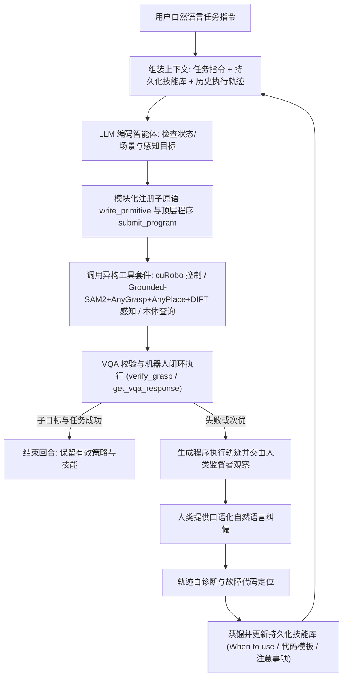
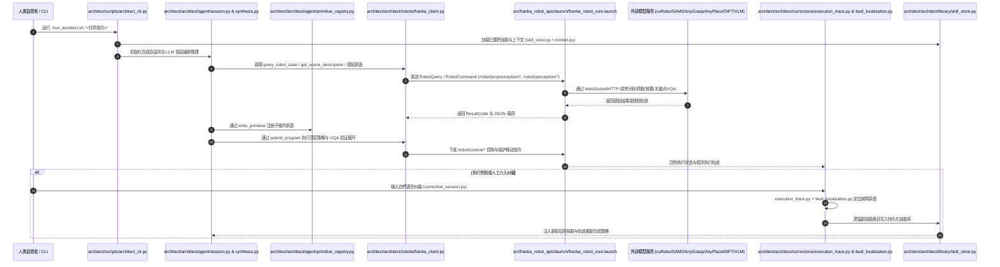

# A Few Words Go a Long Way: Language Guided Robot Policy Synthesis

## 一句话定义

ARCHITECT（Agentic Robot Code with Human In ThE loop CorrecTions）是一个无需机器人演示数据或策略微调的交互式程序合成框架：它由大模型编程智能体组合底层感知与控制工具生成模块化机器人策略代码，并借助基于执行轨迹的人类自然语言纠偏与持久化技能库，实现失败局部修复与跨任务经验迁移。

## 英文缩写速查

| 缩写 | 英文全称 | 简要说明 |
|---|---|---|
| ARCHITECT | Agentic Robot Code with Human In ThE loop CorrecTions | 本文框架：人机协同交互式机器人策略程序合成系统 |
| HiTL | Human-in-the-Loop | 人在回路监督，由人类观察失败并以自然语言引导策略修正 |
| VLA | Vision-Language-Action Model | 视觉-语言-动作端到端黑盒策略模型（如 $\pi_0$、$\pi_{0.5}$） |
| VQA | Visual Question Answering | 视觉问答，本系统用于子目标完成度与抓取状态的闭环校验 |
| SR | Success Rate | 回合二元任务成功率，衡量整体任务是否完全达成 |
| GCR | Goal Condition Recall | 目标条件召回率，衡量任务所有目标条件中被满足的比例 |
| NTP | Normalized Task Progression | 归一化任务进度，按有序评测细则衡量的阶段完成比例 |

## 为什么重要

现有主流视觉-语言-动作模型（VLA）虽具备一定零样本泛化能力，但本质上是难以解释的黑盒策略：一旦遭遇物体更换、场景微调或指令措辞变化，微小的偏差便会级联放大；若要修复单一行为错误，即便是参数高效微调 7B 规模 VLA 往往也需准备约上千条专家演示并耗费数小时 GPU 训练，普通用户几乎无法在部署现场用几句话“纠偏”策略。

另一条模块化路线（如 Code as Policies、ProgPrompt）虽将高层推理与底层控制解耦，却受困于**规范缺口（specification gap）**：初始自然语言指令很难一次性写全几何接触、高度余量或防滑力度等物理细节；一旦生成代码执行失败，开环合成范式既无法精确定位故障，也无法跨会话保留修正经验。ARCHITECT 证明：把策略学习转化为“编程智能体 + 人类自然语言纠偏 + 持久化技能库”，可以在**零演示数据、零模型微调**的前提下，在多步推理、可动关节物体与柔性布料操作上显著超越代表性 VLA 与既有代码合成方法，并随着技能库累积使后续新任务所需的人类纠偏次数大幅下降。

## 核心信息

| 维度 | 内容 |
|---|---|
| 作者 | Daphne Chen, Archit Ritesh Jain, Eric Goossen, Emma Romig, Michael Murray, Nick Walker, Maya Cakmak |
| 机构 | 华盛顿大学（University of Washington）、微软研究院（Microsoft Research）、麻省理工学院（MIT） |
| 发表时间 | arXiv:2607.23784v1（提交于 2026-07-26） |
| 论文链接 | [arXiv:2607.23784](https://arxiv.org/abs/2607.23784) / [HTML 全文](https://arxiv.org/html/2607.23784) |
| 项目与代码 | [官方项目页](https://robo-architect.github.io/) / [官方仓库 `robo-architect/architect-franka`](https://github.com/robo-architect/architect-franka)（MIT） |
| 清单分类 | harness.skills |
| 来源条目 | `survey_ax_2607_23784` |
| 开源状态 | 已开源（智能体程序合成框架 `architect/` 与 Franka Panda ROS 1 Noetic 工具服务栈 `src/franka_robot_apis/` 已公开；cuRobo、Grounded-SAM2、AnyGrasp、AnyPlace、DIFT 与 VLM 等外部模型推理服务需独立部署并按端口接入） |

## 核心原理

ARCHITECT 的核心思想是把机器人策略视作由大模型编程智能体编写和迭代的模块化程序，由三个关键部分协同运作：

### 1. 智能体式分层程序合成与工具调用规范

在实验设定中，编排智能体（Claude Opus 4.6）仅以一条自然语言任务指令作为起点，遵循提示词规定的四步工作流合成可执行 Python 策略（见论文 Appendix F）：

1. **能力自检：** 调用 `list_primitives()` 获取可用机器人 API 与当前会话已注册原语。
2. **状态与场景锚定：** 调用 `query_robot_state()` 与 `get_scene_description()` 获取机器人本体状态与 VQA 场景描述，并预先调用对应感知原语——明确要求仅对**待抓取物体**调用 `detect_objects()`，对**放置容器/表面**调用 `get_placement_pose(base_text_prompt, target_text_prompt)`，避免把容器误识别为抓取目标。
3. **模块化子原语封装：** 通过 `write_primitive(name, code, docstring)` 把多步子操作封装成带文档字符串的独立原语（禁止将低层 API 扁平堆砌在主程序中，亦禁止使用未定义符号或外部 `import`）。
4. **可校验顶层提交：** 调用 `submit_program(code)` 提交简洁的顶层原语调用序列，并默认对本体感觉无法直接观测的子任务（如抓取、放置、开关柜门/抽屉）使用基于 `get_vqa_response()` 的**“执行—VQA 判定—调参重试”**闭环模式。

### 2. 异构工具套件（Control / Perception / Proprioception）

系统底层暴露了 18 个通用且按自然语言参数化的原语（见论文 Appendix H Tables 4–6），使语言层纠偏可以直接映射为几何与力控参数修正：

- **控制工具（7 个）：**
  - `move_ee_to_pose()` / `move_ee_to_rel_pose()`：基于 cuRobo WebSocket 规划的绝对/末端系相对位姿运动，支持可选单轴/多轴力接触保护（`guard`、`force_threshold`、`guard_axes`）与碰撞反射自动恢复；
  - `move_ee_guarded()`：沿末端坐标系单轴的接触感知受保护移动，检测到力阈值后立即取消轨迹并冻结平衡位姿；
  - `execute_waypoints()`：按阶段顺序执行带开合爪动作的末端路径点序列；
  - `set_gripper_width()`（Robotiq 2F-85 0–0.085 m 行程与速度/力控）、`rotate_wrist()`（绕工具 Z 轴旋转）、`reset_robot()`（规划回零并张开夹爪）。
- **感知工具（8 个）：**
  - `detect_objects()`（串联 Grounded SAM2 开放词汇分割与 AnyGrasp 抓取采样，经 TF 变换输出最高分抓取位姿）与解耦的 `get_object_mask()` + `get_grasp_config()`；
  - `get_placement_pose()`（基于 AnyPlace 与点云构建预测目标相对支撑面的放置位姿）；
  - `get_keypoints()`（DIFT 扩散特征提取 3D 语义关键点）与 `get_keypoints_trajectory()`（基于 ReKep 在 DIFT 关键点上生成分阶段路径点序列）；
  - `get_vqa_response()`（论文表 5 采用 GPT-5.4；开源配置亦支持本地 Qwen VLM 或 OpenAI/Azure OpenAI）与 `verify_grasp()`（先做夹爪开度本体门控，再结合腕部相机 VLM 二次确认物体是否在爪中）。
- **本体感觉工具（3 个）：** `get_current_ee_pose()`（读取 `FrankaState` 的 `O_T_EE`）、`get_current_joints()`（7 关节位置/速度/力矩）与 `get_gripper_width()`。

### 3. 执行轨迹诊断与持久化技能库（Skill Library）

与“用完即丢”的单次提示修正不同，ARCHITECT 通过两重机制沉淀人类经验：

- **执行轨迹故障定位：** 每次策略运行都会生成包含原语调用、参数与返回状态的**程序执行轨迹（execution trace）**。当任务失败或回合结束，人类监督者无需阅读代码，只需给出自然语言反馈（如“抓住杯子边缘再往左一点”或“继续下移直到意面盒接触书架再松爪”）。智能体将人类纠偏与执行轨迹对照，精确定位导致失败的代码行或工具调用参数并局部重写程序。
- **技能蒸馏与长期上下文复用：** 有效的纠偏会被提炼为一条结构化技能（包含 `When to use` 适用条件、`How` 代码模板与 `What to watch for` 避坑规则），写入持久化技能库。以论文 Appendix G 中的 `Guarded Place on Surface` 技能为例，针对“悬空松爪导致物体跌落”的口头纠偏被蒸馏为“先 `move_ee_to_pose` 至近似放置点 → 再 `move_ee_guarded(axis="z", distance=-0.25, force_threshold=5.0)` 探触支撑面 → 再 `set_gripper_width(0.085)` 释放并抬升撤离”的通用代码模式。此后每次新任务生成代码前，技能库中的全部技能都会与新任务指令一同加载进智能体上下文，作为一种长期上下文学习（long-term in-context learning）避免重犯同类错误。

## 流程总览

## 源码运行时序图

在官方仓库 `robo-architect/architect-franka` 中，运行时由两条协同进程链路构成：一端通过 `src/franka_robot_apis/launch/franka_robot_core.launch` 启动 Franka 笛卡尔阻抗控制器、Robotiq 夹爪、相机流及 `/robot/*` JSON-over-ROS 服务节点；另一端由 `architect/run_architect.sh` 拉起 `architect/scripts/architect_cli.py`，通过 `Session` / `Synthesis` 与 ROS 客户端闭环执行并在失败时进入 `CorrectionSession` 与 `SkillStore` 更新循环。

## 实验与评测

论文在真实世界 Franka Panda 机械臂（采用 DROID 硬件配置：Robotiq 2F-85 夹爪、腕部 ZED-mini 相机与场景 ZED 2i 相机，搭配 Claude Opus 4.6 与 cuRobo）上开展真机基准评测、人工被试内研究与语言扰动消融。

### 1. 8 项真机操作基准评测（Tables 1 & 2，每任务 $N=10$ 回合）

对比方法涵盖单发/开环代码合成（Code as Policies、ProgPrompt）、闭环语言规划（Inner Monologue）、主流 VLA 模型（$\pi_0$、$\pi_{0.5}$、MolmoAct2、GR00T N1.7）以及用 VLM 自动纠偏替代人类纠偏的消融版 `ARCHITECT-VLM`。`ARCHITECT-HiTL` 在每个任务上最多进行 5 次带单条人类专家纠偏的预演后，使用最终合成策略评测 10 个位置/朝向和指令措辞扰动回合：

| 任务（挑战类别） | CaP (SR/GCR/NTP) | Inner Monologue | ProgPrompt | MolmoAct2 | GR00T N1.7 | $\pi_0$ | $\pi_{0.5}$ | ARCHITECT-VLM | ARCHITECT-HiTL（本文） |
|---|---|---|---|---|---|---|---|---|---|
| Banana → plate（Pick-Place） | .20 / .52 / .52 | .50 / .90 / .90 | .80 / .92 / .92 | .80 / .92 / .92 | .40 / .64 / .64 | .80 / .90 / .90 | **.90** / .98 / .98 | .80 / .88 / .88 | .80 / .96 / .96 |
| Block → basket（Pick-Place） | .40 / .52 / .52 | .50 / .76 / .76 | .60 / .68 / .68 | .30 / .64 / .64 | .00 / .20 / .20 | .40 / .44 / .44 | **1.0** / 1.0 / 1.0 | .70 / .80 / .80 | .70 / .82 / .82 |
| Baseball → bucket（Pick-Place 低摩擦球体） | .60 / .66 / .66 | .50 / .84 / .84 | .60 / .64 / .64 | .00 / .34 / .34 | .00 / .10 / .10 | .00 / .16 / .16 | .20 / .50 / .50 | .40 / .62 / .62 | **1.0** / 1.0 / 1.0 |
| Apple, Bread → bowl（Multi Pick-Place） | .10 / .59 / .47 | .30 / .51 / .49 | .10 / .43 / .38 | .10 / .43 / .43 | .00 / .05 / .05 | .40 / .64 / .64 | .40 / .65 / .65 | .00 / .49 / .39 | **.80** / .88 / .88 |
| Pick bread from box（Clutter 杂乱容器） | .10 / .38 / .38 | .00 / .00 / .00 | .10 / .34 / .34 | .20 / .32 / .32 | .00 / .06 / .06 | .40 / .40 / .40 | .40 / .44 / .44 | .00 / .24 / .24 | **.70** / .78 / .78 |
| Close drawer（Articulated 铰接抽屉） | .00 / .00 / .00 | .00 / .00 / .00 | .00 / .00 / .00 | .00 / .00 / .00 | .00 / .00 / .00 | .10 / .23 / .23 | .00 / .17 / .17 | .40 / .60 / .60 | **.90** / .90 / .90 |
| Fold cloth into triangle（Deformable 柔性布料） | .00 / .00 / .00 | .00 / .00 / .00 | .00 / .00 / .00 | .00 / .08 / .08 | .00 / .00 / .00 | .00 / .40 / .40 | .00 / .04 / .04 | .70 / .62 / .62 | **.80** / .95 / .95 |
| Banana under cloth（Long Horizon 遮挡长程） | .00 / .40 / .40 | .00 / .30 / .30 | .00 / .15 / .14 | .00 / .47 / .47 | .00 / .24 / .22 | .10 / .36 / .36 | .00 / .19 / .19 | .00 / .60 / .60 | **.80** / .80 / .60 |

核心观测：
- 在简单抓取放置上，VLA 基线与程序合成各自有优势项，但一旦进入**多目标序列、杂乱遮挡、铰接体、柔性布料与先揭布后取果的长程任务**，全部 VLA 基线（除 $\pi_0$ 在抽屉和布下取蕉各拿 `.10` 外）和传统代码合成基线成功率几乎归零，而 `ARCHITECT-HiTL` 在 5 项复杂任务上稳定维持 `0.70–0.90` 的成功率（项目页展示 8 任务总体平均成功率为 `80%`）。
- 与 `ARCHITECT-VLM` 对比可见：对于深度/高度偏差（如放置释放过高）或物理接触直觉（如“慢速合爪防止棒球打滑”），仅靠像素观测的自动 VLM 往往无法准确归因，人类在回路纠偏在多目标（`0.80` vs `0.00`）、杂乱场景（`0.70` vs `0.00`）与长程遮挡任务（`0.80` vs `0.00`）上不可替代。

### 2. 人工评测与跨任务迁移（$N=6$ 被试内实验，Sections 5.2–5.5 & Appendix D）

被试依次完成两个结构相似但物体和场景不同的任务：**Task 1**（将杯子正立放到桌面上）与 **Task 2**（将意面盒正立放到货架上），通过开关纠偏环与技能库验证迁移与工作量摊销：

- **人力纠偏摊销：** 将 Task 1 积累的技能库载入 Task 2 后，单回合平均人类纠偏次数从空库时的 `4.67` 次下降至 `0.83` 次（$\Delta = 3.83$，$p = 0.036$；项目页统计降幅达 `82%`），其中 `3/6` 的参与者实现了零纠偏一次通过。
- **零样本跨场景迁移（关闭试验期人工纠偏）：** 未加载技能库时，Task 2 成功率为 `0/6`；加载 Task 1 技能库后，Task 2 零样本成功率提升至 `4/6`（项目页标示 `0% -> 67%`）。且迁移效果与前序任务的纠偏密度正相关：在 Task 1 仅给出 1 条纠偏的 3 名被试中有 2 人迁移失败，而给出 2 条及以上纠偏的 3 名被试全部成功。
- **非专家自然语言可用性：** 非专业被试使用诸如 `"grasp the cup a little bit more to the left"` 或 `"keep moving down until the pasta box is touching the shelf"` 等零术语日常表达即可成功驱动代码与技能更新。

### 3. 指令语言扰动消融（Appendix B Table 3，`Apple -> pan`）

固定物体位姿，测试 15 种语言扰动（同义改写、被动语态、语序颠倒、模糊指代、极短/中等/冗长文本、拼写错误、欠指定与过度指定）：
- `ARCHITECT` 在 **13/15** 种变体上保持 `SR = 1.00`，仅在超长冗长描述（`SR = 0.00`，`GCR/NTP = 0.80`）和未给出放置目标的欠指定指令 `"Move the apple."`（`SR = 0.00`，`GCR/NTP = 0.60`）上未能完全达成。
- 最强 VLA 基线 $\pi_{0.5}$ 仅在 **6/15** 种变体上成功，在部分同义改写、语序调整、模糊指代、中等长度、拼写错字、欠指定与过度指定下均跌至 `0.00`（常见表现为机械臂无目的随机运动）。

## 与其他工作对比

| 对比维度 | 端到端 VLA（$\pi_0$ / $\pi_{0.5}$ / MolmoAct2 / GR00T N1.7） | 单发代码合成（Code as Policies / ProgPrompt） | 自动闭环重规划（Inner Monologue / CaP-x） | ARCHITECT（本文） |
|---|---|---|---|---|
| 机器人训练数据需求 | 需大规模预训练或任务微调演示 | 零机器人训练数据 | 零机器人训练数据 | 零机器人训练数据 |
| 失败可诊断性与局部修正 | 黑盒权重难以隔离局部错误 | 开环生成，缺执行期代码级归因 | 依赖固定技能库或重试，多轮探索开销高 | 结合执行轨迹将人工语言反馈直接定位于失败语句/原语 |
| 人类纠偏方式 | 几乎只能重新采集演示并微调 | 手工改提示词或直接改代码 | 文本问答消歧，不改写持久化代码 | 非专家口语纠偏直接改写模块化代码 |
| 跨任务经验复用 | 无在线上下文积累，换任务需新数据 | 每次从头合成，不保留历史纠偏 | 无跨任务持久化技能蒸馏 | 将纠偏蒸馏为持久化技能库，实现跨场景/物体迁移 |
| 复杂长程与语言扰动表现 | 对提示词、物体类型与长程清理较敏感 | 简单抓取尚可，复杂/遮挡任务几乎失效 | 复杂铰接与柔性布料任务 `SR = 0.00` | 8 项复杂真机基准领先，13/15 语言扰动稳健 |

## 结论

**一句话总判：ARCHITECT 证明了用“大模型编程智能体 + 模块化工具库 + 基于执行轨迹的稀疏人类语言纠偏 + 持久化技能库”替代端到端黑盒微调，是通向可纠偏、可解释、跨任务摊销人力成本的通用操作策略的一条高效路径。**

1. **交互式闭环合成比一次生成更符合物理现实：** 初始自然语言天然存在“规范缺口”，Code as Policies 等开环方案在多目标、抽屉和布料任务上几乎全败，而结合执行轨迹和人类稀疏纠偏的闭环程序合成即可将成功率拉升至 `0.70–0.90`。
2. **人类纠偏解决像素盲区，不可轻易被纯 VLM 替代：** 当涉及深度误差导致的悬空释放或防滑力度等物理直觉时，`ARCHITECT-VLM` 在多目标和杂乱场景跌至 `0.00`，而人类一句日常提示即可精准修复并固化为 `move_ee_guarded` 等安全模式。
3. **技能库让“人工监督”从一次性消耗变为可复用资产：** Task 1 到 Task 2 的实验显示，持久化技能库能把平均纠偏查询从 `4.67` 压低至 `0.83`（$p=0.036$），且前序纠偏覆盖越充分（$\ge 2$ 条），后续零样本迁移越稳健。
4. **模块化设计天然带来抗指令扰动能力：** 当 $\pi_{0.5}$ 在 9/15 种语言扰动下失效时，基于大语言模型编排与标准工具接口的 ARCHITECT 在 13/15 种变体上保持 `1.00` 成功率。

## 工程实践

- **服务拆分部署与接口契约：** 仓库将智能体推理（`architect/`）与真机控制（`src/franka_robot_apis/`）彻底解耦。真机侧基于 ROS 1 Noetic（或 RoboStack Ubuntu 20.04 环境，Python 3.9 + `numpy==1.26.4`）暴露统一的 `RobotCommand` / `RobotQuery` JSON 服务；重计算的 cuRobo（默认端口 `8765`）、VLM（`8000`）、Grounded-SAM2（`8766`）、AnyGrasp（`8767`）、AnyPlace（`8768`）和 DIFT（`8769`）须作为独立 WebSocket/HTTP 模型服务部署并在 `src/franka_robot_apis/config/servers.yaml` 配置。
- **VQA 校验与力保护原语的工程优先级：** 系统提示词与预置文档（`architect/skills/franka/verification.md` 等）强制要求把多步逻辑封装为命名原语，并在抓取、放置与铰接操作后插入 `verify_grasp()` 或 `get_vqa_response()` 检查；涉及高度不确定的放置任务时，优先采用 `move_ee_to_pose` + `move_ee_guarded(axis="z", force_threshold=5.0)` 替代开环固定坐标释放。
- **技能库积累策略：** 从人工评测结果看，若前序任务仅靠偶然成功而只产生 0–1 条纠偏，技能库难以为新任务提供足够的安全边界覆盖；工程中应在代表性边缘失败场景主动注入高质量纠偏，配合 `architect/probes/` 下的探测与毕业机制巩固技能。

## 局限与风险

- **受限于底层工具模块的感知与规划上限：** 论文 Section 6 与 Appendix E 明确指出，系统的首要失败模式来自现有抓取生成器（AnyGrasp）对特定几何/材质物体的抓取采样失误；其次是深度估计误差导致放置悬空，以及 cuRobo 在紧凑约束下无法求得无碰撞轨迹。换言之，高层代码编排无法凭空弥补底层感知/控制原语的物理能力盲区。
- **技能库质量强依赖先前纠偏的覆盖密度：** 在人类评测中，有 2 名仅在 Task 1 提供过 1 条纠偏的参与者未能零样本迁移到 Task 2；此外，当技能库随长期运行不断膨胀时，全量注入上下文对上下文窗口长度与相关性检索（`architect/library/relevance.py`）的依赖也会上升。
- **实时高频反应控制受限于大模型与多跳服务延迟：** 编排依赖大型编码模型推理与多跳外部模型服务（WebSocket/HTTP + VLM），更适合准静态或阶段化离散原语组合任务，不适用于需要数百赫兹连续力反馈或高速动态接抛的实时闭环任务。
- **复现外部服务栈门槛：** 虽然仓库已以 MIT 协议公开客户端与 ROS 工具层，但 `libfranka 0.8.0` 需单独编译，且 6 个外部视觉/规划模型服务端（cuRobo、AnyGrasp、AnyPlace 等）需用户自行搭建，未包含一键容器化权重包。

## 关联页面

- [Agentic Robots 综述](paper-towards-agentic-robots-survey.md)
- [全量项目节点清单](../overview/awesome-agentic-robots-node-index.md)
- [VLA 方法背景](../methods/vla.md)
- [机器人策略学习流程](../methods/robot-policy-learning.md)：了解任务、训练信号与策略评估。
- [智能体式操作策略](../methods/agentic-manipulation-policies.md)：理解大模型编排操作原语的范式位置。
- [智能体工具调用接口](../methods/agent-tool-use-interface.md)：对照标准化感知/控制工具接口设计。
- [智能体技能封装](../methods/agent-skill-packaging.md)：对比可复用技能文档与持久化技能库机制。
- [编码智能体验证闭环](../methods/coding-agent-verification-loops.md)：理解基于执行轨迹与校验信号的迭代代码修正。
- [机器人智能体调度框架（Robot Agent Harness）](../methods/robot-agent-harness.md)：对照智能体宿主与真机服务总线分层。
- [抓取位姿估计](../methods/grasp-pose-estimation.md)：了解 ARCHITECT 底层依赖的 AnyGrasp 等抓取模块边界。
- [机器人操作任务（Manipulation）](../tasks/manipulation.md)：了解多步、铰接体与柔性体操作挑战。

## 推荐继续阅读

- [ARCHITECT 官方项目主页（含 8 任务同步对比视频）](https://robo-architect.github.io/)
- [论文全文（arXiv:2607.23784 HTML）](https://arxiv.org/html/2607.23784)
- [官方开源代码仓库 `robo-architect/architect-franka`](https://github.com/robo-architect/architect-franka)

## 参考来源

- [论文原文核对归档](../../sources/papers/paper-agentic-2607-23784.md)
- [官方代码仓库静态核对归档](../../sources/repos/paper-agentic-2607-23784.md)
- [官方 Awesome 快照归档](../../sources/repos/awesome-agentic-robots-survey-index.md)
- [arXiv:2607.23784](https://arxiv.org/abs/2607.23784)
- [项目主页 https://robo-architect.github.io/](https://robo-architect.github.io/)
- [GitHub 仓库 robo-architect/architect-franka](https://github.com/robo-architect/architect-franka)
