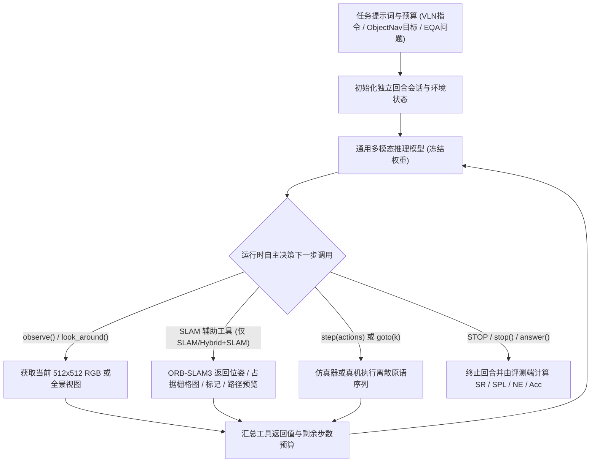
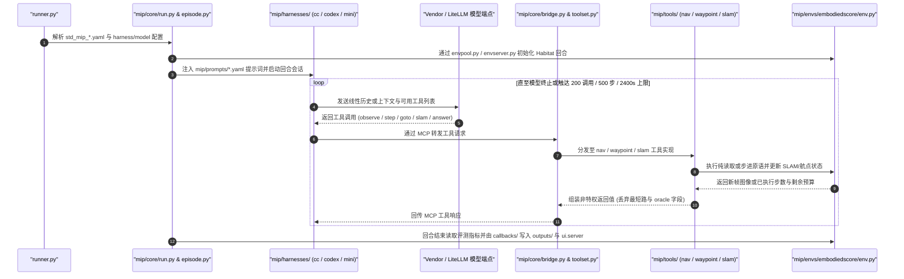

# Embodied Agents Take Control: Minimal-Interface Zero-Shot Agents Rival Industrial-Scale Policies in Vision-and-Language Navigation

## 一句话定义

**MIP（Minimal-Interface Probe）是一种将导航控制循环交还给通用多模态大模型的零样本智能体具身控制框架，仅通过单目 RGB `observe()` 与离散底层动作 `step(actions)` 的极简 MCP 接口，即可让冻结通用模型在无导航微调、无地图与航点器的条件下与大规模专用策略竞争。**

## 英文缩写速查

| 缩写 | 英文全称 | 简要说明 |
|------|----------|----------|
| MIP | Minimal-Interface Probe | 本文构建的极简接口零样本具身控制探针与开源评测框架 |
| VLN-CE | Vision-and-Language Navigation in Continuous Environments | 连续三维仿真环境下的视觉语言导航任务设定 |
| MCP | Model Context Protocol | 连接大模型智能体脚手架与仿真/工具后端的标准化工具协议 |
| SR / $\text{SR}_{\text{vis}}$ | Success Rate / Visibility-Adjusted Success Rate | 导航成功率，以及补充计入停止前最后三帧可见目标的可见性校正成功率 |
| SPL / NE | Success weighted by Path Length / Navigation Error | 按路径长度加权的成功率与终点测地线误差 |
| AutoEA | Autonomous Embodied Agent | 本文附录提出的具备跨任务持久化状态与无重置持续服务能力的自主具身智能体概念 |

## 为什么重要

在视觉语言导航（VLN）与具身问答（EQA）中，传统做法通常将交互结构固化在模型外部：要么训练端到端具身策略（如 NaVid、StreamVLN、Qwen-RobotNav）在固定「观测—动作」周期内被动吐出动作；要么将冻结视觉语言模型（VLM）嵌入人工编写的多阶段工作流（如 MapGPT、SmartWay、O2C-Nav）或固定速率的双脑交接流水线（如 ABot-N1、InternVLA-N1）。这些外部约束限制了高阶多模态模型主动核查信息、回退重规划和自主决定何时停止的能力。

本文系统验证了 **Agentic Embodied Control（智能体具身控制）** 范式的上限：当把循环控制权交回模型自身，即便仅暴露最朴素的前向单目相机和步进原语，前沿多模态模型在六项基准 100 回合子集上的表现不仅全面超过所比较的已发表专用系统与固定工作流，还在多个任务上接近或超过人类测试者；同时通过真机四足部署揭示了物理本体感知与闭环状态维护的真实短板。

## 核心信息

| 字段 | 内容 |
|------|------|
| 作者 | Jian Zhou*、Xunyi Zhao*、Gengze Zhou、Zerui Li、Sihao Lin、Jiajun Liu、Qi Wu（*同等贡献） |
| 机构 | 原文 arXiv HTML 与项目页未展开作者上标 `1–4` 对应的机构名称 |
| 发表时间 | 2026-07-28（arXiv v1），2026-10-17（arXiv v4） |
| 论文链接 | [arXiv:2607.26148](https://arxiv.org/abs/2607.26148) / [HTML v4](https://arxiv.org/html/2607.26148) |
| 项目与代码 | [项目主页与排行榜](https://jianzhou0420.github.io/mip/) / [jianzhou0420/MIP](https://github.com/jianzhou0420/MIP)（MIT License） |
| 清单分类 | `model.robot_control` |
| 来源条目 | `survey_ax_2607_26148` |
| 开源状态 | **已开源**仿真评测框架、三类脚手架适配、五套 MCP 工具臂、配置与 100 回合子集清单；配套仿真环境包 [EmbodiedScore-envs](https://github.com/jianzhou0420/EmbodiedScore-envs)；真机 Unitree Go2 控制端代码未见于当前公开仓 |

## 核心原理

MIP 的核心设计是剥离人工导航流水线，让通用多模态推理模型在运行时直接决定交互结构，并借助控制实验拆解工具与脚手架的独立贡献：

1. **极简感知—动作接口（Minimal Interface，§3.1, Appendix F.2）：**
   - 在连续视觉语言导航（R2R-CE、RxR-CE）中，模型通过 MCP 仅获得两个工具：`observe()` 返回单张 $512 \times 512$ 前向单目 RGB 图像（HFOV $90^\circ$，纯读取不消耗步数）；`step(actions)` 按顺序执行至多 50 个离散原语（`0 = STOP` 永久结束回合、`1 = 前进 0.25 m`、`2/3 = 左/右转 15°`），但**只返回已执行步数与剩余步数预算，不返回图像、位姿、深度或碰撞信号**，迫使模型自主决定何时再次调用 `observe()` 核实运动效果。
   - 在目标导航（HM3D/MP3D ObjectNav）中追加俯仰动作 `4/5`（抬头/低头 $30^\circ$，限幅 $\pm 60^\circ$）；在具身问答（HM-EQA）中将转向调整为 $30^\circ$、移除 `STOP` 并新增 `answer("A"|"B"|"C"|"D")` 作为唯一终止工具。
   - 全程使用统一、简短的冻结系统提示词，每回合最高 200 次模型调用、500 步 Habitat 仿真步数预算与 2400 s 超时限制，每回合为独立全新会话。
2. **可选工具臂与空间支持（§3.2, Appendix F.8–F.9）：**
   - **Waypoint 臂：** 接入来自 SmartWay 的深度驱动航点预测器，将接口替换为全景四视角条带 `observe()`（带编号绿色候选圆圈及方向/距离 JSON）、`goto(k)`（最多 30 次）与 `stop()`。
   - **Hybrid 臂：** 在保留 `observe()` 与 `step(actions)` 原语的同时，额外提供可选的 `observe_waypoints()`、`goto(k)` 与 `stop()`，由模型自主权衡走航点还是微调步进。
   - **SLAM 与 Hybrid + SLAM 臂：** 基于 RGB-D 观测运行 ORB-SLAM3 后端（不使用真值位姿或真值地图），向模型开放六项零步数开销工具：`get_pose()`、`get_map()`（含跨楼层 `floor` 与局部放大 `zoom` 渲染）、`get_trajectory()`、`look_around()`（原地四向环视拼接）、`mark(label)`（在地图打橙色语义标记）与 `preview_path(x, z)`（只读路径预览）。
3. **控制权 × 能力来源二维分类法（Appendix E）：**
   - 论文将导航系统按 **控制权（Control Authority）** 划分为 `Embodied policy`（单模型直接映射动作，如 NaVid、StreamVLN）、`Workflow`（人工编排固定顺序或固定速率慢-快双系统，如 MapGPT、SmartWay、O2C-Nav、ABot-N1、InternVLA-N1/DualVLN）与 `Agentic`（模型动态控制循环分支、工具序列与停止时机，如 NavGPT、AgenticNav 与 MIP），并与 **能力来源（Capability Source：`Trained` vs `Zero-shot`）** 正交解耦。判别 `Agentic` 的关键测试是**动态控制流**而非仅填充不同子目标内容。
4. **回合制智能体与自主具身智能体（AutoEA）的界限（Appendix D）：**
   - 作者界定 MIP 属于回合制（episodic）智能体控制探针，距离真正长期在家庭环境运行的 AutoEA 仍缺五项系统能力：连续多任务无重置服务、跨任务持久化情景状态、闭环执行监控与自恢复、延迟/上下文/电量有界自维护、以及安全适配与选择性求助。

## 流程总览

## 源码运行时序图

以下时序图依据官方仓库 [jianzhou0420/MIP](https://github.com/jianzhou0420/MIP) 的 `runner.py`、`mip/core/`、`mip/harnesses/`、`mip/tools/` 与 `mip/envs/embodiedscore/` 静态梳理（未在本地启动仿真环境或调用外部模型 API）。复现入口为 `python runner.py std_mip_<benchmark>_<interface> harness=<cc|codex|mini> model=<name>`（各论文表格命令汇总于 `scripts/mip_paper_cells.sh`），主循环由 `mip/core/run.py` 调度脚手架进程并通过 MCP 桥接 `mip/core/bridge.py` 驱动 `EmbodiedScore-envs` 仿真服务。

## 实验与评测

论文在 6 个基准的固定 **100 回合验证子集**（R2R-CE 使用 OpenNav `rand100`；RxR-CE 英文 `val_unseen`、HM3D v1/v2、MP3D 与 HM-EQA 使用按场景分层及 SHA-256 哈希确定的 `mip100`）上评测 14 个前沿多模态模型（§1 写作 13 个，摘要与 Table 1 实测 14 个；消融与成本表另包含小参数与早代对照模型）：

1. **Minimal 接口主结果（Table 1，均使用厂商默认推理强度）：**
   - **R2R-CE（`rand100`，3 次重复均值 ± 标准差）：** `fable-5.1` 达 **83.0 ± 1.7** SR、`opus-5.5` 达 **82.3 ± 3.5** SR、`gpt-6-astra` 达 **75.7 ± 4.7** SR、`gpt-6.1-sol` 达 **75.0 ± 1.0** SR（人类测试者 94 SR）。
   - **RxR-CE（`mip100`）：** `gpt-6-astra` 达 **89** SR、`gpt-6.1-sol` 达 **83** SR、`fable-5.1` 达 **79** SR（人类测试者 83 SR）。
   - **ObjectNav（`mip100`，1 m 阈值 SR / 可见性校正 $\text{SR}_{\text{vis}}$）：** HM3D v1 上 `gpt-6-astra` **81 / 94**、`opus-5.5` **80 / 92**（人类 85 / 97）；HM3D v2 上 `gpt-6-astra` **91 / 95**、`gpt-6.1-sol` **89 / 96**、`opus-5.5` **88 / 92**（人类 89 / 93）；MP3D 上 `opus-5.5` **69 / 88**、`gpt-6-astra` **66 / 89**（人类 71 / 85）。
   - **HM-EQA（`mip100`，准确率 Acc）：** `opus-5.5` 达 **81.0%**、`gpt-6-astra` **80.0%**、`fable-5.1` / `gpt-6.1-sol` / `gpt-6-sol` **79.0%**（人类 87%）。
2. **航点工具与 SLAM 组合消融（Table 2–3，R2R-CE）：**
   - **强制 Waypoint 仅利好弱模型：** `qwen3.5-4b` 由 5 跃升至 43 SR（+38）、`qwen3.5-9b` 由 7 升至 44 SR（+37）、`gpt-5.5` 由 46.0 升至 67 SR；但强模型几乎停滞或微降（`opus-5.5` 82.3 → 83.7、`fable-5.1` 83.0 → 81）。
   - **可选 Hybrid + SLAM 在强模型上取得最高成绩：** 将 `Waypoint` 改为与原语并存的 `Hybrid` 后，`opus-5.5` 3 次均值升至 **85.7 ± 1.5** SR（SPL 75.32、NE 2.65 m），且调用次数、墙钟时间与费用分别降至 Minimal 的 **0.59×**、**0.62×**、**0.88×**；叠加 `SLAM` 后，`Hybrid + SLAM` 将 `opus-5.5` 进一步推升至 **88.0 ± 1.0** SR（SPL 75.38、NE 2.09 m、OSR 91.7%，耗时 0.96×、费用 1.05×），`fable-5.1` 升至 **86** SR、`opus-5` 升至 **80** SR、`fable-5` 升至 **78** SR。相比之下，较弱的 `haiku-5.5` 仍以 `Waypoint`（59 SR）最高。
3. **运行开销与推理强度（§4.4, Table 12–13）：**
   - R2R-CE Minimal 平均每回合开销：`opus-5.5` 为 34 轮调用（中位数 25 轮）、墙钟 108 s（中位数 66 s）、$0.21（中位数 $0.14），较前代 `opus-5`（332 s、$1.27）大幅下降；`gpt-6-astra` 28 轮 / 193 s / $0.90；`gpt-6.1-sol` 30 轮 / 141 s / $0.14；`haiku-5.5` 仅 $0.01（49.0 SR）。DashScope 接口高延迟（11–19 s/turn）导致 14–23% 的 Qwen 回合触及 2400 s 超时。
   - 提升推理强度（Claude `max` / Codex `xhigh`）在 Claude 与 Codex 脚手架上有正收益（如 `fable-5` 68.3 → 78 SR、`gpt-5.6` 56 → 62 SR），但在 `mini-swe-agent` 上略有回落。
4. **失败归因与真机定性试验（§4.5–4.6, Appendix A–C）：**
   - `opus-5.5` 单轮全基准 126 例失败中：ObjectNav 63 例有 **39 例为目标可见但未命中标注实例或标注视角**的假阴性；HM-EQA 19 例中 7 例属于审阅认为可辩护或题面歧义的争议答案。
   - R2R-CE `opus-5.5` 18 例失败全部分析（Table 6–7）显示：100% 由模型主动 `STOP` 结束（无一耗尽 500 步），根因集中于**贪心绑定分支后不回溯**（11/18，7 例错分支 + 4 例失控搜索）与 **`step()` 缺乏位移/碰撞信号**（10/18 出现原地顶撞且连续帧不变）。
   - Unitree Go2 四足真机（`claude-sdk × fable-5`，31 个手工设计探针，Table 8–9）：条件判断（4/4）、汇报（4/4）与递送（1/1）全部完成，但跨视角计数（0/2）、多阶段长程（3/6）和过门（3/6）暴露出**机身尾部长于相机视野的碰撞盲区**、**开环转向实际仅完成约 $11^\circ$ 却回传 $90^\circ$ 已执行**及**视角翻转后参照系丢失**。

## 与其他工作对比

| 系统 | 控制权 / 能力来源 | 典型代表与核心机制 | 在本文基准/同集上的表现与差异 |
|------|-------------------|--------------------|-------------------------------|
| **MIP（本文）** | Agentic / Zero-shot | 极简双工具 MCP 接口（`observe` + `step`），由冻结大模型自主驱动控制流与停止时机 | R2R-CE `rand100` 达 **83.0**（Minimal）与 **88.0**（Hybrid+SLAM），无需导航微调或固定流水线 |
| [AgenticNav](./paper-agentic-2606-10577.md) | Agentic / Zero-shot | 提供轨迹图、显式视觉记忆、度量深度查询与像素接地移动等重型导航工具 | 同在 `rand100` + `GPT-5.5` 下报 **55** SR / 48.41 SPL，本文裸 `mini-swe-agent` `gpt-5.5` 达 **52** SR / 44.24 SPL，表明重型导航脚手架并非唯一前提 |
| **SmartWay / O2C-Nav** | Workflow / Zero-shot | 固定流水线编排航点预测器、VLM 选择与回溯阶段 | 作者在同一 `rand100` 用强模型 `opus-5.5` 复跑仅得 **65** / **69** SR，显著低于 MIP Minimal 的 **82.3** SR；仅对弱模型 `gpt-5.5` 略优（49 / 54 vs 46.0） |
| [ABot-N1](./paper-abot-n1.md) / [InternVLA-N1](./paper-rcl-2512-08186-ground-slow-move-fast-a-dual-system-foundation-m.md) | Workflow / Trained | 慢推理系统输出像素目标/潜规划与快执行专家固定速率交接 | 全量 R2R-CE `val_unseen` 报 **70.9** / **64.3** SR（非严格同集），本文将其判定为固定交接工作流而非运行时自主控制流 |
| [StreamVLN](./paper-rcl-2507-05240-streamvln-streaming-vision-and-language-navigati.md) / [NaVid](./paper-vln-10-navid.md) | Embodied Policy / Trained | 单一视频 VLM 直接从连续帧映射动作或动作块，无外部编排 | 全量 R2R-CE 报 **56.4** / **37.4** SR（非严格同集），停留在外部 rollout 驱动的被动观测—动作循环 |
| **mini-swe-agent vs 厂商 SDK** | 脚手架对比（同为 Agentic） | 数百行开源线性历史 ReAct 循环对比 Claude Agent SDK 与 Codex CLI | 12 个模型在 R2R-CE 差异在 $-8$ 至 $+8$ SR 之间，头部模型几乎持平（`fable-5.1` 84 vs 83.0、`opus-5.5` 80 vs 82.3） |

## 结论

**一句话总判：在具身导航中，真正放大强基础模型能力的往往不是更复杂的固定导航工作流或专用航点模块，而是把控制权交还给模型自身，让其在需要时自主选择观测、工具与停止时机。**

1. **脚手架越轻、模型越强时收益越大：** 当基座达到 `opus-5.5` / `fable-5.1` / `gpt-6-astra` 级别时，强加固定工作流（SmartWay、O2C-Nav）或强制航点动作反而会压低成功率 13–21 个点；用数百行 `mini-swe-agent` 循环即可保留绝大部分表现。
2. **工具应当「可选」而非「强制」：** 航点预测器是弱模型的强拐杖（`qwen3.5-4b` +38 SR），但强模型只有在 `Hybrid`（原语 + 可选航点）并辅以 `SLAM` 地图/标记工具时才能稳定达到最高上限（88.0 SR）。
3. **评测数字需结合接口与标注偏差解读：** ObjectNav 高占比的假阴性（39/63 可见未中框）与 R2R-CE 上无碰撞回传导致的卡死提醒研究者：提升基准分数不能替代对接口反馈和标注完备性的审计。
4. **真机落地卡在「非视觉本体闭环」：** 仿真中的极简接口能验证高层语义规划，但真机（Unitree Go2）要求向模型暴露底盘几何包络、真实里程计/执行确认与跨视角持久化空间状态，否则转向欠驱动和机身尾部碰撞会反复发生。

## 工程实践

- **复现起步与空跑验证：** 参考 `INSTALL.md` 配置运行端与仿真端双 Conda 环境（`habitat-sim 0.3.3` + `EmbodiedScore-envs`），先用 `python runner.py std_mip_r2r_minimal harness=cc model=fable-5 +run.fake=true run.episodes=0` 验证链路连通性（零 token 消耗），再运行 `scripts/mip_paper_cells.sh` 中的实验单元；`Waypoint` / `Hybrid` 需额外启动航点服务，`SLAM` 单元需拉起 `mip/tools/slam/docker/Dockerfile`。
- **关键工程防作弊与对齐细节：** 在 `mip/core/bridge.py` 中会剥离原始观测字典中的最短路径和 oracle 传感器字段，防止模型旁路读取；ObjectNav 需在提示词中明确提醒「相机俯仰角状态跨步持久化，移动前需复位水平」。
- **向真机迁移时的最低接口补丁：** 论文真机经验表明，不应继续使用「只报指令步数、不报真实位姿变化」的 `step()` 设计；至少应补充实际里程计增量、视觉/IMU 堵转检测及有界局部记忆（类似 `mark` 与地图坐标），并在提示词或几何安全层中纳入相机后方机身延伸包络。

## 局限与风险

- **子集规模与非同配对比：** 所有定量结果均在 6 个基准的 100 回合子集（`rand100` / `mip100`）上测得，与文献中全量验证集数字存在样本差异；且各人类基线仅来自单名测试者。
- **零样本边界的不可核查性：** 专有闭源模型是否已在预训练或后训练阶段见过 Habitat / Matterport3D / R2R 等公开基准数据无法验证，论文的「zero-shot」严格指推理阶段不做导航权重微调。
- **部分消融为单次运行且存在混杂因素：** 除主表与 `opus-5.5` 工具臂有 3 次重复外，多项补充对比为单次运行；不同脚手架的上下文缓存策略与 API 稳定性（如 DashScope 超时）也无法完全剥离。
- **真机试验未提供开源控制端与统计样本：** 31 次 Unitree Go2 试验为手工设计的定性探针而非独立同分布基准，且公开代码仓未包含真机驱动代码，属于单回合探测而非连续长程 AutoEA 验证。

## 关联页面

- [Agentic Robots 综述](paper-towards-agentic-robots-survey.md)
- [全量项目节点清单](../overview/awesome-agentic-robots-node-index.md)
- [VLA 方法背景](../methods/vla.md)
- [视觉语言导航](../tasks/vision-language-navigation.md)：了解语言条件导航任务。
- [机器人智能体脚手架（Robot Agent Harness）](../methods/robot-agent-harness.md)：对照极简 ReAct 循环与厂商 SDK 的脚手架设计边界。
- [智能体工具调用接口](../methods/agent-tool-use-interface.md)：理解 MCP 与极简感知—动作原语封装原则。
- [智能体规划与反馈机制](../methods/agent-planning-feedback.md)：分析贪心承诺无回溯与无碰撞反馈导致的闭环退化。
- [零样本目标导航](../tasks/zero-shot-object-navigation.md)：结合 HM3D / MP3D ObjectNav 假阴性现象理解评价指标设计。
- [AgenticNav](./paper-agentic-2606-10577.md)：同属零样本智能体控制范式的重型工具接口对照。
- [ABot-N1](./paper-abot-n1.md) / [InternVLA-N1 / DualVLN](./paper-rcl-2512-08186-ground-slow-move-fast-a-dual-system-foundation-m.md) / [StreamVLN](./paper-rcl-2507-05240-streamvln-streaming-vision-and-language-navigati.md) / [NaVid](./paper-vln-10-navid.md)：本文二维分类法对照的典型 Workflow 与 Embodied Policy 基线。

## 推荐继续阅读

- [论文主页与全模型排行榜（MIP Leaderboard）](https://jianzhou0420.github.io/mip/)
- [官方开源仓库（jianzhou0420/MIP）](https://github.com/jianzhou0420/MIP)
- [配套基准环境包（jianzhou0420/EmbodiedScore-envs）](https://github.com/jianzhou0420/EmbodiedScore-envs)
- [arXiv 原文全文（arXiv:2607.26148v4）](https://arxiv.org/html/2607.26148)

## 参考来源

- [Embodied Agents Take Control 原文核对归档](../../sources/papers/paper-agentic-2607-26148.md)
- [官方 Awesome 快照归档](../../sources/repos/awesome-agentic-robots-survey-index.md)
- [jianzhou0420/MIP 官方代码核查](../../sources/repos/paper-agentic-2607-26148.md)
- [arXiv:2607.26148 摘要页](https://arxiv.org/abs/2607.26148)
- [MIP GitHub 仓库](https://github.com/jianzhou0420/MIP)
