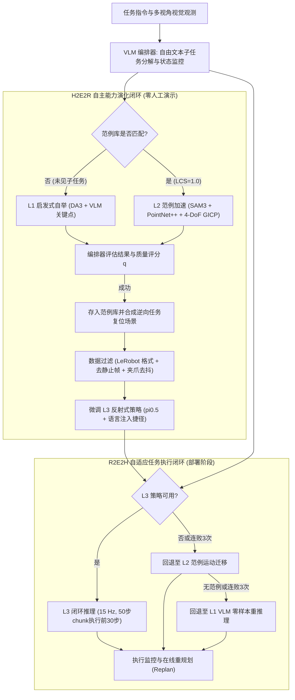

# Practice Makes Policies: Bootstrapping and Consolidating Robotic Capabilities from Zero Human Demonstrations

## 一句话定义

**HERO** 是一种无需初始人工演示的自演化层次化具身智能体框架，它以 VLM 编排器协调 **启发式推理（L1）**、**范例加速复用（L2）** 与 **反射式闭环策略（L3）**，形成“自主积累并蒸馏经验（H2E2R）”与“分层回退自适应执行（R2E2H）”双闭环。

## 英文缩写速查

| 缩写 | 英文全称 | 简要说明 |
|---|---|---|
| HERO | Heuristic Reasoning, Exemplar Reuse, and Reflexive Execution Orchestration | 本文提出的层次化自演化具身智能体编排框架 |
| H2E2R | Heuristic to Exemplar to Reflexive | 从零人工演示自举到范例复用再到策略固化的自主能力演化过程 |
| R2E2H | Reflexive to Exemplar to Heuristic | 部署时优先调用 L3 策略并逐级回退至 L2/L1 的自适应执行过程 |
| VLM | Vision-Language Model | 视觉语言模型，在 HERO 中负责子任务分解、执行状态监控、重规划及 L1 关键点标注 |
| TCP | Tool Center Point | 机器人末端工具中心点，L1 后处理需补偿其与夹爪指尖之间 $0.15\text{ m}$ 的物理偏置 |
| GICP | Generalized Iterative Closest Point | 广义迭代最近点算法，L2 用于精细配准历史范例与当前物体点云 |
| LCS | Longest Common Subsequence | 最长公共子序列，L2 用于计算去停用词后的自然语言子任务指令相似度 |

## 为什么重要

1. **打破“零样本推理延迟高”与“端到端策略强依赖人工遥操作”的二选一困境**：现有基于基础模型的模块化智能体虽能零样本推理但响应慢且不复用历史经验，而端到端 VLA 策略虽能高频闭环控制却依赖大量人工采集演示。HERO 将两者与几何运动迁移连接为同一演化光谱。
2. **用逆向任务合成实现低人工干预的真机自主采集**：在现实世界中自主采集数据常卡在场景复位。HERO 由编排器在任务完成后自动推理并执行逆向复位任务（成功率 84.3%），将平均每子任务人工干预压缩至 **1.03 s**，最长连续完成 **46** 个无人工干预子任务周期。
3. **验证了分层回退架构在真机长时域操作中的互补增益**：单靠 L1、L2 或 L3 的平均任务成功率分别仅 76.0%、66.7% 与 70.0%，而三层联动加上在线重规划将 4 项真机任务平均成功率提升至 **86.0%**。

## 核心信息

| 字段 | 内容 |
|---|---|
| 作者 | Jialiang Li, Yuhan Wang, Haojun Li, Gaojing Zhang, Yangtian Ye, Qipeng Liu, Haotian Liang, Wenzhao Lian |
| 机构 | 上海交通大学（Shanghai Jiao Tong University）；萨塞克斯大学（University of Sussex） |
| 发表时间 | arXiv:2607.26809v1（2026-07-29 提交） |
| 论文链接 | [arXiv:2607.26809](https://arxiv.org/abs/2607.26809) · [HTML 全文](https://arxiv.org/html/2607.26809) |
| 项目与代码 | [项目页（hero-agent.github.io）](https://hero-agent.github.io/) |
| 清单分类 | `model.adaptation` |
| 来源条目 | `survey_ax_2607_26809` |
| 开源状态 | **宣称将开源 / 未列代码仓库链接**（截至 2026-11-27，项目页标注 `Code (Coming Soon)`，尚未公开官方源码仓库；论文训练管线使用第三方 `huggingface/lerobot` 数据格式） |

## 核心原理

HERO 将机器人操作能力划分为 L1–L3 三个执行层，并由基于 `Gemini-3-Flash` 的代理编排器（Orchestrator）统一管理自由文本子任务分解 $\mathcal{P}=\{s_1,s_2,\dots,s_n\}$、步骤状态判定（$\{\text{successful},\text{failed},\text{call\_human}\}$）及动态重规划（每层连续失败最多重试 3 次后触发降级或回退）。

### 1. L1：Heuristic Bootstrapper（零样本启发式自举层）
L1 无需任何人类演示，先利用 3 个外部相机通过 **Depth-Anything-3 (DA3)** 重建 3D 工作空间，再由 VLM 将自然语言子任务映射为两类、共 4 个原语技能并预测 2D 语义关键点：
- **目标导向技能 $\mathcal{G}=\{t_{ee}, R_{ee}\}$**：
  - `Grasp`：VLM 标注夹爪两侧边界点 $p_l, p_r$ 与 x 轴对齐提示点 $p_h$，提升至 3D 点 $P_l, P_r, P_h$ 后按正交基构造目标位姿：
    $$t_{ee}=\frac{P_l+P_r}{2},\quad y_{ee}=\frac{P_r-P_l}{\|P_r-P_l\|},\quad z_{ee}=\frac{(P_h-t_{ee})\times y_{ee}}{\|(P_h-t_{ee})\times y_{ee}\|},\quad x_{ee}=y_{ee}\times z_{ee}$$
  - `Place`：预测单个放置目标点 $t_{ee}$，继承前序操作姿态 $R_{ee}$ 后张开夹爪。
- **路径跟随技能 $\mathcal{T}=\{P_s, P_e, R_{ee}\}$**：
  - `Push`：预测推挤起止点 $P_s, P_e$，使 TCP x 轴与推送方向 $P_e-P_s$ 对齐，并以 $x_{ee}\cdot x_{base}>0$ 做方向消歧避免逆解奇异。
  - `Pull`：预测拉动起止点 $P_s, P_e$，继承抓持阶段末端朝向 $R_{ee}$。
- **几何后处理与安全约束**：① **TCP 偏置补偿**：按腕部 TCP 至指尖距离 $0.15\text{ m}$ 修正 $t^*_{ee}=t_{ee}-0.15z_{ee}$；② **深度歧义校正**：当 Push/Pull 起止点深度差 $>5\text{ cm}$ 时，以可信端点构造交互深度平面并通过射线-平面交点 $P(t)=C+td(u,v)$ 重建另一端点；③ **接近与回撤约束**：执行前按互动方向回退 $d=0.15\text{ m}$ 生成前置点 $p_{\text{pre}}$，跨技能切换时附加 $p_{\text{retract}}$ 避碰。

### 2. L2：Exemplar Accelerator（单样本范例加速层）
L2 基于 **MT3** 思想，直接检索历史成功轨迹并做点云刚体配准，绕过耗时且不稳定的多次 VLM 标注：
- **指令检索与质量评分**：剔除停用词后计算词级有序 LCS 相似度 $s(a,b)=2\cdot\text{LCS}(a,b)/(|a|+|b|)$，仅检索 $s=1.0$ 且目标物体点云 $\ge 1000$ 点的历史范例；每条范例维护质量分 $q\in(0.0,2.0]$（初始 $1.0$，成功复用 $+0.1$，失败 $-0.3$，$q\le 0.0$ 则移除）。
- **由粗到精 4-DoF 运动迁移**：用 **SAM 3** 分割掩码与 DA3 深度提取物体点云。先用点云质心平移 + MT3 预训练 PointNet++ 旋转回归器得到粗位姿 $T_{init}$，再通过带 $\pm 2\text{ cm}$ 多起点扰动的 **GICP**（最大对应距离 $0.10\text{ m}$、50 次迭代、$1.0\text{ s}$ 超时，内点 $<500$ 或 yaw 偏离 $>15^\circ$ 时回退粗估计）精配准。最终施加 **4-DoF 归纳偏置**，舍弃 noisy roll/pitch，仅保留平移与 yaw 旋转（$t_{4dof}=R_{6dof}P_{demo}+t_{6dof}-R_{4dof}P_{demo}$）对参考末端轨迹整体形变。

### 3. L3：Reflexive Policy（反射式闭环策略层）
L3 将积累的成功经验蒸馏为反应式视觉-语言-动作策略（以 **$\pi_{0.5}$-base** 为基座微调）：
- **数据清洗**：将原始轨迹转为 LeRobot 格式，剔除机械臂静止帧（$\|\mathbf{j}_{t+1}-\mathbf{j}_t\|_\infty < 0.001$），对夹爪指令在 $0.5$ 阈值二值化并施加 15 帧时间去抖，保留原始自然语言子任务描述。
- **Action Expert 语言注入捷径**：作者发现标准 $\pi_{0.5}$ 在 PaliGemma 前缀中约 20 个文本 token 与约 512 个图像 token 竞争注意力，导致对颜色指令（如红块/蓝块）不敏感。为此引入线性投影层 $\mathbf{W}_{\text{lang}}\in\mathbb{R}^{2048\times 1024}$（约 2.1M 参数），将池化后的文本特征直接注入全部 50 个动作 token：
  $$\mathbf{h}_{\text{lang}}=\text{Swish}(\mathbf{W}_{\text{lang}}\cdot\text{mean}(\mathbf{E}_{\text{text}},\text{axis}=1)),\quad \mathbf{A}'_t=\mathbf{A}_t+\mathbf{h}_{\text{lang}}$$
- **闭环控制与终止**：以 15 Hz 读取前视+腕部 RGB 与关节状态，取 $\pi_{0.5}$ 32 维输出的前 8 维（7 关节 + 夹爪），每次预测 50 步动作块（约 3.3 s）并执行前 30 步（滚动时域）；当连续 8 轮推理关节最大变化 $<0.02$ 或达 25 轮上限时终止当前子任务。

### 4. 双运行闭环：H2E2R 与 R2E2H
- **H2E2R（自主能力演化）**：面对未见子任务先调用 L1 探索并入库成功范例；同类子任务再次出现时由 L2 加速采集；主任务结束后编排器合成**逆向复位任务**自动还原桌面，累计足量数据后过滤并微调 L3 策略。
- **R2E2H（自适应任务执行）**：在线部署优先调度 L3 闭环策略应对动态扰动；若策略未覆盖或连续失败 3 次则回退至 L2 范例迁移；仍失败或无匹配范例时进一步回退至 L1 启发式重推理，并结合每步执行监控进行计划修订。

## 流程总览

## 源码运行时序图

**不适用**（截至 2026-11-27，官方项目页 https://hero-agent.github.io/ 仅标注 `Code (Coming Soon)`，尚未公开可运行的官方源码仓库；论文数据处理阶段引用了第三方开源格式库 `huggingface/lerobot`。）

## 实验与评测

实验在 **Franka Emika Panda** 机械臂（附录 A/Training 部分注明使用 FR3 关节级控制接口）与 4 台 RealSense D435i 相机（3 台外置相机服务 L1/L2 三维重建，1 台前视 + 1 台腕部相机服务 L3 训练与推理）上完成，覆盖 **Package Picking**、**Block Stacking**、**Drawer Search**（需 Pull/Push）与 **Cuboid Discovery**（需遮挡物 Push）4 项真机任务。每任务采集 30 条完整往返轨迹（共 **664** 条正/逆子任务回合：180 / 163 / 158 / 163），每个任务 L3 在 2× A100-SXM4-80GB 上微调 10,000 步（约 5 小时）。

### 1. 自主能力演化统计（Q1）
- **低人工干预与场景复位**：累计采集 664 条子任务回合，平均每子任务人工干预仅 **1.03 s**；最长连续执行 **46** 个自主子任务周期零干预；逆向复位任务平均成功率达 **84.3%**。
- **经验筛选与采集速率**：编排器自动判断轨迹成败的准确率达 **94.5%**；L1 与 L2 分别贡献 **41.6%** 与 **58.4%** 的有效数据，而 L2 的有效子任务采集速率显著高于 L1（**1.32** vs. **0.85** 回合/分钟）。

### 2. 自适应执行与消融实验（Q2，Table 1，每任务 30 次共 120 次试验）

| 配置变体 | Package Picking SR / TS(min) | Block Stacking SR / TS(min) | Drawer Search SR / TS(min) | Cuboid Discovery SR / TS(min) | 平均 SR | 平均 TS(min) |
|---|---:|---:|---:|---:|---:|---:|
| **HERO（完整三层 + Replan）** | **96.7%** / 3.8 | **66.7%** / 5.8 | **86.7%** / 3.1 | **93.3%** / 3.0 | **86.0%** | 3.9 |
| HERO (L1 + L3) | 90.0% / 4.3 | 66.7% / 6.0 | 83.3% / 3.9 | 90.0% / 4.1 | 82.7% | 4.6 |
| HERO (L1 only) | 90.0% / 4.6 | 60.0% / 3.6 | 76.7% / 3.5 | 76.7% / 2.9 | 76.0% | 3.7 |
| HERO (L1 + L2) | 76.7% / 3.6 | 60.0% / 6.3 | 73.3% / 3.8 | 83.3% / 2.1 | 73.3% | 4.0 |
| HERO (L2 + L3) | 86.7% / 4.0 | 56.7% / 5.3 | 70.0% / 3.2 | 76.7% / 2.7 | 72.5% | 3.8 |
| HERO (L3 only) | 83.3% / 3.8 | 56.7% / 4.9 | 70.0% / 2.7 | 70.0% / 2.3 | 70.0% | 3.4 |
| HERO (L2 only) | 86.7% / 3.2 | 50.0% / 3.1 | 63.3% / 2.6 | 66.7% / 2.1 | 66.7% | 2.8 |
| HERO (L1 only) w/o Replan | 73.3% / 4.0 | 50.0% / 2.5 | 70.0% / 2.7 | 70.0% / 2.7 | 66.0% | 3.0 |
| HERO (L3 only) w/o Replan | 66.7% / 3.2 | 46.7% / 2.8 | 60.0% / 1.9 | 66.7% / 1.8 | 60.0% | 2.4 |
| HERO (L2 only) w/o Replan | 76.7% / 2.2 | 43.3% / 1.3 | 53.3% / 1.4 | 46.7% / 1.2 | 55.0% | 1.5 |

- **抗动态扰动对比**：在 Package Picking 与 Block Stacking 执行途中随机移动物体时，闭环 L3 保持 **67.2%** 的平均子任务成功率，而开环规划的 L1 与 L2 无法可靠应对执行期位移。

### 3. 运行时开销、调用分布与失败剖析（Q3，Table 2 & Figure 6）
- **部署调用分布**：成功子任务中 **86.7%** 由 L3 直接完成，**6.5%** 回退至 L2，**6.8%** 回退至 L1。
- **单子任务归一化延迟（Table 2）**：编排器总计 **19.48 s**（Planning 2.33 s、Monitoring 7.62 s、Replanning 9.53 s）；L1 总计 **46.57 s**（关键点标注 21.04 s、物理执行 17.32 s、技能规划 7.67 s、DA3 0.54 s）；L2 总计 **20.96 s**（检索 0.22 s、DA3 0.52 s、SAM3 0.65 s、运动迁移 2.51 s、执行 17.06 s）；L3 总计 **37.90 s**（含闭环推演与物理动作执行）。
- **恢复能力与失败归因**：120 次试验中 73 次无故障完成；41 次中间失误触发重试/恢复并成功挽回 30 次（总计 103 次任务成功）。失败主要分布在执行层 33 例（L3 策略执行错误 WPE=17、L2 物体分割 WOS=4 与运动迁移 WMT=4、L1 标注错误 WVA=3、L1/L2 三维接地 WGD=4）与编排层 14 例（子任务规划错误 WOP=12、监控误判 WOM=2）。

## 与其他工作对比

| 维度 | RoboClaw | ASPIRE | ENPIRE | HERO（本文） |
|---|---|---|---|---|
| 初始演示需求 | 依赖初始人工演示与早期人工介入 | 主要依赖仿真验证与复位机制 | 聚焦实验设计与策略自优化工作流 | **零人工演示，由 L1 VLM 推理自主冷启动** |
| 经验复用与演化形式 | 自主复位数据采集 + 策略持续微调 | 进化式技能库（Skill Library） | 自动化实验循环优化策略 | **三层光谱（启发式 $\to$ 4-DoF 范例 $\to$ $\pi_{0.5}$ 策略）双向调度** |
| 闭环调度与容错 | 模板化任务流与恢复 | 仿真内技能发现与验证 | 智能体实验优化 | **自由文本重规划 + R2E2H 逐级回退（3 次重试阈值）** |

- 相比 [RoboClaw](roboclaw.md) 仍需初始人工演示并采用模板化规划，HERO 通过 L1 几何关键点自举消除了人工冷启动门槛，并以自由语言动态分解子任务。
- 相比偏重仿真探索的 [ASPIRE](paper-aspire.md) 与自动化实验编排的 [ENPIRE](paper-enpire.md)，HERO 在真实桌面操作中直接闭合了“VLM 采集—点云单样本加速—VLA 策略固化—真机逆向复位”的完整物理闭环。
- 针对 [π_0.5](paper-pi05-open-world-vla.md) 在颜色指令条件下易被视觉特征淹没的问题，HERO 在 Action Expert 侧增加了约 2.1M 参数的语言直连投影分支。

## 结论

**一句话总判：HERO 证明无需预先采集任何人工遥操作演示，也能通过“VLM 几何关键点自举（L1）+ 点云运动迁移加速（L2）+ 逆向复位闭环”在真机上自主积累高质量轨迹并蒸馏为闭环 VLA 策略（L3），而部署期的逐级回退与在线重规划是保底长时域成功率的关键。**

1. **三层能力各司其职且均不可替代**：L1 保证零样本覆盖与语义泛化，L2 将有效数据采集速度提升 55%（1.32 vs. 0.85 回合/分），L3 提供 86.7% 子任务的闭环抗扰动主力执行；完整三层联合将平均成功率从单层最高的 76.0% 提升至 86.0%。
2. **在线监控与 Replan 带来的增益最稳定**：关闭重规划后，L1、L2、L3 单层执行成功率分别统一下降约 10 个百分点（76%→66%、66.7%→55%、70%→60%），说明长时域操作中的执行后校验比单次前向精度更决定最终成败。
3. **逆向任务合成大幅摊薄真机采集人力**：84.3% 的逆向复位成功率使 664 条子任务轨迹仅需平均 1.03 s/子任务的人工协助，为真机无人值守数据飞轮提供了可量化的工程基线。
4. **“语言注入 Action Expert”是 $\pi_{0.5}$ 微调的重要工程修补**：当任务强依赖颜色等细粒度语言区分且微调数据仅百余条时，仅靠前缀注意力易丢失指令约束，在动作专家入口直连语言均值嵌入能有效缓解特征稀释。

## 工程实践

- **L1 几何接地关键细节**：使用多视角外参标定 + DA3 深度估计时，必须显式扣除腕部 TCP 到指尖的物理偏移（本文 Franka 夹爪为 `0.15 m`）及 Push/Pull 跨表面深度跳跃（`> 5 cm` 启用射线-平面交点投影），并在技能切换时统一插入 `0.15 m` 沿作用方向的预接近与回撤路径点。
- **L2 迁移防失真护栏**：只接受物体点云 $\ge 1000$ 点且完全匹配停用词过滤后指令的范例；GICP 精配准须限制时间预算（`1.0 s`）与偏航角漂移阈值（`15°`），并强行剥离 6-DoF 配准中的 roll/pitch 分量，否则实测点云噪声极易导致末端姿态倾斜翻车。
- **L3 数据清洗与训练配方**：L1/L2 采集轨迹包含大量 VLM 等待静止帧，训练 $\pi_{0.5}$ 前必须过滤 $\|\mathbf{j}_{t+1}-\mathbf{j}_t\|_\infty < 0.001$ 的空闲帧，并对二值化夹爪信号做 15 帧去抖；微调采用 AdamW（余弦学习率 $5\times 10^{-5}\to 10^{-6}$、EMA 0.99、batch size 32），推理以 50 步 chunk 执行前 30 步、关节变化 $<0.02$ 连续 8 步自动停机。

## 局限与风险

1. **官方源码尚未公开**：截至 2026-11-27，项目页 `Code (Coming Soon)` 尚未释放仓库链接，L1 关键点 Prompt、L2 质量评分调度与 L3 语言注入分支的精确实现尚未能经由源码核验或本地复现。
2. **VLM 推理延迟与 3D 感知脆弱性**：单子任务中编排器（19.48 s）与 L1（46.57 s）仍存在明显 VLM 延迟；且 L1/L2 强依赖 DA3 深度重建与 SAM3 物体分割，失败案例中直接由分割（WOS=4）、运动迁移（WMT=4）和 3D 接地（WGD=4）引发的错误占执行层故障的重要比例。
3. **预定义原语技能空间限制**：自主演化仍依托人工预先设计的 4 个原语技能（Grasp、Place、Push、Pull）及其前置/回撤约束，尚不具备自主发现全新技能抽象（如双臂协同、灵巧旋转或力控插拔）的能力。
4. **编排器规划上限与单任务独立微调**：编排层 14 例失败中有 12 例源于错误子任务规划（WOP），且实验阶段 L3 策略为四个任务分别独立训练（各 10K 步），尚未验证跨任务统一多任务策略的蒸馏合并效果。

## 关联页面

- [Agentic Robots 综述](paper-towards-agentic-robots-survey.md)
- [全量项目节点清单](../overview/awesome-agentic-robots-node-index.md)
- [VLA 方法背景](../methods/vla.md)
- [机器人学习数据管线](../methods/robot-learning-data-pipelines.md)：了解采集、同步与数据质量检查。
- [智能体机器人操作策略](../methods/agentic-manipulation-policies.md)
- [智能体规划与反馈机制](../methods/agent-planning-feedback.md)
- [机器人智能体执行框架](../methods/robot-agent-harness.md)
- [动作分块（Action Chunking）](../methods/action-chunking.md)
- [抓取位姿估计](../methods/grasp-pose-estimation.md)
- [机器人操作（Manipulation）](../tasks/manipulation.md)
- [π_0.5：开放世界泛化 VLA](paper-pi05-open-world-vla.md)
- [RoboClaw：自主复位长时域机器人智能体](roboclaw.md)
- [ASPIRE：自主技能发现](paper-aspire.md)
- [ENPIRE：真实世界智能体策略自改进](paper-enpire.md)

## 推荐继续阅读

- [HERO 官方项目主页（演示视频与任务展示）](https://hero-agent.github.io/)
- [arXiv:2607.26809 论文主页](https://arxiv.org/abs/2607.26809)

## 参考来源

- [HERO 论文全文核对笔记](../../sources/papers/paper-agentic-2607-26809.md)
- [官方 Awesome 快照归档](../../sources/repos/awesome-agentic-robots-survey-index.md)
- [arXiv:2607.26809v1 HTML 全文](https://arxiv.org/html/2607.26809)
- [HERO 官方项目页](https://hero-agent.github.io/)
