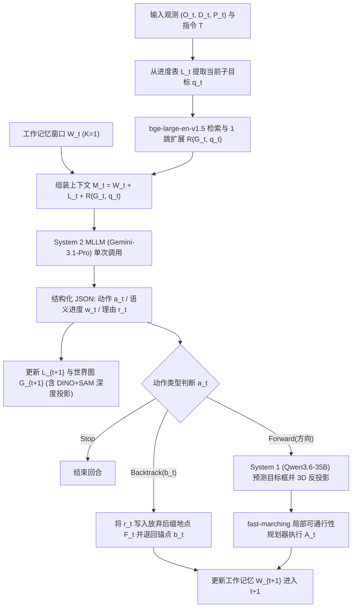

# HAM-VLN: Harnessing Hierarchical Agentic Memory for Zero-Shot Vision-and-Language Navigation

## 一句话定义

**HAM-VLN** 是一种面向零样本视觉语言导航（VLN）的双系统智能体框架：在不增加额外大模型调用的前提下，将导航决策与语义/反思记忆写入耦合在同一次 System 2 多模态大模型（MLLM）调用中，构建基于深度的稀疏地点-物体世界图，并通过子目标条件拓扑检索与地点级失败反思回溯缓解长程导航中的上下文膨胀与死胡同重复探索问题。

## 英文缩写速查

| 缩写 | 英文全称 | 简要说明 |
|---|---|---|
| HAM-VLN | Hierarchical Agentic Memory for Vision-and-Language Navigation | 本文框架：决策耦合的分层智能体记忆零样本导航系统 |
| VLN-CE | Vision-and-Language Navigation in Continuous Environments | 连续环境视觉语言导航基准（如 R2R-CE、RxR-CE） |
| MLLM | Multimodal Large Language Model | 多模态大语言模型（本文用作 System 2 规划与 System 1 视觉定位） |
| SR / OSR | Success Rate / Oracle Success Rate | 导航成功率 / 预言机成功率（轨迹任一点进入目标半径即计成功） |
| SPL | Success weighted by Path Length | 路径长度加权成功率，综合衡量导航成功与路径效率 |
| nDTW | Normalized Dynamic Time Warping | 归一化动态时间规整，衡量轨迹与参考路径的时空对齐度 |

## 为什么重要

1. **打破零样本长程导航的两难瓶颈：** 传统零样本 VLN 的两种历史表征各有硬伤——稠密语义体素/栅格地图随探索面积扩张且与语言决策脱节；直接拼接原始全景视觉流则会令上下文随步数线性暴涨（全量历史达 746.1k tokens/回合），关键地标被淹没，反而出现上下文越长、成功率越低的退化。
2. **零额外 LLM 调用的记忆维护：** 许多记忆增强智能体需要独立摘要/反思调用，而 HAM-VLN 让 System 2 在输出高层次方向决策的同一次结构化 JSON 调用中顺带写出房间语义、可见物体、指令进度与失败原因，实现决策与记忆更新的零额外延迟耦合。
3. **把失败探索转化为可复用空间证据：** 回溯动作不再只是物理退回，而是将放弃的轨迹后缀映射为地点级反思笔记，供后续相似子目标检索时重用，显著提升路径效率（SPL）。

## 核心信息

| 字段 | 内容 |
|---|---|
| 作者 | An Liu, Bingxi Liu, Hongyu Ding, Yixuan Jiang, Yaran Chen, Fulin Tang（通讯）, Cong Leng, Hong Zhang, Jian Cheng |
| 机构 | 中国科学院自动化研究所（CASIA）、南方科技大学（SUSTech）、鹏城实验室、南京大学（NJU）、西交利物浦大学、MAICRO |
| 发表时间 | 2026-07-31（arXiv:2607.29600v1） |
| 论文链接 | [arXiv:2607.29600](https://arxiv.org/abs/2607.29600)（[HTML 全文](https://arxiv.org/html/2607.29600)） |
| 项目与代码 | 截至 2026-11-27 未确认官方 GitHub 代码仓库或独立项目主页 |
| 清单分类 | `harness.memory` |
| 来源条目 | `survey_ax_2607_29600` |
| 开源状态 | 未确认开源代码（arXiv v1 原文及 HTML 未列源码链接） |

## 核心原理

### 1. 双系统导航架构（Dual-Process Architecture）

为避免依赖预训练路点预测器（waypoint predictor）导致远距离语义线索（如走廊开口）丢失，HAM-VLN 将策略分解为慢速审议的 System 2（$\varphi_2$）与快速响应的 System 1（$\varphi_1$ 与确定性控制器 $\pi_{\mathrm{robot}}$）：

$$A_t = \pi_{\mathrm{robot}}\big(\varphi_1\big(\varphi_2(\mathcal{T}, O_t, M_t)\big),\, D_t, P_t, \mathbf{K}_{\mathrm{cam}}\big)$$

- **System 2（$\varphi_2$，实验中为 `Gemini-3.1-Pro`）：** 在每个决策路点调用一次，输入导航指令 $\mathcal{T}$、当前全景观测 $O_t$ 与记忆上下文 $M_t$，输出结构化 JSON 记录 $J_t = (a_t, w_t, r_t)$，分别表示离散高层动作 $a_t$（前进方向描述、回溯到历史路点 $b_t$ 或确认停止）、记忆写回载荷 $w_t$（房间类型、物体描述、指令进度更新）以及决策理由 $r_t$。
- **System 1（$\varphi_1$ + $\pi_{\mathrm{robot}}$，实验中 $\varphi_1$ 为 `Qwen3.6-35B`）：** $\varphi_1$ 接收所选视角图像与目标语义描述并预测像素空间边界框；$\pi_{\mathrm{robot}}$ 从框内选取代表像素，利用深度图 $D_t$ 与相机内参 $\mathbf{K}_{\mathrm{cam}}$ 反投影到三维空间，经里程计位姿 $P_t$ 转换至世界坐标系，并在局部可通行性地图上使用快速行进法（fast-marching planning）执行短程低层动作 $A_t$。

### 2. 决策耦合的分层智能体记忆与世界图

在路点 $t$，送入 System 2 的记忆上下文由三部分组成（实验中固定窗口大小 $K=1$）：

$$M_t = W_t \oplus L_t \oplus \mathcal{R}(G_t, q_t)$$

- **工作记忆（Working Memory，$W_t$）：** 仅保留最近 $K$ 次已完成路点转移的原始 egocentric 观测帧，当前全景 $O_t$ 另行作为即时感知传入。
- **指令进度表（$L_t$）与世界图（$G_t$）：** $L_t$ 维护有序的指令完成状态，首个未完成条目定义当前子目标 $q_t$。长期世界图定义为四元组 $G_t = (\mathcal{V}_t^P, \mathcal{V}_t^O, \mathcal{E}_t^{PP}, \mathcal{E}_t^{PO})$：地点节点 $\mathcal{V}_t^P$ 通过增量单链聚类形成，聚合空间锚点、智能体写入的语义上下文、访问统计与失败证据；物体节点 $\mathcal{V}_t^O$ 由 Grounding DINO 与 SAM 提取开放集检测掩码后经深度投影融合而成；边 $\mathcal{E}_t^{PP}$ 与 $\mathcal{E}_t^{PO}$ 分别编码可导航拓扑连通性与地点-物体语义归属及置信度。
- **同步写回：** System 2 单次输出后，自动触发 $L_{t+1} = \mathcal{U}_L(L_t, w_t)$ 与 $G_{t+1} = \mathcal{U}_G(G_t, w_t, \Gamma(O_t, D_t, P_t))$，将几何证据 $\Gamma$ 与智能体语义 $w_t$ 融合，无需二次 LLM 调用。
- **四重功能视图：** 除工作记忆 $W_t$ 外，图谱检索同时提供 **情景记忆（Episodic Memory）**（时间近因性）、**语义记忆（Semantic Memory）**（地点-物体相关性）与 **反思记忆（Reflection Memory）**（附着于放弃地点的失败笔记，仅在对应地点被检索召回时原样附带进入上下文）。

### 3. 子目标条件拓扑检索

本地部署在计算节点 GPU 上的句向量编码器 `bge-large-en-v1.5`（零外部 API 费用）对当前子目标 $q_t$ 与每个地点摘要 $p \in \mathcal{V}_t^P$ 编码，并按以下三项加权打分：

$$s_t(p) = \alpha\,\mathrm{rel}(q_t, p) + \beta\,\mathrm{rec}_t(p) + \gamma\,\mathrm{sal}(p), \quad \mathrm{rec}_t(p) = \rho^{t-\tau(p)}$$

其中 $\mathrm{rel}$ 为语义余弦相似度，$\tau(p)$ 为最近访问步数，$\mathrm{sal}$ 结合地标一致性与物体丰富度；所有实验固定 $(\alpha, \beta, \gamma) = (1.0, 0.3, 0.3)$、衰减系数 $\rho = 0.85$。读取算子 $\mathcal{R}(G_t, q_t)$ 先取得分最高的 $K_s = 3$ 个种子节点，执行 1 跳拓扑邻域扩展并并入当前地点邻域，最终裁剪至至多 $K_p = 5$ 个地点序列化进 $M_t$。

### 4. 面向回溯的落地失败记忆（Algorithm 1）

当 System 2 选择回溯 $a_t = \textsc{Backtrack}(b_t)$ 时，系统将目标锚点 $b_t$ 之后的已探索轨迹后缀 $\mathcal{B}_t$ 映射到地点集合 $\mathcal{F}_t = \textsc{Places}(\mathcal{B}_t) \setminus \{p(b_t)\}$，并把决策理由 $r_t$ 作为失败证据写入 $\mathcal{F}_t$ 对应地点节点。返回控制锚点 $b_t$ 保持在路点级以保证可执行几何位置，而失败笔记留在地点级以实现跨次访问持久化。该失败证据是建议性（advisory）而非硬性封锁（不修改检索分 $s_t(p)$），使智能体在子目标变更后仍可结合新语境重新评估该区域。

## 流程总览

## 源码运行时序图

**不适用**（截至 2026-11-27，arXiv:2607.29600 原文与检索缓存均未确认可运行官方源码仓库或代码发布入口。）

## 实验与评测

评测遵循 Uni-LaViRA（Ding et al., 2026b）协议，在 **VLN-CE R2R**、**VLN-CE RxR** 与 **HM3D-v2 ObjectNav** 的 `val-unseen` 各自 100-episode 子集上运行 3 个独立随机种子，报告均值±标准差。

### 1. 主基准成绩（Table 1 & Table 2）

| 基准 | 方法 | NE (m) ↓ | OSR (%) ↑ | SR (%) ↑ | SPL (%) ↑ | nDTW (%) ↑ |
|---|---|---|---|---|---|---|
| R2R-CE | LaViRA (ICRA'26, 零样本对比最优 SR) | 6.54 ± 0.27 | 48.7 ± 2.1 | 38.3 ± 0.6 | 28.3 ± 0.9 | – |
| R2R-CE | Three-Step Nav (AISTATS'26, 零样本) | 5.87 | 39.0 | 34.0 | 29.1 | – |
| R2R-CE | SmartWay (IROS'25, 零样本) | 7.01 | 51.0 | 29.0 | 22.5 | – |
| R2R-CE | **HAM-VLN (Ours, 零样本)** | **3.92 ± 0.15** | **78.7 ± 3.1** | **61.0 ± 1.7** | **48.1 ± 0.2** | – |
| RxR-CE | GC-VLN (CoRL'25, 零样本) | 8.80 | – | 33.8 | 13.8 | – |
| RxR-CE | Three-Step Nav (AISTATS'26, 零样本) | 9.21 | – | 22.0 | 16.1 | 45.7 |
| RxR-CE | **HAM-VLN (Ours, 零样本)** | **6.27 ± 0.23** | – | **52.7 ± 1.5** | **35.7 ± 2.6** | **54.3 ± 0.3** |
| HM3D-v2 ObjectNav | ApexNav (RAL'25, 零样本) | – | – | 76.2 | 38.0 | – |
| HM3D-v2 ObjectNav | DSCD-Nav (arXiv'26, 零样本) | – | – | 73.0 | 38.7 | – |
| HM3D-v2 ObjectNav | FiLM-Nav (ICRA'26, 有监督对比最优) | – | – | 77.0 | 41.3 | – |
| HM3D-v2 ObjectNav | **HAM-VLN (Ours, 零样本)** | – | – | **79.7 ± 0.5** | **43.2 ± 0.6** | – |

### 2. 上下文效率与原始历史窗口敏感性（R2R-CE，Table 3）

| 配置 | SR (%) ↑ | SPL (%) ↑ | S2 tokens / 决策 ↓ | API tokens / 回合 ↓ |
|---|---|---|---|---|
| **HAM-VLN ($K=1$)** | **61.0 ± 1.7** | **48.1 ± 0.2** | **17.9k** | **244.9k** |
| Raw history ($K=3$) | 58.0 ± 1.4 | 44.7 ± 0.5 | 32.6k | 375.5k |
| Raw history ($K=5$) | 54.3 ± 2.1 | 38.4 ± 0.3 | 39.8k | 457.8k |
| Raw history ($K=10$) | 58.3 ± 0.9 | 41.6 ± 1.2 | 48.7k | 534.0k |
| Raw history (Full) | 53.3 ± 1.2 | 38.1 ± 0.7 | 57.7k | 746.1k |

- 相比全量原始历史，HAM-VLN 将每步决策 token 与每回合 API token 分别减少 **69.0%** 与 **67.2%**；即使相比最低开销原始历史（$K=3$），仍分别降低 **45.1%** 与 **34.8%**，且 SR 高出 3.0 个百分点。

### 3. 核心消融与回溯定量统计（R2R-CE，Table 4 & §4.5）

| 消融配置 | NE (m) ↓ | OSR (%) ↑ | SR (%) ↑ | SPL (%) ↑ |
|---|---|---|---|---|
| **HAM-VLN (完整)** | **3.92 ± 0.15** | **78.7 ± 3.1** | **61.0 ± 1.7** | **48.1 ± 0.2** |
| w/o WG ($K=1$) | 4.97 ± 0.21 | 72.6 ± 1.8 | 51.7 ± 1.3 | 39.3 ± 1.2 |
| w/o WG (Full) | 4.62 ± 0.19 | 68.3 ± 0.9 | 53.3 ± 1.2 | 38.1 ± 0.7 |
| w/o EM（移除情景记忆） | 4.53 ± 0.37 | 72.0 ± 3.6 | 53.3 ± 2.6 | 41.6 ± 1.4 |
| w/o SM（移除语义记忆） | 4.72 ± 0.29 | 74.0 ± 2.7 | 53.3 ± 0.5 | 42.1 ± 0.7 |
| w/o RM（移除反思笔记） | 4.41 ± 0.17 | 76.0 ± 1.4 | 55.7 ± 1.3 | 36.9 ± 0.9 |
| w/o all（保留图，禁用 EM+SM+RM） | 4.63 ± 0.22 | 75.7 ± 1.9 | 50.7 ± 1.7 | 31.5 ± 1.1 |

- 在 100 个 R2R-CE 回合的 1,288 次路点决策中，智能体共执行 **175 次回溯**（占总决策的 **13.6%**，平均 **1.75 次/回合**）。

## 与其他工作对比

1. **对比无图零样本 VLN（LaViRA、Three-Step Nav、HiMemVLN）：** 在 R2R-CE 上 HAM-VLN 将 SR 从 LaViRA 的 38.3% 提升至 61.0%（+22.7 pp），OSR 从 SmartWay 的 51.0% 提升至 78.7%（+27.7 pp），NE 从 5.87 m 降至 3.92 m；长指令基准 RxR-CE 上 SR 较 GC-VLN（33.8%）提升 18.9 pp。
2. **对比有监督端到端导航模型（Table 1 & Table 2）：** 在 HM3D-v2 ObjectNav 上，HAM-VLN（79.7% SR / 43.2% SPL）高于表中列出的有监督基线 FiLM-Nav（77.0% / 41.3%）与 Uni-NaVid（73.7% / 37.1%）；在 R2R-CE 上 OSR（78.7%）高于表中全部有监督方法（如 SPAN-Nav 75.3%、OmniNav 74.6%），但最终 SR（61.0%）与 SPL（48.1%）仍低于头部微调模型（如 OmniNav 69.5% / 66.1%、ABot-N0 66.4% / 63.9%），论文归因于零样本智能体在不确定条件下依赖探索与回溯而非训练得到的捷径策略。
3. **对比记忆机制（HiMemVLN、ReMemNav、原始视觉历史）：** 仅扩大原始历史窗口（$K=3 \to \text{Full}$）会使每回合 API tokens 增加 98.7%，但 SR 反而从 58.0% 降到 53.3%；而同时保留图结构但关闭 EM/SM/RM 视图（`w/o all`）时 SPL 从 48.1% 骤降至 31.5%，证明仅有图结构不足以提升导航，必须配合时间近因性、语义检索与失败反思三者协同。

## 结论

**一句话总判：在零样本 VLN 中，「少留原始图、多留结构化语义与失败笔记，且与决策同 call 写回」比堆长视觉上下文既更准又更省。**

1. **世界图 + 三视图检索缺一不可：** 仅靠 $K=1$ 窗口（SR 51.7%）或堆叠全量原始历史（SR 53.3%）均明显落后，但保留图结构却关闭 EM/SM/RM 视图会退化更严重（SR 50.7%，SPL 31.5%）。
2. **反思记忆决定路径效率而非单纯保底：** 移除 Reflection Memory（保留回溯动作本身、仅停用失败笔记写回与序列化）使 SR 下降 5.3 pp，而 SPL 暴跌 11.2 pp（48.1% → 36.9%），说明文字反思主要避免在失败岔路反复浪费步数。
3. **控制锚点与记忆证据必须分层：** 回溯控制绑定精确的几何路点 $b_t$，而失败反思绑定聚类后的地点节点并保持“建议性而非硬屏蔽”，兼顾可执行的几何精度与跨次访问、跨子目标的可重用性。
4. **双系统配合大模型能力边界清晰：** 依赖 `Gemini-3.1-Pro` 的语义先验与 `Qwen3.6-35B` 的开放集像素定位摆脱了专用路点预测器，但在强调严格按步对齐指令的连续路径任务（R2R/RxR）上，零样本探索的 SPL 仍与领域内微调模型存在差距。

## 工程实践

- **关键超参数配置：** 工作记忆窗口 $K=1$；`bge-large-en-v1.5` 常驻本地 worker GPU；检索打分权重 $(\alpha, \beta, \gamma) = (1.0, 0.3, 0.3)$，时间衰减 $\rho = 0.85$；图谱召回种子数 $K_s = 3$、1 跳扩展后上限 $K_p = 5$。
- **感知与图谱维护栈：** 开放词汇目标检测与分割采用 Grounding DINO + SAM，经深度与里程计投影融合至增量单链聚类形成的地点节点，低层轨迹通过局部可通行性地图上的 fast-marching 规划器执行。
- **本地复现注意：** 论文未公开仓库，工程复用需自行搭建 System 2（结构化 JSON 提示与图状态解析）、System 1（Grounding MLLM + 深度反投影）及与 Habitat/VLN-CE 仿真器的控制接口，且当前主评测成本与 `Gemini-3.1-Pro` API 吞吐及 `Qwen3.6-35B` 本地推理显存强相关。

## 局限与风险

1. **尚未开源且重度依赖闭源强模型：** 截至 2026-11-27 未见官方代码发布；System 2 使用 `Gemini-3.1-Pro`、System 1 使用 `Qwen3.6-35B`，更换为更弱或无结构化输出约束的模型时，JSON 状态写入与长程反思稳定性尚未验证。
2. **子集评测与无真机实验：** 主实验基于各基准 `val-unseen` 的 100-episode 子集（论文引用 Uni-LaViRA 指出子集与全集 SR 偏差不超过 1.1 pp），未在全量分割或真实移动机器人平台上验证传感器噪声、里程计漂移对单链地点聚类与深度反投影的影响。
3. **连续导航指令跟随效率仍低于微调模型：** R2R-CE 与 RxR-CE 上 SPL（48.1%、35.7%）落后于同表有监督模型（OmniNav 66.1%、62.0%），且每回合仍需约 244.9k API tokens（含多视角/全景输入），高频实时控制场景存在延迟与成本门槛。

## 关联页面

- [Agentic Robots 综述](paper-towards-agentic-robots-survey.md)
- [全量项目节点清单](../overview/awesome-agentic-robots-node-index.md)
- [VLA 方法背景](../methods/vla.md)
- [机器人智能体工具链与脚手架（Agent Harness）](../methods/robot-agent-harness.md)
- [智能体规划与反馈机制](../methods/agent-planning-feedback.md)
- [机器人导航工程工作流](../methods/robot-navigation-workflow.md)
- [视觉语言导航](../tasks/vision-language-navigation.md)
- [零样本物体导航](../tasks/zero-shot-object-navigation.md)

## 推荐继续阅读

- [HAM-VLN arXiv 原文与 HTML 全文](https://arxiv.org/abs/2607.29600)
- [VLN-CE 连续环境视觉语言导航论文（Krantz et al., ECCV 2020）](https://arxiv.org/abs/2004.02857)
- [Generative Agents（Park et al., UIST 2023）：相关性/近因性/重要性记忆检索原型](https://arxiv.org/abs/2304.03442)

## 参考来源

- [HAM-VLN 原文通读与核对归档](../../sources/papers/paper-agentic-2607-29600.md)
- [官方 Awesome 快照归档](../../sources/repos/awesome-agentic-robots-survey-index.md)
- [arXiv:2607.29600 官方入口](https://arxiv.org/abs/2607.29600)
- [arXiv:2607.29600 HTML 全文](https://arxiv.org/html/2607.29600)
