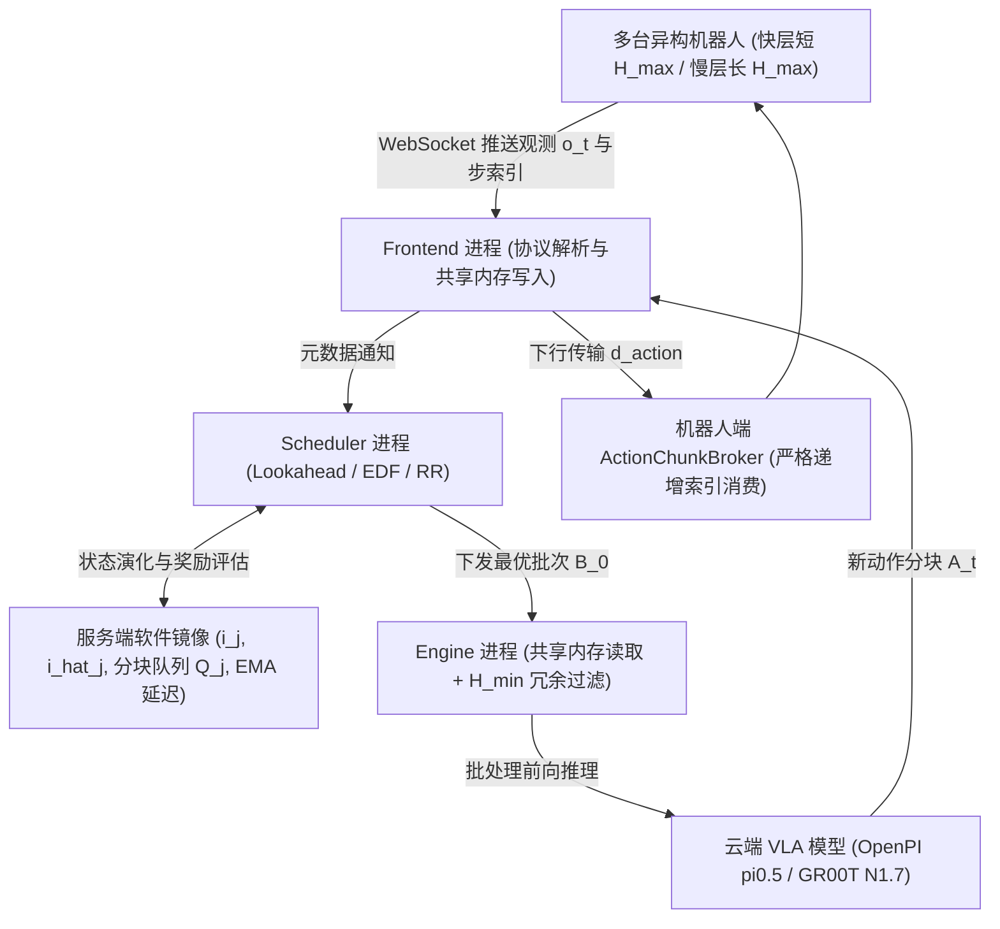
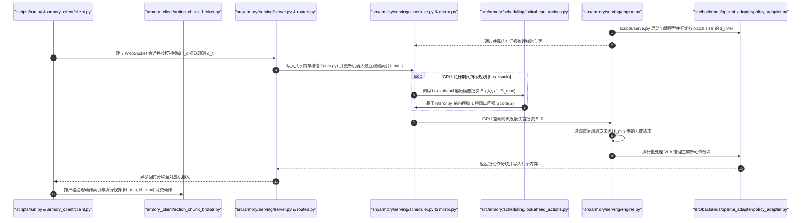

# Action Chunk Scheduling for Batched Robot Policy Serving

## 一句话定义

**面向多机器人云端策略推理的闭环动作分块调度系统（Armory）**：通过在服务端维护每台机器人的动作队列、执行视界与网络延迟软件镜像，并将批处理决策建模为马尔可夫决策过程（MDP），以 Lookahead 调度算法在 GPU 批效率、机器人防饥饿与异构任务响应性之间实现可控权衡。

## 英文缩写速查

| 缩写 | 英文全称 | 简要说明 |
|---|---|---|
| VLA | Vision-Language-Action | 视觉-语言-动作基础模型，计算开销大，适合由远端 GPU 集中提供推理服务 |
| MDP | Markov Decision Process | 马尔可夫决策过程，本文用于刻画服务端批选择对多机器人动作队列的闭环演化 |
| RR | Round Robin | 轮询调度基线，按固定顺序循环服务各机器人批次，忽略任务紧急度差异 |
| EDF | Earliest Deadline First | 最早截止时间优先基线，优先服务即将耗尽动作分块的机器人，但对饥饿代价一视同仁 |
| LA | Lookahead | 本文提出的前瞻调度器，基于服务端镜像向前推演候选批次轨迹并按单位推理耗时评分 |
| EMA | Exponential Moving Average | 指数移动平均，用于服务端在线持续估计各机器人的上下行网络延迟 |

## 为什么重要

- **揭示云端多机器人推理的核心矛盾：** 单个远端高性能 GPU 可通过批处理（batching）摊薄基础模型权重加载开销，但增大批大小会抬高单次推理延迟 $d_{\text{infer}}$；在机器人闭环控制中，延迟不仅是系统指标，更直接决定动作是否过期与是否发生**饥饿（starvation，即无有效动作可执行）**。
- **发现同构与异构机群的调度分野：** 论文在仿真与 10 台真机上证实，执行准静态任务（较长执行视界 $H_{\max}$）的机器人对短时延迟容忍度高，而执行高动态任务（短 $H_{\max}$）的机器人一旦饥饿或动作陈旧，任务吞吐会急剧崩溃。仅追求均匀公平（RR）或仅看截止时间（EDF）的传统启发式在异构负载下会严重亏待快响应机器人。
- **端到端系统验证而非纯离线模拟：** 开源系统 **Armory** 将大模型推理进程与网络收发、调度镜像解耦，并给出可通过任务权重 $w_j$ 调节快慢层级吞吐分配的显式控制界面。

## 核心信息

| 字段 | 内容 |
|---|---|
| **作者** | Rohan Bansal*, David He*, Nadun Ranawaka Arachchige, Zhenyang Chen, Soobum Kim, Kexin Rong†, Danfei Xu† |
| **机构** | 佐治亚理工学院（Georgia Institute of Technology，ARM Lab） |
| **发表时间** | 2026-07-31（arXiv:2608.00337v1 [cs.RO]） |
| **论文链接** | [arXiv:2608.00337](https://arxiv.org/abs/2608.00337) / [arXiv HTML v1](https://arxiv.org/html/2608.00337) |
| **项目与代码** | [项目页](https://gatech-rl2.github.io/actionchunkscheduling) / [GitHub（GaTech-RL2/armory）](https://github.com/GaTech-RL2/armory)（Apache-2.0） |
| **清单分类** | `harness.infrastructure`（来源条目：`survey_ax_2608_00337`） |
| **开源状态** | **已开源**（官方仓库 `GaTech-RL2/armory` 提供完整服务端引擎、客户端、OpenPI/GR00T 适配器及 LIBERO 评测脚本） |

## 核心原理

### 1. 动作分块执行与延迟分解（§2）

机器人以控制频率 $f_c$ 步进执行策略生成的动作分块 $A_t = [a_i, a_{i+H-1}]$，实际仅执行其中前缀区间 $[H_{\min}, H_{\max}]$：前缀过短会因频繁切换分块放大复合误差，过长则会降低对环境变化的反应速度。从采集观测 $o_t$ 到执行对应动作的总延迟分解为三部分：

$$d = d_{\text{obs}} + d_{\text{infer}} + d_{\text{action}}$$

其中 $d_{\text{obs}}$ 与 $d_{\text{action}}$ 由客户端-服务端网络往返时延主导，$d_{\text{infer}}(b)$ 随批大小 $b$ 增长。若当前分块耗尽而下一分块尚未到达，机器人进入饥饿状态并停顿。

### 2. 服务端软件镜像与 MDP 建模（§3.1）

Armory 将多租户策略服务形式化为离散调度周期 $k$ 上的 MDP。对于机器人 $j \in \{1, \dots, N\}$，服务端镜像实时追踪状态 $s_k = (t_k, i_j, \hat{i}_j, \mathcal{Q}_j)$：
- $i_j$：机器人最近一次已执行的动作索引；
- $\hat{i}_j$：服务端已收到的最近一次观测对应的动作索引；
- $\mathcal{Q}_j$：已生成分块队列，每个分块记为 $c = (i_{\text{start}}, h_j, t_{\text{arr}})$，其中 $h_j = H_{\max}$ 为该机器人的执行视界，$t_{\text{arr}}$ 为分块到达机器人的预计时刻。

在周期 $k$ 选定非空批次 $B_k \subseteq \{1, \dots, N\}$ 后，推理于 $t_{k+1} = t_k + \tilde{d}_{\text{infer}}(|B_k|)$ 完成，并为每个 $j \in B_k$ 入队新分块 $c_{\text{new}}^j = (\hat{i}_j, h_j, t_{k+1} + \tilde{d}_{\text{action}, j})$；与此同时各机器人在 $[t_k, t_{k+1}]$ 内以频率 $f_c$ 推进，仅当队列中存在满足 $t_{\text{arr}} \le \tau \wedge i_j \in [i_c, i_c + h_c)$ 的分块时才步进 $i_j \leftarrow i_j + 1$。单步奖励定义为加权非饥饿执行时间：

$$R(s_k, B_k) = \frac{1}{f_c} \sum_{j=1}^{N} w_j \, \Delta i_j(s_k, B_k), \qquad \pi^\star = \arg\max_\pi \sum_k \mathbb{E}[R(s_k, B_k)]$$

其中 $\Delta i_j(s_k, B_k)$ 为周期内机器人 $j$ 实际非饥饿步数，$w_j$ 为任务敏感度权重（$w_j = 1$ 平等对待所有机器人，增大 $w_j$ 用于保护高动态任务的快响应机器人）。

### 3. Lookahead 调度算法与推式多进程架构（§3.2–§3.3 & Appendix A.1, A.9）

- **前瞻搜索与归一化评分：** 由于完整 MDP 搜索随机器人数量和随机网络时延呈指数分支，Lookahead 在 GPU 忙碌期间利用时间裕度（`has_slack()`）在镜像上广度推演深度为 $L$ 的候选调度序列 $S = (s_0, B_0), \dots, (s_{L-1}, B_{L-1})$，对每个候选批大小 $1 \dots B_{\max}$（带启发式剪枝）计算单位 GPU 推理时间收益：
  $$\text{Score}(S) = \sum_{\ell=0}^{L-1} \frac{R(s_\ell, B_\ell)}{d_{\text{infer}}(|B_\ell|)}$$
  并在 GPU 空闲时立即下发得分最高序列的首个批次 $B_0$（主实验取 $L=1$，工程实现在起始后 1 秒窗口内评估奖励）。
- **推式通信与共享内存隔离：** 机器人通过 WebSocket 在每步执行前主动推送观测至 Frontend 进程；Frontend 将图像、提示词与元数据写入共享内存；Scheduler 进程维护镜像与 EMA 延迟估计；Engine 进程启动时标定各批大小 $d_{\text{infer}}(b)$，消费批次前自动过滤与上次服务相同或距上次执行不足 $H_{\min}$ 步的冗余请求，确保 CPU 调度不阻塞 GPU 前向计算。

## 流程总览

## 源码运行时序图

以下时序图基于官方仓库 `GaTech-RL2/armory` 已核实入口与模块（`scripts/serve.py`、`scripts/run.py`、`armory-client/src/armory_client/`、`src/armory/serving/`、`src/armory/scheduling/` 与 `src/backends/openpi_adapter/`），展示本地/自托管模式下服务端启动、观测推送、Lookahead 异步搜批与批推理返回的核心运行闭环。

## 实验与评测

作者在 **LIBERO-10 仿真** 与 **10 台 AgileX PiPER 真机机械臂** 上，以 $\pi_{0.5}$ 为主模型（并补充 GR00T N1.7 延迟剖面与 H100 对比）验证了不同异构配置：`all-fast`（全快同构）、`one-fast`（1 快 + $N-1$ 慢）与 `half-fast`（半快半慢），每组跑 3 个随机种子。主要核实数值如下（源自原文 Table 1–5 与 §4.1–§4.2、Appendix A.2–A.8）：

### 1. 不同 GPU 与模型的批推理延迟剖面（Table 1 & Table 2）

| Batch Size | $\pi_{0.5}$ on L40S (ms) | $\pi_{0.5}$ on H100 (ms) | GR00T N1.7 on L40S (ms) |
|---|---|---|---|
| 1 | 73.0 | 42.3 | 71.8 |
| 2 | 109.8 | 56.0 | 76.5 |
| 3 | 142.4 | 66.1 | 83.5 |
| 4 | 177.5 | 79.3 | 91.8 |
| 5 | 211.1 | 87.2 | 100.9 |

- $\pi_{0.5}$ 更偏计算受限，随批大小增长延迟增幅较陡；GR00T N1.7 更偏显存带宽受限，批大小从 1 增至 5 延迟仅增约 40.5%，说明内存受限模型更易摊薄多机批推理代价。

### 2. 10 台 AgileX PiPER 真机集群实验（Table 5，$f_c=30\text{ Hz}, H=20, H_{\min}=5$）

任务包含静态积木分类（slow，$H_{\max}=20$）与动态转盘积木抓取入杯（fast，$H_{\max}=10$），单次窗口 60 秒；同构组批上限 $b=3$，异构组 $b=5$：

| 场景配置 | 调度器 | 快层吞吐 (legos/min) | 慢层吞吐 (legos/min) | 系统总吞吐 (legos/min) | 平均饥饿率 (%) | 快层 / 慢层饥饿率 (%) |
|---|---|---|---|---|---|---|
| `All Fast` | EDF | 6.27 | — | 62.67 | 35.94 | 35.94 / — |
| `All Fast` | RR | 6.00 | — | 60.00 | 44.46 | 44.46 / — |
| `All Fast` | `LA w=1` | **6.73** | — | **67.33** | 41.65 | 41.65 / — |
| `One Fast` | EDF | 3.67 | 8.81 | 83.00 | 13.37 | 43.27 / 10.05 |
| `One Fast` | RR | 2.00 | 9.04 | 83.33 | 12.90 | 43.31 / 9.52 |
| `One Fast` | `LA w=1` | 3.67 | 9.85 | 92.33 | **12.37** | 42.68 / 9.01 |
| `One Fast` | `LA w=5` | **8.33** | **10.04** | **98.67** | 15.18 | **13.10** / 15.41 |
| `Half Fast` | EDF | 3.13 | 9.40 | 62.67 | 24.93 | 42.09 / 7.78 |
| `Half Fast` | RR | 3.87 | 9.07 | 64.67 | 24.66 | 41.26 / 8.05 |
| `Half Fast` | `LA w=1` | 3.60 | **9.67** | **66.33** | 25.55 | 42.69 / 8.41 |
| `Half Fast` | `LA w=5` | **6.13** | 6.53 | 63.33 | 39.42 | **32.72** / 46.13 |

- **`one-fast` 下的协同收益：** `LA w=5` 将单个高动态机器人的吞吐提升至 EDF 的约 2 倍（8.33 vs 3.67）、RR 的约 4 倍（8.33 vs 2.00），同时慢层未受损反而微升至 10.04，令系统总吞吐较 EDF（83.00）提升约 **18%**（精确比值 +18.9%）。
- **`half-fast` 下的显式权衡：** 权重 $w_j$ 充当运维可调旋钮，`LA w=5` 牺牲慢层部分服务换取快层近翻倍吞吐。

### 3. LIBERO-10 仿真与核心消融（Table 3, Table 4, Appendix A.4–A.6）

- **规模扩展（Table 4，$N=10, b=3$，单位 successes/min 与平均饥饿率）：** `All Fast` 下五种调度器总吞吐相近（RR 29.94 / 38.2%、EDF 31.02 / 37.4%、`LA w=1` 30.18 / 37.6%）；`One Fast` 下总吞吐 37.96–40.42，`LA w=5` 维持高快层吞吐与低快层饥饿；`Half Fast` 下 `LA w=3` 总吞吐 33.89（30.0%）为兼顾快慢层平衡的实用工作点，而 `LA w=5` 总吞吐降至 20.83（48.3%），揭示过度倾斜的边界。
- **动态批大小优势（Figure 7）：** 在 `all-fast` 且最大批上限放宽到 10 时，EDF 与 RR 倾向填满大批量（均值 4.7 台/次），引发等待延迟飙升与高饥饿率；Lookahead 自发选择紧凑高效的批次（均值 3.3、中位数 3），在上限增大时仍保持饥饿率与吞吐平稳。
- **前瞻深度消融（Table 3，$L \in \{1, 2, 3\}$）：** 在当前实现下增大 $L$ 会使平均饥饿率略升（例如 `One Fast` $N=10$ 下 `LA@1` 为 17.6% → 18.1% → 18.4%），因此主实验均采用 $L=1$。
- **网络延迟与抖动鲁棒性（Figure 8）：** 在单向中位时延 $m=50\text{ ms}$ 的对数正态抖动测试中，因 EMA 延迟估计与动作队列缓冲吸收波动，三种调度器的吞吐与饥饿率均近乎平坦；在 50–100 ms 洲际/广域网典型单向延迟区间内性能保持良好，此后随延迟向 500 ms 增长而单调下降。

## 与其他工作对比

| 维度 | Armory（本文） | 常规单机异步执行（RTC / VLASH） | Kairos（arXiv:2605.11381） | ROSA（arXiv:2607.01088） | 通用 LLM 服务（Orca / vLLM / SGLang） |
|---|---|---|---|---|---|
| **服务对象** | 单远端 GPU 服务多台异构机器人 | 单机策略与执行流水线重叠 | 多机器人可扩展服务 | 工厂多机器人静态编排服务 | 通用文本/多模态交互请求 |
| **执行同步假设** | 异步执行、推式通信、显式建模饥饿 | 异步执行 | 可变执行视界动态调度 | 假设同步执行与已知静态负载 | 无物理控制周期与动作队列概念 |
| **异构闭环感知** | 镜像追踪 $i_j, \hat{i}_j, \mathcal{Q}_j$ 与权重 $w_j$ | 不涉及多机资源竞争 | 以端到端请求延迟为目标 | 静态资源配置，未建模滞后分块的闭环物理代价 | 仅优化请求级/Token 级吞吐与尾延迟 |
| **与模型优化关系** | 正交，可复用加速后的 VLA 后端 | 聚焦单模型执行时序或未来状态条件化 | 并行探索服务系统侧优化 | 并行探索工业调度 | 聚焦连续批处理与显存管理 |

## 结论

**一句话总判：Armory 通过在远端推理服务侧引入机器人动作队列镜像与控制感知 MDP 调度，证明多机器人云端策略服务不能照搬常规 ML 批处理启发式，在异构任务场景下必须以任务敏感度为权重协调批效率与防饥饿。**

1. **按机群异构性选择调度器：** 当所有机器人执行相同或相同步调的任务（`all-fast`）时，RR 与 EDF 的效果已接近 Lookahead；仅当混跑不同反应速度要求的任务时，引入异构权重调度才能释放显著收益。
2. **用权重 $w_j$ 显式管理快慢层 SLA：** 在少数高动态机器人与多数准静态机器人共享 GPU（`one-fast`）时，提高快层权重（如 `LA@5`）可在几乎不损慢层的前提下大幅提高快层吞吐；而在半数快层竞争（`half-fast`）时宜选用中等权重（如 `LA@3`）避免慢层过度饥饿。
3. **避免盲目填满最大批大小：** 批大小并非越大越好，动态选取中等紧凑批次（如 L40S 上 $\pi_{0.5}$ 的 $b \approx 3$）能同时兼顾权重加载摊销与较低单步等待延迟。
4. **控制与推理时间匹配优于盲目加深前瞻步数：** 实测单步模型前瞻（$L=1$）配合基于软件镜像的 1 秒窗口回报评估已足够捕获动作缓冲动态，无需付出多步搜索分支开销。

## 工程实践

- **多进程与通信部署：** 在 `GaTech-RL2/armory` 中通过 `scripts/serve.py` 启动服务器、`scripts/run.py` 启动客户端集群，支持 `--server.scheduler.scheduling-algorithm lookahead-actions` 与 `policy:mock` 无 GPU 链路压测，同时提供 `scripts/modal/` 与 `scripts/sbatch/` 脚本便于云容器和 Slurm 集群批扫。
- **跨模型接入：** 仓库内置 `src/backends/openpi_adapter/` 与 `src/backends/gr00t_adapter/` 适配器，并支持在 `src/armory/backends/inference_profiles.json` 记录不同模型与 GPU（如 L40S / H100）的批延迟剖面。
- **异步分块起步索引效应（Appendix A.8）：** 实验意外发现 Lookahead 在朴素异步执行下更倾向让分块从索引 0 开始接管执行，从而减少了分块中段切换带来的动作不连续抖动；若与 RTC 或 VLASH 等连续化异步策略联用，仍有进一步协同空间。

## 局限与风险

1. **单 GPU 静态批处理假设（§7）：** 当前引擎仅针对单卡常规批前向推理设计，尚未联合采用连续批处理（continuous batching）、PagedAttention、预填充-解码分离或分布式多卡推理，限制了超大模型与更大规模机群的扩展上限。
2. **真机样本窗口与异步基线局限（Appendix A.8）：** 10 臂真机搭建耗时高，每组配置仅在 60 秒窗口下运行 3 个随机种子；同时实验底层采用朴素异步分块策略，在 `All Fast` 中曾出现饥饿率略升但因起步索引对齐而吞吐反升的反直觉现象，结果受小样本噪声与分块切换策略耦合影响。
3. **极端网络延迟不可逆（Appendix A.6）：** 调度器与 EMA 缓冲可吸收高网络抖动，但当单向传输延迟远超 100 ms 逼近 500 ms 时，物理传输时延成为硬约束，所有调度策略的吞吐均呈单调下降。

## 关联页面

- [Agentic Robots 综述](paper-towards-agentic-robots-survey.md)
- [全量项目节点清单](../overview/awesome-agentic-robots-node-index.md)
- [VLA 方法背景](../methods/vla.md)
- [动作分块](../methods/action-chunking.md)：了解动作序列预测、执行视界与异步执行机制。
- [AI 模型服务与推理优化](../methods/ai-model-serving-inference.md)：对比通用模型服务批处理与机器人闭环服务差异。
- [π0 策略框架](../methods/pi0-policy.md)：本文主要评测后端 $\pi_{0.5}$ / OpenPI 的策略族系背景。
- [机器人智能体框架（Harness）](../methods/robot-agent-harness.md)：云端调度与分布式运行底座视角。
- [机器人控制架构](../methods/robot-control-architecture.md)：高频闭环控制周期与上层策略服务的时间尺度耦合。
- [机器人操作任务](../tasks/manipulation.md)：LIBERO-10 与机械臂积木分拣任务背景。

## 推荐继续阅读

- [Action Chunk Scheduling 项目主页（含 10 臂实时对比视频与时间轴交互演示）](https://gatech-rl2.github.io/actionchunkscheduling)
- [Armory 官方开源仓库（GaTech-RL2/armory）](https://github.com/GaTech-RL2/armory)
- [arXiv:2608.00337 原文（Action Chunk Scheduling for Batched Robot Policy Serving）](https://arxiv.org/abs/2608.00337)

## 参考来源

- [论文原文核对归档（arXiv:2608.00337）](../../sources/papers/paper-agentic-2608-00337.md)
- [官方开源仓库归档（GaTech-RL2/armory）](../../sources/repos/paper-agentic-2608-00337.md)
- [Awesome Agentic Robots 综述索引归档](../../sources/repos/awesome-agentic-robots-survey-index.md)
- [arXiv:2608.00337 HTML 原文](https://arxiv.org/html/2608.00337)
- [官方项目页（gatech-rl2.github.io/actionchunkscheduling）](https://gatech-rl2.github.io/actionchunkscheduling)
