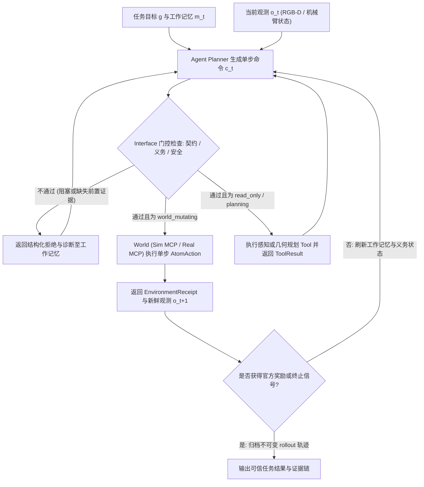
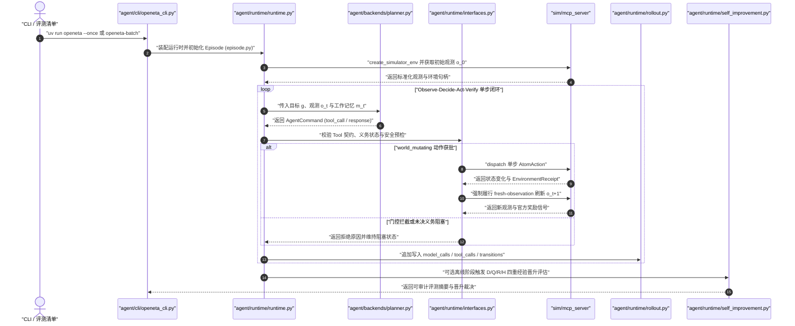

# ETA: A New Agentic Paradigm for Embodied Tasks

## 一句话定义

ETA（Embodied Task Agent）将数字编码智能体的“规划—工具调用—验证—经验沉淀”循环引入物理世界，通过 **Agent–Interface–World** 三层信任边界与单步世界修改强观测约束，使机器人系统在不训练任务专用策略的前提下完成长程操作并输出可审计轨迹；OpenETA 是其开源实现框架。

## 英文缩写速查

| 缩写 | 英文全称 | 简要说明 |
|---|---|---|
| ETA | Embodied Task Agent | 具身任务智能体，以规划器为中心通过受控工具接口与物理世界交互的范式 |
| VLA | Vision–Language–Action | 视觉-语言-动作模型，直接将观测与指令映射为机器人动作序列 |
| WAM | World Action Model | 世界动作模型，联合预测未来观测状态与动作以进行规划或评估 |
| MCP | Model Context Protocol | 模型上下文协议，OpenETA 用于统一封装仿真器与真机服务边界的通信协议 |
| TUI | Terminal User Interface | 终端用户界面，OpenETA 提供的交互式配置、工具检查与会话恢复入口 |
| TTL | Time To Live | 生存时间，论文实验中导致 3 个长程仿真回合失效的句柄过期时限 |

## 为什么重要

1. **填补端到端 VLA/WAM 在长程可控性与可审计性上的短板：** 现有具身基础模型多将视觉观测直接映射为底层动作，泛化能力受限于机器人训练数据覆盖面，且长任务执行过程难以在步级检查、拦截或归因。ETA 将高层决策从底层策略解耦出来，在每次物理修改前插入显式契约门控，在动作后强制收集环境回执。
2. **明确分离“认知智能”与“物理执行权威”：** 规划器（Agent）只负责理解目标与提议结构化指令，宿主运行时（Interface）独占权限校验、安全检查与工具分发，仿真器或真机（World）独占状态真值与奖励裁决，从而避免强编码模型通过读取特权状态或伪造输出“作弊”或触发未授权动作。
3. **验证极简具身接口对多模态推理模型的放大效应：** 在不依赖 VLA 或任务专用策略的条件下，仅向 Codex 暴露 `observe`、`mark_point`、`move_to` 三个核心工具，即可随规划器能力提升在 130 个 LIBERO 任务上实现从 47.7% 到 90.0%（Pass@5）的显著跃升，并诚实披露了受约束自演化尚未带来稳定增益及真机尚处接口集成阶段的边界。

## 核心信息

| 项目 | 内容 |
|---|---|
| 作者 | Yitong Chen, Zezheng Huai, Sixian Li, Yubang Wang, Haozhe Zhang, Yifei Zhang, Hechang Chen, Jingjing Gong, Yu-Gang Jiang, Xipeng Qiu |
| 机构 | 上海创智学院、复旦大学、吉林大学、南京大学、浙江大学 |
| 发表时间 | 2026-08-04（arXiv:2608.03924v1 [cs.RO]） |
| 论文链接 | [arXiv:2608.03924 (HTML)](https://arxiv.org/html/2608.03924) · [arXiv Abs](https://arxiv.org/abs/2608.03924) |
| 项目与代码 | [OpenMOSS/OpenETA](https://github.com/OpenMOSS/OpenETA) · [项目主页](https://openmoss.ai/OpenETA/)（Apache-2.0） |
| 清单分类 | `model.robot_control`, `harness.infrastructure` |
| 来源条目 | `survey_ax_2608_03924` |
| 开源状态 | 已开源（含完整运行时、工具注册表、Codex 适配插件、仿真 MCP 与测试；真机后端目前处于接口集成层级） |

## 核心原理

### 1. ETA 形式化闭环与运行时不变量

在时刻 $t$，Agent 基于任务目标 $g$、当前观测 $o_t$ 与工作记忆 $m_t$ 生成单一结构化命令 $c_t = \pi_{\mathrm{agent}}(g, o_t, m_t)$（仅允许 `tool_call` 或无物理副作用的 `response`）。宿主 Interface 依据结构契约、权限、来源（provenance）与前置证据对 $c_t$ 进行门控校验：

$$
a_t = \begin{cases} \mathrm{dispatch}(c_t), & \mathrm{gate}(c_t, o_t, m_t) = \mathrm{pass}, \\ \varnothing, & \text{otherwise.} \end{cases}
$$

随后 World 执行 $a_t$ 并返回标准化工具结果 $y_t$（`openeta.tool_result.v1`）、宿主签发的环境回执 $e_t$（`openeta.environment_receipt.v1`）以及刷新后的观测 $o_{t+1}$。系统严格执行**运行时不变量**：**一次最多执行一个改变世界状态的动作；动作完成后（或传输状态未知时），必须先获取一次新鲜观测，才能执行下一个依赖状态的物理动作**；若连续三次观测刷新失败，系统安全停机而非基于陈旧图像盲目猜测。

### 2. 三层信任边界与 OpenETA 系统组件

OpenETA 将核心系统划分为三个隔离角色与对应模块：

- **Agent 层（只做决策，不拥有执行权威）：**
  - **Tool（工具）：** 宿主注册的原子能力（`main@135a7edc7e60` 发布快照冻结为 **44 个 Tool**），按副作用分为四类：16 个 `read_only`（如 `observe`、`sam3`、`molmopoint`、`enhance_depth`）、12 个 `planning`（如 `anygrasp`、`graspgenx`、`anyplace`、`ik_preview_check`）、9 个 `bookkeeping`（如 `save_memory`、`register_skill`）和 7 个 `world_mutating`（物理子集称为 `AtomAction`，如 `move_to`、`follow_eef_trajectory`、`gripper_control`）。
  - **Skill 与 Soul：** Skill 为可编辑的文本经验，仅指导模型如何推理、核查与恢复，不能隐式打包执行动作序列；Soul 维护跨会话行为边界与风险偏好，同样无物理执行权。
- **Interface 层（宿主门控与四类运行时义务）：**
  - 只读/规划工具可在受限条件下批处理，但 `world_mutating` 调用严格单步串行执行。
  - 工作记忆维护四类强约束**义务（Obligations）**：（1）**Fresh observation**（新观测义务，3 次刷新失败即安全停机）；（2）**Target selection**（多分割候选时阻塞抓取直至显式选定候选 ID）；（3）**Grasp candidate**（切换或拒绝抓取姿态时保留来源与校验记录）；（4）**Release prerequisite**（夹爪释放前必须满足放置关系、运动与状态证据契约，否则拦截并记录违规）。
  - **可信回执与反作弊隔离：** 仅当回执的权限、执行 ID、会话 ID 与环境句柄全部匹配当前回合时，官方奖励或终止信号才被采信；普通 Tool 无法自造奖励。
- **World 层（双族 MCP 服务后端）：**
  - **Simulator MCP** 管理仿真生命周期与特权状态（如物体位姿、接触与官方判定），但特权字段绝不泄露给 Planner 上下文；**Real-robot MCP** 通过驱动与限幅保护暴露相机、机械臂与夹爪能力，两者向上映射至完全一致的 Planner 契约。

### 3. 两种运行配置：Full OpenETA 与 OpenETA for Codex

- **Full OpenETA：** 使用完整 44-Tool 注册表，将抓取与放置拆解为“资产参照检索（`retrieve_asset_reference`）→ 概念分割定位（SAM 3 / MolmoPoint）→ 显式候选确认 → 6-DoF 抓取估计（AnyGrasp / Contact-GraspNet / GraspGenX）→ 安全预检与运动执行 → 提拉探针与附着验证（attachment check）→ AnyPlace 放置与合规释放”的完整证据链（Appendix A）。
- **OpenETA for Codex：** 面向强多模态编码智能体的极简插件，仅提供 3 个具身工具：**`observe`**（按需获取 512×512 第三视角、腕部或 X/Y/Z 正交投影视图）、**`mark_point`**（单视图射线求交或正交双视图交叉定位 3D 世界坐标）与 **`move_to`**（用接近向量 `approach` 与夹爪张合向量 `jaw` 指定目标位姿，闭爪前渲染目标姿态预览，返回夹爪开度供附着判别）。

### 4. 受约束的智能体自我演化

针对如何将历史交互转化为未来经验，OpenETA 测试了三种从宽到窄的候选经验更新 $u$：任务级 Skill（Task-local Skill）、精确任务剧本（Exact-task playbook，仅在环境、suite、任务索引与文本全匹配时加载）和阶段局部增量（Stage-local delta，对比同任务成败轨迹提炼触发器与动作修正）。所有候选均禁止保存世界坐标、复用历史位姿或修改原子 Tool 规则，且必须依次通过四重门控才可晋升：

$$\mathrm{Promote}(u) = D(u) \land Q(u) \land R(u) \land H(u)$$

其中 $D(u)$ 为确定性契约与禁止项校验，$Q(u)$ 为生成上下文隔离审查，$R(u)$ 为同任务同种子回放复现官方成功，$H(u)$ 为配对留出集评估（要求客观指标提升且无安全/契约回归）。

## 流程总览

## 源码运行时序图

在 `OpenMOSS/OpenETA` 仓库中，用户或评测流水线通过 `agent/cli/openeta_cli.py`（对应 `uv run openeta`）或 `agent/cli/batch_eval.py`（`uv run openeta-batch`）启动主循环，经 `agent/runtime/runtime.py` 协调 `agent/backends/planner.py` 与 `agent/runtime/interfaces.py`，并通过 MCP 将动作请求发往 `sim/mcp_server` 执行，同时将证据写入 `rollout/` 并按需触发 `agent/runtime/self_improvement.py` 晋升校验。

## 实验与评测

论文在 LIBERO 操作基准、受约束自我演化以及 UR5e 真机接口上进行了多维度实证评测，所有成功率均严格以宿主认证的官方环境奖励为准：

### 1. Full OpenETA 固定矩阵基线（40 任务 × 10 种子 = 400 回合）

使用 `gpt-5.6-luna`（medium reasoning effort）在无人类协助、无在线演化的只读模式下运行 LIBERO 4 个标准套件（批运行耗时 19.59 小时，共消耗 17,231 轮次、17,141 次 Tool 调用与约 228.2M tokens）：

| LIBERO Suite | 成功 / 总回合数 | 成功率 | 平均轮次 (有效资源样本 n) | 说明 |
|---|---|---|---|---|
| Spatial | 8 / 100 | 8.0% | 47.5 (100) | 长程空间关系与放置对齐瓶颈明显 |
| Object | 26 / 100 | 26.0% | 31.2 (100) | 单物体抓取迁移表现最高 |
| Goal | 21 / 100 | 21.0% | 36.8 (100) | 部分任务达到 50%–90% 稳定率 |
| Long / LIBERO-10 | 1 / 100 | 1.0% | 58.5 (97) | 含 3 个约 1800s 句柄 TTL 过期污染回合 |
| **Overall** | **56 / 400** | **14.0%** | **43.4 (397)** | 18/40 任务至少成功 1 次；排除 3 污染单元格诊断为 56/397 (14.11%) |

- **成功与失败资源对照：** 成功回合（n=56）平均耗时 **1045.0 s**（30.7 轮次 / 30.7 次调用），失败回合（n=341）平均耗时 **1866.6 s**（45.5 轮次 / 45.2 次调用）。
- **互斥终止失败分布（共 344 个失败回合）：** `episode_timeout` 占 **215 次（62.5%）**，`unattended_ask_human` 占 **66 次（19.2%）**，`max_turns` 占 **35 次（10.2%）**，`status_report_without_reward` 占 **24 次（7.0%）**，`simulator_unknown_handle` 占 **3 次（0.9%）**，`remote_episode_terminated_without_reward` 占 **1 次（0.3%）**。

### 2. OpenETA for Codex（130 个 LIBERO 任务，三工具极简接口）

在未使用 VLA 或任务专用策略的前提下，固定三工具接口（`observe`、`mark_point`、`move_to`），对比三种推理强度规划器在 seeds 0–4 下的任务级 Pass@k：

| 规划器（medium reasoning） | Spatial (10) P@5 | Object (10) P@5 | Goal (10) P@5 | LIBERO-10 (10) P@5 | LIBERO-90 (90) P@5 | 总计 Pass@1 | 总计 Pass@5 |
|---|---|---|---|---|---|---|---|
| GPT-5.6 Luna | 9 | 3 | 6 | 2 | 42 | 21 / 130 | **62 / 130 (47.7%)** |
| GPT-5.6 Terra | 10 | 6 | 6 | 3 | 58 | 58 / 130 | **83 / 130 (63.8%)** |
| GPT-5.6 Sol | 10 | 10 | 8 | 10 | 79 | **92 / 130 (70.8%)** | **117 / 130 (90.0%)** |

注：Sol 在 Pass@2 / Pass@3 / Pass@4 的累计解决任务数分别为 104、113、114 个。仓库 README 另记录了论文提交后的 `robodojo-v112` 分支探索结果（跨版本人工辅助下 RoboDojo 42 任务的临时累积曲线），属后续版本实验，不计入本文正式静态基线。

### 3. 受约束自我演化实验（LIBERO Spatial）

论文在 6 个受控审计批次中测试候选经验更新，**结果无一通过四重晋升门控（晋升数 = 0）**：
- **Online multi-round Skill：** 10 任务 3 轮探索，两次运行成功数分别为 $0\to 1\to 0/10$ 与 $0\to 0\to 3/10$，偶发增益无法持久保持。
- **Task-local Skill（3 任务 × 10 留出种子 = 60 回合）：** Baseline **0/30** vs Candidate **0/30**（附着通过次数由 5 降至 1，到达 AnyPlace 由 3 降至 0）。
- **Exact-task playbook（3 任务 × 10 留出种子 = 60 回合）：** Baseline **4/30 (13.3%)** vs Candidate **1/30 (3.3%)**（McNemar 双侧检验 $p=0.375$；平均轮次由 42.8 增至 49.3，超时由 18 次增至 23 次）。
- **Stage-local delta v1 / v2：** v1 同种子回放双臂均 **0/3**（平均耗时 1342.3 s vs 1634.9 s）；对比式 v2 有效回放 **0/1** vs **0/1**，候选策略新增 1 次过早开爪违规（`open_before_attachment_failure_or_placement_release`），被门控直接拦截。

### 4. 真机接口集成状态（UR5e + Robotiq）

论文将真机证据明确冻结在 **interface integration（接口集成）** 层级：已完成 6 类相机驱动键、2 类机械臂驱动键与安全限幅契约的代码冻结，并保留了 1 条完整海绵入托盘（sponge-to-tray）与 1 条部分青椒抓运定性视频，尚未开展通过完整审计的真机定量批次评测。

## 与其他工作对比

| 范式 / 系统 | 核心决策路径 | 物理闭环与控制粒度 | 泛化依赖与主要短板 |
|---|---|---|---|
| **VLA（OpenVLA / $\pi_0$ / GR00T N1）** | 端到端观测直接映射到动作或动作块 | 隐式高频控制，长程中间状态难以审计与人工介入 | 强依赖机器人遥操作数据覆盖面，任务外泛化受限 |
| **WAM（DreamZero / DreamDojo）** | 联合预测未来视频/状态与动作序列 | 依赖想象未来排序规划，但想象并非真实世界回执 | 预测未来与真实物理结果存在偏差，仍需实测反馈校验 |
| **VLM 编码策略（CaP / CaP-X / ASPIRE）** | 生成完整控制程序后再基于执行轨迹修补 | 程序级粗粒度修复，高阶重规划滞后于单步状态变化 | 代码生成易忽略长程物理不确定性与底层安全门控 |
| **ETA / OpenETA（本文）** | Planner 逐次选择单步 Tool，经 Host 门控并强制刷新观测 | 单步原子动作级可审计闭环，天然兼容异构感知/VLA 工具 | 推理与验证链路延迟高（均值 >1000s/回合），单臂工具链对双臂/接触密集任务覆盖不足 |

在系统定位上，ETA 并非试图取代 VLA 或 WAM，而是将 VLA 视为专用动作 Tool、将 WAM 视为预测与方案比较 Tool，统一纳入 Host 门控的因果闭环之中。

## 结论

**一句话总判：ETA/OpenETA 在系统架构上成功建立了“智能规划与物理执行权限分离、单步动作强观测、经验晋升四重门控”的具身智能体工程规范，但在通用多阶段闭环效率、长程任务成功率及文本自我演化实效上仍处于早期探索阶段。**

1. **工程设计优先确立信任与审计边界：** 将 `world_mutating` 动作限制为单步串行并强制要求新鲜观测与宿主签名回执，是防止大模型幻觉直接引发物理风险或基准评测“读内存作弊”的有效运行时基线。
2. **极简三工具接口充分释放强多模态模型潜力：** 当规划器具备精确空间定位与预览自纠能力时（如 GPT-5.6 Sol），仅靠 `observe`、`mark_point`、`move_to` 即可在 LIBERO 130 任务上达到 90.0% Pass@5，证明复杂工具链在现阶段反而可能引入额外调用开销与失败累积（Full OpenETA 固定矩阵仅 14.0%）。
3. **文本经验的自我演化必须受限于回放与留出防回归门控：** 实验证明大模型事后总结的 Skill 或 Playbook 往往只是增加冗余视觉复查或过早开爪违规，若无 $D \land Q \land R \land H$ 门控，直接注入经验库会导致系统性能退化。
4. **Sim2Real 的工程瓶颈集中在深度质量与轨迹动力学保护：** 真实传感器（RealSense D435i/L515）的深度空洞与侧向抓取引起的机械臂加速度保护停机，说明仿真接口对齐不能替代真机标定、控制器调优与分阶段安全审计。

## 工程实践

- **多后端安装与启动：** 仓库基于 Python 3.10+ 与 `uv` 管理依赖，不同仿真器采用独立虚拟环境隔离（如 `bash scripts/setup_envs.sh libero`）。核心入口包括：
  - `uv run openeta`：交互式 TUI（内置 `/provider`、`/tools`、`/memory`、`/approvement`、`/resume`）。
  - `uv run python -m sim.mcp_server`：启动仿真 MCP 服务、REST API 与 Web 监控台（`http://localhost:8765/`）。
  - `uv run openeta-batch --manifest examples/parallel_libero_eval.json`：并发执行带状态隔离与人机恢复策略的批量评测，并支持 `openeta-replay` 将不可变 `rollout/` 日志重建为时间线视频。
- **可审计数据分层：** 运行时将可变工作状态（`working/`）、对话上下文（`conversation.jsonl`）、审计事件（`trace.jsonl`）与不可变发布归档（`rollout/` 下的 `manifest.json`、`model_calls.jsonl`、`tool_calls.jsonl`、`transitions.jsonl`、`episodes.jsonl`）严格分离，确保实验可逐帧复盘与哈希校验。
- **Codex 轻量集成：** 若已有强视觉推理模型作为 Planner，可优先采用 `adapter/` 下的轻量协议（仅 3 个具身工具），避开复杂多模块串联带来的延迟与超时累积。

## 局限与风险

- **推理与交互延迟过高：** 每次单步动作均需经过规划器推理、视觉感知、安全预检与新观测刷新，Full OpenETA 平均每回合耗时超过 17–31 分钟，`episode_timeout` 占全部失败的 62.5%，尚无法满足高频动态反应任务需求。
- **长程与精细放置能力薄弱：** LIBERO-10 固定矩阵基线仅 1/100 成功；物体附着稳定性、放置关系判别、释放时机以及多子目标剩余预算管理仍是主要瓶颈。
- **任务与形态覆盖受限：** 当前成熟工具链集中于单臂桌面刚体抓取与放置，缺乏双臂协同、力/触觉接触密集操作及移动底盘导航的完整工具与检查器。
- **自我演化尚无正向实证：** 所有 6 批自我演化试验均未能产出可通过晋升门控的经验，文本规则如何精准触发并改变底层动作选择仍待解决。
- **真机安全性与稳定性未经批次验证：** 论文明确提示仿真成功率不能推导物理安全性，碰撞检测、控制频率、急停接管、负载上限与标定漂移必须在实体工作空间内按 Appendix G 清单独立验证。

## 关联页面

- [Agentic Robots 综述](paper-towards-agentic-robots-survey.md)
- [全量项目节点清单](../overview/awesome-agentic-robots-node-index.md)
- [VLA 方法背景](../methods/vla.md)
- [机器人智能体执行框架](../methods/robot-agent-harness.md)：对照规划、工具调用与反馈的系统边界
- [Agent Tool Use Interface](../methods/agent-tool-use-interface.md)：对比宿主工具契约、副作用分级与 MCP 协议设计
- [Agent Planning & Feedback](../methods/agent-planning-feedback.md)：分析单步强观测闭环与执行回执驱动的重规划机制
- [Agent Skill Packaging](../methods/agent-skill-packaging.md)：对比可读文本 Skill 与受约束经验晋升门控
- [Agentic Manipulation Policies](../methods/agentic-manipulation-policies.md)：探讨通用任务智能体与专有操作策略的协作方式
- [Embodied Agent Benchmarking](../methods/embodied-agent-benchmarking.md)：参考可复现清单冻结、基础设施污染界定与 Pass@k 报告规范
- [Coding Agent Verification Loops](../methods/coding-agent-verification-loops.md)：对比数字编码智能体验证闭环向物理世界的迁移
- [Manipulation 任务总览](../tasks/manipulation.md)

## 推荐继续阅读

- [ETA 论文 HTML 全文（arXiv:2608.03924）](https://arxiv.org/html/2608.03924)
- [OpenETA 官方开源仓库（OpenMOSS/OpenETA）](https://github.com/OpenMOSS/OpenETA)
- [OpenETA 项目主页](https://openmoss.ai/OpenETA/)

## 参考来源

- [ETA 论文原文核对归档](../../sources/papers/paper-agentic-2608-03924.md)
- [OpenMOSS/OpenETA 仓库核对归档](../../sources/repos/paper-agentic-2608-03924.md)
- [官方 Awesome 快照归档](../../sources/repos/awesome-agentic-robots-survey-index.md)
- [arXiv:2608.03924 原始论文](https://arxiv.org/abs/2608.03924)
- [OpenMOSS/OpenETA GitHub 仓库](https://github.com/OpenMOSS/OpenETA)
