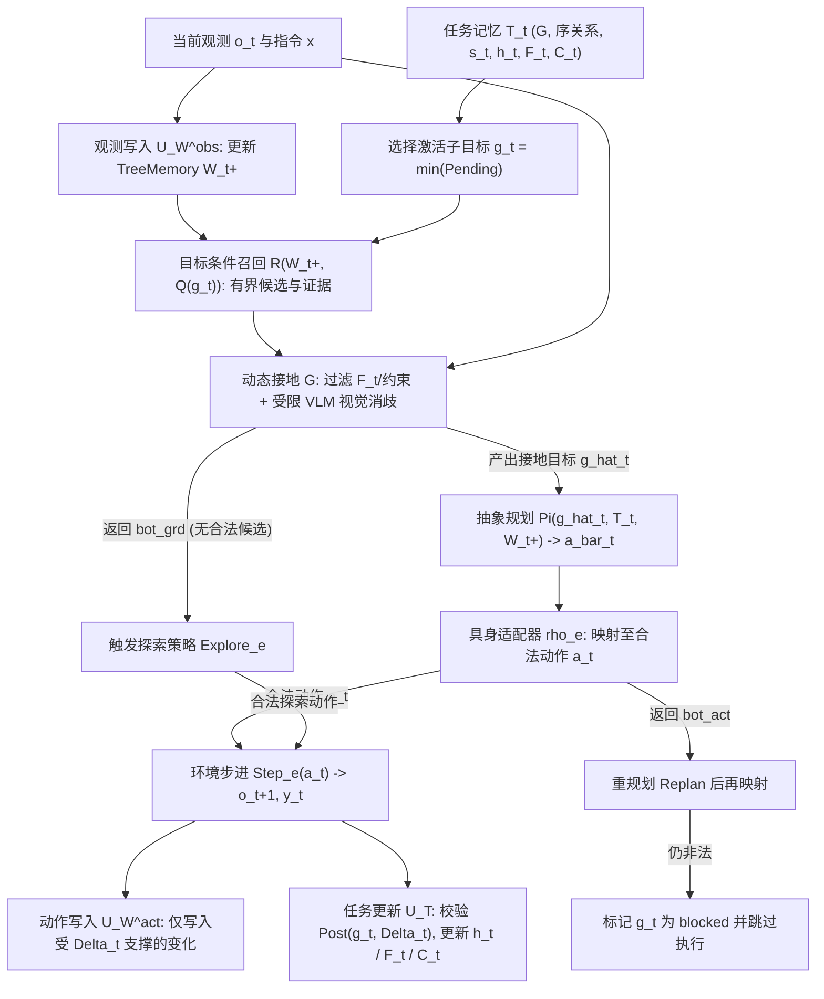

# Mimir: A Neuro-Symbolic Memory System with Dynamic Grounding for Embodied Agents in Interactive Environments

## 一句话定义

Mimir 是一个面向部分可观测长程具身交互任务的神经符号记忆系统：它将维护物体位置、状态与感知证据的 **世界记忆（World Memory / TreeMemory）** 与维护有序子目标议程、手持状态和失败假设的 **任务记忆（Task Memory）** 显式分离，并在每一步决策前通过 **动态接地（Dynamic Grounding）** 将当前激活子目标绑定到有证据支撑的候选实体与来源上下文，再经本体无关抽象规划与具身适配器执行闭环。

## 英文缩写速查

| 缩写 | 英文全称 | 简要说明 |
|---|---|---|
| VLM | Vision-Language Model | 视觉语言模型，Mimir 在多候选视觉消歧与动作规划阶段依赖的骨干模型 |
| SR | Success Rate | 任务整体成功率（百分数），衡量整条长程具身指令是否完全达成 |
| GC | Goal Condition Success Rate | 目标条件完成率（百分数），衡量有序子目标或目标条件的完成比例 |
| EB-ALFRED | EmbodiedBench-ALFRED | EmbodiedBench 中侧重长程家庭多步交互与程序性约束的评测环境 |
| EB-Habitat | EmbodiedBench-Habitat | EmbodiedBench 中侧重开放物理场景物体寻找与位置推理的评测环境 |
| VLA | Vision-Language-Action | 视觉-语言-动作端到端策略范式，文中作为隐式时序记忆的对照路线 |

## 为什么重要

1. **解决扁平历史“有记录但无接口”的结构性缺陷**：长程部分可观测操作中，物体离开视野、被放入容器或经历状态改变后，单纯把历史帧或长文本堆进上下文虽能保留片段，却无法直接回答“目标还在容器里、正被手持，还是已经放置到位”以及“哪些子目标已满足后置条件、哪些被阻塞”。Mimir 将记忆从被动日志转化为在线可读写、可校验的决策状态。
2. **揭示任务进度与场景信念的不同步演化规律**：观测与交互改变物理世界（物体位置与状态），而反馈结果才改变议程进度、手持状态与被证伪的来源假设；二者分离后，推翻一个错误物体位置假设不会抹除已完成的子目标进度，完成一个子目标也不会清除既有场景事实。
3. **证明外化结构化决策状态可弥补骨干模型参数规模差距**：在 13 个评测配置中接入 Mimir 均取得显著增益（EB-ALFRED 上 InternVL3-8B 的 SR 提升达 +42.5 个百分点），且 32B 开源底座（Qwen3-VL-32B）配合 Mimir 在 EB-Habitat Long-horizon 达到 86.0% SR，超过同期对比的多款闭源多模态大模型。

## 核心信息

| 字段 | 内容 |
|---|---|
| 作者 | Haoming Xu, Zhenlin He, Hengyi Wang, Jiafeng Xu, Hao Dong |
| 机构 | PrimeBot Research Institute、北京大学（PKU）、中国科学院大学（UCAS） |
| 发表时间 | 2026-08-05（arXiv:2608.04933v1 [cs.RO]） |
| 论文链接 | [arXiv:2608.04933](https://arxiv.org/abs/2608.04933) · [arXiv HTML 全文](https://arxiv.org/html/2608.04933) |
| 项目与代码 | 暂未公开链接（原文摘要注明“Our code will be released soon.”，截至 2026-11-27 尚无 GitHub 或独立项目主页） |
| 清单分类 | `harness.memory` |
| 来源条目 | `survey_ax_2608_04933` |
| 开源状态 | **宣称将开源 / 暂未列链接**（原文承诺即将开源代码，核查日尚无可访问仓库） |

## 核心原理

Mimir 在回合开始时接收自然语言指令 $x$、当前具身 $e$ 的合法动作空间 $A_e$ 与初始观测 $o_0$。在时间步 $t$，系统维护双记忆状态：

$$M_t = (T_t, W_t)$$

其中 $T_t$ 为任务记忆（execution progress），$W_t$ 为世界记忆（scene belief），二者通过动态接地接口在每步行动前耦合、行动后依据观测与反馈独立更新。

### 1. 任务记忆（Task Memory）

任务记忆将执行状态形式化为六元组：

$$T_t = (\mathcal{G}, \preceq, s_t, h_t, F_t, C_t)$$

- $\mathcal{G}$ 为符号子目标集合，$\preceq$ 为偏序议程（将前置条件排在依赖子目标之前，并以任务顺序作为确定性平局决胜规则）；
- $s_t: \mathcal{G} \to \{\mathrm{pending}, \mathrm{completed}, \mathrm{blocked}\}$ 记录子目标状态；
- $h_t$ 记录当前手持物体状态；
- $F_t$ 记录已被执行反馈证伪的“物体–来源”假设集合；
- $C_t$ 保存已完成子目标的支撑证据。

每步待办集合与当前激活子目标由确定性规则计算：

$$\mathcal{P}_t = \{g \in \mathcal{G} \mid s_t(g) = \mathrm{pending}\}, \qquad g_t = \begin{cases} \min_{\preceq}\mathcal{P}_t, & \mathcal{P}_t \neq \emptyset \\ \bot_{\mathrm{goal}}, & \mathcal{P}_t = \emptyset \end{cases}$$

环境反馈表示为 $y_t = (\sigma_t, \Delta_t)$，其中 $\sigma_t$ 为动作级成败信号，$\Delta_t$ 为受反馈支撑的物体关系、物体状态或手持状态变化。任务记忆按 $T_{t+1} = U_T(T_t, g_t, a_t, y_t)$ 更新，并严格区分“动作成功”与“子目标完成”：

$$s_{t+1}(g_t) = \mathrm{completed} \iff \operatorname{Post}(g_t, \Delta_t) = 1$$

因此导航到达或打开容器即使成功，若未触发抓起、放置或状态改写等后置条件，操作子目标仍保持 `pending`；而一旦某个“物体–来源”绑定被反馈否定，该假设进入 $F_{t+1}$ 以防后续重复尝试。

### 2. 世界记忆（World Memory / TreeMemory）

世界记忆以回合级树状结构 **TreeMemory** 组织场景实体及其关系：

$$W_t = (V_t, E_t, r, \ell_t, \phi_t)$$

- $V_t$ 为实体节点集合，$r$ 为场景根节点，$E_t$ 为父子边集合，为每个非根实体 $v \in V_t$ 赋予唯一激活父节点 $p_t(v)$（表示所在房间、支撑面、容器或手持状态）；同名多实例或冲突关系作为独立假设分支保留。
- $\ell_t$ 为语义标签函数，$\phi_t$ 为属性与证据存储，显式记录条目的来源是感知观测还是交互反馈。

世界记忆区分两个写入算子：
- **观测更新**：$W_t^+ = U_W^{\mathrm{obs}}(W_t, o_t)$，在语义身份与关系上下文一致时合并或细化实体，冲突则保留独立假设；
- **动作更新**：$W_{t+1} = U_W^{\mathrm{act}}(W_t^+, a_t, y_t)$，仅将受 $\Delta_t$ 支撑的效果写入物理关系（如抓取后将父节点迁至手部、放置后迁至目标容器、状态改变写入属性）；失败动作不改变世界物理关系，仅把失败绑定计入 $F_{t+1}$。

### 3. 目标条件召回、动态接地与闭环执行

1. **目标条件召回（Goal-Conditioned Recall）**：查询构造器根据 $g_t$ 的物体描述、目标状态与来源/目的约束生成 $q_t = Q(g_t)$，检索 $W_t^+$ 得到有界排序候选列表：
   $$\mathcal{R}_t = R(W_t^+, q_t) = \bigl[(v_k, p_t^+(v_k), \eta_{t,k})\bigr]_{k=1}^{K_t}$$
   其中 $\eta_{t,k}$ 汇总词法、视觉、语义与关系证据，同时剔除 $F_t$ 中已被否定的绑定。
2. **动态接地（Dynamic Grounding）**：接地算子 $G$ 先过滤不满足合法动作集 $A_e$ 或违背显式约束的候选；若仍有多个备选，VLM 将当前第一人称观测 $o_t$ 与紧凑候选描述对照（受指令 $x$、激活目标 $g_t$ 与失败记录 $F_t$ 条件化），输出被严格限制在 $\{v_k\}_{k=1}^{K_t}$ 内，杜绝无记忆支撑的幻觉实体。选定最优候选 $k^\star$ 后，若指令未显式给出起点来源 $u_x(g_t) = \bot_{\mathrm{src}}$，则自动由世界记忆父节点补全 $u_t^\star = p_t^+(v_t^\star)$，组成接地目标：
   $$\hat{g}_t = G(g_t, \mathcal{R}_t, F_t, A_e, x, o_t) = (g_t, v_t^\star, u_t^\star, d_t^\star, \eta_t^\star)$$
   该接口采用 **失效闭锁（fail-closed）** 设计：若无合法候选则返回 $\bot_{\mathrm{grd}}$，转由探索策略 $\operatorname{Explore}_e(g_t, T_t, W_t^+, A_e)$ 主动搜集新观测。
3. **抽象规划与具身映射**：在接地成功后，规划器在本体无关抽象空间 $\bar{\mathcal{A}}$ 生成 $\bar{a}_t = \Pi(\hat{g}_t, T_t, W_t^+)$，经具身适配器 $\rho_e: \bar{\mathcal{A}} \to A_e \cup \{\bot_{\mathrm{act}}\}$ 映射为可执行动作 $a_t$。若映射到 $\bot_{\mathrm{act}}$，执行一次 `Replan` 并重映射；若仍非法则标记当前子目标为 `blocked`（$\operatorname{Block}(T_t, g_t)$），绝不向环境 $\operatorname{Step}_e$ 发出未验证动作。

## 流程总览

## 源码运行时序图

**不适用**（截至 2026-11-27，论文原文摘要仅声明“Our code will be released soon.”，尚未公布可运行的官方源码仓库或项目页入口，待后续公开后补充核查与运行时序图。）

## 实验与评测

所有实验均在 **EmbodiedBench**（Yang et al., 2025）的 **EB-ALFRED** 与 **EB-Habitat** 上执行，采用 `temperature = 0` 的确定性设置，报告 **Success Rate (SR, %)** 与 **Goal Condition Success Rate (GC, %)**。

### 1. 跨多模态骨干网络的四任务均值结果（Table 1 & Table 4）

四任务均值覆盖 `Base`、`Common-sense`、`Complex-instruction` 与 `Long-horizon`（以下数值摘自 Table 1，Δ 为论文未舍入前差值）：

| 骨干模型 | EB-ALFRED SR（原生 → +Mimir） | EB-ALFRED GC（原生 → +Mimir） | EB-Habitat SR（原生 → +Mimir） | EB-Habitat GC（原生 → +Mimir） |
|---|---:|---:|---:|---:|
| Qwen3-VL-8B | 26.5 → 57.0 (**+30.5**) | 39.7 → 66.7 (+26.9) | 28.5 → 65.0 (**+36.5**) | 37.1 → 73.8 (+36.8) |
| Cosmos-Reason2-8B | 13.0 → 51.5 (+38.5) | 21.8 → 63.4 (+41.6) | 28.5 → 45.5 (+17.0) | 37.4 → 61.1 (+23.6) |
| InternVL3-8B | 17.5 → 60.0 (**+42.5**) | 28.6 → 68.5 (+39.9) | 26.5 → 60.5 (+34.0) | 37.3 → 69.2 (+31.9) |
| Qwen3.5-8B | 41.5 → 59.0 (+17.5) | 52.0 → 67.6 (+15.6) | 32.0 → 53.0 (+21.0) | 38.3 → 66.2 (+27.9) |
| InternVL3.5-8B | 24.5 → 60.5 (+36.0) | 34.1 → 69.5 (+35.4) | 37.0 → 49.5 (+12.5) | 45.1 → 62.9 (+17.7) |
| Gemma-3-12B | 29.0 → 59.0 (+30.0) | 41.4 → 68.0 (+26.6) | 26.5 → 64.0 (**+37.5**) | 33.0 → 75.7 (**+42.6**) |
| Gemma-3-27B | 35.0 → 59.0 (+24.0) | 46.2 → 67.7 (+21.5) | 42.5 → 60.0 (+17.5) | 49.7 → 71.3 (+21.6) |
| Qwen3.5-27B | 70.5 → **72.5** (+2.0) | 75.1 → **79.5** (+4.4) | 57.0 → 62.5 (+5.5) | 64.4 → 71.5 (+7.1) |
| Qwen3-VL-32B (Instruct) | 50.5 → 68.0 (+17.5) | 59.5 → 73.0 (+13.5) | 50.5 → **71.5** (+21.0) | 57.5 → **78.6** (+21.1) |
| InternVL3-38B | 30.0 → 58.5 (+28.5) | 43.0 → 67.2 (+24.2) | 42.5 → 50.0 (+7.5) | 52.6 → 62.9 (+10.3) |
| Qwen2.5-VL-72B | 50.0 → 66.0 (+16.0) | 58.2 → 72.9 (+14.7) | 49.0 → 70.0 (+21.0) | 56.8 → 77.4 (+20.7) |
| InternVL3-78B | 31.5 → 59.5 (+28.0) | 44.1 → 68.4 (+24.3) | 43.5 → 54.5 (+11.0) | 53.4 → 68.4 (+15.0) |

注：Table 4 另评测了 Qwen3-VL-32B Thinking 变体（共 13 个骨干配置）：EB-ALFRED SR 48.0 → 61.5（+13.5）、GC 55.8 → 69.1（+13.3）；EB-Habitat SR 52.0 → 67.5（+15.5）、GC 61.7 → 75.6（+13.9）。全矩阵中最大 SR 增益为 **42.5%**（InternVL3-8B @ EB-ALFRED），论文摘要报告平均增益为 **23.0%**；8B 级别的 `InternVL3-8B + Mimir`（ALFRED 60.0 / Habitat 60.5 SR）甚至持平或高于未加 Mimir 的同系列 38B/78B 模型（58.5/50.0 与 59.5/54.5）。

### 2. 同底座智能体/记忆系统对比（Table 2）与闭源模型对比（Table 3）

- **统一 Qwen2.5-VL-72B 底座（Table 2，`Base` 与 `Long-horizon` 非加权均值，沿用 RoboMemory 评测口径）**：
  - **Mimir**：EB-ALFRED **68.0%** SR / 76.3% GC；EB-Habitat **90.0%** SR / **94.6%** GC；
  - 对比基线：RoboMemory（67.0% / 78.4% 与 74.0% / 81.0%）、Voyager（44.0% / 63.7% 与 49.0% / 69.0%）、Cradle（43.0% / 54.5% 与 46.0% / 59.6%）、Reflexion（29.0% / 43.5% 与 47.5% / 58.6%）、RoboOS（22.0% / 28.0% 与 29.0% / 38.0%）。Mimir 在 EB-Habitat 上较 RoboMemory 高出 **+16.0 SR** 与 **+13.6 GC**，跨基准总体平均 SR 提升 **8.5%**。
- **EB-Habitat Long-horizon 与闭源基础模型对比（Table 3，最大生成预算 16,384 tokens）**：
  - **Mimir (Qwen3-VL-32B)**：**86.0%** SR / **93.0%** GC；
  - 对比模型：Claude-Sonnet-4-6（82.0% / 86.8%）、Gemini-3.5-Flash（80.0% / 84.8%）、GPT-5.5（78.0% / 79.5%）、Gemini-3.1-Pro（70.0% / 75.0%）、Kimi-2.5（30.0% / 34.6%）。Mimir 以 32B 开源底座超过所对比闭源基线最高值 +4.0 SR 与 +6.2 GC。

### 3. 消融实验与分工验证（Table 4）

| 变体（Qwen3-VL-8B / Qwen3-VL-32B） | EB-ALFRED SR | EB-ALFRED GC | EB-Habitat SR | EB-Habitat GC |
|---|---:|---:|---:|---:|
| Full Mimir (8B / 32B) | **57.0** / **68.0** | **66.7** / **73.0** | **65.0** / **71.5** | **73.8** / **78.6** |
| Without world memory (8B / 32B) | 52.0 / 47.0 | 63.2 / 57.2 | **12.5** / **12.5** | 34.8 / 35.0 |
| Without task memory (8B / 32B) | **34.0** / **30.5** | 51.5 / 46.5 | 54.0 / 46.5 | 65.9 / 60.8 |

- **环境敏感性分工**：在需要记忆隐蔽物体位置的 EB-Habitat 上，移除世界记忆导致 8B 与 32B 底座 SR 均暴跌至 **12.5%**；而在步骤依赖严密的 EB-ALFRED 上，移除任务记忆造成更大退化（8B 降 23.0 分，32B 降 37.5 分）。
- **Instruct vs. Thinking 模式逆转**：不加 Mimir 时 Thinking 在 EB-Habitat 略高于 Instruct（52.0% vs 50.5%）；接入 Mimir 后，Instruct 在全部四项指标上反超 Thinking（ALFRED 68.0/73.0 vs 61.5/69.1；Habitat 71.5/78.6 vs 67.5/75.6），说明状态显式外化接地后，直接决策的 Instruct 模型比内置长推理模式更能高效利用记忆。

## 与其他工作对比

| 系统 / 路线 | 核心记忆组织 | 是否分离世界与任务状态 | 决策前显式接地接口 | 与 Mimir 的关键差异 |
|---|---|---|---|---|
| **Mimir（本文）** | 回合级 TreeMemory + 有序符号任务记忆 $T_t$ | 显式分离并独立更新 | 目标条件召回 + 受限候选 VLM 接地 + 失效闭锁 | 通过 $F_t$、$h_t$、$\operatorname{Post}$ 校验与父节点来源补全闭环决策 |
| **LLM-State / CAPEAM** | 物体属性状态 / 动作上下文与物体排布 | 偏重世界状态，任务进度隐式 | 无显式动态接地绑定位 | 未区分观测写与动作写后对激活子目标的单步证据绑定 |
| **SayPlan** | 分层 3D 场景图搜索与模拟器反馈重规划 | 无独立符号任务记忆 | 依赖 3D 场景图 | Mimir 不假设预建 3D 场景图，直接序列化第一人称观测与记忆快照 |
| **CLEA / RoboMemory** | 环境记忆+执行批评 / 类脑空间-时间-情景-语义多记忆 | 多记忆协同但缺直接对齐接口 | 通用记忆检索注入 | 在 Qwen2.5-VL-72B 下 EB-Habitat SR/GC 显著低于 Mimir（74.0/81.0 vs 90.0/94.6） |
| **Voyager / Reflexion / Cradle** | 技能库 / 语言反思 / 通用控制历史 | 无物理实体–进度解耦结构 | 无具身实体约束过滤 | 泛化到多房间隐蔽物体长程操作时更容易丢失物体位置与前置状态 |

## 结论

**一句话总判：Mimir 的核心贡献不在于“存下更多历史”，而在于建立“世界信念 $W_t$ 与任务进度 $T_t$ 分离 + 行动前目标条件动态接地”的在线接口，使中等规模开源 VLM 也能在长程部分可观测任务中稳定闭环。**

1. **世界记忆与任务记忆各司其职且缺一不可** — EB-Habitat 高度依赖世界记忆追踪物体去向（移除后 SR 跌至 12.5%），EB-ALFRED 高度依赖任务记忆维护依赖序与后置条件（移除后 32B 模型跌 37.5 分）。
2. **区分“动作成功”与“子目标达成”是长程防重复的关键** — 仅当 $\Delta_t$ 满足 $\operatorname{Post}(g_t, \Delta_t)=1$ 才推进任务状态，并把证伪绑定写入 $F_t$，可直接消解导航成功后误以为任务完成或死循环重抓问题。
3. **显式外化状态可部分替代隐式长思维链** — 当接地状态足够清晰时，Instruct 变体（68.0/71.5 SR）反而优于 Thinking 变体（61.5/67.5 SR），工程选型上无需为长程记忆决策盲目堆叠隐式思考 token。
4. **记忆受限于感知输入与语言粒度的物理边界** — 若物体被严重遮挡、未进入观测流或指令仅给出歧义颜色/粗类别，Mimir 只能保守保留多假设而无法凭空恢复缺失感知。

## 工程实践

- **闭锁式动作安全护栏**：工程实现中应保留论文 Algorithm 1 的双层退避——接地失败（$\bot_{\mathrm{grd}}$）转交探索策略 $\operatorname{Explore}_e$；抽象动作映射失败（$\bot_{\mathrm{act}}$）先单次 `Replan`，仍失败则 `Block` 当前子目标，避免向真实或仿真底层发送非法参数。
- **受限候选集防幻觉**：在 VLM 消歧阶段把输出词表或选择空间严格限制在召回候选集 $\{v_k\}_{k=1}^{K_t}$ 内，可防止模型在上下文长时虚构场景中不存在的物体或容器。
- **部署前提核查**：由于论文官方源码与 Prompt 细节尚未发布，实际复现时需自行依据 EmbodiedBench 的反馈接口定义 $\Delta_t$ 解析器与 $\operatorname{Post}(g_t, \Delta_t)$ 判定规则。

## 局限与风险

1. **源码与实现细节暂未开放**：论文标注代码“will be released soon”，截至 2026-11-27 尚无公开仓库可供核验 TreeMemory 索引数据结构、召回打分函数及 $\rho_e$ 具身适配器细节。
2. **仅在离散高层仿真基准验证**：评测局限于 EB-ALFRED 与 EB-Habitat（高层技能/动作接口），尚未在连续控制动力学、真实机械臂抓取失败噪声或物理真机长程场景中验证。
3. **跨实例指代歧义与不可见瓶颈**：如图 3 所示，面对只描述粗类别/颜色的多实例场景，以及渲染细节不足或严重遮挡导致的漏检，世界记忆无法补全从未观测到的事实。

## 关联页面

- [Agentic Robots 综述](paper-towards-agentic-robots-survey.md)
- [全量项目节点清单](../overview/awesome-agentic-robots-node-index.md)
- [VLA 方法背景](../methods/vla.md)
- [机器人智能体执行框架](../methods/robot-agent-harness.md)：对照规划、执行接口与反馈机制。
- [智能体规划与反馈机制](../methods/agent-planning-feedback.md)：对照子目标议程维护、后置条件检验与失败重规划机制。
- [智能体工具调用接口](../methods/agent-tool-use-interface.md)：参考抽象动作空间到具身合法动作空间 $\rho_e$ 的受限映射接口。
- [具身智能体基准评测](../methods/embodied-agent-benchmarking.md)：参考 EmbodiedBench（EB-ALFRED / EB-Habitat）的 SR 与 GC 评测口径。
- [智能体操作策略](../methods/agentic-manipulation-policies.md)：对照神经符号记忆规划与端到端策略在长程操作中的分工。
- [机器人操作任务](../tasks/manipulation.md)：了解部分可观测桌面与室内操作对状态追踪的需求。
- [RoboMemory 实体页](paper-robomemory-multi-type-embodied-memory.md)：同底座（Qwen2.5-VL-72B）EmbodiedBench 评测下的直接记忆框架对照。
- [SayPlan 实体页](paper-sayplan-llm-scene-graph-planning.md)：对照 3D 场景图规划与 Mimir 无预设 3D 场景图方案的差异。
- [Voyager 实体页](paper-agentic-2305-16291.md)：Table 2 中的通用具身智能体基线对照。

## 推荐继续阅读

- [Mimir 论文 arXiv 摘要页（arXiv:2608.04933）](https://arxiv.org/abs/2608.04933)
- [Mimir 论文 HTML 全文](https://arxiv.org/html/2608.04933)
- [EmbodiedBench 基准论文（arXiv:2502.09560）](https://arxiv.org/abs/2502.09560)

## 参考来源

- [Mimir 论文全文核对档案](../../sources/papers/paper-agentic-2608-04933.md)
- [官方 Awesome 快照归档](../../sources/repos/awesome-agentic-robots-survey-index.md)
- [arXiv 原文（2608.04933v1）](https://arxiv.org/abs/2608.04933)
