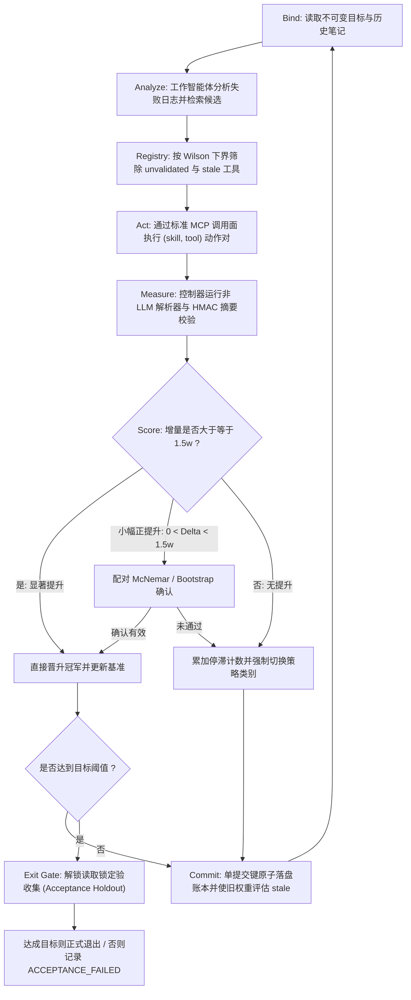

# You Don't Need To Stay in The Loop: An Agentic Robotics Loop for Robot-Policy Improvement

## 一句话定义

**AgenticRobotics** 是一个将软件工程「编码智能体闭环」迁移到**机器人策略改进外层研究循环（outer research loop）**的后端无关控制面：由 LLM 控制器驱动一次性工作智能体执行耐用型 `Train-Evaluate-Improve` 事务，并依赖**证据门控晋升、提交键崩溃恢复、控制器自解析测量与产物绑定的工具质量过期机制**来允许人工离场，而非声称自动选出的检查点优于人类。

## 英文缩写速查

| 缩写 | 英文全称 | 简要说明 |
|---|---|---|
| VLA | Vision-Language-Action | 视觉-语言-动作策略模型（如 $\pi_{0.5}$、SmolVLA），作为本控制面调度的底层策略后端 |
| MCP | Model Context Protocol | 模型上下文协议（2025-11-25 修订版），用于为机器人策略、训练器等工具提供标准化调用面 |
| SPRT | Sequential Probability Ratio Test | 序贯概率比检验；文中以 mixture-SPRT 与 $e$-process 解决可选停止下的任意时刻有效检验 |
| ESS | Expected Sample Size | 平均决策样本数（episodes-to-decision），用于衡量序贯门控在真实 $+8$ 点提升下的评测开销 |
| HMAC | Hash-based Message Authentication Code | 基于哈希的消息认证码，文中将非 LLM 解析指标与检查点、命令摘要绑定以检测伪造 |
| TPE | Tree-structured Parzen Estimator | Vizier 风格的树结构 Parzen 估计超参搜索基线，用于在留出集上对比决策后悔值 |

## 为什么重要

1. **填补机器人「外层研究循环」的工程与统计治理空白**：[VLA](../methods/vla.md)、模仿学习与 RL 后训练强化了策略内循环，但失败归因、作业调度、噪声评测比较与历史教训记忆仍依赖人工驻守；本文把软件编码智能体的「主控制器 + 一次性执行子智能体」架构系统性地移植到机器人实验循环。
2. **直面机器人工具高故障与非确定性本质**：与软件编译/单测工具不同，机器人策略往往只有中等双位数成功率、训练器会崩溃、硬件可能缺席且固定种子仍存在 GPU 非确定性；因此能力信任不能来自静态描述，必须**每次调用留痕、按实测定级、随权重更新自动失效**。
3. **诚实区分「操作可靠性」与「选型优越性」**：论文公开报告了反直觉负结果——在测得的单条从头训练谱系上，所有基于评测分数的选择器（含本文门控）在留出集上均输给「直接取最后一个检查点」；这澄清了外层智能体控制面的核心价值在于**控制误晋升与保证断点可恢复**，而非盲目替代直觉选型。

## 核心信息

| 字段 | 内容 |
|---|---|
| **作者** | Hang Yu (`hangyu8123@gmail.com`) |
| **机构** | Independent Researcher, United States |
| **发表时间** | 2026-08-02（v1）/ 2026-11-08（arXiv:2608.07555v2 [cs.RO]，标注 "Agentic Robotics Preview Version"） |
| **论文链接** | [arXiv:2608.07555](https://arxiv.org/abs/2608.07555) / [arXiv HTML v2](https://arxiv.org/html/2608.07555) |
| **项目与代码** | 标注入口 [AgenticRobotics GitHub](https://github.com/HangYu8123/AgenticRobotics/tree/af89f02d8f886946b1870b75c166e514b75d7cc5)（2026-11-27 实测返回 404，仓库未公开） |
| **清单分类** | `model.training, harness.skills`（来源条目：`survey_ax_2608_07555`） |
| **开源状态** | **未确认开源代码**（截至 2026-11-27 预览仓库地址返回 404，仅论文 §6 给出内部模块布局描述与 106 项单元测试说明） |

## 核心原理

控制面在可执行 Markdown 控制器协议（规定 11 条不变量与阶段顺序）与确定性参考工具（JSONL 账本、纯重放校验器、命令预检、工具注册表与 MCP 调用面）之间划清边界，不直接执行训练或触碰物理硬件（§3.1–§3.6）：

### 1. 四大架构准则与 `agent -> skill -> tool` 解耦（§3.2–§3.3）

- **万物工具化与物理剥离**：所有策略、训练器、评估器、遥操采集器、数据集编辑器与标定器均封装在工具描述符之后（审计快照含 6 个种子描述符），统一经由无 shell、可执行白名单校验的 CLI / MCP stdio（2025-11-25 规范）`input -> tool -> output` 接口调用；发布失败与超时均作为结构化结果信封返回而非异常。评估命令（防篡改）、多小时分离式训练与真机人工采集三类能力刻意不直接暴露为 MCP 同步调用。
- **技能作为可编辑工作流**：动作空间分解为「控制器决定做什么（`agent`）→ 技能编排怎么做（`skill`）→ 工具决定后端能做什么（`tool`）」。技能以 Agent Skills Markdown 格式保存（审计快照包含 29 个循环技能与 1 个编写工具，含构建、打包、验证、改进四类工具生命周期技能），每轮决策由 `(skill, tool)` 动作对组成。跨轮次记忆写入 `NOTEBOOK.md`（每条含 `did / learned / source`），绑定时作为**不可信数据**而非指令读取。

### 2. 研究回合事务与 11 条不变量（§3.4）

- **不可变目标与状态机**：运行前锁定不可变目标（评估指标、优化方向、达标阈值、评估命令、运行目录与可选锁定验收集）。每个研究回合严格按 $\mathrm{Bind} \rightarrow \mathrm{Analyze} \rightarrow \mathrm{Act} \rightarrow \mathrm{Measure} \rightarrow \mathrm{Score} \rightarrow \mathrm{Commit}$ 推进。
- **提交键恢复与代数隔离**：控制器维护单一规范在途记录，在原子文件替换与 sidecar 锁下按提交键推进副作用，进程崩溃恢复时从**首个缺失阶段**继续完成而非重放已提交操作；同时通过 generation ID 隔离过时 worker/timer 唤醒，并设计 `(run_id, round_id, effect_type, generation)` 复合幂等键约束后端去重与 Saga 补偿。
- **11 条不变量**：目标不可变、仅经 exit 退出、控制器独占测量解析、先记日志再推进（log-before-advance）、开放技能与工具菜单、禁止运行时自修改代码、代数限定唤醒、提交键约束副作用、位置无关性、仅依据已验证成果推进状态、能力质量必须实测且随产物变更过期。

### 3. 证据门控晋升（§3.5 & §5）

对于二项成功计数 $k_i / n_i$，基线闭式门控采用双样本 Agresti–Caffo 半宽估计：

$$\tilde{p}_i = \frac{k_i + 1}{n_i + 2}, \qquad w = 1.96 \sqrt{\sum_{i=1}^{2} \frac{\tilde{p}_i (1 - \tilde{p}_i)}{n_i + 2}}$$

- **三分支裁决**：当 $\Delta = m_{\text{new}} - m_{\text{best}} \ge 1.5w$（或算子设定的最小增量，最小化任务取反号）时直接晋升；当 $0 < \Delta < 1.5w$ 时触发配对确认（配对回合上的 McNemar 检验或配对 bootstrap）；无显著增益则增加停滞计数器，强制切换策略类别而不直接中止任务。仅当达到目标阈值时，读取全程锁定的验收留出集（locked acceptance holdout）作为唯一退出门禁。
- **任意时刻有效序贯升级（§5）**：针对可选停止下的偷看膨胀问题，论文进一步测试了基于博弈投注的 $e$-process（N-SCORE 的二值特化，要求在 $[0,1]$ 收益下满足 $\lambda < 2$ 以维持非负鞅）与 mixture-SPRT，依靠 Ville 不等式在任意提前停止下保证 I 类错误受控。

### 4. 产物绑定的能力质量注册表（§3.6）

工具注册表维护五级状态阶梯：`unvalidated -> effective / ineffective -> stale -> deprecated`，遵循四条刚性规则：（1）仅控制器亲自解析的测量结果可赋予 `effective` 或 `ineffective`，worker 上报仅作溯源参考；（2）质量按基准键控隔离；（3）每次测量绑定当前产物引用，一旦重新训练导致权重引用移动，状态**自动派生为 `stale`**（提示「重训后未验证，此前记录为 $X$」）；（4）候选工具按 **Wilson 下界** 排序，避免 $2/2$ 的小样本偶然高分压过稳健实测的 $46/100$，且未验证或已过期工具不得参与无人值守动作集。

## 流程总览

## 源码运行时序图

**不适用**（截至 2026-11-27 核查，论文标注的仓库地址 `https://github.com/HangYu8123/AgenticRobotics/tree/af89f02d8f886946b1870b75c166e514b75d7cc5` 返回 404 且未公开可访问；尽管论文 §6 列出了 `tools/`、`agentic_robot/tools.py`、`agentic_robot/invocation.py`、`agentic_robot/mcp.py` 及 `tech_report/experiments` 等内部路径名称，当前无法核验实际可运行的官方源码实现。）

## 实验与评测

全部实证与案例审计运行于 **Quadro RTX 8000** 与 **LIBERO-10** 仿真环境（累计消耗 `121.6` GPU-hours、覆盖 `5,475` 次真实仿真回合，其中 §5 专项实验占 `9.9` GPU-hours；无真机硬件实验）：

### 1. 两个概念验证案例审计（§4）

- **Task-5 VLA 推理配置筛选（§4.1）**：在先导 $n=10$ 探针选出的高基线任务（放书入盒）上筛选 $\pi_{0.5}$、MolmoAct2、GR00T N1.7 与 X-VLA；10 个保留配置（$n=30$，固定种子）中 7 个达 `100%`、全部跨过 `90%` 门槛；更大动作块配合更少 flow-matching 评估步数将单回合耗时由基础 $\pi_{0.5}$ 的 `29.0` 降至 `12.8 s/episode`。但向 Task 2 扩展时，GR00T 与 chunk-50 $\pi_{0.5}$ 均回落至 `83.3%`，提示单任务筛选不能外推为全套件结论。
- **SmolVLA 改进循环与选择偏差暴露（§4.2）**：以 LIBERO-10 平均成功率 $\ge 70\%$ 为目标、从 `55%` 检查点热启动（每轮 100 episodes），在 5 个日历日（约 3 天活跃 GPU 时间）内提交 0–26 轮并在第 27 轮由人工中止。第 2 轮线性任务向量融合（task-vector soup）测得 `63%` 成为记录冠军，后续数据重平衡、延长训练、动作视野调整、TIES 合并、自模仿等均仅 `47–55%`。对该 `63%` 冠军进行 `1,200` episodes 汇总复测，真实均值仅为 **`56.5%`**（12 次读数标准差 `3.6` 个百分点），证明原先 `+8` 点跃升（McNemar $p \approx 0.25$）系多次筛选下的观测噪声，且无法通过硬化后的 `12` 点直晋门槛。另行从头训练的独立谱系稳定在 `46–50%`（与社区 LIBERO-Long 复现 `43–56%` 一致）。

### 2. 晋升门控统计特性（§5, Table 2）

在真实活动噪声水平（$p_0 = 0.565$，每轮 $n=100$，上限 `1,200` episodes）下执行 $2 \times 10^5$ 次 Monte-Carlo 仿真：

| 门控规则 | I 类错误（误晋升率） | $+8$ 点真实提升检出功效（Power） | 平均决策样本数（ESS） |
|---|---:|---:|---:|
| **Agresti–Caffo $1.5\times$（固定）** | `0.002` | — | `100` |
| **Min-delta $1.5\times$，12 pt（固定）** | `0.049` | `0.31` | `100` |
| **McNemar 偷看（Peeking）** | `0.161` | — | — |
| **$e$-process（任意时刻有效）** | `0.003` | `0.61` | `920` |
| **Mixture-SPRT（任意时刻有效）** | `0.007` | `0.86` | `700` |

- **选择偏差抑制**：在 $K=27$ 次噪声 100 回合读取中直接取优会带来 `+9.8` 个百分点的乐观偏差；将规则硬化至 12 点边际可把乐观偏差降至 `+5.2` 点，并使误晋升减半。
- **配对假设边界**：在同初始状态配对（共享潜在效应）与部分得分进度指标下，任意时刻有效检验将 I 类错误稳定控制在 `0.0027–0.0032`（偷看则膨胀至 `≈0.185`）；一旦改为非配对的臂间独立潜在效应，逐回合鞅失效，所有方法误报率均膨胀至 `0.118–0.505`。

### 3. 决策质量与反例表面（§5, Table 3）

在从头训练谱系的全部 8 个检查点 $\times$ 2 种子 $\times$ 100 回合（`1,600` 次真实 LIBERO-10 回合，10 任务按 5/5 固定划分选择集与锁定留出集，2,000 次 bootstrap，Oracle 最优为 `60.0%`）：

| 策略 | 留出集成功率（%） | 后悔值 Regret | 单次运行误晋升数 |
|---|---:|---:|---:|
| **Human, last checkpoint（取末轮检查点）** | **`60.00`** | **`0.00`** | — |
| Random search | `54.40` | `5.60` | — |
| Vizier-style TPE | `54.33` | `5.67` | — |
| Thompson sampling | `54.16` | `5.84` | — |
| Human, best observed（取观测最高） | `54.04` | `5.96` | — |
| **Ours, $e$-process** | `53.94` | `6.06` | `0.067` |
| **Ours, fixed 8-pt** | `51.84` | `8.15` | `0.005` |
| **Ours, hardened 12-pt** | `50.00` | `10.00` | **`0.001`** |

- **退化原因拆解**：选择集与留出集的最优检查点排序不一致，且即使固定种子，串行单卡重测同一细胞仍有 `22 / 100` 回合翻转结果（固定种子仅固定初始状态，未消除 GPU 推理非确定性）。因此该单调上升谱系对「取末轮」最有利、对所有基于测量排序的选择器最不利；在硬化 `12-pt` 下误晋升率压至 `0.001`（原规则为 `0.005–0.021`），代价是留出集保守损失 `10.00` 点。

### 4. 事务恢复、幂等、完整性与围栏并发（§5）

- **账本崩溃恢复**：在写边界注入 `14,000` 次进程杀死、覆盖部分多字节追加的全部 `78` 个字节偏移与各提交阶段，均实现 **`0` 丢失 / `0` 重复副作用**，单次恢复耗时 `0.15–0.25 ms`。
- **后端幂等与篡改检测**：所设计的 `(run_id, round_id, effect_type, generation)` API 通过 8 项一致性测试与 `4,000` 次物理效应前崩溃注入（实际 LeRobot 二进制尚未实现该键）；非 LLM 解析器 + HMAC 在 `27` 份真实产物上检出 `6/6` 类篡改（原解析路径检出 `0` 类）。
- **围栏扇出与锁门验收**：由聚合器拦截过时租约令牌后，`2,000` 次随机调度零损坏（无围栏在掉队试验中损坏率达 `99.6%`）；锁定验收集拒绝了 `3` 次模拟未授权读取，并在 `53.9%` vs `70%` 目标下正确返回 `ACCEPTANCE_FAILED`（100 回合置信区间宽 `±9.5` 点）。

## 与其他工作对比

对照论文 Table 1 列出的同期智能体驱动机器人改进系统，可见本文把研究重心放在**外层实验事务与统计可信度**而非单纯策略或技能搜索：

| 系统 | 核心优化对象 | 持久证据账本 | 崩溃可恢复事务 | 产物绑定实测工具质量 | 公开实现（按原文核查时点） |
|---|---|---|---|---|---|
| **LearningFlow** | 驾驶课程与奖励函数 | — | — | — | — |
| **RoboRouter** | 策略路由与选择 | — | — | — | — |
| **[RHO](paper-rho.md)** | 策略仓库演化 | — | — | — | — |
| **[ENPIRE](paper-enpire.md)** | 真机物理试错循环 | — | — | — | — |
| **CaP-X** | 代码即策略技能基准 | — | — | — | ✓（公开基准） |
| **EvoTrainer** | LLM 策略与训练框架协同 | — | — | — | — |
| **[ASPIRE](paper-aspire.md)** | 技能程序库迭代探索 | — | — | — | — |
| **AgenticRobotics（本文）** | **实验回合控制面事务** | **✓** | **✓** | **✓** | 原文标注 ✓（当前链接 404 未确认） |

此外，在策略层上本文直接消费了 [SmolVLA](paper-smolvla.md) 与 $\pi_{0.5}$、GR00T N1.7 等后端，说明控制面本身与底层策略架构正交，不与特定 VLA 训练技巧竞争。

## 结论

**一句话总判：无人值守的机器人策略改进循环之所以安全，不在于大模型比人更会「挑好检查点」，而在于通过统计门控、账本事务与产物级信任失效把「挑错、崩溃和篡改」的代价锁在安全阈值之内。**

1. **用任意时刻有效门控替代固定规则或偷看**：$e$-process（I 类错误 `0.003`，功效 `0.61`）和 mixture-SPRT（I 类错误 `0.007`，功效 `0.86`）在允许提前停止的真实循环中远优于易膨胀的偷看 McNemar（I 类错误 `0.161`）和低功效的固定 `12-pt` 门槛（功效 `0.31`）。
2. **切勿用选择集的峰值代替真实技能估计**：多次噪声评估中取最大值会产生高达 `+5.2` 至 `+9.8` 点的乐观偏差（如案例 2 中 `63%` 冠军在 `1,200` 回合复测仅 `56.5%`），必须将「选择观测」「冠军记录」「大样本估计」与「锁定验收」四者严格拆分。
3. **账本幂等不等于物理作业幂等**：虽然本地状态机恢复可达 `0.15–0.25 ms` 且零记账重复，但当前 LeRobot 等下游训练二进制尚未支持 `(run_id, round_id, effect_type, generation)` 去重键，工程上仍需防重入或外层作业去重。
4. **配对初始状态是序贯保证的前提**：所有逐回合鞅界都依赖同一初始状态下的共享潜在效应假设，跨随机种子的非配对比较不可直接套用同一统计保证。

## 工程实践

- **评估与解析隔离**：绝对不要让执行子智能体用 LLM 汇总评测分数作为晋升依据；应由控制器直接运行非 LLM 解析脚本重算逐回合结果并生成绑定检查点哈希与命令摘要的 HMAC。
- **能力质量与训练解耦**：每当产生新权重或数据集版本时，强制通过 Artifact 引用变更触发 `stale` 状态传播，迫使系统在下一轮无人值守动作集复用该工具前先执行再验证。
- **验收留出集机械锁定**：在事务状态机层面禁止 `Exit` 之外的任何阶段访问验收测试集，且注意单次 `100` 回合验收的 `±9.5` 点区间宽度，在设定 `min_delta` 时匹配足够样本量。
- **日志记忆的数据隔离**：将 `NOTEBOOK.md` 等跨轮次经验笔记本在注入上下文时明确标记为待检验假设（data），避免历史错误笔记被当成高优先级指令导致提示注入或策略锁死。

## 局限与风险

- **仓库链接 404 与未实跑闭环**：截至 2026-11-27，论文给出的 `HangYu8123/AgenticRobotics` 仓库返回 404；且论文自己坦承 MCP 调用面、工具注册表与 `stale` 过期规则虽通过 106 项单元测试，但尚未在真实日志闭环中端到端运行，技能复利收益亦未做有控消融（Live-controller ablation）。
- **无真机实验与单谱系局限**：所有审计轨迹均来自单卡 Quadro RTX 8000 上的 LIBERO-10 仿真，无真机安全联锁验证；决策质量比较仅基于一条单调改进的从头训练谱系，尚未在后期退化谱系上验证对「末轮检查点」策略的反超条件。
- **遗漏控制面开销统计与测试缺陷**：历史运行未记录控制器 LLM 的 token 消耗，导致无法评估智能体调度与 GPU 成本之间的真实性价比；且 `tests/test_replay_properties.py` 在缺少可选依赖 `hypothesis` 时会出现收集报错而非自动跳过。
- **固定种子非确定性风险**：在 LIBERO 仿真中固定种子仅重现初始状态，相同权重与种子仍会出现 `53%` vs `49%` 与 `22/100` 单回合翻转，未配对评估极易被硬件/调度噪声误导。

## 关联页面

- [Agentic Robots 综述](paper-towards-agentic-robots-survey.md)
- [全量项目节点清单](../overview/awesome-agentic-robots-node-index.md)
- [VLA 方法背景](../methods/vla.md)
- [机器人智能体执行框架](../methods/robot-agent-harness.md)：对照规划、工具调用与反馈的系统边界
- [Agent Tool-use Interface · 智能体工具调用接口](../methods/agent-tool-use-interface.md)：MCP 标准化调用契约与参数安全边界
- [Agent Skill Packaging · 智能体技能封装](../methods/agent-skill-packaging.md)：Agent Skills Markdown 工作流组织与候选演化机制
- [Coding-Agent Verification Loops · 编码智能体验证闭环](../methods/coding-agent-verification-loops.md)：将软件自动验证闭环迁移至机器人训练外循环
- [AI Benchmark Evaluation · 基准评测方法](../methods/ai-benchmark-evaluation.md)：Wilson 下界、Agresti–Caffo 置信半宽与留出集纪律
- [Robot Policy Learning · 机器人策略学习](../methods/robot-policy-learning.md)：外层控制面与底层策略训练的职责切分

## 推荐继续阅读

- [arXiv 原文 HTML v2（含完整控制面规范、Table 1–3 与 §5 运行特性实验）](https://arxiv.org/html/2608.07555)
- [arXiv 摘要页（arXiv:2608.07555）](https://arxiv.org/abs/2608.07555)
- [Model Context Protocol (MCP) 工具规范](https://modelcontextprotocol.io/specification/2025-06-18/server/tools)
- [Agent Skills 开放规范](https://agentskills.io)

## 参考来源

- [论文一手全文核对归档（arXiv:2608.07555v2）](../../sources/papers/paper-agentic-2608-07555.md)
- [官方 Awesome 快照归档](../../sources/repos/awesome-agentic-robots-survey-index.md)
- [arXiv:2608.07555 论文原文入口](https://arxiv.org/abs/2608.07555)
