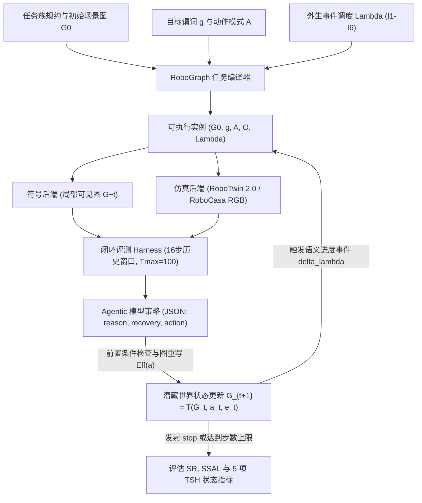

# Compiling and Benchmarking Task-State Horizons for Embodied Agents

## 一句话定义

**RoboGraph / RoboGraphBench** 是一套以**任务状态视界（TSH）**为核心刻画长程具身决策难度的任务编译器与闭环评测基准，通过可执行语义场景图与动态事件注入检验智能体的状态保持、主动探索与信念更新能力。

## 英文缩写速查

| 缩写 | 英文全称 | 简要说明 |
|---|---|---|
| TSH | Task-State Horizon | 任务状态视界，由保持 $H_{\mathrm{maintain}}$、探索 $H_{\mathrm{explore}}$、更新 $H_{\mathrm{update}}$ 三维组成 |
| SR | Task Success Rate | 任务成功率，满足目标谓词且正确执行 `stop` 终止的回合比例 |
| SSAL | Success weighted by Symbolic Action Length | 符号动作长度加权成功率，衡量成功轨迹相对 Oracle 最短长度的效率 |
| AER | Action Executability Rate | 动作可执行率，当前世界状态下前置条件满足的动作占比（衡量状态保持） |
| RAR | Redundant Action Rate | 冗余动作率，重复先前已尝试动作的比例（衡量状态保持） |
| SEG | State Exploration Gain | 状态探索增益，由有效探索动作揭示的任务相关空间依赖比例 |
| ADR | Action-Distance Reduction Rate | 动作距离缩减率，探索动作消除前置依赖后有序动作距离的平均降幅 |
| IRR | Intervention Recovery Rate | 干预恢复率，智能体检测并从外生干预引发的状态变更中恢复的比例 |

## 为什么重要

现有长程具身基准（如 ALFRED、BEHAVIOR-1K、PARTNR）主要通过动作序列长度或子目标个数定义难度，但忽略了**动作长度相同而状态依赖截然不同**的场景。例如在“把口红放进收纳袋”的任务中，口红若直接可见只需线性执行，若藏于多个抽屉之一或在执行中被外力移动，则即便最优动作步数相近，智能体也必须持续记忆已探索区域、主动掀开遮挡物并检测过期信念。RoboGraph 将“世界状态演化跨度”从动作长度中解耦出来，使失败原因能够精确定位到状态保持、状态探索或状态更新三类能力缺陷。

## 核心信息

| 字段 | 内容 |
|---|---|
| 作者 | Meiqi Wang, Shichao Li |
| 机构 | Tsinghua University；Beijing University of Posts and Telecommunications |
| 发表时间 | 2026-08-08（arXiv:2608.08036v1） |
| 论文链接 | [arXiv:2608.08036](https://arxiv.org/abs/2608.08036) · [arXiv HTML](https://arxiv.org/html/2608.08036) |
| 项目与代码 | 未确认开源代码（arXiv:2608.08036v1 正文及附录未提供独立项目页或 GitHub 仓库链接） |
| 清单分类 | `environment.benchmarking`（条目 `survey_ax_2608_08036`） |
| 开源状态 | 未确认开源代码（仅公开论文与基准实验数据描述，截至 2026-11-27 未检索到可运行官方仓） |

## 核心原理

### 1. 部分可观测决策与状态依赖建模

论文将长程具身交互建模为部分可观测决策过程。在时刻 $t$，完整潜藏世界状态为语义场景图 $G_t = (V_t, E_t, X_t)$，其中 $V_t$ 为房间、容器、表面与物体节点，$E_t$ 为包含、支撑、邻接与遮挡等有向关系，$X_t$ 为节点可变属性（如 `open`、`assembled`、`pressed`、`is_full`）。基础任务定义为 $\mathcal{B} = (G_0, g, \mathcal{A})$，每个动作模式 $a = \langle \mathrm{Pre}(a), \mathrm{Eff}(a) \rangle$ 具有前置条件与图重写效果。

观测算子 $O(G_t, h_t)$ 仅暴露当前房间的无遮挡可见子图：

$$
E_t^{\mathrm{block}} = \{ e \in E_t : e \text{ blocks visibility under } X_t \}, \quad O(G_t, h_t) = \left(V_t^{\mathrm{vis}}, E_t[V_t^{\mathrm{vis}}], \rho(X_t[V_t^{\mathrm{vis}}]) \cup \phi(h_t)\right)
$$

其中离开当前视野的事实**不会被自动带入下一步观测**（例如打开第一层抽屉可能遮挡已打开的第二层抽屉，使后者在下一步观察中消失），从而严格考验智能体的内部记忆维持。世界按 $G_{t+1} = \mathcal{T}(G_t, a_t, e_t)$ 演化，外生事件 $e_t \in \mathcal{E} \cup \{\varnothing\}$ 会在未重新观察对应区域前悄然改变潜藏状态。

### 2. 任务状态视界（TSH）形式化

给定任务实例 $\mathcal{I}$ 的最短符号 Oracle 参考解 $\tau^*$ 及存在状态依赖的事实集合 $\mathcal{F}$（即在步 $t$ 决策所依赖、但无法仅从当前可见图 $\widetilde{G}_t$ 恢复的事实），TSH 定义为三元组：

$$
H = (H_{\mathrm{maintain}}, H_{\mathrm{explore}}, H_{\mathrm{update}})
$$

- **$H_{\mathrm{maintain}}$（状态保持）**：$\mathcal{F}$ 中所有时间依赖事实从首次被观察到最后一次约束决策之间在 $\tau^*$ 中的最大间隔步数。
- **$H_{\mathrm{explore}}$（状态探索）**：$\mathcal{F}$ 中所有空间依赖事实在初始状态 $G_0$ 中暴露所需的最小视角扩展动作数（如 `open`、`move_aside`、`walk`）的最大值。
- **$H_{\mathrm{update}}$（状态更新）**：沿 $\tau^*$ 推进过程中被外生事件使其过期失效的事实数量。

### 3. RoboGraph 编译器与动态事件调度

RoboGraph 将任务族规约与源场景图编译为可执行实例 $\mathcal{I} = (G_0, g, \mathcal{A}, O, \Lambda)$，其核心在于动作语义与外生事件调度 $\Lambda = \{\lambda_1, \dots, \lambda_K\}$：

- **统一动作目录（Table 5）**：包含 10 个桌面动作（`observe`、`open`、`close`、`press`、`grab`、`attach`、`puton`、`putin`、`move_aside`、`stop`）以及室内导航场景额外启用的 `walk`。除 `observe` 与 `stop` 外，其余动作均支持失败注入。
- **进度触发的图重写**：每个事件 $\lambda = \langle \psi_\lambda, \delta_\lambda, \kappa_\lambda \rangle$ 由语义进度触发条件 $\psi_\lambda$（如某类动作首次成功执行或某放置子目标首次满足，而非固定时间步）、图重写规则 $\delta_\lambda$ 与触发时机 $\kappa_\lambda$ 组成，并支持扩展新目标谓词。
- **双后端执行协议**：同一编译实例 $\mathcal{I}$ 既可直接运行于符号后端（输入可见节点与边），也可通过适配器映射到仿真后端（RoboTwin 2.0 桌面三视角 RGB 与 RoboCasa 室内厨房），共用同一闭环评测 Harness（`recent_history` 窗口固定为最近 16 步，最大步数 $T_{\max} = 100$，要求严格 JSON 输出 `reason`、`recovery` 与 `action`）。

## 流程总览

## 源码运行时序图

**不适用**：截至 2026-11-27，arXiv:2608.08036v1 原文及公开检索材料未提供可获取的官方源码仓库或项目页入口，未确认可运行的官方源码实现（论文仅在 Appendix B 给出了闭环 Harness 的交互 JSON 协议与系统提示词）。

## 实验与评测

### 1. RoboGraphBench 基准构成

基准共包含 **84 个源场景**（57 个桌面场景、27 个室内场景），覆盖 Table 3 中的 7 个任务族（`Buffet-tray sorting`、`Cosmetics storage`、`Desk organization`、`Dining-table organization`、`Food packing`、`Fridge-condiment loading`、`Toy organization`；正文引言亦提及 10 类任务族表述）。每个源场景生成 1 个无干预基线与 6 个互斥干预回合（$I_1$ 动作失败、$I_2$ 状态回退、$I_3$ 已完成子目标回滚、$I_4$ 错误重定位、$I_5$ 新增遮挡、$I_6$ 新增对象子目标），总计 **588 个回合**（399 桌面 + 189 室内）。全库场景图平均含 $18.4 \pm 3.3$ 个节点、$21.8 \pm 6.1$ 条边、$6.1 \pm 1.8$ 个初始遮挡节点与 $14.3 \pm 4.1$ 个子目标；Oracle 动作长度均值 $21.7 \pm 5.4$，有序动作距离均值 $24.3 \pm 5.6$。

### 2. 15 个模型的语义闭环评测结果（8,820 条轨迹，Table 1）

| 模型 | 类别 | Tabletop SR (%) | Tabletop SSAL | Tabletop AER / RAR (%) | Tabletop IRR (%) | Indoor SR (%) | Indoor SSAL | Indoor IRR (%) |
|---|---|---|---|---|---|---|---|---|
| GPT-5.5 | 闭源 VLM | **78.4** | **0.689** | **97.4** / **12.2** | **78.6** | **82.5** | **0.607** | **81.4** |
| Claude Opus 4.7 | 闭源 VLM | 56.6 | 0.439 | 89.2 / 24.4 | 57.4 | 80.4 | 0.553 | **81.4** |
| Gemini 3.1 Pro | 闭源 VLM | 62.7 | 0.529 | 94.1 / 13.3 | 63.4 | 42.3 | 0.371 | 42.8 |
| DeepSeek-V4 Pro | 闭源 LLM | 49.1 | 0.406 | 94.0 / 19.0 | 49.8 | 23.3 | 0.188 | 23.7 |
| GLM-5.2 | 闭源 LLM | 43.6 | 0.324 | 95.4 / 32.0 | 46.7 | 57.1 | 0.305 | 57.6 |
| Qwen3.7-Plus | 闭源 VLM | 24.3 | 0.232 | 90.3 / 25.9 | 24.7 | 21.7 | 0.076 | 24.8 |
| Qwen3.6-Plus | 闭源 VLM | 21.1 | 0.224 | 92.7 / 23.1 | 20.6 | 28.6 | 0.132 | 30.9 |
| GPT-5.4 | 闭源 VLM | 23.1 | 0.190 | 93.6 / 47.7 | 25.1 | 41.8 | 0.283 | 44.2 |
| Qwen3-VL-32B | 开源 VLM | 9.3 | 0.074 | 81.6 / 51.6 | 11.6 | 9.0 | 0.034 | 11.3 |
| InternVL3.5-38B | 开源 VLM | 6.3 | 0.033 | 32.3 / 74.1 | 8.4 | 5.8 | 0.039 | 6.5 |
| InternVL3.5-8B | 开源 VLM | 2.3 | 0.003 | 31.3 / 76.9 | 3.5 | 0.5 | 0.000 | 1.2 |
| Qwen3-VL-8B | 开源 VLM | 1.5 | 0.003 | 69.7 / 46.7 | 2.4 | 0.5 | 0.000 | 1.1 |
| RoboBrain2.0-32B | 开源具身 VLM | 0.3 | 0.000 | 51.6 / 63.7 | 0.5 | 0.0 | 0.000 | 0.0 |
| Cosmos-Reason1-7B | 开源具身 VLM | 0.0 | 0.000 | 22.6 / 63.6 | 0.0 | 0.0 | 0.000 | 0.0 |
| RoboBrain2.0-7B | 开源具身 VLM | 0.0 | 0.000 | 38.1 / 68.7 | 0.0 | 0.0 | 0.000 | 0.0 |

### 3. 核心实验发现（RQ1–RQ3 与视觉后端扩展）

- **失误模式分化（RQ1）**：不同模型失败机理差异显著。`Qwen3.6-Plus` / `Qwen3.7-Plus` 在桌面的归一化目标进度（NGP）约达 75%（室内约 60%），但常提前终止，反映探索不足；`GPT-5.4` 虽有 93.6% 桌面 AER，却因大量重复动作导致 47.7% RAR，在 52.6% 的桌面回合中耗尽 100 步上限；`InternVL3.5-8B/38B` 桌面平均步数高达 96.0 和 90.7 步但成功率极低。开源具身 VLM（7B/32B）在长程状态管理上几乎全面失效。
- **状态管理指标对 TSH 难度的区分度（RQ2）**：在场景间相关性分析（Fig. 6）中，传统 Oracle 长度 $L_o$ 与子目标数 $N_g$ 仅与 SR 呈中等相关，而桌面 AER（$\rho = 0.69$）与室内 RAR（$\rho = -0.71$）最能区分场景整体难度；在场景内模型间分析（Fig. 7）中，探索指标 SEG 与 ADR 与 SR 高度相关（桌面中位相关性 0.72 / 0.74，室内 0.61 / 0.56）。
- **动态干预影响（RQ3，Table 2）**：**新增遮挡（$I_5$）**造成最严重的成功率下跌，桌面降低 10.4 个百分点（IRR 27.6%）、室内降低 4.4 个百分点（IRR 34.3%）；**动作失败（$I_1$）**虽然可通过 `recover` 提示机制部分挽回，但恢复延迟最长（桌面平均 35.8 步、室内 37.1 步）。
- **视觉后端扩展**：在 RoboTwin 2.0 的 `desk organization` 与 `cosmetics storage` 任务上用头、左、右三视角 RGB 评测 8 个闭源模型，所有指标与符号后端呈正相关（NGP 的 Spearman $\rho = 0.37$，ADR 达 $\rho = 0.75$；在难度更高的 `cosmetics storage` 上 NGP 相关性升至 $\rho = 0.63$），但绝对 SR 显著下降，说明视觉接地与状态解码会进一步放大长程状态管理的负担。

## 与其他工作对比

| 基准 / 方法 | 长程难度主刻画维度 | 局部可观测与遮挡建模 | 执行期动态干预 | 诊断指标粒度 |
|---|---|---|---|---|
| ALFRED / ALFWorld | 动作长度、语言指令分解 | 容器开关可见性 | 无系统化外生干预 | SR / 路径加权成功率 |
| BEHAVIOR-1K / PARTNR | 大规模谓词、多子目标与时序协作 | 物理仿真感知 | 侧重协同与环境约束 | SR / 子目标完成率 |
| FindingDory / 3DMem-Bench / RoboMME | 跨房间导航与历史记忆检索 | 历史帧/记忆检索 | 静态或固定回溯场景 | 记忆问答与任务 SR |
| **RoboGraph / RoboGraphBench** | **TSH 三元组（保持、探索、更新）** | **显式阻塞边 $E_t^{\mathrm{block}}$ 且离视即隐** | **6 类语义进度触发图重写 $I_1$–$I_6$** | **SR + SSAL + 5 项状态指标 + 2 项恢复指标** |

## 结论

**一句话总判：RoboGraph 通过将长程具身任务的“状态管理跨度（TSH）”与“动作序列长度”分离并编译为可注入动态干预的可执行场景图，揭示了当前前沿基础模型在长程主动探索、防冗余记忆维持及遮挡恢复上的显着短板。**

1. **评估具身高层规划器时不应只看动作长度**：相同的 $L_o$ 在不同遮挡与回滚条件下对状态跟踪的要求差异巨大，引入 AER/RAR（保持）、SEG/ADR（探索）与 IRR（更新）可精准归因失效模式。
2. **局部可执行性不等于全局状态管理能力**：多款模型（如 GPT-5.4）虽能选出语法与前置条件合法的动作（高 AER），但因 16 步历史窗口外状态遗忘而陷入高冗余循环（高 RAR）。
3. **新增遮挡（$I_5$）是具身长程执行的最大破坏因素**：相比单步动作失败或新增子目标，在执行中途引入隐藏目标的遮挡关系（需重新规划探索与前置动作）对 SR 的打击最大（桌面 -10.4 pp）。
4. **开源小参数具身 VLM 仍缺乏符号级闭环长程规划能力**：7B–38B 开源模型在 RoboGraphBench 上普遍接近零成功率，而闭源模型间也存在明显分化。
5. **工程复现时需注意当前论文尚未附带公开代码链接**：可依据 Appendix B 给出的完整 JSON Schema 与动作目录自行复刻评测 Harness，但精确场景图与事件触发参数仍依赖作者后续开源。

## 工程实践

- **闭环 Harness 协议复用**：若需自建高层策略评测框架，可直接参考论文 Appendix B（Figure 10–12）的接口设计：将系统提示词、10+1 类离散动作目录（含手部占用约束 `required_free_hands` 与 `held_object_required`）、最近 16 步历史 `recent_history` 与当前局部观察分离，并强制输出包含 `reason`、`recovery` 与 `action` 的结构化 JSON。
- **记忆与状态摘要模块设计**：由于观测算子不自动保留离开视野的事实（且上下文仅保留 16 步近期历史），在实际机器人高层规划器中应显式维护持久化场景图记忆（Persistent Scene Graph Memory）或已探索容器清单，以抑制 RAR 上升。
- **失败恢复状态机**：对于注入型执行失败，需区分“检测需要恢复（F1@RD）”与“定位失败对象并执行正确修复动作（Acc@RG）”，并在恢复后显式重建因失败而丢失的握持或打开前提条件。

## 局限与风险

- **开源代码与资产尚未落地**：截至 2026-11-27，arXiv:2608.08036v1 未附带 GitHub 仓库或数据集下载链接，第三方暂无法直接下载 84 个源场景图或运行 RoboGraph 编译器。
- **抽象动作层与底层控制的鸿沟**：符号后端屏蔽了物理抓握与导航碰撞细节；虽然论文在 RoboTwin 2.0 上验证了两个桌面任务的相关性，但室内 27 个场景在 RoboCasa 视觉后端上的大规模定量结果及真机验证尚未全面展开。
- **固定历史窗口限制**：统一 Harness 仅向策略提供最近 16 步 `recent_history`，对于 $L_o$ 接近 30 步且伴随干预的复杂场景（如 Cosmetics-16），该窗口设定会惩罚未自建外部记忆模块的纯上下文模型。
- **任务族计数口径差异**：论文正文引言提及“10 task families”，而 RoboGraphBench 章节与 Table 3 明细列出 7 个唯一任务族名称（桌面 6 类 + 室内 3 类共计 9 个域内分组，合计 84 个源场景），引用时应以 Table 3 为准。

## 关联页面

- [具身大模型评测基准选型闭环](../queries/embodied-eval-benchmark-selection-loop.md)：对照评测基准设计与指标选型闭环。
- [Agentic Robots 综述](paper-towards-agentic-robots-survey.md)
- [全量项目节点清单](../overview/awesome-agentic-robots-node-index.md)
- [VLA 方法背景](../methods/vla.md)
- [机器人智能体执行框架](../methods/robot-agent-harness.md)：对照规划、工具调用与反馈的系统边界
- [具身智能体基准评测](../methods/embodied-agent-benchmarking.md)：对比任务设计、指标体系与闭环仿真评测方法
- [智能体规划与反馈机制](../methods/agent-planning-feedback.md)：对照失败检测、重试与动态重规划机制
- [机器人仿真场景生成](../methods/robot-simulation-scene-generation.md)：对照程序化场景图生成与仿真器对接
- [机器人操作任务](../tasks/manipulation.md)
- [自主探索任务](../tasks/autonomous-exploration.md)

## 推荐继续阅读

- [Compiling and Benchmarking Task-State Horizons for Embodied Agents (arXiv:2608.08036)](https://arxiv.org/abs/2608.08036)
- [RoboTwin 2.0 论文（arXiv:2506.18088）](https://arxiv.org/abs/2506.18088)
- [RoboCasa 论文（arXiv:2406.02523）](https://arxiv.org/abs/2406.02523)

## 参考来源

- [论文原文核对笔记：Compiling and Benchmarking Task-State Horizons for Embodied Agents](../../sources/papers/paper-agentic-2608-08036.md)
- [官方 Awesome 快照归档](../../sources/repos/awesome-agentic-robots-survey-index.md)
- [arXiv:2608.08036 HTML 全文](https://arxiv.org/html/2608.08036)
