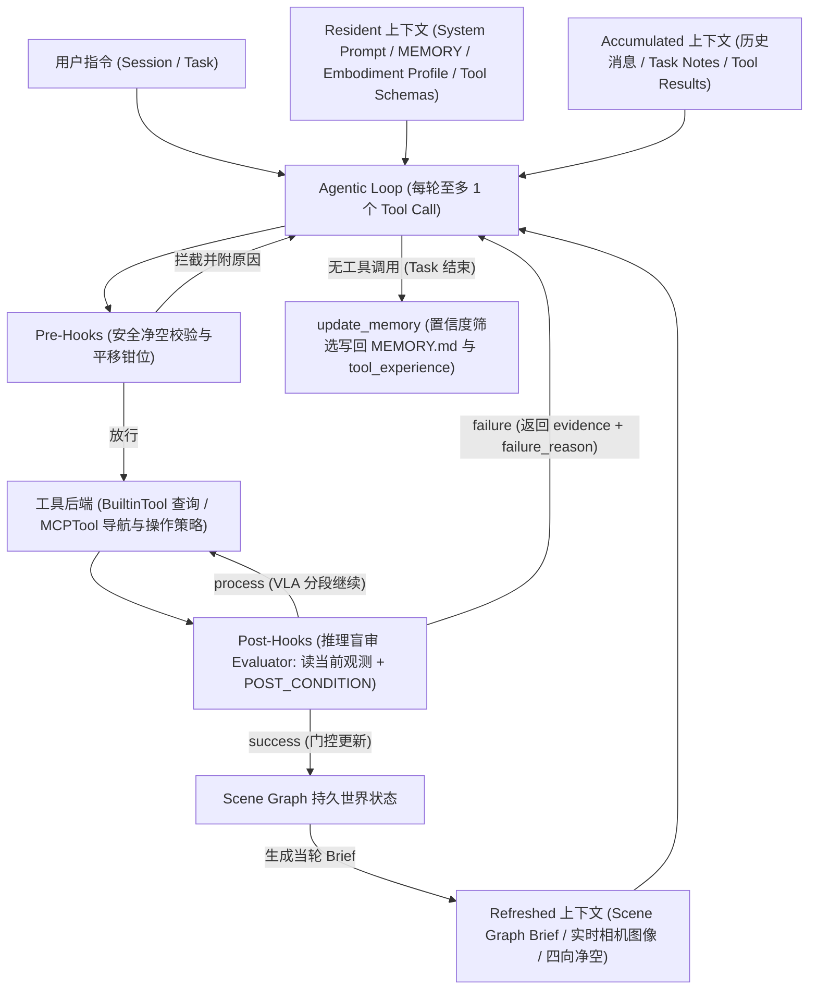
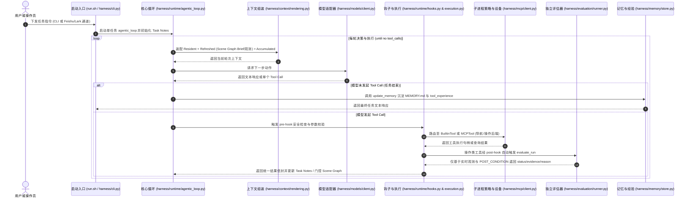

# Towards the Harness of Embodied Agents

## 一句话定义

**Thea** 是一个面向物理世界具身智能体的通用执行框架（Harness），它将编码智能体的工具循环、三层上下文、技能与记忆体系迁移到机器人系统，并补齐物理世界缺失的“世界可读性”（Scene Graph as Context）与“结果可验证性”（Evaluation as Exit Codes）以及机体描述（Embodiment Profile），从而在不重训底层策略的情况下把原子机器人能力编排为可恢复的长程闭环行为。

## 英文缩写速查

| 缩写 | 英文全称 | 简要说明 |
|---|---|---|
| VLA | Vision-Language-Action | 视觉-语言-动作策略模型，在 Thea 中作为可调用底层操作工具后端（如 $\pi_{0.5}$） |
| WAM | World Action Model | 世界动作模型，从图像/视频预测网络直接输出动作的具身基础模型路线 |
| MCP | Model Context Protocol | 模型上下文协议，Thea 统一封装重型导航/操作子进程工具与轻量内置查询的接口规范 |
| RGB-D | Red Green Blue + Depth | 彩色与深度图像传感器流，物理世界连续局部感知的原始输入形式 |
| CaP | Code as Policies / Coding-as-Policy | 策略即代码范式，由大模型生成可自终止的控制程序（如 CaP-X）并作为本文工具后端与基线 |
| SDK | Software Development Kit | 机器人平台底层软件开发套件（如 Astribot S1 SDK），通过工具接口接入编排循环 |

## 为什么重要

编码智能体之所以能在软件工程中取得突破，核心不仅在于基座模型变强，更在于外围 **Harness（执行脚手架）** 与操作系统免费提供的两项基础设施：源码文件天然**可读**（文本、类型系统、持久化文件系统），命令执行天然**可验证**（退出码、stderr 与测试框架）。然而，当大模型直接面对物理世界时，这两项基础设施同时缺失：

1. **世界不可直接读取**：机器人面对的是 30 fps 连续非结构化 RGB-D 传感器流，只能看到当前局部视角，缺乏持久、可全局寻址的符号化环境记录。
2. **动作结果无法自动验证**：VLA 等连续控制策略不会主动发出“已完成”信号，更没有类似退出码或栈回溯的机制告诉上层究竟是抓偏、被遮挡还是中途滑落。
3. **跨机体差异显著**：编码智能体运行在统一的 shell 与文件系统上，而机器人拥有截然不同的底盘尺寸、自由度、传感器视角与可达工作空间。

论文还从可靠性数学角度指出：若单步成功率为 $p_i$，开环串联 $n$ 步的成功率 $P_{\text{open}} = \prod_{i=1}^n p_i$ 会随任务步数几何衰减；当外围 Harness 引入每步最多 $k$ 次检测-重试且评估器准确率为 $\alpha$ 时，高 $\alpha$ 值能将长程任务可靠性从开环崩塌拉回到高可用区间，使“系统可靠性”成为可独立于策略权重进行工程优化的问题。

## 核心信息

| 字段 | 内容与核查结果 |
|---|---|
| 作者 | Qi Wang†, Tianyi Wang†, Chengyang Li†, Shikun Ban, Yurun Chen, Yizhong Ge, Jason Qin, Chengtai Li†, Wentao Zhu† |
| 机构 | 宁波东方理工大学（Eastern Institute of Technology, Ningbo / HAI Lab） |
| 发表时间 | Technical Report (2026-07)；arXiv:2608.11246v1（2026-08-03 提交） |
| 论文链接 | [arXiv:2608.11246](https://arxiv.org/abs/2608.11246) · [HTML 全文](https://arxiv.org/html/2608.11246) |
| 项目与代码 | [官方项目主页](https://eit-hai.github.io/thea) · [GitHub 仓库 `EIT-HAI/Thea`](https://github.com/EIT-HAI/Thea)（Apache-2.0） |
| 清单分类 | `harness.orchestration`（来源条目 `survey_ax_2608_11246`） |
| 开源状态 | **已开源**（公开 `thea-harness` 核心编排运行时、LIBERO/RoboTwin 2.0 仿真适配 `thea-simulation`、Feishu/Lark 通道 `thea-lark`、机器人移植模板 `examples/port-template/` 与 `./install.sh` / `./run.sh` 入口；部署方需自行接入模型凭据、实机 SDK、底层策略与场景图后端） |

## 核心原理

### 1. 闭环可靠性的理论下界（§2）

考虑一个由 $n$ 个子步骤组成的长程任务，第 $i$ 步单次执行成功率为 $p_i$。开环执行总成功率为：

$$P_{\text{open}} = \prod_{i=1}^{n} p_i$$

当 Harness 在每步外包裹最多 $k$ 次“检测-重试”循环，且独立评估器以概率 $\alpha$ 给出正确判定（$1-\alpha$ 误判）时，单次尝试触发重试的概率为 $r_i = p_i(1-\alpha) + (1-p_i)\alpha$。第 $i$ 步在 $k$ 次尝试内获得真实成功并被正确放行的概率为：

$$p_i^*(\alpha, k) = \sum_{j=1}^{k} r_i^{j-1} \cdot p_i \alpha = p_i \alpha \cdot \frac{1 - r_i^k}{1 - r_i}, \qquad P_{\text{harness}} = \prod_{i=1}^{n} p_i^*(\alpha, k)$$

- 当 $\alpha = 1$（完美评估器）时，$p_i^* = 1 - (1-p_i)^k$，失败率随 $k$ 指数压缩；
- 当 $\alpha = 0.5$（随机猜测）时，$p_i^* = p_i(1 - 2^{-k}) \le p_i$，无限重试也无法超越单次执行率；
- 当 $k \to \infty$ 时，单步成功率受限于上限 $\frac{p_i}{(2p_i - 1) + (1 - p_i)/\alpha}$。这证明**提升评估器准确率 $\alpha$ 是物理 Harness 的核心杠杆**；实际系统中，模型还会依据失败原因调整位姿或切换策略，并利用刷新后的场景状态重规划，因此上述独立同分布公式是系统实际收益的下界。

### 2. 从编码智能体继承并改造的七层架构（§3）

1. **Agentic Loop（§3.1）**：以 `turn`（一次模型决策 + 一次工具调用）、`task`（单条指令直至模型不再返回工具调用）和 `session`（跨任务延续消息上下文）组织循环。由于物理动作后果难以预测，**每轮严格最多执行一个工具调用**（反应式单步闭环），待观测或评估结果返回后再决定下一步。
2. **Context Engineering（§3.2, Appendix B）**：按生命周期把上下文划分为三类：
   - **Resident（驻留，任务启动时加载且保持稳定）**：System Prompt、跨任务持久化 `MEMORY.md`、Embodiment Profile、工具定义（`name`、`description` 附带工具经验摘要、`inputSchema`；隐藏 `POST_CONDITION`）。
   - **Refreshed（每轮刷新，决策前替换为当步即时状态）**：全局尺度的 **Scene Graph Brief** 与局部尺度的 **Observations**（实时相机图像 + 四向 LiDAR 障碍物净空距离）。
   - **Accumulated（随轮次累积，逼近窗口上限时仅压缩较早前缀）**：用户指令、**Task Notes**（当前任务工作记事本，随任务结束而销毁）、模型响应与工具返回包。
3. **Tool Protocol 与确定性钩子（§3.3）**：所有能力统一遵循 MCP 契约 `{name, description, inputSchema}`，并在工具文件中绑定对决策模型不可见的 `POST_CONDITION`。所有调用统一返回 `{"success": True, ...}` 或 `{"success": False, "reason": ...}`。轻量查询作为进程内 `BuiltinTool` 执行，重量级导航/操作策略作为独立子进程通过 `MCPTool` 通信。所有调用必须经过模型不可绕过的 `pre-hook`（安全检查）与 `post-hook`（自动评估）。
4. **Skills 与 Contract/Advice 边界（§3.4）**：技能以 `SKILL.md` 目录形式存放，采用三层渐进式披露（名称/描述常驻，经 `load_skill` 按需加载正文）。物理世界中执行动作具有不可逆副作用，因此**凡执行物理动作的策略必须封装为受契约、安全钩子和评估器约束的 Tool**，而工作流习惯与场所规范（如桌面整理规则 `tidy-workspace`）则保留在文本建议侧的 Skill 中。
5. **三生命周期 Memory（§3.5）**：任务内使用 `Task Notes` 跟踪目标、阶段与时间线；任务结束时由 `update_memory` 对轨迹进行置信度筛选并分流写入两类持久存储——跨任务偏好与常规经验写入 `MEMORY.md`（随 Resident 上下文加载），单个策略工具的成功/失败条件与恢复经验写入 `tool_experience/<tool>.md`（汇总后直接追加到该工具的 `description` 中），使工具接口随使用不断自完善。
6. **确定性前置安全与人机交互（§3.6–3.7）**：物理环境没有沙盒与撤销键。安全机制将四向净空距离写入 Refreshed 上下文，并在 `pre-hook` 中于底盘移动前重新采样，无可行方向时直接阻断导航、直接平移时钳位到允许距离内，同时辅以失败次数预算与单工具串行约束。交互层通过阻塞式 `query_user`（歧义消解、高风险确认，可附带候选 ref 与视角截图）与非阻塞式 `notify_user`（进度、告警与结果通知）将人类纳入闭环。

### 3. 填补物理缺口的三大核心模块（§4）

- **Scene Graph as Context（§4.1）**：构建以对象为中心的持久 3D 场景图，为每个物体生成稳定符号引用（如 `cup_2`），存储中心坐标、三维尺寸、置信度、时间戳与关联图像路径；容器节点维护开关状态与内部物品列表，机器人节点记录位姿与抓持状态，边描述 `on`、`inside`、`holding`、`near` 关系。场景图同时接收感知后端的观测更新与**经评估器确认后的执行状态变更**（门控合并）。每轮向模型注入精简的 Scene Graph Brief，其余细节由模型按需调用 `get_object_relations` 与 `get_image` 按 ref 查询，避免上下文膨胀。
- **Evaluation as Exit Codes（§4.2）**：针对三大问题设计独立评估器：
  1. *何时评估*：对无内置终止信号的端到端 VLA 策略，在每个动作分段（action-segment）边界在线返回 `process` / `success` / `failure`（并设步数上限兜底）；对可自终止的 CaP 程序退化为终态二元判定。
  2. *由谁评估*：由 `post-hook` 结构化强制触发，严格遵循**推理盲审（reasoning-blind）**原则——评估器仅接收同步相机观测与工具绑定的 `POST_CONDITION`，完全不读决策模型的思维链或自报。
  3. *返回什么*：输出 `status`、观测证据列表 `evidence` 与结构化 `failure_reason`（相当于物理世界的 `stderr`），用于驱动上层自适应重规划、门控场景图更新以及回流 `tool_experience`。
- **Embodiment Profile（§4.3）**：将机体专有属性封装为可整体替换的文档，覆盖 **Operational Envelope**（底盘占地、移动自由度、末端可达工作空间）、**Perception Configuration**（可用传感器模态、模型可见相机视图命名）与 **Base-Relative Positions**（相机与初始夹爪相对基座中心的位姿），实现单套编排循环跨不同机器人的可移植性。

## 流程总览

## 源码运行时序图

官方仓库 [`EIT-HAI/Thea`](https://github.com/EIT-HAI/Thea) 以独立运行时包 `harness/`（`thea-harness`）为核心，支持通过 `./run.sh --mode {cli|channel|simulation|robot}` 或在 Python 中构建 `Harness` 后调用 `run_stream(instruction)` 启动单任务闭环；新机体与仿真环境通过 `examples/port-template/factory.py`（`create_harness`）、`profile.md`（Embodiment Profile）与 `tools.py` 注册接入。

## 实验与评测

### 1. 实验平台、模型与对比设置（§5.1）

- **机器人平台**：主定量评测在 **Astribot S1**（轮式双臂人形平台，配备可动头部/躯干、全向移动底盘与双夹爪，共 25 DoF；感知栈基于 Astribot S1 SDK 与 SysNav）上完成；跨构型探索拓展至 **AgileX Cobot Magic**（双臂移动底盘）与 **Unitree G1**（配备双 6-DoF BrainCo Revo 2 灵巧手）。
- **基座模型配置**：所有编排方法的决策模型统一采用 **GPT-5.5**（`reasoning effort = high`），独立评估器统一采用 **Qwen3.7-Plus**。
- **对比基线**：
  - *端到端策略*：ACT、LingBot-VLA-V2、$\pi_{0.5}$（每项任务均基于 **200 条**采集示范训练或微调；ACT 因非语言条件策略而未参与 L3 评测）。其中 ACT 与 $\pi_{0.5}$ 同时作为 Thea 操作工具背后的可执行策略，以隔离“编排架构”与“底层策略能力”的影响。
  - *编排基线*：Coding-as-Policy 基线 CaP-X（按 CaP-Bench M3 设置在多轮中基于轨迹修订程序）与基于 SayCan 的分层规划基线，二者共享与 Thea 完全相同的底层工具集合（Appendix A）。

### 2. 分级长程任务复杂度扩展（§5.1–5.2, Table 3, Fig. 8）

| 难度等级 | 任务类型 | 任务描述 | 独立试验次数 / 方法 |
|---|---|---|---|
| **L1** | 短程操作（Short-horizon manipulation） | 抓取桌面单个物体并放入篮中 | 20 次 |
| **L2** | 长程操作（Long-horizon manipulation） | 依次定位、抓取并放置桌面上所有物体至篮中 | 20 次 |
| **L3** | 导航与操作耦合（Navigation and manipulation） | 导航至源桌面、检索指定物体并递送至目标桌面 | 15 次 |

- 成功判据由人工标注员基于完整录制轨迹独立判定（需所有目标物体到位且全部导航/操作阶段完成）。
- 在 Fig. 8 柱状图评测中（注：原文 HTML 未以表格列出各柱状图精确百分比数值），Thea 在 L1、L2、L3 三个等级均取得最高成功率：L1 上各方法差距较小；随着步骤增长到 L2 与跨工作台耦合的 L3，端到端策略因无法识别中途失败而直接失控，开环编排亦因缺少精确状态验证而衰减，Thea 凭借 `evaluate_run` 闭环检查与 `navigate_to` / `move_base` 位姿调整拉开了显著领先优势。

### 3. 独立评估器准确率与理论模型验证（§5.3, Fig. 9）

- **评测集**：从 Astribot S1、AgileX Cobot Magic 与 Unitree G1 采集 **90 个**轨迹检查点，在「成功完成」「执行中」「未恢复失败」三类状态上均衡各采样 30 个，并由两名人工标注员结合完整回放独立标定真值。
- **定量结果**：Qwen3.7-Plus 评估器（仅输入评估提示词、工具 `POST_CONDITION` 与同步相机观测）在三状态上的平均分类准确率为 **93.3%**。
- **错误分布**：全部误判均为单向假阳性——**6.7%** 的失败检查点与 **13.3%** 的执行中检查点被误判为成功，**0%** 的成功检查点被误判为失败或执行中（假阳性会直接导致放弃必要重试或提前中止动作，是后续重点改进方向）。
- **闭环增益对齐**：将实测 $\alpha = 0.93$、假设单步成功率 $p = 0.8$ 与最大重试次数 $k = 5$ 代入 §2 数学公式，5 步长程任务的理论完成率从开环 **0.33** 跃升至 Harness 下的 **0.91**，与实机 L1–L3 趋势一致。

### 4. 涌现能力与跨构型实机日志（§5.4, Appendix C.1–C.4）

- **饮料取送（Astribot S1, Appendix C.1）**：茶水间未找到无歧义纯水时主动调用 `query_user` 询问用户替代饮品，并在确认橙汁后通过多次 `move_base` 厘米级微调（0.15 m、0.28 m 等）完成抓放与闭环验证。
- **充电宝柜内搜索（Astribot S1, Appendix C.2）**：目标不在当前场景图中时自主导航至 `cabinet_87`，按序打开上抽屉确认无果后关闭，再打开下抽屉发现并抓取充电宝、随手关好抽屉后递送至 `desk_96`。
- **工位主动清理（Astribot S1, Appendix C.3）**：以常驻监控工具 `monitor_scene` 等待工位无人，加载 `tidy-workspace` 技能规约区分“空橙汁瓶（垃圾）”与“笔记本/充电宝（保留）”，调用 `notify_user` 通知用户、结合 `tilt_head(45°)` 刷新局部视角完成丢弃。
- **跨房间篮筐递送（Unitree G1 + BrainCo Revo 2 灵巧手, Appendix C.4）**：使用同一套 Harness 编排打包零食、双手/双臂协同提篮步行穿过房门进入客厅、识别就座用户并完成近距离递交，验证了基于 Embodiment Profile 与工具封装的跨本体可移植性。

## 与其他工作对比

| 对比维度 | 端到端策略 (ACT / $\pi_{0.5}$ / LingBot-VLA-V2) | 早期与并发编排 ([SayCan](./paper-saycan.md) / [CaP](./paper-pai-2209-07753-codeaspolicies.md) / [CaP-X](./paper-agentic-2603-22435.md) / [RoboClaw](./paper-agentic-2603-11558.md)) | Thea（本文） |
|---|---|---|---|
| 世界状态表征 | 依赖每步瞬时局部相机观测，易遗忘遮挡或历史物体 | CaP/SayCan 缺少持久可寻址符号表征；部分系统依赖手写摘要或特定场景输入 | **Scene Graph as Context**：持久 3D 对象节点+容器状态+按 ref 按需查图与查关系，门控更新 |
| 动作终止与成败判定 | 无内置终止信号与失败诊断，失败后往往继续输出无效动作 | SayCan 无后置判决；CaP-X 依赖执行轨迹后修订代码；RoboClaw 周期性查询环境与统计量 | **Evaluation as Exit Codes**：`post-hook` 强制触发推理盲审，VLA 分段在线三态判定，返回 `evidence` 与 `failure_reason` |
| 上下文与记忆组织 | 隐式特征或固定短窗口历史 | 多为单一滚动提示或任务/工作记忆树 | **三生命周期上下文**（Resident / Refreshed / Accumulated）+ 跨任务 `MEMORY.md` 与按工具累积的 `tool_experience` |
| 跨构型可移植性 | 高度绑定特定机体动作空间与相机安装位姿 | 多数脚本/技能直接耦合单一实验平台 | **Embodiment Profile** 解耦运动包络、感知视图与基座相对几何，在 S1 / Cobot Magic / G1 三平台复用同一主循环 |

## 结论

**一句话总判：在具身基础模型单步成功率尚未达到 100% 之前，长程可靠性的关键工程杠杆不在继续盲目堆大单步策略，而在于围绕现有策略构建具备“符号化持久世界状态 + 推理盲审独立评估器”的闭环执行 Harness。**

1. **先把评估器准确率 $\alpha$ 做高，再谈重试次数 $k$** — 公式 $p_i^*(\alpha, k)$ 表明 $\alpha=0.5$ 时无限重试也无法突破单步基线，且实测显示假阳性（6.7% 失败与 13.3% 进行中被放行）是比假阴性更危险的失效模式。
2. **用“场景图摘要 + 按 ref 检索”平衡全局可读性与上下文预算** — 每轮仅向 Refreshed 上下文推送对象坐标、置信度与新鲜度，仅在消歧（如分辨红杯子）时按需拉取局部图像或空间关系边。
3. **严格区分受契约保护的 Tool 与文本建议型的 Skill** — 具有物理副作用的操作策略必须通过 MCP/Tool 接口接入前置安全钳位与后置评估钩子，只把领域规约与操作偏好留在 `SKILL.md`。
4. **把失败诊断沉淀到工具描述而非塞进系统提示词** — 通过 `tool_experience/<tool>.md` 将策略的真实物理边界（如“未触发接触时先小步前进”）直接追加到对应工具的 `description` 中，可实现“越用越准”的接口自进化。
5. **跨平台迁移优先标准化三件套** — 接入新机器人时保持主循环与上下文引擎不变，集中实现该机体的 `Embodiment Profile`、底层 `MCPTool` 策略服务以及对应工具的 `POST_CONDITION`。

## 工程实践

- **快速本地验证与通道接入**：克隆 `EIT-HAI/Thea` 后执行 `./install.sh` 初始化 `.venv` 与配置，先使用 `./run.sh --mode cli --check` 与 `--mode cli` 验证模型适配器与本地工具循环（无需机器人或仿真器即可跑通编排协议），再通过 `--mode channel` 对接 Feishu/Lark WebSocket 会话（暴露 `query_user` 与 `notify_user`）。
- **仿真与真机移植步骤**：参考 `examples/port-template/`（`factory.py`、`profile.md`、`tools.py`）与 `simulation/README.md`（支持 LIBERO / RoboTwin 2.0 适配），定义机体的 Operational Envelope 与相机视图，为每个动作工具编写清晰的 `When to use / Readiness / Do not use` 文档字符串与对模型隐藏的 `POST_CONDITION`，最后以 `--mode robot --harness-factory <module:create_harness>` 启动。
- **安全与故障隔离边界**：将底盘急停、关节限位与底层避障保持在模型与 Harness 之外的独立固件/SDK 层；利用 `pre-hook` 对 `move_base` 平移量（例如 Astribot S1 上的 0.03–0.80 m 步长与 3–30° 转角）按实时 LiDAR 净空进行硬钳位，并将重型 VLA 策略进程置于 `MCPTool` 子进程中实现崩溃重启隔离。

## 局限与风险

- **高层决策延迟尚未达到实时闭环**：每一轮决策都需要经由云端 VLM（文中实验使用 GPT-5.5 `high` 推理）与评估 VLM（Qwen3.7-Plus），无法满足毫秒级高频动态接触或抗扰控制需求；作者指出未来需将评估器与编排循环蒸馏至边缘端轻量化模型。
- **场景图受制于底层感知与跨帧关联误差**：三维位置目前仍为粗粒度包围盒，物体长时间移动或遮挡重现时的实体 ID 关联仍可能出错，进而误导导航锚点选择。
- **评估器仍存在假阳性风险**：93.3% 准确率下仍有 6.7% 的失败与 13.3% 的进行中状态被误判为成功，一旦放行就会跳过关键重试并向场景图写入错误的执行更新。
- **安全护栏尚处于实验室原型阶段**：论文明确指出，接触力限制、人群密集环境下的动态避让以及实验室之外的非受控家庭隐私（长期个性化记忆）与功能安全认证仍属开放问题；开源仓库本身仅提供编排层与接口，不附带 Astribot S1 专有底层 SDK 或实验训练好的 VLA 权重。

## 关联页面

- [Agentic Robots 综述](paper-towards-agentic-robots-survey.md)
- [全量项目节点清单](../overview/awesome-agentic-robots-node-index.md)
- [VLA 方法背景](../methods/vla.md)
- [机器人智能体执行框架](../methods/robot-agent-harness.md)：对照规划、工具调用与反馈的系统边界
- [智能体工具调用接口（MCP / Tool Use）](../methods/agent-tool-use-interface.md)：对照 `BuiltinTool` / `MCPTool`、结果信封与钩子拦截机制
- [智能体技能打包规范（Agent Skill Packaging）](../methods/agent-skill-packaging.md)：对照 `SKILL.md` 三层渐进披露及 Tool/Skill 边界
- [智能体规划与反馈机制](../methods/agent-planning-feedback.md)：对照场景图状态维护与失败诊断闭环
- [编码智能体验证闭环](../methods/coding-agent-verification-loops.md)：对照软件测试退出码与物理世界评估器映射关系
- [移动操作任务（Loco-Manipulation）](../tasks/loco-manipulation.md)
- [机器人操作任务（Manipulation）](../tasks/manipulation.md)
- [SayCan 论文实体](./paper-saycan.md) · [Code as Policies 论文实体](./paper-pai-2209-07753-codeaspolicies.md) · [CaP-X 论文实体](./paper-agentic-2603-22435.md) · [RoboClaw 论文实体](./paper-agentic-2603-11558.md)

## 推荐继续阅读

- [Thea 官方项目主页与在线文档](https://eit-hai.github.io/thea)：包含实机长程演示视频、Scene Graph 与 Evaluation 模块设计说明及中英文接入指南
- [Thea 官方 GitHub 仓库 (`EIT-HAI/Thea`)](https://github.com/EIT-HAI/Thea)：查看 `harness/` 核心包、`examples/port-template/` 移植模板及 LIBERO / RoboTwin 2.0 仿真适配器

## 参考来源

- [Towards the Harness of Embodied Agents 原文核对归档](../../sources/papers/paper-agentic-2608-11246.md)
- [Thea 官方仓库核对归档 (`EIT-HAI/Thea`)](../../sources/repos/paper-agentic-2608-11246.md)
- [官方 Awesome 快照归档](../../sources/repos/awesome-agentic-robots-survey-index.md)
- [arXiv:2608.11246 原文](https://arxiv.org/abs/2608.11246)（[HTML 全文](https://arxiv.org/html/2608.11246)）
- [官方项目主页](https://eit-hai.github.io/thea) · [GitHub 官方仓库](https://github.com/EIT-HAI/Thea)
