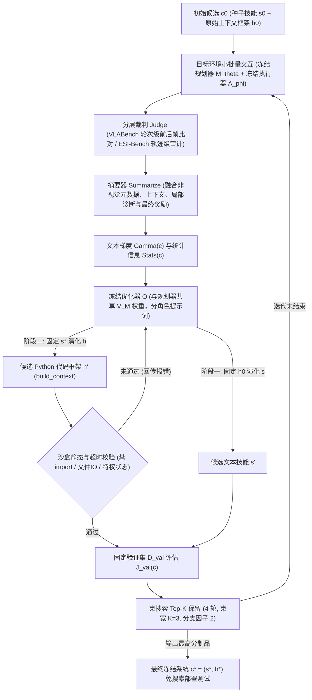

# Self-Evolving Embodied Agents via Skill-Harness Evolution

## 一句话定义

SHAPER 是面向固定动作接口具身智能体的免训练（train-free）自演化框架：它保持上层视觉语言模型（VLM）规划器与底层执行器权重完全冻结，仅利用少量目标环境交互轨迹生成分层文本诊断，再由同一冻结模型先后演化可复用文本技能（skill）与可执行 Python 上下文代码框架（context-code harness），从而在不更新参数的前提下提升规划、纠偏与跨视角证据利用能力。

## 英文缩写速查

| 缩写 | 英文全称 | 简要说明 |
|---|---|---|
| SHAPER | Self-Evolving Embodied Agents via Skill-Harness Evolution（论文框架名） | 本文提出的免训练自演化框架，联合优化外围文本技能与上下文代码框架 |
| VLM | Vision-Language Model | 视觉语言模型，在 SHAPER 中同时冻结复用为上层规划器 $M_\theta$ 与制品优化器 $\mathcal{O}$ |
| VLA | Vision-Language-Action Model | 视觉-语言-动作模型，在 VLABench 实验中作为冻结的底层子目标执行器 $\mathcal{A}_\phi$（如 $\pi_0$） |
| SFT | Supervised Fine-Tuning | 监督微调，实验中与 SHAPER 在相同 15 条训练轨迹上对比的参数更新基线 |
| TTS | Test-Time Scaling | 测试时计算扩展，指推理期多采样与投票聚合方法（文中对比 MG-Select 与 VOTE） |
| PS | Passive Single-view | ESI-Bench 论文中的被动单视角评测协议，用作 GPT-5 外部已发表参考线 |

## 为什么重要

1. **填补固定动作接口下的免训练适应缺口**：传统监督微调（SFT）与强化学习（RL）需要访问模型权重、任务示教或奖励函数；而现有的免训练代码生成方法（如 Code as Policies、Voyager、ASPIRE）通常假定存在可编程的底层机器人 API、调试钩子与执行监视器，在仅暴露受限或固定动作接口（如 VLA 子目标接口或离散交互 API）的环境中难以直接落地。
2. **揭示“技能与上下文框架协同优化”的必要性**：以往自演化智能体工作往往只更新技能（如 SkillOpt、EmbodiSkill）或只合成代码框架（如 AutoHarness）。SHAPER 证明，单靠演化技能无法修补原始上下文窗口丢弃早期关键视觉证据、重复拼接错误自述的缺陷；而通过代码化上下文构建器（`build_context`）引入稀疏关键帧记忆、确定性 RGB 局部裁剪与循环检测，能带来显著的额外收益。
3. **一次性极低开销替代高成本推理期采样**：不同于每次推理都要多路采样的测试时缩放（TTS），SHAPER 的演化开销是一次性的（两个基准单次完整演化 API 等效费用分别约为 $2.25 与 $2.83），得到的技能与上下文代码框架可在全部未见测试回合中零额外搜索成本直接复用。

## 核心信息

| 字段 | 内容 |
|---|---|
| 作者 | Peidong Wang, Zhiming Ma, Ying Chang, Xufang Luo, Yiqun Zhang, Zihan Wang, Xiaocui Yang, Shi Feng, Yuqing Yang, Dongsheng Li |
| 机构 | Northeastern University（东北大学，中国）、Microsoft Research（微软研究院） |
| 发表时间 | 2026-08-11（arXiv v1）；2026-09-10（arXiv:2608.11350v2 [cs.CL] 修订） |
| 论文链接 | [arXiv:2608.11350](https://arxiv.org/abs/2608.11350)（HTML 全文：[arXiv HTML](https://arxiv.org/html/2608.11350)） |
| 项目与代码 | 尚未发现官方项目页或代码仓库（原文及当前核查未提供 GitHub 链接） |
| 清单分类 | `harness.skills` |
| 来源条目 | `survey_ax_2608_11350` |
| 开源状态 | **未确认开源代码**（arXiv:2608.11350v2 原文与 `context.json` 未提供官方项目页或 GitHub 仓库链接；仅 Appendix A 展示了实验用技能文本、上下文构建函数接口规范及优化器提示词模板） |

## 核心原理

### 1. 免训练智能体系统分解（Section 3.1）

SHAPER 将一个具身智能体系统分解为四个组件：冻结的 VLM 规划器 $M_\theta$、冻结的执行器 $\mathcal{A}_\phi$（可以是 VLA 策略或环境 API 封装）、可复用文本技能 $s \in \mathcal{S}$ 以及可执行 Python 上下文代码框架 $h \in \mathcal{H}$（如 `build_context(history)`）。动作接口、输出解析器与底层控制器保持不变。在给定任务指令 $g$、当前观测 $o_t$ 与轨迹前缀 $\tau_{<t}$ 时，单步交互定义为：

$$y_t \sim M_\theta\bigl(\cdot \mid g, o_t, s, h(\tau_{<t})\bigr), \qquad a_t = \mathcal{A}_\phi(y_t, o_t)$$

其中 $\theta, \phi$ 保持冻结，仅非参数对 $c = (s, h)$ 参与优化。对于含 $T$ 步执行与任务级奖励 $R \in [0, 1]$ 的轨迹 $\tau^c(g) = (o_0, y_0, a_0, \dots, o_{T-1}, y_{T-1}, a_{T-1}, o_T, R)$，系统目标是寻找最大化目标任务分布 $\mathcal{D}$ 期望回报的制品组合：

$$(s^\star, h^\star) = \arg\max_{s \in \mathcal{S},\, h \in \mathcal{H}} J(s, h), \qquad J(s, h) = \mathbb{E}_{g \sim \mathcal{D}}\bigl[R(\tau^{(s,h)}(g))\bigr]$$

### 2. 轨迹引导的分层文本诊断（Section 3.2）

由于具身轨迹往往包含大量执行前后图像，直接将整批多图原始轨迹输入优化器既消耗上下文又容易掩盖具体失败步骤。SHAPER 设计了“局部裁判 + 压缩摘要”两级诊断链路形成文本梯度 $\Gamma(c)$：

1. **局部裁判（Judger）**：
   - 在 VLABench 中，轮次级裁判比对每轮规划输出与执行前后的紧邻观测，生成局部诊断 $q_t^c(g) = \mathrm{Judge}(o_t, y_t, a_t, o_{t+1})$（$t = 0, \dots, T-1$），识别错误子目标、无进展停滞或执行器指令不匹配；
   - 在 ESI-Bench 中，轨迹级诊断裁判审计证据获取、探索效率、答案支撑与环境有效性，并将主因归类到 `skill`、`harness`、`environment` 或 `neither`，隔离渲染器/运行器异常以避免污染优化信号。
2. **回合/批次摘要器（Summarizer）**：将非视觉元数据 $m^c(g)$（下发指令、执行步长、运行时报错）、终端框架上下文 $h(\tau_{<T})$、局部诊断 $\{q_t^c(g)\}_{t=0}^{T-1}$ 及最终奖励 $R(\tau^c(g))$ 压缩为单条文本诊断：

$$e^c(g) = \mathrm{Summarize}\Bigl(m^c(g),\, h(\tau_{<T}),\, \{q_t^c(g)\}_{t=0}^{T-1},\, R(\tau^c(g))\Bigr), \qquad \Gamma(c) = \mathrm{Concat}\Bigl(\bigl\{e^c(g) : g \in \mathcal{D}_{\mathrm{tr}}^r\bigr\},\, \mathrm{Stats}(c)\Bigr)$$

### 3. 两阶段技能-框架演化与沙盒束搜索（Section 3.3）

在优化轮次 $r$ 中，同一冻结 VLM 模型通过切换提示词扮演制品优化器 $\mathcal{O}$，基于当前候选 $c$、文本梯度 $\Gamma(c)$ 与历史优化记录 $\mathcal{L}_{<r}$ 生成新候选 $c' = (s', h') \sim \mathcal{O}(c, \Gamma(c), \mathcal{L}_{<r})$。为降低联合搜索难度，SHAPER 采用固定两阶段调度：

- **第一阶段（Skill Evolution）**：固定初始上下文框架 $h_0$，仅演化文本技能 $s' \sim \mathcal{O}_s(s, h_0, \Gamma, \mathcal{L})$，选出最优技能 $s^\star$。在 VLABench 中，演化后的技能将规划器重塑为“面向冻结 VLA 的指令适配器”（映射为短规范指令、保留精确物体与容器词元、每轮只发单个原语、强制检查进展并在连续失败时切换指令形式）；在 ESI-Bench 中则引入参考图优先、证伪视角选择、低信息恢复与置信度感知停机纪律。
- **第二阶段（Harness Evolution）**：固定 $s^\star$，仅演化 Python 上下文构建函数 $h' \sim \mathcal{O}_h(s^\star, h, \Gamma, \mathcal{L})$。生成的候选代码在 rollout 前必须通过**沙盒校验**：须实现契约接口 `build_context(history)`，严禁 `import`、文件 I/O 与动态执行，禁止访问特权仿真状态（如位姿、深度、分割或真值坐标），且需满足负载上限与执行超时；未通过校验的候选直接被拒并将报错返回给优化器。
- **束搜索选择**：合法候选在固定验证集 $\mathcal{D}_{\mathrm{val}}$ 上计算验证分 $\widehat{J}_{\mathrm{val}}(c) = \frac{1}{|\mathcal{D}_{\mathrm{val}}|} \sum_{g \in \mathcal{D}_{\mathrm{val}}} R(\tau^c(g))$，并保留 Top-$K$ 候选池 $\mathcal{B}_{r+1} = \mathrm{TopK}(\mathcal{B}_r \cup \mathcal{C}_r; \widehat{J}_{\mathrm{val}}, K)$。

## 流程总览

## 源码运行时序图

**不适用**（截至 2026-11-27 核查结果：arXiv:2608.11350v2 原文与 `context.json` 未公开官方 GitHub 代码仓库或可运行项目源码，仅在 Appendix A 给出了实验用技能文本、上下文构建函数 `build_context(history)` 契约及四类提示词模板设计，尚无法对实际源码执行入口进行核实并绘制源码运行时序图）。

## 实验与评测

作者在两类低层动作接口截然不同的具身基准上，使用完全冻结的 **Qwen3.6-27B** 作为统一上层规划器与演化优化器进行验证。演化超参数统一为：4 轮束搜索、束宽 $K=3$、分支因子 $2$、训练小批量大小 $4$。

### 1. VLABench：面向 VLA 子目标接口的跨分布操作（Tables 1–2, Figure 3）

- **实验设置**：底层执行器为基于 OpenPI 部署的官方 VLABench $\pi_0$ 检查点（每步输出 5 个低层动作块，单回合上限 10 轮规划 / 400 个环境步）。演化仅使用 **15 条训练回合** 与 **24 条验证回合**，评测在完全不相交的 4 个自定义留出划分 **C1–C4**（每组 5 个任务族 × 40 回合 = 200 回合，总计 800 回合）上进行，分别考察语义理解（Semantic Understanding）与常识世界知识（Common Sense）在已见/未见目标类别下的迁移。

| 方法类别 | 方法 | C1 (语义/已见) | C2 (语义/未见) | C3 (常识/已见) | C4 (常识/未见) | Overall (%) |
|---|---|---:|---:|---:|---:|---:|
| 仅底层策略 | Direct VLA ($\pi_0$) | 26.0 | 9.5 | 45.0 | 12.5 | 23.25 |
| 同数据参数更新 | SFT (15 条训练轨迹) | 32.5 | 13.0 | 38.0 | 12.5 | 24.00 |
| 测试时缩放 (VLA) | VLA + MG-Select | 25.0 | 12.0 | 29.5 | 19.0 | 21.38 |
| 测试时缩放 (VLA) | VLA + VOTE | 26.0 | 12.5 | 33.0 | 16.5 | 22.00 |
| 测试时缩放 (Agent) | Seed Agent + MG-Select | 35.0 | 15.0 | 40.5 | 7.0 | 24.38 |
| 测试时缩放 (Agent) | Seed Agent + VOTE | 38.0 | 13.0 | 34.0 | 9.0 | 23.50 |
| 免训练系统演化 | Seed Agent | 40.0 | 20.0 | 40.0 | 13.0 | 28.25 |
| 免训练系统演化 | Skill Evolution（仅演化技能） | 42.0 | 23.5 | **50.0** | 18.5 | 33.50 |
| 免训练系统演化 | Harness Evolution（仅演化框架） | 42.0 | 21.0 | 46.0 | 13.0 | 30.50 |
| 免训练系统演化 | **SHAPER（两阶段全演化）** | **42.5** | **26.0** | **50.0** | **19.5** | **34.50** |

- **关键观察**：
  1. **分布偏移下增益更明显**：SHAPER 总体成功率 34.50% 领先 Seed Agent（28.25%）**+6.25 个百分点**、领先同数据 SFT（24.00%）**+10.50 个百分点**；分划分来看，相对 Seed Agent 在域内 C1 提升 +2.5 pp，而在未见目标 C2（+6.0 pp）、未见任务形式 C3（+10.0 pp）与双偏移 C4（+6.5 pp）上增幅更大。
  2. **极少样本 SFT 易过拟合、TTS 表现下滑**：相同 15 条轨迹上的 SFT 在跨任务形式 C3 上从 45.0% 跌至 38.0%；而在无外部验证器下施加 MG-Select 或 VOTE 采样聚合，无论作用于 VLA 还是 Seed Agent 均使整体成功率低于未缩放基线。
  3. **组件非简单可加**：单技能演化贡献了主要增量（+5.25 pp），但完整 SHAPER 在未见目标 C2（23.5% → 26.0%）与 C4（18.5% → 19.5%）上继续受益于协同演化后的上下文状态摘要与停滞告警。在 `select_book/ep_024`（Figure 3）中，Seed Agent 因误判书籍仍可见而死循环重复取书指令至 400 步超时（奖励 0.5），而演化技能通过显式进展校验切换至规范拾取指令，3 轮规划 297 步即完全成功（奖励 1.0）。

### 2. ESI-Bench：面向闭环主动感知 API 的空间智能（Table 3, Figure 4）

- **实验设置**：通过基准固定交互 API 最多交互 30 步，演化仅使用 **10 道训练题 + 10 道验证题**，在按官方 10 类比例采样的 **231 题** 测试子集上评测。

| 类别（样本数 $n$） | Seed Agent (%) | Evolved Skill (%) | SHAPER (%) | GPT-5 PS 参考† (%) |
|---|---:|---:|---:|---:|
| Physical Structure ($21$) | 14.3 | 38.1 | 38.1 | 51.4 |
| Physical Dynamics ($10$) | 40.0 | 40.0 | 40.0 | 46.1 |
| Specular Reflection ($20$) | 10.0 | 20.0 | **60.0** | 53.0 |
| Perceptual Grounding ($49$) | 53.1 | 59.2 | **69.4** | 24.9 |
| Metric Comparison ($21$) | 33.3 | 47.6 | 47.6 | 48.2 |
| Enumerative Perception ($18$) | 16.7 | 33.3 | 27.8 | 10.7 |
| Spatial Relations ($51$) | 27.5 | 37.3 | **54.9** | 31.0 |
| Cognitive Mapping ($17$) | 29.4 | 23.5 | 23.5 | 60.4 |
| Temporal Understanding ($19$) | 47.4 | 47.4 | 47.4 | 40.6 |
| Action Sequencing ($5$) | 40.0 | 40.0 | 20.0 | 36.4 |
| **Micro Avg. ($231$)** | **32.5** | **41.1** | **49.8** | – |
| **Macro Avg. (10 类)** | **31.2** | **38.6** | **42.9** | 40.3 |

> 注：† GPT-5 PS 为 ESI-Bench 原论文在全集被动单视角（Passive Single-view）下的已发表外部参考数值，非同子集配对评测。

- **证据感知视觉记忆机制（Figure 4）**：原始框架仅机械保留最近 5 帧 RGB 与完整文本历史，导致第 1 步在镜面中看到的目标罐在后续观测 3 个真实候选时已被滑窗挤出，智能体耗尽 30 步反复左右转向后回答“not sure”。演化后的框架完全不访问位姿或深度，仅对官方 RGB 图像利用对比度、边缘密度与清晰度计算确定性局部焦点裁剪（含当前视角的水平条带与重叠瓦片裁剪），并保留最多 3 帧信息量高且视觉多样的关键帧，同时要求规划器输出结构化的 `VIEW`、`TARGETS`、`EVIDENCE`、`READY`、`GAP` 字段并检测逆动作循环——最终在第 7 步保留第 1 步镜面证据完成跨视角比对，以 0.90 置信度正确选出“middle”，将 Specular Reflection 由 20.0% 提升至 **60.0%**，Spatial Relations 由 37.3% 提升至 **54.9%**。

### 3. 演化计算开销（Section 4.4, Appendix A.4）

按阿里云百炼 Qwen3.6-27B 中国大陆标价（输入 CNY 3/M tokens、输出 CNY 18/M tokens，按 7.2 汇率折合约 USD 0.42/M 与 USD 2.50/M）统计，完整一轮演化包含规划器 rollout、裁判、摘要与优化器调用的 API 等效总成本分别为：**VLABench 约 $2.25**、**ESI-Bench 约 $2.83**（不含最终测试集评估及仿真/GPU 基础设施开销）。

## 与其他工作对比

| 维度 | 参数微调（SFT / RL） | 代码生成代理（CaP / Voyager / ASPIRE） | 单一制品演化（SkillOpt / EmbodiSkill / AutoHarness） | 测试时缩放（MG-Select / VOTE） | **SHAPER（本文）** |
|---|---|---|---|---|---|
| 改变的系统对象 | 策略/VLM 权重 $(\theta, \phi)$ | 面向可编程 API 的控制代码 | 仅文本技能 $s$ 或仅代码框架 $h$ | 推理期多轨迹采样与聚合 | 文本技能 $s$ + 上下文代码框架 $h$ |
| 是否需要权重/梯度 | 需要 | 否 | 否 | 否 | **否（全参数冻结）** |
| 对执行接口的假设 | 端到端或底层控制微调 | 需要可编程机器人 API 与监测钩子 | 依赖各自固定的外围结构 | 需同策略多采样或轨迹评分 | **适配固定/受限接口**（VLA 子目标或固定 API） |
| 推理期额外开销 | 无（更新后单次前向） | 需生成与调试代码 | 几乎无 | 随部署回合线性放大 | **一次性演化（~$2.25–$2.83），测试零额外搜索** |
| 论文实证表现 | 15 条轨迹 SFT 在 VLABench 仅 24.00% | 未在同协议对比 | 单演化在 VLABench 33.50% / 30.50% | VLABench 降至 21.38%–24.38% | **VLABench 34.50%、ESI-Bench Micro 49.8%** |

## 结论

**一句话总判：当基础模型或 VLA 底层执行器权重冻结、训练数据极度稀缺且执行接口不可编程时，利用少量 rollout 分层诊断协同演化“外部文本技能 + 沙盒上下文代码框架”，是比小样本 SFT 与盲目测试时采样更具性价比且更能抗分布偏移的适应路径。**

1. **技能管“如何决策与适配执行器”，框架管“模型能看见什么有效证据”** — 单靠修改提示词技能无法解决原始滑窗丢帧与错误历史文本自我强化的问题；VLABench（33.50% → 34.50%）与 ESI-Bench（Micro 41.1% → 49.8%）一致表明双制品耦合演化才可同时补齐行为规则与上下文表示短板。
2. **分层摘要是避免多模态反思上下文坍缩的关键工程原语** — 先由局部裁判抽取出“执行前-指令-执行后”进展差，再聚合为文本梯度 $\Gamma(c)$，既让同一个 27B 冻结模型能胜任自我优化，也将单轮完整演化成本压缩至约 $2.25–$2.83。
3. **小样本下直接微调风险高，非验证型 TTS 并非万能** — 15 条轨迹 SFT 在跨任务形式（C3）上出现负迁移（45.0% → 38.0%），而无可靠验证器的 MG-Select/VOTE 在长程多轮操作中会放大噪声决策。
4. **当前工程落地需注意边界**：沙盒静态校验与可观测信息边界约束（禁止位姿/深度泄漏）必须在演化提示词与校验器中硬编码；此外论文尚未开展真机闭环与跨本体迁移测试，且部分极小样本子类（如 $n=5$ 的 Action Sequencing）仍有波动退化风险。

## 工程实践

1. **沙盒与可观测契约设计（Appendix A.3）**：将上下文构建封装为单一纯函数契约 `build_context(history)`，在进入真实 rollout 前以静态 AST/正则检查拦截任意 `import`、文件读写与动态代码执行，并规定几何辅助函数只能读取官方 RGB 像素（对比度、边缘密度、锐度等），严禁读入仿真器特权位姿、深度或真值标签。
2. **面向 VLA 执行器的指令对齐技巧（Appendix A.1）**：针对固定 $\pi_0$ 等 VLA 底层策略，不要让上层 VLM 输出抓握姿态或接近几何细节，而是由演化技能约束其输出简短规范的原子子目标、严格保留完整物体名称词元、校准步数预算，并在连续两轮无进展时强制切换子目标表达。
3. **环境异常隔离（Appendix A.3.2）**：在 ESI-Bench 类复杂仿真循环中，Diagnostic Judger 需显式区分“渲染器/运行器无效轨迹（environment）”与“智能体技能/框架失误”，防止环境故障信号反向污染文本梯度。
4. **本地复现状态**：截至 2026-11-27，作者尚未公开独立代码仓库；若需参照设计，可依据论文 Section 3 与 Appendix A.1–A.4 的四角色提示词结构（Judger / Summarizer / Skill Optimizer / Harness Optimizer）与束搜索超参（4 轮、束宽 3、分支 2、批大小 4）在现有 [机器人智能体执行框架](../methods/robot-agent-harness.md) 中搭建等价验证管线。

## 局限与风险

1. **缺少官方开源实现与真机物理验证**：论文全文及索引材料未附带可运行 GitHub 仓库；作者在 Section 5 明确说明跨本体迁移与真实机器人平台实验仍留待未来工作。
2. **评测划分与外部对照的非完全配对性**：VLABench 的 C1–C4 为作者基于原基准构建的自定义留出划分（共 800 回合），ESI-Bench 为 231 题分层采样集；表格中 GPT-5 PS 参考值引自原基准论文的全集被动单视角设定，不宜直接等同于同条件配对测试。
3. **两阶段贪心调度与局部子类退化**：当前固定采用“先技能后框架”的顺序两阶段优化而非联合交替优化；在 ESI-Bench 中，加入演化框架后 Enumerative Perception（33.3% → 27.8%）与 Action Sequencing（40.0% → 20.0%，样本仅 5 题）出现下降，反映通用上下文裁剪策略并非对所有推理模式单调有益。
4. **未覆盖多底座规模消融**：所有实验主规划器均固定为 Qwen3.6-27B，更小参数量模型能否同时稳定承担 Judger 与 Optimizer 角色仍需进一步实证。

## 关联页面

- [Agentic Robots 综述](paper-towards-agentic-robots-survey.md)：了解智能体化机器人系统的整体架构谱系与分类体系。
- [全量项目节点清单](../overview/awesome-agentic-robots-node-index.md)：在 `harness.skills` 分类下定位本文及相邻技能/框架工作。
- [VLA 方法背景](../methods/vla.md)：理解 VLABench 实验中所用冻结视觉-语言-动作底层执行器的工作原理。
- [智能体机器人操作策略](../methods/agentic-manipulation-policies.md)：对照操作场景中的规划、执行与反馈接口。
- [Robot Agent Harness · 机器人智能体执行框架](../methods/robot-agent-harness.md)：对照技能契约、执行状态与循环恢复在系统框架层的设计模式。
- [Agent Skill Packaging · 智能体技能封装](../methods/agent-skill-packaging.md)：对比模块化文本技能封装与按需演化机制。
- [Agent Planning and Feedback Loops · 智能体规划与反馈执行](../methods/agent-planning-feedback.md)：理解基于环境反馈的规划与诊断闭环。
- [π0（Pi-Zero）通用机器人策略](../methods/pi0-policy.md)：VLABench 实验中所采用的冻结 VLA 底层执行器模型背景。
- [Embodied Agent Benchmarking · 具身智能体评测方法](../methods/embodied-agent-benchmarking.md)：理解闭环评测与分布外泛化划分的实验设计规范。
- [Manipulation · 机器人操作任务](../tasks/manipulation.md)：定位 VLABench 长程语义与常识操作任务的任务背景。

## 推荐继续阅读

- [SHAPER 原文（arXiv:2608.11350v2）](https://arxiv.org/abs/2608.11350) · [arXiv HTML 全文](https://arxiv.org/html/2608.11350)
- [VLABench: A Large-Scale Benchmark for Language-Conditioned Robotics Manipulation with Long-Horizon Reasoning Tasks（arXiv:2412.18194）](https://arxiv.org/abs/2412.18194)
- [ESI-Bench: Towards Embodied Spatial Intelligence that Closes the Perception-Action Loop（arXiv:2605.18746）](https://arxiv.org/abs/2605.18746)
- [EmbodiSkill: Skill-Aware Reflection for Self-Evolving Embodied Agents（arXiv:2605.10332）](https://arxiv.org/abs/2605.10332)
- [AutoHarness: Improving LLM Agents by Automatically Synthesizing a Code Harness（arXiv:2603.03329）](https://arxiv.org/abs/2603.03329)

## 参考来源

- [SHAPER 原文通读核对归档](../../sources/papers/paper-agentic-2608-11350.md)
- [官方 Awesome 快照归档](../../sources/repos/awesome-agentic-robots-survey-index.md)
- [arXiv:2608.11350 论文摘要页](https://arxiv.org/abs/2608.11350)与 [arXiv HTML 全文](https://arxiv.org/html/2608.11350)
