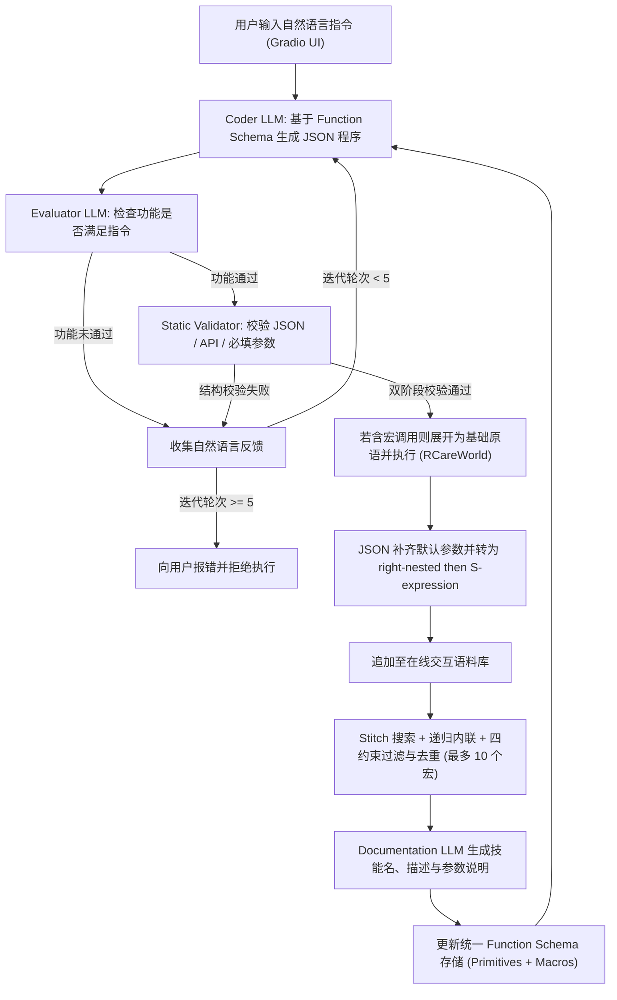

# SkillComposer: Learning Reusable Skills for Natural-Language Robot Programming

## 一句话定义

**SkillComposer** 是一个面向仿真环境的交互式自然语言机器人编程系统，通过「生成-测试（Generate-Test）」双阶段代码校验闭环生成可执行的 JSON 机器人程序，并利用改进的在线库学习算法 **Stitch** 从历史成功程序中持续压缩提炼出可复用宏技能（Macro Skills），从而在多步操作与辅助照护任务中逐步扩展可用技能库。

## 英文缩写速查

| 缩写 | 英文全称 | 简要说明 |
|---|---|---|
| LLM | Large Language Model | 大语言模型；在系统中分别承担代码生成（Coder）、功能评估（Evaluator）与技能文档生成（Documentation） |
| HRI | Human-Robot Interaction | 人机交互；本文重点评测辅助喂食与桌面整理等照护型仿真任务 |
| API | Application Programming Interface | 应用程序接口；本文中对应机器人基础原语与学习得到的宏技能函数 Schema |
| JSON | JavaScript Object Notation | 轻量级数据交换格式；SkillComposer 约束 LLM 输出结构化 JSON 函数调用而非自由文本代码 |
| ROS | Robot Operating System | 机器人操作系统；RCareWorld 仿真器提供 Python 与 ROS 控制接口 |
| SUS | System Usability Scale | 系统可用性量表（满分 100 分）；用于用户研究中的主观可用性量化评测 |

## 为什么重要

- **突破「固定原语 + 单轮孤立生成」的自然语言编程瓶颈**：以往基于 LLM 的机器人编程系统（如 SayCan、ProgPrompt、ChatGPT for Robotics）多依赖人工预先写死的技能集，把每次用户输入当作独立回合处理；用户下达多步或复合指令时往往被迫手工拆分成多条短指令，难以积累跨交互的能力复用。
- **将程序语言（PL）领域的库学习迁移至命令式机器人交互场景**：Stitch 等库学习算法原本面向固定函数式程序语料库。SkillComposer 通过 JSON 到 `then` 二元顺序 S-expression 的转换、抽象内联与四条结构合法性过滤，让在线成长的命令式机器人动作语料也能自动提炼可执行宏技能。
- **以“先验证可靠性、再压缩沉淀技能”证明双机制协同必要性**：消融实验表明，若缺少生成-测试验证环，仅靠 Stitch 压缩历史生成并不会提高复杂任务成功率；只有在评估器把控程序质量后，在线宏学习才能有效缩短程序长度、降低推理耗时并在用户研究中大幅减少提示轮数（用户偏好 11/12）。

## 核心信息

| 字段 | 内容 |
|---|---|
| **作者** | John Woods, Hasti Seifi |
| **机构** | 亚利桑那州立大学计算与增强智能学院（School of Computing and Augmented Intelligence, Arizona State University） |
| **发表时间** | 2026-08-14（arXiv:2608.14944v1 [cs.RO]，8 页，6 图；Submitted to IEEE Humanoids 2026） |
| **论文链接** | [arXiv:2608.14944](https://arxiv.org/abs/2608.14944) / [arXiv HTML v1](https://arxiv.org/html/2608.14944) |
| **项目与代码** | 未确认（arXiv:2608.14944v1 正文及参考文献未提供 GitHub 仓库或独立项目页 URL） |
| **清单分类** | `harness.skills`（来源条目：`survey_ax_2608_14944`） |
| **开源状态** | **未确认开源代码**（截至 2026-11-27，未发现公开源码仓库或可下载实现） |

## 核心原理

SkillComposer 运行在本地 **Gradio** 交互界面与 **RCareWorld**（基于 Unity 的照护机器人仿真器）之上，界面实时呈现仿真相机画面、对话历史、生成的函数调用摘要及自然语言解释。系统由两大核心机制构成（原文 §III）：

### 1. 生成-测试闭环（Generate-Test Loop，§III-A）

1. **结构化动作表示与 Coder LLM**：系统初始仅向 Coder LLM 暴露 **5 个基础原语函数**：`get_info`、`move_to_object`、`move_to_position`、`grasp_object` 和 `release_object`。收到自然语言指令后，Coder LLM 基于当前可用函数 Schema 生成受约束的 **JSON 函数调用序列**（每步含函数名与参数字典），避免自由代码生成带来的语法漂移。
2. **双阶段评估模块（Evaluator Module）**：
   - **语义功能评估（Evaluator LLM）**：对比用户指令与候选 JSON 程序，判断逻辑是否真正满足任务目标；若不满足，则返回指出具体缺陷的自然语言反馈。
   - **静态结构校验（Static Validator）**：确定性检查 JSON 格式合法性、所调用函数是否位于当前 Schema 集合内、参数类型/取值是否有效以及必填参数是否齐全，使 Evaluator LLM 得以专注功能正确性。
3. **迭代修正与准入机制**：任一阶段不通过时，系统将反馈附加回 Coder LLM 对话上下文并要求修订，最多重试 **5 轮**；若 5 轮后仍失败，则向用户报错而**拒绝执行非法程序**。通过双阶段校验的程序先在 RCareWorld 中执行，再写入在线宏学习语料库。

### 2. 面向命令式程序的 Stitch 在线宏学习（Online Macro Learning，§III-B）

1. **JSON 到 S-expression 的树结构转换**：每当一条新程序被接受，系统依据函数 Schema 补齐默认参数，把每个动作转为按 Schema 参数顺序排列的位置调用，并用右嵌套二元 `then` 算子连接多步动作（例如 `(then (move_to_object ...) (grasp_object ...))`），将命令式机器人程序转化为可供 **Stitch** 搜索公共子树的树结构，追加至初始为空的交互语料库。
2. **重实现外循环与结构合法性过滤**：
   - SkillComposer 在不断增长的语料库上运行 Stitch（最多 **20 次迭代**、最大参数元数 `max arity = 5`）以搜索能最小化整体语料长度的压缩抽象。
   - 因 Stitch 原生面向函数式语言且后续抽象会嵌套引用先前抽象，直接输出的原始抽象往往无法作为独立机器人技能执行。系统先**递归内联**所有抽象调用直至全部还原为基础原语，并为缺失参数引入新变量（处理部分应用），随后强制检查四项结构约束：
     1. 至少包含 **2 个**基础原语调用；
     2. `then` 仅用作**二元顺序连接符**；
     3. 仅调用**已知基础原语**；
     4. 变量仅允许出现在**基础原语的参数位置**。
   - 经一致变量重命名去重后，系统重实现 Stitch 外层循环：每轮过滤后仅取排名最高且合法的候选抽象重写语料库，直至学满 **10 个有效宏技能**或无新合法候选为止。每次接受新指令后均重新运行学习，使宏库与完整交互历史保持同步。
3. **自动化 Schema 与文档生成（Documentation LLM）**：通过追踪抽象变量对应的原语参数自动推断参数名与类型，再将宏体及该抽象出现过的历史用户指令/程序片段交给 **Documentation LLM**，生成人类可读的技能名称、功能说明与参数描述。
4. **宏注册与执行展开**：生成的宏 Schema 与基础原语一同存入共享 Schema 存储，供后续 Coder LLM 与 Evaluator LLM 检索调用；下发至 RCareWorld 执行前，系统将宏调用重新展开为底层原语序列，无需改动仿真器接口。实验中自动学到的典型宏包括 `Objects` 场景的 `move_and_place_object`，以及 `Feeding` 场景的 `place_object_on_plate` 与 `hand_object_to_user`。

## 流程总览

## 源码运行时序图

**不适用**（截至 2026-11-27，arXiv:2608.14944v1 原文及公开材料未提供官方开源仓库、可执行源码或入口脚本，原文仅包含系统结构图、JSON 与 S-expression 转换示例以及实验设计描述，因此不绘制源码级运行时序图。）

## 实验与评测

论文围绕两个研究问题展开实验：消融实验（RQ1）检验生成-测试与在线库学习对任务性能的贡献；被试内用户研究（RQ2）评估实际可用性与用户交互成本。

### 1. 消融实验（§IV-A, §V-A, Table I, Fig. 5）

在 **RCareWorld** 的 `Objects`（Prompts 1–20）和 `Feeding`（Prompts 21–40）两个仿真场景共 40 条指令上对比 4 种系统变体，每个系统-场景组合重复运行 **5 次**取均值：

| 任务类别（代表性提示） | 系统变体 | 成功率 (Success Rate) | 程序长度 (Program Length) | 宏使用率 (Macro Usage %) | 生成耗时 (Runtime s) |
|---|---|---|---|---|---|
| Object Manipulation (`Grab a yellow fruit`) | Coder LLM | $1.00 \pm 0.00$ | $1.00 \pm 0.00$ | — | $2.26 \pm 0.80$ |
| | Coder LLM + Eval LLM | $0.96 \pm 0.09$ | $1.32 \pm 0.44$ | — | $9.58 \pm 9.86$ |
| | Coder LLM + Stitch | $1.00 \pm 0.00$ | $1.08 \pm 0.11$ | $0.00 \pm 0.00$ | $2.24 \pm 0.67$ |
| | SkillComposer | $0.96 \pm 0.09$ | $1.32 \pm 0.36$ | $8.00 \pm 17.89$ | $13.97 \pm 9.80$ |
| Spatial Reasoning (`Move rightmost banana to the left of the can`) | Coder LLM | $0.24 \pm 0.43$ | $0.96 \pm 0.41$ | — | $11.94 \pm 4.05$ |
| | Coder LLM + Eval LLM | $0.76 \pm 0.43$ | $2.82 \pm 0.76$ | — | $50.43 \pm 17.02$ |
| | Coder LLM + Stitch | $0.24 \pm 0.43$ | $1.00 \pm 0.58$ | $0.00 \pm 0.00$ | $14.51 \pm 5.80$ |
| | SkillComposer | $0.40 \pm 0.42$ | $2.06 \pm 0.90$ | $37.33 \pm 43.87$ | $30.47 \pm 18.28$ |
| Multi-Step Actions (`Pick up the sphere, move it to the right 50cm, then release it`) | Coder LLM | $0.32 \pm 0.27$ | $1.68 \pm 0.46$ | — | $7.21 \pm 2.55$ |
| | Coder LLM + Eval LLM | $1.00 \pm 0.00$ | $3.60 \pm 1.52$ | — | $22.51 \pm 11.81$ |
| | Coder LLM + Stitch | $0.32 \pm 0.23$ | $1.80 \pm 0.71$ | $0.00 \pm 0.00$ | $9.38 \pm 3.28$ |
| | SkillComposer | $0.96 \pm 0.09$ | $2.32 \pm 1.10$ | $45.33 \pm 51.08$ | $20.59 \pm 10.74$ |
| Goal Planning (`Stack all the cubes`) | Coder LLM | $0.08 \pm 0.18$ | $1.72 \pm 2.06$ | — | $11.67 \pm 3.62$ |
| | Coder LLM + Eval LLM | $0.68 \pm 0.39$ | $13.07 \pm 11.21$ | — | $50.33 \pm 26.83$ |
| | Coder LLM + Stitch | $0.00 \pm 0.00$ | $0.64 \pm 0.22$ | $0.00 \pm 0.00$ | $16.50 \pm 5.07$ |
| | SkillComposer | $0.76 \pm 0.33$ | $6.17 \pm 4.48$ | $86.00 \pm 21.91$ | $49.18 \pm 9.25$ |
| Human-Robot Interaction (`Put the fork up to the user's mouth`) | Coder LLM | $0.14 \pm 0.19$ | $1.16 \pm 0.32$ | — | $15.96 \pm 4.33$ |
| | Coder LLM + Eval LLM | $0.94 \pm 0.13$ | $3.44 \pm 1.05$ | — | $47.49 \pm 15.50$ |
| | Coder LLM + Stitch | $0.16 \pm 0.18$ | $1.16 \pm 0.23$ | $4.00 \pm 8.43$ | $10.71 \pm 2.98$ |
| | SkillComposer | $0.86 \pm 0.23$ | $2.86 \pm 1.04$ | $22.00 \pm 23.94$ | $33.36 \pm 12.14$ |
| Multi-Step Human-Robot Interaction (`Feed the peach first and then the banana to the user`) | Coder LLM | $0.02 \pm 0.06$ | $1.46 \pm 1.07$ | — | $16.06 \pm 2.50$ |
| | Coder LLM + Eval LLM | $0.98 \pm 0.06$ | $10.39 \pm 6.05$ | — | $53.95 \pm 11.09$ |
| | Coder LLM + Stitch | $0.04 \pm 0.08$ | $1.52 \pm 0.90$ | $5.00 \pm 10.54$ | $11.77 \pm 3.60$ |
| | SkillComposer | $1.00 \pm 0.00$ | $5.50 \pm 1.75$ | $55.82 \pm 34.06$ | $27.98 \pm 11.37$ |

- **组件贡献拆分**：在简单物体抓取上各变体均接近 1.00；在复杂与多步任务上，生成-测试闭环贡献了主要的成功率飞跃，但将生成耗时推高至约 4–5 倍。在线宏学习显著压缩了程序长度（`Goal Planning` 从 13.07 降至 6.17，`Multi-Step HRI` 从 10.39 降至 5.50），并在多项复杂任务中降低了引入评估器后的总耗时（如 `Multi-Step HRI` 从 53.95s 降至 27.98s）。
- **需注意的波动**：在 `Spatial Reasoning` 上，引入宏学习后完整 `SkillComposer` 的成功率（0.40）低于仅含评估器的 `Coder LLM + Eval LLM`（0.76），且宏使用率标准差较大。

### 2. 被试内用户研究（§IV-B, §V-B, Table II, Fig. 6）

招募 **12 名**无或仅有初级编程与机器人经验的参与者（3 女 9 男，23–67 岁，每人获 $15 礼品卡，IRB 批准），先在 `Bananas` 场景完成练习，再以顺序平衡方式分别使用 `Baseline`（仅 Coder LLM）与 `SkillComposer` 在 `Feeding` 场景完成三项高层任务：

| 任务 | 系统 | 成功率 (Success Rate) | 平均提示轮数 (Num. Prompts) | 任务完成时间 (m:ss) |
|---|---|---|---|---|
| Rearrange Objects | Baseline (Coder LLM) | $0.50 \pm 0.52$ | $5.8 \pm 2.2$ | $6:09 \pm 2:57$ |
| | SkillComposer | **$0.92 \pm 0.29$** | **$1.9 \pm 1.2$** | **$3:20 \pm 1:20$** |
| Meal Preparation | Baseline (Coder LLM) | $0.92 \pm 0.29$ | $8.2 \pm 5.6$ | $6:10 \pm 3:19$ |
| | SkillComposer | $0.92 \pm 0.29$ | **$3.2 \pm 2.6$** | **$3:59 \pm 1:48$** |
| Feed Care Recipient | Baseline (Coder LLM) | **$0.75 \pm 0.45$** | $6.6 \pm 2.7$ | **$3:48 \pm 1:43$** |
| | SkillComposer | $0.67 \pm 0.49$ | **$3.5 \pm 1.6$** | $4:16 \pm 1:57$ |

- **主观问卷与偏好**：SkillComposer 的 SUS 均分为 **72.1**（$\sigma = 20.1$，属于 Good 可用性区间），高于基线的 **61.4**（$\sigma = 24.6$，属于 OK 区间），均值高出 10.7 分（Cohen's $d = 0.46$），但在配对 $t$ 检验下所有主观量表均未达到统计显著性（$p > 0.05$）。定性访谈中 **11/12 名参与者**明确偏好 SkillComposer，核心原因是可用单条高层多步指令完成任务，而不必像基线那样手动拆成六七条分步指令。
- **反例洞察**：在 `Feed Care Recipient` 任务中，基线耗时略短且成功率略高，因为临近喂食口部时常需细粒度微调位置，快速单步响应比多轮生成-测试规划更高效。

## 与其他工作对比

| 维度 | 固定原语 LLM 规划（SayCan / ProgPrompt） | 仅做内部反思/校验（MultiTalk 等） | 文本检索/人工课程技能学习（Voyager / LLRL / LYRA） | SkillComposer（本文） |
|---|---|---|---|---|
| **技能库来源** | 人工预先定义的固定原子技能集 | 无跨任务技能沉淀，仅优化当前回合 | 整段自由代码按描述检索，或依赖人工示教/课程设计 | **从已验收的交互历史程序自动压缩提取宏技能** |
| **动作表示与校验** | 离散选择或 Python 文本补全 | 规划-分析 LLM 结合视觉输入迭代 | 自由 JavaScript/Python 代码或技能策略 | **Schema 约束 JSON 调用 + Evaluator LLM + 静态校验** |
| **库学习机制** | 无 | 无 | 向量检索或手工课程/唤醒-睡眠范式 | **S-expression 转换 + 约束过滤版在线 Stitch** |
| **终端用户友好度** | 面向研究者或需适配固定 API | 面向自动规划场景 | 面向自主探索或需用户设计课程 | **针对零/初级编程用户优化，单指令驱动多步任务** |

## 结论

**一句话总判：SkillComposer 证明了“生成-测试双阶段验证 + 约束过滤版 Stitch 在线宏学习”能够把零散的自然语言交互持续沉淀为可执行机器人技能，在降低非专业用户提示负担的同时，也暴露了生成延迟与空间微调场景适应性的权衡。**

1. **校验环路必须先于技能压缩**：`Coder LLM + Stitch` 在没有 Evaluator 把关时在复杂任务上几乎失效（`Goal Planning` 成功率 0.00），工程上不可将未校验的历史生成直接纳入技能语料库。
2. **库学习适配命令式控制需显式结构约束**：将 Stitch 等函数式库学习工具引入机器人控制时，必须通过 `then` 顺序化、变量位置限定与递归内联保证学出的宏可直接展开为合法动作序列。
3. **重规划与快微调需要分层切换**：多步编排受益于 5 轮生成-测试与宏调用，但接近目标末端的精细位置微调（如喂食对齐）更适合低延迟直出或轻量闭环，不宜对所有交互一刀切走长链路验证。
4. **宏库规模扩大后需引入检索过滤**：随着交互增多，若将全部学到的宏注入上下文会干扰 Coder LLM 选择，后续应结合检索增强（RAG）按任务上下文动态召回相关宏技能。

## 工程实践

- **Schema 约束优于自由代码执行**：在医疗照护或仿真操作接口中，让 LLM 输出带必填参数与类型检查的 JSON 函数调用，再经静态校验器兜底，能把语义评估负担与语法安全边界解耦。
- **向后兼容的宏展开层**：新学到的宏只在提示词和 Schema 层对 LLM 可见，下发底层执行器前统一展开为初始 5 个基础原语，可在不改写仿真器或机器人底层控制接口的前提下实现技能复用。
- **交互透明度设计**：在 Gradio UI 中向用户同时展示“实际调用的技能列表 + 自然语言总结”，有助于非技术用户建立心智模型，判断系统是否真的学到并复用了合理技能。

## 局限与风险

1. **仿真验证边界与底层模型信息缺失**：全部实验均在 RCareWorld 仿真环境中完成，尚未部署至物理硬件验证抗噪与物理安全边界；同时论文未公开所用 Coder/Evaluator/Documentation LLM 的具体模型名称与超参数配置。
2. **生成延迟显著增加与空间推理回退**：生成-测试闭环将推理时间拉长约 4–5 倍；在 `Spatial Reasoning` 消融中，`SkillComposer` 成功率从 `Coder LLM + Eval LLM` 的 0.76 降至 0.40，表明已有宏或压缩抽象在特定空间关系推理任务中可能诱导错误复用。
3. **上下文容量退化与统计学功效限制**：作者在结论中指出，随着学到的宏技能数量继续增加，Coder LLM 正确选用技能的能力可能下降（尚未实现 RAG 检索）；此外用户研究样本量为 12 人，主观 SUS 提升（72.1 vs 61.4）未达到 $p < 0.05$ 的统计显著性。
4. **开源复现状态**：截至 2026-11-27，原文未附带公开代码仓库，内部提示词模板与静态校验器实现细节无法直接源码核验。

## 关联页面

- [Agentic Robots 综述](paper-towards-agentic-robots-survey.md)
- [全量项目节点清单](../overview/awesome-agentic-robots-node-index.md)
- [VLA 方法背景](../methods/vla.md)
- [智能体机器人操作策略](../methods/agentic-manipulation-policies.md)：对照操作场景中的规划、执行与反馈接口。
- [智能体技能封装](../methods/agent-skill-packaging.md)：对照标准化技能描述、按需加载与接口规范化。
- [编码智能体自验证闭环](../methods/coding-agent-verification-loops.md)：对照生成-测试迭代修正与确定性校验机制。
- [规划与反馈执行](../methods/agent-planning-feedback.md)：对照多步高层规划与失败回流修正闭环。
- [智能体工具调用接口](../methods/agent-tool-use-interface.md)：对照结构化 Function Schema 约束与工具调用边界。
- [机器人操作任务](../tasks/manipulation.md)：对照桌面物体重排、多步抓取放置等核心任务评测背景。
- [Voyager 论文节点](paper-agentic-2305-16291.md)：对照基于向量检索的开放世界可执行代码技能库路线。
- [ProgPrompt 论文节点](paper-agentic-2209-11302.md)：对照静态程序补全式机器人任务规划提示机制。

## 推荐继续阅读

- [arXiv:2608.14944v1 原文（HTML）](https://arxiv.org/html/2608.14944)
- [Voyager: An Open-Ended Embodied Agent with Large Language Models (arXiv:2305.16291)](https://arxiv.org/abs/2305.16291)

## 参考来源

- [SkillComposer 原文核读归档](../../sources/papers/paper-agentic-2608-14944.md)
- [官方 Awesome 快照归档](../../sources/repos/awesome-agentic-robots-survey-index.md)
- [arXiv:2608.14944 摘要页](https://arxiv.org/abs/2608.14944)（[HTML 全文 v1](https://arxiv.org/html/2608.14944)）
