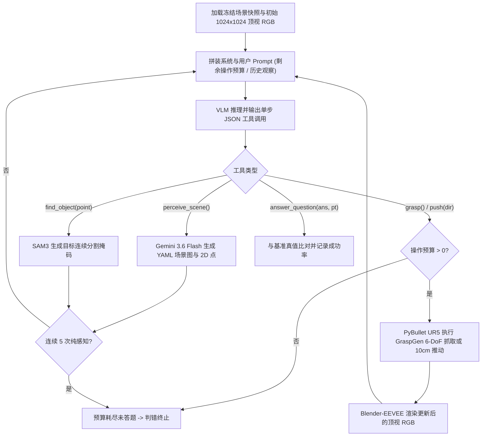
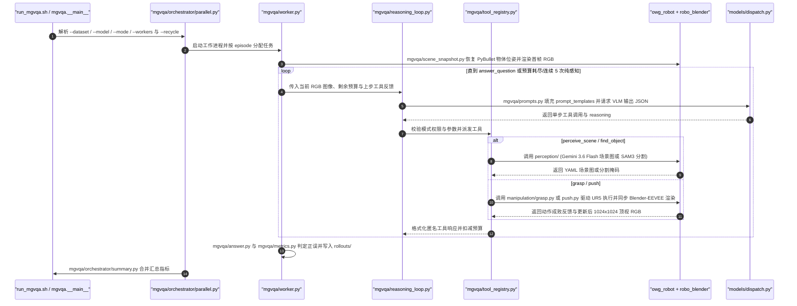

# MG-VQA: Manipulation Grounded Visual Question Answering with VLMs

## 一句话定义

**MG-VQA** 是 NVIDIA 提出的操作驱动视觉问答（Manipulation-Grounded VQA）问题形式化框架、600 题人工核验基准（**MG-VQA-Bench**）与物理交互仿真评测环境（**MG-VQA-Sim**），用于衡量视觉语言模型（VLM）在杂乱遮挡桌面中通过抓、推等物理交互获取隐藏证据并从失败中恢复推理的能力。

## 英文缩写速查

| 缩写 | 英文全称 | 简要说明 |
|---|---|---|
| MG-VQA | Manipulation-Grounded Visual Question Answering | 将物理操作作为中间信息采集步骤的视觉问答范式 |
| VLM | Vision-Language Model | 具备图像理解、空间推理与工具调用能力的多模态大模型 |
| SAM3 | Segment Anything Model 3 | 论文中 `find_object` 工具后端使用的点提示开放词汇分割模型 |
| 6-DoF | Six Degrees of Freedom | 6 自由度（3D 位置与 3D 姿态），用于 GraspGen 生成机械臂抓取位姿 |
| EQA | Embodied Question Answering | 具身问答，传统工作侧重导航换视角，MG-VQA 聚焦桌面接触式清障取证 |
| SR | Success Rate | 评测核心指标（正确回答数 / 有效答题数，按 4 类任务计算宏平均） |

## 为什么重要

1. **打破静态 VQA 的“可见性假设”**：既有空间推理基准大多默认关键视觉证据已存在于静态图像、视频或固定多视角中；而在真实杂乱桌面里，物体常被堆叠掩埋或标识面朝下，单靠静态感知工具（点定位、分割、场景图）几乎无法超越盲猜水平（论文中 8 个模型在 Direct 与 Perception 模式的平均成功率分别为 36.2% 与 37.6%，仅略高于无图像 Chance 基线的 32.7%）。
2. **引入真实物理后果与非神谕反馈**：不同与将操作抽象为“自动揭示内部物品”的简化设定，MG-VQA-Sim 保留了 PyBullet 物理接触、GraspGen 抓取失败、物体滑移及推动引起的邻近物体联动，迫使 VLM 必须在每步交互后重新观测并判断证据是否充分、场景图是否过期。
3. **量化具身工具调用的关键分化**：通过统一接口评测 8 个开源与闭源前沿 VLM，论文首次清晰定位了影响性能的核心差距——不是“能不能看懂图”，而是“愿不愿意主动操作取证”以及“抓取失败后是否重新构建场景图再重锚定”。

## 核心信息

| 字段 | 内容 |
|---|---|
| 作者 | Vineet Bhat, Mikaela Angelina Uy, Siyi Chen, Chan Hee Song, Alex Zook, Xuning Yang, Stan Birchfield, Valts Blukis, Jonathan Tremblay |
| 机构 | NVIDIA |
| 发表时间 | 2026-08-17 提交 v1（原题 *Probe: Manipulation-Grounded Visual Question Answering with VLM Agents*），2026-10-12 修订 v3（arXiv:2608.17129） |
| 论文链接 | [arXiv:2608.17129](https://arxiv.org/abs/2608.17129) · [HTML 全文](https://arxiv.org/html/2608.17129) |
| 项目与代码 | [vineet2104/MG-VQA](https://github.com/vineet2104/MG-VQA) · [MG-VQA-Bench (HF)](https://huggingface.co/datasets/bhatvineet/mg-vqa-bench) |
| 清单分类 | `model.perception` |
| 来源条目 | `survey_ax_2608_17129` |
| 开源状态 | **已开源**（MIT License，源码、MG-VQA-Sim 与 600 题 MG-VQA-Bench 均已发布；仓库标注 MG-VQA-Hard 与训练数据生成引擎为后续计划更新） |

## 核心原理

### 1. 任务定义与四类空间推理题型

在 MG-VQA 中，智能体面对一个包含最多 15 个物体的紧密杂乱桌面（`50 × 50 cm` 工作区 + 1 个用于暂存清出杂物的 clearing basket）。**MG-VQA-Bench** 包含 600 道经双人独立核验的题目，均匀分布于 4 类任务（每类 150 题），并通过严格遮挡阈值保证初始单张顶视 RGB 图像无法直接作答：

- **Count（隐蔽计数）**：回答目标类别物体在场景中的总数量（`0–5` 整数）。当存在目标时先于干扰物生成以形成遮挡，且要求目标在初始顶视图像素可见度 $\le 10\%$。模型若过早依可见物体作答会产生典型少计（undercounting）错误。
- **Find（遮挡搜寻）**：判断指定物体是否存在（正负样本各 75 题）；回答“是（B）”时必须同时给出当前可见像素上的 2D 坐标 `[row, col]` $\in [0, 1000]$。正样本初始像素可见度同样 $\le 10\%$，因此“初始图里看不到”不能作为“不存在”的依据。
- **Beneath（下方关系推理）**：询问被指代遮挡物下方隐藏着什么物体（四选一，包含 `"None of the Above"`）。构建时通过反事实透明渲染（令遮挡物透明）筛选移开后能显著暴露下方目标且目标初始可见度 $\le 10\%$ 的配对。
- **Compare（隐蔽标识比较）**：在三个不同物理体积、表面贴有标准化 `circle-A`、`square-B`、`triangle-C` 标签的物体中判断体积最大或最小者。构建时确保至少一个关键标签在初始顶视图中被遮挡，且贴纸大小一致不构成体积提示。

此外，基准在选项中刻意加入颜色或纹理相近的**混杂干扰项（confounding distractors）**（例如藏着红苹果时选项同时包含红黄相间球），防止 VLM 仅凭露出的局部色块猜对答案。所有题目均经过两位标注员使用可透明化非关键杂物的核验界面确认语义无歧义且物理上可恢复。

### 2. 三档信息访问级别与标准工具接口

评测通过统一的 JSON 工具协议对比三种访问权限：

1. **Direct（直接问答）**：仅提供初始 `1024 × 1024` 顶视 RGB 图像与题目，无任何工具。
2. **Perception（纯感知增强）**：开放两个免费感知工具及答题工具：
   - `perceive_scene()`：无论主测 VLM 是何模型，统一调用 **Gemini 3.6 Flash** 返回 YAML 格式的可见物体清单、文本描述、2D 图像点坐标及成对空间关系谓词。
   - `find_object(point)`：基于场景图中的 2D 点调用 **SAM3** 生成连续实例分割掩码。
3. **Manipulation（操作取证，`agentic` 模式）**：在 Perception 基础上额外开放共享 **10 次操作预算** 的两个接触式操作工具：
   - `grasp()`：结合上一步 `find_object` 的分割掩码、顶视深度图与相机内参重建 3D 点云，调用 **GraspGen** 生成 6-DoF 抓取候选；由 UR5 + Robotiq 2F-140 尝试抓取并放入 clearing basket。若掩码有误、无合法抓取或邻近杂物阻挡则抓取失败，并可能顺带扰动周围物体。
   - `push(direction)`：基于上一步分割掩码计算物体 2D 质心，将闭合夹爪移至反侧并沿图像坐标 `left` / `right` / `up` / `down` 水平推动 10 cm，适合扁平物体清障或局部腾挪，同样可能引发多物体连带位移。
   - `answer_question(answer[, point])`：提交最终答案并结束回合。

交互约束规定：每轮只能调用 1 个工具；感知调用免费但**连续 5 次纯感知调用**或**耗尽 10 次操作预算仍未调用 `answer_question`** 均判为错误并终止回合。系统在每轮后将当前更新后的顶视 RGB 图像、工具返回文本（仅报告成功/失败及当前观测状态，不泄露真值状态）与历史上下文一同送回 VLM。

## 流程总览

## 源码运行时序图

在官方仓库 `vineet2104/MG-VQA` 中，评测由 `run_mgvqa.sh` 或 `python -m mgvqa`（`mgvqa/__main__.py` → `mgvqa/cli.py`）触发 `mgvqa/run_benchmark.py`，经多进程编排器 `mgvqa/orchestrator/parallel.py` 分发至 `mgvqa/worker.py` 恢复冻结场景并运行 `mgvqa/reasoning_loop.py`（Direct 模式走 `mgvqa/singlepass.py`），每轮通过 `mgvqa/tool_registry.py` 调度感知、操作与物理渲染模块并由 `mgvqa/metrics.py` 汇总结果。

## 实验与评测

### 1. MG-VQA-Bench 主实验结果（600 题，Table 1）

论文在 4 类任务（每类 150 题）上评测了 4 个开源模型与 4 个闭源模型，并设置图像盲猜基线 `Chance`（Count 恒答 `"0"`、Find 恒答 `"No"`、Beneath 恒答 `"None of the above"`、Compare 随机三选一）。部分核心数据（成功率 `%`，`Avg.` 为四任务宏平均）如下：

| 模型 | 模式 | Count | Find | Beneath | Compare | Avg. |
|---|---|---:|---:|---:|---:|---:|
| Chance（盲猜基线） | — | 22.0 | 50.0 | 26.0 | 32.7 | 32.7 |
| Gemma 4 31B IT | Direct / Perception / Manipulation | 24.0 / 22.7 / 32.0 | 38.0 / 46.7 / 50.7 | 33.3 / 28.7 / 52.7 | 35.3 / 43.3 / 42.0 | 32.7 / 35.3 / 44.3 |
| Kimi K3 | Direct / Perception / Manipulation | 24.7 / 25.3 / 40.0 | 39.3 / 44.7 / 53.3 | 29.3 / 32.0 / 74.7 | 52.7 / 60.7 / 58.7 | 36.5 / 40.7 / 56.7 |
| GLM 5.3 | Direct / Perception / Manipulation | 24.7 / 21.3 / 25.3 | 38.7 / 42.0 / 47.3 | 23.3 / 27.3 / 46.7 | 34.0 / 39.3 / 44.0 | 30.2 / 32.5 / 40.8 |
| Qwen 3.8 Flash Next | Direct / Perception / Manipulation | 28.7 / 24.0 / 36.7 | 40.0 / 38.0 / 42.0 | 34.0 / 31.3 / 66.0 | 52.0 / 47.3 / 71.3 | 38.7 / 35.2 / 54.0 |
| Gemini 3.1 Pro | Direct / Perception / Manipulation | 24.7 / 27.3 / 62.7 | 47.3 / 48.7 / 66.7 | 42.7 / 36.0 / 66.7 | 48.0 / 50.0 / 62.0 | 40.7 / 40.5 / 64.5 |
| Gemini 3.8 Flash | Direct / Perception / Manipulation | 28.0 / 25.3 / 60.0 | 49.3 / 48.7 / 66.0 | 44.0 / 41.3 / 80.0 | 47.3 / 46.0 / 71.3 | 42.2 / 40.3 / 69.3 |
| Claude Opus 4.8 | Direct / Perception / Manipulation | 23.3 / 22.7 / 25.3 | 38.7 / 45.3 / 47.3 | 28.0 / 27.3 / 51.3 | 35.3 / 41.3 / 42.0 | 31.3 / 34.2 / 41.5 |
| **GPT 6 Astra** | Direct / Perception / Manipulation | 33.3 / 32.7 / **87.3** | 31.3 / 44.0 / **80.7** | 33.3 / 36.0 / **88.0** | 50.0 / 57.3 / **76.0** | 37.0 / 42.5 / **83.0** |

核心统计发现：
- **Manipulation 带来普遍大幅跃升**：全模型均值由 Direct 的 36.2%、Perception 的 37.6% 提升至 Manipulation 的 56.8%（其中 Count +20.4% 至 46.2%，Beneath +32.8% 至 65.8%，Compare +12.2% 至 58.4%，Find +14.2% 至 56.8%）。闭源模型在 Manipulation 模式下平均达 64.6%，开源模型平均达 49.0%。
- **Find 正负样本不对称与 Count 少计偏差**：在 Find 中，操作让“目标实际存在”的 75 题成功率从 7.3% 跃升至 30.3%（“目标不存在”从 77.8% 升至 82.8%）；而在 Count 中模型主要因未翻找其余杂物而过早回答导致少计。

### 2. 消融实验与失败恢复行为（Table 2–4）

- **Prompt 与多视角消融（Table 2）**：
  - Kimi K3 加入首轮引导 `+ Search`、每轮重复引导 `+ Search-persistent` 或附加斜视角 `+ Multiview` 后，平均成功率从 56.7% 分别升至 **61.8%**、**66.0%** 和 **62.3%**，至少执行过一次操作的回合数从 371/600 增至 519、527 和 385。
  - Claude Opus 4.8 在 `+ Search` 下从 41.5% 微升至 44.0%，但在 `+ Search-persistent` 下回落至 41.5%（强迫交互但未能有效利用新观察）；GPT 6 Astra 加 `+ Search` 反而由 83.0% 降至 80.5%（操作回合数维持 584 不变）。
  - `+ Multiview` 有助于 Count 与 Beneath，但在 Compare 上对 Kimi 无增益（58.7%）且使 Opus 下降（42.0% → 37.3%），因 A/B/C 贴纸主要面向顶视相机。
- **操作投入与失败重锚定（Table 3–4）**：
  - GPT 6 Astra 平均每题执行 **3.9** 次操作（其余模型 0.9–2.9 次），在 Count / Find / Beneath / Compare 上的中位轮数与操作次数分别为 `16/5`、`14/4`、`8/2`、`12/3`，而较弱模型在 Count/Find 中位操作常为 `0`。
  - 当发生抓取失败后（Table 4），GPT 6 Astra（`N=502` 次含失败回合）中有 **82.7%** 转而执行 `push` 清障，且在推动前 **98.8%** 会先调用 `perceive_scene` 重建场景图再分割（`Scene + seg.`），**0.0%** 沿用过时场景图；相比之下，Gemini 3.8 Flash（84.5%）和 Claude Opus 4.8（88.6%）大量直接用旧场景图做分割（`Seg. only`），而 GLM 5.3（46.3%）和 Claude Opus 4.8（23.6%）常在抓取失败后直接放弃操作并答题（`None`）。

### 3. MG-VQA-Hard 对抗测试（40 题，Table 5）

作者让 GPT 6 Astra 分析所有模型轨迹并借助扩展 50 个物体库构建了 **MG-VQA-Hard**（40 题，每任务 10 题）。结果 5 个评测模型平均成功率集体跌至 **17.5%–27.5%**（Kimi K3 17.5%、Qwen 3.8 Flash Next 27.5%、Gemini 3.1 Pro 27.5%、Gemini 3.8 Flash 25.0%、GPT 6 Astra 25.0%）。这暴露出两大共性盲区：（1）当物体分散平放时，VLM 误以为下方不可能藏有小物体（如把扁平盒子当成无遮挡）；（2）单目顶视角下严重缺乏 3D 高度感知（GPT 6 Astra 在 Compare 的 8 次错误中有 6 次将横向宽扁物体误判为比竖直高物体体积更大）。

## 与其他工作对比

- **对比经典机器人操作仿真基准**（如 LIBERO、CALVIN、ManiSkill / ManiSkill3、RoboCasa、RoboTwin、VLABench、RoboLab）：这些平台主要训练和评测端到端 RL 或 VLA 策略以达到目标物理状态；MG-VQA-Sim 专门面向工具调用型 VLM，将机械臂动作作为中间取证手段并在狭小桌面高密度聚拢物体以考察失败恢复。
- **对比具身问答与空间交互基准**（如 OpenEQA、MQA、ESI-Bench）：OpenEQA 与 ESI-Bench 侧重室内移动导航或抽象化视角/交互操作，绕过了低层抓取与碰撞失败；MQA 虽涉及箱内互动但早期方案依赖分离模块；MG-VQA-Bench 则保留了接触式抓/推的真实失败率、遮挡残留与连带位移，完整检验闭环重锚定能力。
- **对比视觉空间推理与工具智能体**（如 SpaceTools、BOP-ask、CaP-X）：前沿 VLM 与工具智能体在静态 RGB-D 或代码策略基准上已展现强能力，但 MG-VQA 证明了“拥有工具”不等于“主动且稳健地用工具持续消除不确定性”。

## 结论

**一句话总判：MG-VQA 用严谨的 600 题遮挡交互基准和物理仿真闭环证明，VLM 在杂乱环境下的空间推理瓶颈已不在静态看图，而在“是否主动实施物理探索”以及“操作失败后能否刷新状态并重锚定”。**

1. **不能只用纯感知工具替代物理交互**：在存在遮挡的桌面任务中，点定位、SAM 分割和场景图平均只比盲猜高不到 5 个百分点；必须引入可改变环境状态的抓、推原语才能打开性能上限。
2. **闭环重锚定是工程实现分水岭**：物理操作失败常伴随周围物体位移，若不强制或引导智能体重新调用 `perceive_scene`，后续 `find_object` 与 `push` 极易基于过期坐标连续失误（如 Table 4 中弱模型高达 84%–89% 的过期场景图重用率）。
3. **显式搜索提示词是双刃剑**：`+ Search` / `+ Search-persistent` 能显著拉高高潜力中等模型（如 Kimi K3）的交互意愿与成绩，但对缺乏有效后验利用能力的模型或本已充分探索的模型可能适得其反。
4. **单目顶视角与空间先验仍需多视角/3D 补充**：MG-VQA-Hard 揭示 VLM 普遍存在“平铺无遮挡错觉”与顶视高度估计失真，工程部署应结合斜视角/多视角或深度体积估计工具，而非依赖单一顶视 RGB。

## 工程实践

- **硬件与环境要求**：官方仓库要求 Linux、NVIDIA GPU（参考配置为单张 RTX 5090 32 GB VRAM、62 GB RAM）及匹配 `nvcc` CUDA 工具链，并需安装 Blender 5.1（用于 EEVEE 渲染）与 Conda 环境（`environment.yml`）。
- **权重与资产拉取**：需分别通过 `scripts/finish_setup.sh` 编译 CUDA 扩展、 `scripts/download_weights.sh` 下载 SAM3 与 GraspGen 权重、`scripts/download_assets.py` 拉取 319 个共享物体网格（`vineet-datasets/agentic-mqa-objects`）以及 `scripts/download_benchmark.py` 下载基准（`bhatvineet/mg-vqa-bench`）。
- **并发与进程回收建议**：由于 PyBullet 与 Blender 在长跑多回合后可能存在内存累积，仓库建议在多 worker 评测时使用 `--workers 4 --recycle 4`（每 4 个 episode 回收一次进程），并用 `scripts/preflight.py` 做启动前依赖与数据集校验、用 `scripts/build_report.py` 生成可视化HTML轨迹报告。
- **API 路由与无头验证**：默认场景图模型（Gemini 3.6 Flash）及主测模型支持通过 `.env` 配置 NVIDIA Gateway（`NV_API_KEY`）或原生 OpenAI / Gemini / Anthropic API；修改前可通过 `./run_mgvqa.sh ... --dry-run` 检查命令编排。

## 局限与风险

1. **固定桌面与离散工具集限制**：MG-VQA-Sim 目前仅支持单台固定底座 UR5 + Robotiq 2F-140 在 `50 × 50 cm` 桌面上的离散工具调用（固定 10 cm 推动与 GraspGen 抓取），尚未涵盖双臂协同、移动底盘或由 VLM 动态编写新技能的开放工具空间。
2. **统一场景图感知器依赖**：所有受测模型的 `perceive_scene` 均统一由 Gemini 3.6 Flash 承担，既保证感知底座一致，也意味着评测结果受限于该场景图模型自身的识别与空间关系表述误差。
3. **MG-VQA-Hard 尚未随首版开源**：截至 2026-11-27，仓库 README 将 MG-VQA-Hard（40 题及扩展 50 物体库）、新增操作工具与训练数据生成引擎列为后续计划，当前公开复现范围为 600 题 MG-VQA-Bench。
4. **仿真与真机 Sim2Real 鸿沟**：Blender-EEVEE 渲染虽接近写实，但仍与真实相机噪声、反光材质及软体/可变形杂物存在差距。

## 关联页面

- [具身大模型评测基准选型闭环](../queries/embodied-eval-benchmark-selection-loop.md)：对照评测基准设计与指标选型闭环。
- [Agentic Robots 综述](paper-towards-agentic-robots-survey.md)
- [全量项目节点清单](../overview/awesome-agentic-robots-node-index.md)
- [VLA 方法背景](../methods/vla.md)
- [智能体机器人操作策略](../methods/agentic-manipulation-policies.md)：对照智能体、机器人接口与执行反馈。
- [智能体工具调用接口](../methods/agent-tool-use-interface.md)：对应 VLM 调用感知与抓推原语的 JSON 工具协议设计。
- [具身智能体基准评测](../methods/embodied-agent-benchmarking.md)：对比任务设计、环境访问分级与防作弊构建原则。
- [抓取位姿估计](../methods/grasp-pose-estimation.md)：对应 `grasp` 工具调用 GraspGen 生成 6-DoF 抓取位姿的技术链路。
- [机器人视觉感知](../methods/robot-visual-perception.md)：对应场景图生成与 SAM3 点提示分割掩码提取。
- [智能体规划与执行反馈](../methods/agent-planning-feedback.md)：对应抓推失败后的状态重锚定与策略调整机制。
- [机器人操作任务](../tasks/manipulation.md)：定位物理操作在通用桌面交互与证据搜寻中的角色。

## 推荐继续阅读

- [MG-VQA arXiv 原论文与 HTML 全文](https://arxiv.org/abs/2608.17129)
- [MG-VQA 官方开源代码与评测框架 (GitHub)](https://github.com/vineet2104/MG-VQA)
- [MG-VQA-Bench 数据集快照 (Hugging Face)](https://huggingface.co/datasets/bhatvineet/mg-vqa-bench)
- [MG-VQA 物体资产池 (Hugging Face)](https://huggingface.co/datasets/vineet-datasets/agentic-mqa-objects)

## 参考来源

- [MG-VQA 论文原文精读归档](../../sources/papers/paper-agentic-2608-17129.md)
- [MG-VQA 官方仓库核对归档](../../sources/repos/paper-agentic-2608-17129.md)
- [官方 Awesome 快照归档](../../sources/repos/awesome-agentic-robots-survey-index.md)
- [arXiv:2608.17129 官方入口](https://arxiv.org/abs/2608.17129)
- [vineet2104/MG-VQA 官方仓库](https://github.com/vineet2104/MG-VQA)
