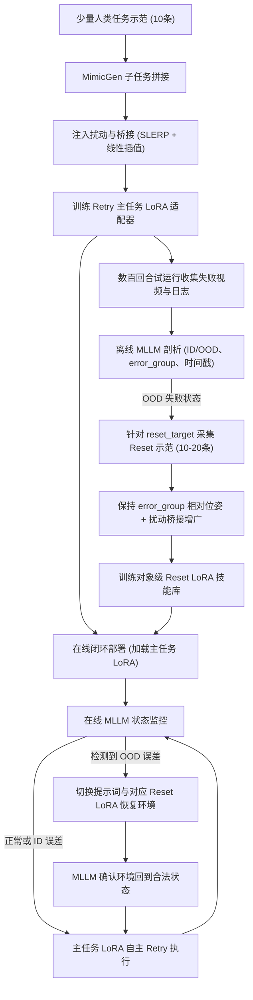

# FLARE: A Failure-Aware Framework for Autonomous Correction and Recovery in Visual-Language Robotic Manipulation

## 一句话定义

FLARE 是一个面向视觉-语言-动作模型（VLA）的**失败感知自主纠错与恢复框架**：基于分布内（ID）与分布外（OOD）错误分类，通过“扰动-桥接”数据增广赋予策略内置的 **Retry（重试）** 鲁棒性，并结合多模态大模型（MLLM）离线失败挖掘、对象级 **Reset（重置）** LoRA 技能库与在线监控仲裁实现闭环环境恢复。

## 英文缩写速查

| 缩写 | 英文全称 | 简要说明 |
|---|---|---|
| FLARE | Failure-Aware Retry/Reset Framework | 本文提出的面向 VLA 机械臂操作的失败感知重试/重置框架 |
| VLA | Vision-Language-Action Model | 联合视觉感知、语言指令与机器人动作输出的策略模型（如 $\pi_{0.5}$、OpenVLA） |
| MLLM | Multimodal Large Language Model | 本文中用于离线失败视频剖析与在线状态异常监控的多模态大模型 |
| ID | In-Distribution（Error） | 环境状态仍处有效任务轨道但机械臂位姿落入示范低概率区的可重试误差 |
| OOD | Out-of-Distribution（Error） | 环境状态被破坏（如容器倾倒、物体卡槽），常规任务策略无法直接挽救的误差 |
| LoRA | Low-Rank Adaptation | 低秩微调技术，用于在统一 VLA 底座上分别隔离训练主任务与各重置技能适配器 |
| SLERP | Spherical Linear Interpolation | 球面线性插值，用于在扰动-桥接阶段生成末端旋转恢复轨迹 |

## 为什么重要

现有 VLA 模型（如 $\pi_0$、$\pi_{0.5}$、OpenVLA）主要在无失败的“完美”人类示范上训练，面临两类结构性脆弱问题：

1. **轨迹单调性导致的虚假耦合**：人类示范常沿狭窄的位姿流形接近目标，使策略错误地将“机械臂自身位姿 $s_t^r$”与“任务进度”强绑定。一旦遭遇轻微碰撞或抓空，环境虽仍有效（ID Error），策略却因进入未见位姿而无法原地重试。
2. **成功偏置导致的 OOD 盲区**：示范集中几乎不含从灾难性故障恢复的轨迹。一旦物体翻倒或卡死（OOD Error），单纯重组成功片段的数据增广（如 MimicGen）无法合成修复行为，只能依赖人类介入重置。

FLARE 将机器人自主性从“零失误执行”重构为“内置重试 + 外部仲裁重置”的分层韧性架构，为提升 VLA 长时程接触密集型操作的闭环可靠性提供了可复用的数据增广与系统编排范式。

## 核心信息

| 项目 | 内容 |
|---|---|
| 作者 | Ganlong Zhao、Zijia Tang、Xingping Chen、Zhanghui Kuang、Ye Tian、Guanbin Li（通讯） |
| 机构 | 香港中文大学（CUHK）、CPII、杜克大学（Duke）、中山大学（SYSU）、TengenX、腾讯 Robotics X、深圳河套研究院、广东省大数据分析与处理重点实验室 |
| 发表时间 / 载体 | CVPR 2026（已录用）；arXiv:2608.26645v1（2026-08-27） |
| 论文链接 | [arXiv 摘要页](https://arxiv.org/abs/2608.26645) / [arXiv HTML 全文](https://arxiv.org/html/2608.26645) |
| 项目与代码 | 截至 2026-11-27，原文与补查元数据未列出独立项目页或官方代码仓库 |
| 清单分类 | `harness.monitoring_and_recovery`（`survey_ax_2608_26645`） |
| 开源状态 | 未确认开源代码（无官方仓库可核验） |

## 核心原理

FLARE 将系统世界状态分解为环境状态 $s_t^e$ 与机器人自身状态 $s_t^r$，并以语言条件马尔可夫策略 $\mathbf{a}_t \sim \pi_\theta(\cdot \mid o_t, \mathcal{I})$ 建模动作块预测：

1. **ID / OOD 错误形式化分类**：
   - **ID Error**：满足 $s_t^e \in \mathcal{S}_{\text{task}}^e$（环境仍在有效任务路径上），但 $s_t^r$ 落入 $P(s_t^r \mid s_t^e, \mathcal{D}_{\text{demo}})$ 的低概率尾区。策略因过拟合 $(s_t^e, s_t^r)$ 联合配置而误判进度，需要解耦位姿的 **Retry** 能力。
   - **OOD Error**：$s_t^e \notin \mathcal{S}_{\text{task}}^e$（如杯子倒扣、咖啡胶囊卡入插槽），主策略动作分布无法将环境拉回 $\mathcal{S}_{\text{task}}^e$，必须调用专用 **Reset** 技能 $\pi_{\text{reset}, j}$ 恢复环境至合法状态 $s_{t'}^e \in \mathcal{S}_{\text{task}}^e$。
2. **基于扰动-桥接（Perturbation & Bridging）的内置 Retry 机制**：
   - 首先沿用 [MimicGen](mimicgen.md) 将少量人类示范（每任务 10 条）按子任务分段并在新场景下重组为基准轨迹 $\mathcal{T}_{\text{task}} = (a_0, a_1, \dots, a_N)$。
   - 在起点及相邻子任务之间注入随机扰动-桥接段 $d_i = (d_i^A, d_i^B)$，得到 $\mathcal{T}_{\text{aug}} = (d_{\text{init}}, a_0, d_0, a_1, d_1, \dots, a_N)$：
     - **扰动段 $d_i^A$**：施加随机末端平移与旋转（论文主实验最大 $45^\circ$ 旋转、$0.5\text{ m}$ 平移），将机械臂推离示范轨迹流形。
     - **桥接段 $d_i^B$**：采用无规划器运动学插值（位置线性插值 + 姿态 SLERP）从扰动终点接回下一子任务 $a_{i+1}$ 的合法起点。
   - 训练时**丢弃扰动动作 $d_i^A$**，仅将原始成功片段与桥接-任务衔接序列 $(d_i^B, a_{i+1}, \dots)$ 作为监督目标，使策略学会从广泛异常位姿直接接续正确动作。
3. **MLLM 离线失败挖掘与对象级 Reset 技能学习**：
   - 先用仅具 Retry 能力的策略运行数百回合收集失败视频与状态日志，交给离线 MLLM（论文采用 Gemini-2.5-Pro，温度 $0.7$）输出结构化 JSON：`error_type`、`reset_target`、`error_group` 与 `failure_timestamp`。
   - **语义失败资产与操作依赖规则**：当故障涉及多物体几何耦合（例如胶囊被咖啡机盖压住）时，Prompt 强制记录完整 `error_group` 并在新场景增广时保持组内相对位姿不变；同时依据操作依赖优先选定首个可操作对象作为 `reset_target`（先开盖再处理胶囊）。
   - 依时间戳提取状态（仿真直接读取 MuJoCo 状态；真机通过 Any6D 估计物体 6D 位姿近似复现故障布局，无需严格坐标对齐），为每个重置对象采集 10–20 条人类示范并同样应用扰动-桥接增广。
4. **模块化 LoRA 技能库与在线闭环仲裁**：
   - 选定 $\pi_{0.5}$ 作为共享底座（冻结感知等其余模块，仅以 LoRA 微调语言模型与动作专家），分别训练主任务适配器 $\pi_{\text{LoRA}}^{\text{task}}$ 与各对象重置适配器 $\pi_{\text{LoRA}}^{\text{reset}, j}$，避免不同技能间的梯度冲突并支持热插拔扩展。
   - 推理时由在线 MLLM 监控器观察执行画面：遇到 ID 误差时不介入，依赖主策略自主重试；检测到 OOD 误差时切换提示词并热替换对应 $\pi_{\text{LoRA}}^{\text{reset}, j}$，待确认环境恢复后再切回 $\pi_{\text{LoRA}}^{\text{task}}$ 继续原任务。

## 流程总览

依据原文 §3（Fig. 2）构建的离线数据增广、失败挖掘与在线闭环恢复流程：

## 源码运行时序图

**不适用**（截至 2026-11-27，原文 [arXiv:2608.26645v1](https://arxiv.org/html/2608.26645) 及元数据补查均未提供独立项目页或官方 GitHub 代码仓库链接，尚未确认可运行官方源码实现）。

## 实验与评测

以下数据全部来自论文原文（未在本库本地复现）；仿真基于 [RoboMimic](robomimic.md) 9 项接触密集操作任务，每任务从 10 条人工示范增广至 500 条，评测 50 个随机化回合；后缀 `D0` / `D1` 表示物体初始随机化幅度递增。

| 方法 | Coffee_D0 | Coffee_D1 | Stack_D0 | Stack_D1 | StackThree_D0 | StackThree_D1 | Threading_D0 | ThreePieceAssembly_D0 | ThreePieceAssembly_D1 | 平均成功率 |
|---|---|---|---|---|---|---|---|---|---|---|
| OpenVLA | 42% | 18% | 84% | 86% | 36% | 20% | 20% | 28% | 8% | 38.0% |
| Task-conditioned | 66% | 24% | 88% | 68% | 30% | 6% | 74% | 20% | 0% | 41.8% |
| Subgoal-conditioned | 76% | 26% | 88% | 74% | 24% | 6% | 78% | 20% | 2% | 43.8% |
| Motion-conditioned | 68% | 32% | 92% | 84% | 38% | 16% | 58% | 30% | 4% | 46.9% |
| Subgoal Self-reflection | 80% | 32% | 88% | 78% | 32% | 6% | 80% | 34% | 2% | 48.0% |
| Phoenix | 94% | 48% | 96% | 86% | 50% | 20% | 68% | 52% | 6% | 57.8% |
| Phoenix-Human（人工子目标上界） | 100% | 100% | 100% | 90% | 70% | 40% | 100% | 70% | 40% | 78.9% |
| $\pi_{0.5}$（底座基线） | 82% | 56% | 100% | 92% | 90% | 84% | 42% | 58% | 46% | 72.2% |
| **FLARE（Ours）** | **96%** | **78%** | **100%** | **100%** | **100%** | **90%** | 72% | **62%** | **58%** | **84.0%** |

关键消融、模块评测与真机结果（Table 2–5 & Fig. 4）：

- **真机验证（Piper 机械臂 + 顶视/腕部 RealSense D435i，每任务 10 条示范增广至 50 条，评测 40 次）**：`Stack Three Blocks` 成功率由 $\pi_{0.5}$ 基线的 `62.5%` 提升至 `75.0%`；`Insert U-shaped Block` 由 `45.0%` 提升至 `55.0%`。真机利用 Any6D 估计物体 6D 位姿辅助数据增广，并证明近似人工摆放相似故障状态即可训练有效 Reset 技能。
- **Reset 模块消融（Table 3）**：在 Coffee 与 ThreePieceAssembly 四组设定上，去掉 Reset（`Ours w/o Reset`，仅做 Retry 增广）导致平均成功率下降 `3.5%`；用人工反馈替代在线 MLLM 监控（`Ours-Oracle`）可再提升 `7%`（Coffee_D0 达 `100%`、Coffee_D1 达 `90%`）。
- **单技能重置成功率与生成效率（Table 4）**：操作依赖中先置动作更容易习得——Coffee 机盖重置成功率 `84%`（数据生成效率 `83.7%`）、ThreePieceAssembly 的 T 型块 `88%`（`48.6%`）；而需要精巧手内调整扶正的咖啡胶囊与 U 型块重置成功率仅为 `24%`（`11.6%`）与 `20%`（`5.9%`）。
- **离线 MLLM 失败分析准确率（50 条人工标注视频，Table 5）**：Gemini-2.5-Pro 在 Coffee / ThreePieceAssembly 上分别取得 Retry/Reset 分类 `88%` / `96%`、目标物体识别 `88%` / `78%`、失败时间戳定位 `78%` / `66%`。
- **扰动超参敏感性（Coffee_D1，Fig. 4）**：旋转 $r = 30^\circ$ 与平移 $t = 0.7\text{ m}$ 在单变量实验中分别达到最高成功率；继续增大扰动会因数据方差过大及有效生成率下降而导致性能回落。

## 与其他工作对比

| 对比维度 | 常规 VLA 微调（如 [OpenVLA](paper-openvla.md)、[$\pi_{0.5}$](paper-pi05-open-world-vla.md)） | MLLM 自反思框架（如 Phoenix、REFLECT） | 强化学习恢复（如 SeRO） | FLARE（本文） |
|---|---|---|---|---|
| 核心机制 | 端到端模仿成功示范 | 固定技能库或粗粒度运动指令反思 | 在线试错优化恢复策略 | 扰动-桥接内置 Retry + 离线挖掘 Reset LoRA 技能库 |
| 对 ID 误差处理 | 易受位姿-进度虚假耦合影响而停滞 | 需额外触发高频子目标/运动纠偏（如 5Hz） | 依赖在线探索样本 | 策略内生自主重试，无需在线 MLLM 介入 |
| 对 OOD 误差处理 | 无显式恢复数据支持 | 依赖预设技能或人工纠正（Phoenix-Human） | 样本效率低，真机部署代价高 | MLLM 定向挖掘少量示范（10–20 条）并模块化微调 |
| 9 任务平均成功率 | OpenVLA `38.0%`；$\pi_{0.5}$ `72.2%` | Phoenix `57.8%`；Phoenix-Human `78.9%` | —（本文未同表测试） | **`84.0%`**（相比 $\pi_{0.5}$ 提升 `+11.8%`） |

## 结论

**一句话总判：VLA 脆弱性很大程度源于示范数据中“机械臂位姿—任务进度”的虚假耦合；仅靠无需在线调用大模型的“扰动-桥接”数据增广即可解决大部分分布内偏差，而针对真正破坏环境状态的 OOD 故障再配以轻量对象级 Reset LoRA 技能库是最具性价比的工程路径。**

1. **区分 ID 与 OOD 是降低系统延迟的关键** — 实验表明仅使用 Retry 增广（`Ours w/o Reset`）已能贡献大部分增益（如 Coffee_D0 从 `82%` 升至 `92%`），将昂贵的 MLLM 在线干预严格限制在 OOD 状态切换上，避免每步依赖大模型推理。
2. **丢失扰动段动作、仅监督桥接段不可省略** — 扰动阶段只用于打乱初始/中间机器人构型，将随机运动踢出损失计算并只监督 SLERP/线性插值回流段，才能学出干净的重试行为。
3. **多物体故障重置必须遵循操作依赖与相对位姿保持** — 面对遮挡或卡死故障（如机盖压住胶囊），先识别前置解除约束的物体并锁定 `error_group` 相对几何关系进行场景增广，决定了数据生成效率（`83.7%` vs `11.6%`）。
4. **末端灵巧度仍是 Reset 技能的硬瓶颈** — 对倒扣圆柱体或复杂构件的重新抓取与扶正（成功率仅 `20%–24%`），单纯扩大数据规模难以弥补平行夹爪自由度与手内调整能力的不足。

## 工程实践

1. **轨迹分段与扰动超参设置**：使用 MimicGen 对初始 10 条人类示范做子任务切分与场景重组；在首段前与子任务衔接处注入最大约 $30^\circ$–$45^\circ$ 旋转、$0.5$–$0.7\text{ m}$ 平移扰动（需结合自身工作空间裁剪，防止生成效率过低），并以线性插值 + SLERP 生成桥接段。
2. **微调配置**：以 $\pi_{0.5}$ 为底座，仅对语言主干与动作专家挂载 LoRA（其余权重冻结），采用 Adam 优化器与恒定学习率 $2.5 \times 10^{-4}$（不加余弦衰减）；主任务与每个可重置对象分别保存独立 LoRA 权重以防技能遗忘与梯度冲突。
3. **MLLM 提示工程与失败采集**：离线视频剖析建议限制在明确的 `reset_objects` 候选清单内，并在 Prompt 中显式编码 `error_group` 与“先解除遮挡再恢复目标”的依赖规则；真机部署可用 Any6D 等无模型位姿估计替代仿真特权状态，且无需追求毫米级复现故障初始状态。

## 局限与风险

1. **不可恢复故障边界**：论文显式排除了超出夹爪抓握尺度或脱离机械臂可达工作空间的故障（如大型咖啡机整体倾覆、零件掉落地面），系统对此类错误无法自愈。
2. **依赖预定义重置技能库**：当前方案无法对从未见过的复杂 OOD 故障零样本合成多步协同恢复动作，仍需人工针对挖掘出的 `reset_target` 补采 10–20 条示范。
3. **MLLM 在线误判与延迟**：`Ours-Oracle` 比完整版高出 `7%`，表明在线 MLLM 对复杂遮挡、失败时机（时间戳准确率 `66%–78%`）和目标物体（`78%–88%`）的判断仍有误报/漏报，需要配合安全约束与人类急停接管机制。
4. **源码未公开与复现核验限制**：截至 2026-11-27 尚未确认官方开源代码，文中超参（如 LoRA rank/alpha 具体数值、在线 MLLM 监控采样频率及硬件具体控制器频率）在原文中未完整披露。

## 关联页面

- [Agentic Robots 综述](paper-towards-agentic-robots-survey.md)
- [全量项目节点清单](../overview/awesome-agentic-robots-node-index.md)
- [VLA 方法背景](../methods/vla.md)
- [机器人操作](../tasks/manipulation.md)
- [机器人智能体调度框架（Robot Agent Harness）](../methods/robot-agent-harness.md)
- [智能体规划与反馈（Agent Planning & Feedback）](../methods/agent-planning-feedback.md)
- [智能体操作策略（Agentic Manipulation Policies）](../methods/agentic-manipulation-policies.md)
- [生成式数据增广（Generative Data Augmentation）](../methods/generative-data-augmentation.md)
- [$\pi_{0.5}$：面向开放世界泛化的 VLA 模型](paper-pi05-open-world-vla.md)
- [OpenVLA：开源视觉-语言-动作模型](paper-openvla.md)
- [MimicGen：基于子任务重组的机器人操作数据生成](mimicgen.md)
- [robomimic：机器人示范学习与离线强化学习框架](robomimic.md)

## 推荐继续阅读

- [FLARE 论文原文（arXiv HTML）](https://arxiv.org/html/2608.26645)
- [FLARE 论文摘要页（arXiv:2608.26645）](https://arxiv.org/abs/2608.26645)

## 参考来源

- [FLARE 论文通读归档](../../sources/papers/paper-agentic-2608-26645.md)
- [官方 Awesome 快照归档](../../sources/repos/awesome-agentic-robots-survey-index.md)
- [arXiv:2608.26645 原文入口](https://arxiv.org/abs/2608.26645)
