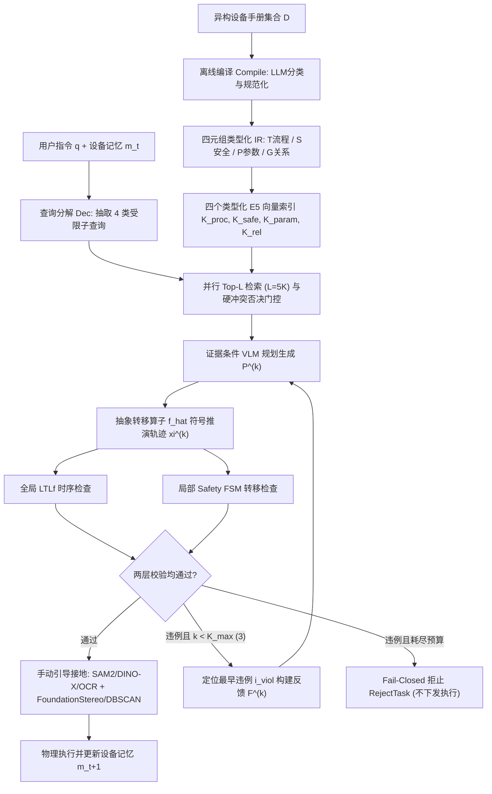
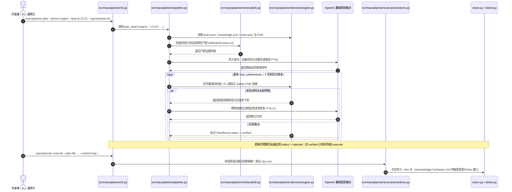

# MaCoPlanner: LLM-Assisted Manual-Compiled Task Planning with Proactive Safety Verification for Robotic Industrial Panel Operation

## 一句话定义

MaCoPlanner 是一种面向工业设备控制面板操作的机器人任务规划与主动安全验证框架：它将异构设备手册离线编译为类型化中间表示（IR），在线按设备当前状态检索并门控约束证据，再于物理执行前通过有限迹时序逻辑（LTLf）与安全有限状态机（Safety FSM）联合校验、局部修复或 fail-closed 拒止候选计划。

## 英文缩写速查

| 缩写 | 英文全称 | 简要说明 |
|---|---|---|
| IR | Intermediate Representation | 离线编译后的结构化中间表示四元组 $(\mathcal{T}, \mathcal{S}, \mathcal{P}, \mathcal{G})$ |
| LTL / LTLf | Linear Temporal Logic / LTL on Finite Traces | 有限执行轨迹上的线性时序逻辑，用于检验跨步骤顺序与安全约束 |
| FSM | Finite-State Machine | 有限状态机，本文中 Safety FSM 负责校验设备模式切换与互锁合法性 |
| HMI | Human-Machine Interface | 工业设备人机操作面板，含按钮、旋钮、拨动开关与状态指示灯 |
| LVLM / VLM | Large Vision-Language Model / Vision-Language Model | 视觉语言（大）模型，承担自然语言指令到动作原语序列的生成与修复 |
| E5 | Embeddings from Bidirectional Encoder Representations | 本文默认使用的密集向量检索编码器（`intfloat/e5-base-v2`） |

## 为什么重要

1. **填补工业设备操作的“规则依赖”缺口**：与家庭桌面整理不同，发动机、发电机、激光器与变频器等工业面板受严格的操作规程、设备状态与硬性互锁约束（如“换向必先切至 OFF”“停机前必先断负载”）。直接把冗长手册原文拼入 VLM 上下文容易遗漏跨页、跨章节的隐式依赖。
2. **将安全检查从“执行后/运行时被动拦截”前移为“执行前主动诊断与修复”**：通过 LTLf（全局时序）与 Safety FSM（局部状态转移）对候选计划做符号推演，不仅拦截不合规动作，还定位最早违例步 $i_{viol}$ 并生成结构化修复反馈；若 $K_{\max}=3$ 轮内仍未通过则直接拒止（fail-closed），避免危险指令触达机械臂。
3. **打通“文档知识—符号规划—几何操作参数”闭环**：物理层不仅定位面板控件的 3D 位姿，还结合手册参数规范从立体深度点云中提取旋钮半径、按钮行程与触发阈值，并将每次执行后的观测写回带陈旧标记的设备记忆。

## 核心信息

| 字段 | 内容 |
|---|---|
| 作者 | Guipeng Xin, Jiahe Xu, Mohammad Deghat, Chenhui Wan, Jie Liu, Youmin Hu, Zhongxu Hu |
| 机构 | 华中科技大学（HUST）；新南威尔士大学（University of New South Wales, UNSW） |
| 发表时间 | 2026-08-28（arXiv:2608.28300v1） |
| 论文链接 | [arXiv:2608.28300](https://arxiv.org/abs/2608.28300) · [arXiv HTML](https://arxiv.org/html/2608.28300) |
| 项目与代码 | [XinGP/MaCoPlanner](https://github.com/XinGP/MaCoPlanner)（MIT License） |
| 清单分类 | `model.planning` |
| 来源条目 | `survey_ax_2608_28300` |
| 开源状态 | **已开源** — 公开统一规划 API/CLI、3 类设备（`engine` / `generator` / `vfd`）资源与 FSM/规则校验器、400 检索基准、1,440 条规划评测记录及单元测试；原始 PDF 手册、ROS 构建树、Dobot 厂商驱动与硬件标定文件未随仓发布（见仓库 `docs/open-source-audit.md`） |

## 核心原理

### 1. 离线手册编译：类型化中间表示（IR，§3.2.1）

针对异构手册集合 $D = \{d_1, \dots, d_{|D|}\}$（512-token 分块、64-token 重叠），MaCoPlanner 经“分块提取 → LLM 辅助分类（`gpt-4o`）→ 模板规范化与单位统一 → 跨条目关联与确定性模式校验”，将其编译为四元组：

$$\mathcal{I} = \operatorname{Compile}(D) = (\mathcal{T}, \mathcal{S}, \mathcal{P}, \mathcal{G})$$

- **流程骨架集 $\mathcal{T}$**：步节点 $s_i = \langle \phi_i^{pre}, a_i, \phi_i^{post}, \beta_i, \rho_i \rangle$，显式编码前置条件、动作原语、可观测验收准则、异常分支守卫与重试策略。
- **安全条款集 $\mathcal{S}$**：触发-禁止规则 $k_j: \phi_j^{trig}(x) \Rightarrow \neg \psi_j^{forbid}(x, a)$，并进一步翻译为形式化 LTL 约束。
- **参数规范集 $\mathcal{P}$**：归一化参数 $p_k = \langle u_k, [l_k, r_k], \epsilon_k, g_k(\cdot) \rangle$（单位、合法区间、容差与观测校验函数）。
- **结构关系图 $\mathcal{G} = (V, E)$**：编码面板控件、步骤与参数间的空间邻接、从属与逻辑耦合；所有编译项均通过溯源映射 $\ell(i) = (d, \omega)$ 保留原手册片段引用。

### 2. 查询分解驱动检索与状态适用性门控（§3.2.2）

在线给定用户指令 $q$ 与设备记忆 $m_t$：

1. **受限查询分解**：由 `gpt-4o` 按 `{PROC, SAFE, PARAM, REL}` 四个 IR 槽位生成子查询（每类至多 1 条），经确定性后处理剔除越界或重复字段。
2. **分类型并行密集检索**：使用共享且 L2 归一化的 `intfloat/e5-base-v2` 编码器，在四个类型化索引 $\mathcal{K} = \{K_{proc}, K_{safe}, K_{param}, K_{rel}\}$ 中各自取 $L = 5K$ 条候选。
3. **硬否决 + 加权可用性门控**：计算综合门控分

$$Score(e, q_{(c,i)}, m_t) = \alpha\,Sim(e, q_{(c,i)}) + (1 - \alpha)\,App(e, m_t), \quad \alpha = 0.70,\ \tau = 0.55$$

其中若证据条件与当前设备模式、控件或状态存在硬冲突（$C_h = 1$），则 $App(e, m_t) = 0$ 并触发一票否决（不因语义相似度高而放行）；其余项以 $\tau = 0.55$ 截断，汇聚为最终证据集 $E_t$。

### 3. 证据条件规划与双层主动安全验证（§3.3）

1. **初始规划与符号推演**：VLM 规划器根据 $(q, m_t, E_t)$ 输出参数化动作原语序列 $P^{(k)} = \langle u_1^{(k)}, \dots, u_{N_k}^{(k)} \rangle$。抽象转移算子 $\hat{f}$ 从符号初始态 $x_0^{(k)} = Abs(m_t)$ 出发，生成有限符号轨迹 $\xi^{(k)} = \langle x_0^{(k)}, u_1^{(k)}, x_1^{(k)}, \dots, x_{N_k}^{(k)} \rangle$。
2. **双视角并发校验**：
   - **全局时序检查（LTLf）**：将轨迹标注为原子命题序列 $\sigma^{(k)}$，检验 $\sigma^{(k)} \models \Phi$；若违例，返回最早违例公式与步骤下标 $v_{proc}^{(k)} = (\phi_j, i_{viol})$。
   - **局部状态合法性检查（Safety FSM）**：在设备安全有限状态机上逐步重放 $P^{(k)}$，拦截非法状态转移（如未先停至 `OFF` 即切换驱动方向），返回 $v_{state}^{(k)} = (i_{viol}, r_{fail})$。
3. **局部化修复与 fail-closed 拒止**：将违例合并为结构化反馈 $F^{(k)}$ 触发修复 $P^{(k+1)} = \pi_{\theta_{\mathrm{pln}}}(q, m_t, E_t, F^{(k)})$（最大预算 $K_{\max} = 3$ 轮）。仅当两层检查均通过时输出可执行计划 $P^*$；耗尽预算仍未通过则返回 `RejectTask`，禁止调用物理接地与执行。

### 4. 手册引导接地与设备记忆（§4）

- **语义-空间协同匹配**：用 SAM2 分割、DINO-X 开放词汇检测与 OCR 提取面板语义锚点，结合手册空间关系 $\mathcal{R}_s = \{\text{left\_of}, \text{right\_of}, \text{above}, \text{below}, \text{near}, \dots\}$ 以代价值 $S_{\mathrm{match}}(c) = \sum \|p_i^{(c)} - p_i^*\|^2 + \lambda \sum g_r(p_a^{(c)}, p_b^{(c)})$（$\lambda=0.5$，保留阈值 $S_{\mathrm{match}} \le 0.65$）筛选候选，仅在歧义时回退 VLM。
- **操作级 3D 几何参数提取**：RealSense D435i 双目深度经 FoundationStereo 重建点云并去噪后，通过 RANSAC 拟合面板基准平面（内点距离 `0.005 m`），对齐面板坐标系后采用 DBSCAN（$\epsilon_{\mathrm{db}} = 0.015\text{ m}$，$\mathrm{MinPts}=10$）分割控件点簇；针对旋钮拟合圆柱/圆盘中心与半径 $(c, r, h)$，针对按钮估计按压行程 $\delta_{\text{button}}$ 与触发阈值 $\eta_{\text{button}}$。
- **带陈旧标记的设备记忆**：以结构化 JSON 槽位记录模式、控件状态、参数、上一动作与验证置信度，设置 `5 s` 陈旧阈值以防止低置信度或过期推断覆盖已验证状态。

## 流程总览

## 源码运行时序图

官方仓库 [XinGP/MaCoPlanner](https://github.com/XinGP/MaCoPlanner) 将推理规划、离线规则校验、基准验证与受限执行拆分为独立模块化入口（仓库归档见 [sources/repos/paper-agentic-2608-28300.md](../../sources/repos/paper-agentic-2608-28300.md)）：

- **最短复现路径：** 安装包后可用 `macoplanner verify` 与 `macoplanner benchmark validate` 在无 API Key 条件下离线校验显式计划与全部 400 条检索 + 1,440 条规划基准记录；在线生成需设置 `OPENAI_API_KEY` 后运行 `macoplanner plan` 或 Python API `plan_task`。

## 实验与评测

### 1. 手册编译保真度与全语料统计（Table 2 & Table 16）

- **语料规模（Table 16）：** 4 份设备手册（Motor-drive controller simulator、Generator control system、Laser controller、Engine controller）合计 **304 页 / 347 块**，编译得 **463** 条 IR 项（$|\mathcal{T}|=50$、$|\mathcal{S}|=107$、$|\mathcal{P}|=70$、$|\mathcal{G}|=236$）。
- **编译保真度审计（Table 2，350 个独立人工标注黄金单元）：**

| IR 类型 | Gold Units | Compiled Items | 完整性（%） | 语义一致性（%） |
|---|---:|---:|---:|---:|
| 流程骨架 $\mathcal{T}$ | 37 | 35 | 94.59 | 97.14 |
| 安全条款 $\mathcal{S}$ | 81 | 81 | 100.00 | 97.53 |
| 参数规范 $\mathcal{P}$ | 54 | 53 | 98.15 | 98.11 |
| 结构关系 $\mathcal{G}$ | 179 | 171 | 95.53 | 96.49 |
| **总计（Overall）** | **350** | **340** | **97.14** | **97.32** |

### 2. 端到端任务规划与独立安全评测（480 任务，Table 3 & §5.6）

基准涵盖 80 个 Level-1、200 个 Level-2 与 200 个 Level-3 任务（上下文预算统一为 16,000 tokens，安全违例由隐藏于规划器/校验器之外的独立人工安全 oracle 判定，标注者间一致性 $\kappa = 0.93$）：

| 方法 | L1 成功率（%） | L2 成功率（%） | L3 成功率（%） | 独立 Oracle 违例率（%） |
|---|---:|---:|---:|---:|
| Raw-Manual Long-Context | 88.2 | 62.8 | 25.9 | 11.6 |
| Prompt-Safety | 93.1 | 70.5 | 33.8 | 8.3 |
| ISR-LLM | 93.6 | 74.2 | 35.7 | 6.8 |
| $\text{LLM}^3$ | 93.4 | 76.8 | 37.1 | 5.2 |
| SafePlan | 92.7 | 79.3 | 39.6 | 3.5 |
| **MaCoPlanner（本文）** | **93.5** | **84.4** | **43.2** | **2.7** |

- **Fail-Closed 拒止分析（§5.6）：** 在进入规划修复循环的 357 次运行中，**26.3%** 在耗尽 $K_{\max}=3$ 轮预算后被主动拒止，从而将最终违例率压低至 **2.7%**。
- **消融与骨干敏感性（§5.3–§5.6）：** 在简单单步 L1 任务上各方法差距不大，但随着跨步依赖与状态确认需求上升（L3 计划中 42% 动作为状态确认），去掉类型化索引、证据门控、LTL/FSM 校验、局部修复或设备记忆均会显著拉低 L2/L3 成功率；骨干模型对比（1/4 子集）显示 GPT-5 表现最高、GPT-4o 接近，Gemma 3 27B-IT 在高复杂度任务上差距拉大。
- **规则编码审计（Table 18）：** 81 条 LTL 规则中 75 条语义完全正确、6 条为保守近似；48 条 FSM 转移/守卫中 45 条语义正确。

### 3. 物理定位操作与长时程真机验证（Table 4 & Table 5，无负载面板模拟器）

平台配置为 Dobot CR3 机械臂、AG95 夹爪、Intel RealSense D435i 深度相机与工业电机驱动器控制器面板模拟器（无外部工业负载）：

- **5 视角几何测量与重复操作成功率（Table 4）：**

| 控件类别 | 视角数 | 中心偏差 (mm) | 按压偏差 (mm) | 厚度偏差 (mm) | 深度偏差 (mm) | 旋转偏差 (deg) | 操作成功率（%） |
|---|---:|---:|---:|---:|---:|---:|---:|
| Buttons | 5 | $0.80 \pm 0.04$ | $2.80 \pm 0.14$ | – | – | – | 96.0 |
| Small buttons | 5 | $0.30 \pm 0.02$ | $1.00 \pm 0.05$ | – | – | – | 93.0 |
| Knobs | 5 | $0.70 \pm 0.04$ | – | $1.50 \pm 0.08$ | $2.60 \pm 0.13$ | $3.50 \pm 0.18$ | 95.0 |
| Emergency stop | 5 | $1.20 \pm 0.06$ | $3.50 \pm 0.18$ | $2.70 \pm 0.14$ | $3.40 \pm 0.17$ | – | 80.0 |
| Small round knob | 5 | $0.40 \pm 0.02$ | – | $1.10 \pm 0.06$ | $1.70 \pm 0.09$ | $2.20 \pm 0.11$ | 93.0 |

- **25 次长时程物理试验（Table 5，5 类任务各 5 次）：** 总完成 **23/25**（其中首次尝试即完成 **19/25**），平均 Planner/API 延迟 **4.2 s**、物理执行 **3.9 s**、平均重规划 **0.36** 次、平均安全触发 **0.16** 次。在审计的 12 例失败中，检索漏召回是最大单一原因，其次为符号校验拒止与物理接地/按压行程误差（§5.10）。

## 与其他工作对比

| 对比维度 | Raw-Manual / Prompt-Safety | ISR-LLM | $\text{LLM}^3$ | SafePlan | MaCoPlanner（本文） |
|---|---|---|---|---|---|
| 知识表示与检索 | 原始文本上下文（16k tokens） | 文本上下文 | PDDL 域/问题 + 文本上下文 | 文本上下文 + 安全规则 | **四元组类型化 IR + E5 并行检索 + 硬冲突门控** |
| 形式化校验层 | 无 / 仅自然语言提示 | LLM 自反思校验 | PDDL 前后置条件与运动可行性 | 思维链引导的形式/自然安全推理 | **LTLf（全局时序）+ Safety FSM（局部状态机）** |
| 迭代修复与拒止策略 | 单次输出（无修复/拒止） | 最多 3 轮自反思；超限返回末版 | 最多 10 次调用；无独立安全拒止 | 无有界迭代修复循环 | **局部违例定位反馈（最多 3 轮）；不通过则 fail-closed 拒止** |
| 物理参数接地 | 无专门操作参数提取 | 无 | 偏重刚体抓取与装箱运动规划 | 无 | **SAM2/DINO-X/OCR + 深度平面/圆柱/按压参数拟合 + 设备记忆** |

## 结论

**一句话总判：MaCoPlanner 证明了将工业设备手册离线编译为结构化 IR，并在执行前叠加 LTLf 与 Safety FSM 的“局部诊断 + fail-closed 拒止”，能显著压低复杂操作违例率，但端到端上限仍受制于检索召回完整度与物理接触定位精度。**

1. **知识结构化比堆上下文更决定复杂任务表现**：在相同的 16k token 预算下，L2 成功率相对 Raw-Manual 从 62.8% 提升至 84.4%、L3 从 25.9% 提升至 43.2%，核心收益集中在多步骤状态耦合任务。
2. **安全机制的有效性同时来自“局部修复”与“敢于拒止”**：违例率降至 2.7% 并非因为所有问题都能被模型修好，而是 26.3% 不可满足预算的规划被前置拦截。
3. **验证速度并非瓶颈，检索漏召回与物理接触才是**：LTL/FSM 校验耗时远小于 VLM API 延迟（均值 4.2 s），而真机急停按钮操作成功率仅 80.0%、审计失败以检索漏召回居首，工程落地时应优先加固检索覆盖与接触力/行程反馈。
4. **严格区分布局与安全边界**：仓库中的校验仅覆盖人工/LLM 编译进 IR 的任务级规则，不能替代碰撞规避、急停安全电路或实际带载工况下的工厂级联锁。

## 工程实践

- **规范配置文件锁定**：仓库 `src/macoplanner/settings.py` 默认锁定模型配置、`intfloat/e5-base-v2` 检索器与 `--max-refinements 3` 预算，防止消融或复现实验被静默篡改；自定义实验须显式传 `--allow-custom-config`。
- **无痛离线基准核验**：部署或改写规则后，优先用 `macoplanner verify` 与 `macoplanner benchmark validate` 在无 API 调用与无硬件条件下核验 400 条检索 + 1,440 条规划基准的完整性。
- **物理执行隔离设计**：`macoplanner execute` 默认运行在 dry-run 模式；真机接管必须显式提供经过安装标定的控制映射文件并同时传入 `--live` 与 `--acknowledge-hardware-risk`。

## 局限与风险

1. **编译保真度依赖与闭环假定**：LTL/FSM 验证保证严格受限于手册到 IR 的编译准确性（Table 18 显示 81 条 LTL 规则中仍有 6 条需人工修订的近似或语法问题）以及设备记忆是否实时反映真实面板状态（5 s 陈旧阈值无法消除传感器漏检导致的“状态漂移”）。
2. **高复杂度 L3 规划成功率仍偏低**：即便在完整框架下，L3 任务成功率仍仅 43.2%，说明稠密互锁与长序列依赖依然构成主要规划瓶颈。
3. **物理层未带真实工业负载且急停控件可靠性有限**：实验仅在无负载模拟器上固定光照与单视角展开；对面板急停按钮的操作成功率仅 80.0%，且仓库明确提示不可直接用于带电或安全关键工业现场。

## 关联页面

- [Agentic Robots 综述](paper-towards-agentic-robots-survey.md)
- [全量项目节点清单](../overview/awesome-agentic-robots-node-index.md)
- [VLA 方法背景](../methods/vla.md)
- [智能体机器人操作策略](../methods/agentic-manipulation-policies.md)：对照操作场景中的规划、执行与反馈接口。
- [Agent 规划与反馈机制](../methods/agent-planning-feedback.md)：对照失败定位驱动的迭代修复（refinement loop）范式。
- [机器人智能体 Harness 设计](../methods/robot-agent-harness.md)：理解如何用形式化规则与状态机为大模型规划器加装安全护栏。
- [具身智能体评测基准方法](../methods/embodied-agent-benchmarking.md)：参考独立安全 oracle、盲标一致性与失败归因审计协议。
- [机器人操作任务](../tasks/manipulation.md)：了解按钮按压、旋钮旋转等面板精细操作任务的物理挑战。

## 推荐继续阅读

- [arXiv:2608.28300 论文原文与 HTML 全文](https://arxiv.org/abs/2608.28300)
- [XinGP/MaCoPlanner 官方 GitHub 仓库与基准说明](https://github.com/XinGP/MaCoPlanner)
- [LLM³: Large Language Model-based Task and Motion Planning with Motion Failure Reasoning (arXiv:2403.11552)](https://arxiv.org/abs/2403.11552)
- [SafePlan: Leveraging Formal Logic and Chain-of-Thought Reasoning for Enhanced Safety in LLM-based Robotic Task Planning (arXiv:2503.06892)](https://arxiv.org/abs/2503.06892)

## 参考来源

- [MaCoPlanner 论文核对归档](../../sources/papers/paper-agentic-2608-28300.md)
- [XinGP/MaCoPlanner 官方源码归档](../../sources/repos/paper-agentic-2608-28300.md)
- [官方 Awesome 快照归档](../../sources/repos/awesome-agentic-robots-survey-index.md)
- [arXiv:2608.28300 原文](https://arxiv.org/abs/2608.28300) · [GitHub 官方仓库](https://github.com/XinGP/MaCoPlanner)
