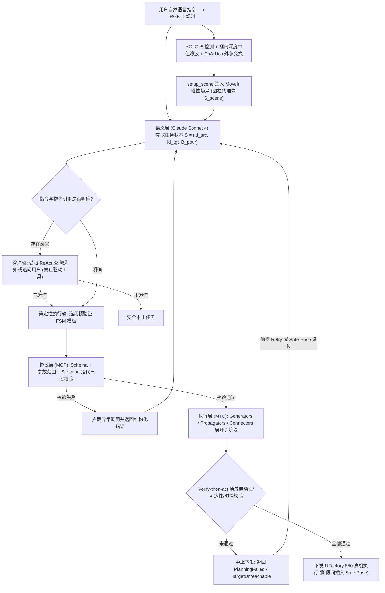

# Bridging Semantics and Physics with Constrained LLMs for Safe and Trustworthy Robotic Manipulation

## 一句话定义

该论文形式化了语言推理与物理执行之间的**类型化契约（typed contract）**：大语言模型仅通过受 Model Context Protocol（MCP）Schema 约束的原子工具调用输出符号意图，再由 MoveIt Task Constructor（MTC）在基于 RGB-D 重建的碰撞感知场景中执行 **verify-then-act**（先验证后执行）预检，从而在杂乱桌面环境中可靠地完成安全操作。

## 英文缩写速查

| 缩写 | 英文全称 | 简要说明 |
|---|---|---|
| LLM | Large Language Model | 大语言模型；本文中采用 Claude Sonnet 4 负责语义解析与澄清，不直接输出位姿或轨迹 |
| MCP | Model Context Protocol | 模型上下文协议；作为类型化协议层对外暴露带 JSON Schema 与边界约束的工具接口 |
| MTC | MoveIt Task Constructor | 面向多阶段机械臂规划的框架；将单个原子工具调用展开为多阶段运动生成与可行性校验管道 |
| IK | Inverse Kinematics | 逆运动学；用于在 MTC 阶段中过滤抓取候选位姿并检查关节可达性 |
| RGB-D | Red, Green, Blue and Depth | 彩色与深度图像；本文通过眼在手外 RealSense D435i 相机采集并重建 3D 碰撞场景 |
| FSM | Finite-State Machine | 有限状态机；用于清晰指令的确定性执行模板（`pick -> move -> pour -> place`） |

## 为什么重要

1. **弥合语言-动作鸿沟（Language-Action Gap）：** 通用 LLM 能把自然语言指令拆解为看似合理的动作序列，但常因幻觉出不存在的物体引用、非法参数或忽略运动学与碰撞约束而在物理真机上不可执行甚至存在碰撞风险。
2. **以显式几何验证替代易幻觉的动力学猜测：** 与依赖学习世界模型预测动作后果（在部分可观测下易产生物理不一致幻觉）的路线不同，本文在每次真机下发前，把候选轨迹放在感知重建的三维规划场景里做确定性运动学与碰撞回放检查。
3. **验证了协议级恢复对真机鲁棒性的决定性作用：** 消融实验表明，在共享感知与运动规划栈的前提下，单纯有 LLM 推理仍会因瞬时 IK 或净空失败而中断；引入 `retry` 重试与阶段间 `safe-pose` 安全位姿恢复分别贡献了 47.5 与 32.5 个百分点的均值成功率提升，高于仅靠任务图排序（25.0 个百分点）。

## 核心信息

| 字段 | 内容 |
|---|---|
| 作者 | Wenhao Hong, Lan Wei, Dandan Zhang（通讯：`d.zhang17@imperial.ac.uk`） |
| 机构 | Imperial College London, London, UK |
| 发表时间 | 2026-08-29（`arXiv:2608.29379v1 [cs.RO]`；arXiv 元数据备注 `ECCV Workshop paper`） |
| 论文链接 | [arXiv:2608.29379](https://arxiv.org/abs/2608.29379) / [arXiv HTML](https://arxiv.org/html/2608.29379) |
| 项目与代码 | 原文与 arXiv 页面未公布独立项目主页或官方源码仓（引用的 GitHub 链接仅指向第三方检测依赖 Ultralytics YOLOv8） |
| 清单分类 | `model.robot_control, harness.infrastructure` |
| 来源条目 | `survey_ax_2608_29379` |
| 开源状态 | 未确认开源代码（截至 2026-11-27 核查 arXiv 全文未发现官方代码仓库或数据集发布入口） |

## 核心原理

系统在硬件平台 **UFactory 850**（配二指夹爪）与眼在手外 **Intel RealSense D435i** 上运行，将推理与控制严格划分为三个层级：

### 1. 语义层（Semantic Layer）

- **结构化输入与零几何暴露：** 推理骨干为 **Claude Sonnet 4**，只接收自然语言指令 $U$ 以及经感知落地后的符号化场景上下文（注册物体 ID、语义类别、机器人状态），不直接读取原始 RGB-D 图像，也**不允许**生成末端位姿、关节构型或路径点。
- **紧凑任务状态抽象：** 以倾倒任务为例，语义解析器将指令映射为三元组：
  $$S = \{\mathrm{id}_{\mathrm{src}},\ \mathrm{id}_{\mathrm{tgt}},\ B_{\mathrm{pour}}\}$$
  其中 $\mathrm{id}_{\mathrm{src}}$ 与 $\mathrm{id}_{\mathrm{tgt}}$ 为规划场景中已登记的源容器与目标容器符号 ID，$B_{\mathrm{pour}}$ 为是否需要倾倒物料的布尔标志。
- **双轨推理策略（Dual-Track Policy）：**
  - **澄清轨（Clarification Track）：** 针对存在指代歧义或欠定的指令（如场景中有两个杯子而指令只说“倒进杯子”），触发受限的 ReAct 代理循环；该代理只允许查询感知信息或向用户反问澄清，**禁止**调用任何驱动与运动工具。若歧义无法消除，系统直接中止任务而非猜测执行。
  - **确定性执行轨（Deterministic Execution Track）：** 一旦目标与源对象无歧义绑定，直接切换至预验证的 FSM 模板，按规范序列（`pick` → `move` → `pour` → `place`）调度协议层工具。

### 2. 协议层（Protocol Layer，基于 MCP）

- **类型化工具定义：** 通过 MCP 将机器人技能封装为带 JSON Schema 与边界约束的有限工具集。例如倾倒工具定义为：
  $$\mathrm{Tool}_{\mathrm{pour}}: \bigl(\mathrm{id}_{\mathrm{tgt}} \in S_{\mathrm{scene}},\ \theta_{\mathrm{tilt}} \in [0,\theta_{\max}],\ \tau_{\mathrm{duration}} \in \mathbb{R}^+\bigr)$$
  其中 $S_{\mathrm{scene}}$ 为当前规划场景中已注册的物体 ID 集合。
- **运行时三阶段校验：** 每次工具调用在抵达运动规划器前依次经过：（1）**Schema 校验**（检查必填字段与数据类型）；（2）**范围校验**（检查倾角 $\theta_{\mathrm{tilt}}$、持续时间 $\tau_{\mathrm{duration}}$ 等物理参数是否处于安全边界）；（3）**指代校验**（确认 $\mathrm{id}_{\mathrm{tgt}} \in S_{\mathrm{scene}}$）。任一校验失败即被拦截拒绝。
- **原子到组合绑定（Atomic-to-Composite Binding）：** 规划层视角下的单个原子工具调用，在执行层展开为多阶段 MTC 子任务流：
  - `setup_scene` → 感知注入 → 生成碰撞对象
  - `pick(object)` → 抓取生成 → IK 过滤 → 接近 → 闭合夹爪 → 抬起
  - `move_to_pour` → 笛卡尔规划 → 倾斜约束检查 → 速度缩放 → 执行
  - `place(target)` → 放置位姿生成 → 接近 → 张开夹爪 → 撤回
- **可审计性与后端解耦：** 所有语义参数调用均记录日志，底层规划/运动异常被归一化为结构化错误码（如 `PlanningFailed`、`TargetUnreachable`）反馈给语义层进行重试或追问；同一套工具接口可先绑定至运动学预检环境，再绑定至真机驱动。

### 3. 执行层（Execution Layer，动态场景与 Verify-then-Act）

- **动态场景接地：** 通过 $5 \times 7$ ChArUco 标定板获取亚厘米级平移、$1^\circ\text{--}2^\circ$ 旋转精度的相机外参；RGB 帧经 YOLOv8 检测器（按类别设置信度阈值）检测后，在检测框内对对齐深度图做中值滤波去噪，反投影变换至机器人基座系，并由 `setup_scene` 以**单位尺度预定义圆柱体碰撞代理（cylindrical proxies）**而非在线网格重建的方式写入 MoveIt 规划场景。
- **约束运动生成与分段倾倒：** MTC 将技能拆解为 Generators（基于规划场景采样抓取假设并用 IK 剪枝）、Propagators（在速度、加速度与姿态约束下求解安全高度接近、下降、抓取后抬起）与 Connectors（连接相邻阶段并在无解时回溯）。倾倒过程不建模流体或颗粒动力学，而是采用受限倾角、角速度与驻留时间的分段倾斜-保持（tilt-and-hold）剖面。
- **Verify-then-act 与安全位姿恢复：** 候选轨迹（从接近到撤回的完整序列）必须先在重建的 MoveIt 规划场景中完成连续性、可达性与无碰撞回放验证，全部通过后才序列化发送给 UFactory 850 控制器；若检出碰撞、奇异点或轨迹不连续，立即中止并返回结构化失败码。此外，在高风险阶段之间（例如抓取后、倾倒前）强制插入预定义的无碰撞**安全位姿（safe pose）**，以阻断误差累积并为重试恢复提供已知安全起点。

## 流程总览

## 源码运行时序图

**不适用**（截至 2026-11-27 核查 `arXiv:2608.29379v1` 全文、arXiv 元数据及引用链接：作者未公布本论文的官方代码仓库或独立项目主页，唯一出现的 GitHub 链接 `https://github.com/ultralytics/ultralytics` 为参考文献 `[16]` 所引第三方目标检测依赖 YOLOv8 仓库，无对应本系统控制栈的可运行官方源码供时序核对。）

## 实验与评测

作者在物理 **UFactory 850** 机械臂上评测了 4 项难度递增的端到端倾倒任务（`T1–T4`）及 1 项跨技能抓放任务。每项任务与消融条件均运行 **$N = 10$ 次独立真机试验**（单次试验占 10 个百分点），完整完成 `pick -> move-to-pour -> pour -> place` 且物料成功转移并归位源容器才计为成功。

### 1. 主任务对比（Table 2，每任务 10 次真机试验）

对比共享同一套感知与 MTC 运动规划后端的两个基线：**FSM/BT**（手工编写固定原语序列）与 **LLM w/o task graph**（保留相同 LLM、MCP 工具集、Schema 校验、safe-pose、retry 与 verify-then-act，仅去掉规范任务图排序）：

| 任务 | 场景与难度特征 | Ours | FSM/BT | LLM w/o task graph |
|---|---|---|---|---|
| T1: Single Pour | 单源倾倒、低杂乱、无歧义 | 80% | **90%** | 60% |
| T2: Multi-Source Pour | 多源容器、干扰物、需重新绑定指代 | **70%** | 40% | 30% |
| T3: Multi-Material Pour | 多材质（水、咖啡豆、鸡蛋等离散固体） | **80%** | 60% | 60% |
| T4: Complex Scene | 高杂乱、多物体、紧几何约束综合场景 | **60%** | 10% | 40% |
| **Mean（四任务均值）** | — | **72.5%** | 50.0% | 47.5% |

- 在最简单的 T1 上，手工脚本 FSM/BT 因无推理开销略高 10 个百分点（90% vs. 80%，相差 1 次试验）；但在最复杂的 T4 上 FSM/BT 骤降至 10%，而本文方法保持 60%。
- 无任务图约束的 LLM 在所有任务上均低于完整方法（均值 47.5%），表明缺少规范状态序列时，中间环节的定位与顺序误差会向上下游传播。

### 2. 多材质鲁棒性与跨技能泛化（§4.4–§4.5）

- **多材质泛化（T3）：** 使用完全相同的分段倾倒剖面与参数化倾角限制（未针对材质单独调参），在液体（水）、颗粒介质（咖啡豆）和离散固体（鸡蛋）上取得 **80%** 端到端成功率；失败更多源于抓取稳定性而非倾倒运动本身。
- **跨技能迁移（§4.4）：** 迁移到水果抓放任务（将苹果或橙子抓取并放入碗中），仅新增任务级 tool schema 与对应 MTC 模板，规划器、MCP 协议层与 verify-then-act 栈保持不变，在 **10 次试验中取得 90%（9/10）成功率**；唯一失败是由相机视野边缘附近位姿估计误差引起的接近阶段碰撞。

### 3. 协议级恢复机制消融（Table 3，每条件 10 次试验）

在保留 Schema 校验与 verify-then-act 的条件下分别关闭 `safe-pose` 复位与 `retry` 重试：

| 任务 | Ours | w/o safe-pose | w/o retry |
|---|---|---|---|
| T1: Single Pour | **80%** | 50% | 20% |
| T2: Multi-Source Pour | **70%** | 20% | 40% |
| T3: Multi-Material Pour | **80%** | 70% | 10% |
| T4: Complex Scene | **60%** | 20% | 30% |
| **Mean（均值）** | **72.5%** | **40.0%**（-32.5 pp） | **25.0%**（-47.5 pp） |

与移除任务图（均值 47.5%，下降 25.0 pp）相比，`retry`（-47.5 pp）与 `safe-pose`（-32.5 pp）的影响更显著——大量真机失败来自局部 IK 无解或净空不足等瞬时异常，重试机制与阶段间安全位姿重置直接决定了能否从异常中恢复。

### 4. 感知接地误差分析（§4.2，Fig. 4）

作者统计了世界坐标系下的物体质心平移误差与朝向角偏差，分布均存在不可忽视的长尾（主要发生在遮挡与杂乱场景下），这也是在规划前引入协议层指代校验与执行层碰撞核验的直接依据。

## 与其他工作对比

| 路线 / 代表方法 | 推理与控制边界 | 安全性与物理校验机制 | 本文相对特点 |
|---|---|---|---|
| **本文方法（Constrained LLM + MCP + MTC）** | 类型化契约（MCP Schema + 符号 ID + 有界参数）；不输出位姿 | 运行时三段校验 + MTC 规划场景 verify-then-act 碰撞/IK 预检 | 把概率推理严格锁在符号与技能边界内，可在不同后端与技能间通过新增 Schema/模板复用 |
| **手写脚本策略（FSM/BT 基线）** | 硬编码固定动作序 | 共享同一 MTC 后端校验 | 在简单静态场景 T1 略高（90% vs. 80%），但在多源干扰与复杂场景 T4 跌至 10% |
| **非结构化 LLM（w/o task graph 基线）** | 相同 MCP 工具与后端，无规范任务图排序 | 保留 Schema 与 verify-then-act | 缺少状态机序列约束导致错误传播，四任务均值 47.5%（比完整方案低 25.0 pp） |
| **Code-as-Policies / ProgPrompt 等代码生成型** | LLM 直接生成 Python 控制脚本 | 依赖高层 API 封装或运行时断言 | 本文避免让模型生成自由控制流或位姿代码，而用 MCP Schema + 固定 MTC 模板收窄动作空间 |
| **AutoTAMP / LLM³ / LLM-GROP** | LLM 翻译或协同提出 TAMP 符号与连续参数 | 借助 TAMP 求解器反馈迭代修正 | 本文明确分离“只读澄清 ReAct 轨”与“FSM 执行轨”，并利用标准 MCP 统一工具校验与日志审计 |
| **学习型世界模型 / 端到端 [VLA](../methods/vla.md)** | 隐式预测动力学后果或端到端输出连续动作 | 依赖数据分布与隐式物理先验 | 无需大规模演示训练或高风险动力学外推，但依赖显式 RGB-D 重建精度且缺乏低层高频闭环 |

在站内工程框架归类中，本文是 [机器人智能体执行框架（Robot Agent Harness）](../methods/robot-agent-harness.md) 与 [智能体工具调用接口（Agent Tool-use Interface）](../methods/agent-tool-use-interface.md) 在桌面操作任务上的典型实体实现。

## 结论

**一句话总判：在语义推理与真机运动控制之间引入“MCP 类型化工具契约 + MTC 场景预验证（verify-then-act）+ 阶段间安全位姿与重试恢复”，能够在不训练端到端动作模型的前提下显著提升杂乱环境语言引导操作的真机安全性与可靠性，但其能力上限仍受限于显式 RGB-D 几何重建精度与开环执行假设。**

1. **严格隔离语义输出与几何控制：** 禁止 LLM 直接预测位姿、路径点或关节角，仅输出在当前规划场景 $S_{\mathrm{scene}}$ 中可验证的物体 ID 与有界技能参数，可从源头消除大量非法控制指令。
2. **优先保障协议级恢复机制（Retry + Safe Pose）：** 真机实验中关闭 `retry` 导致均值成功率暴跌 47.5 个百分点，关闭 `safe-pose` 暴跌 32.5 个百分点；工程落地时应将瞬时 IK/规划失败的结构化错误回传与安全回退位姿作为一等公民设计。
3. **分离“只读澄清”与“确定性执行”：** 对存在指代歧义的指令限制 ReAct 仅执行感知查询和用户反问、严禁触碰驱动接口，确认目标后再交由预验证模板执行，避免模型在不确定状态下“盲猜抓取”。
4. **跨技能扩展只需增量契约：** 只要底层感知-规划-校验栈稳定，迁移到新操作技能（如从倾倒扩展到抓放）只需注册新的 MCP 工具 Schema 与对应 MTC 阶段模板，无需重写核心调度或安全框架。

## 工程实践

- **传感器与标定链路：** 眼在手外 D435i 与机械臂基座之间使用 $5 \times 7$ ChArUco 板标定，确保亚厘米平移与 $1^\circ\text{--}2^\circ$ 姿态误差；框内深度取中值滤波可显著减轻透明/高光容器边缘的深度噪声。
- **双环境绑定验证：** 依托 MCP 协议层对执行后端的抽象，先将工具绑定到离线/预演运动学验证环境进行全流程预检，确认连续性与无碰撞后再切换绑定到真机驱动接口。
- **错误码归一化：** 将驱动层与 MoveIt/MTC 底层异常映射为语义层可理解的结构化错误（如 `PlanningFailed`、`TargetUnreachable`），避免 LLM 解析原始堆栈信息。

## 局限与风险

1. **感知与碰撞代理体失配：** 论文 Fig. 4 显示世界坐标系位姿估计存在不可忽视的长尾误差，且 `setup_scene` 使用单位尺度预定义圆柱体代理而非在线网格重建，当目标形状偏离圆柱或靠近相机视野边界时（如 §4.4 中唯一失败案例）仍会发生接近碰撞；外观相近容器也可能引起语义误绑定。
2. **无材质动力学与执行期闭环反馈：** 系统不建模液体或颗粒流变动力学，也未接入执行期间的视觉、触觉或力/听觉闭环反馈，难以应对倾倒过程中的动态扰动或滑动。
3. **小样本实验统计局限：** 论文每项任务与消融条件仅测试 $N = 10$ 次真机试验（单次变化即影响 10 个百分点），单任务微弱差距（如 T1 上 80% vs. 90%）不足以作过度外推，仅宜看跨任务趋势。
4. **未开源复现限制：** 论文未公开自研 MCP 服务端、MTC 模板与标定配置文件，外部团队只能依据正文架构描述自行搭建复现。

## 关联页面

- [Agentic Robots 综述](paper-towards-agentic-robots-survey.md)
- [全量项目节点清单](../overview/awesome-agentic-robots-node-index.md)
- [智能体工具调用接口（MCP 与契约）](../methods/agent-tool-use-interface.md)
- [智能体规划与反馈执行](../methods/agent-planning-feedback.md)
- [机器人智能体执行框架（Robot Agent Harness）](../methods/robot-agent-harness.md)
- [智能体操作策略（Agentic Manipulation Policies）](../methods/agentic-manipulation-policies.md)
- [VLA 方法背景](../methods/vla.md)
- [机器人操作](../tasks/manipulation.md)

## 推荐继续阅读

- [arXiv 原文主页：Bridging Semantics and Physics with Constrained LLMs for Safe and Trustworthy Robotic Manipulation](https://arxiv.org/abs/2608.29379)
- [arXiv HTML 全文版本](https://arxiv.org/html/2608.29379)
- [Anthropic Model Context Protocol（MCP）发布说明](https://www.anthropic.com/news/model-context-protocol)

## 参考来源

- [论文全文核对归档（arXiv:2608.29379v1）](../../sources/papers/paper-agentic-2608-29379.md)
- [官方 Awesome Agentic Robots 快照归档](../../sources/repos/awesome-agentic-robots-survey-index.md)
- [arXiv 摘要与元数据入口](https://arxiv.org/abs/2608.29379)
- [arXiv HTML 正文入口](https://arxiv.org/html/2608.29379)
