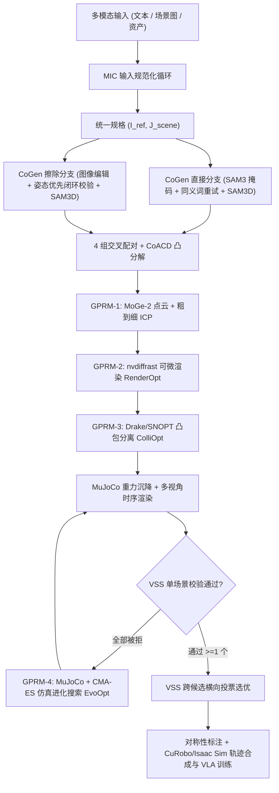

# GIF: Agentic Generation of Interactive and Functional Object Compositions for Robot Learning

## 一句话定义

**GIF**（Generation of Interactive and Functional object compositions）是一个面向机器人操作学习的智能体三维场景生成框架，通过「2D-3D 互补解耦重建（CoGen）+ 几何与物理引导位姿精修（GPRM）+ VLM 重力沉降验证（VSS）」流水线，从语言或图像提示自动合成具备精确接触关系、无穿模且物理稳定的交互式双物体仿真资产与相对位姿，并支撑零样本 Sim2Real 策略学习。

## 英文缩写速查

| 缩写 | 英文全称 | 简要说明 |
|---|---|---|
| GIF | Generation of Interactive and Functional object compositions | 本文提出的功能性交互物体组合生成智能体框架 |
| MIC | Multimodal Input Canonicalization | 多模态输入规范化模块，将语言或图像统一转为前景参考图与 JSON 规格 |
| CoGen | Complementary 2D-3D Generative Asset Construction | 结合直接重建与擦除重生成的互补解耦三维资产构建模块 |
| GPRM | Geometry- and Physics-Guided Pose Refinement Modules | 串联 ICP、可微渲染、凸碰撞优化与仿真进化搜索的位姿精修模块 |
| VSS | VLM-based Scene Selection | 基于 MuJoCo 重力沉降多视角渲染的 VLM 校验与跨候选投票模块 |
| CoACD | Collision-Aware Concave Decomposition | 将视觉网格分解为凸碰撞体以支撑稳定物理接触仿真的算法 |
| CMA-ES | Covariance Matrix Adaptation Evolution Strategy | 协方差矩阵自适应进化策略，用于 EvoOpt 物理黑盒位姿搜索 |
| O.M. / R.M. / C.R. | Object Matching / Relationship Matching / Collision Rate | 本文用于评估资产保真度、接触关系匹配度与网格穿模率的三项核心指标 |

## 为什么重要

现有自动化机器人仿真场景生成方法（如布局优化或桌面生成管线）主要关注房间与支撑面级别的粗粒度摆放，而在机器人操作任务中，诸如盖锅盖（Capping）、挂杯子（Hooking）、插书入架（Slotting）或套环（Pegging）等动作依赖毫米级局部接触几何与重力稳定性：

1. **解决接触接口处的重建纠缠**：双物体在接触部位往往存在严重相互遮挡，直接图像转 3D 容易把两个物体融合成单一网格或发生纹理泄漏，导致后续无法独立交互。
2. **弥补纯语言或单步位姿估计的物理盲区**：VLM 直接输出坐标容易失真，纯几何对齐忽略物理支撑后在仿真重力下会滑落或穿模。GIF 将几何对齐与 Drake/MuJoCo 物理约束闭环耦合，使生成资产直接可用作下游轨迹合成与 VLA 训练的终端状态目标。

## 核心信息

| 字段 | 内容或状态 |
|---|---|
| 作者 | Long Xu, Zhiqi Zhang, Mi Yan, Shengliang Deng, Chong Xia, Mingyu Dong, Jiayi Chen, Jiangran Lyu, Fei Gao, Zhizheng Zhang, He Wang |
| 机构 | 北京大学（PKU, CFCS）、银河通用（Galbot）、浙江大学（ZJU）、香港大学（HKU）、清华大学（Tsinghua） |
| 发表时间 | 2026-09-10（arXiv:2609.05927v2，v1 提交于 2026-09-05） |
| 论文链接 | [arXiv:2609.05927](https://arxiv.org/abs/2609.05927) · [arXiv HTML 全文](https://arxiv.org/html/2609.05927) |
| 项目与代码 | 暂未公开官方代码仓库或独立项目主页（arXiv 全文及补充材料未附链接） |
| 清单分类 | `environment.reconstruction` · 来源条目：`survey_ax_2609_05927` |
| 开源状态 | 未确认开源代码（各模块所调用的 SAM3、SAM3D、MoGe-2、CoACD、Drake、MuJoCo 等外部依赖均在附录 Table S1 明确列明） |

## 核心原理

给定语言指令 $\mathcal{I}=T$、参考场景图 $\mathcal{I}=I_{\mathrm{input}}$ 或资产图/网格输入，GIF 的目标是生成可交互场景 $\mathcal{S}=\{(m_i, p_i)\}_{i\in\{1,2\}}$，包含两个独立刚体网格 $m_i$ 及其相机坐标系位姿 $p_i=(r_i, t_i)\in\mathrm{SO}(3)\times\mathbb{R}^3$。

### 1. 多模态输入规范化（MIC）

智能体以「分析—执行—验证」闭环（`gpt-4o-mini` + `gemini-3.1-flash-image-preview` + `qwen3-vl-plus`）将异构输入统一为二元组 $(I_{\mathrm{ref}}, J_{\mathrm{scene}})$：
- 若输入包含 GLB 三维资产，先在纯色背景上进行透视预渲染，统一进入视觉分析接口。
- 输出纯色背景的双物体前景图 $I_{\mathrm{ref}}$，并依据 7 条质量准则（双物体数量、完整可见度、抬高视角、常识性接触、无浮空穿模、可分离刚体）与 13 种受控关系词表（如 `cover`、`hang_on`、`insert_into`、`lean_against` 等）生成结构化 JSON $J_{\mathrm{scene}}$。

### 2. 互补 2D-3D 资产构建（CoGen）

针对接触区域相互遮挡和跨实例特征泄漏问题，CoGen 为每个物体 $o_i$ 构建两条重建分支并保留全部 4 组跨分支配对 $\mathcal{C}=\{(a_1, a_2)\}, a_i\in\{\mathrm{ref}, \mathrm{erase}\}$：
- **直接重建分支（`ref`）**：由 SAM3 基于 $J_{\mathrm{scene}}$ 生成实例掩码 $b_i^{\mathrm{ref}}$（若失败或低置信，触发 LLM 生成 5 个递进同义词重试），输入 SAM3D 重建 $(m_i^{\mathrm{ref}}, p_i^{\mathrm{ref}})$。
- **闭环擦除重生成分支（`erase`）**：使用图像编辑模型擦除伴随物体 $o_j$ 得到无遮挡图 $I_i^{\mathrm{erase}}$。为防止编辑偏移原物体位姿，引入姿态优先扣分校验（位姿偏移 $-50$、目标残留 $-25$、外观漂移 $-15$、背景伪影 $-10$，阈值 $90$ 分），随后由 SAM3D 提升为 $(m_i^{\mathrm{erase}}, p_i^{\mathrm{erase}})$。
- **仿真碰撞体制备**：所有纹理视觉网格均通过 CoACD 分解为一组凸碰撞体，用于 MuJoCo 接触仿真。

### 3. 几何与物理引导位姿精修（GPRM）

对 4 组初始网格-位姿配对依次施加四级递进优化：
1. **粗到细 ICP**：利用单目几何估计器 MoGe-2 从 $I_{\mathrm{ref}}$ 反投影度量深度点云，在腐蚀后的实例掩码内采样目标点云，经阈值递减的多轮 ICP 对齐初始尺度与位姿。
2. **可微渲染优化（RenderOpt）**：借助 `nvdiffrast` 渲染软掩码 $\hat{b}_i$ 与深度 $\hat{d}_i$，联合优化位姿与尺度以最小化全局轮廓 Focal BCE、深度 L1 误差、ICP 锚定正则项，以及逐物体召回/精度与自深度/遮挡顺序项 $\mathcal{L}_{\mathrm{rend}}$；仅当四项逐物体损失均改善时才采纳更新。
3. **碰撞避让优化（ColliOpt）**：在 Drake 中以 SNOPT 求解约束优化，在 $\mathrm{SO}(3)\times\mathbb{R}^3$ 内寻找距 $p_i^{\mathrm{rend}}$ 最近的无穿模位姿，显式约束任意跨物体凸分解子块对的最小带符号距离 $d_{\min}\ge -\varepsilon$ 及地面间隙 $t_{i,z}\ge z_{\mathrm{floor}}+\varepsilon$。
4. **仿真进化搜索（EvoOpt）**：当前三级精修候选均未通过 VLM 校验时触发。以 $p_i^{a_i,\mathrm{rend}}$ 为中心，在 MuJoCo 中运行 $T_{\mathrm{sim}}$ 步物理仿真并用 EvoTorch CMA-ES 搜索 9 维扰动（3D 平移 + 6D 旋转），最小化包含重力漂移、接触穿透深度、残余速度与偏离惩罚的适应度函数。

### 4. VLM 场景校验与投票（VSS）

每个精修场景进入 MuJoCo 执行重力沉降，并将初始帧与沉降末帧的透视/俯视视角拼合为时序图：
- **单场景校验器**：确认目标关系在初始帧成立、沉降末帧仍保持（不误将脱落当作完成），且场景具备可抓取性。
- **跨候选投票器**：将通过校验的候选横向拼接（红线分隔），综合关系保持度、网格解耦质量（优先于纯贴合但有伪影的网格）和物理合理性选出最优场景 $\widehat{\mathcal{S}}$。

### 5. 策略数据合成与 VLA 训练

以 $\widehat{\mathcal{S}}$ 定义终端相对变换 $\Delta p = p_2^{-1}p_1$。在每次仿真采样随机初始位姿 $p_1^{\mathrm{rand}}, p_2^{\mathrm{rand}}$ 时，计算目标位姿 $p_1^\star = p_2^{\mathrm{rand}}\Delta p$，并由 VLM 对称性分析器标注任务等价对称群（$C_1\text{–}C_4, C_\infty$）避免冗余监督。随后在 GraspSimulator 中结合 MuJoCo 物理、CuRobo 规划与 Isaac Sim 光线追踪渲染及域随机化生成示范轨迹，训练以 `Qwen3-VL-2B-Instruct` 替换骨干的 $\pi_{0.5}$ 流匹配 VLA 策略（输入 224×224 第三人称与腕部双视角图像及 7 维本体状态，输出 4 步 7 维动作块，$\Delta t=0.3\text{ s}$）。

## 流程总览

## 源码运行时序图

**不适用**（截至 2026-11-27 核查 arXiv:2609.05927v2 全文及项目上下文元数据，论文未公布官方代码仓库或独立项目主页，尚无可供核对的官方源码目录与可运行入口）。

## 实验与评测

作者基于 Ego4D 约 60 万条 FHO 动作筛选 5 万条双物体交互描述，经 LLM 聚类得到 **8 类接触几何分类**（C.1 Containment 容纳、C.2 Capping 盖合、C.3 Resting 承托、C.4 Leaning 倚靠、C.5 Hooking 挂钩、C.6 Slotting 插槽、C.7 Spanning 跨置、C.8 Pegging 套柱），每类 3 个任务 × 5 个语义变体共 **120 个评测场景**。

### 主实验对比（Table 1，已将所有需图生 3D 的基线统一替换为 SAM3D 后端并关闭人工干预）

| 输入模式 | 方法 | C.1 (O.M./R.M.) | C.2 (O.M./R.M.) | C.3 (O.M./R.M.) | C.4 (O.M./R.M.) | C.5 (O.M./R.M.) | C.6 (O.M./R.M.) | C.7 (O.M./R.M.) | C.8 (O.M./R.M.) | 碰撞率 C.R. ↓ |
|---|---|---|---|---|---|---|---|---|---|---|
| 图像输入 | RoLA | 8.00 / 3.80 | 8.60 / 5.07 | 8.33 / 4.33 | 8.47 / 3.07 | 8.00 / 2.80 | 7.40 / 3.33 | 7.87 / 4.47 | 8.20 / 6.20 | 0.558 |
| 图像输入 | TabletopGen | 6.60 / 1.33 | 9.13 / 8.67 | 9.13 / 3.73 | 5.33 / 2.07 | 7.07 / 1.73 | 7.40 / 3.60 | 8.60 / 5.00 | 7.60 / 5.27 | 0.000 |
| 图像输入 | **GIF (Ours-Img)** | **9.07 / 7.80** | **9.60 / 9.20** | **9.53 / 9.27** | **9.67 / 9.47** | **9.00 / 4.47** | **9.40 / 7.33** | **9.60 / 7.53** | **8.73 / 7.53** | **0.000** |
| 语言输入 | GenieSim | 4.87 / 3.47 | 4.40 / 1.07 | 4.07 / 2.13 | 2.73 / 0.80 | 2.53 / 0.87 | 6.07 / 2.13 | 3.07 / 1.00 | 2.87 / 0.33 | 0.217 |
| 语言输入 | SceneSmith | 8.93 / 6.60 | **9.40** / 7.60 | 8.67 / 6.93 | 8.27 / 6.33 | 7.20 / 2.27 | 8.93 / 6.80 | 9.47 / 6.67 | 7.93 / 7.47 | 0.083 |
| 语言输入 | **GIF (Ours)** | **8.93 / 7.60** | 9.27 / **9.00** | **9.33 / 8.20** | **9.13 / 8.27** | **8.80 / 5.20** | **9.00 / 7.47** | **9.53 / 7.80** | **8.80 / 9.00** | **0.008** |

- **汇总与人类盲测（Table 2）**：在语言输入下，GIF 平均 R.M. 达 **7.82**（对比 SceneSmith 的 6.33 与 GenieSim 的 1.48）；107 名评测者超 1,000 次盲测中，GIF 在 R.M. 上对 SceneSmith、RoLA、TabletopGen、GenieSim 的两两胜率分别为 **95.9%**、**97.2%**、**95.9%**、**100.0%**，在 O.M. 上胜率分别为 **80.7%**、**78.5%**、**80.8%**、**98.4%**。
- **消融实验（Table 3 & 4）**：
  - 去除 CoGen 互补重建（`w/o c.r.`）会导致全部 8 类指标显著下降，例如 C.2 Capping 的 R.M. 从 9.00 降至 2.80、C.5 Hooking 从 5.20 降至 2.60、C.8 Pegging 从 9.00 降至 4.00。
  - GPRM 各阶段累计提升 R.M.（如 C.1 由 SAM3D Only 5.47 → +ICP 6.80 → +RenderOpt 7.33 → +EvoOpt 7.60；高难度挂钩类 C.5 由 4.60 逐步提升至 5.20，EvoOpt 带来 +0.33 的关键增益）。
- **下游策略学习与真机扩展律（Sec. 4.4 & App. A.6）**：在固定 50,000 条仿真训练轨迹下，将 GIF 生成的资产变体数从 2 个增至 40 个，Franka 机械臂零样本真机成功率（每条件 10 种布局 × 3 次重复 = 30 次真机试验）单调提升：「纸盒装香肠」从 **0.20 升至 0.90**，「锅盖盖锅」从 **0.00 升至 0.75**。
- **效率与成本（Table S10）**：120 个图像输入场景平均耗时 **425.0 秒/场景**（范围 243–935 秒，其中 MIC 45.6 s、CoGen 191.2 s、GPRM 多进程 5.3 s、VSS 182.8 s），平均消耗 **19.2K API tokens**（约 **0.25 美元/场景**），VLM 校验器单轮通过率为 **92%**。

## 与其他工作对比

| 对比工作 | 核心范式 | 相比 GIF 的主要差距与差异 |
|---|---|---|
| RoLA [11] | 依赖人工掩码的单图物理场景重建 | 缺少物理碰撞避让优化，8 类平均碰撞率达 0.558，且重力沉降下易穿模或倾倒 |
| TabletopGen [8] | 基于桌面支撑面的实例级场景生成 | 实例分割易在强接触时漏检物体或将复合体融为单实例，在非桌面或复杂接触（C.1/C.4/C.5）R.M. 偏低 |
| SceneSmith [3] | 分层室内场景智能体生成 | 依赖 VLM 直接输出位姿或启发式规则，缺乏局部三维几何与接触精修，挂钩类 C.5 R.M. 仅 2.27（GIF 5.20） |
| GenieSim 3.0 [7] | 面向人形机器人的资产库检索式仿真平台 | 在无人工干预的自动化设定下受限于既有资产库覆盖度，全自动平均 R.M. 仅 1.48，碰撞率 0.217 |

## 结论

**一句话总判：GIF 证明了将「2D 擦除补全解耦重建」与「可微渲染+凸碰撞+仿真进化搜索」闭环结合，可在不依赖人工调参的前提下稳定生成支撑策略学习的接触级刚体组合场景。**

1. **接触接口必须先解耦再求位姿**：单靠单图直接转 3D 会在盖合、插孔等遮挡面产生几何粘连，结合姿态优先校验的闭环擦除分支（CoGen）是下游精修收敛的前提。
2. **几何优化与仿真物理闭环缺一不可**：RenderOpt 保证图像轮廓与遮挡一致，ColliOpt 消除穿模，而高敏感悬空关系（如挂钩）仍需 MuJoCo 黑盒仿真反馈（EvoOpt）维持重力平衡。
3. **资产变体多样性直接驱动真机泛化**：保持 5 万条仿真轨迹总数不变，仅把 GIF 生成的不同资产变体从 2 个扩充到 40 个，即可显著提升零样本真机策略成功率，验证了资产多样性缩放价值。
4. **选型注意与工程取舍**：若任务聚焦刚体双物体高精度交互关系生成，可借鉴其四阶段 GPRM + VLM 时序校验设计；但若涉及房间级大规模布局或较长序列，应考虑将其作为底层叶子求解器嵌入上层布局框架，以控制推理延迟。

## 工程实践

- **多分支容错策略**：工程复现同类 2D-3D 管线时，保留原始分支与擦除分支的 4 种交叉配对而非仅依赖擦除图，能有效对冲图像编辑模型偶发的尺度漂移与残留伪影。
- **视觉/碰撞分离建模**：采用 SAM3D 生成的高面数纹理网格做视觉渲染与 RenderOpt，同时使用 CoACD 输出的凸分解子块构建 Drake 与 MuJoCo 碰撞约束（而非整体凸包），是在保持凹槽/孔洞几何功能同时避免仿真卡死的关键。
- **策略数据合成细节**：当物体具有轴对称或旋转等价性时，通过 VLM 标注离散循环群（$C_2, C_3, C_4$）或连续对称群（$C_\infty$）并在轨迹目标采样中予以等价豁免，可显著减少规划失败与监督冲突。

## 局限与风险

- **刚体假设边界**：CoACD 凸分解与当前 GPRM 均假设物体为不可变形的独立刚体，铰接物体（如带铰链柜门）与柔性体暂不在适用范围内。
- **多物体扩展尚属初步**：论文 Sec. 4.5 与附录 B.6 展示的 9 步多物体序贯扩展依赖人工在环调整参数与重试；当存在多次重试时，系统总时间与 API 成本会随物体数量非线性增长。
- **推理时延与外部闭源依赖**：单场景平均生成需 425 秒（最长超 15 分钟），且高度依赖外部闭源图像编辑与 VLM 服务（如 `gemini-3.1-flash-image-preview`、`qwen3-vl-plus`、`gpt-4o-mini`）；官方代码尚未开源也提高了完整复现的工程门槛。
- **残留微穿模权衡**：在挂勺（spoon-hook）等极薄环状结构上，CoACD 凸分解误差迫使 EvoOpt 在防穿模与防脱落之间妥协，导致语言设定下仍存在 0.008 的极低残留碰撞率。

## 关联页面

- [Agentic Robots 综述](paper-towards-agentic-robots-survey.md)
- [全量项目节点清单](../overview/awesome-agentic-robots-node-index.md)
- [VLA 方法背景](../methods/vla.md)
- [机器人策略学习流程](../methods/robot-policy-learning.md)：了解任务、训练信号与策略评估。
- [机器人仿真场景生成](../methods/robot-simulation-scene-generation.md)：对照仿真场景生成管线与物理验证方法。
- [CMA-ES 进化优化](../methods/cma-es.md)：理解 EvoOpt 中黑盒物理搜索所使用的协方差矩阵自适应算法。
- [视觉三维重建](../methods/visual-3d-reconstruction.md)：了解单目深度、可微渲染与点云配准在 3D 资产构建中的作用。
- [Sim2Real 迁移工作流](../methods/sim2real-transfer-workflow.md)：理解域随机化与光线追踪渲染如何支撑零样本真机部署。
- [机器人操作任务](../tasks/manipulation.md)：了解接触密集型操作任务的定义与评测基准。

## 推荐继续阅读

- [SceneSmith: Agentic Generation of Simulation-Ready Indoor Scenes (arXiv:2602.09153)](https://arxiv.org/abs/2602.09153) — 分层室内物理仿真场景生成方法，GIF 在讨论房间级扩展时建议将其作为上层布局框架搭配使用。
- [SAM 3D: 3dfy Anything in Images (arXiv:2511.16624)](https://arxiv.org/abs/2511.16624) — GIF 中 CoGen 模块所使用的单图到 3D 网格与粗位姿重建基座模型。
- [TabletopGen: Instance-level Interactive 3D Tabletop Scene Generation (arXiv:2512.01204)](https://arxiv.org/abs/2512.01204) — 从文本或单图生成实例级桌面交互场景的代表性基线。

## 参考来源

- [论文原文精读归档](../../sources/papers/paper-agentic-2609-05927.md)
- [官方 Awesome 快照归档](../../sources/repos/awesome-agentic-robots-survey-index.md)
- [arXiv 摘要与 PDF 入口 (2609.05927)](https://arxiv.org/abs/2609.05927)
- [arXiv HTML 全文版本 (2609.05927v2)](https://arxiv.org/html/2609.05927)
