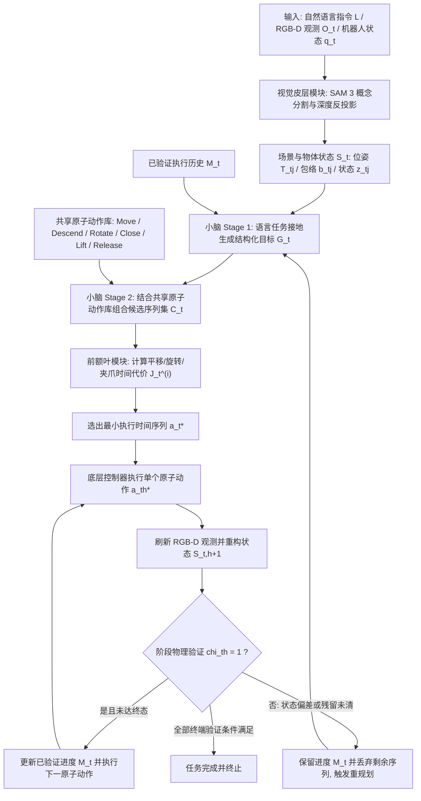

# A Brain-inspired Hierarchical Framework for Zero-Shot Robot Task Reasoning and Execution

## 一句话定义

**ActionReasoning 2.0：面向零样本机器人任务推理与执行的人脑功能启发式分层框架**，将开放语言指令依次经由视觉状态推理、基于共享原子动作库的两阶段任务接地与序列组合、基于预估执行时间的代价优选，以及刷新观测驱动的闭环物理验证，实现对长时域及非规则初始布局操作任务的零样本执行与失败恢复。

## 英文缩写速查

| 缩写 | 英文全称 | 简要说明 |
|---|---|---|
| VLA | Vision-Language-Action | 视觉-语言-动作端到端机器人策略模型 |
| LLM | Large Language Model | 大语言模型；本文中 Qwen3-7B 用于状态推理、任务接地与动作组合 |
| VLM | Vision-Language Model | 视觉语言模型；用于跨模态语义理解与场景解析 |
| RGB-D | Red-Green-Blue-Depth | 彩色-深度相机观测，用于分割掩码向机器人坐标系的 3D 投影 |
| SR | Success Rate | 任务成功率（$\mathrm{SR} = \frac{100}{N}\sum s_r$） |
| TP | Task Progress | 任务完成进度百分比（子目标完成比例或擦除区域缩减比例） |

## 为什么重要

- **弥补端到端 VLA 缺乏显式物理约束与中间校验的短板**：[VLA](../methods/vla.md) 直接把观测和指令映射为连续或离散动作，缺少对中间物理状态是否达成、几何姿态是否可抓取、以及失败后如何局部重规划的显式机制。
- **通过共享原子动作库实现跨任务家族的零样本泛化**：不同于单任务硬编码技能或单次直出大段脚本，ActionReasoning 2.0 将长时域任务拆解为 `Move`、`Descend`、`Rotate`、`Close`、`Lift`、`Release` 六类可扩展原子动作，在完全不更新模型权重、不人工编写分步序列的情况下统一支撑离散拾取放置、结构敏感的立体堆叠与连续接触擦拭。
- **用可标定物理时间代价替代纯语义排序**：当同一接地目标存在多种可行物体指派或动作顺序时，框架不依赖语言模型主观打分，而是使用真机实测标定的平移、旋转与夹爪开合时间系数进行量化排序，直接压缩冗余路径并显著提升不规则布局下的成功率。

## 核心信息

| 字段 | 内容 |
|---|---|
| **作者** | Guangming Wang, Pengfei Ye, Qizhen Ying, Yixiong Jing, Yuxiang Ma, Haonan Chen, Haibing Wu, Olaf Wysocki, Molong Duan, Brian Sheil |
| **机构** | 剑桥大学（University of Cambridge）；麻省理工学院（MIT）；香港科技大学（HKUST）；牛津大学（University of Oxford）；哈佛大学（Harvard University） |
| **发表时间** | 2026-09-05（arXiv:2609.05985v1 [cs.RO]，10 页，5 图，4 表） |
| **论文链接** | [arXiv:2609.05985](https://arxiv.org/abs/2609.05985) / [arXiv HTML v1](https://arxiv.org/html/2609.05985) |
| **项目与代码** | 未确认（截至 2026-11-27，arXiv v1 原文及参考文献均未公布 GitHub 仓库或独立项目页地址） |
| **清单分类** | `model.planning`（来源条目：`survey_ax_2609_05985`） |
| **开源状态** | **未确认开源代码**（正文未提供代码仓库、模型权重或公开数据集下载链接） |

## 核心原理

ActionReasoning 2.0 延续作者在砖块堆叠工作 ActionReasoning（ICRA 2026，arXiv:2602.21161）中的三维物理推理思路，在功能上以人脑区域分工为类比（非神经生物学仿真），组织为以下四个紧密耦合的模块（原文 §III-A 至 §III-D）：

### 1. 视觉感知与状态推理（视觉皮层类比，§III-A）

在规划周期 $t$ 接收到 RGB-D 观测 $O_t$ 与机器人本体状态 $q_t$ 后，系统使用 **SAM 3** 提取概念条件分割掩码，并结合配准深度图将各掩码反投影至机器人坐标系，构建显式场景状态：

$$S_t = \Phi(O_t, q_t) = (\mathcal{D}_t, \mathcal{R}_t, q_t)$$

其中 $\mathcal{R}_t$ 为实体间空间关系，$\mathcal{D}_t = \{d_{t,j}\}_{j=1}^{N_t}$ 为物体状态描述符集合：

$$d_{t,j} = (\omega_j, \mathcal{M}_{t,j}, \mathbf{T}_{t,j}, \mathbf{b}_{t,j}, z_{t,j})$$

各分量依次表示实体标识 $\omega_j$、分割掩码 $\mathcal{M}_{t,j}$、$SE(3)$ 位姿 $\mathbf{T}_{t,j}$、几何包络 $\mathbf{b}_{t,j}$ 与任务相关离散物理状态 $z_{t,j}$。在积木/金字塔堆叠中，$z_{t,j}$ 显式编码 `flat`（平放）、`side-oriented`（侧立）、`vertical`（竖直）与 `stacked`（已堆叠）四类状态；在 Pick-and-Place 中维护目标物与容器位姿关系；在 Clean Board 中维护擦拭工具、白板平面与残留污渍区域。

### 2. 语言接地与原子动作序列生成（小脑类比，§III-B）

为避免单次 LLM 调用直接生成脆弱的长序列，该模块采用两阶段推理（以 Qwen3-7B 为骨干）：

1. **阶段一 · 任务接地（Task Grounding）：** 结合语言指令 $L$、场景状态 $S_t$ 与已验证执行历史 $M_t$，解析出不绑定固定动作的物理目标集合 $G_t = \Gamma(L, S_t, M_t) = \{g_{t,k}\}_{k=1}^{K_t}$，其中 $g_{t,k} = (\omega_k, \tau_k, \epsilon_k, v_k)$ 依次指定目标实体、期望物理状态或空间关系、容差阈值及物理验证条件。
2. **阶段二 · 原子动作组合（Action Composition）：** 基于共享原子动作库 $\mathcal{A}_{\mathrm{atom}} = \{\mathrm{Move}, \mathrm{Descend}, \mathrm{Rotate}, \mathrm{Close}, \mathrm{Lift}, \mathrm{Release}\}$ 生成候选序列集 $\mathcal{C}_t = \Psi(S_t, G_t, M_t; \mathcal{A}_{\mathrm{atom}}) = \{\mathbf{a}_t^{(i)}\}_{i=1}^{N_t}$。每个原子动作参数化为 $a_{t,h}^{(i)} = (\rho, \omega, \xi, \kappa, \nu)$（动作类型、操作对象、几何目标参数、夹爪/接触参数与阶段验证条件）。各任务通过参数化与条件组合复用同一原子库：
   - **Pick-and-Place：** 名义序列 $\mathrm{MoveAbove} \to \mathrm{Descend} \to \mathrm{Close} \to \mathrm{Lift} \to \mathrm{MoveToTarget} \to \mathrm{Descend} \to \mathrm{Release}$。
   - **Pyramid Stacking：** 根据 $z_{t,j}$ 与支撑关系动态插入动作——`side-oriented` 或 `vertical` 物体先插入 `Rotate` 与重定位 `Move`；`stacked` 物体先增加分离运动再抓取。
   - **Clean Board：** 基于白板平面与残留掩码参数化 `Move`（接近）$\to$ `Descend`（建立接触）$\to$ 连续平面受限 `Move`（区域覆盖擦拭）$\to$ `Lift`。

### 3. 基于执行代价的方案选择（前额叶类比，§III-C）

当多个候选动作序列 $\mathbf{a}_t^{(i)} \in \mathcal{C}_t$ 均可达成相同接地目标时，前额叶模块以预估真机执行时间作为统一物理判据对其进行排序。单步原子动作代价定义为：

$$c_{t,h}^{(i)} = \alpha_d d_{t,h}^{(i)} + \alpha_\theta \theta_{t,h}^{(i)} + \alpha_g g_{t,h}^{(i)}$$

其中 $d_{t,h}^{(i)}$ 为末端平移距离，$\theta_{t,h}^{(i)}$ 为偏航角绝对变化量，$g_{t,h}^{(i)}$ 为夹爪开合次数；时间换算系数 $\alpha_d = 1/\bar{v}$、$\alpha_\theta = 1/\bar{\omega}$、$\alpha_g = \bar{t}_g$ 由真机多次执行实测标定并在全部实验中固定（$\alpha_d = 27.39\text{ s/m}$、$\alpha_\theta = 2.72\text{ s/rad}$、$\alpha_g = 1.23\text{ s}$）。整条序列总代价 $J_t^{(i)} = \sum_{h=1}^{H_i} c_{t,h}^{(i)}$，最终选出代价最小方案 $\mathbf{a}_t^* = \arg\min_{\mathbf{a}_t^{(i)} \in \mathcal{C}_t} J_t^{(i)}$。

### 4. 真机执行与闭环物理验证（§III-D）

选定序列中的第 $h$ 个原子动作交由底层控制器（负责轨迹插值与高频伺服）执行：$(q_{t,h+1}, r_{t,h}) = \mathcal{E}(a_{t,h}^*, q_{t,h})$。每步执行完毕后采集刷新后的 RGB-D 观测 $O_{t,h+1}$，更新场景状态 $S_{t,h+1} = \Phi(O_{t,h+1}, q_{t,h+1})$，并评估阶段验证条件：

$$\chi_{t,h} = \prod_{k \in \mathcal{K}_{t,h}} v_k(S_{t,h+1}, G_t) \in \{0, 1\}$$

若 $\chi_{t,h} = 1$，继续执行序列中下一动作；一旦 $\chi_{t,h} = 0$（例如抓取滑脱、砖块倾倒或白板仍有残留污渍），立即丢弃剩余待执行序列，保留已确认完成的任务进度 $M_t$，从刷新后的物理状态 $S_{t,h+1}$ 重新生成候选方案并续接执行，直到满足所有终端完成条件。

## 流程总览

## 源码运行时序图

**不适用**（截至 2026-11-27，arXiv:2609.05985v1 原文及公开检索记录未确认可运行的官方 GitHub 源码仓库、脚本入口或模型权重发布，故不绘制源码级运行时序图。）

## 实验与评测

作者在真实机器人平台上评估三类互补的长时域操作任务（Table I–IV），推理骨干统一使用 **Qwen3-7B**，并将对比基线 **$\pi_{0.5}$** 在每个任务上采集 50 条演示轨迹微调，同时对比无需微调的结构化/流引导基线 **ReKep** 与 **Dream2Flow**。

### 1. 任务定义与成功判据（Table II）

| 任务家族 | 试验次数 $N$ | 任务进度 $\mathrm{TP}_r$ 定义 | 终端成功判据 |
|---|---|---|---|
| **Clean Board** | 10 | $100(1 - \|D_T\| / \|D_0\|)$（残留污渍掩码缩减率） | $\mathrm{TP}_r > 80\%$ |
| **Pick-and-Place** | 10 | 已验证放入碗中的积木数 / 目标总数 | $\mathrm{TP}_r = 100\%$ 且终态位于碗内 |
| **Pyramid–Flat** | 5 | 已验证正确放置的砖块数 / 目标总数 | $\mathrm{TP}_r = 100\%$ 且最终结构稳定 |
| **Pyramid–Irregular** | 5 | 已验证正确放置的砖块数 / 目标总数 | $\mathrm{TP}_r = 100\%$ 且最终结构稳定 |

### 2. 与基线方法定量对比（Table III）

| 实验条件 | 方法 | 成功率 SR (%; $n_s / N$) | 成功试次平均耗时 (s) | 平均任务进度 TP (%) |
|---|---|---|---|---|
| **Clean Board** | ReKep | 0; 0/10 | – | $15.22 \pm 19.35$ |
| | Dream2Flow | 10; 1/10 | 93.0 | $52.93 \pm 26.50$ |
| | $\pi_{0.5}$ | 30; 3/10 | $124.0 \pm 9.67$ | $42.46 \pm 42.27$ |
| | **ActionReasoning 2.0 (ours)** | **100; 10/10** | $171.3 \pm 28.65$ | **$99.03 \pm 1.67$** |
| **Pick-and-Place** | ReKep | 10; 1/10 | 279.0 | $53.33 \pm 28.11$ |
| | Dream2Flow | 0; 0/10 | – | $53.33 \pm 17.21$ |
| | $\pi_{0.5}$ | 50; 5/10 | $95.4 \pm 40.66$ | $70.00 \pm 36.68$ |
| | **ActionReasoning 2.0 (ours)** | **100; 10/10** | $182.1 \pm 17.03$ | **$100.00 \pm 0.00$** |
| **Pyramid–Flat** | ReKep | 0; 0/5 | – | $53.33 \pm 32.06$ |
| | Dream2Flow | 0; 0/5 | – | $0.00 \pm 0.00$ |
| | $\pi_{0.5}$ | 40; 2/5 | $136.5 \pm 14.85$ | $73.33 \pm 25.28$ |
| | **ActionReasoning 2.0 (ours)** | **80; 4/5** | $306.0 \pm 18.49$ | **$96.67 \pm 7.45$** |
| **Pyramid–Irregular** | ReKep | 0; 0/5 | – | $50.00 \pm 33.33$ |
| | Dream2Flow | 0; 0/5 | – | $0.00 \pm 0.00$ |
| | $\pi_{0.5}$ | 0; 0/5 | – | $26.67 \pm 14.91$ |
| | **ActionReasoning 2.0 (ours)** | **80; 4/5** | $354.75 \pm 42.52$ | **$96.67 \pm 7.45$** |

### 3. 消融实验结果（Table IV）

| 变体 | Clean Board SR / TP | Pick-and-Place SR / TP | Pyr.–Flat SR / TP | Pyr.–Irregular SR / TP |
|---|---|---|---|---|
| **Full ActionReasoning 2.0** | **10/10 (100%)** / $99.03 \pm 1.67$ | **10/10 (100%)** / $100.00 \pm 0.00$ | **4/5 (80%)** / $96.67 \pm 7.45$ | **4/5 (80%)** / $96.67 \pm 7.45$ |
| **Single agent**（合并推理角色） | 8/10 (80%) / $91.55 \pm 16.38$ | 7/10 (70%) / $86.67 \pm 23.31$ | 1/5 (20%) / $50.00 \pm 33.33$ | 1/5 (20%) / $50.00 \pm 31.18$ |
| **Single LLM**（单次调用直出） | 0/10 (0%) / $0.00 \pm 0.00$ | 8/10 (80%) / $93.33 \pm 14.05$ | 0/5 (0%) / $0.00 \pm 0.00$ | 0/5 (0%) / $0.00 \pm 0.00$ |
| **No state inference**（去状态分类） | – | – | 4/5 (80%) / $96.67 \pm 7.45$ | 0/5 (0%) / $36.67 \pm 7.45$ |
| **No cost-based selection**（去代价排序） | – | – | 2/5 (40%) / $46.67 \pm 49.16$ | 0/5 (0%) / $30.00 \pm 18.26$ |

## 与其他工作对比

- **对比 [$\pi_0$ / $\pi_{0.5}$ 系列 VLA](../methods/pi0-policy.md) 等端到端通才策略**：$\pi_{0.5}$ 在各任务使用 50 条遥操作演示微调后，成功试次耗时更短（如 Pick-and-Place 95.4 s vs. 182.1 s），但在需要长时域稳定性与异常恢复的 `Pyramid–Irregular` 条件上成功率为 0%；ActionReasoning 2.0 零样本无需任务微调即可在所有条件下取得更高成功率，代偿则是显式感知-规划-验证循环带来了更高的耗时。
- **对比 ReKep 与 Dream2Flow 等几何约束/视频流引导规划器**：ReKep 通过关系关键点约束求解轨迹，Dream2Flow 依赖视频生成提取 3D 物体流，二者在执行出错后均缺少基于刷新观测的离散物体状态重判与局部动作序列重组合，因此在 Clean Board 残留补擦与非规则砖块重定向（Fig. 4、Fig. 5）中容易停滞或提前终止。
- **对比前作 ActionReasoning（ICRA 2026，arXiv:2602.21161）**：前作聚焦砖块堆叠的 3D 动作推理，ActionReasoning 2.0 将其泛化为面向多任务家族的统一分层接口，抽象出共享原子动作库、显式物理时间代价优选与阶段级闭环验证机制。
- **在 [智能体机器人操作策略](../methods/agentic-manipulation-policies.md) 与 [规划反馈机制](../methods/agent-planning-feedback.md) 谱系中的位置**：本文是典型的「符号/几何状态接地 + 原子动作库组合 + 物理代价选择 + 感知闭环校验」架构，与依赖单一 LLM 代码生成（如 Code as Policies）相比，将高层语义决策与底层可行性/时间最优性解耦得更彻底。

## 结论

**一句话总判：在零样本条件下，将语言推理拆分为「显式物体状态推断 + 共享原子动作两阶段组合 + 实测执行时间代价优选 + 逐阶段物理观测校验」，是比端到端微调 VLA 或单次 LLM 规划更可靠的复杂长时域操作路径，但需以更高的执行耗时为代价。**

1. **视觉状态推理决定非规则场景成败**：消融表显示移除 `state inference` 对平放金字塔几乎无影响（同为 4/5），但在不规则初始布局下成功率直接由 80% 跌至 0%（TP 由 96.67% 跌至 36.67%），说明离散姿态/支撑状态抽象是触发 `Rotate` 等恢复动作的前提。
2. **两阶段接地与角色分工不可简并**：将接地与序列组合合并为单次 `Single LLM` 后，仅 Pick-and-Place 仍可维持 80%，Clean Board 与 Pyramid Stacking 全部归零（0%）；合并角色为 `Single agent` 也会导致金字塔任务成功率由 80% 骤降至 20%。
3. **执行时间代价优选显著抑制冗余与失败累积**：移除 `cost-based selection` 使 `Pyr.–Flat` 成功率腰斩（4/5 → 2/5）、`Pyr.–Irregular` 归零（4/5 → 0/5），表明在存在多可行序列时必须用运动学物理代价而非纯文本偏好筛选方案。
4. **耗时换可靠性的工程权衡**：ActionReasoning 2.0 在 `Clean Board` 与 `Pick-and-Place` 上达 100% 成功率，但平均完成时间（171.3 s / 182.1 s）高于微调后的 $\pi_{0.5}$ 尝试成功组（124.0 s / 95.4 s），高频实时场景需进一步优化感知-推理延迟。

## 工程实践

- **时间代价系数标定流程**：部署至新机械臂前，应先在真实平台重复测试典型动作以标定末端平均平移线速度 $\bar{v}$、偏航角速度 $\bar{\omega}$ 与单次夹爪开合时长 $\bar{t}_g$，换算 $\alpha_d = 1/\bar{v}$、$\alpha_\theta = 1/\bar{\omega}$、$\alpha_g = \bar{t}_g$（本文实测值为 $27.39\text{ s/m}$、$2.72\text{ s/rad}$、$1.23\text{ s}$），使序列代价具备物理时间量纲。
- **原子动作库扩展规范**：新增操作原语时保持五元组接口 $a = (\rho, \omega, \xi, \kappa, \nu)$，明确定义其对应的前/后置物理验证函数 $v_k(S_{t,h+1}, G_t)$，即可在不改动四层框架与低层伺服控制器的前提下扩展至新任务。
- **失败保留与局部重规划**：执行器返回且观测确认某阶段失败（$\chi_{t,h}=0$）时，务必保留已验证子目标进度记录 $M_t$ 并丢弃旧序列剩余部分，防止机器人重复已成功步骤或沿失效几何路径继续碰撞。

## 局限与风险

- **未开源代码与硬件细节披露有限**：截至 2026-11-27，原文未公开源码仓库、Prompt 模板及具体机械臂/RGB-D 相机硬件型号，工程复现需自行完成 SAM 3 深度配准管线、Qwen3-7B 提示接口及底层伺服控制器对接。
- **推理与逐阶段验证带来的时间开销较大**：受限于每步原子动作后的重新采样与 VLM/LLM 分层推理，任务总耗时达到 171–355 秒量级，不适用于强动态、毫秒级实时反应操作。
- **实验样本量与任务覆盖边界**：金字塔堆叠每个布局条件仅评估 $N=5$ 次（4/5 成功即代表仍有 1 次失败），且原子动作库目前仅在刚性积木抓取/堆叠与平面白板擦拭三类单臂准静态任务上验证，尚未涉及双臂协同、柔性体变形或强力控插装等高难度接触任务。

## 关联页面

- [Agentic Robots 综述](paper-towards-agentic-robots-survey.md)
- [全量项目节点清单](../overview/awesome-agentic-robots-node-index.md)
- [VLA 方法背景](../methods/vla.md)
- [智能体机器人操作策略](../methods/agentic-manipulation-policies.md)：对照操作场景中的规划、执行与反馈接口。
- [Agent Planning & Feedback · 智能体规划与闭环反馈](../methods/agent-planning-feedback.md)：阶段验证与重规划闭环设计参考。
- [Robot Agent Harness · 机器人智能体执行框架](../methods/robot-agent-harness.md)：原子动作接口与底层控制器解耦范式。
- [Robot Visual Perception · 机器人视觉感知](../methods/robot-visual-perception.md)：RGB-D 分割与三维物体位姿/状态推断基础。
- [π0 / π0.5 策略家族](../methods/pi0-policy.md)：本文主要对比的通用流匹配 VLA 基线。
- [Manipulation · 机器人操作任务](../tasks/manipulation.md)：拾取放置、堆叠与表面擦拭任务评测背景。

## 推荐继续阅读

- [arXiv 原文 HTML v1（arXiv:2609.05985）](https://arxiv.org/html/2609.05985)
- [arXiv 摘要页（arXiv:2609.05985）](https://arxiv.org/abs/2609.05985)
- [前作 ActionReasoning：3D 砖块堆叠（arXiv:2602.21161）](https://arxiv.org/abs/2602.21161)

## 参考来源

- [论文一手全文核对归档（arXiv:2609.05985v1）](../../sources/papers/paper-agentic-2609-05985.md)
- [官方 Awesome 快照归档](../../sources/repos/awesome-agentic-robots-survey-index.md)
- [arXiv:2609.05985 论文官方入口](https://arxiv.org/abs/2609.05985)
