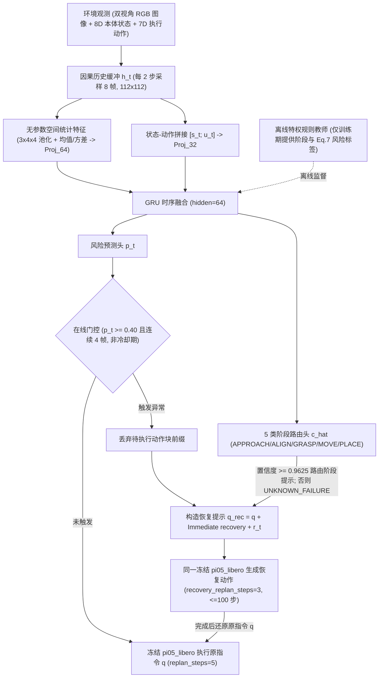

# VLA-Corrector: Stage-Aware Observable State Understanding for Prompt-Based Closed-Loop Recovery of Vision-Language-Action Policies

## 一句话定义

**一套外挂于冻结 VLA 策略之上的轻量级闭环纠错框架**：通过时序建模双视角 RGB 图像、本体感知状态与历史执行动作的可学习验证器（Learned Verifier）在线估计任务阶段与执行风险，并在触发异常时以「原指令 + 阶段恢复提示」驱动同一冻结 VLA 策略自主纠偏，无需微调主策略或读取特权环境坐标。

## 英文缩写速查

| 缩写 | 英文全称 | 简要说明 |
|---|---|---|
| VLA | Vision-Language-Action | 视觉-语言-动作策略；本文以冻结的 OpenPI `pi05_libero` 作为被监控的底层控制器 |
| GRU | Gated Recurrent Unit | 门控循环单元；Learned Verifier 中隐层维度为 64 的时序融合骨干 |
| RGB | Red-Green-Blue | 三通道彩色视觉观测；本文使用第三方视角的 agent-view 与腕部 wrist-view 双视角输入 |
| BDDL | Behavior Domain Definition Language | 行为域定义语言；LIBERO 中用于判定子目标谓词与特权规则监督的底层状态描述 |
| AUROC | Area Under the Receiver Operating Characteristic Curve | 受试者工作特征曲线下面积；衡量验证器跨阈值的二值风险区分能力 |
| AUPRC | Area Under the Precision-Recall Curve | 精确率-召回率曲线下面积；更敏感地反映正样本（失败预警）稀缺条件下的检测质量 |

## 为什么重要

1. **揭示动作分块 VLA 的「执行期不透明性（Execution-Time Opacity）」**：现有 [VLA](../methods/vla.md) 与 [Action Chunking](../methods/action-chunking.md) 策略虽然能生成符合语言指令的连续动作块，但在执行窗口内缺乏「是否做对」的在线自检机制；一旦遭遇动作噪声、物体位移或目标区域偏移，策略会继续执行过时动作块直到耗尽时域。
2. **解耦「策略能力」与「执行可靠性」**：不同于重新微调大模型或额外训练专用恢复策略控制器，Prompt Recovery 把冻结 VLA 视作可复用底层控制器，仅通过可微调/可替换的轻量验证器与文本提示接口实现闭环纠错。
3. **验证纯可观测历史足以替代特权状态监督**：在部署期完全不读取物体 3D 坐标或 BDDL 谓词的情况下，Learned Verifier 仅凭 8 步视觉-本体-动作历史即可逼近特权规则验证器（Rule + Prompt）的恢复上限，并零样本迁移至物理机械臂任务。

## 核心信息

| 字段 | 内容 |
|---|---|
| **作者** | Chang Song, Bin Qian, Yan Feng, Zhijie Song |
| **机构** | 原文未标注（arXiv:2609.06508v1 HTML 未列机构信息） |
| **发表时间** | 2026-09-06（arXiv:2609.06508v1 [cs.RO]） |
| **论文链接** | [arXiv:2609.06508](https://arxiv.org/abs/2609.06508) / [arXiv HTML v1](https://arxiv.org/html/2609.06508) |
| **项目与代码** | 待核实：正文未附独立项目页或 GitHub 代码仓库；基座策略采用 OpenPI 检查点 `gs://openpi-assets/checkpoints/pi05_libero` |
| **清单分类** | `harness.monitoring_and_recovery`（来源条目：`survey_ax_2609_06508`） |
| **开源状态** | **未确认开源代码**（截至 2026-11-27，arXiv v1 正文未列出 VLA-Corrector 自身代码库、训练脚本或验证器权重） |

## 核心原理

VLA-Corrector 在冻结的 OpenPI `pi05_libero`（$\pi_\theta$）外围构建「状态观测历史编码 → 阶段/风险预测 → 门控路由 → 提示恢复」四段式闭环（原文 Problem Formulation & Method）：

### 1. 问题形式化与冻结基座策略

- **可观测交互历史**：在时刻 $t$，系统记录外部视角图像 $I_t^a$、腕部视角图像 $I_t^w$、8 维本体状态 $s_t \in \mathbb{R}^8$ 及环境实际执行的 7 维动作 $u_t \in \mathbb{R}^7$，构成严格因果序列 $h_t = \{(I_i^a, I_i^w, s_i, u_i)\}_{i=0}^t$。
- **冻结控制器交互**：基座策略 $U_t = \pi_\theta(q, h_t)$ 在评测全程保持权重与视觉/动作头冻结；客户端在 $256 \times 256$ 分辨率渲染图像并缩放至 $224 \times 224$ 送入推理接口，每次输出 7 维动作块后执行前 `replan_steps = 5` 步再重规划（单回合常规执行上限 280 步）。

### 2. 特权规则教师与非对称监督对齐

- **六阶段语义状态机**：仿真器中的 Privileged Rule-Based Verifier 利用物体位姿、末端运动学、距离与夹爪状态跟踪状态机：
  $$\texttt{APPROACH} \rightarrow \texttt{ALIGN} \rightarrow \texttt{GRASP} \rightarrow \texttt{MOVE} \rightarrow \texttt{PLACE} \rightarrow \texttt{SUCCESS}$$
  当规则超时或动作/位姿偏离时记录失败事件步集合 $\mathcal{E}$ 与对应阶段上下文 `(stage, context)`。特权信号**仅用于离线生成监督标签及构建实验上限（Rule + Prompt）**，不输入部署期验证器。
- **带缓冲区的二值风险监督（Eq. 7）**：对时间步 $t$，若距最近失败事件 $\min_{e \in \mathcal{E}} |e - t| \le 10$ 则标为正样本 $f_t = 1$；若 $> 20$ 则标为负样本 $f_t = 0$；处于 $[11, 20]$ 步的模糊过渡窗口从二分类损失中剔除，避免边界噪声干扰。

### 3. 可观测历史驱动的 Learned Verifier

Learned Verifier 接收每 2 个环境步采样一次的 **8 步历史窗口**（图像缩放到 $112 \times 112$），结构极简以保证亚毫秒级在线开销：

1. **无参数视觉空间统计特征**：对每个视角执行 $3 \times 4 \times 4$ 自适应平均池化（48 维），拼接通道均值（3 维）与标准差（3 维）共得 54 维单视角特征；双视角拼接（108 维）经线性投影 $\operatorname{Proj}_{64}$ 映射为 $v_t \in \mathbb{R}^{64}$。
2. **本体-动作编码与 GRU 时序融合**：将 15 维状态-动作向量 $[s_t; u_t]$ 经 $\operatorname{Proj}_{32}$ 映射为 $x_t \in \mathbb{R}^{32}$，拼接 $[v_t; x_t]$ 后送入隐层维度 64 的单向 GRU 得到隐状态 $z_t$。
3. **双预测头分工**：
   - **风险头**：$p_t = \sigma(w_f^\top z_t + b_f)$，输出未来 10 步内出现异常的概率估计 $\Pr(f_t=1 \mid h_t)$。
   - **阶段路由头**：$\hat{c}_t = \arg\max_{c \in \mathcal{C}}[\operatorname{Softmax}(W_{\mathrm{stage}} z_t + b_{\mathrm{stage}})]_c$，在 5 个非终态阶段 $\mathcal{C} = \{\texttt{APPROACH}, \texttt{ALIGN}, \texttt{GRASP}, \texttt{MOVE}, \texttt{PLACE}\}$ 上分类（终态 `SUCCESS` 由环境结果判定）。阶段头仅作路由上下文，不直接充当 5 类异常检测器。

### 4. 在线触发门控与 Prompt Recovery

- **防抖门控策略**：在线推理以阈值 $\tau = 0.40$ 判定单窗口预警，需连续 $k = 4$ 个采样窗口超过阈值且不在 10 步冷却期内，才正式触发恢复介入；触发后立刻丢弃当前待执行的动作块剩余前缀。
- **阶段条件化提示拼接（Eq. 5）**：若阶段头预测置信度 $\ge 0.9625$，按预测阶段路由具体恢复指令片段 $r_t$；若低于 $0.9625$，则回退到通用恢复标签 `UNKNOWN_FAILURE`。最终构造恢复指令 $q_t^{\mathrm{rec}} = q \oplus r_t$（在保留原始任务指令 $q$ 后追加 `"Immediate recovery: "` 与阶段纠错引导），由同一冻结 $\pi_{0.5}$ 以 `recovery_replan_steps = 3` 生成最多 100 步恢复动作，随后还原原始指令 $q$ 继续任务。

## 流程总览

## 源码运行时序图

**不适用**（截至 2026-11-27，arXiv:2609.06508v1 原文及 `candidate_repos` 未确认可运行的官方源码实现、GitHub 仓库或可执行训练/推理脚本入口，基座策略仅引用 OpenPI 公开检查点 `gs://openpi-assets/checkpoints/pi05_libero`。）

## 实验与评测

作者在 **标准 LIBERO**（含 SPATIAL、GOAL、OBJECT、10、90 五个套件）、**LIBERO Plus**（难度 4 与难度 5）以及 **物理机械臂平台** 上，对比三种共用同一冻结 `pi05_libero` 策略的配置：无辅助基线（No Assistance）、特权规则上限（Rule + Prompt）与可观测验证器（Learned Binary + Prompt）。

### 1. 仿真基准综合鲁棒性与多扰动对比（Table 3 & 跨基准汇总）

Table 3 在标准 LIBERO 上对每种扰动条件评测 1000 个回合（动作噪声 $\sigma=0.1$；目标物体 XY 偏移 $0.1\text{ m}$；目标区域 XY 偏移 $0.1\text{ m}$；Combined 同时施加三者且图像噪声为 0）：

| 评估方法 | Clean (%) | Action Noise (%) | Target-Object Shift (%) | Goal-Region Shift (%) | Combined (%) | 五工况均值 (%) |
|---|---:|---:|---:|---:|---:|---:|
| **No Assistance**（冻结基线） | 93.7 | 85.2 | 78.3 | 77.6 | 70.7（正文汇总为 70.9） | 81.14 |
| **Rule + Prompt**（特权上限） | 94.2 | 89.4 | 86.2 | 88.2 | 82.6（`+11.7`） | 88.12（`+6.98`） |
| **Learned Binary + Prompt**（本文部署方案） | 94.1 | 88.9 | 83.7 | 87.5 | 80.2（`+9.3`） | 86.88（`+5.74`） |

- **LIBERO Plus 泛化表现**：在难度 4（Spatial / Goal / Object / 10 跨干净与扰动条件平均）下，No Assistance、Rule + Prompt 与 Learned Binary + Prompt 成功率分别为 **73.7% / 79.7% / 79.0%**；在难度 5（LIBERO-Object 与 LIBERO-10 汇总）下分别为 **66.7% / 73.6% / 72.6%**。可观测验证器在两种难度上均与特权规则上限差距在 1 个百分点以内。

### 2. 失败检测、在线门控与消融实验（Table 2 & Table 4）

Learned Verifier 基于 120 条 episode-disjoint 轨迹（60% 训练 / 20% 验证 / 20% 测试，CPU 训练 30 epochs）训练后，在测试集与在线回放上达到 **93.1% 准确率（93.09%）**、**61.1% 精确率（61.14%）**、**94.9% 召回率（94.85%）**、**74.4% Positive F1（74.35%）**、**AUROC 0.902** 与 **AUPRC 0.7123**。结合连续 4 帧门控后，**在线触发精确率达 79.2%**，诊断日志显示恢复介入后的任务成功率在 Rule + Prompt 与 Learned Binary + Prompt 上分别达到 **77.0%** 与 **75.0%**。

| 消融配置 | Acc. (%) | Prec. (%) | Recall (%) | Pos. F1 (%) | 延迟 p50 / p95 (ms) |
|---|---:|---:|---:|---:|---:|
| **Single frame**（无时序，长度=1） | 86.95 | 48.87 | 75.49 | 59.33（`-15.02`） | 0.214 / 0.376 |
| **Agent-view only**（去掉腕部视角） | 89.73 | 52.33 | 80.92 | 63.56（`-10.79`） | 0.420 / 0.503 |
| **Vision only**（去掉本体与动作） | 92.66 | 58.00 | 82.24 | 68.03（`-6.32`） | 0.371 / 0.477 |
| **State-action only**（无视觉输入） | 80.75 | 47.67 | 75.88 | 58.55（`-15.80`） | 0.382 / 0.455 |
| **Temporal + Fusion**（完整配置） | **93.09** | **61.14** | **94.85** | **74.35** | 0.457 / 0.589 |

### 3. 真机零样本迁移评测（Fig. 2 & Fig. 5）

作者在不收集任何真机微调或重训数据的条件下，将同一套冻结 `pi05_libero` + Learned Verifier 部署到物理机器人上测试三类任务（每任务 40 次独立试验，执行中途人为移动目标物体）：**Pick and Open**（抓取并拉开玩具抽屉）、**Place**（将木块放入四格木盒指定隔间）与 **Pour Water**（抓起塑料瓶倾倒液体至容器）。三项任务**平均执行成功率从冻结基线的 82.5% 提升至 88.3%（+5.8 pp）**。

## 与其他工作对比

| 对比维度 | 常规 VLA / 动作分块策略（如 `pi05_libero`） | 特权规则监控（Rule + Prompt） | 内省/语言反思智能体（如 ReAct / Reflexion） | **VLA-Corrector（本文）** |
|---|---|---|---|---|
| **主策略参数** | 冻结或需任务级微调 | 冻结 | 依赖大模型上下文或文本重规划 | **完全冻结，无需追加动作头或微调** |
| **状态感知依据** | 当前单步/短窗观测，无风险评估 | 仿真器特权坐标与 BDDL 谓词 | 高层文本描述或视觉问答 | **8 步双视角 RGB + 8D 本体 + 7D 动作历史** |
| **监控延迟与部署性** | 无在线纠偏监控 | 不可直接部署到真机 | 云端/大模型推理开销较高 | **CPU 亚毫秒级（p50 0.457 ms），可直接上真机** |
| **纠偏控制接口** | 等待下个 replan 周期自然重规划 | 规则触发 `q + 阶段提示` | 改写文本计划或高层技能重选 | **丢弃旧动作块，保留原指令并拼接阶段恢复提示** |

## 结论

**一句话总判：针对动作分块 VLA 的执行期失效问题，无需改动或重训庞大的基座模型参数，仅靠亚毫秒级的纯可观测历史 GRU 验证器搭配「原指令 + 阶段提示」重查询机制，即可在物理扰动下逼近特权仿真监控的闭环恢复收益。**

1. **时序历史与双视角融合不可偏废**：消融实验表明，单帧模型（Pos. F1 降 `15.02 pp`）和纯本体-动作模型（降 `15.80 pp`）均大幅退化；腕部视角对对齐/抓取期异常感知贡献明显（去掉后降 `10.79 pp`）。
2. **连续帧门控比单步阈值更关键**：离线单窗精确率仅 `61.14%`（离线检测阈值 `0.03294`），但配合在线阈值 `0.40`、连续 4 帧确认与 10 步冷却期后，触发精确率提升至 `79.2%`，避免频繁打断正常动作块。
3. **阶段分类适合作为路由信号而非直接风险判据**：原文将阶段估计严格限定为高置信度（$\ge 0.9625$）提示路由器，低置信度时自动退回通用 `UNKNOWN_FAILURE`，在保持高召回的同时降低了误路由风险。
4. **向工程落地迁移需关注基座策略指令遵循能力**：Prompt Recovery 成立的前提是底层冻结 VLA 本身能理解 `"Immediate recovery: ..."` 这类附加文本指令并生成退避/重抓行为，迁移到弱语言条件化策略前需先验证其指令响应余量。

## 工程实践

- **冻结 VLA 推理与重规划参数**：以 OpenPI `pi05_libero` 为例，图像统一按 $256 \times 256$ 渲染并缩放至 $224 \times 224$，常规执行 `replan_steps = 5`，进入恢复模式切换为更高频的 `recovery_replan_steps = 3`（单次干预上限 100 步）以缩短响应滞后。
- **极简验证器特征工程**：Learned Verifier 无需额外训练图像骨干网络，直接对 $112 \times 112$ 双视角图像做 $3 \times 4 \times 4$ 自适应平均池化与通道均值/方差统计（单帧 54 维/视角），使 64 维 GRU 在 CPU 上即可维持 $0.457\text{ ms}$（p50）/ $0.589\text{ ms}$（p95）推理速度，几乎不增加控制周期负担。
- **双阈值标定流程**：训练期剔除失败前 $11\text{–}20$ 步的过渡模糊样本；部署前在验证集上独立标定在线风险阈值（`0.40`）、连续确认帧数（`4`）、冷却步数（`10`）以及阶段路由置信度门槛（`0.9625`），切忌直接复用离线 F1 最优阈值（`0.03294`）。

## 局限与风险

- **未开源代码与验证器权重**：截至 2026-11-27，原文未公布 Learned Verifier 训练脚本、120 条训练轨迹切分清单或 Prompt 模板全集，工程复现需自行依据论文描述重建特征提取器、状态机教师与提示路由词表。
- **阶段语义与状态机耦合于操作范式**：当前 `APPROACH -> ALIGN -> GRASP -> MOVE -> PLACE` 五阶段抽象主要针对桌面拾取放置与倾倒操作，若拓展至双臂协同、灵巧手在手重定位或柔性体操作，需重新定义阶段词汇与教师触发规则。
- **极端高置信误路由与真机细节披露有限**：虽然加入了 `0.9625` 置信度兜底与 10 步冷却机制，但在严重遮挡或视觉域偏移下仍可能发生误触发；此外原文未公布真机三项任务的分项数值明细及所用的物理机器人硬件型号。

## 关联页面

- [Agentic Robots 综述](paper-towards-agentic-robots-survey.md)
- [全量项目节点清单](../overview/awesome-agentic-robots-node-index.md)
- [VLA 方法背景](../methods/vla.md)
- [机器人智能体执行框架](../methods/robot-agent-harness.md)：对照规划、执行接口与监控恢复闭环
- [Action Chunking · 动作分块执行](../methods/action-chunking.md)：理解多步动作块执行期重规划滞后与打断代价
- [π0 / OpenPI 策略族](../methods/pi0-policy.md)：本文冻结基座策略 `pi05_libero` 所属的流匹配 VLA 策略体系
- [智能体规划与反馈执行](../methods/agent-planning-feedback.md)：对照高层语言反馈纠错与本文冻结 VLA 提示恢复机制
- [具身智能体评测基准](../methods/embodied-agent-benchmarking.md)：参考 LIBERO / LIBERO Plus 扰动注入与受控评测设计
- [Manipulation · 机器人操作](../tasks/manipulation.md)：长时程桌面拾取、放置与倾倒操作任务背景

## 推荐继续阅读

- [arXiv:2609.06508v1 HTML 原文（含 Eq. 1–7、Table 1–4 与扰动协议）](https://arxiv.org/html/2609.06508)
- [arXiv:2609.06508 摘要与 PDF 下载页](https://arxiv.org/abs/2609.06508)

## 参考来源

- [论文一手全文核对归档（arXiv:2609.06508v1）](../../sources/papers/paper-agentic-2609-06508.md)
- [官方 Awesome 快照归档](../../sources/repos/awesome-agentic-robots-survey-index.md)
- [arXiv:2609.06508 论文摘要与元数据入口](https://arxiv.org/abs/2609.06508)
- [arXiv:2609.06508v1 HTML 全文](https://arxiv.org/html/2609.06508)
