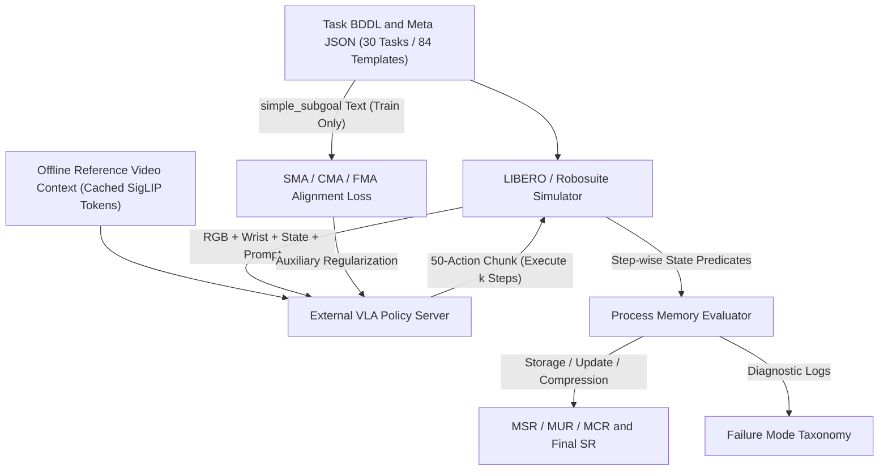
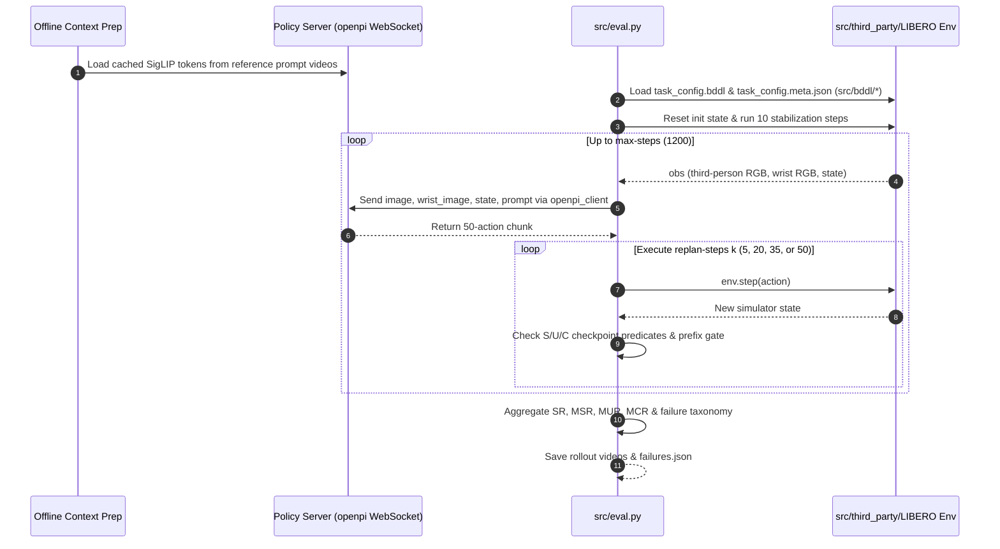

# MEMOBench: A Process Level Memory Benchmark for Robotic Manipulation

## 一句话定义

MEMOBench 是浙江大学提出的机器人操作过程级记忆评测基准，在 LIBERO/robosuite 仿真中构建 30 个历史依赖任务与 4,200 个带仿真器谓词的可执行检查点，将策略失败拆解为记忆存储（Storage）、更新（Update）、压缩（Compression）与动作执行四个可观测环节。

## 英文缩写速查

| 缩写 | 英文全称 | 简要说明 |
|---|---|---|
| MEMOBench | Process Level Memory Benchmark for Robotic Manipulation | 本文基准：面向机器人操作的过程级记忆诊断基准 |
| MSR | Memory Storage Rate | 记忆存储率：新观测任务信息检查点谓词的完成率 |
| MUR | Memory Update Rate | 记忆更新率：外部状态变化后修订记忆检查点的完成率 |
| MCR | Memory Compression Rate | 记忆压缩率：累积历史信息整合检查点的完成率 |
| SR | Success Rate | 最终任务成功率，依据末端 BDDL 目标谓词判定 |
| VLA | Vision-Language-Action | 视觉-语言-动作策略模型（如 $\pi_0$、$\pi_{0.5}$、OpenVLA-OFT） |
| BDDL | Behavior Domain Definition Language | 机器人仿真任务初始状态、目标与检查点谓词规范语言 |
| SMA / CMA / FMA | Semantic / Contrastive / Framewise Memory Alignment | 基于检查点语言监督的三种训练期记忆对齐正则化目标 |

## 为什么重要

现有视觉-语言-动作（VLA）策略大多在「当前观测即可决定下一步动作」的马尔可夫假设下评测；一旦任务需要跨时间步记住指代对象、追踪状态翻转或复现演示程序，策略成功率往往骤降。此前的机器人记忆基准（如 MemoryBench、MIKASA-Robo、LIBERO-Mem、RoboMME、RoboMemArena）虽然暴露了这一短板，但仍主要以**最终任务成功率（SR）**或粗粒度关键帧评分，无法区分「根本没记住」「状态改变后未刷新旧记忆」「无法归纳多次交互历史」还是「记住了但机械臂控制失败」。MEMOBench 在不读取模型内部隐状态的前提下，通过可执行的仿真器谓词把过程记忆拆成 Storage、Update、Compression 三项可量化指标，既能定位记忆瓶颈，也能反过来作为训练期对齐监督信号。

## 核心信息

| 字段 | 内容或状态 |
|---|---|
| 作者 | Haiyang Sun, Haoxiao Wang, Junming Chen, Weicheng Fang, Zihao Su, Jingkun Yi, Wenyou Yi, Hao Chen, Zhou Zhao |
| 机构 | Zhejiang University（浙江大学） |
| 发表时间 | 2026-09-07（arXiv:2609.07047v1；仓库注明 `[EMNLP 2026]`） |
| 论文链接 | [arXiv:2609.07047](https://arxiv.org/abs/2609.07047) · [arXiv HTML](https://arxiv.org/html/2609.07047) |
| 项目与代码 | [Collab-Gen/MEMOBench](https://github.com/Collab-Gen/MEMOBench) · [HuggingFace 数据集](https://huggingface.co/datasets/SunSeaLucky/MEMOBench) |
| 清单分类 | `environment.benchmarking`（来源条目：`survey_ax_2609_07047`） |
| 开源状态 | **已开源**（评测代码、`src/bddl/` 30 任务规范与 84 检查点元数据、vendored LIBERO 与 HuggingFace 340.56 GiB 示范数据均已开放；策略微调/对齐训练脚本未包含在基准仓中） |

## 核心原理

MEMOBench 的核心设计由**双层记忆分类学**、**可执行检查点系统**、**过程记忆度量**与**检查点语言对齐监督**四部分构成：

### 1. 双层记忆分类学（Memory Type × Memory Operation）

1. **任务记忆类型层（Task Type）**——回答「任务需要记住什么」：
   - **Temporal Memory（`when`，10 任务）**：保留事件计数、时序先后与状态转换条件（如检查抽屉、开关微波炉/炉灶并延迟放置）。
   - **Spatial Memory（`where`，10 任务）**：在遮挡或抽屉关闭后维持物体空间位置记忆（如单抽屉/双抽屉物品放置）。
   - **Object Memory（`what`，5 任务）**：在相似候选物体或早期参考视频/语言提示中保持物体身份与指代一致性（如依据提示视频取特定牛奶或黄油）。
   - **Procedural Memory（`how`，5 任务）**：复现演示视频中的动作模式或长程序列约束（如装配、清理上菜、先丢弃再装盘、按序叠碗、3 步缓冲交换物体）。
2. **过程记忆操作层（Memory Operation）**——回答「记忆状态在检查点发生了何种变换」：
   - **Storage（$\varnothing \to \mathcal{M}$）**：首次编码新观测到的任务信息（35 模板 / 1,750 实例）。
   - **Update（$\mathcal{M} \to \mathcal{M}'$）**：外部物理状态变化后修订已有记忆条目，含覆写或清除旧状态（32 模板 / 1,600 实例）。
   - **Compression（$\mathcal{M} \to \hat{\mathcal{M}}$）**：将多次累积的交互或事件历史整合为紧凑表征（17 模板 / 850 实例）。
   - 不对 Retrieval 单独打标，因为检索可发生于任意决策步。盲标一致性检验（3 名独立标注员覆盖 84 个模板）达到 Fleiss' $\kappa = 0.799$、三评委完全一致率 83.3%（$70/84$）。

### 2. 数据规模与可执行检查点

- **任务与示范规模**：基于 LIBERO / robosuite / MuJoCo 栈构建，覆盖 29 类物体与 5 类固定装置；30 个任务各含 50 条专家示范，总计 1,500 条轨迹、927,444 个控制步（平均 618.30 步、中位数 489.00 步、最长 2,012 步），HDF5 总体积 340.56 GiB。每步记录 $(T, 7)$ 动作、双视角 $(T, 256, 256, 3)$ RGB（第三人称与腕部）及 $(T, D)$ 本体状态（$D \in \{38, 47, 51, 58, 71, 77, 84, 97, 149\}$）。
- **检查点结构**：30 个任务共定义 84 个有序检查点模板 $\mathcal{C}_\tau = \{c_1, \dots, c_K\}$，扩展为 4,200 个示范级实例。每个检查点包含**粗/中/细三档语言描述**、**单一操作标签（S/U/C）**与**仿真器可验证的 BDDL 状态谓词**。

### 3. 过程记忆指标与前缀门控

对任务 $\tau$ 的 $N$ 次 rollout（实验中 $N=50$），设操作 $o \in \{\texttt{S}, \texttt{U}, \texttt{C}\}$ 对应的检查点子集为 $\mathcal{C}_\tau^o$，判定函数 $v_i(c) \in \{0,1\}$ 表示第 $i$ 条轨迹在仿真器中是否满足检查点谓词，则：

$$
r_o(\tau) = \frac{1}{N} \sum_{i=1}^{N} \frac{1}{|\mathcal{C}_\tau^o|} \sum_{c \in \mathcal{C}_\tau^o} v_i(c)
$$

由此分别得到 **MSR**（$r_{\texttt{S}}$）、**MUR**（$r_{\texttt{U}}$）与 **MCR**（$r_{\texttt{C}}$），并与最终任务成功率 $\mathrm{SR}(\tau)$ 并列汇报（未包含对应操作的任务标记为 N/A，不计入宏平均）。对于时序敏感分析，采用有序前缀指示器 $\bar{v}_i(c_k) = \prod_{j=1}^k v_i(c_j)$，避免孤立或乱序碰巧触发后续谓词而虚高得分。

### 4. 检查点语言驱动的记忆对齐训练

MEMOBench 将检查点子目标文本（`simple_subgoal`，由冻结 SigLIP 文本编码器离线编码为 $d_t = 1152$ 维向量 $T_b$）作为训练期辅助正则项，接入 RoboMME $\pi_{0.5}$ 记忆模块（$L=512 = 32 \text{ 帧} \times 16 \text{ token}$，维度 $d_m=2048$）：

$$
\mathcal{L}_{\mathrm{total}} = \mathcal{L}_{\mathrm{action}} + \lambda \mathcal{L}_{\mathrm{align}}
$$

- **Semantic Memory Alignment (SMA, $\lambda=0.1$)**：对有效记忆 token 做掩码均值池化并线性投影为 $z_b$，最小化与目标文本的余弦距离 $\mathcal{L}_{\mathrm{SMA}} = \frac{1}{B}\sum_b (1 - \hat{z}_b^\top \hat{T}_b)$。
- **Contrastive Memory Alignment (CMA, $\lambda=0.1$)**：在批内记忆与文本特征间计算双向 InfoNCE（初始可学习温度 $\tau=0.07$），并将批内 $\hat{T}_i^\top \hat{T}_j > 0.99$ 的重复子目标视为同正例以消除假负例梯度。
- **Framewise Memory Alignment (FMA, $\lambda=0.05$)**：将记忆张量重排为 $F=32$ 帧槽并分别投影，匹配到同步或下一可用检查点子目标，再按帧序施加线性近因权重 $\alpha_{b,f} = 0.5 + 0.5 \frac{r_{b,f}}{\max(N_b-1, 1)}$。推理阶段完全不依赖对齐文本头。

## 流程总览

## 源码运行时序图

官方仓库 [Collab-Gen/MEMOBench](https://github.com/Collab-Gen/MEMOBench) 提供了可运行的评测链路：服务端（如 `openpi` 的 `scripts/serve_policy.py`）离线缓存参考视频视觉 token 并暴露 WebSocket 推理接口，客户端 `src/eval.py` 加载 `src/bddl/` 下的任务规范与检查点元数据，在 `src/third_party/LIBERO` 仿真中执行闭环 rollout 并输出过程记忆指标与失败诊断。

## 实验与评测

全部基线均在 MEMOBench 1,500 条示范上微调，并在 1,500 个留出仿真回合（每任务 50 回合，基线种子 `7+i`，10 步稳定、1,200 步上限，重规划步长 $k \in \{5, 20, 35, 50\}$）上评测：

### 1. 主实验对比（Table 2，含各模型峰值重规划设置摘录）

| 模型 | 显式记忆 | 最优 $k$ | Avg. SR (%) | Avg. MSR (%) | Avg. MUR (%) | Avg. MCR (%) | Temporal SR | Spatial SR | Object SR | Procedural SR |
|---|---|---|---|---|---|---|---|---|---|---|
| $\pi_0$ | 否 | 5 | 11.2 | 38.6 | 8.3 | 2.1 | 4.4 | 0.2 | 27.6 | 12.4 |
| OpenVLA-OFT (7B) | 否 | 20 | 12.1 | 33.7 | 24.1 | 0.6 | 0.4 | 0.4 | 35.2 | 12.4 |
| $\pi_{0.5}$ | 否 | 5 | 30.4 | 54.9 | 13.5 | 4.2 | 2.2 | 0.0 | **99.6** | 19.6 |
| MemoryVLA | 是 | 20 | 29.2 | 55.1 | **49.9** | **14.1** | 0.2 | **28.4** | 32.4 | **55.6** |
| HiF-VLA | 是 | 5 | 21.0 | 23.0 | 4.8 | 0.1 | 0.2 | 0.0 | 79.6 | 4.0 |
| $\pi_{0.5}$ + RoboMME 记忆模块 | 是 | 5 | **31.9** | **58.1** | 16.5 | 7.8 | **9.8** | 2.0 | **99.6** | 16.0 |

- **高存储与低更新/压缩共存**：例如 $\pi_0$（$k=5$）在 Temporal 上 MSR 达 94.0%，但 SR 仅 4.4%、MUR 12.4%、MCR 4.0%；$\pi_{0.5}$ + RoboMME（$k=20$）Temporal MSR 达 90.0%，SR 仅 7.6%。HiF-VLA 在 $k=50$ 时 Temporal MCR 达 64.0%（Avg. MCR 32.1%），但 Avg. SR 仅 3.5%。
- **错误归因（Section 5.3, Figure 4）**：在三检查点炉灶时序任务的 150 次 rollout 中仅 10 次成功；140 次失败中 36 次卡在初始存储，63 次在首个更新检查点出现「过时记忆（stale memory）」，41 次在后期检查点因旧状态残留失败。

### 2. 记忆对齐、Oracle 分解与消融（Table 3, Table 4, Table 10）

- **记忆对齐效果（Table 3，基于 $\pi_{0.5}$ + RoboMME 记忆模块）**：
  - 在 $k=5$ 时，**CMA** 将 Avg. SR 从 31.9% 提升至 **34.7%**（Temporal SR $9.8\% \to 14.4\%$，Procedural SR $16.0\% \to 23.6\%$，Avg. MUR $16.5\% \to 21.4\%$，Avg. MCR $7.8\% \to 11.1\%$）；**FMA** 达 32.7%（Temporal MSR 99.4%），**SMA** 达 31.9%（Avg. MSR 60.8%）。
  - 在稀疏重规划 $k=50$ 下，FMA 保持 **27.3%** Avg. SR（未对齐基线降至 21.8%）；跨四个 $k$ 的平均指标上，FMA 的 Avg. MSR 最高，SMA 的 Avg. MUR 最高，CMA 的 Avg. MCR 最高。
- **Oracle Memory 分解（Table 4，$k=5$）**：将真值检查点记忆文本直接拼入标准 $\pi_{0.5}$ 提示词后，Avg. SR 从 30.4% 升至 **51.9%**，其中 Temporal SR $2.2\% \to 54.9\%$、Spatial SR $0.0\% \to 45.8\%$，合计弥合 **45.5%** 的 MUR 缺口与 **54.9%** 的 MCR 缺口，而仅弥合 20.2% 的 MSR 缺口；但 Procedural SR 反从 19.6% 降至 10.0%，表明程序性任务的瓶颈主要在长程动作执行与对齐。
- **顺序与粒度消融（Figure 5–6）**：打乱训练期子目标顺序（Shuffled Memory Control）后，炉灶任务初始存储可达 90%，但在状态更新后跌至 24%，最终成功率仅 2%（有序基线为 76% → 52% → 8%）。此外，中等或极细粒度文本并未带来单调收益（粗粒度 4/50 成功，中粒度与细粒度均为 3/50），说明检查点文本的关键在于准确传达「驱动后续决策的状态变化」。
- **特权监督参考（Appendix G, Table 10）**：分层策略 MemER（Qwen2.5-VL-7B + $\pi_{0.5}$）直接消费检查点关键帧与子目标监督后 Avg. SR 达 **56.4%**（MSR 65.4%、MUR 45.2%、MCR 70.3%），但 Spatial MUR（52.8%）和 Procedural SR（19.6%）仍远未解决。

## 与其他工作对比

| 基准 | 记忆维度 | 部分可观测 / 动态场景 | 视频输入 | 过程记忆操作标注 (S/U/C) | 任务数 / 示范数 / 平均步长 |
|---|---|---|---|---|---|
| LIBERO (2023) | 偏基础任务迁移 | 否 / 否 | 否 | 否 | 130 / 6,500 / 162 |
| RoboCerebra (2025) | Temporal | 否 / 是 | 否 | 否 | 100 / 1,000 / 2,972 |
| MemoryBench (2025) | T + S | 否 / 否 | 否 | 否 | 3 / 300 / 312 |
| MIKASA-Robo (2026) | S + O + Seq + Cap | 是 / 是 | 否 | 否 | 32 / 1,250 / 72 |
| RoboMME (2026) | T + S + O + P | 是 / 是 | 是 | 否（仅子目标/关键帧） | 16 / 1,600 / 481 |
| RoboMemArena (2026) | T + S + O + Seq | 是 / 是 | 是 | 否（仅子目标/关键帧） | 26（仿真） / 2,600 / 1,076 |
| **MEMOBench (本文)** | **T + S + O + P** | **是 / 是** | **是** | **是（84 模板 / 4,200 实例）** | **30 / 1,500 / 618** |

与仅看最终 SR 的传统基准相比，MEMOBench 通过把可执行检查点绑定到仿真器谓词，首次支持在黑盒策略上将「初始记忆编码」「状态更新」与「历史压缩」分离评测，并通过 Oracle 注入给出了记忆误差与控制误差的上下界。

## 结论

**一句话总判：MEMOBench 用可执行仿真器谓词把「记忆是否有效」拆解为存储、更新与压缩三项可测指标，证明当前主流与记忆增强 VLA 的真正短板不在「记不住初始信息」，而在「状态变化后更新与长程压缩失败」。**

1. **过程指标防止被「高存储假象」误导** — 评测内存增强 VLA 时不能只看 SR 或初始检索精度；像 $\pi_0$（Temporal MSR 94.0% / SR 4.4%）那样能记住起点却无法随环境更新旧记忆，依然会导致任务失败。
2. **重规划频率对不同记忆结构影响迥异** — $\pi_{0.5}$ 系列高度依赖高频重规划（$k=5$ 降至 $k=50$ 掉点 ~10%），而带有显式记忆整合设计的 MemoryVLA 在 $k=20$ 达到最佳平衡（MUR 49.9%、Procedural SR 55.6%）。
3. **训练期对齐损失按目标分化收益** — 不改推理架构即可用检查点文本作为辅助正则（$\lambda \in \{0.05, 0.1\}$）：需要提升综合/压缩与程序任务时优先选用对比对齐（CMA，$k=5$ Avg. SR 34.7%），而在低频稀疏重规划下帧级对齐（FMA）稳定性更优。
4. **有序状态变化比冗长文本更关键** — 消融实验表明打乱检查点时序会摧毁更新能力（成功率 8% → 2%），而过度堆砌细节描述反而不如直指状态翻转的粗粒度检查点文本有效。

## 工程实践

- **仿真与数据准备**：在 `Collab-Gen/MEMOBench` 目录下通过 `pip install -e src/third_party/LIBERO` 安装仿真环境，并安装 `openpi_client`；从 HuggingFace 下载 `MEMOBench.zip` 与 `assets.zip`，并将资产目录合并到 `src/third_party/LIBERO/libero/libero/assets/`。
- **参考视频上下文接入**：由于基准中的提示视频固定，工程实现上应提前用策略自身的视觉编码器（如 SigLIP）对关键帧编码并缓存 token，在策略服务端初始化时加载并拼接到 prompt token 之后；`src/eval.py` 仅传递实时视角图像（224×224 输入）、本体状态与文本 prompt。
- **典型训练与评测超参（Appendix H）**：
  - RoboMME $\pi_{0.5}$ 记忆模块配置：3.2B 基座 + 约 80M 记忆调制器参数，缓存前视角 32 帧 × 16 token = 512 记忆 token（2048 维），冻结 SigLIP 视觉编码器；AdamW（$\beta_1=0.9, \beta_2=0.95$，lr $5\times10^{-5}$，5% warmup，batch size 64，EMA 0.999，梯度裁剪 1.0），在 4 张 A40 上训练 80k 步约需 3–4 天。
  - 评测命令：`python src/eval.py --task-dir src/bddl/temporal --num-trials-per-task 50 --memory-level 1 --replan-steps 5`，日志会自动输出 SR、MSR/MUR/MCR 与五类失败归因统计。

## 局限与风险

- **纯仿真环境约束**：全部 30 个任务与 1,500 条示范基于 LIBERO / robosuite / MuJoCo 仿真，尚未在真机上验证过程记忆指标与传感器噪声、接触动力学和视觉域迁移的对应关系。
- **模型覆盖范围有限**：主实验涵盖 6 种基线，受控对齐实验仅在 $\pi_{0.5}$ + RoboMME 记忆模块单一骨干上验证，尚未覆盖状态空间模型（SSM）等其他记忆架构。
- **人工标注边界与训练代码缺失**：盲标分析显示 Update 与 Compression 在多阶段收尾动作处存在一定主观边界（14/84 模板存在 2:1 分歧）；此外当前开源仓库只包含评测脚本与任务定义，策略微调与对齐损失训练代码未一并开源，复现 Table 3 需自行在 `openpi` 等训练框架中实现对应辅助损失；许可方面亦需注意仓库 `LICENSE` 标明为非商业科研许可 `CC BY-NC 4.0`。

## 关联页面

- [具身大模型评测基准选型闭环](../queries/embodied-eval-benchmark-selection-loop.md)：对照评测基准设计与指标选型闭环。
- [Agentic Robots 综述](paper-towards-agentic-robots-survey.md)
- [全量项目节点清单](../overview/awesome-agentic-robots-node-index.md)
- [VLA 方法背景](../methods/vla.md)
- [具身智能基准评测](../methods/embodied-agent-benchmarking.md)
- [动作分块（Action Chunking）](../methods/action-chunking.md)
- [$\pi_0$ 策略模型](../methods/pi0-policy.md)
- [AI 基准评测方法](../methods/ai-benchmark-evaluation.md)
- [机器人操作](../tasks/manipulation.md)：了解物体操作、长程序列和记忆依赖任务背景。

## 推荐继续阅读

- [MEMOBench 论文全文（arXiv:2609.07047）](https://arxiv.org/abs/2609.07047)
- [MEMOBench 官方 GitHub 仓库（Collab-Gen/MEMOBench）](https://github.com/Collab-Gen/MEMOBench)
- [MEMOBench 数据集与资产（HuggingFace）](https://huggingface.co/datasets/SunSeaLucky/MEMOBench)

## 参考来源

- [MEMOBench 论文全文精读归档](../../sources/papers/paper-agentic-2609-07047.md)
- [MEMOBench 官方仓库源码核对归档](../../sources/repos/paper-agentic-2609-07047.md)
- [官方 Awesome 快照归档](../../sources/repos/awesome-agentic-robots-survey-index.md)
- [arXiv:2609.07047](https://arxiv.org/abs/2609.07047)
- [GitHub: Collab-Gen/MEMOBench](https://github.com/Collab-Gen/MEMOBench)
