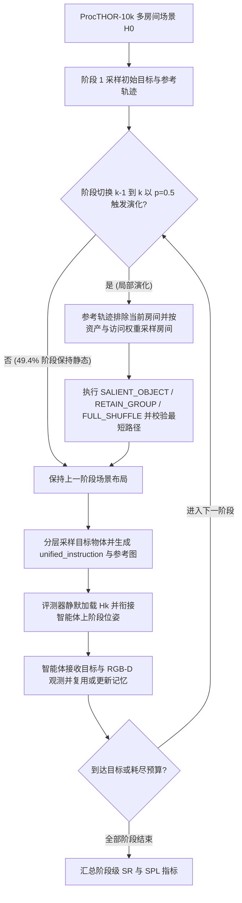

# EvoNav-Bench: Benchmarking Lifelong Navigation in Evolving Environments

## 一句话定义

**EvoNav-Bench** 是构建于 ProcTHOR-10k 之上的多阶段终身物体导航（Lifelong Navigation）基准，通过在导航阶段之间静默实施局部物体重排，系统评测持续场景记忆在“部分过时且不可完全信赖”环境中的复用收益、误导风险与纠偏能力。

## 英文缩写速查

| 缩写 | 英文全称 | 简要说明 |
|------|----------|----------|
| LN | Lifelong Navigation | 终身导航：智能体在同一环境中连续执行多阶段导航子任务并积累复用经验 |
| SR | Success Rate | 阶段级导航成功率：终止位置与目标二维欧氏距离小于 $2.0\,\mathrm{m}$ 的比例 |
| SPL | Success-weighted Path Length | 成功加权路径长度：结合成功率与相对最短路径效率的阶段级指标 |
| FU | Frontier-Update | 启发式基线：保留物体条目，但在占据栅格冲突时重建地图并重置探索前沿 |
| FTU | Fail-then-Update | 启发式基线：在 FU 基础上到达预测目标位置后由 VLM 核验并删除失效条目 |
| GT | Ground Truth | 基准中的真值感知设定：由仿真器直接提供物体掩码与语义标签 |

## 为什么重要

1. **揭示静态假设下的隐性失效模式**：GOAT-Bench、MultiON、C-Nav 等已有终身导航基准默认环境在各阶段之间完全静止。真实家庭或服务场景中人类活动会改变物体摆放，直接将旧点云或场景图与新观测融合会导致“记忆污染”，而静态基准无法暴露该缺陷。
2. **区分“感知误差”与“环境演化”两类错误源**：通过同时设置真值感知（GT）与视觉检测感知（Prediction）对照实验，论文证明过时记忆与误检条目会叠加干扰导航决策，且在预测感知下感知质量的影响甚至可能压过环境演化本身。
3. **验证记忆复用与清除之间的核心权衡**：对比跨阶段记忆复用、全局重置（Stage-Reset）与反应式纠偏（FTU）策略，为长期部署服务机器人的场景记忆更新机制提供了可复现的诊断框架。

## 核心信息

| 字段 | 内容或状态 |
|------|------------|
| 作者 | Xilin Wang*, Guoxi Zhang*, Hongming Xu, Zhuofan Zhang, Tianxu Wang, Lifeng Fan† |
| 机构 | State Key Laboratory of General Artificial Intelligence, BIGAI；Tsinghua University |
| 发表时间 | 2026-09-08（arXiv v1）/ 2026-09-14（arXiv v2，`cs.RO`） |
| 论文链接 | [arXiv:2609.08292](https://arxiv.org/abs/2609.08292) |
| 项目与代码 | 未确认开源代码（原文及 HTML 页面未给出官方项目页、代码仓库或数据集下载链接；文中参考文献 [1] 的 `github.com/matterport/Mask_RCNN` 为基线 UniGoal 使用的第三方检测库） |
| 清单分类 | `environment.benchmarking`（来源条目：`survey_ax_2609_08292`） |
| 开源状态 | 未确认开源代码 |

## 核心原理

### 1. 任务形式化与多阶段闭环接口

- **输入与动作空间**：在单栋未见过的 ProcTHOR 多房间住宅中连续执行 $K \in \{3, 4, 5\}$ 个目标导航阶段；每步接收 RGB-D 观测 $o_t$，支持离散动作（`MOVE_FORWARD` $0.25\,\mathrm{m}$、`TURN_LEFT` / `TURN_RIGHT` $15^\circ$、`Stop`）或基于目标点 $p_t$ 的路点执行（`TeleportFull`）。
- **多模态目标描述**：每阶段目标 $x_k$ 由 $300 \times 300$ RGB 参考图（在距目标 $1.0\text{–}1.5\,\mathrm{m}$ 可见可达位姿渲染）与三种指令（确定性生成的 `basic_instruction`，以及 `gpt-4o` 生成的 `appearance_instruction` 与 `unified_instruction`）组成；论文评测统一使用 `unified_instruction`。
- **静默演化与位姿衔接**：阶段内环境保持静止；阶段切换时不重置智能体内部记忆（除非策略显式清空），且不向智能体通报环境修改。若智能体上一阶段的终止位姿在演化后不再可达，评测器将其吸附到最近可达位置并保持朝向。

### 2. 受控场景演化流水线（Algorithm 1）

基准围绕 **局部性（Locality）**、**经验相关性（Experience Relevance）**、**不可直接观测性（Observability）** 与 **演化后可达性（Post-evolution Validity）** 四项原则生成每阶段房屋状态 $H^{(k)}$：

1. **参考轨迹驱动房间采样**：在任务生成阶段，利用 AI2-THOR 的 `GetShortestPathToPoint` 构造独立于具体被测智能体的参考轨迹，记录已访问房间与阶段切换时的过渡房间。
2. **演化触发与房间权重**：从第 $k>1$ 阶段开始，以 $p^{\text{evolve}} = 0.5$ 触发演化，并按以下分布采样单个待改房间 $j$：
   $$p^{\text{evolved room}}_{j} \propto q^{\text{asset}}_{j} \, q^{\text{visited}}_{j} \, q^{\text{current}}_{j} \, q^{\text{evolved}}_{j}$$
   其中 $q^{\text{asset}}_j$ 为房间资产数量；已访问房间加权 $f^{\text{visited}} = 3.0$；当前过渡房间权重置零（$q^{\text{current}}_j = 0$）以确保变化发生在当前视野之外；前两阶段内已修改过的房间施加衰减因子 $f^{\text{evolved}} = 0.5$。
3. **三种房间级修改算子**：
   - `SALIENT_OBJECT`（概率 0.5）：重排一个显著大件物体及其表面放置的小物体；
   - `RETAIN_GROUP`（概率 0.4）：在保持语义资产组合（如桌椅组）的前提下重排全屋物体；
   - `FULL_SHUFFLE`（概率 0.1）：独立随机重排房间内所有物体，并经 ProcTHOR 放置算法与最短路径规划器校验可行性。
4. **分层目标采样**：按全局唯一（2 分）、房间唯一（1.5 分）、非唯一（1 分）为物体赋分；发生变化的房间权重乘以 9.0，上一阶段刚作为目标的房间权重乘以 0.2；若本阶段采用 `SALIENT_OBJECT`，被移动大件在房间内的采样权重乘以 9.0。

### 3. 数据规模与演化分布

过滤 ProcTHOR-10k 单房间场景后，EvoNav-Bench 共生成 **7,924 个训练任务（31,797 阶段）**、**751 个验证任务（3,003 阶段）** 与 **776 个测试任务（3,098 阶段）**。全库统计显示：85.9% 的任务至少经历一次场景演化（48.4% 经历 $\ge 2$ 次），同时 49.4% 的阶段过渡保持静态；62.1% 的阶段目标在指派前未被重排（37.9% 被重排）；单回合被重排物体比例的中位数位于 10%–20% 之间，兼顾局部变化与经验可用性。

## 流程总览

> 注：以上流程图依据论文 §3.1–§3.2 与 Appendix A.1/B.1 整理（为便于 Mermaid 纯文本渲染，上图中节点标签不含 HTML 标签；实际生成流水线见 Algorithm 1）。

## 源码运行时序图

**不适用**（截至 2026-11-27，论文原文 `arXiv:2609.08292v2` 未提供官方项目页、基准代码仓库或数据集下载入口；文中出现的 `github.com/matterport/Mask_RCNN` 仅为基线 UniGoal 感知组件引用的第三方分割库，并非 EvoNav-Bench 可运行官方实现）。

## 实验与评测

实验在 EvoNav-Bench 测试集的 10% 子集（**90 个独特场景、365 个阶段**）上进行，对比三类具身导航智能体（UniGoal、3D-Mem、MSGNav）与三种启发式策略（FU、Stage-Reset、FTU），VLM 统一采用 `gpt-4o`。

### 1. 主实验结果（Table 1，阶段级 SR / SPL %）

| 方法 | 类型 | GT SR ↑ | GT SPL ↑ | Prediction SR ↑ | Prediction SPL ↑ |
|------|------|--------:|---------:|----------------:|-----------------:|
| UniGoal | 基线（在线场景图+LLM） | 20.0 | 14.9 | 12.9 | 7.9 |
| 3D-Mem | 基线（视觉/前沿快照+VLM） | 47.7 | 42.5 | 44.1 | 37.7 |
| MSGNav | 基线（多模态 3D 场景图+VLM） | 59.2 | 41.3 | **54.8** | **38.2** |
| Frontier-Update (FU) | 启发式（冲突时重建地图） | 61.1 | 48.8 | 42.2 | 32.5 |
| Stage-Reset | 启发式（每阶段清空记忆） | 61.9 | 45.1 | 46.8 | 29.6 |
| Fail-then-Update (FTU) | 启发式（FU+到达核验删旧） | **67.4** | **53.3** | 49.0 | 35.8 |

### 2. 目标重排与否的分拆评测（Table 2，SR %）

| 方法 | GT 重排目标 | GT 未重排目标 | Prediction 重排目标 | Prediction 未重排目标 |
|------|------------:|--------------:|--------------------:|----------------------:|
| UniGoal | 12.8 | 18.7 | 9.2 | 10.8 |
| 3D-Mem | 40.4 | 56.0 | 40.4 | 48.1 |
| MSGNav | 51.4 | 64.5 | 50.7 | **57.8** |
| FU | 54.1 | 65.1 | 29.4 | 50.0 |
| Stage-Reset | 60.6 | 61.4 | 44.0 | 49.4 |
| FTU | **68.8** | **66.3** | **52.3** | 47.9 |

### 3. 受控对照实验（§4.3 Fixed vs. Not Fixed）

在 90 个测试场景（GT 感知）中先强制智能体沿最短路径经过 Stage-2 与 Stage-1 目标以预存目标条目，随后在同一 Stage-2 目标上比较场景“固定（Fixed）”与“演化（Not Fixed）”两种变体：
- 保留物体条目的方法（3D-Mem、MSGNav、FU、FTU）在 Fixed 下均高于 Stage-Reset，但在 Not Fixed 下均明显下降（FU 跌至 Stage-Reset 之下），而 Stage-Reset 仅下降 **2.2% SR**；
- 具有目标核验机制的 MSGNav 与 FTU 抗退化表现优于 3D-Mem 与 FU，且能主动删除失效条目的 FTU 进一步优于仍保留旧条目的 MSGNav。

## 与其他工作对比

论文 Appendix A.5（Table 4）从终身设定、连续环境、未知环境、时间演化、布局变化与多模态目标六个维度对比了已有导航基准：

| 基准 | 终身多阶段 | 连续未知环境 | 时间演化 | 局部布局变化 | 多模态目标 | 与 EvoNav-Bench 的核心差异 |
|------|------------|--------------|----------|--------------|------------|----------------------------|
| MultiON / C-Nav / LENL | ✓ | ✓ | × | × | × | 仅静态场景，侧重类别增量或多目标序列 |
| GOAT-Bench | ✓ | ✓ | × | × | ✓ | 支持多模态终身导航，但假定阶段间完全静止 |
| Portable ObjectNav | × | ×（图拓扑） | ✓ | × | × | 仅在已知拓扑图上移动便携物体，不涉及连续探索 |
| STARBench | × | ×（已知环境） | ✓ | × | × | 在已知环境与给定策略下做物体检索，非未知探索 |
| **EvoNav-Bench** | **✓** | **✓** | **✓** | **✓（局部）** | **✓** | **首次将未知连续环境下的跨阶段记忆复用与静默局部布局演化结合** |

## 结论

**一句话总判：在演化环境中做终身导航，仅保留历史记忆会在场景变动后引入比“从零探索”更大的负迁移，真正决定上限的是“感知纠错 + 冲突重探索 + 失效条目主动清理”的协同。**

1. **直接复用静态场景记忆会显著受损**：GT 感知下，不感知环境变化的 UniGoal / 3D-Mem / MSGNav 全部落后于简单启发式策略，目标发生重排时尤甚。
2. **重置与复用存在明确边界**：`Stage-Reset` 在重排目标上比 `FU` 高 6.5% SR（60.6 vs 54.1），但在未重排目标上低 3.7% SR（61.4 vs 65.1）且整体 SPL 更低（45.1 vs 48.8），表明盲目清空会损失本可复用的静态先验。
3. **验证后删旧（FTU）是最有效的局部纠偏模式**：FTU 在 GT 下达到 67.4% SR 与 53.3% SPL，验证了“保留默认可信记忆 + 到达失效后定向剔除旧条目”的可行性。
4. **预测感知误差可压过环境演化影响**：切换为 YOLO-World + SAM + OpenCLIP 预测感知后，具备感知纠错能力的 MSGNav（SR 54.8%）反超未专门抑制误检的 FTU（49.0%），提示真实部署不能只解决记忆过时问题。

## 工程实践

- **参考适应与复现边界**：由于官方仓库尚未确认公开，若基于 AI2-THOR / ProcTHOR-10k 复现该评测范式，需注意论文附录 B.3–B.4 披露的关键工程适配细节：
  - **占据栅格提取**：原始 3D-Mem 从单层水平 TSDF 切片提取占据图易把桌底等不可通行空隙误判为自由空间，实验改为对仿真器 oracle 占据图做射线投射提取，以反映智能体完整碰撞体积。
  - **记忆粒度与上下文压缩**：`FU` / `FTU` 暴露 ConceptGraph 风格的单体物体条目而非绑定旧周围语境的视觉快照，并使用 OpenCLIP 相似度预排序，每轮仅向 `gpt-4o` 输入前 5 个候选物体条目。
  - **动作与预算口径**：基于离散动作的 UniGoal 设每阶段 500 步预算；基于高层决策轮次的 3D-Mem / MSGNav / FU / FTU 设每阶段 50 轮决策预算，并通过 `TeleportFull` 沿规划路点执行。

## 局限与风险

1. **演化类型仍较受限**：目前仅覆盖物体平面/空间重排，尚未包含物体新增或移除、柜门/抽屉等铰接状态变化，以及源自真实人类日常行为统计的移动先验。
2. **仿真保真度与动作抽象差距**：ProcTHOR-10k 的视觉与物理真实感有限，且部分基线采用 `TeleportFull` 路点传送，尚未充分验证低层连续控制与高保真仿真（如 Isaac Sim / Real2Sim）下的长程表现。
3. **策略均为反应式且依赖感知质量**：FTU 需在智能体实际走到旧位置发现目标缺失后才删除条目，存在额外路程开销；在 Prediction 设定下，检测误检会同时污染物体记忆与目标核验结果。
4. **评测子集与接口依赖**：论文主实验在 10% 测试子集（90 场景、365 阶段）上完成，且启发式与适应版均依赖仿真器提供的占据图与闭源 VLM（`gpt-4o`），与端到端实机部署仍存在工程差距。

## 关联页面

- [具身大模型评测基准选型闭环](../queries/embodied-eval-benchmark-selection-loop.md)：对照评测基准设计与指标选型闭环。
- [Agentic Robots 综述](paper-towards-agentic-robots-survey.md)
- [全量项目节点清单](../overview/awesome-agentic-robots-node-index.md)
- [VLA 方法背景](../methods/vla.md)
- [具身智能体评测方法](../methods/embodied-agent-benchmarking.md)：对照任务设置、接口与评估指标
- [零样本物体目标导航](../tasks/zero-shot-object-navigation.md)：对应单阶段/跨阶段开放词汇找物基础任务
- [视觉-语言导航](../tasks/vision-language-navigation.md)：对比指令跟随与连续环境导航设定
- [自主探索](../tasks/autonomous-exploration.md)：对应 Frontier-Update 等基于前沿的未知区域再探索机制
- [机器人仿真场景生成](../methods/robot-simulation-scene-generation.md)：对照 ProcTHOR 程序化室内场景与受控重排流水线

## 推荐继续阅读

- [EvoNav-Bench 原文（arXiv:2609.08292）](https://arxiv.org/abs/2609.08292)
- [MSGNav: Unleashing the Power of Multi-Modal 3D Scene Graph for Zero-Shot Embodied Navigation（arXiv:2511.10376）](https://arxiv.org/abs/2511.10376)
- [STARBench: Searching in Space and Time（arXiv:2511.14004）](https://arxiv.org/abs/2511.14004)

## 参考来源

- [EvoNav-Bench 论文原文核对归档](../../sources/papers/paper-agentic-2609-08292.md)
- [官方 Awesome 快照归档](../../sources/repos/awesome-agentic-robots-survey-index.md)
- [arXiv:2609.08292v2 官方摘要与 HTML 全文](https://arxiv.org/abs/2609.08292)
