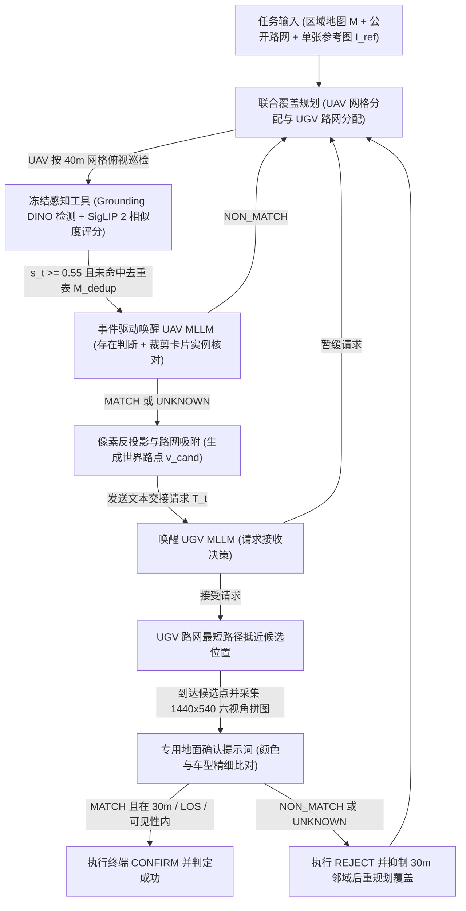
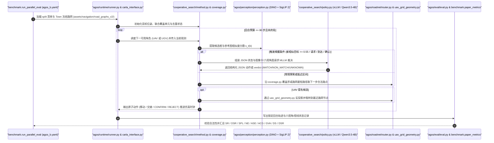

# Towards Embodied Air-Ground Cooperative Object Search: Benchmark, Dataset and Agentic Method

## 一句话定义

**AGOS-Bench / AGOS-Dataset / AGOS-Agent**：首个将无人机广域发现与无人地面车近距实例确认纳入同一闭环的城市无先验目标搜索体系，通过 **9 项细分指标** 区分“找到但未确认”与“从未找到”，并以**确定性联合覆盖规划 + 冻结感知工具 + 事件驱动 MLLM 稀疏唤醒**实现高效协同搜索与跨视角验证。

## 英文缩写速查

| 缩写 | 英文全称 | 简要说明 |
|---|---|---|
| AGOS | Air-Ground Object Search | 空地协同目标搜索任务，仅凭单张参考图定位并地面确认目标车辆 |
| UAV / UGV | Unmanned Aerial Vehicle / Unmanned Ground Vehicle | 无人机（80 m 俯视广域搜索）与无人地面车（6 视角路网抵近与实例确认） |
| MLLM | Multimodal Large Language Model | 多模态大语言模型，负责跨视角目标存在/实例判断、交接决策与地面确认 |
| OSR | Oracle Success Rate | 预言机成功率，衡量 UGV 是否曾到达满足距离、视线与可见性的合法确认位姿 |
| ASE / ACG | Aerial Search Efficiency / Aerial Candidate Guidance | 空中搜索效率（首次合法观测早晚）与空中候选引导质量（位置精度与提名早晚） |
| GVA | Ground Verification Accuracy | 地面验证准确率，事件级评估 UGV 执行 `CONFIRM` 或 `REJECT` 裁决的正确率 |
| DS / DSR | Decision Steps / Decision-Step-Weighted Success Rate | 回合平均 MLLM 调用步数及按调用步数倒数加权的成功率 |

## 为什么重要

- **补齐“探索—协同—地面确认”闭环评测缺口：** 既往城市具身基准各自只测链路一段——单无人机搜索（CityAVOS、UAV-ON）只停留在空中发现，空地协同导航（AirGroundVLN、AGC-VLN）往往提供粗方向或目标位置先验并以到达距离判胜，问答类基准（AirCopBench、AirGroundBench）不考核闭环确认。AGOS-Bench 要求在无目标位置和路径提示下，由 UGV 在 30 m 内满足视线与六视角可见性条件后给出 `MATCH` 才算完成。
- **精细归因“找到但未确认”与无效协同：** 通过 `OSR–SR` 差值与 `ASE` / `ACG` / `GVA` 三项协同指标，能够精确拆解失败究竟源于空中漏搜、错误候选把地面车引向干扰区域，还是抵近后地面验证失误或步数耗尽。
- **揭示大模型推理成本与协同收益的真实边界：** 通过控制相同观测、动作与提示词，证明单纯把 MLLM 当作纯规则或高频步进控制器要么因误确认暴毙、要么调用爆炸且陷入巡逻死循环；仅将 MLLM 留给事件触发的跨视角语义裁决，才同时提高成功率并大幅压低调用次数 `DS`。

## 核心信息

| 字段 | 内容 |
|---|---|
| **作者** | Boao Yu, Zimo Chen, Junreng Rao, Yue Hu, Zhengqiu Zhu, Yong Zhao, Jianzhe Gao, Pengfei Zhu, Rusheng Ju |
| **机构** | 国防科技大学（NUDT，系统工程学院 / 数字智能建模与仿真国家重点实验室）、浙江大学（ZJU）、天津大学（TJU） |
| **发表时间** | 2026-09-08（arXiv:2609.08402v1），2026-11-20 修订 v3（22 页，含 Appendix A–F） |
| **论文链接** | [arXiv:2609.08402](https://arxiv.org/abs/2609.08402) / [arXiv HTML v3](https://arxiv.org/html/2609.08402) |
| **项目与代码** | [GitHub（Yomier/AGOS-Bench，兼项目页）](https://github.com/Yomier/AGOS-Bench) / [Hugging Face 数据集（Yomier/AGOS-Dataset）](https://huggingface.co/datasets/Yomier/AGOS-Dataset) |
| **清单分类** | `environment.benchmarking`, `harness.orchestration`（来源条目：`survey_ax_2609_08402`） |
| **开源状态** | **已开源**（仓库代码 Apache-2.0、数据集 CC BY 4.0，含评测器、路网图、AGOS-Agent/Baseline/Minimal 实现与 SFT 训练脚本；论文原始 LoRA 实验权重未直接随仓发布，需使用公开的 `trajectories-train1100` 自行微调） |

## 核心原理

### 1. 任务形式化与异步闭环协议（§3, Appendix C）

给定城市子区域地图 $M$、公开道路拓扑与双方初始位姿 $P_0^r$，团队仅获得一张无背景的目标车辆参考图 $I_{\text{ref}}$（约 12 m 距离、$10^\circ\text{–}75^\circ$ 仰角、非部署点拍摄，不泄露目标位置）。UAV 与 UGV 根据各自动作持续时间**异步调度**：每当成员 $r \in \{\text{UAV}, \text{UGV}\}$ 完成上一动作即触发下一步决策：

$$a_t^r = \pi^r\left(M,\; I_{\text{ref}},\; \mathcal{H}_t^r,\; T_t\right), \qquad a_t^r \in \mathcal{A}^r$$

- **UAV 空间：** 在 80 m 高度、$90^\circ$ FOV 下观测 $1024\times 576$ 俯视 RGB；在距公开道路 40 m 以内按 40 m 间距构建的离散网格上作 8 方向水平移动，并可执行候选标注、协助请求与悬停观察（有效规划采样半径 25 m）。
- **UGV 空间：** 观测 6 路环形 $480\times 270$ RGB（方位角 $-45^\circ, 0^\circ, 45^\circ, -135^\circ, 180^\circ, 135^\circ$，拼成 $1440\times 540$ 六视角拼图）；在约 10 m 间距的有向道路网络上前进、倒车、转弯、确认、拒绝或停车观察。
- **终端成功判据（Eq. 2）：** 仅当四个条件同时成立时回合成功：

$$\text{success} = \mathbb{1}\!\left[d(\text{UGV}, o) \le 30\,\text{m}\right] \cdot \mathbb{1}\!\left[\text{LOS}\right] \cdot \mathbb{1}\!\left[\mathrm{Vis}(o, V_{\text{stop}})\right] \cdot \mathbb{1}\!\left[v = \text{MATCH}\right]$$

其中 $d$ 为水平距离，$\text{LOS}$ 要求无遮挡视线，$\mathrm{Vis}$ 要求目标出现在六视角观测中；每回合预算为 80 个任务步、1,000 次逻辑模型调用与 1 次终端 `CONFIRM` 机会（`REJECT` 不消耗确认机会，而是释放候选并在 30 m 抑制邻域外恢复搜索）。

### 2. AGOS-Dataset 分割与难度设计（§4, Appendix D）

基于 CARLA-Air v0.1.7 在 6 张城市地图上构建 **2,125 个回合**，目标选自 34 种车型、159 种外观（25 种可换 6 色 + 9 种固定涂装）：
- **数据划分：** Train1100（1,100 回合，来自 5 张已见地图）、Val275（275）、Seen-Test450（450，5 张已见地图）与 Unseen-Test300（300，完全留出 Town03）。
- **三级难度：** Easy（$150\times 150\text{ m}$，无干扰车，距起点 $\ge 10\text{ m}$）、Mid（$300\times 300\text{ m}$，距起点 $\ge 100\text{ m}$）、Hard（保留 Mid 几何并加入 2–3 辆近似干扰车，在 Hard Unseen-Test300 中同款异色占 73.6%、同色异款占 24.0%）。
- **专家轨迹与微调样本：** 1,100 条专家轨迹由公开几何规划运动、真值监督提名/接受/确认，产出 **27,720 条 Train Examples**（Move Decision 15,214 / Verification 9,048 / Confirmation 3,458）。论文微调从 301 条轨迹（8,212 条样本）按 5,120-token 上限过滤后保留 **6,014 条**（UAV 5,297 / UGV 717，含 188 条专用地面确认样本）。

### 3. AGOS-Agent 双层架构（§5, Appendix E）

AGOS-Agent 将确定性规划/预训练感知与可学习 MLLM 决策解耦，二者共享同一套接口：

1. **算法与工具层（固定不训练）：**
   - **联合覆盖规划（Eq. 3）：** 先把仅能空中覆盖的路点 $\mathcal{V}_{\text{aerial-only}}$ 分给 UAV，再按剩余单元增量时间最小化原则贪心划分 $(\mathcal{V}_{\text{A}}^\star, \mathcal{V}_{\text{G}}^\star)$：
     $$(\mathcal{V}_{\text{A}}^\star, \mathcal{V}_{\text{G}}^\star) = \arg\min_{(\mathcal{V}_{\text{A}}, \mathcal{V}_{\text{G}})} \max\left\{\hat{T}_{\text{UAV}}\big(\mathcal{V}_{\text{A}}\cup \mathcal{V}_{\text{aerial-only}}, P_t^{\text{UAV}}\big),\; \hat{T}_{\text{UGV}}\big(\mathcal{V}_{\text{G}}, P_t^{\text{UGV}}\big)\right\}$$
     其中规划速度估计为 UAV 10 m/s、UGV 6 m/s；当交接被接受或地面验证释放候选后，在保留已完成覆盖的前提下重规划。
   - **冻结感知与事件驱动唤醒（Eq. 17）：** 使用 `Grounding DINO`（`grounding-dino-base`，框阈值 0.20、文本阈值 0.18、NMS IoU 0.50）提取候选车框，并用 `SigLIP 2`（`siglip2-base-patch16-224`）计算候选裁剪图与 $I_{\text{ref}}$ 的缩放余弦相似度 $s_t(b) = \frac{1 + \cos(\phi(O_t^{\text{UAV}}[b]), \phi(I_{\text{ref}}))}{2}$；仅当存在满足 $s_t(b) \ge \tau_{\text{wake}} = 0.55$ 且离散证据键 $\kappa_t(b) \notin \mathcal{M}_{\text{dedup}}$（按 20 m 位置、$30^\circ$ 偏航角、16 像素框与 0.05 相似度分箱去重）的新检测，或出现未处理交接请求、候选到达、补充证据与工具故障时才唤醒 MLLM，常规航路与抵近均由算法执行。
   - **候选反投影与路网吸附（Eq. 16）：** 将选中候选框中心 $(u_c, v_c)$ 经 80 m 俯视相机内外参反投影至地面 $\mathbf{p}_{\text{world}}$，并吸附到最近公开道路节点 $\mathbf{v}_{\text{cand}} \in \mathcal{V}_{\text{road}}$ 后发送给 UGV。
2. **可学习 MLLM 层（LoRA 联合微调）：**
   - UAV 与 UGV 共享同一个 `Qwen3.5-4B` 基座与角色提示词（输出无 CoT 的单 JSON 对象），串起四类核心裁决：**存在判断（Existence Judgment）**、**实例裁剪卡片核对（Instance Judgment，最多 3 张 $256\times 256$ 卡片）**、**请求接收（Request Acceptance）** 与 **地面六视角最终确认（Final Ground Verification）**。
   - **联合 LoRA 配置（Table 20）：** 冻结视觉塔与投影层，在 16 个 q/v 模块（第 3, 7, 11, 15, 19, 23, 27, 31 层）施加 rank=8、$\alpha=16$ LoRA（约 0.92M 可训练参数），仅对 assistant JSON 回复计算交叉熵损失，单卡运行 3,007 步（1 epoch）。

## 流程总览

## 源码运行时序图

以下时序图基于官方仓库 [`Yomier/AGOS-Bench`](https://github.com/Yomier/AGOS-Bench) 已核实入口与核心模块（`benchmark.run_parallel_eval`、`agos/runtime/runner.py`、`agos/methods/cooperative_search/`、`agos/perception/`、`agos/roadnet/` 与 `agos/eval/eval.py`），描绘多进程推理/感知服务就绪后单回合闭环执行与评分链路。

## 实验与评测

所有主实验与消融默认在留出未见城市场景 **Unseen-Test300（Town03，$n=300$，Easy/Mid/Hard 各 100）** 上开展（另在 **Seen-Test450** 验证微调迁移），单机开源模型均采用贪心解码（`temperature=0`、随机种子 `20260725`、thinking 关闭）。

### 1. Unseen-Test300 主结果与基座对比（Table 2, Table 6）

| 模型 / 配置 | SR (%) ↑ | OSR (%) ↑ | SPL (%) ↑ | NE (m) ↓ | ASE (%) ↑ | ACG (%) ↑ | GVA (%) ↑ | DS ↓ | DSR (%) ↑ | Easy / Mid / Hard SR (%) |
|---|---:|---:|---:|---:|---:|---:|---:|---:|---:|---|
| `Minimal-Agent` (Qwen3.5-4B) | 15.33 | 42.33 | 7.41 | 137.76 | 47.33 | 38.53 | 64.79 | 70.0 | 1.01 | 21.0 / 13.0 / 12.0 |
| `Baseline-Agent` (Qwen3.5-4B) | 30.67 | 54.33 | 17.27 | 109.68 | 44.92 | 54.54 | 91.68 | 55.5 | 1.92 | 63.0 / 20.0 / 9.0 |
| **AGOS-Agent** (Qwen3.5-4B, 零样本) | **37.67** | 56.33 | 19.32 | 96.11 | 47.17 | 55.55 | **92.59** | 36.3 | 2.48 | 65.0 / 28.0 / 20.0 |
| `AGC-VLN-OS` (Qwen3.5-4B 适配) | 31.33 | 42.33 | 17.63 | 109.63 | 28.92 | 51.78 | 33.90 | 36.9 | 1.70 | 68.0 / 15.0 / 11.0 |
| `AeroDuo-OS` (Qwen3.5-4B + PilotLLM) | 28.67 | 49.67 | 14.51 | 102.90 | 57.23 | — | 82.69 | 66.9 | 1.78 | 57.0 / 12.0 / 17.0 |
| `Qwen3-VL-4B` (AGOS / Baseline) | 28.00 / 26.33 | 60.67 / 36.67 | 13.58 / 21.83 | 103.45 / 103.44 | 51.07 / 43.97 | 49.55 / 45.12 | 73.77 / 80.77 | 32.5 / 62.7 | 1.58 / 1.20 | 51.0 / 18.0 / 15.0（AGOS） |
| `GPT-6 Astra` (AGOS / Baseline) | 52.33 / 49.00 | 72.00 / 74.33 | 29.35 / 28.22 | 68.16 / 71.74 | 56.66 / 52.03 | 85.16 / 79.24 | 88.69 / 89.91 | 27.6 / 53.0 | 3.51 / 2.61 | 79.0 / 40.0 / 38.0（AGOS） |
| `GLM-5.3 Flash` (AGOS / Baseline) | 44.33 / 40.67 | 69.67 / 68.00 | 22.82 / 21.57 | 82.50 / 84.22 | 53.34 / 45.38 | 71.34 / 66.13 | 86.45 / 88.05 | 29.5 / 54.8 | 3.00 / 2.34 | 75.0 / 33.0 / 25.0（AGOS） |
| `DeepSeek-4.1 Flash` (AGOS / Baseline) | 37.33 / 38.00 | 64.33 / 65.00 | 19.62 / 20.71 | 92.17 / 88.30 | 54.54 / 51.16 | 71.88 / 69.84 | 88.21 / 86.97 | 31.9 / 56.5 | 2.59 / 2.16 | 69.0 / 19.0 / 24.0（AGOS） |
| **AGOS-Agent + SFT** (联合 LoRA, 6,014 样本) | **57.00** | **74.33** | **33.23** | **65.19** | 52.85 | **81.56** | 78.38 | **24.2** | **3.77** | **88.0 / 46.0 / 37.0** |

- **跨基座规律：** 在全部 9 个测试基座中，AGOS-Agent 在 7 个上取得更高 SR，并在 **全部 9 个**上显著削减调用步数 `DS`（例如 `Qwen3.5-4B` 由 55.5 降至 36.3，`GPT-6 Astra` 由 53.0 降至 27.6）。
- **监督微调效果（Table 4 & Table 15）：** 联合 LoRA 在 Unseen-Test300 上将 SR 提升 **+19.33 pp**（Holm(3) $p=5.65\times 10^{-8}$），在 **Seen-Test450** 上从 28.22% 提升至 **52.00%**（+23.78 pp，Holm(3) $p=7.72\times 10^{-17}$）。分角色双适配器在两个测试集分别达 56.67% 与 50.00%，与单适配器联合训练差距在 2.00 pp 以内。

### 2. 决策源对照（C1–C6）与 2×2 组件消融（Table 3, Table 5, Table 9–10）

- **混合 vs. 规则阈值决策（Qwen3.5-4B, Unseen-Test300）：**
  - `C1 (UAV=混合, UGV=混合)`：SR **37.67%**，DS 36.3（162 步数耗尽、25 误确认、0 停滞）。
  - `C2 (UAV=混合, UGV=规则 τ=0.55)`：SR 24.67%，高达 **211/226** 失败为误确认。
  - `C3 (UAV=规则, UGV=混合)`：SR 23.33%，高达 **205/230**（89.1%）失败为步数耗尽（错误空中提名把 UGV 引偏，SPL 跌至 12.54%）。
  - `C4 (全规则)`：SR 16.00%（247 误确认）；`C6 (仅 UGV 规则)`：SR 10.00%（270 误确认）。
  - `C5 (仅 UGV 混合)`：SR 32.33%，调用量升至 DS 64.4，但在 **Hard** 档位 SR 达 **33.0%**，高于双机零样本 C1 的 20.0%（大场景存在多个近似干扰车时，未精调的空中交接反而可能额外消耗地面绕行步数）。
- **2×2 消融（Table 5 & B.5.2）：** 相比 `Baseline-Agent`（30.67%，DS 55.5），仅加联合覆盖 `w/o EW` 为 29.67%（DS 56.3），仅加事件唤醒 `w/o JC` 为 34.33%（DS 35.4），完整 `Full`（JC+EW）达 **37.67%**（+7.00 pp，95% CI [2.00, 12.00]，Holm(3) $p=0.0259$）。

## 与其他工作对比

| 维度 | AGOS-Bench / AGOS-Agent（本文） | CityAVOS / UAV-ON | AirGroundBench / AirGroundVLN / AGC-VLN | AeroDuo-OS（适配对比） |
|---|---|---|---|---|
| **智能体编成** | 异构异步 1 UAV + 1 UGV | 单 UAV | UAV + UGV（或同步问答） | UAV 协同探索 / 区域概率引导 |
| **目标先验** | 无路径指令、无目标坐标/方向，仅单张参考图 $I_{\text{ref}}$ | 无路径，部分依赖开放词汇/图像 | AirGroundBench 给路径，AirGroundVLN / AGC-VLN 给目标方位或位置 | 依赖文本指令或 PilotLLM 区域预测 |
| **成功判据** | **地面 30 m 内 + LOS + 六视角可见 + `MATCH` 确认** | 到达目标空中视野/距离阈值 | 到达阈值或问答正确 | 到达目标阈值（适配后加六视角确认） |
| **Unseen-Test300 SR（同基座）** | **37.67%**（零样本）/ **57.00%**（SFT） | 不适用（未做地面实例闭环确认） | `AGC-VLN-OS` 适配后 **31.33%**（GVA 33.90%） | 适配后 **28.67%**（DS 66.9） |

## 结论

**一句话总判：空地协同搜索的瓶颈并非多模态模型调用不够频密，而在于如何把高频探索交给确定性路网规划与轻量检测器，只在跨视角歧义与地面确认关口唤醒可微调 MLLM；同时，若缺乏负例拒识监督，微调虽能大幅抬高发现率，也会带来更高的误确认代价。**

1. **双组件必须协同启用（+7.00 pp 增益）：** 单独加入联合覆盖而不做事件门控（29.67%）甚至略低于固定覆盖基线（30.67%），必须把 **联合覆盖规划 + 事件驱动唤醒** 配对使用，才能在提升 SR 至 37.67% 的同时把调用数压低 34.6%（DS 55.5 → 36.3）。
2. **地面最终确认不可交给纯阈值规则：** 把 UGV 换成相似度规则阈值（`C2`、`C4`、`C6`）会导致 93.4%–100% 失败源于盲目 `CONFIRM` 误确认；小参数开源 MLLM（如 `Qwen3.5-4B`）在六视角拼图下的语义拒识准确率（GVA 92.59%）是闭环可靠性的底线。
3. **Hard 场景下注意低精度空中交接的负迁移：** 零样本双机 C1 在 Easy/Mid 全面领先单车 C5，但在多近似干扰车的 Hard 档位被 C5 反超（20.0% vs. 33.0%），表明若空中提名噪声过高，强行引导地面车长距离奔袭不如让单车近距渐进排查。
4. **单 LoRA 联合微调极具部署性价比，但需补齐负样本：** 用单份约 0.92M 参数的 LoRA 适配器服务双角色（57.00% SR）与双适配器（56.67% SR）几乎等价；但因 6,014 条离线样本不含 `NON_MATCH`/`REJECT` 标签，微调后 Unseen-Test300 的正确拒识由 412/567 骤降至 3/222（GVA 由 92.59% 降至 78.38%），后续应通过在线迭代或负样本挖掘补全拒识边界。

## 工程实践

- **多终端进程分离架构：** 官方部署将模拟器（`carlaAir` Python 3.10 环境）、感知微服务（`agos-perception` Python 3.12 环境，托管 `grounding-dino-base` 与 `siglip2-base-patch16-224`）与模型推理（`agos-vllm` Python 3.12 环境，vLLM 0.28.0 托管 `Qwen3.5-4B` 或 LoRA adapter）拆为三个独立终端，先用 `--arm menu_oracle --dry-run` 验证本地地图与任务清单，再不带 `--dry-run` 做零模型调用的仿真冒烟检查。
- **结构化 JSON 约束与缓存去重：** 所有 MLLM 调用禁止输出 CoT 散文，仅输出严格枚举 JSON；感知侧通过位置 20 m、航向 $30^\circ$、框坐标 16 px、相似度 0.05 分箱构建 $\mathcal{M}_{\text{dedup}}$，避免同一候选反复唤醒模型耗尽 1,000 次逻辑调用预算。
- **LoRA 联合微调实操要点：** 仓库说明论文原版微调权重与当时 301 回合筛选样本不在发布清单内，复现时需下载 `trajectories-train1100` 后运行 `python -m training.corpus` 生成 `mixed.jsonl`，再通过 `python -m training.train --max-sequence-tokens 5120` 在单卡训练 rank-8 / $\alpha=16$ 联合适配器；超长（>5,120 tokens）样本采用直接隔离过滤而非截断，以免破坏多图提示词结构。

## 局限与风险

- **静态世界与理想通信假设（§7）：** 当前基准所有车辆均为静止停放，未模拟动态交通流遮挡、无线通信丢包/延迟或 GPS 漂移；UAV 像素反投影亦假设固定垂直俯拍与水平地面假设，遇到高架桥或显著地形起伏会产生路点吸附偏差。
- **微调后拒识能力退化（§6.4, Appendix B.4）：** 专家轨迹仅覆盖成功推进状态，训练语料缺失“错误抵近后的 `NON_MATCH` / `REJECT`”监督，导致微调策略更倾向积极确认，在线对抗强近似干扰车时存在误确认抬升风险。
- **统计多重检验边界（Appendix B.6）：** 2×2 消融中 `Baseline -> Full` 通过 Holm(3) 显著性检验（$p=0.0259$），但跨 9 个基座家族做多重校正后，零样本 `Qwen3.5-4B` 的 Holm(9) 校正 $p=0.07777$，未能跨过 0.05 阈值；且单次 SFT 仅基于单个随机种子（`20261027`）报告。

## 关联页面

- [具身大模型评测基准选型闭环](../queries/embodied-eval-benchmark-selection-loop.md)：对照评测基准设计与指标选型闭环。
- [Agentic Robots 综述](paper-towards-agentic-robots-survey.md)
- [全量项目节点清单](../overview/awesome-agentic-robots-node-index.md)
- [VLA 方法背景](../methods/vla.md)
- [具身智能体评测方法](../methods/embodied-agent-benchmarking.md)：对照任务设置、闭环成功判据与评测指标设计。
- [机器人导航工作流](../methods/robot-navigation-workflow.md)：对应有向路网规划、离散路点图与地面抵近路由。
- [机器人智能体框架（Robot Agent Harness）](../methods/robot-agent-harness.md)：对照事件驱动唤醒、状态账本与结构化工具调用协议。
- [目标检测方法](../methods/object-detection.md)：涉及 Grounding DINO 开放词检测与候选框提议。
- [零样本目标导航（Zero-Shot Object Navigation）](../tasks/zero-shot-object-navigation.md)：延伸至视觉参考驱动的无位置先验城市目标搜索。
- [视觉语言导航（VLN）](../tasks/vision-language-navigation.md)：对照论文评测的 `AGC-VLN-OS` 与 `AeroDuo-OS` 等空地导航改编基线。
- [自主探索（Autonomous Exploration）](../tasks/autonomous-exploration.md)：对应 UAV-UGV 联合覆盖分配与动态重规划机制。

## 推荐继续阅读

- [Yomier/AGOS-Bench 官方开源仓库与部署文档](https://github.com/Yomier/AGOS-Bench)
- [Yomier/AGOS-Dataset（Hugging Face 数据集发布页）](https://huggingface.co/datasets/Yomier/AGOS-Dataset)
- [arXiv:2609.08402v3 论文全文（HTML）](https://arxiv.org/html/2609.08402)

## 参考来源

- [AGOS-Bench 论文原文核对归档（arXiv:2609.08402v3）](../../sources/papers/paper-agentic-2609-08402.md)
- [Awesome Agentic Robots 官方动态文献索引](../../sources/repos/awesome-agentic-robots-survey-index.md)
- [Yomier/AGOS-Bench 官方开源仓库档案](../../sources/repos/paper-agentic-2609-08402.md)
- [arXiv:2609.08402 摘要入口](https://arxiv.org/abs/2609.08402)
