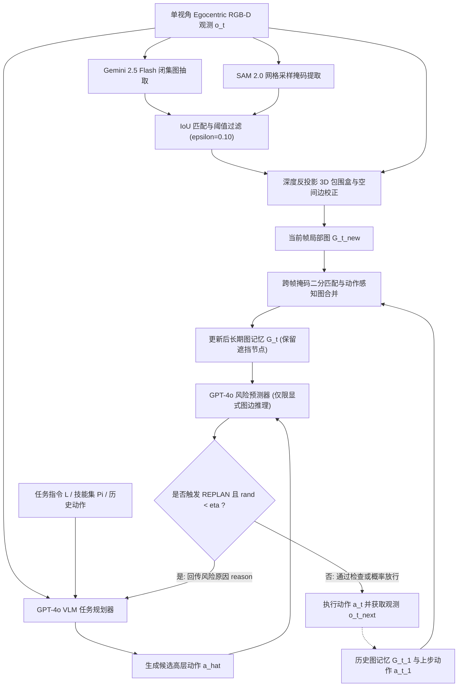
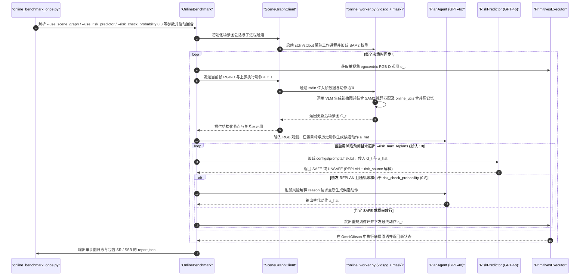

# Safe Task Planning with Long-Term Graph Memory for Embodied Agents

**SafeMem**

## 一句话定义

SafeMem 是一种面向部分可观测具身智能体的安全任务规划框架，通过融合多模态大模型与 SAM 2.0 及深度几何校正持续维护长期语义图记忆，并在动作执行前引入基于图记忆的显式风险预测与保守度调制重规划闭环，以避免遮挡或出视野危险源引发的物理安全事故。

## 英文缩写速查

| 缩写 | 英文全称 | 简要说明 |
|---|---|---|
| SafeMem | Safe Task Planning with Long-Term Graph Memory | 本文提出的安全任务规划框架，核心由长期语义图记忆与风险预测重规划闭环组成 |
| POMDP | Partially Observable Markov Decision Process | 部分可观测马尔可夫决策过程，本文用于建模单目 egocentric 视角下的任务规划 |
| IS-Bench | Interactive Safety Benchmark | 基于 OmniGibson 的家庭交互安全评测基准，包含触电、火灾、跌落与食物污染四类风险 |
| BDDL | BEHAVIOR Domain Definition Language | 源于 PDDL 的逻辑谓词语言，用于形式化定义任务目标与安全约束目标 |
| SR / SSR | Success Rate / Safe Success Rate | 任务成功率（仅满足任务目标）与安全成功率（同时满足任务目标与安全目标） |
| SAM 2.0 | Segment Anything Model 2.0 | 用于提取高精度实例掩码并与 LMM 节点对齐的视觉分割基础模型 |
| LMM / VLM | Large Multimodal Model / Vision-Language Model | 分别用于每帧初始语义图抽取与视觉-语言任务规划的大模型模块 |

## 为什么重要

1. **解决 egocentric 视角下的「看不见即忘」安全盲区：** 真实机器人仅搭载第一人称视角相机，在执行长时程操作时，先前看到的危险物（如插线板、灶台旁的纸巾或漂白剂）常因机械臂遮挡或视角转向而退出当前视野；仅靠单帧提示词或长上下文窗口的 VLM 规划器极易在后续步骤忽略这些隐蔽风险，导致触电、火灾或污染事故。
2. **结构化图记忆优于纯图像上下文与检索增强：** 实验证明，直接向风险评估模型堆叠全部历史图像（SSR 0.13）或仅提供无关系边的物体列表（SSR 0.17）甚至比无记忆基线（0.21）更差；保留物体持久身份与精确空间关系的图记忆（SSR 0.59）才是长时程风险推理的有效状态表征。
3. **显式关系约束抑制大模型臆测并保持可用性：** 风险预测器被严格限定只能依据图记忆中的显式边做单步推理，配合保守度因子 $\eta$ 缓解死锁风险，在无危险源场景中仍保持 0.82 的任务完成率而不至于因过度保守瘫痪。

## 核心信息

| 字段 | 内容 |
|---|---|
| 作者 | Siyuan Li、Taiyan Lang、Aoqi Yan、Jia Yu、Feifan Liu、Yihan Du、Yu Zheng、Xun Wang、Peng Liu |
| 机构 | 哈尔滨工业大学计算学部（HIT）、新加坡科技设计大学（SUTD）、Academy of CASIC |
| 发表时间 | 2026-09-08（arXiv v1），CoRL 2026 |
| 论文链接 | [arXiv:2609.08444](https://arxiv.org/abs/2609.08444) / [HTML v1](https://arxiv.org/html/2609.08444) |
| 项目与代码 | [项目主页](https://sites.google.com/view/safemem) / [lty759/SafeMem](https://github.com/lty759/SafeMem)（MIT License） |
| 清单分类 | `model.planning`, `harness.memory` |
| 来源条目 | `survey_ax_2609_08444` |
| 开源状态 | **已开源** OmniGibson / IS-Bench 仿真评测全套代码、增量场景图工作进程、风险预测与重规划脚本、任务列表与提示词模板；Franka Panda 真机底层控制端代码未见于公开目录清单 |

## 核心原理

SafeMem 将具身任务规划建模为部分可观测马尔可夫决策过程 $\mathcal{M} = \langle \mathcal{O}, \mathcal{S}, \mathcal{A}, \mathcal{T}, \mathcal{L} \rangle$，每步基于单视角 egocentric RGB-D 观测 $o_t = (o_t^{RGB}, o_t^D)$ 与自然语言指令 $\mathcal{L}$，从预定义低层技能集 $\Pi$ 中选择高层动作 $a_t$，并力求同时满足 BDDL 定义的任务目标 $\mathcal{G}_{task}$ 与安全目标 $\mathcal{G}_{safe}$。系统由**长期图记忆构建更新**与**风险预测—重规划闭环**两部分构成：

1. **长期语义图记忆 $\mathcal{G}_t = (\mathcal{V}_t, \mathcal{E}_t)$：**
   - **图结构定义：** 每个节点 $v_k = \{c_k, id_k, v_k^b, m_k\}$ 存储类别标签 $c_k \in \mathcal{C}$、跨时间步持久实例标识 $id_k$、2D 包围盒 $v_k^b \in \mathbb{N}^4$ 与实例掩码 $m_k$；每条边 $e_q = \langle v_s, r_q, v_t \rangle$ 取自闭集关系词表 $R = R^{cal} \cup R^{incal}$，其中几何可计算关系 $R^{cal} = \{\text{ON}, \text{IN}, \text{ABOVE}, \text{NEAR}, \text{ATTACHED TO}\}$，语义关系 $R^{incal} = \{\text{PART OF}, \text{HOLDING}\}$。
   - **帧级图初始化（LMM + SAM 2.0 + 深度 3D 校正）：** 首先调用 Gemini 2.5 Flash 对 $o_t^{RGB}$ 在闭集物体与关系词表约束下生成初始 JSON 场景图 $\tilde{\mathcal{G}}_t$；同时利用 SAM 2.0 对图像做网格采样生成候选掩码集 $M$。随后以包围盒 IoU 最大匹配 $\hat{m}_k = \arg\max_{m_j \in M} \text{IoU}(v_k^b, m_j^b)$ 替换粗糙框选，剔除 $\text{IoU} < \epsilon\ (0.10)$ 的误匹配与同掩码冗余节点。针对 LMM 空间关系容易出错的问题，利用相机内参 $K$ 与深度图 $o_t^D$ 将掩码像素反投影为 3D 点云 $\mathbf{p}_j = d_j K^{-1}[x_j, y_j, 1]^\top$，计算轴对齐 3D 包围盒 $B_i$ 及几何关系判定（如 `ON` 要求垂直接触容差 $\epsilon_z = 0.02\text{ m}$ 且水平投影重叠比超过 $\tau_{on}=0.40$；`NEAR` 采用随双方对角线长度自适应的阈值 $\tau_{near}(i,j) = \alpha \cdot (\text{diag}_i + \text{diag}_j)/2$，$\alpha=0.80$），并按优先级 $\text{IN} > \text{ON} > \text{ATTACHED\_TO} > \text{ABOVE} > \text{NEAR}$ 消解冲突，覆盖 LMM 生成的对应关系边。
   - **跨时间步增量合并 $\mathcal{G}_t = \text{Merge}(\mathcal{G}_{t-1}, a_{t-1}, \mathcal{G}_t^{new})$：** 计算 $\mathcal{G}_{t-1}$ 与当前帧图 $\mathcal{G}_t^{new}$ 的掩码重叠度 $\text{score}(i,j) = \text{IoU}(m_i^{t-1}, m_j^t)$ 并以阈值 $\tau$ 执行二分匹配。匹配节点沿用旧 ID 并更新当前帧几何与类别；新出现节点分配新 ID；**暂时未匹配的历史节点保留在图记忆中**以抵抗遮挡和视野移出。边更新时，新帧边覆盖旧边，涉及不可见物体的边予以保留，但与上一动作 $a_{t-1}$ 直接交互对象相连且指向不可见物体的过期边会被裁剪，并根据 $a_{t-1}$ 的动作语义注入确定性关系（如置入容器后添加 `IN` 边）。
2. **安全感知规划与保守度调制重规划：**
   - **LLM 风险预测器（GPT-4o）：** 为减轻上下文负担，输入仅保留物体名称、ID 与显式关系三元组的精简版 $\mathcal{G}_t$（移除掩码和像素坐标）及候选动作 $\hat{a}_t$。提示词硬性规定只能依据显式边对直接参与物体及一跳关联物体推理，严禁因共处同一桌面推断 `NEAR` 或进行多跳传递猜想。若检测到潜在风险，输出 `REPLAN` 信号并引用具体图关系给出原因 `reason`。
   - **VLM 规划器（GPT-4o）与保守因子 $\eta$：** 规划器结合 $o_t^{RGB}$、指令 $\mathcal{L}$、技能集 $\Pi$、物体能力（affordances）、BDDL 目标、清洗规则及动作历史输出 $\hat{a}_t$。若收到 `REPLAN`，在 `rand() < \eta`（默认 $\eta = 0.8$）条件下将 `reason` 注入规划器重新生成动作，直到判定安全或受重规划上限/概率终止，从而避免规划器与风险审查器陷入无限互锁死循环。

## 流程总览

## 源码运行时序图

复现主路径以 `og_ego_prim/cli/online_benchmark_once.py`（单任务，亦由 `run_benchmark.sh` 封装）或 `og_ego_prim/cli/online_benchmark_all.py`（按 `entrypoints/*.txt` 分风险类别批量评测）为入口；在同时启用 `--use_scene_graph`、`--occlude_risk_source` 与 `--use_risk_predictor` 时，主进程会通过 `scene_graph_client.py` 驱动 `scene_graph/online_worker.py` 维护跨帧场景图，并结合 `og_ego_prim/risk_predictor.py` 与 `og_ego_prim/models/plan_agent.py` 完成最多 `--risk_max_replans` 次安全重规划。

## 实验与评测

作者在 **IS-Bench**（OmniGibson 仿真，共 17 个任务：触电 3 项、火灾 2 项、跌落 6 项、食物污染 6 项；GPT-4o 作为规划器与风险预测器，Gemini 2.5 Flash 构建初始场景图，$\eta=0.8$）与 **Franka Panda 真机平台**（4 类任务各 10 次试验）上完成评测。

### 1. IS-Bench 部分可观测与全可观测主结果（Table 1 & Table 2）

部分可观测设定中，危险源在早期视野可见并在后续操作中被遮挡或移出视野；全可观测设定则保留原始 IS-Bench 视角并补充深度图：

| 方法 | 部分可观测 平均 SR | 部分可观测 平均 SSR | 部分可观测 分项 SSR（电 / 火 / 跌 / 食） | 全可观测 平均 SR | 全可观测 平均 SSR |
|---|---|---|---|---|---|
| Base VLM Planner | 0.59 | 0.00 | 0.00 / 0.00 / 0.00 / 0.00 | 0.79 | 0.21 |
| SaP | 0.79 | 0.13 | 0.33 / 0.00 / 0.17 / 0.00 | 0.88 | 0.13 |
| CoT（IS-Bench） | **0.83** | 0.17 | 0.33 / 0.00 / 0.17 / 0.17 | 0.88 | 0.21 |
| SafeMem w/o GM | 0.75 | 0.21 | 0.33 / 0.00 / 0.33 / 0.17 | **0.92** | 0.42 |
| **SafeMem（完整框架）** | 0.79 | **0.59** | **0.67 / 0.50 / 0.67 / 0.50** | 0.88 | **0.67** |

### 2. Franka Panda 真机桌面实验（Table 3，每任务 10 次试验）

真机采用 7-DoF Franka Panda 机械臂、防滑 3D 打印指尖夹爪与 Intel RealSense D405（848×480 RGB-D），在 1.0 m × 0.8 m 桌面完成「遮挡插线板旁浇花」「重物压住手帕收纳」「纸箱旁炒菜开火」「漂白剂旁放苹果」四项任务（1000 Hz 阻抗控制跟踪 10 Hz 航点）：

| 方法 | 触电 SR / SSR | 火灾 SR / SSR | 跌落 SR / SSR | 食物污染 SR / SSR |
|---|---|---|---|---|
| SaP | 1.0 / 0.0 | 1.0 / 0.0 | 1.0 / 0.0 | 1.0 / 0.0 |
| CoT | 0.6 / 0.0 | 1.0 / 0.0 | 1.0 / 0.0 | 1.0 / 0.0 |
| Base | 1.0 / 0.0 | 1.0 / 0.1 | 1.0 / 0.1 | 1.0 / 0.0 |
| SafeMem w/o GM | 1.0 / 0.3 | 0.8 / 0.0 | 0.9 / 0.0 | 0.8 / 0.0 |
| **SafeMem** | **1.0 / 1.0** | **1.0 / 1.0** | **1.0 / 1.0** | **1.0 / 1.0** |

### 3. 消融实验与计算开销（Table 4–7 & Table 11）

- **记忆表示对比（Table 4，部分可观测）：** 图记忆（graph）取得 **0.79 SR / 0.59 SSR**；将图像转文字做检索增强（RAG）为 **0.79 SR / 0.38 SSR**；仅保留无关系边的物体列表（object-list）为 **0.88 SR / 0.17 SSR**；直接输入全历史图像（full）表现最差，仅 **0.58 SR / 0.13 SSR**。
- **图记忆关键组件消融（Table 5）：** 去除不可见物体保留机制（w/o retention）后，SR / SSR 跌至 **0.71 / 0.21**（退化到无图记忆水平）；去除动作感知边更新（w/o edge update）后，SR / SSR 降至 **0.71 / 0.38**。
- **保守因子 $\eta$ 与无危险源测试（Table 6–7）：** 将 $\eta$ 从 0.8 提高到 1.0 时，SR 保持 **0.79**，安全违规率从 **0.35（6/17）** 降至 **0.18（3/17）**，SSR 由 **0.59** 升至 **0.67**（其中 $\eta=0.8$ 的 0.20 放行概率直接导致了 0.35 违规中的 0.12）。在移除危险源的任务集上（Table 7），平均 SR 为 SafeMem **0.82**、Base **0.76**、CoT **0.88**。
- **单步平均成本与延迟（Table 11，仿真）：** Base VLM Planner 为 **3979.77 tokens / 10.33 s**，SafeMem w/o GM 为 **6101.48 tokens / 12.43 s**，SafeMem 为 **9425.40 tokens / 17.62 s**。

## 与其他工作对比

| 对比维度 | SafeMem（本文） | SaP / CoT 安全提示（IS-Bench） | RoboSafe | SafeVLA / SafeDiffuser |
|---|---|---|---|---|
| 作用层级 | 高层任务规划 + 记忆与重规划层 | 高层任务规划（单步上下文或认知提示） | 高层计划拦截（检索静态安全知识库） | 低层动作策略 / 轨迹安全约束 |
| 部分可观测处理 | 显式长期图记忆保留被遮挡/出视野对象与关系 | 依赖隐式视觉记忆或 VLM 上下文窗口 | 依赖当前状态与外部知识库规则 | 主要处理局部实时物理/碰撞约束 |
| 空间关系可靠性 | SAM 2.0 掩码对齐 + 深度反投影 3D 几何校正 | 纯 VLM 视觉理解，无显式 3D 边校正 | 逻辑规则校验，依赖上游感知 | 依赖连续状态或动力学约束 |
| 防过度推理与死锁 | 显式图边单步约束 + 保守因子 $\eta$ 调制 | 无专门重规划死锁调制 | 基于阻塞拦截规则 | 优化/采样阶段直接约束 |

## 结论

**一句话总判：在部分可观测具身任务中，限制风险预测器只基于带持久实例身份与 3D 校正关系的语义图记忆做显式推理，远比把更多历史图像或长提示词直接塞给 VLM 更能防止隐蔽物理事故。**

1. **图结构中的「边」和「不可见节点保留」是安全增益核心：** 去掉关系边（object-list）SSR 从 0.59 骤降至 0.17，去掉不可见节点保留 SSR 降至 0.21，而直接喂全历史图像只有 0.13。
2. **闭集词表 + SAM 2.0 + 深度几何校正显著抑制幻觉：** 仅靠 LMM 生成关系边容易误判支撑与邻近关系，通过掩码 IoU 匹配和 3D 包围盒几何优先级规则修正后，下游风控提示才能可靠启用「禁止跨表面臆测」约束。
3. **可用性与严格安全的权衡可通过 $\eta$ 显式调节：** $\eta=0.8$ 避免死锁但带来了 0.12 的概率放行违规率；在对安全零容忍的实际工业或家用场景中，应设 $\eta=1.0$ 并改用受限重规划次数后的安全停机或人类接管兜底。
4. **单步延迟与 Token 翻倍是明确工程代价：** 相比 Base Planner，SafeMem 单步耗时从 10.33 s 增至 17.62 s、Token 从 3979.77 增至 9425.40，当前仅适用于高层离散技能规划，无法直接套用于高频连续控制回路。

## 工程实践

1. **闭集与关系优先级配置：** 若迁移至新场景，需按目标任务提前在提示词中定义闭集物体词表 $\mathcal{C}$（IS-Bench 中从 BDDL 自动抽取）与 7 类闭集关系 $R$；几何判定默认参数见表 10（$\epsilon_z=0.02\text{ m}$、$\tau_{on}=0.40$、$\delta_z=0.08\text{ m}$、$\epsilon_c=0.01\text{ m}$、$\tau_a=0.01\text{ m}^2$、$\alpha=0.80$、$\epsilon=0.10$）。
2. **双 API 与依赖部署：** 官方仿真仓需要事先按 IS-Bench 配置 OmniGibson 数据集与 `data/` 资产、安装 SAM2 并下载 `sam2.1_hiera_large.pt`；同时分别配置 OpenAI 兼容接口（Planner 与 RiskPredictor 默认使用 `gpt-4o`）及 Gemini 兼容接口（`scene_graph/.env` 默认 `gemini-2.5-flash-lite`，论文主实验报告为 Gemini 2.5 Flash）。
3. **死锁兜底策略：** 代码通过 `--risk_max_replans`（默认 10）与 `--risk_check_probability`（默认 0.8）控制循环次数；工程上线时若提高 $\eta$ 至 1.0，必须配合明确的超时拒止或人工确认回退，不能无限制重试。

## 局限与风险

1. **强依赖历史或当前观测曾出现过危险源：** 论文明确指出，SafeMem 无法仅凭常识预测从未进入过历史视野的隐蔽威胁或环境隐式动态（例如始终关在柜内未曾露面的危险品，或未被相机观测到的外部扰动）。
2. **静态与半静态世界假设风险：** 对于被遮挡且未发生显式动作交互的物体，系统保留其历史位置与关系；若环境中有其他智能体、人类或物理扰动移动了视野外危险源，图记忆会出现陈旧误导或漏报。
3. **跨时间步追踪依赖 2D 掩码重叠：** `Merge` 阶段使用连续帧掩码 IoU 二分匹配关联实例身份；当相机发生剧烈视角跳变或快速大位移时，物体重识别可能断裂并产生重复新节点。
4. **未开源真机底层栈：** 公开仓库目前覆盖完整的 IS-Bench / OmniGibson 仿真评测链路，真机 Franka Panda 运动原语脚本与 RealSense D405 实时采集节点尚未见于仓库目录树。

## 关联页面

- [Agentic Robots 综述](paper-towards-agentic-robots-survey.md)
- [全量项目节点清单](../overview/awesome-agentic-robots-node-index.md)
- [VLA 方法背景](../methods/vla.md)
- [智能体机器人操作策略](../methods/agentic-manipulation-policies.md)
- [智能体规划与反馈机制](../methods/agent-planning-feedback.md)
- [机器人智能体脚手架（Agent Harness）](../methods/robot-agent-harness.md)
- [具身智能体基准评测](../methods/embodied-agent-benchmarking.md)
- [安全强化学习（Safe RL）](../methods/safe-rl.md)
- [机器人操作任务（Manipulation）](../tasks/manipulation.md)

## 推荐继续阅读

- [SafeMem 官方项目主页与演示视频](https://sites.google.com/view/safemem)
- [SafeMem 官方 GitHub 仓库（lty759/SafeMem）](https://github.com/lty759/SafeMem)
- [IS-Bench 交互安全基准官方仓库（AI45Lab/IS-Bench）](https://github.com/AI45Lab/IS-Bench)

## 参考来源

- [SafeMem 原文核对归档](../../sources/papers/paper-agentic-2609-08444.md)
- [lty759/SafeMem 官方代码核查](../../sources/repos/paper-agentic-2609-08444.md)
- [官方 Awesome 快照归档](../../sources/repos/awesome-agentic-robots-survey-index.md)
- [arXiv:2609.08444 论文原文](https://arxiv.org/abs/2609.08444)
