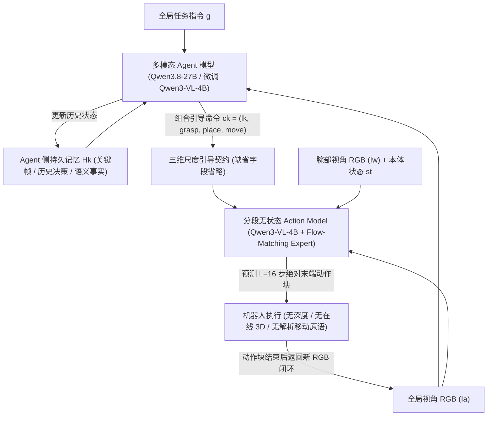
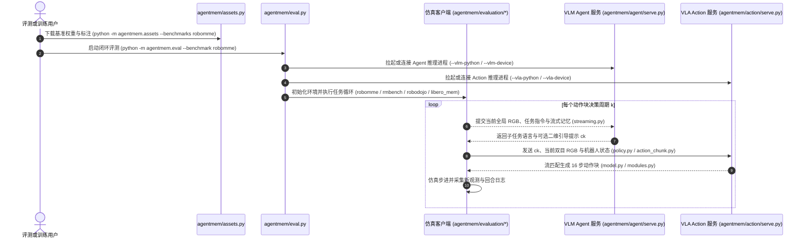

# 2AM: Grounding Agent-Side Memory as Guidance for Steerable Action Models in Long-Horizon Manipulation

## 一句话定义

**2AM（项目主页 2026-11 演进版本称 AgentMem）是一种受控的双模型具身智能体架构：将长程任务记忆完全保存在多模态 Agent 侧，通过「子任务语言 + 可选二维抓取/放置/移动提示」这一组合引导契约，单通道驱动纯 RGB、分段无状态的流匹配动作模型（Action Model）完成全部操作运动。**

## 英文缩写速查

| 缩写 | 英文全称 | 简要说明 |
|---|---|---|
| 2AM | Agent-Side Memory as Guidance for Steerable Action Models | 本文原名；由高层记忆智能体与可引导动作模型构成 |
| AgentMem | Agent-Side Memory with Steerable Action Models | 作者团队于 2026-11 在项目页与开源代码仓采用的扩展版名称 |
| VLA | Vision-Language-Action | 视觉-语言-动作模型，本文作为底层分段无状态运动执行器 |
| VLM | Vision-Language Model | 视觉-语言模型，本文作为维护历史记忆与生成引导命令的 Agent |
| SR | Success Rate | 任务成功率；LIBERO-Mem 区分严格按次停止的 Strict SR 与超调前达标的 Relaxed SR |
| SFT | Supervised Fine-Tuning | 监督微调；文中用于将 27B 零样本 Agent 替换为轻量 `Qwen3-VL-4B` Agent |

## 为什么重要

在长程机器人操作中，传统系统往往面临两条导致性能归因混乱的路线：

1. **记忆塞入策略内部**：在示范训练的 VLA 内加入视觉历史或循环隐状态，虽然能保存过去信息，但也会在失败重试时把当前控制耦合进先前失败轨迹的潜状态中。
2. **工具箱过度扩张与低带宽语言接口**：将 VLA 与解析几何工具、深度感知、轨迹规划器或专属技能混用，多组件共享运动控制权，使得增益究竟来自额外传感、替代运动原语还是 VLA 本身无法剥离；同时，纯文本子任务指令往往遗漏「抓哪一个实例、放到哪个具体位置」的消歧信息，掩盖了动作模型本已具备的底层运动能力。

2AM 通过**故意收窄工具与传感边界、同时提高 Agent-to-Action 接口带宽**，给出了一组可独立验证的对照证据：任务记忆可以完全留在 Agent 侧，但前提是接口必须具备足够的物理意图绑定精度。

## 核心信息

| 字段 | 内容与核查结果 |
|---|---|
| 作者 | Yutong Hu, Fengjiao Chen, Xuezhi Cao, Renaud Detry（2026-11 项目页 AgentMem 版另列 Xiangming Zhu） |
| 机构 | KU Leuven、美团（Meituan Inc.）、Flanders Make@KU Leuven（AgentMem 版另列上海交通大学） |
| 发表时间 | 2026-09-10（arXiv v1）/ 2026-11-02（arXiv v2）；2026-11 项目页更新为 AgentMem 扩展版 |
| 论文链接 | [arXiv:2609.11308](https://arxiv.org/abs/2609.11308) · [HTML 全文](https://arxiv.org/html/2609.11308) |
| 项目与代码 | [项目主页](http://agent-mem-action-model.github.io) · [GitHub 仓库 (AgentMem-Action-Model)](https://github.com/utomm/AgentMem-Action-Model) · [Hugging Face 模型与标注](https://huggingface.co/collections/you2who/agentmem-models-and-annotations-6b07deecb14d1c8e0abb5070) |
| 清单分类 | `harness.memory`（来源条目 `survey_ax_2609_11308`） |
| 开源状态 | **已开源**（仓库以 `CC-BY-4.0` 发布 `agentmem/` 训练与评测代码及 4 个基准模型权重与标注） |

## 核心原理

### 1. 受控部署边界与双时钟分工（§2.1–2.2）

2AM 在部署通路中施加严格的信息隔离：系统仅接收全局任务指令 $g$、全局视角 RGB $I^a$、腕部 RGB $I^w$ 与机器人本体状态 $s_t$；**禁止传入**深度图、在线分割掩码、物体位姿、像素-3D 反投影或任何针对特定物体的解析式运动规划，所有任务相关运动均必须经过同一 Action Model。

两个模型按不同时间尺度运行：

1. **Agent Model（按动作块周期 $k$ 更新）**：持有并整合有限历史记录 $H_k$（筛选后的关键视觉观测、已下发命令与可见执行结果），维护对象身份、目标位置、重复计数与语义阶段等慢变量，生成引导命令：
   $$c_k = \mathrm{AM}_{\mathrm{agent}}(g, I_k^a, H_k)$$
   在 2026-11 项目页的 AgentMem 修订版中，$H_k$ 进一步显式结构化为**历史关键帧（Visual Evidence）**、**已下发子目标历史（Decision History）**与**紧凑语义事实（Persistent Semantics）**三类外置记录。
2. **Action Model（在长度 $L=16$ 的动作块内高频执行）**：完全不接触 $H_k$，也不在跨 Agent 调用间保留任何回合潜状态（episodically stateless），仅依据当前双视角 RGB、本体状态 $s_t$ 与引导命令 $c_k$ 预测绝对末端执行器动作序列：
   $$\hat{a}_{t:t+L-1} = \mathrm{AM}_{\mathrm{action}}(I_t^a, I_t^w, s_t, c_k)$$
   论文实现采用 `Qwen3-VL-4B` 作为 VLM 主干，配合流匹配（flow-matching）Action Expert 输出 16 步动作块，保留完整接近几何、腕部对齐、夹爪闭合、避障与释放控制权。

### 2. 三尺度组合引导契约（§2.3, Table 1）

引导命令定义为一个四元组，其中坐标均处于当前全局视角图像的归一化空间 $[0, 1000]^2$（左上角为原点），**不可用字段直接省略**而非填充占位坐标：

$$c_k = \left(\ell_k, q_k^{\mathrm{grasp}}, q_k^{\mathrm{place}}, q_k^{\mathrm{move}}\right)$$

| 接口字段 | 回答的问题 | 典型有效时间窗 | 不负责的内容 |
|---|---|---|---|
| 语言指令 $\ell_k$ | 执行什么行为？ | 当前语义阶段 | 相同类别多实例的视觉消歧 |
| `grasp_target` ($q_k^{\mathrm{grasp}}$) | 下一步抓哪个物体？ | 物理接触之前（抓起后须移除） | 具体抓取姿态与接触几何 |
| `place_target` ($q_k^{\mathrm{place}}$) | 放到哪个目标位置？ | 跨整个搬运过程（应对腕部遮挡/视野受限） | 完整无碰撞搬运路径 |
| `move_target` ($q_k^{\mathrm{move}}$) | 近期向哪移动有利？ | 未来若干步的局部方向线索 | 必须严格贴合的完整轨迹 |

这种可组合设计使同义重复阶段可以复用同一句文本指令（如 `"place the bowl on the plate"`），而由 `grasp_target` 与 `place_target` 随历史状态切换具体绑定对象与目的地；同时在接近阶段可启用「语言+抓取+移动」，搬运阶段撤销 `grasp_target`（避免残余抓取点把夹爪拉回原点）并保留 `place_target` 与 `move_target`。

### 3. 无模型教师离线标注与抗噪引导训练（§3.1–3.2）

为避免依赖 VLM 自动解说引入标注噪声，2AM 直接从同步示教日志（阶段标签、物体包围盒/掩码、夹爪接触、物体运动与机器人末端投影轨迹 `robot_xy`）进行确定性规则恢复，且特权标注仅用于离线训练：

- **物体点位监督**：对可见物体包围盒 $(x, y, w, h)$ 取图像归一化中心 $q = 1000\left(\frac{x+w/2}{W}, \frac{y+h/2}{H}\right)$ 作为语义靶点（不强求其为最优物理接触点，仍由策略学出真实抓取构型）。
- **未来窗口运动监督**：以均匀采样偏移 $\Delta \sim \mathcal{U}\{10, \dots, 20\}$ 取末端投影位置 $q_t^{\mathrm{move}} = \texttt{robot\_xy}_{t+\Delta}$（回合末裁剪），防止策略绑定固定时间步长并适配在线 Agent 延迟；动作块窗口允许跨越子任务标签边界，保持动作连续性。
- **针对三类在线误差的鲁棒训练**：
  1. **非空结构化条件随机掩码（Structured hint dropout）**：从可用字段掩码 $v_t \in \{0,1\}^4$ 中采样 $m_t \preceq v_t$ 且满足 $\|m_t\|_0 \ge 1$，混合产出纯语言、纯点位及任意子集组合样本；
  2. **各向同性高斯坐标噪声**：$\widetilde{q} = \operatorname{clip}_{[0,1000]^2}(q + \epsilon)$，$\epsilon \sim \mathcal{N}(0, \sigma^2 I_2)$，容忍 Agent 定位偏差；
  3. **未来窗口随机化**，容忍时间抖动。

## 流程总览

## 源码运行时序图

官方仓库以 `agentmem/assets.py` 拉取 Hugging Face 模型与标注集合，并通过统一入口 `agentmem/eval.py` 调度隔离的 Python 虚拟环境分别运行 `agentmem/agent/serve.py`（VLM Agent 记忆与引导推理）、`agentmem/action/serve.py`（基于 `policy.py` 与 `action_chunk.py` 的流匹配动作模型服务）以及 `agentmem/evaluation/` 下对应四个基准的客户端；训练侧则由 `agentmem/agent/train.sh` 调用 `DeepSpeed ZeRO-2` 与 `Qwen3-VL-4B-Instruct` 对 `configs/agentmem/*.json` 执行 LoRA 微调。

## 实验与评测

### 1. LIBERO-Mem 全量对比与接口带宽消融（arXiv v2, Table 2–3）

实验在 **LIBERO-Mem** 的 10 项长程记忆操作任务（涵盖物体运动 M、重复序列 S、关系 R 与遮挡 O）上评测，采用三项指标：**Strict SR**（严格按正确顺序与重复次数停止，多做一轮即失败）、**Relaxed SR**（在后续超调前曾完整达到目标状态）与 **Completion**（有序子目标完成比例）。

| 方法与 Agent 配置 | Strict SR (%) | Relaxed SR (%) | Completion (%) | 说明 |
|---|---|---|---|---|
| 文献公开最佳基线（SlotSSM） | `0.00` | `–` | `14.80` | 原文报告 $\pi_0$ 与 SlotVLA 平均仅 `5.0%` |
| 对齐复现 $\pi_0$（Qwen3-VL-4B, 16 步块） | `12.25` | `37.42` | `70.79` | 与 2AM 共享同款主干、双 RGB 与块长 |
| 纯语言接口消融（Qwen3.8-27B, 零样本） | `7.25` | `19.42` | `53.72` | 保留同款 Agent 记忆，仅移除全部 2D 提示 |
| **2AM 原版零样本（Language + hints, Qwen3.8-27B）** | `11.83` | `63.00` | `76.29` | 相对纯语言消融 Relaxed SR +43.58 pp |
| 2AM SFT 轻量版（Language + hints, Qwen3-VL-4B） | `31.90` | `62.20` | `80.44` | 以更小参数量显著缓解过冲停机难题 |

- **分任务结构差异（Table 2）**：原版 2AM 在 **全部 10 个任务** 上 Relaxed SR 均超越对齐复现 $\pi_0$，在 **7 个任务** 上 Completion 更高。在关系与遮挡任务 `T7–T10` 上 2AM 优势尤为突出（例如 `T9 Center occupied basket` 达 `47.50%` Strict/Relaxed SR，而复现 $\pi_0$ 为 `0.00%`）；但在重复计数任务 `T1–T6` 中，原版零样本 2AM 的 Strict SR 反而低于复现 $\pi_0$（例如 `T1 Bowl lift-and-return` 为 `1.67%` vs `30.83%`），表明零样本大模型虽能推进目标达成，却经常在完成后继续多做动作导致严格成功失败。

### 2. 项目主页扩展版（2026-11 AgentMem 修订版）补充实测

项目主页记录了将同一配方分别训练并扩展至 4 个仿真基准（共 42 项任务）及真机平台后的系统性数据（注：该部分数据来自项目主页 2026-11 修订版而非 arXiv v2 正文）：

- **四基准全量结果（单基准独立模型、统一训练配方）**：
  - RoboMME（16 任务）：`70.13%` SR；
  - RMBench（9 任务通用子集，不含 Place-Mat）：`62.33%` SR；
  - LIBERO-Mem（10 任务）：`77.07%` Completion；
  - RoboDojo-Mem（6 任务）：`30.33%` SR。
- **记忆 × 引导正交消融（RoboMME 与 RMBench 的 6 任务子集，3 种子 × 50 次）**：
  - 无持久记忆 + 纯语言：`17.78 ± 1.58%`；
  - 无持久记忆 + 引导提示：`23.78 ± 1.84%`；
  - 完整记忆 + 纯语言：`22.89 ± 0.77%`；
  - **完整记忆 + 引导提示：`67.00 ± 1.53%`**（仅保留语义文本事实而去掉历史图像时为 `56.89%`，说明历史图像关键帧额外带来 `10.1` 个百分点增益）。
- **真机实验（成功次数 / 总次数）**：在 3 项真机记忆任务上对比 $\pi_{0.5}$ / $\pi_{0.5}$·8 frames / AgentMem：
  - Cup Reveal（遮挡前记忆）：`5/15` / `5/15` / **`9/15`**；
  - Block Swap（身份与进度记忆）：`0/15` / `15/15` / **`15/15`**；
  - Pattern Lock（现场人手演示新序列）：`0/16` / `0/16` / **`15/16`**。

## 与其他工作对比

| 对比维度 | 策略内记忆路线（如 MemoryVLA / SlotSSM） | 纯文本分层记忆路线（如 MemER / PrediMem） | 复杂工具箱智能体（如 RoboClaw / Harness VLA） | 2AM / AgentMem |
|---|---|---|---|---|
| 记忆存放位置 | 策略内部循环状态或历史帧缓存 | 高层 VLM 关键帧检索 | 外部状态图/工作记忆树 | 严格独占于多模态 Agent 侧 |
| 高层-底层接口 | 隐状态直连 | 纯文本子任务指令 | 技能/MCP 工具或解析运动原语 | 子任务语言 + 可选 2D `grasp`/`place`/`move` 提示 |
| 底层动作模型形态 | 需改造为带历史输入的策略 | 分段 VLA | 多工具与多策略协同 | 单一纯 RGB 分段无状态流匹配 VLA |
| 归因清晰度 | 记忆与运动耦合，难区分重试失败原因 | 受限于语言指代歧义，易低估策略能力 | 多运动原语并发，难归因至单一 VLA | 剥离深度与替代运动工具，专注检验接口带宽 |

## 结论

**一句话总判：2AM 用严格的受控消融证明，长程操作所需的任务记忆不必塞进底层动作策略，但前提是高层 Agent 与底层 VLA 之间必须拥有超越纯文本的二维物理意图绑定接口。**

1. **接口带宽决定策略表现上限** — 固定同一记忆与执行栈，在语言指令之外加入二维 `grasp`/`place`/`move` 提示，就将 LIBERO-Mem 的宽松成功率从 `19.42%` 拉升至 `63.00%`（+43.58 pp），证明此前大量失败并非底层不会抓放，而是纯语言未说清「抓谁、放哪」。
2. **记忆与引导缺一不可** — 项目页 6 任务正交消融表明，只有记忆没有二维引导仅得 `22.89%`，只有二维引导没有持久记忆仅得 `23.78%`，两者同时具备才跃升至 `67.00%`。
3. **训练期抗噪契约防止双模型接口脆断** — 非空随机条件掩码、坐标高斯噪声与未来窗口采样让单一动作模型同时兼容缺失提示、定位漂移与异步延迟。
4. **「会做不会停」是当前核心短板** — 零样本 27B Agent 虽取得 `63.00%` 宽松成功率，严格成功率仅 `11.83%`；改用监督微调的 `Qwen3-VL-4B` Agent 后严格成功率翻倍至 `31.90%`，说明语义终止判定更依赖贴合任务的轻量微调而非一味扩大零样本模型参数。

## 工程实践

- **依赖隔离部署**：官方仓库将训练（`.venv-train`）、Agent 推理（`.venv-agent`）、Action 推理（`.venv-action`）与各仿真器环境（`environments/` 子模块）拆分为独立虚拟环境，并通过 `agentmem/eval.py` 传入对应 Python 路径与 GPU 设备（`--vlm-device` / `--vla-device`）完成跨进程通信。
- **数据与监督生成规范**：离线标注提取需确保示范日志包含可靠的物体包围盒/掩码与夹爪接触事件；在物体被抓起后及时撤销 `grasp_target` 对防止策略回拉原抓取点至关重要。
- **轻量 Agent 微调收益显著**：实际部署建议参考仓库 `agentmem/agent/train.sh`（默认 8 卡 `DeepSpeed ZeRO-2` 对 `Qwen3-VL-4B-Instruct` 做 3 epoch LoRA），在降低推理延迟的同时直接提升任务终止判断准确率。

## 局限与风险

- **二维提示的表达物理上限**：`[0, 1000]^2` 平面点位无法直接编码被遮挡的三维几何关系、精细接触力状态或依赖高频连续运动历史的技能（如动态插接与柔顺擦拭）。
- **高频高层错误无法靠底层抗噪修复**：论文 Fig. 3 指出，空间噪声与条件掩码只能提高对「点位轻微偏离或缺失」的容忍度，一旦 Agent 选错子任务阶段或绑定了错误目标实例，Action Model 仍会忠实执行错误意图。
- **论文指标与单基准边界**：arXiv v2 论文主文仅在 LIBERO-Mem 单个仿真基准上完成消融，尚未独立量化 `grasp`、`place`、`move` 三种提示各自的边际贡献，亦未系统评估不同引导频率下的计算延迟开销；多基准与真机结果需结合 2026-11 项目页更新版本及开源代码共同核验。

## 关联页面

- [Agentic Robots 综述](paper-towards-agentic-robots-survey.md)
- [全量项目节点清单](../overview/awesome-agentic-robots-node-index.md)
- [VLA 方法背景](../methods/vla.md)
- [智能体机器人操作策略](../methods/agentic-manipulation-policies.md)：对照智能体、机器人接口与执行反馈
- [动作分块执行（Action Chunking）](../methods/action-chunking.md)：对照 16 步动作块预测与跨子任务连续执行
- [Pi0 流匹配 VLA 策略](../methods/pi0-policy.md)：对照本文流匹配动作专家与对齐复现的 $\pi_0$ 基线
- [机器人智能体脚手架（Robot Agent Harness）](../methods/robot-agent-harness.md)：对照高层记忆维护与受控执行接口设计
- [机器人操作任务（Manipulation）](../tasks/manipulation.md)
- [Pi0 实体页](paper-pi0.md)
- [RoboMemArena（PrediMem）](paper-agentic-2605-10921.md)：对照预测编码与关键帧记忆双系统基线
- [RoboClaw](paper-agentic-2603-11558.md)：对照借助 MCP 工具与 EAP 自重置的长程智能体框架
- [Goal2Skill](paper-agentic-2604-13942.md)：对照带验证与恢复的记忆驱动操作智能体
- [ETA / OpenETA](paper-agentic-2608-03924.md)：对照可组合具身能力规划架构
- [SparkVLA](paper-sparkvla.md)：对照显式建模长程停机判定（Stop-Aware）的层次化 VLA

## 推荐继续阅读

- [2AM / AgentMem 官方项目主页](http://agent-mem-action-model.github.io)：查看 112 秒解说视频、四基准扩展结果与真机日志演示
- [AgentMem-Action-Model 官方 GitHub 仓库](https://github.com/utomm/AgentMem-Action-Model)：查阅 `agentmem/agent/` 与 `agentmem/action/` 训练及评测代码
- [Hugging Face 模型与标注集合](https://huggingface.co/collections/you2who/agentmem-models-and-annotations-6b07deecb14d1c8e0abb5070)：获取 RoboMME、RMBench、LIBERO-Mem 与 RoboDojo-Mem 对应 VLM/VLA 权重

## 参考来源

- [2AM（AgentMem）论文原文核对归档](../../sources/papers/paper-agentic-2609-11308.md)
- [2AM / AgentMem 官方仓库核对归档](../../sources/repos/paper-agentic-2609-11308.md)
- [官方 Awesome 快照归档](../../sources/repos/awesome-agentic-robots-survey-index.md)
- [arXiv:2609.11308 原文](https://arxiv.org/abs/2609.11308) · [HTML 全文](https://arxiv.org/html/2609.11308)
- [GitHub 官方仓库](https://github.com/utomm/AgentMem-Action-Model)
