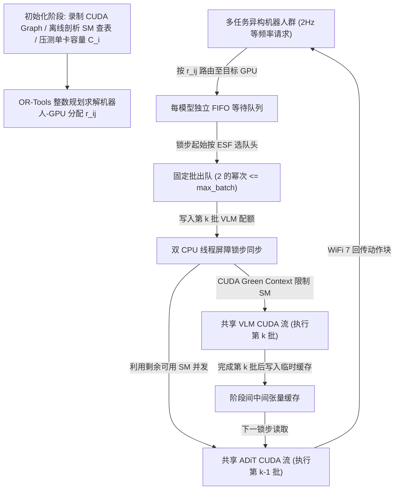

# Efficient Vision-Language-Action Management and Serving for Robot Factories

## 一句话定义

**Robion** 是首个面向机器人工厂多卡本地边缘服务器、满足严格服务等级目标（SLO）的多机器人与多视觉-语言-动作（VLA）模型服务及管理系统，通过单卡双流阶段解耦、锁步受保护动态 SM 划分与整数规划流量控制提升并发服务规模。

## 英文缩写速查

| 缩写 | 英文全称 | 简要说明 |
|---|---|---|
| VLA | Vision-Language-Action | 结合视觉观测与语言指令生成机器人动作块的两阶段策略模型 |
| VLM | Vision-Language Model | VLA 的第一阶段，属于算力密集型视觉-语言特征编码模块 |
| ADiT | Action Diffusion Transformer | VLA 的第二阶段，属于访存密集型的多步扩散动作生成模块 |
| SLO | Service-Level Objective | 机器人安全与实时控制要求下每条推理请求的端到端延迟上限 |
| SM | Streaming Multiprocessor | GPU 流式多处理器；Robion 在锁步起始限制 VLM 流可用的 SM 数 |
| ESF | Earliest-SLO-First | 最早 SLO 截止优先调度策略，用于多模型共置时的队列选择 |
| SLO-AT / SLO-MR | SLO Attainment / SLO Miss Ratio | 满足延迟截止的请求占比（达成率）与超时违约率 |

## 为什么重要

1. **机载部署与工厂规模化的矛盾：** 机器人端受重量、成本、散热与供电限制难以装配高端 GPU；机载嵌入式 GPU（如 Jetson AGX Thor，70W）相比服务器 GPU 延迟高出约 $3\times$，且会缩短电池续航达约 45%。将推理卸载到本地边缘服务器成为机器人工厂的现实路径。
2. **传统多阶段服务系统在毫秒级 VLA 上失灵：** 典型 VLA（1–5B 参数，权重约 10 GB）由计算密集型 VLM 与访存密集型 ADiT 构成，单阶段仅持续数毫秒（ADiT 每步 1–2 ms）。以 vLLM-Omni 为代表的跨卡吞吐型系统若跨卡拆分会浪费大量算力（$\pi_0$ 在 RTX 6000 Pro batch 4 下 VLM/ADiT Tensor Core 利用率仅 52% 与 15%）；若放回单卡，其每步扩散对阶段间缓存的轮询开销又占到总延迟的 30–35%。
3. **补齐多模型共置与多卡流量分配短板：** 现有机器人基础设施（如 ROSA、Kairos、Armory）未在请求级 SLO 约束下解决单卡内阶段并发与多模型 GPU 共享问题。Robion 从“内核级并发控制”和“集群级流量塑形”两层打通，单张高端卡（RTX 6000 Pro）即可在 $\ge 98\%$ SLO 达成率下平均服务约 20 台机器人，硬件成本相对逐机配嵌入式 GPU 降低约 $6.8\times$。

## 核心信息

| 项目 | 详情 |
|---|---|
| **作者** | Dionysios Adamopoulos, Nattapol Chanpaisit, Basel Fakhri, Christina Giannoula |
| **机构** | Max Planck Institute for Software Systems（马克斯·普朗克软件系统研究所） |
| **发表时间** | 2026-09-10（arXiv:2609.12075v1） |
| **论文链接** | [arXiv:2609.12075](https://arxiv.org/abs/2609.12075)（[HTML 全文](https://arxiv.org/html/2609.12075)） |
| **项目与代码** | 未确认开源代码（截至 2026-11-27 论文原文及索引均未提供独立项目页或 GitHub 地址） |
| **清单分类** | `harness.infrastructure`（条目 `survey_ax_2609_12075`） |
| **开源状态** | **未确认开源代码**（仅发布 arXiv 论文，未发现官方代码仓库或权重释放入口） |

## 核心原理

Robion 由运行在单张 GPU 上的 **Robion Serving Engine（服务引擎）** 与跨卡管理的 **Robion Management Engine（管理引擎）** 组成。

### 1. 固定批大小卡内阶段解耦（Fixed-Batch Intra-GPU Stage Disaggregation）

- **双异步流隔离：** 在单张 GPU 上开辟两条异步 CUDA 流（VLM 流与 ADiT 流），针对彼此独立的请求批次并行执行计算密集型 VLM 与访存密集型 ADiT，充分利用异构硬件资源。
- **阶段起始固定批处理与 CUDA Graph：** 放弃每步去噪检查队列的连续批处理（continuous batching），仅在阶段开始时接纳固定大小批次（取不超过 `max_batch` 的最大 2 的幂次，默认 `max_batch = 2`），直接消除每 1–2 ms 一次的缓冲区轮询和 KV 缓存重打包开销。同时在初始化阶段为所有 `(stage, batch_size)` 组合预录制 CUDA Graph，消除内核 CPU 启动延迟。

### 2. 锁步与受保护动态空间 SM 划分（Guarded & Dynamic SM Partitioning on Locksteps）

- **避免大核阻塞与抢占损失：** VLM 内核线程块数量庞大，不加约束时会占满全部 SM，阻塞线程块很少的 ADiT 内核并发；若在执行中途动态调整 SM 配额，则会触发 CUDA Graph 失效或强制重启已执行进度。
- **双线程锁步（Locksteps）：** 由两个 CPU 线程分别向 VLM 流与 ADiT 流提交任务并通过线程屏障对齐：第 $k$ 个锁步中，VLM 流处理第 $k$ 批（批大小 $b_k$），ADiT 流同时处理上一锁步已产出中间张量的第 $k-1$ 批（批大小 $b_{k-1}$）。
- **受保护动态 SM 配额：** 利用 **CUDA Green Contexts**（AMD GPU 上可使用执行上下文）在每个锁步**起始处**一次性限制 VLM 流可用的 SM 上限，保证其余 SM 始终可供 ADiT 立即并发启动，同时无需把全卡严格切分为互不重叠的两半（避免非 8 倍数总 SM 数如 188 SM 被向下取整造成闲置）。初始化期枚举 $O(U^2 \cdot \log(\text{max\_batch})^2)$ 种（共置架构数 $U$ 与批大小）组合，以 GPU 硬件粒度（如 8 SM 倍数）离线剖析生成最短锁步耗时查表配置（例如 188 SM 设备上 $(1,1)\to 152$ SMs、$(2,1)\to 176$ SMs、$(2,2)\to 168$ SMs）。

### 3. SLO 感知双流多模型共置（SLO-Aware Dual-Stream Multi-Model Serving）

- 单卡共置多个 VLA 模型时（每个模型权重约 10 GB，远低于 80–96 GB 显存），所有模型共享同一对 VLM 流与 ADiT 流：每个锁步只并发一个 VLM 批和一个 ADiT 批，既避免同类阶段互相争抢相同硬件瓶颈，也绕开了针对 8–10 $\mu\text{s}$ 短内核进行用户态拦截调度的高昂开销。
- 每个模型维护独立 FIFO 等待队列，在每个锁步起始计算各队列队头请求的**剩余 SLO 时间**（$\text{SLO 期限} - \text{已等待时间}$），按 **Earliest-SLO-First（ESF）** 选择剩余时间最短的队列出队进入 VLM 流。

### 4. 灵活模型放置与整数规划流量控制（Management Engine）

- **灵活放置：** 支持单卡共置同构微调变体或异构架构、跨卡复制模型，以及将多卡划分为**不相交 GPU 分组**（每组专用于单一 VLA 架构的微调变体，避免异构模型阶段耗时差异带来的锁步等待气泡）。
- **自适应流量控制器：** 初始化压测得到模型 $m_i$ 在单卡上满足目标 SLO 达成率（如 98%）的最大机器人容量 $C_i$。给定第 $i$ 类模型机器人总数 $N_i$ 与请求频率 $f_i$，采用 **Google OR-Tools** 求解整数规划得到各卡分配机器人数 $r_{ij}$（未部署 $m_i$ 的卡取 $r_{ij}=0$）：
  $$\sum_{1 \le j \le G} r_{ij} = N_i, \qquad \sum_{1 \le i \le M} \frac{r_{ij}}{C_i} \le 1$$
  $$\min \left( \sum_{1 \le j \le G} \sum_{1 \le i < k \le M} r_{ij} r_{kj} \right)$$
  该目标函数惩罚同一张卡混合服务多个模型，促使控制器优先将每个模型的流量集中到单卡队列以放大单卡批大小，仅在超出单卡容量 $C_i$ 时向其他副本卡分流。

## 流程总览

## 源码运行时序图

**不适用**（核查结果：截至 2026-11-27，arXiv:2609.12075v1 原文及官方索引条目均未提供独立项目页或可运行的官方源码仓库，故无法核对具体源码文件入口与调用时序）。

## 实验与评测

实验采用 4 个 VLA 架构：$\pi_0$（PI0）、SmolVLA（SVLA）、GR00T N1.5（GR15）与 Xiaomi-Robotics-0（XR0），图像与语言输入采样自 LIBERO 数据集，默认请求频率 $f=2\text{ Hz}$；SLO 期限设定为同模型在机载 **Jetson AGX Thor（70W）** 上的推理延迟（**PI0 156 ms、XR0 117 ms、SVLA 50 ms、GR15 53 ms**），端到端延迟包含服务器推理延迟与 WiFi 7 网络延迟。硬件平台为 $4\times$ NVIDIA RTX 6000 Pro Blackwell（96 GB，188 SMs）与 $4\times$ NVIDIA H100（80 GB），对比基线为 **Monolithic**（单流水线顺序执行两阶段）和 **vLLM-Omni**（跨进程阶段解耦）。

### 1. 单模型单卡服务与消融（§5.2）

- **对比基线（Fig. 6）：** 在 98% SLO-AT 约束下，Monolithic 平均可承载比 vLLM-Omni 高 $4.4\times$ 的机器人负载（后者因每步扩散轮询开销占总延迟 30–35% 而严重劣化）。Robion 在 Monolithic 饱和前最大负载处的 P99 延迟平均低 **$1.4\times$**；在 98% SLO-AT 下平均可服务比 vLLM-Omni 高 **$6.7\times$**、比 Monolithic 高 **$1.5\times$** 的机器人负载，单卡平均可服务 **20 台**机器人。
- **机制消融（Fig. 7 & Fig. 8）：**
  - 在 PI0（20 台）和 XR0（24 台）高负载下，Monolithic 的 SLO-AT 均为 **0%**；仅开卡内阶段解耦升至 **56% / 39%**；若采用互不重叠的不相交 SM 划分（188 SM 需按 8 的倍数向下取整至 184 SM，浪费 4 个 SM）为 **67% / 85%**；加入受保护动态 SM 划分后达到 **82% / 89%**。
  - `max_batch=1` 在 PI0 超过 14 台机器人时 SLO-AT 急剧下降，而 `max_batch=2` 在 18 台下仍维持 98% SLO-AT；若将 VLM SM 静态固定在 96/188，4 个模型在 98% SLO-AT 下平均可服务负载下降约 **18%**。

### 2. 单卡多模型共置与队列调度（§5.3）

- 在单卡共置多款同构或异构模型、总计最多 18 台机器人的均衡与偏斜负载组合中，vLLM-Omni 全部饱和（100% SLO-MR），Robion 的 SLO 违约率（SLO-MR）平均比 Monolithic 低 **$2.1\times$**。
- 队列选择策略对比（Fig. 10）：在架构或 SLO 期限存在差异时，ESF 相比轮询（RR）和最大队列优先（LQF）平均 SLO-AT 分别高出 **$1.06\times$** 与 **$1.07\times$**。

### 3. 多卡放置、流量控制与云边对比（§5.4–§5.5）

- **流量控制对比（Fig. 11）：** 4 卡服务器运行 4 个微调变体（请求频率 1/2/2/4 Hz；单卡上限分别为 PI0 `(27, 16, 16, 9)`、XR0 `(32, 22, 22, 12)`）。Robion 流量控制器相比单模型独占单卡（SMG）和跨卡均匀切分（EPS）平均分别减少 **$8.2\times$** 与 **$4.4\times$** 的 SLO 违约（如 PI0 `(8,8,8,24)` 时 SMG 违约率达 70%，而 `(28,16,16,8)` 时 EPS 违约率为 SMG/Robion 的 $4.1\times$）。
- **8 模型大规模与放置策略（Fig. 12 & Fig. 13）：** 4 卡服务 8 个变体（4 PI0 + 4 XR0）时，按架构划为不相交 GPU 分组（`Best-Group`）始终优于全混合共置（`Mix`），可在 98% SLO-AT 下服务多达 **64 台**机器人。在 PI0 4 卡部署中，Robion 卡内解耦+4 卡复制可服务 **72 台**（98% SLO-AT），优于最佳跨卡阶段解耦方案 `Dis-3:1`（3 张卡跑 VLM、1 张卡跑 ADiT）的 **60 台**。
- **云端 vs 边缘（Fig. 14）：** 4 模型各占 1 卡且每模型服务 24 台机器人时，云端因网络延迟较高，SLO-AT 在 $4\times$ RTX 6000 Pro 与 $4\times$ H100 上分别比本地边缘（WiFi 7）低 **23.6%** 与 **18.4%**；边缘侧 $4\times$ H100 可在 98% SLO-AT 下服务每模型 24 台（约 $2\times$ 硬件成本），而 $4\times$ RTX 6000 Pro 为每模型 16 台。

## 与其他工作对比

| 系统 / 方案 | 解耦与共享粒度 | 优化目标 | 多模型多卡支持 | 与 Robion 差异（依据原文 §2.5、§5、§6） |
|---|---|---|---|---|
| **Robion（本文）** | 单卡双流锁步 + 动态受保护 SM 划分 | 请求级 SLO 达成率 | 共享双流多模型 + 分组放置 + IP 流量控制 | 针对毫秒级 VLA 设计，单卡负载比 vLLM-Omni 高 $6.7\times$、比 Monolithic 高 $1.5\times$ |
| **vLLM-Omni / M* / SGLang-Omni** | 跨进程 / 跨 GPU 阶段解耦 + 连续批处理 | 百毫秒级系统吞吐 | 支持跨卡部署 | ADiT 每步缓存轮询占 VLA 延迟 30–35%，跨卡拆分利用率低（ADiT 仅 15%） |
| **Monolithic（单流水线）** | 单流水线串行执行 VLM 与 ADiT | 简单推理部署 | 无跨阶段/SLO 细粒度共享 | 无法重叠计算密集型 VLM 与访存密集型 ADiT，高并发下饱和快 |
| **ROSA / Kairos / Armory** | 视 VLA 为单一整体阶段 | 集群放置 / 减动作数 / 公平调度 | ROSA 负责异构模型集群放置 | 不做卡内两阶段资源互补并发，也不优化单卡 SM 级共享 |
| **Orion / Tally / Reef 等内核调度** | 内核级（kernel-level）拦截调度 | 通用 DNN 多租户共享 | 单卡多模型 | 每次内核发射引入数微秒拦截开销，无法被 8–10 $\mu\text{s}$ 级的 VLA 短内核摊薄 |

## 结论

**一句话总判：Robion 证明了在本地多卡边缘服务器上服务毫秒级两阶段 VLA 模型，必须放弃面向百毫秒级吞吐的跨卡解耦与连续批处理，转而采用卡内固定批锁步、受保护动态 SM 划分及集中排队优先的流量调度。**

1. **避免对 VLA 使用跨卡解耦或连续批处理：** ADiT 单步仅 1–2 ms，跨进程轮询缓存会吞噬 30–35% 延迟；`max_batch=2` 的阶段起始固定批处理 + CUDA Graph 才是低尾延迟的关键。
2. **用“受保护 SM 上限”代替“硬切分互不重叠 SM”：** 通过 CUDA Green Contexts 在锁步起点只限制 VLM 流 SM 上限，既保证 ADiT 随时拿到剩余 SM，又避免非 8 倍数 SM GPU（如 188 SM）向下取整造成硬件闲置。
3. **跨架构不要强行单卡混合共置：** 不同 VLA 架构的阶段耗时差异会在锁步同步点产生等待气泡，多卡集群应优先按架构划分不相交 GPU 分组，仅在组内共置同架构微调变体。
4. **多卡流量路由应“先集中、后溢出”：** 将同一模型的请求集中到单卡队列能显著提升批处理机会，只有在单卡负载接近压测上限 $C_i$ 时再将溢出流量分摊到副本卡。
5. **工厂部署优先本地边缘服务器而非公有云：** 尽管云端可使用更高端 GPU，但云网往返延迟在 24 台/模型负载下会使 SLO 达成率下降 18.4%–23.6%。

## 工程实践

- **初始化与重算时机：** 在 4 卡 8 模型场景下，CUDA Graph 捕获约 4 分钟、SM 查表剖析约 3 分钟、单卡容量压测约 1 小时（多卡并行）、OR-Tools CP-SAT 求解约 10 秒。仅当模型集合、`max_batch` 或 GPU 型号改变时才需重跑 SM 剖析和容量压测；机器人数量调整只需 10 秒重跑流量求解器。
- **参数建议：** 通用边缘部署可设默认 `max_batch = 2`（在测试中兼顾批效率与 SLO）；多模型共置时务必开启 **ESF** 队列策略以保护短期限任务（如 50 ms 期限的 SmolVLA）。
- **硬件选型权衡：** 单卡 96 GB RTX 6000 Pro 在 98% SLO-AT 下可服务约 16–20 台机器人；若单模型并发要求更高（如 24 台/模型），可选用 H100（成本约 $2\times$）。

## 局限与风险

- **初始化离线压测耗时较长：** 确定单卡容量 $C_i$ 的模拟流量压测在 8 模型规模下需约 1 小时，对于频繁上线全新微调架构或动态扩缩模型品种的产线仍偏重。
- **强依赖静态周期流量假设：** 当前流量控制器在初始化期依据固定请求频率 $f_i$ 与机器人数 $N_i$ 求解静态分配 $r_{ij}$，对于突发事件触发、任务动态切换导致频率剧烈波动的工厂场景尚需在线重调度机制。
- **未评估闭环物理执行成功率影响：** 实验基于 LIBERO 输入生成请求并结合 WiFi 7 网络模型评测系统侧延迟与 SLO 达成率，未在真机或闭环仿真器中验证极端尾延迟抖动对实际抓取装配任务成功率的直接影响。
- **未公开官方实现：** 截至 2026-11-27 尚未确认开源代码与硬件驱动兼容细节（如依赖支持 CUDA Green Contexts 的较新 NVIDIA 驱动与 CUDA 版本）。

## 关联页面

- [Agentic Robots 综述](paper-towards-agentic-robots-survey.md)
- [全量项目节点清单](../overview/awesome-agentic-robots-node-index.md)
- [VLA 方法背景](../methods/vla.md)
- [机器人智能体执行框架](../methods/robot-agent-harness.md)：对照规划、执行接口与反馈机制。
- [AI 模型服务与推理架构](../methods/ai-model-serving-inference.md)：对照高并发模型服务调度、批处理与资源隔离机制。
- [动作分块（Action Chunking）](../methods/action-chunking.md)：理解 VLA 输出动作块长度与 2 Hz 周期调用背后的控制节拍。
- [π₀ 策略（Pi0 Policy）](../methods/pi0-policy.md)：本文重点评测与剖析的代表性两阶段 VLA 架构。
- [机器人操作（Manipulation）](../tasks/manipulation.md)：文中 LIBERO 评测数据与工业装配/分拣操作场景背景。

## 推荐继续阅读

- [Efficient Vision-Language-Action Management and Serving for Robot Factories（arXiv:2609.12075）](https://arxiv.org/abs/2609.12075) — 论文摘要页与 PDF/HTML 原文入口。
- [ROSA: A Robotics Foundation Model Serving System for Robot Factories（arXiv:2607.01088）](https://arxiv.org/abs/2607.01088) — 同面向机器人工厂的异构基础模型集群放置系统，与 Robion 在单卡阶段并发层面互补。

## 参考来源

- [Robion 论文原文核对归档](../../sources/papers/paper-agentic-2609-12075.md)
- [官方 Awesome 快照归档](../../sources/repos/awesome-agentic-robots-survey-index.md)
- [arXiv:2609.12075 论文主页](https://arxiv.org/abs/2609.12075) 与 [HTML 全文](https://arxiv.org/html/2609.12075)
