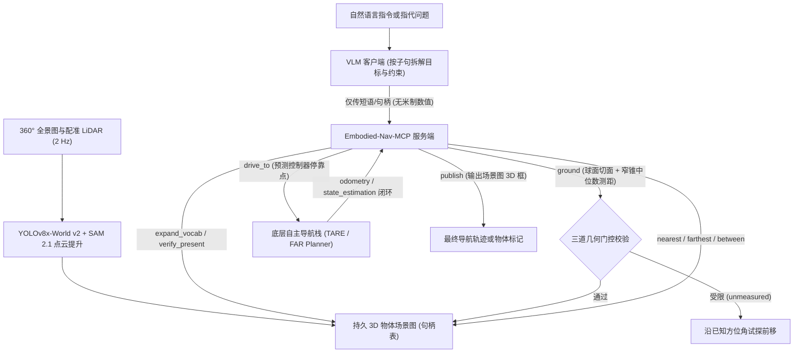
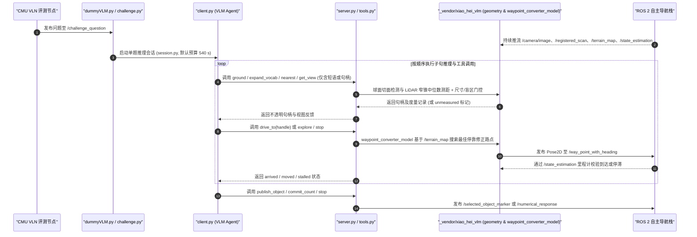

# AnchorVLN: Geometry-Anchored Vision-Language Grounding Reasoning for Open-Vocabulary Navigation

## 一句话定义

AnchorVLN（实现为 `Embodied-Nav-MCP`）是一种面向未知室内环境的开放词汇视觉–语言导航系统，通过 Model Context Protocol（MCP）在接口层面强制隔离语义推理与米制几何：VLM 仅传递语言短语与不透明物体句柄，LiDAR 场景图负责所有 3D 测距、空间比较推理及底层控制器停靠点预测。

## 英文缩写速查

| 缩写 | 英文全称 | 简要说明 |
|---|---|---|
| VLN | Vision-Language Navigation | 视觉–语言导航任务：在无预建地图下依自然语言指令导航至目标或沿指定路径行驶 |
| VLM | Vision-Language Model | 视觉–语言大模型：在 AnchorVLN 中负责语义解析、子句拆解与 2D 像素框落地，不输出米制坐标 |
| MCP | Model Context Protocol | 模型上下文协议：用于标准化 VLM 客户端与机器人感知/运动工具服务器之间的类型化接口边界 |
| nDTW | Normalized Dynamic Time Warping | 归一化动态时间规整：衡量机器实际轨迹与参考轨迹对齐程度的导航指标 |
| IoU | Intersection over Union | 交并比：用于检测框去重（2D NMS）以及物体指代任务中 3D 边界框命中判定（阈值 ≥ 0.1） |
| AABB | Axis-Aligned Bounding Box | 轴对齐边界框：在持久场景图与对象标记输出中用于表征 LiDAR 聚类后的物体空间范围 |

## 为什么重要

多模态大模型在开放词汇识别、指代表达式解析和零样本指令推理方面表现突出，但在直接输出「距离（米）」「方位角（弧度）」或相对空间比较（如「离沙发最近的灯」）等米制物理量时存在系统性幻觉与高置信度误差（实验中模型直接估计距离的中位绝对误差达 2.80 m，甚至劣于恒定猜测 5.0 m）。

现有方案通常面临两难：要么将特定机器人的几何逻辑硬编码进定制管线（跨平台迁移困难），要么放任模型直接生成路点坐标（幻觉坐标会直接驱动底盘撞障或停错位置）。AnchorVLN 将该问题重塑为**接口设计问题**：通过 MCP 工具签名禁止任何数值型几何参数跨过客户端–服务端边界，在不修改底层自主导航控制栈（如 TARE / FAR Planner）的前提下实现可靠的开放词汇导航与物体定位。

## 核心信息

| 字段 | 内容 |
|---|---|
| 作者 | Long Giang Vu*, Chengkai Yao*, Yuxin Liu, FNU Aryan, Rajath Chandrashekar Aralikatti（* 同等贡献） |
| 机构 | 论文署名栏未显式列明机构（仅列邮箱；文中说明与 SysNav 来自同一实验室，评测基于 CMU VLN Challenge 2026 平台） |
| 发表时间 | 2026-09-10（arXiv:2609.12285v1 [cs.RO]） |
| 论文链接 | [arXiv:2609.12285](https://arxiv.org/abs/2609.12285) · [HTML 全文](https://arxiv.org/html/2609.12285) |
| 项目与代码 | [aryanmangal769/embodied-nav-mcp](https://github.com/aryanmangal769/embodied-nav-mcp)（MIT，官方实现）；底层依赖 [ginlov/CMU-VLN-Challenge-2026](https://github.com/ginlov/CMU-VLN-Challenge-2026) |
| 清单分类 | `model.perception` |
| 来源条目 | `survey_ax_2609_12285` |
| 开源状态 | 已开源（含完整 MCP 服务端、VLM 代理客户端、ROS 2 `dummy_vlm` 适配包及 `--fake` 离线测试模式） |

## 核心原理

### 1. 三层权威与两道接口边界

系统严格划分三层权威职责：

1. **VLM 客户端（语义层）**：读取自然语言指令并按序拆分为目的地（destinations）、避让区（keep-outs）与通道（passages，如「穿过电视与床之间」）。客户端只能通过工具签名传递**自然语言短语**或此前工具返回的**不透明句柄**（如 `obj_7`），无法将自行臆造的坐标传入机器人。
2. **Embodied-Nav-MCP 服务端（几何与记忆层）**：内部维护沿用自 SysNav 的持久 3D 物体图（persistent object graph），每条记录保存物体类别、方位、距离、3D 边界范围及地图坐标系位置。服务端负责将句柄解析为度量坐标、执行 LiDAR 点云提升（lifting）与空间比较算术，并针对底层控制器建模。
3. **底层自主导航栈（执行层）**：挑战赛提供的不可修改基础导航模块（基于 Autonomous Exploration Development Environment、TARE 与 FAR Planner），持续发布 360° 全景图 `/camera/image`（1920 × 640）、配准点云 `/registered_scan`、局部地形图 `/terrain_map` / `/terrain_map_ext` 与里程计 `/state_estimation`，并接收 `Pose2D` 路点请求（`/way_point_with_heading`）。

### 2. MCP 工具集设计

论文 Table I 定义了 10 个类型受限的 MCP 工具（实际开源仓库还扩展了面向计数任务的 `get_view`、`stop`、`parse_numerical`、`count_in_view`、`commit_count`、`publish_object`）：

- **感知类（不移动底盘）**：
  - `ground(phrase)`：将 360° 全景图投影为多个重叠的球面切面（gnomonic faces）以保留远距离小物体分辨率；由 VLM 输出 2D 像素框，中心反投影至方位角，再取该方位窄锥内 LiDAR 点云的**中位数距离**作为深度（避免前景与背景点均值混叠）。
  - **三道几何拒绝门控**：若方位角低于激光雷达最低扫描线（**elevation floor**，易采样地面）、依据返回距离推算的物体物理尺寸与名词先验冲突（**implied-size gate**），或窄锥内有效点云过少（**empty-cone test**），则拒绝完成测距并返回标记为 `unmeasured` 的句柄；后续对该句柄调用 `drive_to` 时，仅沿已知方位角试探性推进有界步长以改善观测几何。
  - `expand_vocab(phrase)`：在 100 类室内先验之外，根据当前自然语言问题动态向检测器注入开放词汇类别。
  - `verify_present(phrase)`：直接检索持久物体图，不额外调用 VLM。
  - `nearest(handles, anchor)`、`farthest(handles, anchor)`、`between(h1, h2)`：完全基于场景图记录执行空间几何算术（避免 VLM 自身做比较查询时误将锚点本身当作最近物体返回），其中 `between` 返回两个物体间的可通行中点作为通道句柄。
- **运动与输出类**：
  - `drive_to(handle)`：核心解决「控制器不服从精确坐标、也不上报到达状态」的问题。服务端针对共享地形图复现底层路点转换器（waypoint converter）的目标函数，搜索使控制器**预测停靠点**最接近目标句柄坐标的修正路点并发布，再直接依据 `/state_estimation` 里程计判定是否到达。更换机器人平台时只需替换这一控制器模型。
  - `explore(avoid_handles)`：当目标短语多次检索失败时切换至未知空间前沿探索（frontier exploration），遇到新检出目标或覆盖率趋于平稳时终止。
  - `orbit(handle)`：围绕已接近的目标句柄走弧线多视角补测，将遮挡背面点云融入同一物体记录，收紧其 3D 边界框估计。
  - `publish(handle)`：输出持久场景图中已锚定的 3D 边界框（绝不输出模型直接生成的坐标）。

### 3. 2 Hz 持久场景图构建管线

后台感知线程以 2 Hz 频率运行：将 1920 × 640 全景图展开为 4 个球面切面图 -> `YOLOv8x-World v2`（`yolov8x-worldv2.pt`，置信度阈值 0.4、NMS IoU 0.5、初始 100 类先验 + 动态扩展词表）检测目标 -> `SAM 2.1 Hiera-Large`（`sam2.1_hiera_large.pt`，仅保留预测 mask-IoU > 0.8 的掩码）细化轮廓 -> 反投影至 `/registered_scan` 点云（至少需 10 个表面点支撑聚类）-> 结合 0.3 m 新视角门控（novel-viewpoint gate）去重并合并至持久三维物体图。

## 流程总览

## 源码运行时序图

`embodied-nav-mcp` 通过 `examples/cmu_vln/dummy_vlm/launch/dummy_vlm.launch` 启动兼容挑战赛包名的 ROS 2 节点 `dummyVLM.py`，并在进程内拉起 `src/embodied_mcp/challenge.py`（也可通过 `embodied-mcp --attach-ros` 以标准输入输出 MCP 方式或 `--fake` 离线模式调试）；以下序列描述一次典型指令/指代任务的执行链路：

## 实验与评测

所有定量评测在 **CMU VLN Challenge 2026 开发集（15 个未知室内场景）**上进行，客户端统一使用关闭 extended thinking、默认解码设置的 `claude-opus-5`，单题墙钟上限 10 min（前 540 s 用于导航，最后 60 s 预留提交答案）。

### 1. 指令跟随任务（Instruction Following，30 题，参考轨迹平均长 11.0 m，到达容差 1.25 m）

| 配置（Table II & Appendix A Table IV） | Challenge Score ↑ | Δ (pp) | 配对 $t$ 值（df=29） | nDTW ↑ | 轨迹长度比 TL Ratio | 最近接近距离 ↓ |
|---|---|---|---|---|---|---|
| **Full system（完整系统）** | **64.4%** | — | — | **0.360** | 1.23 | **1.58 m** |
| w/o Lift（由 VLM 估计距离） | 63.6% | −0.8 | 0.23 | 0.279 | 1.53 | 1.73 m |
| w/o Platform Model（无控制器模型） | 51.1% | −13.3 | **2.77** | 0.352 | 0.79 | 2.10 m |
| Naive（同时移除 Lift 与控制器模型） | 54.4% | −10.0 | **2.38** | 0.337 | 1.00 | +0.27 m（相对完整系统，$t=2.25$） |
| w/o Memory（移除提示词中的已访位姿记忆） | 68.3% | +3.9 | 1.13 | 0.394 | 1.20 | — |

关键实验分析：
- **控制器模型是决定得分的主因**：移除 Platform Model 使分数暴跌 13.3 个百分点（$t = 2.77$，显著超越 $|t| > 2.05$ 阈值），最近接近距离在 30 题中的 24 题上退化 +0.52 m（$t = 3.42$），原因是底层控制器将路点拉回自由空间导致欠冲（TL ratio 0.79）。
- **LiDAR Lift 的真实收益在于推理效率而非最终轨迹分**：尽管 VLM 直接猜测距离的中位绝对误差高达 **2.80 m**（LiDAR 测距仅 **0.16 m**），但底层自主导航栈的地形图重规划把 1.47 m 的指向差异吸收到了仅 0.15 m 的停靠点差异，因此分数几乎不变（−0.8 pp）；然而开启 Lift 每题显著减少 **1.45 次 grounding 调用**（$t = 2.86$）。
- **运行方差与提示词记忆**：完整系统两次重复运行分别取得 63.5% 与 62.2%，w/o Lift 两次为 57.7% 与 63.5%（单配置重复方差可达 5.8 pp，30 题设计的最小可分辨差异约为 9.4 pp）。因此 `w/o Memory` 的 +3.9 pp 差异不具统计显著性；此外真实参考轨迹有 21/30 条存在折返（平均折返占总长 15%），提示词强行抑制重访反而与最优路径相悖。

### 2. 物体指代任务（Object Reference，45 题，3D IoU ≥ 0.1 为命中）

| 配置（Table III） | 命中率（IoU ≥ 0.1）↑ | 命中题数 | Mean IoU ↑ | 中位中心误差 ↓ | 平均场景图物体数 |
|---|---|---|---|---|---|
| **Full system (grounded)** | **22%** | **10 / 45** | **0.060** | **2.48 m**（命中时均值 0.36 m） | **52.4** |
| w/o tool structure (naive) | 18% | — | 0.054 | — | 43.8 |
| w/o geometric grounding (model-metric) | **0%** | **0 / 45** | **0.000** | 3.37 m | — |

- 绕开场景图让模型直接输出 $(x, y, z)$（`model-metric`）时，模型无法给出真实三维包围盒尺度（只能用默认立方体），导致 45 题无一达到 0.1 3D IoU 阈值；而完整系统在命中的 10 题上中心误差均值仅为 **36 cm**。
- 移除 `explore`、`expand_vocabulary` 和 `verify_present` 等工具结构后，45 题中有 30 题场景图规模缩水（均值 43.8 vs. 52.4 个物体），且缺乏按问题词表扩展的能力（如将「fossil decoration」退化匹配到先验词「ammonite artwork」而误选墙画）。

## 与其他工作对比

| 系统 / 路线 | 核心范式 | 语义与几何边界 | 对底层控制栈假设 | 相对 AnchorVLN 的差异 |
|---|---|---|---|---|
| **AnchorVLN (`Embodied-Nav-MCP`)** | MCP 工具调用 + 持久 3D 物体图 + 控制器预测 | 强隔离：接口只许传短语与句柄，禁止数值度量 | 视为黑盒但显式建模其地形图重规划目标函数 | 在不改动官方自主栈前提下完成指令跟随、物体指代与计数 |
| **SysNav [10]** | 三层解耦（VLM 房间级决策 + 规划 + 控制） | VLM 仅做高层房间选择，不介入局部执行 | 实验室自研并拥有底层控制器 | AnchorVLN 沿用其持久物体图构造，但面向细粒度物体级指令与不可修改控制器 |
| **AO-Planner [11]** | 相机几何投影 + 可通行地面落地 | 不让 VLM 输出 3D 坐标 | 假定系统拥有底层可行域空间与控制权 | AnchorVLN 直接以 360° LiDAR 点云与三道物理门控测距，并显式建模黑盒控制栈 |
| **NaVid [7] / NaVILA [9]** | 端到端视频 VLM 或快慢双系统 VLA | 隐式视觉–动作映射，依赖策略训练 | 需端到端或分层重训练动作策略 | AnchorVLN 无需微调策略权重，推理期即插即用 |

## 结论

**一句话总判：在 VLM 导航系统中，通过工具签名强制隔离「语义选择」与「米制测距」只是起点，真正决定导航任务得分的是服务端是否显式建模了底层黑盒控制器的实际停靠行为。**

1. **接口强制解耦消灭了模型坐标幻觉**：禁止工具接收米制距离与角度后，物体指代任务的 3D-IoU 命中率从直接出坐标的 0/45（中位误差 3.37 m）提升至 10/45（中位误差 2.48 m，命中均值 36 cm）。
2. **「测得准」不等于「停得准」**：底层自主导航栈的自由空间重规划会掩盖单纯测距提升（w/o Lift 仅掉 0.8 pp，但多耗 1.45 次 grounding）；一旦移除对控制器的停靠点预测（Platform Model），得分骤降 13.3 pp（$t=2.77$）。
3. **探测与词表工具决定长尾召回**：`explore` 与 `expand_vocab` 使场景图规模提升近 20%（52.4 vs. 43.8 物体），是开放词汇指代避免受限于固定 100 类先验的关键。
4. **不要盲目在提示词中禁用折返**：参考轨迹普遍存在折返（21/30 题），提示词级别的「访问历史避让记忆」不仅无益，甚至略微干扰路径纠偏。

## 工程实践

- **本地无 ROS 干跑验证**：仓库支持通过 `uv sync --extra dev` 与 `uv run pytest` 运行模拟机器人测试，或执行 `uv run embodied-mcp-agent --fake "<instruction>"` 验证工具调用与推理链路，无需部署 ROS Jazzy。
- **挑战赛/实机节点集成**：保留官方包名 `dummy_vlm`，通过 `examples/cmu_vln/Dockerfile.overlay` 叠加构建容器，并用 `ros2 launch dummy_vlm dummy_vlm.launch` 在进程内启动 `embodied-mcp-challenge`（规避机器人容器无公网地址无法接入远程 MCP 的限制）。
- **关键运行配置**：需设置 `ANTHROPIC_API_KEY`，默认推理与像素落地模型为 `EMBODIED_MCP_MODEL=claude-opus-5`，单题墙钟超时预算 `EMBODIED_MCP_BUDGET_S=540` 秒，图像话题默认 `XIAO_HEI_IMAGE_TOPIC=/camera/image`；到达判定务必订阅 `/state_estimation` 自主核对，切勿依赖底层 `/way_point_reached`。

## 局限与风险

- **推理延迟高**：每次工具调用都需往返前沿 VLM（`claude-opus-5`），单步耗时约半分钟，受限于串行架构，在真实动态环境中直接部署需替换更快的局部 grounding 模型或合并多步决策。
- **单模型与仿真依赖**：实验仅验证单一前沿闭源模型且接口针对其错误模式设计，迁移至较弱开源 VLM 时的鲁棒性尚未测试；全文定量结果均来自单一仿真环境开发集，尚无真机硬件实验数据支撑控制器模型跨平台迁移的有效性。
- **评测指标实现偏差风险**：由于 CMU VLN Challenge 2026 官方评测节点（`challenge_evaluation_node`）未公开源码，实验中的到达容差与实例匹配规则为作者复现实现，且开发集仅 30/45 题、存在约 5.8 pp 的重复运行随机波动。

## 关联页面

- [Agentic Robots 综述](paper-towards-agentic-robots-survey.md)
- [全量项目节点清单](../overview/awesome-agentic-robots-node-index.md)
- [VLA 方法背景](../methods/vla.md)
- [视觉–语言导航](../tasks/vision-language-navigation.md)
- [Agent 工具调用接口](../methods/agent-tool-use-interface.md)
- [机器人智能体运行框架（Harness）](../methods/robot-agent-harness.md)
- [机器人视觉感知](../methods/robot-visual-perception.md)
- [机器人导航工作流](../methods/robot-navigation-workflow.md)
- [零样本目标导航](../tasks/zero-shot-object-navigation.md)

## 推荐继续阅读

- [arXiv:2609.12285 论文主页与全文](https://arxiv.org/abs/2609.12285)
- [embodied-nav-mcp 官方开源代码仓](https://github.com/aryanmangal769/embodied-nav-mcp)
- [CMU VLN Challenge 2026 官方任务与基线仓库](https://github.com/ginlov/CMU-VLN-Challenge-2026)

## 参考来源

- [AnchorVLN 论文原文核对笔记](../../sources/papers/paper-agentic-2609-12285.md)
- [embodied-nav-mcp 官方代码仓结构与接口核对](../../sources/repos/paper-agentic-2609-12285.md)
- [官方 Awesome 快照归档](../../sources/repos/awesome-agentic-robots-survey-index.md)
- [论文 arXiv HTML 全文（2609.12285v1）](https://arxiv.org/html/2609.12285)
- [官方代码仓库（aryanmangal769/embodied-nav-mcp）](https://github.com/aryanmangal769/embodied-nav-mcp)
