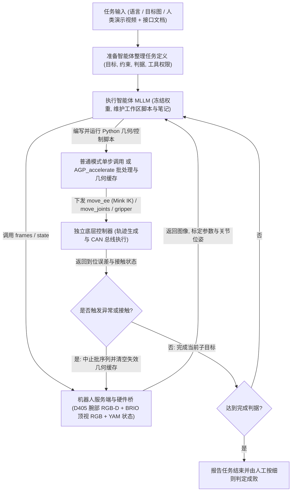
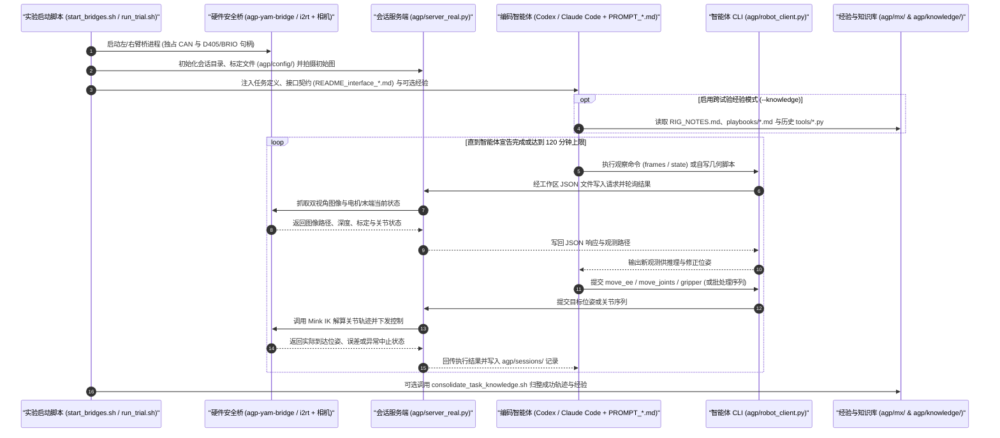

# Agent as Policy for Robotic Manipulation

## 一句话定义

**Agent as Policy (AGP)**：让参数冻结的通用多模态编码智能体（如 Codex、Claude Code）**直接充当物理机器人的运行时策略**，通过文档化机器人接口按需采图、现场编写并执行几何/控制程序、依据实机视觉与运动反馈在线修改计划与恢复动作，从而在零任务训练下完成精密装配、动态抛投、双臂柔性物体折叠等复杂操作。

## 英文缩写速查

| 缩写 | 英文全称 | 简要说明 |
|---|---|---|
| AGP | Agent as Policy | 本文范式：通用编码智能体直接作为运行时机器人策略控制物理交互 |
| MLLM | Multimodal Large Language Model | 多模态大语言模型，用于解析参考视频/图像、观测画面与工具输出并决策 |
| IK | Inverse Kinematics | 逆运动学，本文控制器使用基于 MuJoCo 的 Mink 将末端位姿转为关节目标 |
| LHR | Long Horizon Reasoning | 长程推理任务标签，对应四对零件装配与多步积木搭建 |
| AD | Action Diversity | 动作多样性任务标签，对应六颗骰子翻转与定向抛投 |
| OD | Object Diversity | 物体多样性任务标签，对应双臂柔性毛巾折叠 |
| SFT | Supervised Fine-Tuning | 监督微调，本文用于将 GPT-6 Astra 轨迹蒸馏到开源权重模型 Qwen3.6-35B-A3B |

## 为什么重要

- **突破“预生成固定程序”与“仅编排既定技能”两类旧范式的上限：** 既往以 Code as Policies、GaP、ASPIRE 为代表的程序合成方法把控制流和异常处理提前写死在代码或计算图里，一旦遇上真实物体倾倒、深度缺失或毫米级装配卡滞，预设分支很难应对；而只做技能调度的系统仍受限于底层预训练策略或基元的能力边界。AGP 将**感知解析、几何编程、动作生成与失败恢复**全部留在运行期闭环内，允许智能体在现场看到问题后现写代码重算位姿或更换策略。
- **揭示“运行时智能体策略”的延迟—成本瓶颈及工程解法：** 高频往返调用大模型会导致显著的推理时长与 token 消耗（例如顺序双臂叠毛巾平均耗时 50.8 min、花费 $24.14）。本文提出 `AGP_accelerate`，通过带反馈的短动作序列批处理与接触感知的几何估计缓存，在不牺牲成功率的前提下将耗时压低超过 50%、token 与推理费用压低超过 60%。
- **验证跨试验经验复利与开源模型可迁移性：** 运行期间沉淀的文本/代码经验既能在同模型后续试验中持续降本提速，也能只读迁移给较弱模型显著提高成功率；同时，通过仿真轨迹蒸馏可让 35B MoE 开源模型具备相似的运行时策略能力。

## 核心信息

| 字段 | 内容 |
|---|---|
| **作者** | Mengzhao Jia, Yang Lin, Xixin Zhang, Zhihan Zhang, Meng Jiang |
| **机构** | 圣母大学（University of Notre Dame）、加州大学圣迭戈分校（UCSD）、圣地亚哥州立大学（San Diego State University） |
| **发表时间** | 2026-09-11（arXiv:2609.12541v1），2026-11-18 修订 v4（含 Appendix A–F） |
| **论文链接** | [arXiv:2609.12541](https://arxiv.org/abs/2609.12541) / [arXiv HTML v4](https://arxiv.org/html/2609.12541) |
| **项目与代码** | [GitHub（agent-as-policy-2026/agent-as-policy）](https://github.com/agent-as-policy-2026/agent-as-policy) / [官方项目页](https://agent-as-policy-2026.github.io/) / [HF 数据集](https://huggingface.co/datasets/Agent-as-Policy/agent-as-policy) |
| **清单分类** | `harness.skills`（来源条目：`survey_ax_2609_12541`） |
| **开源状态** | **已开源**（Apache-2.0 代码仓库公开真机实验调度 `agp/`、安全硬件桥 `hardware-bridge/`、标定文档 `calib/`、任务经验与运行记录及 `robodojo/AGP/` 仿真适配器；配套真机/仿真数据集托管于 Hugging Face；`i2rt` 依赖需按 `third_party/i2rt/UPSTREAM.md` 检出补丁） |

## 核心原理

### 1. 问题形式化与两阶段组织（§3.1）

任务可由人类演示视频、静态目标图像、自然语言指令或其组合指定，机器人在持续物理场景中完成目标：
1. **任务准备（Task Preparation）：** 引入新任务时，准备智能体将任务指令、参考图像或视频帧（含时间戳文字说明）以及机器人接口文档整理成结构化任务定义，明确目标、约束、完成判据、参考素材与工具权限。
2. **运行时智能体策略（Agent as Policy）：** 执行智能体以冻结参数 $\theta$ 直接充当策略 $\pi_\theta$。在每一步 $k$，它读取任务规范 $g$、文档化接口 $I$、对话与工具返回历史 $H_k$ 以及当前本地工作区 $W_k$（内含自写脚本、笔记与保存的图像观测），采样下一步工具调用：

$$u_k \sim \pi_\theta(\cdot \mid g, I, H_k, W_k)$$

工具调用既可以是向机器人请求采图或查询状态，也可以是运行智能体刚编写或修改的 Python 脚本来解析深度、计算抓取位姿并下发运动目标。

### 2. 双向异步智能体—机器人接口（§3.2, §4.1.1, Appendix A.1）

接口 $I$ 由智能体侧 Python CLI 客户端（`robot_client.py`）、独立服务端进程（`server_real.py`）与独占底层硬件句柄的桥接服务（`hardware-bridge/`）构成，客户端与服务端通过工作区 JSON 文件交换请求与结果：
- **感知输入（Robot → Agent）：**
  - 腕部 **Intel RealSense D405**（$640\times 360$ 对齐 RGB 与深度，30 fps）与顶视固定 **Logitech BRIO**（$1920\times 1080$ 畸变校正 RGB，30 fps），按需触发采集并连同相机内外参及时间戳保存到工作区。腕部像素直接通过深度反投影到机械臂基坐标系，顶视像素通过射线与估计高度平面求交定位。
  - 电机实测关节角、前向运动学解算的末端位置与四元数姿态、夹爪开度，以及每次动作后的实际到位状态与目标误差。
- **控制原语（Agent → Robot，共 7 个命令）：** `state`、`status`、`help`、`frames`、`move_ee`（目标末端位置与四元数）、`move_joints`（弧度制关节角）与 `gripper`（`[0, 1]` 归一化开度）。当提交 `move_ee` 时，控制器调用基于 MuJoCo 的 **Mink** 差分逆运动学求解关节目标并在工作空间与运动约束内生成轨迹。控制器独立于智能体推理异步运行，单臂队列按序执行，双臂可通过标定刚体变换在共享坐标系下并发执行。

### 3. 运行时编程、反馈恢复与 `AGP_accelerate`（§3.3–§3.4, Appendix D）

- **现场编程与闭环恢复：** 对 65 次运行记录的日志分析表明，智能体在工作区动态编写的脚本主要覆盖三类职责：（1）几何感知与估计（如基于腕部深度 SVD 平面拟合与射线求交的 `fit_head.py`，以及利用 `np.linalg.lstsq` 对双视角射线求最近点中点的 `triangulate.py`）；（2）多步控制调用与双臂并发编排；（3）将 3D 参考点反投回相机画面进行可视化自检。当夹爪释放后零件倾倒或插装未到位时，智能体可自主切换到带倾角（如 $15^\circ$）抓取、放大局部画面或逐毫米下探并采图核对。
- **执行加速机制 `AGP_accelerate`（§3.4）：** 为缓解每次工具返回都要重新全上下文推理带来的耗时与 token 膨胀，引入两项机制：
  1. **带反馈动作批处理（Action Batching with Feedback）：** 允许智能体在单轮推理中提交包含测量、臂运动与夹爪动作的短序列；运行时利用前一步反馈解析命名测量目标，一旦遇到深度缺失或电机误差超限立即中止序列并返回当前观测画面，将常规多步操作合并到单次推理中而不丧失纠偏能力。
  2. **可复用几何估计（Reusable Geometric Estimates）：** 运行时将选中图像点经标定深度转为机械臂坐标并缓存供后续动作复用，抵近后再用腕部深度微调；当主动接触或电机反馈检测到意外接触时，自动将受影响的坐标估计标记为失效，防止复用过期场景状态。

## 流程总览

## 源码运行时序图

以下时序图依据官方仓库 [`agent-as-policy-2026/agent-as-policy`](https://github.com/agent-as-policy-2026/agent-as-policy) 的 `README.md` 与 `files_sample` 已核实入口绘制，对应真机实验链路（`agp/start_bridges.sh`、`hardware-bridge/` 中的 `agp-yam-bridge`、`agp/run_trial.sh`、`agp/server_real.py`、`agp/robot_client.py` 与 `agp/mx/`）；另外 `robodojo/AGP/` 提供了面向 RoboDojo 仿真的独立 MCP 策略适配器（`eval.sh`）。

## 实验与评测

真机实验均在 **I2RT YAM** 机械臂（带 `linear_4310` 夹爪）上开展，单回合上限 120 分钟，所有初始物体位置在可达空间内随机化，物理成败由人工依据事前定义的细则（Table 6）核定；表中耗时、token 与 API 费用仅在成功回合上取均值及 `[min, max]`。

### 1. 主实验与 `AGP_accelerate` 效率对比（Table 1，GPT-6 Astra，high effort）

| 任务与配置 | 能力 / 指令类型 | AGP 成功率 | AGP 均时 (min) | AGP Tokens (M) / 费用 | `AGP_accelerate` 成功率 | 加速均时 (min) | 加速 Tokens (M) / 费用 |
|---|---|---|---|---|---|---|---|
| 四对零件装配（AutoMate，径向间隙 0.73–2.83 mm） | LHR / Video | 8/10 (80%) | 37.2 `[16.0, 59.1]` | 13.02 / $16.62 | 5/5 (100%) | 7.6 `[5.3, 8.7]` | 2.47 / $3.82 |
| 积木搭建：金字塔（6 块 50 mm 立方块） | LHR / Image | 10/10 (100%) | 21.6 `[14.9, 32.2]` | 9.24 / $11.69 | 5/5 (100%) | 10.0 `[7.2, 13.8]` | 2.68 / $4.19 |
| 积木搭建：双塔 | LHR / Image | 10/10 (100%) | 20.6 `[14.8, 29.2]` | 7.94 / $9.92 | 5/5 (100%) | 6.6 `[5.3, 8.5]` | 1.64 / $2.82 |
| 积木搭建：六块高塔 | LHR / Image | 9/10 (90%) | 28.2 `[11.6, 55.0]` | 11.57 / $14.93 | — | — | — |
| 六颗骰子翻转至指定点数 | AD / Language | 10/10 (100%) | 37.9 `[22.6, 56.0]` | 17.08 / $21.07 | 5/5 (100%) | 17.1 `[9.6, 22.1]` | 5.22 / $7.52 |
| 定向抛投（圆弧甩臂 + 适时松爪） | AD / Language | 9/10 (90%) | 11.1 `[5.9, 21.4]` | 5.75 / $8.24 | 4/5 (80%) | 3.6 `[2.7, 5.1]` | 0.75 / $1.69 |
| 双臂叠毛巾：顺序折叠 | OD / Video | 5/5 (100%) | 50.8 `[33.8, 63.3]` | 18.12 / $24.14 | — | — | — |
| 双臂叠毛巾：同步折叠两端 | OD / Video | 3/5 (60%) | 21.4 `[15.7, 31.2]` | 5.06 / $7.46 | — | — | — |

- **整体结论：** 原版 AGP 在 8 个配置中的 7 个取得 $\ge 80\%$ 成功率（4 个达到 100%）；`AGP_accelerate` 在全部 5 个评测配置上将平均耗时缩短超过 50%、平均 token 与费用降低超过 60%。双臂同步叠毛巾成功率最低（3/5），反映柔性材料双臂协同操作难度。

### 2. 智能体框架、基座模型与推理强度对比（Table 2 & Table 8）

- **两对零件装配（Table 2）：** Codex + GPT-6 Astra 在 Low / Medium / High 思考强度下均取得 **5/5**（均时分别为 9.9 / 9.2 / 9.2 min，费用 $4.79 / $4.09 / $4.47）；GPT-5.6 Sol 达 **5/5**（14.2 min，7.13M tokens，$3.94）；GPT-5.6 Terra 仅 **1/5**（19.0 min，$1.98）；GPT-5.6 Luna 为 **0/5**。在 Claude Code 下，Claude Opus 5 取得 **5/5**（22.2 min，12.40M tokens，$9.75），Claude Fable 5.1 取得 **3/5**（27.7 min，9.27M tokens，$11.30）。
- **金字塔积木补充对比（Table 8，high effort）：** GPT-6 Astra **10/10**（9.24M tokens，$11.69），GPT-5.6 Sol **7/10**（18.86M tokens，$9.22）。

### 3. 经验积累、跨模型迁移与开源权重蒸馏（§4.3, §4.5, Table 4–5）

- **经验精炼（§4.3）：** 在金字塔搭建上经过 5 版经验更新后，第 5 版相对第 1 版均值总耗时下降 **17.8%**、token 下降 **30.9%**；所有带历史经验的版本均优于空白经验。
- **经验迁移（§4.3）：** 将 Astra 5 次两对装配的经验只读迁移给 GPT-5.6 Terra 后，成功率较无经验基线明显提升，成功回合均时下降 **34.3%**、token 下降 **11.4%**。
- **开源权重仿真与真机验证（Table 4–5）：** 用 Astra 在 4 个仿真训练集收集 **5,658 条**成功轨迹对 `Qwen3.6-35B-A3B` 做 SFT（冻结视觉编码器，序列上限 65,536）后，VLA-Arena 成功率从 **0.8%** 升至 **57.5%**（Astra 70.6%），RoboTwin 从 **8.3%** 升至 **62.3%**（Astra 82.5%）。无需额外 SFT 的 `Qwen3.8-Flash-Next` 在上述两基准分别达 **33.7%** 与 **48.0%**，且在真机四物装箱任务中取得 **5/5**（582.2 s，零 API 费用；Astra 为 **5/5**，413.4 s，$2.49）。
- **仓库附带 RoboDojo 仿真汇总（仅见仓库 README `robodojo/results/seed0/_summary.md`）：** `gpt-6-astra` 驱动的 XPolicyLab 适配器在 RoboDojo 全部 54 个配置共 2,100 回合（seed 0）取得 **56.13%** 平均成功率与 **63.63** 平均得分（Generalization 54.67%、Precision 44.00%、Long-Horizon 28.75%、Memory 91.00%、Open 62.25%）。

## 与其他工作对比

在论文 §4.2.3（Table 3）中，作者将 **Graph-as-Policy (GaP)** 与 **ASPIRE** 的官方实现适配到相同 YAM 平台与 MuJoCo 同比例仿真场景（均使用 GPT-6 Astra high effort）进行真机对比：

| 方法 | 两对装配 (Sim / Real) | 四对装配 (Sim / Real) | 金字塔搭建 (Sim / Real) | 关键机制差异 |
|---|---|---|---|---|
| **GaP** | 8/25 / **0/5** | 1/25 / **0/10** | 3/25 / **0/10** | 预先合成并仿真优化固定计算图，真机遇 IK 无解或视觉识别失败即终止 |
| **ASPIRE** | 25/25 / **2/5** | 20/25 / **0/10** | 25/25 / **1/10** | 经真机调试后**冻结**程序与技能库再评测，执行期不调用大模型（$0 边际费），但对位置变化与异常恢复脆弱；计入准备开销后金字塔单次成功合均 280.9 min / $78.13 |
| **AGP (本文)** | — / **5/5**（9.2 min / $4.47） | — / **8/10**（37.2 min / $16.62） | — / **10/10**（21.6 min / $11.69） | 零样本直接真机执行，运行期按实时观测重算几何、重写代码并自主恢复 |

相比 [ASPIRE](../methods/aspire.md) 等“先进化调试再冻结代码”的路线，AGP 用运行期推理成本换取了跨任务零样本鲁棒性与精细纠偏能力；相比仅靠高层语义调度 VLA 的框架（如 RoboClaw、Harness VLA），AGP 无需训练专用动作策略，而是依靠通用几何编程与差分 IK 直接产出连续末端位姿与关节动作。

## 结论

**一句话总判：AGP 证明“把通用编码智能体直接放在控制闭环里现场写代码、看图与纠错”在真实精密与柔性操作上显著比“预先生成并冻结程序”更稳健，而批处理动作与接触感知几何缓存则是使其走出高耗时泥潭的关键工程开关。**

1. **零样本泛化强但纯闭环成本高：** 原版 AGP 在 8 个高难真机配置中 7 个达到 $\ge 80\%$ 成功率，但单回合均时 11.1–50.8 分钟、费用 $8.24–$24.14；工程部署时应默认开启 `AGP_accelerate`（均时减半以上、费用降 60%+）。
2. **模型选型与思考强度要分任务权衡：** 两对装配中 GPT-6 Astra 在 Low effort 即取得 5/5（9.9 min），但面对更复杂的长程推理任务，弱模型（如 Terra 1/5、Luna 0/5）会迅速失效；用强模型先跑出可复用经验再迁移给弱模型，是低成本落地的有效路径。
3. **动态交互与精密装配依赖“现场脚本 + 视觉自检”：** 运行期智能体自发写出 SVD 平面拟合、双视角三角测量与图像重投影验证脚本，表明通用编码能力与高精度标定相机接口结合后，足以替代大量手工编写的专用视觉伺服流水线。
4. **开源小模型可通过轨迹蒸馏接棒：** 通过 5,658 条 Astra 仿真轨迹微调的 `Qwen3.6-35B-A3B` 能从几乎不可用（0.8%/8.3%）跃升至 57.5%/62.3%，且 `Qwen3.8-Flash-Next` 已可在真机装箱实现 5/5 零 API 费运行，说明该范式正从强闭源模型向本地轻量模型下沉。

## 工程实践

- **硬件桥隔离与安全边界：** 部署真机时应采用仓库 `hardware-bridge/` 的隔离设计，由 `agp-yam-bridge` 独占 CAN 总线与相机驱动，并通过 `agp-yam-preflight` 与 `agp-yam-camera-acceptance` 先做连通性与标定验收；无实机时可通过 `agp/start_bridges.sh` 的 `--source fake` 与 `PAPER_DRYRUN=1 bash agp/run_trial.sh` 验证配置。
- **标定与几何缓存设计：** 务必保证顶视 RGB（BRIO）与双臂基座标定（`agp/config/top_calib.json`、`right_base_in_left_base.json`）精度，否则高程平面射线求交会产生厘米级偏差；启用类似 `AGP_accelerate` 的几何缓存时，必须将碰撞或主动接触事件绑定到缓存失效逻辑。
- **渐进式降本路径：** 先用强推理模型跑通首批试验并启用 `--knowledge` 沉淀 `playbooks/*.md` 与 `tools/*.py`，随后冻结或只读挂载给低成本模型或本地开源模型复跑。

## 局限与风险

- **推理延迟与长耗时限制高频实时闭环：** 单次推理需几秒至数十秒，难以胜任依赖毫秒级高频力/触觉反馈的连续插拔或抗强外扰控制；当前定位为“慢思考 + 底层独立轨迹执行器”的准静态与阶段性动态操作（如抛投靠单次关节弧线配合开爪时机）。
- **API 成本与长上下文膨胀：** 在复杂长程或柔性物体任务（如叠毛巾）上，单回合 token 仍可达 1,800 万以上；若开源权重模型未经过足够轨迹蒸馏，工具调用格式与几何编程稳定性显著下降。
- **评测与感知假设边界：** 论文主实验成功与否依赖人工依据定义细则判定；且当前几何接地主要依赖手腕 D405 对齐深度与顶视平面求交，遇到强反光、透明或细小无有效深度的物体时，仍需频繁重试或退回到多视角三角测量。

## 关联页面

- [Agentic Robots 综述](paper-towards-agentic-robots-survey.md)
- [全量项目节点清单](../overview/awesome-agentic-robots-node-index.md)
- [VLA 方法背景](../methods/vla.md)
- [Agentic 操作策略](../methods/agentic-manipulation-policies.md)
- [智能体工具调用接口](../methods/agent-tool-use-interface.md)
- [智能体规划与执行反馈](../methods/agent-planning-feedback.md)
- [编码智能体验证闭环](../methods/coding-agent-verification-loops.md)
- [机器人智能体调度底座（Harness）](../methods/robot-agent-harness.md)
- [ASPIRE 对比方法](../methods/aspire.md)
- [机器人操作](../tasks/manipulation.md)：了解物体操作和抓取任务。
- [双臂协同操作](../tasks/bimanual-manipulation.md)：了解双臂坐标系共享与柔性物体操作挑战。

## 推荐继续阅读

- [Agent as Policy 官方项目页（含完整真机任务视频与轨迹演示）](https://agent-as-policy-2026.github.io/)
- [Agent as Policy 官方 GitHub 仓库（含真机桥接、Playbooks 与 RoboDojo 适配器）](https://github.com/agent-as-policy-2026/agent-as-policy)
- [Hugging Face 真机交互与轨迹数据集](https://huggingface.co/datasets/Agent-as-Policy/agent-as-policy)

## 参考来源

- [论文原文核对笔记](../../sources/papers/paper-agentic-2609-12541.md)
- [官方仓库静态核查档案](../../sources/repos/paper-agentic-2609-12541.md)
- [官方 Awesome 快照归档](../../sources/repos/awesome-agentic-robots-survey-index.md)
- [arXiv:2609.12541v4 论文 HTML 原文](https://arxiv.org/html/2609.12541)
