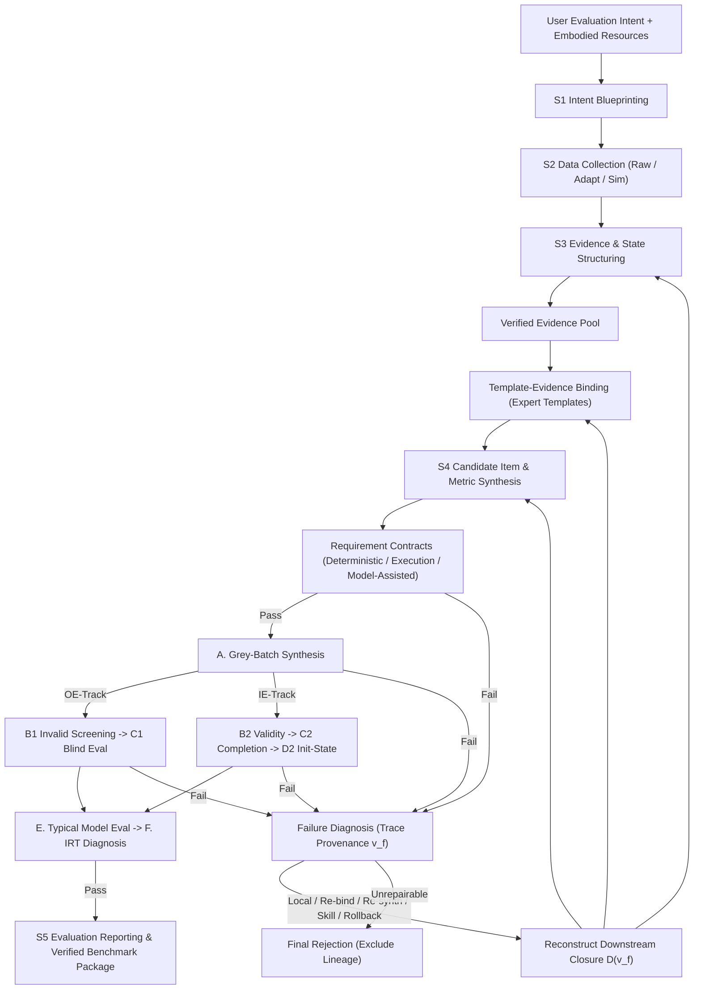

# Embodied-BenchForge: A Closed-Loop Agentic Workflow for Embodied Benchmark Construction

## 一句话定义

Embodied-BenchForge 是一个面向具身基准自动构建的闭环智能体工作流框架，通过**类型化可复用技能编排**与**需求契约及血缘溯源驱动的局部验证修复**，将用户评测意图自动转化为可接地的离线具身问答基准（OE-Track）与可执行交互基准（IE-Track）。

## 英文缩写速查

| 缩写 | 英文全称 | 简要说明 |
|------|----------|----------|
| OE-Track | Offline EQA Track | 离线具身问答赛道，含 SHT、SHN、SD、SA、SU、SQ 共 6 个基准（各 10,000 题） |
| IE-Track | Interactive Embodied Track | 交互式具身赛道，含基于 AI2-THOR 的 220 个可执行任务与轨迹接地问答 |
| SHT / SHN / SD / SA / SU / SQ | SpatialHome-Task / SpatialHome-Nav / SpatialDrive / SpatialArm / SpatialUAV / SpatialQuadruped | OE-Track 下对应 ALFRED、Habitat、CARLA、LIBERO、真实航拍、TartanGround 的 6 个子基准 |
| UIA / FSQ / QAC / EGC / SGC / AFC / TSD / SSC | User-Intent Alignment / Format & Usability Quality / Question-Answer Consistency / Evidence-Grounding Correctness / Spatial-Geometric Consistency / Action-Affordance Consistency / Target-Signal Dependency / Skill Challenge | LLM-as-Judge 基准质量评估的 8 个加权维度 |
| IRT | Item Response Theory | 项目反应理论，本文采用正则化 2PL 模型做辅助题目难度与区分度诊断 |
| SRL | Success-Weighted Trajectory EQA Rate | IE-Track 联合指标，统计任务成功完成且轨迹接地问答正确的题目比例 |

## 为什么重要

1. **突破“单环境/单阶段”自动构建瓶颈**：现有具身任务或场景生成方法（如 ProcTHOR、RoboCasa、MimicGen、RoboGen）通常绑定特定仿真器或任务族，而 A2Eval 等多从既有基准抽样重组；面对图像、视频、轨迹、仿真状态与真实航拍等异构资源时，将新评测意图转化为完整基准包仍依赖大量人工配置。
2. **解决多步智能体构建中的“过程级可靠性”问题**：基准构建包含信源获取、证据结构化、模板绑定、题目/验证器合成等多步依赖。若缺乏产物级契约检查，上游缺陷会向下游静默传播；而仅靠终末过滤（final-stage inspection）在 SpatialUAV 上仅能保留 10.4% 的合法样本，全量重生成又会丢弃已验证成果并推高 token 成本。
3. **揭示“被动观察理解”与“闭环具身执行”的能力裂痕**：框架同时覆盖离线观测问答与在线可恢复状态交互，并在统一轨迹上评测执行成功率与轨迹问答正确率，直接暴露出部分小模型“能看懂轨迹却几乎无法执行完成任务”的能力错配。

## 核心信息

| 字段 | 内容或状态 |
|---|---|
| 作者 | Baoyang Jiang, Fengchun Zhang, Leyuan Wang, Haotian Li, Yida Wang, Zhe Ji, Jinshan Lai, Xi Ren, Danyang Li, Zheng Yang, Jianwei Hu, Qiang Ma |
| 机构 | QiYuan Lab、电子科技大学（UESTC）、北京邮电大学（BUPT）、Northeastern University、北京航空航天大学（BUAA）、清华大学（Tsinghua） |
| 发表时间 | 2026-09-11（arXiv:2609.13082v1） |
| 论文链接 | [arXiv:2609.13082](https://arxiv.org/abs/2609.13082) / [HTML 全文](https://arxiv.org/html/2609.13082) |
| 项目与代码 | 附录 C.1 提及随文代码快照，但截至 2026-11-27 论文及公开页面未给出可访问的 GitHub 仓库或项目主页 URL |
| 清单分类 | `environment.benchmarking`（来源条目：`survey_ax_2609_13082`） |
| 开源状态 | 未确认开源代码 |

## 核心原理

Embodied-BenchForge 将基准构建形式化为**闭环基准合成（Closed-Loop Benchmark Synthesis）**，耦合前向技能编排合成与后向验证修复两条路径：

### 1. Skill-Orchestrated Artifact Synthesis（技能编排产物合成）

- **类型化产物与血缘图**：每个中间或终态产物形式化为四元组 $a_i = \langle \tau_i, x_i, m_i, p_i \rangle$，分别记录产物类型 $\tau_i$、内容 $x_i$、元数据与验证状态 $m_i$、构建血缘 $p_i$。全流程通过有向产物依赖图 $G=(V,E)$ 追踪依赖，避免类型不兼容的连接。
- **类型化分层技能库**：每个构建操作封装为 $s_k = \langle I_k, O_k, P_k, F_k \rangle$（输入类型、输出类型、前置条件、可执行后端）。复杂技能 $S_k$ 经 **Hierarchical Skill Decomposition** 拆分为可复用子技能，后端 $F_k$ 可为 LLM、确定性程序、仿真器 API、资源适配器或评分/验证器编译器。论文分析的实现快照共注册 64 个技能/卡片定义。
- **五阶段前向主干**：
  1. `S1 Intent Blueprinting`：将用户评测意图解析为能力目标、资源需求、任务规格与输出 schema。
  2. `S2 Data Collection`：通过统一资源接口执行 `Acquire Raw Sources`（如 SU 航拍图）、`Adapt Existing Benchmarks`（如 SHT/SQ）或 `Collect in Simulation`（如 SHN/SD/SA/IE）。
  3. `S3 Evidence & State Structuring`：OE-Track 生成带空间、语义、时序与来源索引的证据记录；IE-Track 额外组织可恢复初始状态、合法动作空间、任务前置条件与目标变量。
  4. `S4 Benchmark Synthesis`：执行 `Template Design`、`Code Generation` 与 `Metric Production`，由 `Verified Evidence Pool` 与 `Expert Template Library` 经 `Template–Evidence Binding` 合成候选题项、可执行动作接口与终末状态验证器（terminal verifier）。
  5. `S5 Verification & Evaluation Reporting`：汇总评测结果、典型模型响应与诊断统计并编译为最终基准包。

### 2. Requirement-Guided Verification and Repair（需求引导的验证与修复）

- **产物级需求契约（Requirement Contracts）**：每类产物绑定契约 $\kappa_\tau = \{\phi_{\tau,1}, \dots, \phi_{\tau,n}\}$，组合三类校验：**确定性检查**（schema、字段完整性、引用一致性）、**基于执行的检查**（运行评分器、状态恢复例程、动作与终末验证器）以及**模型辅助检查**（仅用于意图对齐、指令–目标语义一致性等无法仅靠结构/执行判定的语义关系，且**模型结果不得覆盖失败的确定性或执行检查**）。
- **分赛道质量门控（Quality Gates）**：
  - `A. Grey-Batch Synthesis`：全量合成前先运行小批量灰度样本，验证启用模板可稳定产出合法候选。
  - **OE-Track 门控**：`B1. Invalid Item Screening`（清除格式、接地或评分错误）与 `C1. Image-Dependency Blind Evaluation`（对比全证据与盲测条件，剔除仅靠语言先验或选项模板泄漏即可答对的捷径题）。
  - **IE-Track 门控**：`B2. Task Validity Check`（指令–实体–动作–目标一致性）、`C2. Task Completion Test`（实际跑通参考轨迹验证 terminal verifier 可触发且非完整控制不会误过）与 `D2. Initial-State Check`（核验序列化初始状态可按容差稳定复现）。
  - **诊断门控**：`E. Typical Model Evaluation` 在 11 模型面板上生成响应矩阵；`F. IRT Diagnosis` 拟合正则化双参数逻辑斯蒂（2PL）模型：
    $$P(Y_{mi}=1\mid\theta_m)=\frac{1}{1+\exp[-a_i(\theta_m-b_i)]}$$
    以 $a_i \ge 0.7$ 统计高区分度题（High-Disc.），并用 $a_i < 0$ 或校正题总相关 $r_{i,-i} < 0$ 标记 `ReverseRisk` 进行人工/规则复核，但不将 IRT 单独作为硬性准入替换有效性检查。
- **血缘驱动局部修复（Provenance-Guided Repair）**：失败诊断定位最早致因产物 $v_f$，仅使下游闭包 $D(v_f)=\{u\in V\mid v_f \rightarrow^* u\}$ 失效并重建，其余已验证产物直接复用。按最小必要作用域选择 6 种算子：`Local field repair` → `Template re-binding` → `Candidate re-synthesis` → `Skill re-execution` → `Upstream rollback` → `Final rejection`（修复不放宽任何契约门槛）。

## 流程总览

## 源码运行时序图

**不适用**（截至 2026-11-27 核查 arXiv:2609.13082 原文与公开检索材料，论文附录 C.1 虽提及“accompanying code snapshot”，但论文及 arXiv 页面未给出可访问的 GitHub 仓库或项目主页链接，无从核实可运行官方源码入口）。

## 实验与评测

论文使用 `Qwen3.6-27B` 承担工作流编排、`GPT-5.5 Pro` 承担产物合成与模型辅助验证，并在 4×NVIDIA H100 80GB（Python 3.11.9 / PyTorch 2.8.0 / vLLM 0.19.0）环境下构建与评测 11 个 API/本地模型及人类基线：

### 1. 构建基准规模与质量（Table 2, Table 3, Table 11, Table 24）

- **OE-Track（6 个基准，每项 10,000 题，共 60,000 题）**：由 GPT-5.5、Claude Opus 4.7、Gemini 3 Flash、Qwen3.6-35B-A3B 四位裁判模型按 8 维加权评分（100 分制）：
  - `SpatialHome-Task (SHT, ALFRED)`：`88.56`（8 维度 / 6 题型 / 22 模板）
  - `SpatialHome-Nav (SHN, Habitat)`：`89.09`（7 维度 / 4 题型 / 13 模板）
  - `SpatialDrive (SD, CARLA)`：`88.97`（8 维度 / 6 题型 / 80 模板）
  - `SpatialQuadruped (SQ, TartanGround)`：`88.34`（8 维度 / 8 题型 / 192 模板）
  - `SpatialUAV (SU, Real aerial images)`：`88.72`（9 维度 / 7 题型 / 260 模板）
  - `SpatialArm (SA, LIBERO)`：`90.75`（9 维度 / 8 题型 / 203 模板）
- **IE-Track（AI2-THOR）**：覆盖 28 个场景（8 厨房、7 客厅、7 卧室、6 浴室），含 220 个独立可执行任务（Simple 110 / Hard 110，746 个实例化动作表达式，回合上限 150 步）。

### 2. 代表性模型在两类赛道上的表现（Table 4 & Table 5）

| 模型 / 基线 | OE-Track Mean | IE-Track SR (%) | IE-Track EQA Acc (%) | IE-Track SRL (%) | Avg. Steps |
|---|---:|---:|---:|---:|---:|
| **Human** | **85.89** | **97.73** | **74.09** | **71.82** | 44.00 |
| GPT-5.5 | 57.67 | 83.18 | 73.64 | 61.36 | 40.13 |
| Claude Opus 4.7 | 56.61 | 77.73 | 70.00 | 55.00 | 39.65 |
| Gemini-3-Flash | 51.97 | 72.27 | 59.55 | 42.73 | 42.74 |
| Qwen3.6-35B (本地最高) | 49.86 | 46.36 | 50.91 | 25.45 | 30.69 |
| GPT-5.4-Mini | 47.23 | 16.82 | 46.82 | 8.18 | 85.30 |
| GPT-5.4-Nano | 42.96 | 20.45 | 53.64 | 12.73 | 77.22 |
| Claude Sonnet 4.6 | 42.54 | 16.82 | 42.27 | 7.73 | 81.46 |
| Claude 4.5 Haiku | 34.73 | 5.00 | 55.91 | 1.36 | 99.76 |
| Qwen3.5-4B | 35.97 | 0.00 | 55.91 | 0.00 | 105.54 |
| Qwen3.5-2B | 32.07 | 0.00 | 46.82 | 0.00 | 35.76 |
| Qwen3.5-0.8B | 30.34 | 0.00 | 22.73 | 0.00 | 132.59 |

- **能力断层**：在 OE-Track 上，表现最好的模型（GPT-5.5, 57.67）仍落后人类（85.89）28.22 分；在 IE-Track 上，多款中小模型（如 Qwen3.5-4B/2B 与 Claude 4.5 Haiku）能获得 46.8%–55.9% 的轨迹问答正确率，但执行成功率（SR）为 0%–5%，体现出“轨迹语义理解”并不等价于“闭环动作执行”。

### 3. 技能复用、构建成本与消融实验（Tables 6–8, 18, 19, 32）

- **技能复用（Table 6 & Table 16）**：7 次构建平均每次调用 41.0 个技能、复用 37.6 个，总复用率 `91.6%`；其中 4 个仿真类 OE 基准复用率达 `97.5%`（平均仅需 1 个特定适配器），SU（`82.9%`）、SQ（`87.8%`）与 IE-Track（`81.8%`）亦保持在 81% 以上。
- **构建效率（Table 18 & Table 19）**：构建 10,000 条 OE 基准平均耗时 `86.0 min`（SD 仅 `38.0 min` / `263.2 items/min`，SU 需 `160.0 min` / `62.5 items/min`），平均消耗 `11.45M` tokens（`1,145` tokens/item）；构建并验证 20 个 IE-Track 任务平均耗时约 `1.5 小时`。S4 阶段贡献了 `52.8%–62.3%` 的 token 消耗，全流程输入/输出 token 比约为 `14.4:1`。
- **系统消融（Table 7，OE-Track 均值）**：完整系统 LLM Judge `89.07`、Human `91.28`、Judge–Human $\rho=0.87$、Valid Rate `93.7%`。移除 Verification & Repair 后人类评分暴跌 `23.25` 分（至 `68.03`）、Valid Rate 降至 `62.4%`、$\rho$ 降至 `0.78`；移除 Source Grounding 与 Evidence Skill 分别导致人类评分下降 `19.16` 和 `17.20` 分。
- **过程质控消融（Table 8，SpatialUAV 1,000 题）**：仅用终末检查时，Valid Rate 仅 `10.4%`（High-Disc. `14.6%`）；移除 Requirement Contracts 后质量分从 `89.21` 降至 `78.74`、Valid Rate 降至 `62.2%`；移除 Provenance-Guided Repair 虽可保持接近质量（`88.74`），但 token 消耗由 `2.62M` 飙升至 `3.93M`（+50%）。
- **IRT 稳定性（Table 32）**：60,000 条 OE 题目池化 High-Disc.（$a_i \ge 0.7$）占比 `42.5%`（bootstrap 95% CI `[31.3, 43.7]%`），2PL 区分度与古典高低三名分差 $D_i$ 的 Spearman 秩相关达 `0.906`。

## 与其他工作对比

| 维度 | 传统具身基准与任务生成（ALFRED / ProcTHOR / RoboGen） | 通用自动基准构建（AutoBencher / BenchAgents / Code2Bench） | 具身抽样评估（A2Eval） | Embodied-BenchForge（本文） |
|---|---|---|---|---|
| 端到端意图驱动构建 | 局限于特定仿真器或任务族 | 支持语言/代码域端到端生成 | 从已有基准筛选子集 | 支持跨仿真器、真实图像与交互环境的端到端合成 |
| 模块化复用 | 局部流程或脚本复用 | 有限阶段复用 | 评估流水线复用 | 64 个类型化分层技能，跨 7 类构建平均复用率 `91.6%` |
| 异构资源与可执行性 | 多偏单仿真器状态或演示扩展 | 仅 Code2Bench 产可执行代码 | 依赖原基准形态 | 统一产出离线证据问答与 AI2-THOR 可恢复状态+终末验证器 |
| 过程级验证与局部修复 | 无系统化产物契约与血缘回滚 | 多为终末过滤或整批重试 | 无闭环修复 | 产物契约 + 分赛道质量门控 + 血缘闭包 $D(v_f)$ 局部重建 |

## 结论

**一句话总判：Embodied-BenchForge 证明了“产物级需求契约 + 血缘驱动局部重建”才是多步智能体构建具身基准时兼顾合法率与 token 成本的关键，而非仅靠强模型前向生成或终末筛选。**

1. **过程质控远胜终末过滤**：SpatialUAV 上“仅终末检查”的合法率只有 `10.4%`，而引入需求契约与质量门控后升至 `93.7%`；跳过中间验证会把大量算力浪费在失效下游分支上。
2. **血缘追踪直接决定扩展成本**：在质量相近的前提下，取消 Provenance-Guided Repair 会使千题构建 token 消耗从 `2.62M` 增至 `3.93M`；记录产物依赖图并在 $D(v_f)$ 闭包内局部重算能显著抑制返工开销。
3. **跨异构资源复用依赖接口隔离**：仿真类基准通过统一适配器即可实现 `97.5%` 技能复用，而无标注真实航拍（SU）的瓶颈集中在 S3 证据结构化阶段（10K 题耗时占 `65.0 / 160.0 min`）。
4. **观测问答不能替代交互评测**：IE-Track 上多款小模型轨迹 EQA 正确率达 `46.8%–55.9%`，但闭环任务成功率均为 `0.00%`，评测具身智能体必须同时考察状态恢复与可执行闭环。

## 工程实践

- **多角色模型分工**：编排调度与工具调用可使用中等参数量开源模型（如 `Qwen3.6-27B` 配合 `qwen3_coder` 解析器），将高成本大模型（如 `GPT-5.5 Pro`）集中用于模板合成与复杂语义契约校验；注意全流程输入/输出 token 比约 `14.4:1`，上下文缓存与紧凑证据 Schema 对控本至关重要。
- **不变量约束（Operator Invariants）**：工程落地时须严格执行四条防泄漏不变量（附录 A.1.3）：（1）不得用未注册的模型猜测替换已接受证据；（2）模型可见产物严禁包含答案、隐藏血缘、内部对象 ID、原始深度或分割掩码；（3）修复记录须保留版本与违反契约的审计链；（4）修复后产物必须重跑全套契约与门控，绝不放宽阈值。
- **盲测捷径排查（Gate C1）**：对多模态问答基准，务必加入去掉视觉输入或只给局部文本的盲测门控，并统一选项文本长度与模板格式（如 SHN 案例修复），防止模型利用选项字数或描述泄露作答。

## 局限与风险

1. **未公开代码与数据资产**：论文虽提及 64 个注册技能与随文代码快照，但未公开 GitHub 仓库或项目页链接，具体技能卡片实现、提示词与全部 60K/220 题目尚无法独立复现或直接下载使用。
2. **跨资源适配非零样本**：作者在附录 B 明确指出，跨资源扩展依赖于将差异隔离在资源适配器与特定技能中（如 SU 新增 7 个、IE-Track 新增 8 个专属技能），并不支持对任意未知新仿真器的“零样本即插即用”。
3. **无标注真实图像构建代价高**：真实图像缺少仿真器特权状态，导致 SpatialUAV 在 S3 证据整理与验证阶段耗时最长（160 分钟），且部分低置信度目标（如检测置信度低于 0.25 阈值）只能终审拒绝，依赖上游感知器精度。
4. **IRT 面板规模有限**：辅助 IRT 拟合仅基于 11 个评测模型的响应矩阵，只能作为异常题目审计的辅助信号，不能替代严格统计意义下的大规模心理测量校准或确定性有效性检查。

## 关联页面

- [具身大模型评测基准选型闭环](../queries/embodied-eval-benchmark-selection-loop.md)：对照评测基准设计与指标选型闭环。
- [Agentic Robots 综述](paper-towards-agentic-robots-survey.md)
- [全量项目节点清单](../overview/awesome-agentic-robots-node-index.md)
- [VLA 方法背景](../methods/vla.md)
- [具身智能体评测方法](../methods/embodied-agent-benchmarking.md)：对照任务设置、接口与评估指标。
- [AI 基准评测方法](../methods/ai-benchmark-evaluation.md)：对照盲测捷径过滤、LLM-as-Judge 与 IRT 区分度诊断协议。
- [智能体技能封装与编排](../methods/agent-skill-packaging.md)：对照类型化分层技能库 $s_k=\langle I_k,O_k,P_k,F_k\rangle$ 与跨任务复用机制。
- [编程智能体闭环验证](../methods/coding-agent-verification-loops.md)：对照确定性契约检查、执行验证与局部回滚修复设计。

## 推荐继续阅读

- [Embodied-BenchForge 论文全文（arXiv HTML）](https://arxiv.org/html/2609.13082)
- [OpenEQA: Embodied Question Answering in the Era of Foundation Models (CVPR 2024)](https://arxiv.org/abs/2312.14193)
- [A2Eval: Agentic and Automated Evaluation for Embodied Brain (arXiv:2602.01640)](https://arxiv.org/abs/2602.01640)
- [AutoBencher: Towards Declarative Benchmark Construction (arXiv:2407.08351)](https://arxiv.org/abs/2407.08351)

## 参考来源

- [论文原文核对笔记](../../sources/papers/paper-agentic-2609-13082.md)
- [官方 Awesome 快照归档](../../sources/repos/awesome-agentic-robots-survey-index.md)
- [arXiv 论文摘要页（2609.13082）](https://arxiv.org/abs/2609.13082)
- [arXiv HTML 全文版本（2609.13082）](https://arxiv.org/html/2609.13082)
