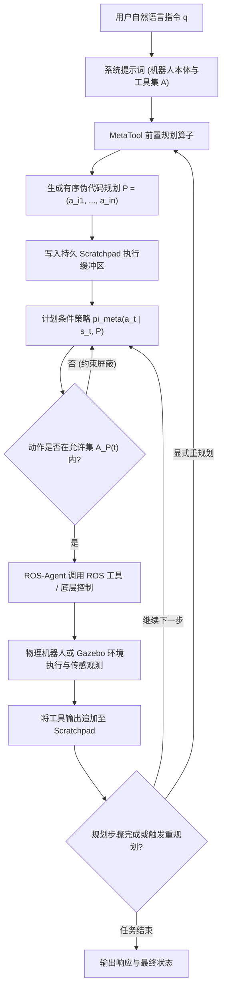

# Bridging Thought and Action: Taming Long-Horizon Instability in Open-Source LLM Agents with a MetaTool-Enhanced ROS Framework

## 一句话定义

**MetaTool-ROS-Agent** 是一种基于 NASA JPL ROS-Agent（ROSA）的机器人智能体执行框架，通过前置 **MetaTool** 算子在执行前生成有序伪代码工具规划并写入持久 scratchpad 记忆，以计划条件策略严格约束每步可调用工具，从而抑制开源 LLM 在长程 ROS 任务中的重复调用、递归死循环与意图漂移。

## 英文缩写速查

| 缩写 | 英文全称 | 简要说明 |
|---|---|---|
| ROS / ROSA | Robot Operating System / Robot Operating System Agent | 机器人中间件与 NASA JPL 提出的面向 ROS 的 LLM 智能体框架 |
| ReAct | Reasoning and Acting | 交替生成推理思考与工具动作的经典智能体循环范式 |
| CaP | Code as Policies | 让语言模型直接生成可执行策略代码的具身控制范式 |
| RAG | Retrieval-Augmented Generation | 检索增强生成，本文用于 `RAG_query` 向量库知识查询 |
| BFCL | Berkeley Function Calling Leaderboard | 用于评估 LLM 函数调用与工具使用能力的基准榜单 |
| TCDS | IEEE Transactions on Cognitive and Developmental Systems | 本文提交的 IEEE 期刊名称 |

## 为什么重要

在将大语言模型接入 ROS 控制系统时，闭源大模型往往受限于推理成本与部署隐私，而开源 LLM 在多步工具调用中常出现长程推理退化——例如重复触发同一工具、陷入无限循环、在长上下文中遗忘初始目标或调用不存在的工具。现有方法多在提示词层面改进或依赖重度微调（如 RoboGPT），缺乏对 ROS 工具动作空间的硬约束。本文在不重新训练模型权重的前提下，通过架构级的“规划–执行分离”与持久状态契约，使中等规模开源模型（如 `GPT-OSS-20B`、`GPT-OSS-120B`、`Kimi-K2`）在真实移动机器人上的长程任务稳定性显著提升，为低成本开源智能体落地 ROS 提供了轻量级工程方案。

## 核心信息

| 字段 | 内容或状态 |
|---|---|
| 作者 | Kazi Abrar Mahmud, Nilotpaul Kundu Dhurubo, Tamal Kirttonia, Sabbir Hossain Ujjal, Mohammad Ariful Haque |
| 机构 | Bangladesh University of Engineering and Technology (BUET); University of Massachusetts Amherst |
| 发表时间 | 2026-09-11（arXiv:2609.13335v1，投稿至 IEEE TCDS） |
| 论文链接 | [arXiv:2609.13335](https://arxiv.org/abs/2609.13335) / [arXiv HTML](https://arxiv.org/html/2609.13335) |
| 项目与代码 | [匿名仓库入口](https://anonymous.4open.science/r/uh_bot_v1_sim-BDB1/README.md)（`uh_bot_v1_sim-BDB1`） |
| 清单分类 | model.planning, harness.memory（来源条目：`survey_ax_2609_13335`） |
| 开源状态 | 宣称匿名开源 / 未确认可运行源码（论文 §IV-B 脚注提供匿名 4open.science 链接，但截至 2026-11-27 缓存仅捕获 `"Anonymous Github"` 文本，未能获取源码目录与可运行入口） |

## 核心原理

### 1. 系统输入与动作空间

系统接收自然语言用户指令 $q \in \mathcal{Q}$，连同编码了机器人本体能力与工具清单的预制系统提示词一起送入 LLM，在 ROSA 的观察–推理–行动（observation–reasoning–action）循环中运行。除 ROSA 原生系统诊断工具（`rosnode`、`rostopic`）外，系统定义了 8 个面向任务的工具模块 $\mathcal{A} = \{a_1, a_2, \dots, a_m\}$：

| 工具名称 | 功能说明 |
|---|---|
| `describe_image` | 基于实时相机图像执行视觉–语言场景理解 |
| `RAG_query` | 通过向量数据库检索领域知识与设施规章 |
| `face_expression` | 发布机器人情感表情状态以支持社交交互 |
| `follow_me` | 基于人体姿态关键点实现人机跟随 |
| `get_goal_odometry` | 估计目标条件下的里程计位置信息 |
| `set_goal` | 为导航任务定义并存储目标点 |
| `publish_twist_to_move_base` | 向底层 `move_base` 下发高层导航目标/速度指令 |
| `stop_uh_v1` | 执行紧急制动并取消当前导航目标 |

### 2. MetaTool 前置规划与持久 Scratchpad 契约

基线 ROS-Agent 的 scratchpad 仅充当被动对话日志，无法阻止后续动作偏离初始意图。MetaTool 作为位于 LLM 与 ROS 执行层之间的中间算子，在任务首个工具调用之前强制分离“规划”与“执行”：

1. **前置符号规划生成**：针对输入指令 $q$，MetaTool 诱导 LLM 先输出一条有序的伪代码工具调用序列：
   $$P = \langle a_{i_1}, a_{i_2}, \dots, a_{i_n} \rangle, \quad a_{i_k} \in \mathcal{A}$$
2. **外化持久缓冲**：规划 $P$ 立即存入 ROS-Agent 的 scratchpad 记忆，并在整个交互回合中保持持久可见；每一步实际工具执行返回的观测结果均追加到同一个 scratchpad 中，使“初始意图 + 历史工具输出”共同构成连续执行上下文。
3. **计划条件执行约束**：将常规无约束工具选择策略 $\pi(a_t \mid s_t)$ 替换为计划条件策略 $\pi_{\mathrm{meta}}(a_t \mid s_t, P)$，除非显式触发重规划，否则将步骤 $t$ 的容许动作集合限制为当前规划步指定工具 $\mathcal{A}_P(t) = \{a_{i_t}\}$：
   $$\pi_{\mathrm{meta}}(a_t \mid s_t, P) = 0 \quad \forall\, a_t \notin \mathcal{A}_P(t)$$
   由于 $|\mathcal{A}_P(t)| \ll |\mathcal{A}|$，动作分支空间被大幅收窄，从而抑制了开源 LLM 在长程执行中的递归重复调用、工具幻觉与指令漂移。

## 流程总览

## 源码运行时序图

**不适用**（说明核查结果：截至 2026-11-27 未确认可运行官方源码实现；论文 §IV-B 脚注提供了匿名代码仓库入口 `https://anonymous.4open.science/r/uh_bot_v1_sim-BDB1/README.md`，但本次缓存抓取仅返回 `"Anonymous Github"` 占位文本，`candidate_repos` 为空，未获得实际仓库目录、依赖配置及入口脚本源码，无法绘制对齐源码模块的运行时序图）。

## 实验与评测

作者在 **ROS–Gazebo 仿真**（大办公室、医院楼层、带散落障碍物工厂、城市住宅 4 类场景）与**定制物理移动机器人**（Intel 机载主机 + NVIDIA GTX 1050 Ti GPU，IMU 与轮式编码器融合里程计，通过 Groq API 调用开源 LLM）上设计了三类递进复杂度的任务：

- **T1（Simple Information Query）**：基础信息检索与自然语言解析（例如查询设施运行规范与安全条例）。
- **T2（Complex Contextual Navigation）**：语义推理与导航接地（例如识别“开展电力系统设备研究的实验室”并引导用户前往）。
- **T3（Contextually Grounded Sequential Task）**：长程时序任务，串联人物跟随（`follow_me`）、记忆特定视觉地标（如红色货架）、穿插无关对话，最后返回之前记忆的地标。

### 1. Gazebo 仿真组件消融（Table III & IV，每任务 20 次试验）

对比四种同管线配置：`C1`（ROS-Agent + 自适应提示词）、`C2`（非持久提示规划）、`C3`（MetaTool 持久 scratchpad，无执行约束）、`C4`（完整 MetaTool：持久 scratchpad + 执行约束）。按论文原表报道的成功率如下（作者指出受每项 20 次试验限制，结果反映经验性趋势而非统计显著性检验）：

| 配置 | 任务 | GPT-4o | GPT-OSS-20B | GPT-OSS-120B | Kimi-K2 |
|---|---|---|---|---|---|
| C1（自适应提示） | T1 / T2 / T3 | 75% / 50% / 55% | 55% / 40% / 30% | 55% / 75% / 40% | 75% / 80%* / 50% |
| C2（非持久规划） | T1 / T2 / T3 | 85% / 85% / 75% | 60% / 60% / 35% | 75% / 75% / 40% | 75% / 80%* / 65% |
| C3（持久无约束） | T1 / T2 / T3 | 95% / 85% / 75% | 70% / 60% / 35% | 95%* / 80% / 50% | 85% / 85%* / 65% |
| C4（完整 MetaTool） | T1 / T2 / T3 | 90% / 85% / 75% | 85% / 75% / 55% | 85% / 90% / 70% | 95% / 85%* / 70% |

> 注：表中带 `*` 项在论文 Table III 原表分别记为 `17/20 (80%)`、`18/20 (85%)` 与 `18/20 (95%)`（原表百分比保留原文排版口径）。在最复杂的 `T3` 任务上，从 `C1` 到 `C4` 的增益集中体现在开源模型：`GPT-OSS-20B` 提升 +25 个百分点（30% → 55%），`GPT-OSS-120B` 提升 +30 个百分点（40% → 70%），`Kimi-K2` 提升 +20 个百分点（50% → 70%）；执行约束（`C3 → C4`）在 `T3` 上分别带来 +20、+20 与 +5 个百分点的稳定提升。

### 2. 真机硬件效率与 Token 方差（Table V & Fig. 5，T2 任务 40 次试验，GPT-OSS-120B）

| 方法 | 重复工具调用率 (%) | 无效/失败工具调用率 (%) | 平均执行耗时 (s) |
|---|---|---|---|
| ROS-Agent（基线） | 19.0 ± 5.7 | 21.7 ± 6.5 | 89.51 ± 16.48 |
| MetaTool（本文） | 6.1 ± 2.2 | 8.1 ± 2.9 | 84.23 ± 9.71 |

在真机试验中，MetaTool 将重复调用率由 19.0% 降至 6.1%，无效/失败调用率由 21.7% 降至 8.1%，耗时方差从 16.48 s 降至 9.71 s；同时 Fig. 5 显示其 token 消耗分布方差显著低于原版 ROSA，表明无限循环与发散试探得到明显抑制。

## 与其他工作对比

在论文 Table I 特性对比与 Table VI 物理平台失败模式分析（40 次物理试验，T1–T3，使用 `GPT-OSS-120B` 作为统一骨干，其中 ReAct 与 CaP 由作者在同一 ROS 工具接口下复现适配）中，各方案表现如下（失败类别非互斥）：

| 方法 | 显式规划缓冲 | 执行约束 | ROS 原生 | 错误/幻觉规划 | 导航失败 | 工具不可用/超时 | 总成功率 |
|---|---|---|---|---|---|---|---|
| ReAct | × | × | × | 17/40 | 13/40 | 10/40 | 17/40 (42.5%) |
| CaP | ✓ | × | × | 13/40 | 10/40 | 13/40 | 20/40 (50.0%) |
| ROSA（原版） | ✓（被动） | × | ✓ | 17/40 | 10/40 | 17/40 | 23/40 (57.5%) |
| MetaTool-ROS-Agent（本文） | ✓（持久契约） | ✓ | ✓ | 10/40 | 7/40 | 3/40 | 30/40 (75.0%) |

- **对比 ReAct / 原版 ROSA**：无持久规划或无动作约束时，开源模型极易产生高比例幻觉规划（17/40）和超时/工具不可用（10/40–17/40）。
- **对比 CaP（Code as Policies）**：单次生成代码式策略可略微减少规划幻觉（13/40），但缺少运行期执行约束与环境反馈绑定，面对工具超时与状态变化时成功率仍只有 50.0%。
- **与站内方法关联**：该方法对应 [机器人智能体执行框架](../methods/robot-agent-harness.md) 中的“规划缓存 + 工具门控”模式，可与 [Agent 规划与反馈](../methods/agent-planning-feedback.md) 中的显式重规划策略互补。

## 结论

**一句话总判：对于工具调用能力中等的开源 LLM，在 ROS 中把 scratchpad 从“被动对话记录”升级为“前置伪代码规划 + 步级动作门控契约”，比单纯微调提示词更能有效消除长程死循环与无效调用。**

1. **分离规划与执行对开源模型收益最大** — 在复杂时序任务 `T3` 上，完整 MetaTool 使 `GPT-OSS-120B` 成功率从 40% 提升至 70%，`GPT-OSS-20B` 从 30% 提升至 55%。
2. **必须同时包含“持久缓冲”和“动作约束”** — 消融显示仅持久化而不加约束（`C3`）在 `T3` 上收益有限，加入 $\pi_{\mathrm{meta}}(a_t \mid s_t, P) = 0$ 硬门控（`C4`）才触发了稳定收敛。
3. **强闭源模型在简单任务上可能被过度约束** — `GPT-4o` 在简单查询 `T1` 上 `C4`（90%）略低于 `C3`（95%），说明强模型在简单分支上更需要保留一定动作灵活性。
4. **真机稳定性提升主要来自减少超时与冗余调用** — 40 次物理试验中工具不可用/超时从 ROSA 的 17/40 降至 3/40，重复工具调用率从 19.0% 降至 6.1%。

## 工程实践

- **中间件集成方式**：可在现有 ROSA / LangChain 式 ROS Agent 工具循环入口前挂接 MetaTool 节点，要求首次 LLM 调用仅输出结构化工具序列（如 JSON/伪代码列表），解析后写入不可覆写的系统状态字段。
- **工具原子化设计**：参考 Table II，将底层硬件控制抽象为幂等或明确状态的 ROS 工具（如 `set_goal`、`get_goal_odometry`、`stop_uh_v1`），降低 LLM 直接拼装底层话题消息出错的概率。
- **云端推理与本地控制解耦**：本文在机载 Intel + GTX 1050 Ti 上仅运行视觉感知、里程计融合与底层运动控制，将大参数开源 LLM 推理托管于 Groq API，适合算力受限的原型验证，但需同步做好网络超时与急停工具（`stop_uh_v1`）兜底。
- **重规划触发条件**：当步级工具返回异常或导航失败时，需要设计明确的异常处理分支允许回调 MetaTool 重新生成剩余计划，而非无限重试原步骤。

## 局限与风险

- **初始规划错误仍难完全自愈**：真机试验中仍有 10/40 的错误/幻觉规划与 7/40 的导航失败，若 MetaTool 在第一步生成的计划 $P$ 本身存在语义误解，后续强约束执行会沿着错误轨迹推进。
- **匿名代码暂未核验可复现性**：论文给出的 `anonymous.4open.science` 仓库在当前静态归档中无法获取源码与 ROS launch 文件，工程复现需自行基于 ROSA 重建规划缓冲与工具掩码逻辑。
- **评测样本量与复现口径限制**：Gazebo 消融每配置仅 20 次试验（不足以做严格显著性检验），且 Table VI 的 ReAct/CaP 为作者在自有工具接口上的重实现，与原论文默认任务域存在差异。
- **外部 API 依赖风险**：实验使用云端 Groq API 调用 `GPT-OSS-120B` 等模型，在弱网或离线物理部署场景下存在延迟波动和断连风险；机载端小模型本地化部署仍有待验证。

## 关联页面

- [Agentic Robots 综述](paper-towards-agentic-robots-survey.md)
- [全量项目节点清单](../overview/awesome-agentic-robots-node-index.md)
- [VLA 方法背景](../methods/vla.md)
- [机器人智能体执行框架](../methods/robot-agent-harness.md)
- [智能体工具调用接口](../methods/agent-tool-use-interface.md)
- [智能体规划与反馈](../methods/agent-planning-feedback.md)
- [机器人导航工作流](../methods/robot-navigation-workflow.md)
- [视觉语言导航（VLN）](../tasks/vision-language-navigation.md)

## 推荐继续阅读

- [arXiv 原文主页（2609.13335）](https://arxiv.org/abs/2609.13335) — 查看论文元数据与 PDF 下载
- [arXiv HTML 全文阅读版](https://arxiv.org/html/2609.13335) — 阅读完整公式、Table I–VI 与图注细节
- [NASA JPL ROSA 论文（IEEE Aerospace 2025）参考条目](https://arxiv.org/html/2609.13335#bib.bib4) — 了解本文所扩展的 ROS-Agent 基础架构

## 参考来源

- [论文原文核对归档（arXiv:2609.13335）](../../sources/papers/paper-agentic-2609-13335.md)
- [官方 Awesome 快照归档](../../sources/repos/awesome-agentic-robots-survey-index.md)
- [arXiv:2609.13335 原始页面](https://arxiv.org/abs/2609.13335)
- [匿名代码入口（uh_bot_v1_sim-BDB1）](https://anonymous.4open.science/r/uh_bot_v1_sim-BDB1/README.md)
