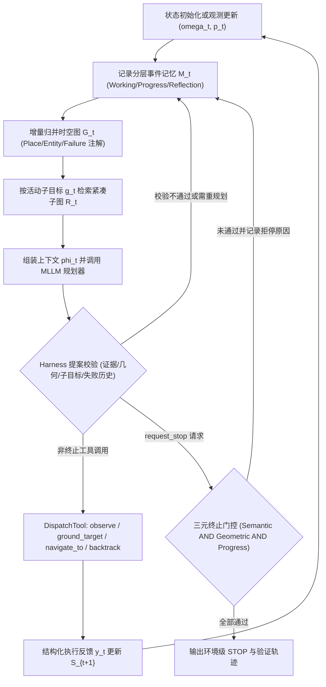
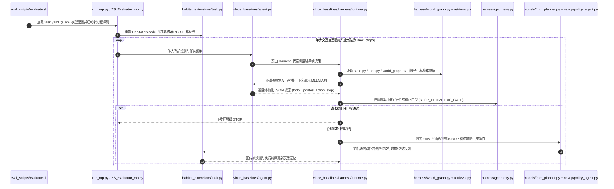

# HarnessVLN: Unifying Training-Free Embodied Navigation through an Agent Harness

## 一句话定义

**HarnessVLN** 是一种零样本免训练（training-free）具身导航框架，通过统一的 **Agent Harness** 运行时将多模态大语言模型（MLLM）的语义规划与分层事件记忆、持久化时空图（ST Graph）、工具契约校验及证据化终止门控绑定，在单一架构下同时支持连续环境指令跟随（VLN-CE）与目标物体导航（ObjectNav）。

## 英文缩写速查

| 缩写 | 英文全称 | 简要说明 |
|---|---|---|
| MLLM | Multimodal Large Language Model | 多模态大语言模型，负责任务分解、子目标规划、图像区域定位与停止核验 |
| ST Graph | Spatiotemporal Graph | 持久化时空图，记录位置节点、实体假设、观测视点时间戳与失败注解 |
| VLN-CE | Vision-and-Language Navigation in Continuous Environments | 连续环境视觉语言导航，智能体需执行连续位姿与底盘运动以跟随自然语言路线 |
| ObjectNav | Object-Goal Navigation | 目标物体导航，要求智能体在未知室内环境中定位并接近指定类别物体 |
| FMM | Fast Marching Method | 快速行进法路径规划器，用于平面局部障碍地图上的无碰撞路径规划 |
| NavDP | Navigation Diffusion Policy | 导航扩散策略，在本工作中作为可替换执行器处理跨楼层楼梯通行 |

## 为什么重要

1. **打破多任务管线割裂：** 既有免训练具身导航方案通常为指令跟随与物体搜寻分别设计提示流程与地图逻辑，而 HarnessVLN 用同一套状态协议 $\mathcal{S}_t$ 与 8 个标准工具接口统一了两类任务，仅在任务进度表征 $z_t$ 与终止判据上做任务条件化切换。
2. **用运行时校验替代盲信模型输出：** 即使 MLLM 具备更强语义推理能力，仍可能提出不可达目标、混淆外观相似物体或基于过时记忆误判到达；Harness 在派发动作与执行 `STOP` 前强制校验空间证据、几何可达性与活动子目标一致性。
3. **验证了 Harness 工程在免训练导航中的直接收益：** 在固定 100 回合子集上，同一底座模型叠加事件记忆、ST Graph 与停止校验后，R2R 成功率由 $43.0\%$ 提升至 $58.0\%$（$+15.0$ 个百分点），HM3D-OVON 由 $45.0\%$ 提升至 $55.0\%$（$+10.0$ 个百分点），说明运行时机制本身能显著释放预训练模型的导航潜力。
4. **打通跨任务真机落地路径：** 同一 Harness 协议无需针对场景做导航微调即可部署到 AGIBOT A3 Ultra 人形机器人，完成指令跟随、开放词汇寻物及二者的串联组合任务。

## 核心信息

| 字段 | 内容 |
|---|---|
| 作者 | Yang Chen, Lirong Che, Zhenyu Huang, Wenbo Fu, Chuang Wang, Xu Cao, Daqi Liu, Yuzhe Yang, Jian Su, Lan-Zhe Guo |
| 机构 | 南京大学（NJU）、智元机器人（AGIBOT）、清华大学（Tsinghua） |
| 发表时间 | 2026-09-14 提交 arXiv v1，2026-09-29 修订 v3 |
| 论文链接 | [arXiv:2609.15195](https://arxiv.org/abs/2609.15195)（[HTML 全文](https://arxiv.org/html/2609.15195)） |
| 项目与代码 | [官方项目页](https://agibot-harnessvln.netlify.app/) · [GitHub: AgibotGeneral/harnessvln](https://github.com/AgibotGeneral/harnessvln) |
| 清单分类 | `harness.monitoring_and_recovery`（来源条目：`survey_ax_2609_15195`） |
| 开源状态 | **已开源** — 公开仿真评估、Agent Harness 运行时、FMM/NavDP 执行集成与可视化工具（许可证 README 标注 CC BY-NC-SA 4.0） |

## 核心原理

### 1. 统一状态与 Agent Harness 决策循环

在决策步 $t$，Agent Harness 维护如下六元组状态：

$$\mathcal{S}_t = \bigl(x,\, \omega_t,\, p_t,\, z_t,\, \mathcal{M}_t,\, \mathcal{G}_t\bigr)$$

- $x$：任务规格（路线语言指令或目标物体类别）。
- $\omega_t$：位姿对齐的 RGB-D 观测（主前向与 $0^\circ/90^\circ/180^\circ/270^\circ$ 四向视图）及分辨率为 $5\text{ cm}$ 的局部几何占据栅格。
- $p_t$：智能体当前位姿。
- $z_t$：任务进度状态——指令跟随任务中记录当前路段、已满足的运动约束与已见地标；ObjectNav 任务中记录已探索区域、候选目标假设及其核验状态。
- $\mathcal{M}_t$：面向任务执行历程的分层事件记忆。
- $\mathcal{G}_t$：面向环境结构与证据溯源的持久化时空图。

每步由同一 MLLM 规划器 $\pi_\theta$ 根据组装上下文 $\phi_t$ 提出语义工具调用 $c_t$，但必须经过 Harness 的 `Validate` 阶段（核验参数格式、证据来源与时效性、几何可达性及子目标一致性）后才会转化为可执行调用 $\widehat{c}_t$，工具返回的结构化反馈 $y_t$ 再同步更新 $\mathcal{S}_{t+1}$、$\mathcal{M}_t$ 与 $\mathcal{G}_t$。

### 2. 统一工具接口（8 类核心工具）

Harness 通过标准化输入输出契约封装异构模块，使感知或执行器可独立替换而不改动规划器协议：

| 工具名 | 角色 | 核心功能 |
|---|---|---|
| `observe` | Perception | 采集当前位姿下的 RGB-D 观测与机器人位姿 |
| `observe_panorama` | Perception | 按预设朝向采集多视角全景观测（仿真中完整旋转为 12 次 $30^\circ$ 转向） |
| `retrieve_memory` | Retrieval | 按当前子目标从事件记忆与时空图中检索相关空间证据与失败约束 |
| `ground_target` | Grounding | 将文本子目标定位到候选视图与归一化图像包围框（`[0,1000]` 坐标系） |
| `query_depth` | Perception | 查询已定位区域的深度估计及其方差不确定度 |
| `navigate_to` | Navigation | 调用可替换 Navigation Executor（平面 FMM / 楼梯 NavDP）前往已校验目标 |
| `backtrack` | Recovery | 沿时空图拓扑返回已验证历史节点并确认到达 |
| `request_stop` | Termination | 发起终止请求，交由 Harness 执行三元证据校验 |

### 3. 分层事件记忆 $\mathcal{M}_t$

- **工作记忆（Working Memory）：** 仅保存当前观测、受 50 张图像预算约束的降采样历史视图（每 2 步采样前向视图）、当前目标假设与最近工具反馈，避免提示词上下文随轨迹线性膨胀。
- **进度记忆（Progress Memory）：** 将任务拆解为带稳定 `todo_id` 的子目标序列，每个条目取 `pending`、`active`、`completed`、`blocked` 四态之一且**同一时刻最多仅允许 1 个 `active`**。仅当存在位姿对齐观测证据（`evidence_ids`）或工具成功反馈时才允许标为 `completed`，防止规划器凭主观臆断推进进度。
- **反思记忆（Reflection Memory）：** 作为执行异常的权威日志，记录不可达目标、定位矛盾、碰撞、无进展停滞、回溯失败及被拒停止请求，保留事件 ID、位置、时间戳、工具反馈与原始观测；对具有空间复用意涵的失败，仅向时空图写入轻量注解与事件引用指针，避免全量冗余复制。

### 4. 持久化时空图 $\mathcal{G}_t$ 与任务条件检索

时空图定义为四元组 $\mathcal{G}_t = (\mathcal{V}^P_t \cup \mathcal{V}^E_t, \mathcal{E}_t, \mathcal{T}_t)$：

- **图节点与拓扑边：** 位置节点 $\mathcal{V}^P_t$（空间合并半径 $0.75\text{ m}$）通过双向 `NavigableTo` 边构成可通行拓扑骨架；实体节点 $\mathcal{V}^E_t$（合并半径 $1.00\text{ m}$）存储语义别名、空间假设、置信度及支持视图，并通过 `ObservedFrom` 与 `Contains` 边绑定观测视点与时间戳 $\mathcal{T}_t$。
- **任务条件打分检索：** 规划前 Harness 按活动子目标 $g_t$ 对位置节点排序：

$$s(v_i \mid g_t) = R(v_i, g_t) + \lambda_{\mathrm{rec}} C(v_i) + \lambda_{\mathrm{sal}} A(v_i) - \lambda_{\mathrm{fail}} P(v_i, g_t)$$

  其中 $R$ 为基于局部 IDF 加权余弦相似度的语义相关性，$C$ 为时间近因性（权重 $\lambda_{\mathrm{rec}}=0.3$），$A$ 为空间显著性（权重 $\lambda_{\mathrm{sal}}=0.3$），$P$ 为面向当前子目标的既往失败惩罚（单次 $0.5$、上限 $1.0$，防止永久封死分支）。检索选取前 3 个种子节点并作 1 跳图扩展，最多返回 5 个位置节点组成紧凑检索集 $\mathcal{R}_t$。

### 5. 接地执行与三元证据化终止

MLLM 不被允许直接向环境发送底层 `STOP` 动作，所有终止请求都必须通过 Harness 的三元合取校验：

$$F_{\mathrm{stop}} = F_{\mathrm{semantic}} \land F_{\mathrm{geometric}} \land F_{\mathrm{progress}}$$

1. **语义校验（$F_{\mathrm{semantic}}$）：** 在 ObjectNav 中须由验证提示确认目标清晰可见且属于指定类别（拒绝外观相近物），并输出紧致 2D 包围框；在 VLN-CE 中须与最终路段及地标描述一致。
2. **几何校验（$F_{\mathrm{geometric}}$）：** 优先取目标包围框锚点处 $5 \times 5$ 深度邻域的中位数（仅当深度标准差 $\le 0.5\text{ m}$ 时采信，阈值 $\le 2.5\text{ m}$）；若深度缺失或噪声过大，则回退至到投影导航目标点的水平距离（阈值 $\le 1.0\text{ m}$）。
3. **进度校验（$F_{\mathrm{progress}}$）：** 核查进度记忆与当前路由状态是否支持终止。若任一条件未通过，Harness 拒绝终止、将拒停事件写入反思记忆，并引导模型继续观察、重定位、逼近或回溯。

## 流程总览

## 源码运行时序图

结合官方仓库 `AgibotGeneral/harnessvln` 目录样本（`files_sample`）与 `README.md` 入口说明，仿真评测与 Harness 控制循环的调用时序如下（基于仓库文件结构与 README 静态核对，未展开单文件内部函数逐行分析）：

入口说明：`eval_scripts/evaluate.sh` 经 `eval_common.sh` 解析任务配置与环境变量后调用 `run_mp.py` / `vlnce_baselines/ZS_Evaluator_mp.py` 驱动评测循环；`vlnce_baselines/harness/` 下的 `runtime.py`、`state.py`、`todo.py`、`world_graph.py`、`retrieval.py`、`geometry.py` 分别对应论文中的运行时闭环、共享状态、进度记忆、时空图、任务条件检索与几何校验模块。

## 实验与评测

> **注：** 官方项目页列出的 R2R / RxR 主实验 SR 为 $60.8\%$ / $53.9\%$（消融 $46.0 \rightarrow 64.0\%$），而 arXiv v3 正文（2026-09-29）报告为 $59.6\%$ / $51.4\%$（消融 $43.0 \rightarrow 58.0\%$）；下表严格采信 arXiv v3 全文数据。

### 1. 指令跟随主评测（VLN-CE R2R 与 RxR val-unseen，Table 2）

| 方法 | 类型 / 底座 | R2R NE↓ | R2R OSR↑ | R2R SR↑ | R2R SPL↑ | RxR NE↓ | RxR SR↑ | RxR SPL↑ | RxR nDTW↑ |
|---|---|---|---|---|---|---|---|---|---|
| HarnessVLN（全量 split） | 免训练 · GPT-5.5 | **4.08** | **70.7** | **59.6** | **43.6** | **6.50** | **51.4** | **38.1** | **55.6** |
| HSGM [CVPR26] | 免训练 · GPT-5 | 5.42 | 58.7 | 47.9 | 32.8 | 7.43 | 41.8 | 25.1 | 54.9 |
| GC-VLN [CoRL25] | 免训练 | 7.30 | 41.8 | 33.6 | 16.3 | 8.80 | 33.8 | 13.8 | – |
| CA-Nav [TPAMI25] | 免训练 | 7.58 | 48.0 | 25.3 | 10.8 | 10.40 | 19.0 | 6.0 | 13.5 |
| HarnessVLN†（R2R Rand100） | 免训练 · GPT-5.5 | **4.24** | **77.0** | **58.0** | 35.8 | – | – | – | – |
| AgenticNav† [arXiv26] | 免训练 · GPT-5.5 | 5.19 | 65.0 | 55.0 | **48.4** | – | – | – | – |
| mini-swe-agent† [arXiv26] | 免训练 · GPT-5.5 | 7.29 | 57.0 | 52.0 | 44.2 | – | – | – | – |
| EvoNav† [CVPR26] | 免训练 · Gemini-2.5-pro | 5.04 | 51.0 | 43.0 | 37.8 | – | – | – | – |
| ABot-N0 [CVPR26] | 有监督训练 | 3.78 | 70.8 | 66.4 | 63.9 | 3.83 | 69.3 | 60.0 | – |
| InternVLA-N1 [ICLR26] | 有监督训练 | 4.83 | 63.3 | 58.2 | 54.0 | 5.91 | 53.5 | 46.1 | 65.3 |

### 2. 目标物体导航主评测（HM3D-v2 1,000 回合与 HM3D-OVON 3,000 回合，Table 3）

| 方法 | 需导航训练 | HM3D-v2 SR↑ | HM3D-v2 SPL↑ | HM3D-OVON SR↑ | HM3D-OVON SPL↑ |
|---|---|---|---|---|---|
| **HarnessVLN（GPT-5.6-luna）** | ✗（免训练） | **76.0** | 37.9 | **59.3** | **36.6** |
| MSGNav [CVPR26] | ✗（免训练） | 74.4 | 33.4 | 48.3 | 27.0 |
| DRIVE-Nav [arXiv26] | ✗（免训练） | 72.4 | **41.3** | 50.2 | 32.6 |
| STEGNav [arXiv26] | ✗（免训练） | 69.4 | 28.2 | – | – |
| VLFM [ICRA24] | ✗（免训练） | 63.6 | 32.5 | 38.5 | 22.2 |
| InstructNav [CoRL24] | ✗（免训练） | 58.0 | 20.9 | – | – |
| FiLM-Nav [arXiv25] | ✓（有监督） | 77.0 | 41.3 | 40.8 | 24.4 |
| ABot-N0 [CVPR26] | ✓（有监督） | – | – | 54.0 | 30.5 |

### 3. 累积消融实验（固定 100 回合子集，Table 4）

| Mem.（事件记忆） | Graph（ST Graph） | Stop（停止校验） | R2R SR↑ | R2R SPL↑ | R2R OSR↑ | HM3D-OVON SR↑ | HM3D-OVON SPL↑ | HM3D-OVON OSR↑ |
|---|---|---|---|---|---|---|---|---|
| ✗ | ✗ | ✗ | 43.0 | 24.3 | 65.0 | 45.0 | 32.0 | 72.0 |
| ✓ | ✗ | ✗ | 50.0（+7.0） | 30.9 | 73.0 | 52.0（+7.0） | 32.4 | 72.0 |
| ✓ | ✓ | ✗ | 56.0（+6.0） | 32.4 | 76.0 | 53.0（+1.0） | **34.2** | 71.0 |
| ✓ | ✓ | ✓ | **58.0**（+2.0） | **35.9** | **77.0** | **55.0**（+2.0） | 33.0 | **74.0** |

### 4. 模型敏感性与同底座对比（Table 6，100 回合子集）与步数预算分析（Appendix 1.3）

- **底座替换与同模型对照（GPT-5.6-luna）：** 在 HM3D-v2 上 HarnessVLN 达 $76.0\%$ SR / $40.8\%$ SPL（同底座 MSGNav 为 $62.0\%$ / $27.7\%$，OSR–SR 差距由 $22.0$ 收窄至 $10.0$）；在 HM3D-OVON 上达 $55.0\%$ SR / $33.0\%$ SPL（同底座 MSGNav 为 $37.0\%$ / $18.9\%$，但 HarnessVLN 的 OSR–SR 差距仍有 $19.0$ 个百分点）。更换为 `GPT-6-astra` 后 HM3D-v2 / HM3D-OVON SR 进一步升至 $86.0\%$ / $63.0\%$；使用轻量模型 `Qwen3.8-flash` 仍达 $72.0\%$ / $51.0\%$。
- **步数上限与观测旋转开销：** 在 R2R Rand100 上，将预算从 500 步放宽到 1,000 步使 OSR 从 $77.0\%$ 升至 $81.0\%$、SR 从 $58.0\%$ 升至 $61.0\%$，但 SPL 从 $35.85\%$ 微降至 $35.63\%$；在 1,000 步运行总共 $36,291$ 次动作中，全景观测旋转占 $19,907$ 次（$54.85\%$，每回合平均 $199.07$ 步）。

## 与其他工作对比

- **对比有监督导航大模型（NaVid / Uni-NaVid / ETPNav / InternVLA-N1 / NavFoM / ABot-N0）：** 在全量 R2R 与 RxR 上，HarnessVLN（$59.6\%$ / $51.4\%$ SR）已超越早先有监督模型 NaVid、Uni-NaVid，并与 ETPNav（$57.0\%$）、InternVLA-N1（$58.2\%$）处于同一水平，但仍低于大规模轨迹训练的 ABot-N0（$66.4\%$ / $69.3\%$）且路径效率（SPL $43.6\%$ vs $63.9\%$）偏低；而在开放词汇 HM3D-OVON 上，HarnessVLN（$59.3\%$ SR）超越所列全部有监督基线（ABot-N0 为 $54.0\%$）。
- **对比同底座工具化代理（AgenticNav / mini-swe-agent）：** 在 R2R Rand100 上均使用 GPT-5.5 时，HarnessVLN 的到达率与完成率更高（OSR $77.0\%$ vs $65.0\%$ / $57.0\%$；SR $58.0\%$ vs $55.0\%$ / $52.0\%$；NE $4.24\text{ m}$ vs $5.19\text{ m}$ / $7.29\text{ m}$），但 SPL 较低（$35.8\%$ vs AgenticNav 的 $48.4\%$），反映出频繁全景扫描与保守停止校验以步数换取成功率。
- **对比通用三维场景图免训练方法（MSGNav / DRIVE-Nav / STEGNav / HSGM）：** 同样采用 GPT-5.6-luna 时，HarnessVLN 在 HM3D-v2 与 HM3D-OVON 上相对 MSGNav 分别提升 $+14.0$ 与 $+18.0$ 个百分点 SR，优势主要来自子目标进度绑定、可回溯失败惩罚与几何停止校验。

## 结论

**一句话总判：HarnessVLN 证明了在免训练具身导航中，将 MLLM 规划器置于具有状态校验、分层事件记忆、时空图溯源与三元停止门控的 Agent Harness 之内，可在无需任务微调的前提下用单一框架打通指令跟随、开放词汇寻物与人形机器人真机部署。**

1. **优先将状态一致性与停止核验交给 Harness：** 把子目标完成条件与 `STOP` 权限从模型自然语言自信中剥离，绑定到 `todo_id` 证据和深度/投影几何门控，是提升长程任务完成率（OSR 与 SR）的关键杠杆。
2. **明确成功率与路径效率的权衡：** 全景观测旋转占用了超过一半（$54.85\%$）的仿真步数，工程应用时需在高精度感知与高 SPL 之间设置扫描频率或触发条件。
3. **部署官方代码时注意默认开关：** 公开仓库的默认评测脚本将 `EVAL.STOP_GEOMETRIC_GATE` 与预算自动停止置为关闭，复现论文主实验行为须按 README 显式开启对应覆盖参数。
4. **语义规划与底层执行器可独立演进：** 将 FMM/NavDP（仿真）或 Fast-FoundationStereo + 局部规划器（真机）封装在 `navigate_to` 工具契约之后，可使同一规划逻辑直接迁移到物理机器人平台。

## 工程实践

- **仿真观测与图谱关键参数（Table 5）：** RGB-D 分辨率 $640\times 480$（水平视场角 $79^\circ$），深度有效区间 $[0.1, 5.0]\text{ m}$，局部占据图分辨率 $5\text{ cm}$，前进步长 $0.25\text{ m}$、转向角 $30^\circ$，单回合默认预算 $500$ 步；前向历史每 $2$ 步采样且每次请求上限 $50$ 张图；时空图位置合并半径 $0.75\text{ m}$、实体合并半径 $1.00\text{ m}$。
- **推理采样设置（Appendix 1.2）：** 初始化、规划、验证、恢复均采用采样温度 $0.7$（最大输出分别为 $4096 / 8192 / 8192 / 2048$ tokens）；图像区域定位（grounding）使用确定性采样温度 $0$（最大输出 $10240$ tokens）。
- **开源仓库启动与开关注意事项：** 仓库依赖 Python 3.9、PyTorch 2.8.0+cu128、Habitat-Sim 0.3.1 及带补丁的 Habitat-Lab / GroundingDINO / SAM / NavDP 权重；启用论文所述证据化停止校验须在 `eval_scripts/evaluate.sh` 命令行追加 `EVAL.STOP_GEOMETRIC_GATE True EVAL.STOP_AUTOSTOP_BEFORE_TIMEOUT True EVAL.STOP_REJECTION_PANORAMA_COOLDOWN_STEPS 24`。
- **人形机器人真机系统配置（§5.1）：** 在身高 $1.74\text{ m}$ 的 **AGIBOT A3 Ultra** 平台上，采用头部双目相机与 **Fast-FoundationStereo** 实时估计稠密度量深度，使用 **Qwen-3.8-27B** 担任规划器并运行于 NVIDIA Thor 机载计算平台，下接局部路径规划器执行指令跟随与寻物任务。

## 局限与风险

1. **全景观测带来显著步数与效率代价：** Appendix 1.3 显示每次完整全景需消耗 12 步 $30^\circ$ 旋转，占总步数的 $54.85\%$，直接拉低 SPL（如 R2R Rand100 上低于 AgenticNav $12.6$ 个百分点）。
2. **几何接近并不等价于任务成功：** 附录病例 Figure 10 指出，在错误路段终点满足投影目标距离（$0.998\text{ m}$）仍会通过几何门控导致在距真实终点 $6.48\text{ m}$ 处误停；Figure 11 亦表明传感器深度通过门控（$1.20\text{ m}$）仍可能因基准测地线距离为 $2.15\text{ m}$ 而判失败。
3. **开放词汇寻物的终止缺口仍较明显：** 在 HM3D-OVON 上，即使使用 `GPT-5.6-luna` 或 `GPT-6-astra`，OSR 与 SR 之间仍分别存在 $19.0$ 与 $13.0$ 个百分点的落差（Table 6），反映开放类别确认与终点接近策略仍有改进空间。
4. **静态编排规则缺乏在线自演化：** 论文第 6 节明确指出当前 Harness 依赖人工预定义的编排与校验规则，尚不支持在开放环境中从交互经验自动演化规则。
5. **模型随机性、闭源接口依赖与版本数字差异：** 尽管仿真种子固定为 0，MLLM API 采样随机性仍会引入波动；主实验依赖云端多模态模型接口且费用/延迟受限；此外官方项目页展示的 R2R/RxR 分数（$60.8\%$ / $53.9\%$）高于 arXiv v3 正文（$59.6\%$ / $51.4\%$），引用时应以论文版本为准。

## 关联页面

- [Agentic Robots 综述](paper-towards-agentic-robots-survey.md)
- [全量项目节点清单](../overview/awesome-agentic-robots-node-index.md)
- [VLA 方法背景](../methods/vla.md)
- [机器人智能体执行框架](../methods/robot-agent-harness.md)：对照规划、工具调用与反馈的系统边界
- [智能体规划与反馈机制](../methods/agent-planning-feedback.md)
- [智能体工具调用接口](../methods/agent-tool-use-interface.md)
- [机器人导航工作流](../methods/robot-navigation-workflow.md)
- [视觉语言导航（VLN）](../tasks/vision-language-navigation.md)
- [零样本目标物体导航（Zero-Shot ObjectNav）](../tasks/zero-shot-object-navigation.md)

## 推荐继续阅读

- [HarnessVLN 论文原文（arXiv HTML）](https://arxiv.org/html/2609.15195)
- [HarnessVLN 官方项目页](https://agibot-harnessvln.netlify.app/)
- [HarnessVLN 官方代码仓（AgibotGeneral/harnessvln）](https://github.com/AgibotGeneral/harnessvln)

## 参考来源

- [HarnessVLN 论文原文核对归档](../../sources/papers/paper-agentic-2609-15195.md)
- [HarnessVLN 官方源码核对归档](../../sources/repos/paper-agentic-2609-15195.md)
- [官方 Awesome 快照归档](../../sources/repos/awesome-agentic-robots-survey-index.md)
- [arXiv:2609.15195 摘要页](https://arxiv.org/abs/2609.15195)
- [HarnessVLN 官方项目页](https://agibot-harnessvln.netlify.app/)
- [AgibotGeneral/harnessvln GitHub 仓库](https://github.com/AgibotGeneral/harnessvln)
