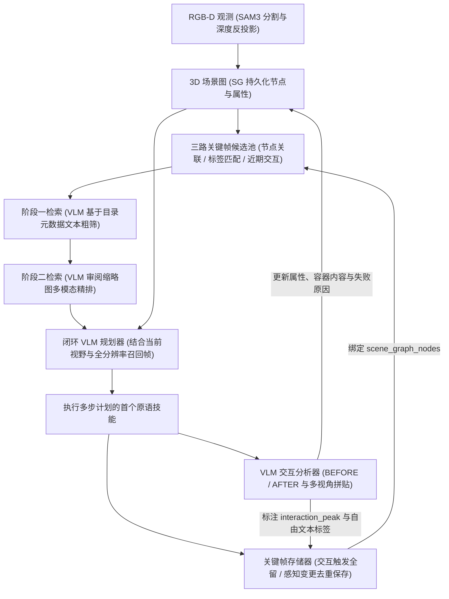

# MessyMem: Learning-from-Doing Memory for Mobile Manipulation

## 一句话定义

**MessyMem** 是斯坦福大学（CoRL 2026）面向移动操作机器人提出的持久化「做中学（Learning-from-Doing）」记忆系统：它以**空间接地的 3D 场景图**为全局索引，通过 **VLM 交互分析器**将物理交互揭示的隐含属性与失败原因回写节点，并把**细粒度 RGB 关键帧**绑定到场景图实体上，使机器人在跨房间、跨小时的多任务序列中直接复用历史经验而无需反复探索。

## 英文缩写速查

| 缩写 | 英文全称 | 简要说明 |
|---|---|---|
| SG | Scene Graph | 3D 场景图：MessyMem 的全局可检索空间索引，持久化记录物体/容器的 3D 质心、交互属性与内部物品 |
| IA | Interaction Analyzer | 交互分析器：基于 VLM 分析动作前后全分辨率图与交互窗口多视角拼贴，更新物体属性与执行结果 |
| KF | Keyframe / Keyframes | 关键帧记忆：与场景图节点绑定的 RGB 原图与缩略图库，保留杂乱度、标签文字与花纹等细粒度视觉证据 |
| VLM | Vision-Language Model | 视觉语言模型：在 MessyMem 中分别承担交互窗口分析、两阶段关键帧重排检索与闭环动作规划 |
| ACSG | Action-Conditioned Scene Graph | 动作条件场景图：对比基线 RoboEXP 采用的预定义关系场景图表示 |
| DMP | Dynamic Movement Primitives | 动态运动基元：真机 TidyBot++ 平台用于从少数遥操作示教拟合操作技能的底层原语 |
| SPL | Success weighted by Path Length | 成功加权路径长度：真机序贯搜索任务中同时衡量完成度与路径紧凑性的核心指标 |

## 为什么重要

移动操作机器人在多房间、多时段长期部署时，常常面临“每次任务都从零开始”的困境：既记不住哪个抽屉锁着，也找不到此前扫视过的物品究竟在哪个柜子，更分不清外形相近的两个容器内部哪个更不拥挤。论文指出，实用的移动操作记忆必须**同时**满足三项特征，而既有系统往往顾此失彼：

1. **全局可检索且空间接地（Globally queryable & spatially grounded）：** 滑动窗口或未索引的视频日志在跨越数小时和多个房间后难以检索；记忆必须紧凑并绑定 3D 世界坐标，让规划器知道“去哪里找”。
2. **可从物理交互中更新（Updatable from interactions）：** 柜门是否上锁、抽屉里装了什么、物体是否可抓取或太重，仅靠被动视觉观测无法获知，必须通过物理试探并将结果持久化。
3. **细粒度可追溯（Fine-grained）：** 仅靠场景图里的类别文本（例如“柜子里有番茄酱”）无法区分印有“John”字样的杯子、两只花纹相似的袜子，或哪个柜子的番茄酱被杂物堵住。

MessyMem 将这三者统一到同一个闭环记忆架构中，在超过 3 小时的连续 25 任务仿真中达到 **80.0%** 任务进度，并在真机 TidyBot++ 上以 **1.00** 任务进度完成全部测试场景。

## 核心信息

| 字段 | 内容与状态 |
|---|---|
| 作者 | Anuva Banwasi, William Muckelroy III, Priya Sundaresan, Linfeng Zhao, Jeannette Bohg, Cherie Ho |
| 机构 | Stanford University |
| 发表时间 | CoRL 2026 录用；arXiv:2609.15976v2（2026-09-14 提交，2026-09-15 修订） |
| 论文链接 | [arXiv:2609.15976](https://arxiv.org/abs/2609.15976) · [arXiv HTML 全文](https://arxiv.org/html/2609.15976) |
| 项目与代码 | [官方项目页](https://messymem.github.io)（标注 `Code: soon`、`Video: soon`） |
| 清单分类 | `harness.memory`（来源条目：`survey_ax_2609_15976`） |
| 开源状态 | 宣称将开源或未列链接（截至 2026-11-27 项目页尚未放出代码仓库；页脚所引 `nerfies/nerfies.github.io` 仅为网页模板） |

## 核心原理

MessyMem 采用“感知建图 + 交互分析 + 关键帧绑定 + 两阶段检索闭环规划”的架构，将结构化符号状态与原始高分辨率视觉历史耦合到同一组持久化实体 ID 上。

### 1. 全局空间索引：3D 场景图构建器（SG）

- **实例分割与 3D 融合：** 每帧 RGB-D 图像通过 **SAM3**（使用面向任务的封闭词表提示词，如 `cabinet`、`drawer`、`ketchup`、`cup`、`sock` 等）生成物体与容器掩码，结合深度图反投影到世界坐标系 3D 点云；相同语义标签且空间邻近的观测会合并到既有节点并滑动平均更新 3D 质心 `pos` 与 `bbox_3d`。
- **持久化节点 Schema：** 每个节点以稳定 `object_id`（如 `cabinet_3`）索引，维护 `properties` 字典（种子属性包括 `accessible`、`pickable`、`pushable`、`fullness`、`openable` 与 `is_opened`，均带 `value`、`confidence`、`source` 与 `reasoning`）、容器内部物品 `contents` 列表及 `task_history` 执行记录。物体离开当前相机视野后节点仍保留在图中，确保持久空间接地。

### 2. 交互更新机制：VLM 交互分析器（IA）

- **交互窗口拼贴（Interaction Collage）：** 每次执行非单纯移动的操作原语（如 `OpenCabinet`、`Inspect`）后，系统收集操作前的全分辨率 `BEFORE` 帧（机械臂处于静止态）、操作后的全分辨率 `AFTER` 帧（机械臂自动复位）以及抓取/拉拽核心窗口的多视角时间序列拼贴图（行代表 wrist / side / front 等相机视角，列代表从 `BEFORE` 到 `AFTER` 的时间步）。
- **因果消歧与结构化回写：** 仅看起止两帧无法区分“夹爪没抓到把手”与“抓牢了但柜门上锁打不开”。交互分析器先横向扫描腕部特写（`WRIST` 行）确认是否接触把手，再结合侧视/前视判断是否夹紧：
  - **真锁死 / 卡住（locked / stuck）：** 夹爪抓牢但门体零位移 $\rightarrow$ 写回 `openable` 失败原因，提示规划器换其他柜子（若信息模棱两可，策略偏好判定为锁死以避免死循环）；
  - **抓取失误（failed grasp）：** 未形成有效接触 $\rightarrow$ 记录为执行失败，允许规划器重试。
- **动态覆盖与只增历史：** 新交互观察到的内容与属性（含开放词汇新属性如 `has_handle`）会覆写场景图中过时的结构化字段，但关联的关键帧库保留完整视觉历史。

### 3. 细粒度视觉记忆：关联关键帧库（KF）

- **两类触发源：**
  - **交互触发：** 保留 `interaction_pre`（动作前）、`interaction_during`（动作中）、`interaction_post`（动作后）以及交互分析器选出的信息峰值帧 `interaction_peak`（如刚拉开抽屉露出内部物件的瞬间）。**交互帧不做相似去重**，以免丢失判断成败的微弱动态线索。
  - **感知触发：** 当场景图出现显著变化时保存 `scene_graph_delta` 帧，并在入库前过滤空白、模糊及近似重复帧。
- **索引元数据：** 每帧同时保存全分辨率 RGB 与降采样缩略图，并记录 `frame_id`、`timestamp`、`session_id`、`camera`、`trigger`、`action`、`scene_graph_nodes`、`robot_pose` 以及由分析器生成的自由文本标签（如 `spoiled bananas`、`cabinet interior`）。

### 4. 两阶段关键帧检索与闭环规划

- **三路候选池构建：** 每个规划步从三路来源收集候选帧并设置每路数量上限（防止近期帧淹没历史关键证据）：（1）当前场景图节点关联的关键帧；（2）分析器标签与任务指令语义匹配的帧；（3）近期交互帧。
- **先文后图两阶段过滤：**
  1. **文本粗筛：** 检索 VLM 仅读取候选目录表格（`idx | frame_id | trigger | camera | action | graph_nodes | labels`）、任务目标与场景图摘要，选出至多 `max_k` 个候选帧及理由；
  2. **多模态精排：** 检索 VLM 审阅粗筛帧的缩略图，剔除遮挡或冗余画面，输出精简的高信息量关键帧集合。
- **闭环规划与视觉锚定：** 规划 VLM 接收目标描述、执行历史、可用原语清单、完整场景图 JSON、当前相机视野与召回的**全分辨率**关键帧，生成多步 JSON 计划，但系统**仅执行第一步**，随即更新记忆并重新规划（Receding-Horizon 闭环）。在真机底座相机视图上，系统通过标定外参将 3D 场景图节点投影为 Set-of-Mark（SoM）黄色圆圈标注 ID，而腕部鱼眼帧保持无标注并用文本说明接地。

## 流程总览

## 源码运行时序图

**不适用**（核查结果：截至 2026-11-27，官方项目页 [messymem.github.io](https://messymem.github.io) 仅标注 `Code: soon`，尚未发布可运行的官方源码仓库；项目页关联的 `nerfies/nerfies.github.io` 为项目主页静态模板仓库，不包含 MessyMem 的场景图、交互分析器或规划器实现）。

## 实验与评测

论文在 MuJoCo 驱动的 **RoboCasa365** 仿真环境（Franka Panda 机械臂 + Omron 移动底盘，每任务 12 次规划器调用上限，每方法 50 次试验）以及真机 **TidyBot++** 平台（6-DoF YAM 机械臂 + 全向底盘 + 双 ZED 2 RGB-D + 腕部鱼眼相机）上进行了系统验证，所有对比方法共享相同的感知前端、底层原语和 VLM 规划器以纯粹隔离记忆表示的影响。

### 仿真主结果（Table 1，50 次试验均值与 95% 置信区间）

| 方法 | 记忆组件 | Cluttered Pick 任务进度 (%) ↑ | Locked / Unlocked 任务进度 (%) ↑ | 25-Task Long Horizon 任务进度 (%) ↑ |
|---|---|---|---|---|
| **MessyMem (Ours)** | SG + IA + KF | **84.0** `[77.0, 90.0]` | **99.0** `[97.0, 100.0]` | **80.0** `[77.4, 82.6]` |
| SG + IA | 无关键帧 | 58.0 `[53.0, 63.0]` | 88.0 `[82.0, 94.0]` | 65.2 `[63.5, 67.0]` |
| RoboEXP | ACSG 预定义关系 | 53.0 `[48.0, 58.0]` | 70.0 `[63.0, 76.0]` | 51.1 `[49.1, 53.1]` |
| SG + KF | 无交互分析器 | 51.0 `[44.0, 58.0]` | 43.0 `[35.0, 51.0]` | 47.9 `[45.5, 50.4]` |
| SG | 仅位置与类别 | 49.0 `[45.0, 53.0]` | 50.0 `[50.0, 50.0]` | 49.1 `[47.4, 51.0]` |
| MemER + Fixtures | 情景帧 + 固定装置位姿 | 8.0 `[3.0, 13.0]` | 27.0 `[16.0, 39.0]` | 0.7 `[0.3, 1.2]` |
| MemER-style | 仅情景关键帧 | 0.0 `[0.0, 0.0]` | 0.0 `[0.0, 0.0]` | 1.8 `[1.0, 2.5]` |

- **25-Task Long Horizon 细节：** 在含 10 个橱柜（3 个上锁）、60+ 物体与固定装置的厨房中连续运行 **超过 3 小时且不重置记忆**（含 Finding 9 项、Matching 9 项、Manipulation 3 项、Memory queries 4 项）。MessyMem 领先最强消融 `SG+IA` **14.8 个百分点**、领先最强外部基线 `RoboEXP` **28.9 个百分点**，且 6 项成对比较经 Holm 校正均具统计显著性（$p_{\mathrm{Holm}} < 10^{-4}$）。
- **长程记忆扩展性：** 在 3+ 小时运行中，系统累计中位数为 **9,669** 帧关键帧，依托场景图与任务目标粗筛后再视觉精排，中位检索延迟保持在 **8.6 s**，中位有效历史回溯跨度达 **62.7 分钟**。
- **关键机制归因：**
  - *Cluttered Pick* 中两个柜子均含番茄酱，其中有 6 件物品的柜子反而侧向无遮挡、仅 3 件物品的柜子却挤成一团（物体数量与可抓取性反相关），`SG+IA` 仅靠计数或文字描述只能拿到 58.0%，而 MessyMem 借助召回关键帧对比杂乱布局达到 84.0%。
  - *Locked / Unlocked* 中 `SG+KF`（43.0%）甚至略低于 `SG`（50.0%），因为未经过交互分析器判定锁闭原因时，单靠静态图像容易误判并反复尝试已上锁的柜门。

### 真机实验结果（Table 2 & Fig. 3，TidyBot++）

1. **Office Drawer Search（$n=5$ 次试验，3 个顺序子任务：找剪刀 $\rightarrow$ 移至 John 的杯子 $\rightarrow$ 找朋友新放入未上锁抽屉的游戏手柄）：**
   - **MessyMem：** 唯一全部完成 3 项任务的系统，总进度 **1.00**，平均总步数 **10.8**，SPL **0.92**（子任务进度均为 1.00，步数分别为 6.4 / 1.2 / 3.2，SPL 分别为 0.85 / 0.90 / 1.00）。
   - **SG+IA：** 总进度 **0.87**、步数 11.0、SPL 0.82（因缺少视觉记忆，在区分“John 的杯子”时任务 2 进度跌至 0.60）。
   - **SG+KF / SG：** 总进度分别仅 **0.60**（17.0 步，SPL 0.40）和 **0.40**（15.4 步，SPL 0.34），因记不住左侧抽屉已锁而不断重复无效试探。
2. **Sock Pairing（$n=6$ 次试验，检查两抽屉内袜子后将椅子上的单只袜子配对放回，颜色/花纹每次随机对调）：**
   - **MessyMem** 取得 **1.00** 任务进度，显著高于 **SG+IA**（0.67）、**SG+KF**（0.67）与 **SG**（0.50）。

## 与其他工作对比

| 对比系统 | 核心记忆表示 | 空间持久性 | 交互属性/失败归因 | 细粒度视觉回溯 | 在移动操作长程任务中的主要短板 |
|---|---|---|---|---|---|
| **MessyMem (本文)** | 3D 场景图 + 交互更新属性 + 绑定关键帧 | 有（3D 世界坐标节点持久化） | 有（VLM 拼贴区分锁死与抓空） | 有（两阶段检索全分辨率帧） | 依赖封闭词表分割与较长检索调用开销 |
| **RoboEXP (ACSG)** | 动作条件关系场景图（`inside` / `on` / `under`） | 有 | 仅探索揭示结构，缺少锁闭/杂乱等丰富属性 | 无 | 预定义关系无法区分 Froot Loops 与 Trix 等外观相近实例 |
| **MemER-style** | 时间聚类筛选的情景关键帧（固定长度缓冲区） | 无 | 无 | 有（时间窗采样） | 移动过程中容器频繁离开视野，缺少空间索引导致 3 小时任务进度仅 1.8% |
| **MemER + Fixtures** | 情景关键帧 + 固定装置位置词表 | 仅固定装置级 | 无 | 有 | 仍受时间近因偏置影响，长程旧证据被淹没（25 任务仅 0.7%） |
| **SG + IA (消融)** | 3D 场景图 + 交互更新 | 有 | 有 | 无 | 丢弃原始视觉后无法处理标签文字、花纹配对与容器内杂乱布局 |

## 结论

**一句话总判：移动操作的长程记忆既不能只靠紧凑的文本场景图，也不能只靠无索引的视频关键帧；MessyMem 用「3D 场景图索引 + VLM 交互因果归因 + 节点绑定关键帧两阶段检索」证明了结构化符号状态与细粒度视觉历史必须协同工作。**

1. **用交互窗口拼贴消除动作失败歧义：** 对操作失败，必须保留动作过程中的多视角时序拼贴而非仅看首尾帧，才能区分“没抓准把手（可重试）”与“门锁死（应绕行）”。
2. **结构状态可覆写，视觉历史只增不改：** 物体当前状态（如抽屉是否打开、内部新增物品）由新交互证据覆盖更新，而关键帧库永久保存原始细节并用三路带上限候选池防止近期记忆挤占远期线索。
3. **先元数据粗筛再缩略图精排以控成本：** 面对近万帧（中位数 9,669 帧）长程日志，先由纯文本 VLM 过滤元数据再对缩略图视觉重排，能将中位检索延迟维持在 8.6 s 并实现跨 1 小时以上精准回溯。
4. **当前仍属模块化 VLM+原语系统：** 在将类似记忆接口接入端到端 [VLA](../methods/vla.md) 策略前，需重点补齐开放词表检测与更低延迟的本地检索机制。

## 工程实践

- **节点数据结构设计（Appendix A.3）：** 场景图节点 JSON 建议显式分离三类字段——几何定位（`pos`、`bbox_3d`、`first_seen_frame`）、带置信度与来源的交互属性（`properties.<name>.{value, confidence, source, reasoning}`）以及容器内容与历史（`contents`、`contents_empty`、`task_history`），避免把原始图像特征硬塞进图节点。
- **关键帧触发与去重策略（Appendix B.2）：** 对感知变更帧（`scene_graph_delta`）开启模糊、空白与相似度过滤以抑制静态冗余；但对交互相关帧（`pre`/`during`/`post`/`peak`）务必关闭视觉相似度去重，确保夹爪是否接触把手的微弱时序差异完整入库。
- **真机空间接地技巧（Appendix A.2 & B.3）：** 在标定外参的底盘/立柱 RGB-D 视图上叠加 Set-of-Mark（黄色圆圈+节点 ID）能有效减少多抽屉堆叠时的指代歧义；操作执行则结合 VLM 2D 点选反投影至 3D 预抓取点来平移复用少量遥操作拟合的 [DMP](../methods/dmp.md) 技能原语。
- **物理边界约束入提示词：** 在规划器提示词中显式写入底盘尺寸（如仿真 Omron 宽 ~0.55 m 无法通过 <0.6 m 窄缝，真机底座 0.55 m × 0.51 m）与机械臂工作空间（仿真 Panda ~0.85 m 臂展，真机 X 0.3–0.5 m、Y ±0.28 m），并强制先导航至目标再执行交互原语。

## 局限与风险

1. **封闭词表感知瓶颈：** 当前场景图依赖预设的 SAM3 类别提示词（如真机实验中故意未列入 `scissors` 与 `gaming controller`），未登录词表的物体不会主动生成独立场景图节点，需依赖父容器的关键帧或人工扩展词表。
2. **仅建模机器人主动交互：** 交互分析器围绕机器人自身发出的动作窗口触发，尚未处理人类在场移动物品（HRI）导致的状态漂移；当用户告知“放入新物品”时，规划器只能通过提示词启发式怀疑旧 `contents` 过时并重新 `Inspect`。
3. **底层技能与仿真设定依赖：** 仿真中抓取放置原语 `PickPlaceCabinetToCounter` 使用了物体真值位姿，真机执行则由操作员进行安全把关（operator-gated），整体表现仍受 VLM 误判与底层 DMP/控制技能成功率约束。
4. **未开源与检索延迟开销：** 截至 2026-11-27 官方代码尚未公开，复现需自行搭建 SAM3 + VLM 两阶段检索管线；且中位 8.6 s 的检索耗时在高频实时控制场景下仍偏慢。

## 关联页面

- [Agentic Robots 综述](paper-towards-agentic-robots-survey.md)
- [全量项目节点清单](../overview/awesome-agentic-robots-node-index.md)
- [VLA 方法背景](../methods/vla.md)
- [机器人智能体脚手架（Robot Agent Harness）](../methods/robot-agent-harness.md)
- [智能体规划与反馈闭环](../methods/agent-planning-feedback.md)
- [动态运动基元（DMP）](../methods/dmp.md)
- [移动操作（Loco-Manipulation）](../tasks/loco-manipulation.md)
- [机器人操作（Manipulation）](../tasks/manipulation.md)

## 推荐继续阅读

- [MessyMem 官方项目主页](https://messymem.github.io)（含仿真与真机任务视频演示布局说明）
- [arXiv:2609.15976 原文（HTML 版）](https://arxiv.org/html/2609.15976)（含 Appendix A–D 完整 Prompt 与 JSON Schema）
- [TidyBot++ 开源移动操作平台论文 (arXiv:2412.10447)](https://arxiv.org/abs/2412.10447)

## 参考来源

- [MessyMem 论文原文核对笔记](../../sources/papers/paper-agentic-2609-15976.md)
- [官方 Awesome 快照归档](../../sources/repos/awesome-agentic-robots-survey-index.md)
- [arXiv:2609.15976](https://arxiv.org/abs/2609.15976)
- [MessyMem 官方项目页](https://messymem.github.io)
