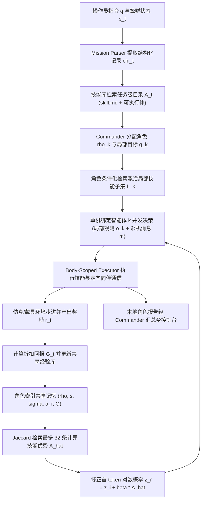
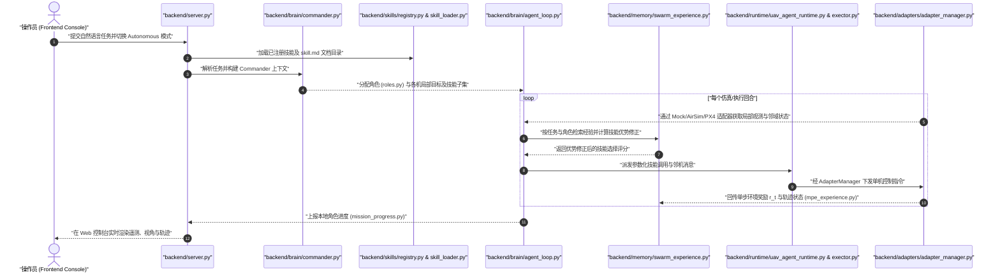

# AeroWeaver: An Embodied-Agent Harness for Weaving Aerial Skills into Distributed, Adaptive Swarm Execution

## 一句话定义

AeroWeaver 是北京航空航天大学提出的无人机蜂群具身智能体执行框架（Harness），将封装为 `skill.md` 与可执行对象的空中技能映射到绑定单机的角色化局部智能体，并利用角色索引的状态-动作-回报经验在线修正技能选择排序而无需重训模型权重。

## 英文缩写速查

| 缩写 | 英文全称 | 简要说明 |
|---|---|---|
| UAV | Unmanned Aerial Vehicle | 无人驾驶飞行器，本文中每个局部智能体绑定一架物理/仿真无人机 |
| LLM | Large Language Model | 大语言模型，负责使命解析、角色分配与局部技能选择推理 |
| MPE | Multi-Agent Particle Environment | 多智能体粒子环境，本文用于设计 9 类蜂群协作与对抗评测任务及奖励函数 |
| HMAS-2 | Hierarchical Multi-Agent System (2-stage review) | ICRA 2024 提出的“中心规划 + 局部评审 + 中心修订”多机器人 LLM 基线架构 |
| UE4 | Unreal Engine 4 | 虚幻引擎 4，AirSim 仿真所依赖的三维渲染与物理场景前端 |
| API | Application Programming Interface | 外部模型推理（含首 token 对数概率返回）与底层飞控适配器接口 |

## 为什么重要

将大语言模型用于多无人机蜂群时，仅有高层语义推理并不足以形成可靠集体行为，系统在语义到物理的接口边界上面临三个相互关联的断点：

1. **可执行落地断点：** 语言层的动作提议必须映射到当前部署平台确实支持的能力，并路由到拥有该接口的具体载具，否则任务规划与飞行控制将保持割裂。
2. **集中推理与分布执行的拓扑错位：** 许多多机器人 LLM 系统把全队状态汇总到单一共享规划器中输出联合动作，但真实的传感观测、通信邻域与执行器却分布在各架无人机本地。
3. **无重训在线经验复用缺失：** 同一蜂群任务中不断积累的回合回报与局部状态、角色分工及同伴交互强相关，若不能在线归因并反馈给后续技能选择，智能体便无法在部署期内自适应改进。

AeroWeaver 把这三层问题收拢进同一套具身执行框架（Harness），在固定模型参数与底层控制器的前提下打通了“技能封装—分布协同—经验进化”闭环。

## 核心信息

| 字段 | 内容 |
|---|---|
| 作者 | Jiabin Lou, Yirong Yang, Haopeng Wang, Xuxin Lv, Xinyu Liu, Diyuan Hou, Xuehong Liu, Rongye Shi, Wenjun Wu |
| 机构 | 北京航空航天大学（Beihang University） |
| 发表时间 | 2026-09-16（arXiv:2609.18520v1） |
| 论文链接 | [arXiv:2609.18520](https://arxiv.org/abs/2609.18520) · [HTML 全文](https://arxiv.org/html/2609.18520) |
| 项目与代码 | [Admire-ljb/AeroWeaver](https://github.com/Admire-ljb/AeroWeaver) · [项目主页](https://admire-ljb.github.io/AeroWeaver/) |
| 清单分类 | `harness.orchestration` |
| 来源条目 | `survey_ax_2609_18520` |
| 开源状态 | 已开源（MIT 协议；含 Mock / AirSim / PX4-Gazebo 适配器、技能注册表、记忆模块与 Web 控制台） |

## 核心原理

AeroWeaver 将系统划分为空中技能执行框架、分布式蜂群编排和经验引导在线强化三个核心模块。

### 1. 空中技能与任务条件化激活（§III-A）

系统将每项无人机能力封装为类型化技能单元，把语义说明文档 `skill.md` 与可执行对象绑定为七元组：

$$\sigma_i = \langle n_i, d_i, I_i, O_i, P_i, E_i, M_i \rangle$$

其中 $n_i, d_i$ 为名称与描述，$I_i, O_i$ 为类型化输入输出，$P_i$ 为运行前置条件，$E_i$ 为绑定的执行器，$M_i$ 记录来源、依赖与效果。给定操作员指令 $q$ 与当前蜂群状态 $s_t$，Mission Parser 提取结构化任务记录 $\chi^t$（任务类型、参与机号、作业区域与任务约束），据此从已注册技能库检索任务级候选目录 $\mathcal{A}^t$。随后，Harness 将 $q$、$\chi^t$、蜂群状态与候选目录文档拼装为 Commander 上下文；Commander 为每架参与无人机 $k$ 分配语义角色 $\rho_k$ 与局部目标 $g_k$，再构造角色条件化查询 $q_k = \mathrm{Pack}(q, \rho_k, g_k)$ 并按检索得分 $r_k$ 截断出该机的激活技能子集：

$$\mathcal{L}_k = \operatorname{TopK}_{\sigma_i \in \mathcal{A}^t} \{ r_k(q_k, \sigma_i) \}$$

不同角色因此只看到各自相关的技能子集与文档，避免将全库文档塞入单步推理上下文。

### 2. 单机绑定的分布式蜂群编排（§III-B）

智能体 $k$ 严格绑定到无人机 $u_k$，持有独立隔离的历史上下文 $c_k^t$、角色目标与激活技能集 $\mathcal{L}_k$。在世界步 $t$，各机智能体并发执行局部策略：

$$a_k^t = \pi_{\mathrm{sem}}\!\left(c_k^t, o_k^t, \{m_{\ell \rightarrow k}^{t-1}\}_{\ell \in \mathcal{N}_k^t}, \mathcal{L}_k\right)$$

其中 $o_k^t$ 为机载局部观测，$\mathcal{N}_k^t$ 为当前通信半径 $r_{\mathrm{comm}}$ 内的可达邻机集合。邻机间通过带发送方与接收方标识的定向消息 $m_{k \rightarrow \ell}^t$ 交换角色状态、局部观测、意图运动或状态查询；消息仅进入接收方下一轮决策上下文，不越权控制他机。Commander 仅提供初始任务上下文与全局进度监控，**不持有任何飞行控制权**；本地角色报告通过 Commander 与 Mission Console 单向汇聚给操作员。若出现非法调用，运行时执行本机悬停（own-body hold）。

### 3. 角色索引的经验引导在线强化（§III-C）

为在不修改大模型权重和底层飞控的前提下实现在线适应，AeroWeaver 对当前可调用的“技能-参数”对分配单 token 标签，读取推理接口返回的首 token 对数概率作为基础偏好分数 $z_i$（每次请求最多 20 个备选 token 分数；仅当被省略候选项的概率上界不可能超过修正后最高分时才采纳修正结果，否则保留基础最高分项）。

记忆检索先按精确任务与角色 $\rho$ 过滤，再基于分词后状态描述的 Jaccard 相似度选取至多 32 条经验构成邻域 $\mathcal{N}_\rho(s)$（相同相似度按最近时间优先）。同一技能 $\sigma_i$ 的不同参数化共享该技能的角色条件优势估计：

$$\widehat{A}(s, \sigma_i) = \bar{G}_{i,\rho}(s) - \bar{G}_{\rho}(s)$$

其中 $\bar{G}_{\rho}(s)$ 为 $\mathcal{N}_\rho(s)$ 的平均回报，$\bar{G}_{i,\rho}(s)$ 为其中执行技能 $\sigma_i$ 的记录的平均回报（无匹配经验时置 0）。随后通过加性修正更新排序并选择最高分技能 $\sigma_t$ 派发执行：

$$z_i' = z_i + \beta \widehat{A}(s, \sigma_i), \qquad \beta \ge 0$$

执行产生转移 $(\rho_t, s_t, \sigma_t, a_t, r_t)$，沿该参与者轨迹计算折扣回报 $G_t = \sum_{u=t}^{T} \gamma^{u-t} r_u$ 并回写至角色索引的共享蜂群记忆库 $(\rho_t, s_t, \sigma_t, a_t, r_t, G_t)$，供同角色后续（含不同机身编号）决策复用。

## 流程总览

## 源码运行时序图

基于官方仓库 [Admire-ljb/AeroWeaver](https://github.com/Admire-ljb/AeroWeaver) 的目录样本与 `README.md` 核查，系统通过 `python backend/server.py` 启动后端控制与静态控制台服务（`http://127.0.0.1:5001`），核心运行链路跨越 `backend/brain/`、`backend/skills/`、`backend/runtime/`、`backend/memory/` 与 `backend/adapters/` 五个子包：

关键复现路径说明（静态代码核对，未本地运行）：按官方 `README.md`，先安装 `requirements/mock.txt` 并构建 `frontend/`，再运行 `python backend/server.py` 即可在无外部仿真器或 API 密钥时通过 `backend/adapters/mock_adapter.py` 体验控制台与技能调用；接入 `airsim_adapter.py` 或 `px4_adapter.py`（配合 `backend/sim/mpe_runtime.py`）则对应完整多机仿真闭环。

## 实验与评测

### 评测设定（§IV-A）

- **任务集：** 9 个基于 MPE2 奖励函数并在 AirSim 中运行的闭环任务（$140 \times 140\text{ m}$ 固定高度；默认感知半径 $45\text{ m}$、通信半径 $55\text{ m}$，World communication 领机感知半径 $100\text{ m}$；步长 $0.5\text{ s}$，最多 24 轮；共 22 个任务技能；非法调用触发本机悬停）。
- **主骨干与超参数：** DeepSeek V4-flash；经验修正参数 $\gamma = 0.95$、$\beta = 0.8$（不对回报或优势做重缩放）；54 个“任务-条件”组合各运行 $n = 10$ 回合。
- **评估指标：** 未折扣回合平均总回报 $R = |C|^{-1}\sum_{i \in C}\sum_{t=1}^{T} r_{i,t}$（汇报均值 ± 样本标准差）以及单回合总 Token 消耗（含激活设置与全部决策调用）。

### 主实验结果（Table I，回合奖励均值 ± 标准差，$n=10$）

| 任务 | Centralized | HMAS-2 | AeroWeaver |
|---|---|---|---|
| Coverage | $-14.81 \pm 1.02$ | $-14.81 \pm 1.00$ | **$-14.20 \pm 0.95$** |
| Pursuit-evasion | $90.00 \pm 5.00$ | $70.00 \pm 4.60$ | **$130.00 \pm 4.80$** |
| Guided navigation | $-8.53 \pm 0.36$ | $-8.53 \pm 0.35$ | **$-7.10 \pm 0.32$** |
| Private communication | $-2.00 \pm 0.11$ | $-2.00 \pm 0.10$ | **$-1.85 \pm 0.09$** |
| Circular formation | $-8.45 \pm 0.12$ | $-8.45 \pm 0.11$ | **$-8.20 \pm 0.10$** |
| Line formation | $-13.99 \pm 0.27$ | $-7.62 \pm 0.23$ | **$-7.30 \pm 0.22$** |
| World communication | $129.00 \pm 5.30$ | $115.00 \pm 0.90$ | **$135.00 \pm 5.20$** |
| Collection-delivery | $33.91 \pm 0.85$ | $38.70 \pm 0.78$ | **$49.50 \pm 0.68$** |
| Goal concealment | $-1.06 \pm 0.14$ | $-0.41 \pm 0.10$ | **$-0.25 \pm 0.11$** |

- **Token 效率（Fig. 6）：** 在全部 9 个任务上，AeroWeaver 相比 HMAS-2 减少 **52.0–70.0%** 的单回合 Token 消耗；在 4 个任务上低于 Centralized（较短的局部上下文会被各机独立调用次数部分抵消，因此相对 Centralized 的 Token 优势具有任务相关性）。

### 消融与附加实验（Table II & Fig. 7）

Table II 报告了相对完整 AeroWeaver（基准为 1.0）的仿射归一化得分 $Q_{t,m} = 1 + (\bar{R}_{t,m} - \bar{R}_{t,\mathrm{full}})/K_t$（得分越低表示退化越严重）：

| 任务（$K_t$） | w/o 技能激活 | w/o 协调报告 | w/o 奖励修正 ($\beta=0$) |
|---|---|---|---|
| Coverage (17.077) | **0.650** | 0.708 | 0.764 |
| Pursuit-evasion (17.606) | **0.670** | 0.781 | 0.823 |
| Guided navigation (15.029) | 0.734 | **0.632** | 0.802 |
| Private communication (15.969) | 0.812 | **0.617** | 0.874 |
| Circular formation (16.801) | **0.762** | 0.763 | 0.825 |
| Line formation (14.280) | **0.722** | 0.821 | 0.798 |
| World communication (35.217) | 0.790 | **0.633** | 0.854 |
| Collection-delivery (10.881) | 0.632 | **0.628** | 0.814 |
| Goal concealment (13.505) | 0.777 | **0.605** | 0.780 |

- **组件贡献分解：** 去掉“协调报告”在 5 个高度依赖通信与掩护的任务（Guided navigation、Private/World communication、Collection-delivery、Goal concealment）中造成最大降幅；去掉“技能激活”在其余 4 个任务中造成最大降幅；去掉“奖励修正”在 9 个任务中均带来降幅（0.764–0.874），但在 8 个任务上是三者中退化最小的消融项（仅 Line formation 为 0.798 低于 w/o 协调报告的 0.821）。
- **在线适应曲线与鲁棒性（Fig. 7）：** （a）在经验积累早期回报快速抬升随后趋于平稳；（b）替换为 GPT-5.6 Luna 与 GLM-5.3-Flash 后性能接近 DeepSeek-V4-Flash 基准（1.0），而 qwen3.8-flash 出现中等幅度下降；（c）在保持激活技能集固定时，干扰信息插入（distractor insertion）造成的性能降幅明显大于同义改写（paraphrasing）与句序重排（reordering）。

## 与其他工作对比

| 系统/基线 | 决策与执行拓扑 | 技能暴露方式 | 在线适应机制 | 相对 AeroWeaver 的主要差异 |
|---|---|---|---|---|
| **Centralized**（本文基线） | 中央单点聚合队伍观测并联合输出各机动作 | 全量 22 个技能一次注入长上下文 | 无奖励记忆 | 上下文负担重、需单次同时为多机指派技能与参数，在全部 9 个任务上回报低于 AeroWeaver |
| **HMAS-2**（ICRA 2024 适配基线） | 中央初规划 + 局部评审 + 中央二次修订 | 全量 22 个技能 | 无奖励记忆 | 需往返规划与修订调用，Token 消耗比 AeroWeaver 高出约 2–3 倍（AeroWeaver 节省 52.0–70.0%） |
| **TALKER / AERIS**（同团队前置工作） | 动作原语知识库激活 / 运行时角色重绑定 | 原语库或角色模块 | 无经验优势修正 | 侧重技能扩展或运行时角色绑定，AeroWeaver 将技能契约、单机并发循环与首 token 优势修正统一为执行框架 |
| **JitRL**（arXiv:2601.18510） | 单体非梯度推理期策略修正 | 通用工具/动作空间 | 检索状态-动作回报调整 logits | JitRL 面向单体智能体；AeroWeaver 将状态检索与优势估计按蜂群角色 $\rho$ 索引，适配多机共享与隔离 |

## 结论

**一句话总判：AeroWeaver 验证了“角色条件化技能过滤 + 单机绑定异步协同 + 无重训首 token 优势修正”组合在多无人机 LLM 任务中的可行性，其中技能过滤与同伴协调报告是核心收益来源，在线经验修正提供稳定的二次增益。**

1. **先做技能裁剪与通信协同，再叠加经验修正：** 消融表显示移除协调报告或技能激活可将相对得分拉低至 0.605–0.670，而关闭奖励修正仍保留 0.764–0.874，工程落地应优先保障前两者稳定。
2. **上下文抗干扰比提示词措辞更关键：** 扰动实验表明，往任务文本塞入无关报告元数据对表现的伤害远大于同义改写或句序变化，Harness 侧必须严格过滤上下文噪声。
3. **无梯度在线适应依赖供应商 API 能力：** 优势修正机制要求模型接口返回备选首 token 的对数概率（本文上限 20 个），面对闭源受限 API 时存在退回基础高分项的回退路径，但也会削弱修正覆盖率。
4. **Token 节省相对 HMAS-2 稳定，但相对集中式看任务长度：** 每架机独立决策减少单次上下文长度却增加了调用总次数，规模扩大时需平衡并发成本与集中式上下文上限。

## 工程实践

- **多后端适配器切换：** 仓库 `backend/adapters/` 提供 `MockAdapter`、`AirSimAdapter`、`PX4Adapter` 与 `GazeboDirectAdapter`，通过 `backend/config/sim_config.yaml` 与 `safety_config.yaml` 配置仿真世界与安全参数；新手调试建议先用 `requirements/mock.txt` 与 `MockAdapter` 跑通前端控制台与技能调度，再接入 AirSim 或 PX4/Gazebo。
- **技能包组织规范：** 新增技能需在 `backend/skills/` 注册执行体并生成对应的 `skill.md`（参考 `backend/skills/docs/mpe/skill.md`），确保 `I_i / O_i / P_i` 前置条件与参数枚举清晰，避免将过多参数组合一次性暴露超过 20 个首 token 备选上限。
- **在线经验超参数经验值：** 论文主实验采用 $\gamma = 0.95$、$\beta = 0.8$、最多保留 32 条 Jaccard 状态近邻记录；在任务状态文本化时应保持格式稳定、剔除无关元数据，以免拉低 Jaccard 检索命中率。

## 局限与风险

- **仅限预定义技能与仿真评估：** 全文主实验基于预先定义的 22 个任务技能与二维固定高度（$140 \times 140\text{ m}$、$0.5\text{ s}$ 步长、最多 24 轮）AirSim 仿真，未包含真实户外气流扰动、复杂三维障碍或物理无人机真机飞行实验。
- **Token 概率绑定与截断风险：** 首 token logprob 修正要求严格单 token 标签映射且最多采样 20 个备选分数；当有效技能-参数组合数量较多或 API 省略部分备选概率且无法给出概率上界时，系统只能退回基础最高分，导致经验无法生效。
- **实体飞行安全边界：** 仓库声明其为研究原型软件；若迁移至真机集群，LLM 推理延迟与偶发幻觉无法充当实时安全护栏，必须独立配置硬件级地理围栏（Geofence）、避障控制、急停开关与人工接管监督。

## 关联页面

- [Agentic Robots 综述](paper-towards-agentic-robots-survey.md)
- [全量项目节点清单](../overview/awesome-agentic-robots-node-index.md)
- [VLA 方法背景](../methods/vla.md)
- [机器人智能体执行框架](../methods/robot-agent-harness.md)：对照规划、工具调用与反馈的系统边界
- [智能体技能封装](../methods/agent-skill-packaging.md)：对应本文 `skill.md` 文档与可执行对象分离/配对的设计模式
- [多智能体强化学习（MARL）](../methods/marl.md)：对照传统基于梯度的 CTDE / MPE 策略训练与本文无梯度在线优势修正
- [智能体规划与反馈执行](../methods/agent-planning-feedback.md)：对照基于环境回报与局部报告的闭环调度机制
- [智能体工具调用接口](../methods/agent-tool-use-interface.md)：对照类型化技能参数校验与失败回退设计

## 推荐继续阅读

- [AeroWeaver GitHub 仓库与文档](https://github.com/Admire-ljb/AeroWeaver)
- [AeroWeaver 官方项目主页](https://admire-ljb.github.io/AeroWeaver/)
- [AeroWeaver 论文原文（arXiv:2609.18520）](https://arxiv.org/html/2609.18520)

## 参考来源

- [AeroWeaver 论文全文核对归档](../../sources/papers/paper-agentic-2609-18520.md)
- [Admire-ljb/AeroWeaver 官方仓库核查归档](../../sources/repos/paper-agentic-2609-18520.md)
- [官方 Awesome 快照归档](../../sources/repos/awesome-agentic-robots-survey-index.md)
- [arXiv 原始论文页面](https://arxiv.org/abs/2609.18520)
