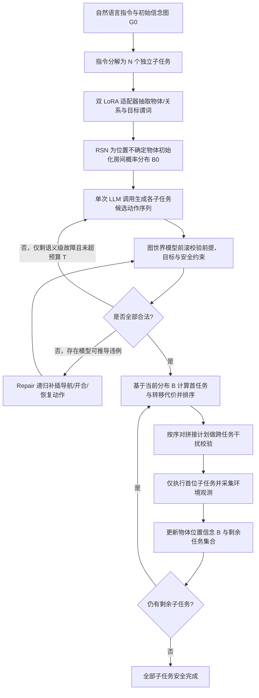

# GAVEL: Graph World Models for Verified and Efficient Long-Horizon LLM Task Planning

## 一句话定义

**GAVEL（Graph World Models for Verified and Efficient Long-Horizon LLM Planning）**：围绕显式类型化场景图世界模型构建的长时程具身任务规划框架，在执行前对大语言模型生成的动作序列做前滚校验，将动作前提、目标补全与安全恢复等模型可推导错误在图内自动修复，仅把真正需要语义推理的故障退回 LLM 重规划，并在部分可观多任务场景下维护未见物体位置的完整概率分布以在线重排子任务顺序。

## 英文缩写速查

| 缩写 | 英文全称 | 简要说明 |
|---|---|---|
| GAVEL | Graph World Models for Verified and Efficient Long-Horizon LLM Planning | 本文提出的基于显式图世界模型的规划校验、自动修复与信念重排框架 |
| LLM | Large Language Model | 大语言模型，负责语义层长时程动作生成及无法由图模型推导的语义故障重规划 |
| RSN | Relational Semantic Network | 关系语义网络，基于冻结文本嵌入与多层感知机预测未观测物体在各房间类型的先验分布 |
| LoRA | Low-Rank Adaptation | 低秩适配微调，用于将轻量基座模型适配为物体/关系抽取器与目标谓词解析器 |
| MLP | Multilayer Perceptron | 多层感知机，RSN 中用于将物体名称向量映射为房间类型得分的 3 层分类网络 |
| AUC | Area Under the ROC Curve | 受试者工作特征曲线下面积，用于衡量 RSN 对房间存在性的排序判别能力 |

## 为什么重要

- **避免端到端 LLM 规划在长时程下雪崩与低效重调：** 纯 LLM 规划在长时程任务上极易遗漏前置条件（如未走近物体即抓取、未打开容器即拿取内部物品）或违反安全约束（未关门或未关闭电器）。已有“提议-校验”循环（如 SayPlan）将所有错误一律退回 LLM 重写，不仅增加推理次数与延迟，而且端侧小模型也未必能仅凭报错修复底层动作顺序。GAVEL 将“模型可推导修复”从 LLM 职责中剥离，显著压低调用预算并大幅提升成功率。
- **弥补纯图差分规划的语义表达盲区：** 以 EPoG 为代表的图编辑规划器通过比较当前图与目标图的拓扑差异合成动作，难以表达“洗盘子”这类必须通过操作特定电器（运行洗碗机）才能触发隐式语义状态的流程。GAVEL 保留 LLM 作为语义规划器，同时让图世界模型承担状态前滚、合法性校验与局部补齐，形成能力互补。
- **利用完整分布信念与在线观测重排多任务顺序：** 在部分可观环境中，直接把物体位置信念坍缩到单一最可能房间（MAP 估计）在实测中仅 47% 情况命中真实房间，且固定初始顺序无法利用执行前序子任务时顺带获得的房间观测。GAVEL 保留完整分布并按期望搜索距离在线重排剩余任务，在不牺牲成功率的前提下缩短物理行驶距离。
- **证明外部世界模型框架与模型规模扩展呈互补关系：** 即使升级到云端强模型（如 GPT-5.6 Sol 与 Claude Sonnet 5），无校验单次规划在多任务长时程基准上成功率仍不足 40%；加入 GAVEL 校验修复框架后，两者均达到接近 100% 的表现，说明显式世界模型 harness 并不会因模型变强而失效。

## 核心信息

| 字段 | 内容 |
|---|---|
| **作者** | Ruiyang Wang, Hao-Lun Hsu, Swarajh Mehta, Jiwoo Kim, Zhihao Dou, Miroslav Pajic |
| **机构** | 未在 arXiv HTML 原文明确标注（按原文署名作者列表记录） |
| **发表时间** | 2026-09-16（arXiv:2609.19315v1 `[cs.RO]`） |
| **论文链接** | [arXiv:2609.19315](https://arxiv.org/abs/2609.19315) / [arXiv HTML](https://arxiv.org/html/2609.19315) |
| **项目与代码** | 未确认公开仓库（原文及候选仓库核查未列出独立项目页或 GitHub 代码地址） |
| **清单分类** | `model.planning`（来源条目：`survey_ax_2609_19315`） |
| **开源状态** | **未确认开源代码**（截至 2026-11-27，arXiv:2609.19315 原文未附带开源仓库或可运行代码发布说明） |

## 核心原理

### 1. 类型化场景图与部分可观问题建模

GAVEL 假设室内房间布局 $(\mathcal{R},\tau)$ 及其连通性已知（$\tau:\mathcal{R}\to\mathcal{T}$ 为房间语义类型），将环境表示为类型化场景图：

$$G = (V, E, \Phi), \qquad V = \mathcal{R} \cup \mathcal{O} \cup \{\rho\}$$

其中 $\rho$ 代表机器人，$\mathcal{O}$ 为任务相关物体集合；边集 $E$ 描述空间与归属关系 $\{\texttt{near}, \texttt{under}, \texttt{room\_connect}, \texttt{room\_inside}, \texttt{object\_inside}, \texttt{on\_top}, \texttt{next\_to}, \texttt{holding}\}$；一元谓词 $\Phi$ 记录物体交互与语义状态 $\{\mathrm{open}, \mathrm{toggled}, \mathrm{cooked}, \mathrm{washed}, \mathrm{dried}\}$。

系统严格区分真实隐物理状态 $G_t^{\star}$ 与机器人信念图 $G_t$：已知或由指令显式声明的物体关系确定性地写入 $G_t$，而位置未知物体的房间归属由概率信念 $B_t = \{b_o^t\}_{o\in\mathcal{O}}$ 表示，其中 $b_o^t(r) = P(\mathrm{room}(o)=r \mid \mathcal{H}_t)$。多任务指令 $\mathcal{I}$ 被拆分为 $N$ 个目标物体互不相交的独立子任务 $\{\mathcal{I}_i\}_{i=1}^N$，目标是在满足所有步前提 $\mathrm{pre}_{a_t}(G_t^{\star})$、终态全目标 $\mathsf{unmet}(g,G_H^{\star})=\emptyset$ 与轨迹级安全约束 $\mathsf{safe}(a_{0:H-1})$（打开过的容器须关闭、安全关键电器使用后须关闭）的条件下，最小化期望物理导航距离 $\mathbb{E}[C_{\mathrm{exec}}(\mu)]$。

### 2. 任务理解与 RSN 分布信念初始化

- **双 LoRA 指令解析（`Task Understanding`）：** 共享使用两个基于 `Qwen3-1.7B` 的轻量 LoRA 适配器（在 8,000 条合成指令-目标对上训练，500 条独立验证），分别完成：（1）物体与显式关系抽取 $(\mathcal{O}_i,\mathcal{E}_i)$，如从“get the potato from the fridge”中直接抽出 $\texttt{inside}(\texttt{potato},\texttt{fridge})$ 并写入 $G_0$，将位置仍不确定的物体划入查询集 $\mathcal{O}_i^{\mathrm{qry}}$；（2）目标部分图抽取 $g_i$，输出如 $\texttt{on\_top}(o_1,o_2)$ 或 $\texttt{washed}(o)$ 等终态谓词。
- **RSN 房间先验初始化：** 遵循 SEEK 架构，以冻结的 `BAAI/bge-small-en-v1.5` 编码器将物体名称编码为 $\phi(o)\in\mathbb{R}^{384}$，经三层 MLP（隐藏维度 256–128–64、dropout 0.2，加权 BCE 训练并做 Platt scaling 校准）预测各房间类型得分 $\tilde{f}_o(\tau)$，随后在所有可达的同类型房间实例间均匀分配并归一化得到初始信念 $b_o^0(r)$。

### 3. 显式图世界模型、前滚验证与自动修复

GAVEL 定义 9 个 grounded 动作原语：

$$\mathcal{A} = \{\textsc{NavigateTo}, \textsc{Grasp}, \textsc{Release}, \textsc{PlaceOnTop}, \textsc{PlaceInside}, \textsc{Open}, \textsc{Close}, \textsc{ToggleOn}, \textsc{ToggleOff}\}$$

每个动作 $a=(\alpha,\xi)$ 具备显式前提与效果对 $\langle\mathrm{pre}_a,\mathrm{eff}_a\rangle$。前提涵盖四类可执行性检查：**邻近性**（`proximity`，且禁止对处于关闭容器内的隐蔽物体直接执行 `NavigateTo`）、**可供性**（`affordance`）、**夹爪状态**（`gripper state`）和**可达性**（`accessibility`，要求容器先打开）。

在单次 LLM 调用一次性生成全部子任务动作序列 $\{\pi_i\}_{i=1}^N$ 后，图世界模型按以下双层机制修复与反馈：

1. **模型推导自动修复（`Repair`，Algorithm 2）：** 前滚检查 $\pi_i$ 的前提、目标和安全性，返回结构化裁决 $\omega$。凡是动作语义可直接推导的违例均由图模型递归编辑修复——例如缺失邻近性导致抓取失败时自动前插 `NavigateTo`、目标位于关闭容器内时插入导航与 `Open`、遗漏关闭容器或电器时补全恢复动作。为防止循环修改，维护已访问集合 $\mathcal{S}$，并按词典序评分函数保留历次迭代中最优候选：

$$\mathrm{rk}(\omega, \pi) = \left(\mathbf{1}[\omega.\mathrm{app}],\;\mathbf{1}[\omega.\mathrm{unmet}=\emptyset],\;\mathbf{1}[\omega.\mathrm{safe}],\;-\omega.d\right)$$

2. **语义故障受限重规划：** 仅当当前违例不存在模型可推导的直接修复（例如缺失语义操作步骤）时，才将结构化失败说明 $\omega_i$ 返回给 LLM 进行下一轮规划，总 LLM 重试预算上限设为 $T=5$。

### 4. 信念感知的在线多任务重排

当所有子任务序列通过校验后，GAVEL 依据当前信念 $B_t$ 计算期望搜索与导航开销以决定执行顺序：
- 对未定位物体 $o$，将其候选房间按 $b_o^t(r)$ 降序排列，结合房间间最短路径距离 $D(\cdot,\cdot)$ 与单房间遍历搜索代价 $s(r)=A_{\mathrm{trav}}(r)/w_{\mathrm{cov}}$（实验取有效感知宽度 $w_{\mathrm{cov}}=1.2\text{ m}$）计算期望搜索代价 $C_{\mathrm{srch}}(x_t,o;B_t)$；对已定位物体则直接使用几何导航距离 $C_{\mathrm{loc}}(q_t,o)=d_{\mathrm{nav}}(q_t,p_o)$。
- 通过 $\mathcal{O}(N^2)$ 次信念条件前滚构造首任务代价 $h[j]$ 与任务间转移代价 $A[i,j]$，在子任务数 $N\le 5$ 时枚举排列并按 $J(\varsigma)=h[\varsigma_1]+\sum_{p=2}^N A[\varsigma_{p-1},\varsigma_p]$ 升序依次做全局拼接校验，选出首个无跨任务干扰的合法排列。
- 机器人**仅执行排在首位的子任务** $\pi_{\varsigma_1}$，利用过程中获得的新观测（定位到的物体与已排查但未发现目标的房间）同步更新 $B_t$，随后对剩余子任务重新构建 $(h,A)$ 并重排顺序。

## 流程总览

## 源码运行时序图

**不适用**（截至 2026-11-27，arXiv:2609.19315 原文及候选仓库核查均未确认可运行官方源码实现或独立代码仓库链接）。

## 实验与评测

作者在 **BEHAVIOR-1K** 场景与动作语义体系下开展评测。为支持 5,500 次大规模实验，将 9 个原语映射至保留原平面图、可通行几何（A* 寻路 + 扇形视场前沿探索）与谓词的轻量 2D 执行器（单规划仿真由 OmniGibson 的约 17 分钟缩至约 1 秒），并在全量 100 个单任务指令上与 OmniGibson 实测对齐，**成功判定 100% 一致**。所有结果取 5 个随机种子均值 $\pm$ 标准差。

### 1. RSN 先验与多任务代价模型质量（§V-D）

- **RSN 预测质量：** 在 51 个场景、197 类物体、37 种房间类型的 11,218 条放置数据上按场景留出训练评估，AUC 达 **0.904**，Brier score 为 **0.057**；但在 832 条留出查询中，真实房间排名第一的比例仅 **47%**，直接证明不能将分布简单坍缩为单一最高概率房间。
- **代价近似拟合度：** 仅需 $\mathcal{O}(N^2)$ 次前滚的成对转移代价模型与实际驾驶距离高度吻合，在四任务指令上 $R^2 = \mathbf{0.93}$，五任务指令上 $R^2 = \mathbf{0.89}$，单个指令的重排优化耗时仅 **17 ms**。

### 2. 实验 1：100 个单长时程任务可靠性（§V-E, Table I）

跨越 10 个场景、平均 12.2 个原语（8–17 步）、共含 240 个目标谓词：

| 基座模型 | 方法 | 成功率（%） | 平均 LLM 调用次数 | 规划耗时（s） |
|---|---|---|---|---|
| Qwen3-4B | `llm-only` | 21.8 ± 1.5 | 1.00 ± 0.0 | 9.2 ± 1.0 |
| Qwen3-4B | `sayplan` | 55.4 ± 1.9 | 3.4 ± 1.7 | 27.6 ± 12.0 |
| Qwen3-4B | `gavel-basic`（仅图修复，不重调 LLM） | 67.7 ± 1.6 | 1.00 ± 0.0 | 9.2 ± 1.0 |
| Qwen3-4B | `gavel` | **88.8 ± 1.6** | 1.7 ± 1.3 | 15.0 ± 11.1 |
| Qwen3-8B | `llm-only` | 41.2 ± 1.2 | 1.00 ± 0.0 | 13.3 ± 6.4 |
| Qwen3-8B | `sayplan` | 76.4 ± 1.5 | 2.7 ± 1.7 | 24.6 ± 15.8 |
| Qwen3-8B | `gavel-basic`（仅图修复，不重调 LLM） | 76.2 ± 1.2 | 1.00 ± 0.0 | 13.5 ± 6.4 |
| Qwen3-8B | `gavel` | **91.8 ± 1.3** | 1.5 ± 1.1 | 15.5 ± 9.4 |

### 3. 实验 2：500 条多任务指令与信念重排消融（§V-F, Table II, Qwen3-8B）

每条指令包含 $N\in\{2,3,4,5\}$ 个子任务，平均 18.8 个原语、跨 4.66 个房间，其中 199 条包含需操作电器才能产生的语义状态：

| 方法 | 成功率（%） | 行驶距离（m） | 规划耗时（s） |
|---|---|---|---|
| `llm-only` | 19.9 ± 0.7 | 86.69 ± 0.37 | 31.8 ± 10.5 |
| `sayplan` | 75.6 ± 2.1 | 83.01 ± 0.42 | 51.4 ± 27.6 |
| `epog` | 60.2 ± 0.0 | 84.51 ± 0.00 | 13.9 ± 3.9 |
| `gavel-map`（坍缩至最可能房间，固定顺序） | **92.6 ± 1.0** | 82.45 ± 0.23 | 39.3 ± 22.6 |
| `gavel-static`（保留完整分布，固定顺序） | **92.6 ± 1.0** | 79.69 ± 0.45 | 39.3 ± 22.6 |
| `gavel`（保留分布 + 每步完结后在线重排） | **92.6 ± 1.0** | **78.01 ± 0.71** | 39.3 ± 22.6 |
| `oracle`（真值位置与参考子规划） | 100.0 ± 0.0 | 56.17 ± 0.00 | — |

- 在对比配对成功样本上，完整 `gavel` 相对 `gavel-map` 将平均行驶距离从 82.45 m 降至 78.01 m，共节省 **4.45 m（约 5.4%）**。
- 故障归因显示，`gavel` 全部 38 例残余失败中，**21 例来自上游物体抽取阶段**，仅 5 例属于不可执行规划、9 例属于未达目标。

### 4. 实验 3：模型规模缩放是否替代 GAVEL（§V-G, Table III, 100 条子集）

| 基座模型 | 纯 LLM 成功率（%） | 接入 GAVEL 成功率（%） | 纯 LLM 耗时（s） | 接入 GAVEL 耗时（s） |
|---|---|---|---|---|
| Qwen3-4B | 2.4 ± 1.5 | **75.2 ± 2.1** | 23.0 ± 7.4 | 35.0 ± 31.2 |
| Qwen3-8B | 23.6 ± 1.5 | **89.2 ± 1.3** | 31.8 ± 10.5 | 39.3 ± 22.6 |
| GPT-5.6 Sol | 24.6 ± 3.9 | **99.2 ± 0.8** | 16.5 ± 3.9 | 16.5 ± 4.0 |
| Claude Sonnet 5 | 38.6 ± 2.2 | **99.4 ± 0.5** | 18.0 ± 4.4 | 18.2 ± 4.4 |

## 与其他工作对比

| 对比维度 | 纯反馈校验（SayPlan 类） | 纯图差分规划（EPoG 类） | GAVEL（本文） |
|---|---|---|---|
| **语义过程生成** | 由 LLM 负责 | 无（仅从当前图与目标图差分生成抓取放置动作） | 由 LLM 负责语义流程生成 |
| **动作错误修复方式** | 全部失败退回 LLM 重新生成，增加耗时与二次出错风险 | 通过图编辑满足空间变化，但无法处理电器语义状态（Table II 中 60.2% 止步于此） | **图世界模型自动修复语义可推导违例，仅语义失败返回 LLM** |
| **部分可观信念利用** | 依赖重规划被动应对 | 依赖局部 situated 重规划，缺乏全局多任务分布重排 | **RSN 保留完整房间分布，在线重算剩余任务期望搜索顺序** |
| **与强基座的协同性** | 对小模型提升有限且调用倍增 | 绕开 LLM，受限于图表达能力上限 | 在 Qwen3-4B/8B 至 GPT-5.6 Sol / Claude Sonnet 5 全尺度均有大幅增益 |

## 结论

**一句话总判：在长时程具身任务规划中，把“模型可推导的局部修复”交给显式图世界模型、把“语义步骤与跨任务因果”留给 LLM，并保留完整概率分布做在线重排，能在端侧与云端模型上同时大幅提升可执行率与搜索效率。**

1. **单靠端侧自动图修复即可打平甚至超越多轮 LLM 反馈** — 在 `Qwen3-4B` 上，只跑 1 次 LLM 调用加图自动修复的 `gavel-basic` 成功率达 **67.7%**（9.2 s），高于调用 3.4 次的 `sayplan`（**55.4%**，27.6 s）；叠加受限语义重规划后完整 `gavel` 进一步升至 **88.8%**。
2. **仅做图差分无法覆盖带语义副作用的家务任务** — `epog` 基线在 500 条多任务指令上止步于 **60.2%**，其失败精确对应 199 条需要开关电器以产生 `cooked`/`washed`/`dried` 状态的指令，验证了保留 LLM 高层语义规划的必要性。
3. **前沿闭源大模型仍需要世界模型护栏** — `GPT-5.6 Sol` 与 `Claude Sonnet 5` 裸跑多任务子集成功率仅 **24.6%** 和 **38.6%**，甚至远低于 `Qwen3-4B + GAVEL`（**75.2%**）；二者结合 GAVEL 后几乎零耗时增量即可分别达到 **99.2%** 与 **99.4%**。
4. **分布信念重排的收益随不确定性直接兑现** — 仅取最可能房间的 Top-1 命中率仅 **47%**；保留全分布并结合任务后观测在线重排，额外将行驶距离从 82.45 m 降至 78.01 m（节省约 **5.4%**），而优化计算本身仅耗 **17 ms**。

## 工程实践

- **系统集成接口（静态文献边界说明）：** 截至 2026-11-27 本项目未公开可运行源码仓；若按论文规范在自有框架复现，核心组件包括：
  1. **任务解析前端：** 使用两个轻量 `Qwen3-1.7B` LoRA 适配器分别输出 JSON/谓词化的初始物体关系与部分图目标，显式提及位置的关系必须直接锁定，切勿覆盖式送入 RSN。
  2. **符号世界模型校验层：** 显式实现 9 个原语的四类前提检查与迹级安全规则，并在自动编辑循环中保留已访问状态集合 $\mathcal{S}$ 与词典序评分 $\mathrm{rk}(\omega,\pi)$ 防止死循环或越改越差。
  3. **多任务调度边界：** 当子任务目标物体互不相交时，在每次子任务执行完毕后利用新探索房间观测裁剪未见物体的候选集 $B_t$，再以 $\mathcal{O}(N^2)$ 代价前滚更新首任务与转移代价表并枚举重排（$N\le 5$ 时可精确求解）。

## 局限与风险

- **停留在符号动作层面，未约束底层几何与动力学可行性：** 论文评测假设 9 个高层原语可由底层控制器无误执行（在 100 个单任务 OmniGibson 仿真验证中符号成败一致），但尚未将运动学可达性、臂障碰撞检查或抓取失败反馈纳入同一“校验-修复”闭环。
- **RSN 先验静态绑定房间类型：** 当前基于 `bge-small-en-v1.5 + MLP` 的 RSN 主要依据房间语义类别预测位置先验，尚未利用同一家庭环境跨回合累积的观测经验更新个体化物体分布。
- **多任务假设子任务目标物体互不相交：** 虽然执行过程校验拼接序列的辅助物体冲突，但主框架假定子任务间无强耦合排序死锁；若存在严格前置依赖的多任务，需要扩展任务图依赖建模。
- **上游指令接地成为主要残余瓶颈：** 多任务实验中 38 例残余失败里有 21 例源自前端物体抽取漏检或误抽，表明随着世界模型消除规划层违例，前端自然语言理解精度成为下一阶段主导误差源。

## 关联页面

- [Agentic Robots 综述](paper-towards-agentic-robots-survey.md)
- [全量项目节点清单](../overview/awesome-agentic-robots-node-index.md)
- [VLA 方法背景](../methods/vla.md)
- [生成式世界模型](../methods/generative-world-models.md)：了解环境预测与动作生成。
- [Agent 规划与反馈闭环](../methods/agent-planning-feedback.md)：对比纯反馈重规划与模型推导修复的工程边界。
- [Robot Agent Harness](../methods/robot-agent-harness.md)：了解世界模型与护栏层在长时程智能体架构中的组织方式。
- [A* 路径规划](../methods/a-star.md)：GAVEL 2D 导航执行器中的底层最短路径求解基础。
- [自主探索任务](../tasks/autonomous-exploration.md)：部分可观环境下前沿探索与信念更新的相关任务脉络。
- [机器人操作任务](../tasks/manipulation.md)：长时程拾取、容器开关与电器操作任务设定。

## 推荐继续阅读

- [arXiv:2609.19315 论文摘要页](https://arxiv.org/abs/2609.19315)
- [arXiv:2609.19315 HTML 全文](https://arxiv.org/html/2609.19315)
- [SayPlan（arXiv:2307.06135）：基于 3D 场景图的 LLM 规划校验基线](https://arxiv.org/abs/2307.06135)
- [SEEK（arXiv:2405.09822）：关系语义网络（RSN）用于部分可观目标搜索](https://arxiv.org/abs/2405.09822)
- [EPoG（arXiv:2602.04419）：基于场景图差异与局部 LLM 重规划的基线方法](https://arxiv.org/abs/2602.04419)

## 参考来源

- [论文原文精读归档](../../sources/papers/paper-agentic-2609-19315.md)
- [官方 Awesome 快照归档](../../sources/repos/awesome-agentic-robots-survey-index.md)
- [arXiv:2609.19315 官方 HTML 原文](https://arxiv.org/html/2609.19315)
