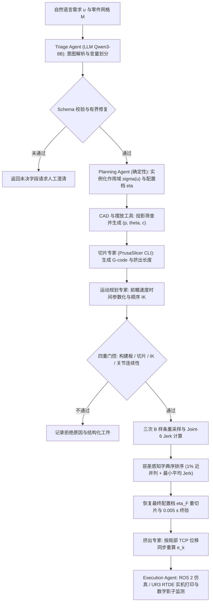

# Kinematics-Grounded Agentic AI for Robotic Additive Manufacturing Process Planning

## 一句话定义

**A-RAM**（Agentic Robotic Additive Manufacturing）是一个运动学接地（kinematics-grounded）的智能体—专家—工具规划框架，由大语言模型解析自然语言制造意图并输出受 Schema 约束的规划请求，再由确定性规划器与切片、逆运动学、轨迹定时、Joint-6 jerk 评估和挤出同步工具联合验证候选方案，将用户需求与 STL 模型转化为可追溯、可执行且针对六轴机械臂运动特性优化的增材制造方案。

## 英文缩写速查

| 缩写 | 英文全称 | 简要说明 |
|---|---|---|
| A-RAM | Agentic Robotic Additive Manufacturing | 本文提出的面向机器人增材制造的智能体—专家—工具过程规划框架 |
| AM | Additive Manufacturing | 增材制造，本文中主要指基于机械臂的熔融长丝制造（FFF） |
| FFF | Fused Filament Fabrication | 熔融长丝制造（材料挤出成型工艺） |
| IK | Inverse Kinematics | 逆运动学，将目标末端位姿序列求解为机械臂关节角序列 |
| TCP | Tool Center Point | 工具中心点，本文中指增材制造挤出喷嘴末端坐标系原点 |
| RTDE | Real-Time Data Exchange | 优傲机器人（UR）用于实机状态采集与运动下发的实时数据交换接口 |
| LLM | Large Language Model | 大语言模型，本文用于 Triage Agent 解析自然语言制造目标与约束 |

## 为什么重要

在传统龙门架（gantry）3D 打印机中，切片软件生成的笛卡尔 G-code 几乎直接对应机器执行动作；但在六轴机械臂增材制造（Robotic AM）中，这一假设不再成立：

1. **切片工艺决策与机器人运动实现强耦合：** 填充图案（infill pattern）、填充密度与零件平面朝向共同决定 G-code 路径与非沉积空行程，而零件朝向与构建板摆放位置（workspace placement）又直接改变逆运动学（IK）可达性、分支连续性以及关节空间加速度/冲击（jerk）。
2. **局部几何指标无法代表关节空间质量：** 较短的挤出路径不一定带来更短的轨迹完成时间（受空行程和转角加减速限制影响）；笛卡尔路径平顺也不等于关节运动平顺（非线性 IK 映射可能放大微小 TCP 变化为剧烈腕部 jerk）。
3. **已有工具链路割裂：** 既有 AM 大模型系统偏重知识问答、缺陷预测或运行时监控，数字影子（digital shadow）主要在方案选定后提供执行侧可观测性，而传统机器人轨迹优化多以固定 G-code 为前提，缺少面向“切片参数 × 零件朝向 × 工作空间摆放”的联合预执行量化验证闭环。

## 核心信息

| 字段 | 内容或状态 |
|---|---|
| 论文标题 | Kinematics-Grounded Agentic AI for Robotic Additive Manufacturing Process Planning |
| 作者 | Jingzhan Ge, Ruimin Chen, Azadeh Haghighi, Jiong Tang, Farhad Imani |
| 机构 | University of Connecticut（UConn）、University of Illinois Chicago（UIC） |
| 发表时间 / 载体 | 2026-09-16（arXiv:2609.19347v1 [cs.RO]，25 页，17 图，CC BY 4.0） |
| 论文链接 | [arXiv:2609.19347](https://arxiv.org/abs/2609.19347) · [arXiv HTML](https://arxiv.org/html/2609.19347) |
| 项目与代码 | 未确认开源代码（截至 2026-11-27，原文与元数据未列出独立项目页或官方源码仓库） |
| 清单分类 | `model.robot_control`（来源条目：`survey_ax_2609_19347`） |
| 开源状态 | 未开源 / 未公开源码链接（文中明确采用 Qwen3-8B、PrusaSlicer CLI、ROS 2 / MoveIt 与 UR3 RTDE 搭建实验系统） |

## 核心原理

### 1. 耦合规划问题建模

给定自然语言需求 $u$、输入零件网格 $\mathcal{M}$ 与已标定机器人制造单元 $\mathcal{R}$，候选沉积任务定义为三元组 $x = (p, \theta, \mathbf{c}) \in \mathcal{X}(\mathcal{M})$，其中 $p \in \mathcal{P}$ 为切片工艺候选（填充图案与切片参数），$\theta \in \Theta(\mathcal{M})$ 为零件平面朝向，$\mathbf{c} \in \mathcal{C}(\mathcal{M}, \theta) \subset \mathbb{R}^2$ 为构建板摆放中心。为区分快速筛选阶段（如零填充或仅保留轮廓）与最终打印配置，框架引入评估配置档 $\eta \in \mathcal{H}$ 与最终打印配置档 $\eta_{\mathrm{F}}$，每个被评估任务记为 $(x, \eta)$ 并依次经过确定性链路：

$$(x,\eta) \xrightarrow{\;\mathcal{G}\;} g(x;\eta) \xrightarrow{\;\mathcal{T}\;} \boldsymbol{\tau}(x;\eta) \xrightarrow{\;\mathcal{K}\;} \mathbf{q}(t;x,\eta) \xrightarrow{\;\mathcal{A}\;} \mathbf{m}(x;\eta)$$

输出 8 维定量证据向量 $\mathbf{m}(x;\eta) = [\chi_{\mathrm{bed}}, \chi_{\mathrm{slice}}, \chi_{\mathrm{ik}}, \chi_{\mathrm{joint}}, t_{\mathrm{f}}, \ell_{\mathrm{e}}, j_6^{\max}, \bar{j}_6]^\top$：

- **四项硬性可行性门控：** 构建板几何匹配 $\chi_{\mathrm{bed}}$、切片成功 $\chi_{\mathrm{slice}}$、IK 求解存在且满足位姿误差容限与关节限位 $\chi_{\mathrm{ik}}$、相邻采样点关节 $1\text{–}5$ 满足连续性约束 $|\operatorname{wrap}_{2\pi}(q_j - q_{k-1,j})| \le \delta q_j^{\max}$ 的 $\chi_{\mathrm{joint}}$。
- **四项标量评价指标：** 轨迹规划总时长 $t_{\mathrm{f}}$、挤出路径总长度 $\ell_{\mathrm{e}}$、最大绝对 Joint-6 冲击 $j_6^{\max}$ 与平均绝对 Joint-6 冲击 $\bar{j}_6$。

### 2. 智能体职责分离与查询条件化搜索作用域

- **Triage Agent（LLM，实验使用未微调的 Qwen3-8B + 确定性解码）：** 解析自由文本请求 $u$，将其编码为受 Schema 约束的规划请求 $\rho(u) = (\omega, \boldsymbol{\kappa}, \mathcal{V}_{\mathrm{fix}}, \mathcal{V}_{\mathrm{search}}, \mu)$，即制造目标 $\omega$、约束与工艺限值 $\boldsymbol{\kappa}$、用户指定变量 $\mathcal{V}_{\mathrm{fix}}$、待搜索变量 $\mathcal{V}_{\mathrm{search}}$ 与执行模式 $\mu$（仿真/实机/两者）。LLM 仅负责意图与自由度推理，不生成或猜测任何运动学数值；若 Schema 校验失败，系统先触发有界次数的错误反馈修复提示，仍未解决则退回人工澄清。
- **Planning Agent（确定性）：** 根据 $\rho(u)$ 自动实例化三种不同粒度的搜索范围 $\sigma(u)$：
  1. **全交叉搜索 $\sigma_{\mathrm{full}}(u)$：** 当填充图案、朝向与摆放均未固定时遍历 $\mathcal{P}_u \times \Theta_u \times \mathcal{C}_u(\theta)$（默认网格 $16 \times 5 \times 3 = 240$ 个候选）。
  2. **两阶段筛选 $\mathcal{Z}_{\mathrm{screen}}(u) = \mathcal{Z}_{\mathrm{pat}}(u) \cup \mathcal{Z}_{\mathrm{plc}}(u)$：** 针对省料或最快时间目标，先在锚定位姿 $(\theta_{\mathrm{a}}=0^\circ, \mathbf{c}_{\mathrm{a}}=\mathbf{c}_2)$ 下用 $\eta_{\mathrm{pat}}$ 筛选最佳填充图案 $\hat{p}$，再在精简配置档 $\eta_{\mathrm{plc}}$（如零填充保留实体层或仅保留轮廓）下评估朝向与摆放（$16 + 5 \times 3 = 31$ 次评估），最后将获胜组合 $(\hat{p}, \theta^\star, \mathbf{c}^\star)$ 恢复为 $\eta_{\mathrm{F}}$ 重新切片并验证。
  3. **固定工艺搜索 $\sigma_{\mathrm{place}}(u)$：** 当专家已指定切片图案（或同时指定朝向）时，仅搜索剩余自由度（如 $1 \times 5 \times 3 = 15$ 或 $1 \times 1 \times 3 = 3$）。

### 3. 轨迹定时、顺序 IK、Joint-6 Jerk 度量与挤出同步

1. **轨迹时间参数化：** 对 G-code 分段生成分段恒加速度（三角形/梯形）速度轮廓（$v_{\max}, a_{\max}, d_{\max}$），并基于段间转角 $\alpha_i$ 设定前瞻初值 $v_i^{(0)} = v_{\max}\max(0,\cos\alpha_i)$ 后做前向-后向速度可行性扫描，计算 $t_{\mathrm{f}}$。
2. **顺序逆运动学与样条重采样：** 首采样点使用固定初始种子，后续点以前一接受构型 $\mathbf{q}_{k-1}$ 为首选种子并枚举多组种子；在满足 $SE(3)$ 误差容限 $\varepsilon_T$、关节限位与前 5 轴连续性门控的子集 $\mathcal{Q}_k^{\mathrm{c}}$ 中按加权最近邻延续选择构型，对 Joint-6 做周期 $2\pi$ 解卷绕（unwrapping）。随后用三次 B 样条（$d_{\mathrm{B}}=3$）拟合各关节轨迹并按名义间隔 $\Delta t_c = 0.005\text{ s}$ 重采样。
3. **容差感知字典序排序与 Joint-6 Jerk：** 针对解卷绕后的 $q_6(t_r)$，沿实际时间向量连续应用三次二阶精确中心一阶差分算子 $\mathcal{D}$ 得到 $j_6 = \mathcal{D}^3 q_6$（单位 $\mathrm{rad\,s^{-3}}$）。在候选比较集 $\mathcal{B}_u$ 上，先筛选满足 $j_6^{\max} \le (1+\epsilon)\min j_6^{\max}$（$\epsilon=0.01$，1% 近并列阈值）的候选集 $\mathcal{N}_\epsilon$，再在其中选取 $\bar{j}_6$ 最小者。
4. **运动同步挤出与数字影子：** 挤出专家按机械臂最终轨迹时间步的局部 TCP 位移比例 $d_k(x)$ 重新分配 G-code 段落挤出目标 $e_s$（$e_k(x) = \frac{d_k(x)}{\sum_{r\in\mathcal{I}_s(x)} d_r(x)} e_s$，空行程强制 $e_k=0$），确保总挤出量守恒且不与时空参数化脱节。执行层通过 ROS 2 / MoveIt（仿真）或 UR3 RTDE + 挤出控制器（实机）下发，并借助数字影子记录命令侧 TCP 位姿、Joint-6 状态与体积守恒代理线宽 $w_{b,k}^{\mathrm{cmd}} = \frac{e_k A_f}{h \Delta s_k}$ 以实现全链路溯源。

## 流程总览

## 源码运行时序图

**不适用**（说明核查结果：截至 2026-11-27 未确认可运行官方源码实现；arXiv:2609.19347 原文及元数据仅给出基于 Qwen3-8B、PrusaSlicer CLI、ROS 2 / MoveIt 与 UR3 RTDE 的系统架构与案例验证，未公开随附 GitHub 代码仓库或独立项目页）。

## 实验与评测

作者在六轴 **UR3** 机械臂 FFF 实验平台上设计了 **3 个案例研究、共 9 项查询条件化任务**。统一实验参数：层高 $h = 1\text{ mm}$，挤出宽度 $2.5\text{ mm}$，构建区 $160\text{ mm} \times 160\text{ mm}$（安全裕度 $2\text{ mm}$），默认朝向集 $\Theta=\{0^\circ,30^\circ,45^\circ,60^\circ,90^\circ\}$，每个朝向生成 3 个确定性中心 C1–C3；$v_{\max}=25\text{ mm\,s}^{-1}$，$a_{\max}=d_{\max}=25\text{ mm\,s}^{-2}$，关节 $1\text{–}5$ 步间连续性阈值 $\delta q_j^{\max}=0.35\text{ rad}$；批量初筛步长 $\Delta t_{\mathrm{batch}}=0.01\text{ s}$，终验步长 $\Delta t_{\mathrm{final}}=0.005\text{ s}$，所有 jerk 均在 $\Delta t_c=0.005\text{ s}$ 网格下计算。

| 任务 | 零件与层数 | 用户意图 / 目标 | 搜索范围 | 选中最优方案 | 关键定量对比（相对同组最差有效候选） |
|---|---|---|---|---|---|
| **I-a** | Dogbone Type IV | 专家指定参数（`gyroid`, 50%, $45^\circ$ 朝向） | $1\times 1\times 3 = 3$ | `gyroid, 45°/C3` | $j_6^{\max}$：$543.6724$ vs $606.7101\text{ rad\,s}^{-3}$（**-10.4%**）；$\bar{j}_6$：$3.6033$ vs $4.4117$（**-18.3%**） |
| **I-b** | Dogbone Type IV | 仅目标：最小化 $j_6^{\max}$ | $16\times 5\times 3 = 240$（239 有效，1 个 IK 不可行） | `stars, 30°/C3` | $j_6^{\max}$：$353.593$ vs $760.800\text{ rad\,s}^{-3}$（**-53.5%**）；$\bar{j}_6$：$2.854$ vs $5.524$（**-48.3%**） |
| **II-a** | Husky Head（5 层） | 90% 填充 + 省料（兼顾表面/轮廓运动质量） | $16+5\times 3 = 31$ | `lightning, 90°/C3` | $\ell_{\mathrm{e}}$：$11049.11\text{ mm}$ vs `3dhoneycomb` $12652.44\text{ mm}$（**-12.7%**） |
| **II-b** | Husky Head（5 层） | 90% 填充 + 最快打印 | $16+5\times 3 = 31$ | `supportcubic, 90°/C3` | $t_{\mathrm{f}}$：$1131.7031\text{ s}$ vs `hilbertcurve` $1753.49\text{ s}$（**-35.5%**） |
| **II-c** | Husky Head（5 层） | 100% 填充 + 省料（仅 5 种图案可切片） | $16+5\times 3 = 31$ | `octagramspiral, 90°/C3` | $\ell_{\mathrm{e}}$：$11993.30\text{ mm}$ vs `concentric` $12632.71\text{ mm}$（**-5.1%**） |
| **II-d** | Husky Head（5 层） | 100% 填充 + 最快打印（仅 5 种图案可切片） | $16+5\times 3 = 31$ | `rectilinear, 90°/C3` | $t_{\mathrm{f}}$：$1137.91\text{ s}$ vs `hilbertcurve` $1900.25\text{ s}$（**-40.1%**） |
| **III-a** | Gator Head（4 层） | `rectilinear` 100%，仅优化轮廓运动质量 | $1\times 5\times 3 = 15$ | `rectilinear, 0°/C3` | $j_6^{\max}$：$553.46$ vs $803.38$（**-31.1%**）；$\bar{j}_6$：$8.82$ vs $9.34$（**-5.6%**） |
| **III-b** | Husky Head（4 层） | `rectilinear` 100%，仅优化轮廓运动质量 | $1\times 5\times 3 = 15$ | `rectilinear, 0°/C1` | $j_6^{\max}$：$586.95$ vs $757.91$（**-22.6%**）；$\bar{j}_6$：$10.87$ vs $11.93$（**-9.0%**） |
| **III-c** | Husky Head（5 层） | `rectilinear` 100%，仅优化轮廓运动质量 | $1\times 5\times 3 = 15$ | `rectilinear, 90°/C3` | $j_6^{\max}$：$588.20$ vs $847.39$（**-30.6%**）；$\bar{j}_6$：$11.19$ vs $10.74$（+4.2%） |

- **额外关键实验发现：**
  - **两阶段共享朝向—摆放表现（Case Study II）：** 在 0% 填充但保留顶底实体层的 $\eta_{\mathrm{plc}}$ 评估下，`90°/C3` 较最差组合 `45°/C1` 将 $j_6^{\max}$ 从 $798.290$ 降至 $563.067\text{ rad\,s}^{-3}$（降 29.5%），$\bar{j}_6$ 从 $7.443$ 降至 $6.112\text{ rad\,s}^{-3}$（降 17.9%）；4 组最终方案均完成 UR3 实机打印与数字影子同步记录。
  - **近并列容差规则与几何敏感性（Case Study III）：** 4 层 Husky Head 中 `90°/C3` 的原始 $j_6^{\max}=585.846$ 略低于 `0°/C1` 的 $586.949$，但两者处于 1% 容差带内，因此依据 $\bar{j}_6$ 更低（$10.865$ vs $11.009$）选中 `0°/C1`；而仅增加 1 层变为 5 层 Husky Head 后，最优位姿跃迁为 `90°/C3`，直接证明“朝向—摆放经验规则无法跨几何或跨层数泛化”。

## 与其他工作对比

| 研究方向 | 代表性工作（本文引用） | 主要能力范围 | 与 A-RAM 的核心差异 |
|---|---|---|---|
| **AM 知识问答与制造智能体** | AMGPT、AdditiveLLM / 2、FDM-Bench、LLM-3D Print、Agentic Alloy Eval | 文献检索、缺陷预测、参数推荐或运行时视觉纠偏 | 缺乏机器人工作空间可达性、IK 连续性、轨迹定时与关节 jerk 的预执行验证闭环 |
| **切片参数与工具路径研究** | Suteja、Birosz 等、CONVIP | 在零件坐标系下优化填充图案/角度对丝材消耗、时间与力学性能的影响 | 忽略机械臂非线性 IK 映射与摆放位置对同一路径关节运动质量的改变 |
| **固定路径机器人规划/摆放优化** | Dai 等、Zhang 等、Ghungrad 等、Bhatt 等 | 对既定 G-code 做关节光滑、奇异规避或工作空间摆放优化 | 将切片图案与路径视为固定输入，无法反向协同筛选更优的切片工艺参数 |
| **数字影子 / 数字孪生监控** | Mu 等（WAAM）、Alvares 等 | 执行阶段的传感融合与在位缺陷检测 | 属于规划确定后的执行观测层；A-RAM 将数字影子定位为预执行选型之后的可追溯校验层 |

## 结论

**一句话总判：A-RAM 通过“LLM 负责意图与变量范围编排、确定性工具链负责几何/运动学/挤出量化裁决”的分离设计，首次在单一闭环中打通了机器人增材制造的切片工艺、零件朝向与工作空间摆放联合预执行优化。**

1. **避免让 LLM 直接估算物理与运动学指标：** 用 Schema 约束请求 + 有界修复 + 确定性工具评估替代端到端大模型参数猜测，可使底层 LLM（如 Qwen3-8B）在不微调的情况下安全替换升级，同时保持所有候选排序完全可复现与可审计。
2. **保留结构化被拒候选工件（rejected artifacts）：** 对不可行候选显式标注失败来源（超板、切片失败、IK 无解或关节跳变超限），比静默丢弃更利于定位工作空间或工艺瓶颈。
3. **采用查询条件化的精简替代评估档（$\eta$）时须复检：** 用零填充或仅轮廓档 $\eta_{\mathrm{plc}}$ 加速朝向—摆放筛选时，必须在最终选定后切换回真实打印档 $\eta_{\mathrm{F}}$ 重新切片并做 $\Delta t_{\mathrm{final}}=0.005\text{ s}$ 全量轨迹验证，防止高填充内部路径引发新的奇异或超限。
4. **不要跨几何或跨层高复用固定摆放经验：** 如 Case Study III 所示，即便平面投影完全相同的 4 层与 5 层 Husky Head，其最优朝向—摆放仍从 `0°/C1` 变为 `90°/C3`，生产切换零件时应重新触发候选评估。

## 工程实践

- **硬件与软件栈集成模式：**
  - **语言推理与规划编排：** Qwen3-8B（确定性解码）输出受 Schema 校验的规划请求 $\rho(u)$；确定性 Planning Agent 决定启用全交叉搜索、两阶段筛选还是固定工艺位置筛选。
  - **切片与轨迹引擎：** PrusaSlicer CLI 负责快速批量导出 G-code 与特征标签；批量筛选采用 $\Delta t_{\mathrm{batch}}=0.01\text{ s}$ 降低 IK 耗时，终选方案使用 $\Delta t_{\mathrm{final}}=0.005\text{ s}$ 精算；两者统一采用三次 B 样条并重采样到 $\Delta t_c = 0.005\text{ s}$ 后计算 $j_6^{\max}$ 与 $\bar{j}_6$，保证尺度一致。
  - **机器人通信与挤出同步：** 仿真使用 ROS 2 + MoveIt mock-hardware 分支，实机通过 RTDE 控制 UR3 并向挤出控制器发送按局部 TCP 步长比例分配的增量命令 $e_k$（空行程严格置零）。
- **可调关键参数与适用参考：**
  - 连续性门控阈值 $\delta q_j^{\max} = 0.35\text{ rad}$（前 5 轴）与 1% 近并列容差 $\epsilon = 0.01$ 可随机械臂关节速度能力及采样步长调整；
  - 若目标工艺以高速打印或极限省料为主且伴随高填充率（如 100%），应在 Slicer 验证前置过滤不可实现图案（如 Husky Head 100% 填充时 16 种图案仅 5 种可切片）。

## 局限与风险

1. **平面固定喷嘴姿态假设：** 当前实现在沉积过程中保持末端喷嘴姿态固定，尚未覆盖多轴非平面/保形（conformal）打印中的连续工具轴冗余优化。
2. **运动学可行性不等于动力学与碰撞安全：** $\chi_{\mathrm{ik}}$ 与 $\chi_{\mathrm{joint}}$ 仅检查离散采样点的运动学可达性、关节限位与步间增量，未包含完整机械臂动力学力矩校核与全局环境/自碰撞检测。
3. **单一 Joint-6 jerk 指标的代表性边界：** 实验中 $q_5$ 近似静止而 $q_1\text{–}q_4$ 量级差异大，故选用 Joint-6 jerk 作为局部腕部平滑度指标，但它既不能直接等同于整臂能量最优，也不直接衡量实际打印件的力学强度或表面外观质量。
4. **材料节省与打印时间指标未对齐力学等效性：** 省料对比基于名义填充率下的 G-code 挤出路径长度 $\ell_{\mathrm{e}}$，未要求不同填充图案具有相同的实际体积分数或拉伸强度；同时数字影子监测的线宽代理值 $w_{b,k}^{\mathrm{cmd}}$ 来自命令端体积守恒计算，而非实测熔道视觉/编码器反馈闭环。
5. **未确认开源实现：** 截至 2026-11-27 未找到公开的官方代码库或可运行镜像，跨平台复现需要依据论文公式与 ROS 2 / PrusaSlicer / RTDE 接口自行搭建。

## 关联页面

- [Agentic Robots 综述](paper-towards-agentic-robots-survey.md)
- [全量项目节点清单](../overview/awesome-agentic-robots-node-index.md)
- [VLA 方法背景](../methods/vla.md)
- [机器人智能体执行框架](../methods/robot-agent-harness.md)：对照规划、工具调用与反馈的系统边界
- [智能体工具调用接口](../methods/agent-tool-use-interface.md)：与 A-RAM 中 LLM 编排与确定性领域工具解耦模式相关
- [智能体规划与反馈机制](../methods/agent-planning-feedback.md)：对应 Triage Schema 校验修复与两阶段筛选反馈机制
- [时间最优路径参数化](../methods/time-optimal-path-parameterization.md)：对照论文中基于前瞻速度限制的分段加减速轨迹定时方法
- [操作任务综述](../tasks/manipulation.md)：六轴机械臂运动学、逆解连续性与轨迹跟踪在操作/制造任务中的共性约束

## 推荐继续阅读

- [Kinematics-Grounded Agentic AI for Robotic Additive Manufacturing Process Planning（arXiv:2609.19347）](https://arxiv.org/abs/2609.19347) — 原论文摘要页与 PDF 获取入口
- [arXiv HTML 全文版（2609.19347）](https://arxiv.org/html/2609.19347) — 包含完整公式推导、17 张图注与 3 组案例实验数据表

## 参考来源

- [论文精读归档](../../sources/papers/paper-agentic-2609-19347.md)
- [官方 Awesome 快照归档](../../sources/repos/awesome-agentic-robots-survey-index.md)
- [arXiv:2609.19347 论文页面](https://arxiv.org/abs/2609.19347)
- [arXiv:2609.19347 HTML 全文](https://arxiv.org/html/2609.19347)
