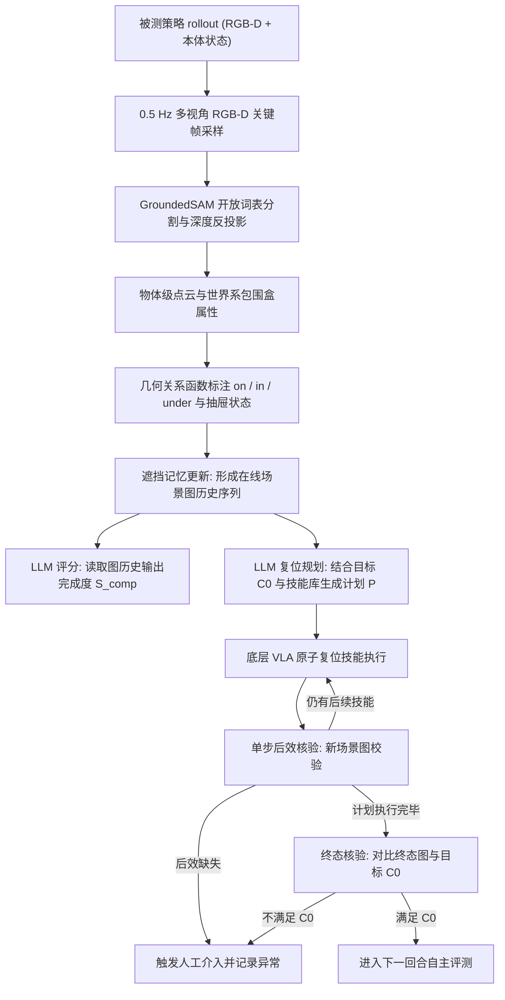

# From Rollout to Reset: A Graph-Based Harness for Autonomous Long-Horizon Manipulation Evaluation

## 一句话定义

**HALTER**（*Harness for Autonomous Long-horizon Task Evaluation and Reset*）是一套面向真机长程操作策略的自主评测与场景复位框架，通过在线构建物体关系场景图，由大语言模型统筹回合完成度评分、原子复位技能序列规划与两级复位核验，从而替代人工频繁复位。

## 英文缩写速查

| 缩写 | 英文全称 | 简要说明 |
|------|----------|----------|
| HALTER | Harness for Autonomous Long-horizon Task Evaluation and Reset | 本文提出的真机长程操作自主评测与复位系统 |
| VLA | Vision-Language-Action | 视觉-语言-动作模型，本文用于学习底层原子复位技能（X-VLA） |
| TAMP | Task and Motion Planning | 任务与运动规划，本文用其符号前置/后效偏序形式化长程任务 |
| LLM | Large Language Model | 大语言模型（本文使用 Qwen3.5-397B）负责图上推理、规划与核验 |
| RGB-D | Red-Green-Blue-Depth | 彩色与对齐深度图像流，用于重建物体级点云与空间关系 |
| SR | Success Rate | 成功率，本文中复位成功率 Reset SR 指终态满足初始条件 $\mathcal{C}_0$ 的回合占比 |

## 为什么重要

1. **解决真机评测的“非并行瓶颈”：** 仿真可一键重置状态，而真机长程评测长期依赖人工摆放物体，不仅消耗大量操作员时间，还会因手工摆放差异导致初始状态分布不可复现。
2. **突破单步自动复位的组合爆炸困境：** 以 AutoEval 为代表的单步自动复位方法为每个任务训练单一整体复位策略与终态分类器；但在多步长程任务中，策略可能在任意子目标失败或按不同合法顺序执行，导致可达终态呈组合级增长，整段复位演示成本难以承受。
3. **应对局部遮挡与图像空间推理短板：** 回合结束时关键物体可能已被关进抽屉或遮挡（如柠檬留在闭合抽屉内），仅靠终态单帧图像或依赖像素隐式空间关系的 VLM 均无法可靠判定状态与规划复位；HALTER 通过“执行期在线累积场景图 + 显式几何关系推理”同时解决了局部可观测性与状态精确判定问题。

## 核心信息

| 项目 | 内容 |
|---|---|
| **作者** | Jing Jiang*, Yue Yang*, Xinkai Jiang, Gedas Bertasius, Daniel J. Szafir, Rudolf Lioutikov† |
| **机构** | 卡尔斯鲁厄理工学院（KIT）、北卡罗来纳大学教堂山分校（UNC-Chapel Hill） |
| **发表时间** | 2026-09-16（arXiv:2609.19413v1 [cs.RO]） |
| **论文链接** | [arXiv 摘要](https://arxiv.org/abs/2609.19413) · [arXiv HTML 全文](https://arxiv.org/html/2609.19413) |
| **项目与代码** | [项目页](https://yy-gx.github.io/HALTER/) · [GitHub（YY-GX/HALTER）](https://github.com/YY-GX/HALTER) |
| **清单分类** | `harness.monitoring_and_recovery`（来源条目 `survey_ax_2609_19413`） |
| **开源状态** | **宣称将开源（占位仓库）**：截至 2026-11-27，项目页已上线，`YY-GX/HALTER` 仓库仅含 `README.md`（注明 `Code release is in progress.`），尚无公开训练/推理脚本或模型权重 |

## 核心原理

### 1. 问题形式化与两大子问题

遵循 TAMP 形式化框架，将自然语言指令 $x$ 指定的长程任务表示为原子技能集 $\mathcal{S} = \{a_1, \ldots, a_H\}$ 及其因果偏序 $\prec$，合法执行序列集合记为 $\mathrm{Lin}(\mathcal{S}, \prec)$。被测策略 $\pi$ 在每步观测图像 $I_t$ 与本体状态 $q_t$ 并输出动作 $u_t$，从初始物理状态 $s_0$ 运行至终态 $s_T$。

不同于固定 6D 位姿目标，HALTER 用物体间符号关系集合定义可重复评测的初始条件：

$$\mathcal{C}_0 = \{r_j(o_j, o_j')\}$$

例如 $\{\texttt{on(lemon,plate)}, \texttt{on(plate,table)}\}$，允许物体在满足关系的区域内有合理位姿变化。复位问题即给定终态 $s_T$ 与目标 $\mathcal{C}_0$，寻找动作序列将场景恢复至满足 $s \models \mathcal{C}_0$。论文指出该闭环包含两类子问题：
- **(P1) 终态覆盖度：** 长程策略可在任意技能处失败或走不同线性化分支，单策略直接映射 $s_T \to u$ 所需演示数随终态数呈组合增长。
- **(P2) 三阶段场景状态估计：** 同一场景状态表达需同时支撑：(A) 计算完成度分数 $S_{\mathrm{comp}} \in [0, 1]$（已达成效应的技能占比）、(B) 生成复位动作序列、(C) 核验复位后状态是否满足 $\mathcal{C}_0$。

### 2. 分层复位架构（Hierarchical Reset）

为将演示成本与任务长度解耦，HALTER 将复位拆为两层：
- **底层原子复位技能库 $\mathcal{K} = \{k^{(1)}, \ldots, k^{(M)}\}$：** 覆盖刚体抓放、容器存取与铰接体（抽屉）开合等单步原子操作，由 VLA（具体采用 X-VLA）学习。技能库 $\mathcal{K}$ 独立于被测任务的技能集 $\mathcal{S}$，数据采集量仅随 $|\mathcal{K}|$ 线性增长。实验中两个桌面场景共构建 12 项原子技能（抽屉场景 6 项、炉灶场景 6 项），每项使用 30–50 条演示微调 X-VLA。
- **高层规划器：** 读取场景图历史、目标 $\mathcal{C}_0$、技能库 $\mathcal{K}$ 及少量参考样例，输出有序复位计划 $P = (k_1(\alpha_1), \ldots, k_N(\alpha_N))$。技能参数 $\alpha_i$ 直接绑定场景图中存在的具名物体节点，避免自由文本生成不可执行指令。

### 3. 在线时空场景图构建

为兼顾几何精度与局部可观测性，HALTER 将感知与推理分离：
1. **实例分割与点云重建：** 在被测策略 rollout 期间以 **0.5 Hz** 采样多视角 RGB-D 关键帧（2 台 DepthAI OAK-D Lite + 1 台 ZED），给定任务相关物体名，使用 **GroundedSAM**（Grounding DINO + SAM）提取实例掩码并反投影至对齐深度图，恢复每个物体的世界系点云与空间包围盒属性（位置、尺寸）。
2. **确定性几何关系边：** 由几何规则函数直接计算物体对的空间关系——`on`（垂直邻近与水平支撑）、`in`（体积包含）、`under`，以及依据世界系 $y$ 轴位置判别抽屉开关状态。
3. **遮挡历史记忆：** 当物体在任务中进入封闭容器或被遮挡（如柠檬放入抽屉并关闭后外部不可见），系统保留其最近一次有效观测及支撑关系，待物体再次出现时更新，形成按时间顺序排列的场景图序列。

### 4. 同一图序列上的三项 LLM 推理

三项推理共用同一份序列化的场景图记录（物体节点属性 + 关系三元组）与同一骨干模型（**Qwen3.5-397B**），仅切换阶段提示词：
- **完成度评分（Scoring）：** 扫描整个图历史判断每步技能的预期后效是否曾在 rollout 中出现过，输出 $\widehat{S}_{\mathrm{comp}}$（防止中间达成但后续被遮挡或破坏的技能漏计）。
- **复位规划（Planning）：** 结合 4 条任务参考样例（1 条成功 + 3 条失败轨迹的图历史与对应复位技能序列），为当前终态生成可执行的原子技能序列 $P$。
- **两级复位核验（Verification）：** 先在每执行完一个原子技能后检查新场景图中是否出现该技能预期后效（缺失则立即中止后续依赖步骤）；全计划完成后再核验终态图是否满足 $\mathcal{C}_0$（结合 4 条成功技能参考样例）。任意一级失败均触发人工介入请求，避免以错误初始状态开始下一回合评测。

## 流程总览

## 源码运行时序图

**不适用**（截至 2026-11-27，官方项目页列出的仓库 [YY-GX/HALTER](https://github.com/YY-GX/HALTER) 仅包含 `README.md` 占位说明 `Code release is in progress.`，尚无公开可运行的训练、场景图构建或真机控制代码文件）。

## 实验与评测

所有真机实验均在 **Franka Panda 7-DoF** 机械臂（配 Robotiq 2F-85 平行夹爪）与三路 RGB-D 相机平台上开展，统一评测由任务专用 **BESO** 检查点生成的 rollout，每个任务/方法评测 25 个回合（4 个主任务合计 100 个回合），误差为二项分布标准误。

### 1. 主任务评测与复位性能（Table I，4 项长程任务，%）

四项任务跨两个桌面场景：`Drawer-Store`（开下层抽屉→放柠檬→关抽屉）、`Drawer-Retrieve`（开抽屉→取草莓→放盘中）、`Pot-Cook`（锅上灶→煮胡萝卜）、`Pan-Cook`（平底锅上灶→煎胡萝卜）。

| 方法 | 指标 | Drawer-Store | Drawer-Retrieve | Pot-Cook | Pan-Cook | 平均 (%) |
|---|---|---|---|---|---|---|
| **AutoEval** | Scoring acc. | 72 | 64 | 80 | 88 | 76.0 ± 4.3 |
| AutoEval | Verification acc. | 76 | 80 | 80 | 76 | 78.0 ± 4.1 |
| AutoEval | Reset SR | 52 | 64 | 16 | 76 | 52.0 ± 5.0 |
| **MP skills** | Reset SR | 68 | 76 | 72 | 44 | 65.0 ± 4.8 |
| **HALTER (ours)** | Scoring acc. | 100 | 96 | 80 | 84 | **90.0 ± 3.0** |
| HALTER (ours) | Plan validity | 92 | 84 | 72 | 88 | **84.0 ± 3.7** |
| HALTER (ours) | Verification acc. | 96 | 84 | 88 | 96 | **91.0 ± 2.9** |
| HALTER (ours) | Reset SR | 88 | 84 | 48 | 84 | **76.0 ± 4.3** |

### 2. 人工耗时与评测吞吐开销（Table II，100 回合汇总）

| 方法 | 人工介入次数 | 单回合周期 (s/ep) | 操作员总耗时 (min) |
|---|---|---|---|
| Manual reset | 100 | 53 | 88 |
| AutoEval | 46 | 104 | 44 |
| MP skills | 34 | 137 | 29 |
| **HALTER (ours)** | **25** | 121 | **24** |

- 相比纯人工复位，HALTER 将人工介入从 100 次降至 25 次，平均连续无人干预回合数从 1.0 提升至 4.0，操作员耗时减少 **72%**（88 min → 24 min）。
- 按复位技能数分层统计：1 步复位比 MP skills 快 2–18 s，3 步复位快 24–57 s（$p < 0.01$）。

### 3. 留出任务组合泛化（Table III，3 项新目标任务，每项 25 回合，零新增演示）

保持相同桌面物体但更改任务目标（如柠檬留桌上且抽屉闭合、草莓留桌上而非盘中、汤锅带盖上灶且无胡萝卜），HALTER 直接重组原有技能库且不采集任何新演示：

| 方法 | 指标 | Store (Held-out) | Retrieve (Held-out) | Pot (Held-out) | 平均 (%) |
|---|---|---|---|---|---|
| **AutoEval** | Scoring acc. | 72 | 72 | 80 | 74.7 ± 5.0 |
| AutoEval | Verification acc. | 84 | 80 | 84 | 82.7 ± 4.4 |
| AutoEval | Reset SR | 0 | 4 | 0 | 1.3 ± 1.3 |
| **HALTER (ours)** | Scoring acc. | 100 | 100 | 84 | **94.7 ± 2.6** |
| HALTER (ours) | Plan validity | 92 | 96 | 80 | **89.3 ± 3.6** |
| HALTER (ours) | Verification acc. | 96 | 92 | 88 | **92.0 ± 3.1** |
| HALTER (ours) | Reset SR | 84 | 84 | 56 | **74.7 ± 5.0** |

### 4. 场景图与采样率消融（Fig. 4，Drawer-Store，每组 25 回合）

- **状态表征消融：** 完整场景图取得 92% 规划有效率、96% 核验准确率与 88% 复位 SR；替换为原始 RGB 图像后分别降至 72% / 76% / 72%；替换为渲染点云后进一步降至 40% / 52% / 40%。说明增益并非单纯来自三维视觉外观，而源于将几何信息显式转化为具名物体关系。
- **更新频率消融：** 图更新率降至 0.2 Hz 时性能仍能保持；低于 0.2 Hz 时规划有效率由 92% 跌至 64%、核验准确率由 96% 跌至 60%、复位 SR 由 88% 跌至 48%，而评分准确率维持在 96%（说明规划需捕捉中间关键状态迁移，而部分完成度可由末端少数关键帧推断）。

## 与其他工作对比

| 对比维度 | AutoEval（单步自动复位代表） | MP skills（HALTER + 运动规划基线） | HALTER（本文） |
|---|---|---|---|
| **复位策略粒度** | 每任务端到端整段 X-VLA 复位策略（每类失败/成功 30–40 条演示） | LLM 规划原子序列 + GraspNet 抓取 + CuRobo 轨迹规划 | LLM 规划原子序列 + X-VLA 原子复位技能（每技能 30–50 条演示） |
| **演示数据规模** | 4 任务共需 138k 时间步 | 无需复位技能演示 | 4 任务共需 **105k** 时间步（少 24%），且跨任务复用 |
| **状态表征** | 依赖视觉图像/分类器提示 | 与 HALTER 共用场景图历史 | 在线 RGB-D 物体点云 + 显式几何关系图历史 |
| **组合泛化（留出任务）** | 复位 SR **1.3%**（绑定训练序列） | 未单独汇报 | 零新演示下复位 SR **74.7%** |
| **主要短板** | 长程终态退化严重、新任务无法迁移 | 开环单次选抓遇小偏差易失败、周期长（137 s） | 重型/特殊几何物体（如 Pot-Cook 汤锅）VLA 抓取仍弱于解析抓取（48% vs 72%） |

与偏重“引导前向策略执行”的策略包装框架（如 Harness VLA、Guava）或专注“失败解释与前向重规划”的系统（如 Foresight、REFLECT）不同，HALTER 将组合式场景图规划用于**逆向复位与评测闭环**；同时相较于仍依赖人工摆放的场景基准（SceneReplica、FurnitureBench、RoboArena），HALTER 在单机真机上显著降低了操作员介入频率。

## 结论

**一句话总判：对于长程真机策略评测，「在线累积的显式物体关系图 + 原子技能库分层复位」比端到端整段复位策略和开环运动规划都更省数据、更易跨任务复用，但底层原子技能对特定几何物体（如大型炊具）的抓取鲁棒性仍是整体复位成功率的瓶颈。**

1. **把演示成本从“终态数”降到“技能数”** — 将长程复位拆解为 12 项可重组的 X-VLA 原子技能后，HALTER 比按终态逐类收集的 AutoEval 节省 24% 演示步数（105k vs 138k），并在 3 个未见过目标的留出任务上取得 74.7% vs 1.3% 的复位成功率。
2. **显式关系图不可被端到端 VLM 图像直读替代** — 在 Drawer-Store 消融中，去掉场景图改传图像或渲染点云会使复位成功率从 88% 分别跌至 72% 和 40%，证明“先几何分割建模关系、再交由 LLM 推理”的分工在空间判定上更可靠。
3. **关键帧更新频率须守住 0.2 Hz 下限** — 低于 0.2 Hz 会漏掉抽屉开合或容器存取的瞬时状态迁移，导致复位 SR 从 88% 骤降至 48%，实际部署应保证至少 0.2–0.5 Hz 的关键帧构图速率。
4. **混合底层执行器是现实折中方案** — HALTER 在 4 项主任务平均复位 SR（76.0%）高于 MP skills（65.0%），但在 `Pot-Cook` 上解析抓取+CuRobo（72%）反而明显优于学习型 VLA 技能（48%）；工程中可将学习型技能与解析抓取按物体类型混编。
5. **非完美闭环下，高准确率核验比盲目重跑更重要** — HALTER 91.0% 的复位核验准确率与单步后效检查机制，使其在遭遇物理不可逆故障或技能失败时能够及时停机唤人，将人工介入压低至 25/100 回合（操作员耗时减少 72%），同时保证后续评测初始分布不被污染。

## 工程实践

- **硬件与相机配置：** 论文在 Franka Panda 7-DoF + Robotiq 2F-85 上部署三目 RGB-D（桌面两侧对向布置 OAK-D Lite 与 ZED，外加腕部 OAK-D Lite），用于缓解桌面侧向遮挡并做世界坐标点云融合。
- **场景图参数与实现栈：**
  - 采样率设为 **0.5 Hz**（消融显示 $\ge 0.2\text{ Hz}$ 即可稳住规划与核验精度）。
  - 开放词表分割使用 GroundedSAM（需预先给定当前场景任务相关物体清单），几何关系依赖世界系标定外参后的包围盒与高度/支撑阈值规则。
- **LLM 接口与提示词工程：** 使用 Qwen3.5-397B 承担评分、规划、核验三项职责；每个新任务需准备 4 条带场景图历史与目标复位序列的上下文参考样例（1 成功 + 3 失败），核验复用 4 条技能级成功样例。
- **复现提醒：** 截至 2026-11-27 官方代码仓库 `YY-GX/HALTER` 尚未释放源码，复现需自备多相机外参标定、GroundedSAM 分割节点、X-VLA 原子技能微调权重及 LLM API/推理服务。

## 局限与风险

1. **反向技能覆盖依赖额外演示：** 若复位过程需要前向任务从未出现过的动作（例如把已倒入或放入深容器的物体取出复原），仍需额外采集该原子复位技能的演示数据。
2. **每任务仍需手工编写上下文样例：** 虽然无需采集大量成功图像训练专用分类器，但新增任务时仍需编写 4 条参考轨迹样例写入提示词。
3. **物理不可逆场景无法自动恢复：** 面对物体摔碎、液体泼洒等操作技能无法复原的状态，HALTER 只能依靠终态核验发现异常并请求人工处理，而非真正修复物理现场。
4. **复合误差与大件物体抓取瓶颈：** 复位本身也是一段多步操作，长复位序列（如 `Pot-Cook`）仍会累积原子技能执行误差；若原子技能对特殊几何体（如汤锅双耳/锅盖）抓握不稳，整体复位成功率会明显下降（48%）。

## 关联页面

- [具身大模型评测基准选型闭环](../queries/embodied-eval-benchmark-selection-loop.md)：对照评测基准设计与指标选型闭环。
- [Agentic Robots 综述](paper-towards-agentic-robots-survey.md)
- [全量项目节点清单](../overview/awesome-agentic-robots-node-index.md)
- [机器人智能体评测与 Harness](../methods/robot-agent-harness.md)：对照监控、恢复与自主评测框架设计。
- [具身智能体评测方法](../methods/embodied-agent-benchmarking.md)：对照任务设置、接口与评估指标。
- [VLA 方法背景](../methods/vla.md)：理解底层原子技能采用的 X-VLA 策略架构。
- [Agentic 操作策略](../methods/agentic-manipulation-policies.md)：长程操作策略与子技能编排背景。
- [机器人操作任务](../tasks/manipulation.md)：桌面操作与长程任务核心挑战及指标。

## 推荐继续阅读

- [HALTER 项目主页（含演示视频与消融展示）](https://yy-gx.github.io/HALTER/)
- [arXiv:2609.19413 官方 HTML 全文](https://arxiv.org/html/2609.19413)
- [YY-GX/HALTER 官方 GitHub 仓库（代码发布追踪）](https://github.com/YY-GX/HALTER)

## 参考来源

- [论文原文核对归档（arXiv:2609.19413）](../../sources/papers/paper-agentic-2609-19413.md)
- [Awesome Agentic Robots 官方文献快照归档](../../sources/repos/awesome-agentic-robots-survey-index.md)
- [HALTER arXiv 论文页](https://arxiv.org/abs/2609.19413)
- [HALTER 官方项目页](https://yy-gx.github.io/HALTER/)
- [YY-GX/HALTER GitHub 仓库](https://github.com/YY-GX/HALTER)
