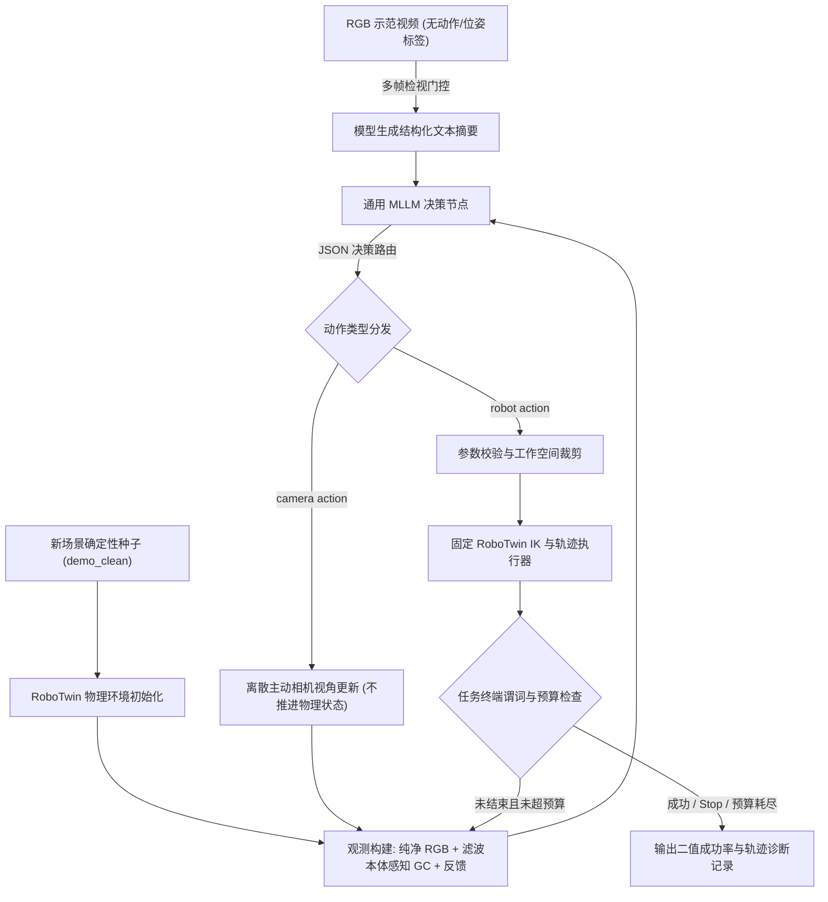
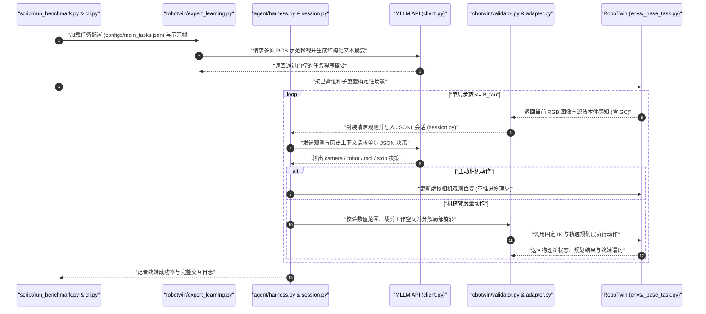

# VABench: Measuring Embodied Spatial Intelligence through Visual Demonstrations, Active Perception, and Metric Control

## 一句话定义

**VA-Bench**（Vision-Action Benchmark）是一个基于 RoboTwin 物理仿真的闭环具身空间智能评测基准，要求通用多模态大语言模型（MLLM）仅凭纯 RGB 示范与主动视角观测，直接输出度量级单/双臂笛卡尔运动指令并依据执行反馈在线修正，且不提供任何特权物体位姿、专家轨迹或可学习动作头。

## 英文缩写速查

| 缩写 | 英文全称 | 简要说明 |
|---|---|---|
| MLLM | Multimodal Large Language Model | 多模态大语言模型；VA-Bench 中作为唯一模型相关组件直接决策视角与度量动作 |
| GC | Gripper Center (finger midpoint) | 物理夹爪指尖中点；本体感知的度量参考点及语义相机视角的对齐中心 |
| IK | Inverse Kinematics | 逆运动学；由固定、模型无关的 RoboTwin 规划层执行，不参与语义目标选择 |
| SPU | Spatial Perception and Understanding | 空间感知与理解诊断模块，包含目标定位（TL）、主动探索（AE）与空间关系（SR） |
| RM | Robot Manipulation | 机器人操作诊断模块，包含操作语义（MS）、目标导向规划（MP）与接触前精细分析（FG） |
| ER | Error Recovery | 错误恢复诊断模块，仅在发生可观测错误时计分，含错误检测（ED）、在线纠偏（OC）与失败后调整（PF） |

## 为什么重要

现有空间推理与具身操作评测往往将感知、视角获取和物理执行割裂开来：静态或被动多视角空间基准（如 BLINK、3DSRBench）停留在口头或 QA 描述，即使判断出相对关系也不一定能给出满足接触公差的度量参数；交互式探索基准（如 Theory of Space、ESI-Bench）主要评估空间信念或高层决策；而多数操作基准要么向模型暴露固定前视/物体 3D 坐标与真值位姿，要么依赖经过专门训练的 VLA 策略或参数化运动原语。

VA-Bench 的核心价值在于将**示范程序抽象、主动视角获取、度量级末端控制与反馈修正**耦合进同一个 `observe–reason–act–revise` 闭环中，并用严格的物理成功谓词与九维轨迹行为诊断揭示出一个关键瓶颈：即便通用 MLLM 在目标识别与操作语义上接近满分，在几何精密对齐、主动找视角、双臂协同、跨几何迁移和在线纠偏上仍存在显著落差。

## 核心信息

| 字段 | 内容 |
|---|---|
| 作者 | Zhongbo Zhang*, Jiayi Jin*, Yifan Wang, Zaibin Zhang, Haiwen Diao, Lijun Wang, Huchuan Lu（* 共同一作） |
| 机构 | 大连理工大学（DUT）、南洋理工大学（NTU） |
| 发表时间 | 2026-09-17（arXiv:2609.19554v1 [cs.RO]） |
| 论文链接 | [arXiv:2609.19554](https://arxiv.org/abs/2609.19554) · [arXiv HTML](https://arxiv.org/html/2609.19554) |
| 项目与代码 | [GitHub: zhangzhongbo2213/VABench](https://github.com/zhangzhongbo2213/VABench)（MIT）· [Hugging Face 数据集](https://huggingface.co/datasets/zhangzhongbo2213/VA-Bench) |
| 清单分类 | `environment.benchmarking` |
| 来源条目 | `survey_ax_2609_19554` |
| 开源状态 | **已开源**（公开 Python Agent Harness、RoboTwin 任务与种子验证脚本、主评测脚本及版本化资产包 `assets-v1`） |

## 核心原理

VA-Bench 将每个评测实例定义为元组 $z = (\tau, \xi, g_{\tau,\xi}, D_\tau, B_\tau, \phi_\tau)$，分别对应任务族 $\tau$、确定性场景种子 $\xi$、自然语言指令 $g_{\tau,\xi}$、纯 RGB 示范视频 $D_\tau$、单局动作预算 $B_\tau$ 与物理成功谓词 $\phi_\tau$。

### 1. 示范条件化重定位（Demonstration-Conditioned Re-Grounding）

在主协议（model-specific summary）中，被测模型 $m$ 在测试前需先检视一段成功专家执行纯 RGB 视频 $D_\tau$ 中的多帧画面（受帧检视门控约束），提炼一份结构化文本摘要 $s_{m,\tau}$，记录抓取区域、指尖位置、接近方向、姿态要求、左右臂分工及完成条件。视频与摘要**均不包含**机器可读动作、末端位姿、关节状态、物体坐标或语义阶段标签。测试阶段换用全新种子 $\xi$ 时，模型必须把文本程序经验重新锚定（re-ground）到当前场景并独立生成全部数值控制量。

### 2. 观测与特权信息边界

在控制步 $t$，模型接收观测 $o_t = (I_t, p_t, h_t, f_{t-1})$：
- **纯净图像 $I_t$**：当前主动相机（或被动对照下的固定 5 视角包）RGB 图像，严禁叠加关键点、坐标轴、掩码或目标标记；
- **滤波本体感知 $p_t$**：受控末端位姿、夹爪开合状态、指尖中点（GC）及世界坐标系下的夹爪局部坐标轴（双臂任务分别提供双臂状态），由此为模型锚定世界系度量尺度；
- **历史与反馈 $h_t, f_{t-1}$**：交互历史文本以及上一步的动作合法性与轨迹规划器二值反馈；
- **严格隔离项**：深度图、点云、分割掩码、物体真实坐标/位姿、接触状态、任务路点、相机数值标定及离线验证探针均不对模型开放。

### 3. 动作空间与固定执行器

动作空间定义为 $\mathcal{A} = \mathcal{A}_{\mathrm{cam}} \cup \mathcal{A}_{\mathrm{move}} \cup \mathcal{A}_{\mathrm{rot}} \cup \mathcal{A}_{\mathrm{grip}} \cup \mathcal{A}_{\mathrm{dual}}$：
- **机器人度量动作（改变物理状态 $x_{t+1} = \mathcal{T}_\tau(x_t, a_t)$）**：
  - 世界轴平移：$u \in \{x,y,z\}$、符号 $\sigma \in \{-,+\}$、步长 $d \in [1, 100]\text{ mm}$；
  - 夹爪局部轴旋转：$r \in \{r_x, r_y, r_z\}$、符号 $\sigma$、角度 $\alpha \in [1, 90]^\circ$（适配器通过位置补偿保持 GC 近似不动，并将大角度拆分为 $\le 10^\circ$ 路点）；
  - 夹爪开合（`open` / `close`）及双臂模式下的臂选择（`arm=left|right`）与同步双臂平移/双爪开合（`dual_gripper.open/close`）。
- **有界主动相机动作（仅改变观测视角，$x_{t+1} = x_t$）**：
  - 5 个围绕 GC $c$ 的语义视角：`view_topdown`（俯视对齐 X-Y）、`view_side`（侧视看高度与桌面净空）、`view_front_side_45`（消解前侧投影歧义）、`view_side_top_45`、`view_oblique_45`（双臂支持 `view_left_*` / `view_right_*` / `view_both_*`）；
  - 离散局部微调：相机系左右上下平移（5 cm）、缩放（8 cm）、绕世界 Z 轴偏航（$10^\circ$）及绕相机左轴俯仰（$10^\circ$）。相机动作与机械臂动作共享总步数预算 $B_\tau$，且限制连续纯相机动作最多 5 步；该接口不模拟物理相机机械臂的碰撞与运动学。
- **模型无关执行层**：基于 RoboTwin 的固定 IK 与轨迹规划器检查可达性并执行合法目标，只返回成功/失败，不替模型挑选物体或抓取点。

### 4. 三条评测轨道与物理种子筛选

- **Base Track（14 个任务族）**：11 个单臂任务 + 3 个双臂任务，涵盖直接抓取定位（5 个）、放置与堆叠（4 个）、功能接触与工具使用（2 个）、双臂协同（3 个）。在 `demo_clean` 确定性配置下，对每个候选种子先运行 2,000 步物理静置再观测 500 步（末 200 步姿态漂移 $\le 3^\circ$），并通过完整 `task.play_once()` 专家探测；从 318 次实际探测中筛选保留 280 个（每族 20 个，条件通过率 88.1%）。
- **Controlled Transfer Track**：在 7 个单臂任务族上改变物体几何形状、容器实例或空间布局，直接复用基础任务的示范摘要。
- **Long-Horizon Composition Track**：五物体放篮长程任务（20 局共 100 次放置），仅提供 4 个原子技能视频，无完整任务示范。

## 流程总览

## 源码运行时序图

主评测由 `script/run_benchmark.py` 启动，经由 `agent/src/agent/cli.py` 与 `agent/src/agent/harness.py` 维护持久化决策线程，并通过 `agent/src/agent/robotwin/` 适配层完成参数校验与 RoboTwin 仿真交互：

入口说明：先通过 `bash script/install.sh` 配置环境，再运行 `python script/run_benchmark.py --run-id <id> --tasks ... --gpus ...` 即可调度单任务冒烟或全量 14 任务并行评测（可用 `script/monitor.py` 监控进度）；模型协议支持 OpenAI `chat_completions`、Responses 以及 Anthropic `anthropic_messages` 接口。

## 实验与评测

### 1. 主基准表现（14 任务 $\times$ 20 种子 $\times$ 3 次独立运行 = 840 局/模型）

- **头部梯队接近且明显断层（Table 3）**：`Qwen3.8-max` 三次运行宏观均值为 $53.93 \pm 3.17\%$（单臂 $65.61 \pm 3.81\%$，双臂 $11.11 \pm 2.55\%$）；`Opus-5` 为 $52.86 \pm 2.79\%$（单臂 $64.09\%$，双臂 $11.67\%$）；`GPT-5.6-sol` 为 $51.55 \pm 4.31\%$（单臂 $59.55\%$，双臂最高 $22.22\%$）。三者区间重叠，其后断崖式跌落至 `GPT-5.6-terra`（$23.10 \pm 1.25\%$）、`Doubao-seed-2.1-turbo`（$15.00 \pm 0.36\%$）、`Gemini-3.6-flash`（$14.17 \pm 0.21\%$）及以下（最末 `MiMo-v2.5` 为 $3.33 \pm 0.21\%$）。
- **子任务进度与双臂瓶颈**：单次标注运行中，子任务检查点微平均完成度为 `Opus-5` $68.57\%$、`Qwen3.8-max` $66.07\%$、`GPT-5.6-sol` $65.89\%$。所有 12 个模型在双臂交接 `handover_horizontal_block` 上成功率均为 $0.00\%$；在 `lift_pot` 上仅 `GPT-5.6-terra` 达到 $1.67 \pm 2.89\%$，其余 11 个模型均为 $0.00\%$。

### 2. 九维行为诊断（Table 11, 28）

三名标注员对 12 个主模型共 3,360 局轨迹的标注一致性达 $95.69\%$（Fleiss $\kappa = 0.942$，Gwet $\text{AC1} = 0.943$）：
- **感知/语义高分 vs. 几何与纠偏短板**：头部三模型在目标定位 `TL` 上均达 $100.0\%$、操作语义 `MS` 均 $\ge 99.6\%$，但空间关系 `SR` 降至 $70.4\%\text{–}78.9\%$、接触前精细分析 `FG` 为 $73.9\%\text{–}77.9\%$（`Opus-5` 最高）。主动探索 `AE` 最高为 `Opus-5`（$83.2\%$）。
- **错误检测不等于在线纠偏**：头部三模型的错误检测 `ED` 均在 $69.9\%\text{–}73.6\%$ 之间，但在线纠偏 `OC` 仅 `Qwen3.8-max` 达到 $46.7\%$、`Opus-5` $32.4\%$、`GPT-5.6-sol` $27.3\%$；`Gemini-3.6` 失败后重规划 `PF` 达 $61.9\%$，但在线纠偏 `OC` 仅 $1.9\%$。

### 3. 消融与泛化实验（§5, Table 4–6, 15, 19）

- **主动视角 vs. 被动五视角（Table 4）**：固定模型、种子与执行器，仅取消主动相机控制并改为每步提供固定顺序的 5 张标准视角图像，四个测试模型全部大幅掉点——`Qwen3.8-max` 从 $57.50\%$（161/280）跌至 $27.86\%$（78/280，$\Delta = -29.64\text{ pp}$），其中 `place_cube_in_bowl` 从 $85.00\%$ 骤降至 $5.00\%$；`Opus-5` 跌 $23.93\text{ pp}$；`GPT-5.6-sol` 跌 $22.14\text{ pp}$；`Doubao-2.1` 跌 $9.64\text{ pp}$。
- **受控几何迁移与长程组合（Table 5）**：在 7 个单臂留出迁移任务上，`Qwen3.8-max` 从 $77.86\%$ 降至 $67.86\%$（$-10.00\text{ pp}$），而基线接近的 `GPT-5.6-sol` 从 $80.00\%$ 骤降至 $47.86\%$（$-32.14\text{ pp}$）。五物体长程放篮任务上，所有测试模型严格整局成功率为 $0.00\%$（`Qwen3.8-max` 完成了 $61/100$ 个子放置，`GPT-5.6-sol` 完成 $53/100$）。
- **跨模型示范摘要迁移（Table 6）**：在 3 个单臂任务上的交叉实验表明，任务成功率最高的 `Qwen3.8-max` 生成的摘要偏隐式，替换给其余 4 个模型使用后平均掉点 $31.25\text{ pp}$（`GPT-5.6-sol` 暴跌 $51.67\text{ pp}$）；相反，约束更显式的 `Opus-5` 摘要使其余 4 个模型平均提升 $+7.50\text{ pp}$。
- **本地小模型表现（Table 19）**：使用 `Qwen3.8-max` 摘要引导时，本地部署的 `Qwen3.8-27B` 取得 $9.64\%$（27/280）、`Gemma-4-31B-it` 取得 $8.57\%$（24/280）、`Qwen3.6-27B` $1.07\%$、`Qwen3.6-35B-A3B` $0.71\%$，且全部局限在基础抓取和按铃任务，放置与双臂任务全为 $0\%$。

## 与其他工作对比

| 基准 / 工作 | 主动视角选择 | 物理执行机械臂控制 | 视角-机械臂联合闭环 | 通用 MLLM 直接闭环（无学习动作头） | 核心差异定位 |
|---|---|---|---|---|---|
| ManipBench | 否 | 否 | 否 | 是 | 基于给定图像测低层操作推理，不进入物理执行循环 |
| Theory of Space / ESI-Bench / SpatialWorld | 是 | 否 | 否 | 是 | 侧重空间信念构建、语义选择或导航决策，不输出度量机械臂控制 |
| EmbodiedBench (manipulation) / ST-BiBench / IMBench / ESPIRE | 否 | 是 | 否 | 是 | 依赖固定视角、真值物体位姿、参数化原语或深度反投影 |
| **VA-Bench（本工作）** | **是** | **是** | **是** | **是** | **同一 MLLM 在无特权几何下统一完成示范归纳、主动选视角、度量控制与错误修正** |

## 结论

**一句话总判：VA-Bench 通过严格的「无特权几何 + 主动选视角 + 度量笛卡尔控制 + 物理反馈闭环」评测协议证明，当前顶尖通用 MLLM 已具备较高的语义与目标识别能力，但在连续空间关系估计、主动证据利用、在线纠偏、几何泛化及双臂协同上仍远未达到可靠物理执行的水平。**

1. **不能用目标定位或静态空间 QA 分数代替闭环操作评估**：`TL=100%` 与 `SR=70%–79%`、任务成功率 $\approx 51\%\text{–}54\%$ 之间的落差说明，必须直接检验模型将视觉判断转化为毫米/角度级控制参数的能力。
2. **任务条件化的主动选视角优于被动全视角堆叠**：被动输入 5 个固定视角（覆盖集是主动可达视角的真子集）反而导致放置类任务成功率大幅下滑，说明按子目标按需消除遮挡与视差是闭环空间推理的关键环节。
3. **跨模型经验迁移取决于约束显式化而非原作者成功率**：编写清晰、显式约束接触与对齐条件的文本摘要（如 `Opus-5`）可正向迁移给较弱执行模型，而省略隐含前提的摘要会严重误导其他模型。
4. **长程组合与双臂精细协同仍是通用 MLLM 的核心瓶颈**：即使单子目标完成率过半（61/100），微小的局部误差与状态维护失效也会使严格长程成功率归零；双臂交接与抬锅任务几乎全军覆没。

## 工程实践

- **本地搭建与冒烟测试**：按官方仓库 `README` 使用 `conda create -n va-bench python=3.10 -y && bash script/install.sh` 部署 RoboTwin 与 `va-bench`，从 GitHub Releases 或 Hugging Face 下载 `assets-v1` 解压至根目录，随后用 `python script/run_benchmark.py --run-id smoke --tasks grasp_single_cube --num-seeds 1 --gpus 0 --parallel 1` 验证 API 连通性与物理仿真链路。
- **观测与控制接口设计经验**：在将 MLLM 接入真实或仿真机械臂时，提供基于指尖中点（GC）的局部坐标系轴向信息与小步长增量接口（平移 $\le 100\text{ mm}$、旋转分解 $\le 10^\circ$），并将工作空间裁剪与可达性检查交给固定底层规划器，可有效隔离语义/空间推理与底层动力学误差。
- **提示与示范上下文构建**：若采用「视频摘要 + 零样本重定位」范式，应显式提示模型记录抓取部位、夹爪闭合轴与长轴关系、高度净空与释放前提，避免仅输出高层动作名称。

## 局限与风险

- **未覆盖模块化 VLM–VLA 架构（Appendix B.4）**：基准聚焦通用 MLLM 直接输出度量增量，未评测「高层 VLM 规划 + 底层专用 VLA 策略执行」分工范式的表现与接口误差边界。
- **自生成摘要与在线控制耦合（Appendix B.3）**：主评测中模型既写摘要又执行控制，端到端结果同时混杂了程序提炼质量与在线重定位能力；无摘要基准和专家人工摘要对照尚未在全套 14 任务上补齐。
- **虚拟相机接口不计物理相机运动约束（Appendix C.6）**：离散相机动作直接更新渲染位姿，未建模腕部或外置相机臂的运动学可达性、碰撞和连续轨迹代价。
- **泛化范围有限与诊断非因果性（Appendix B.1–B.2）**：评估限于 `demo_clean` 仿真环境（无光照/杂物/相机标定随机化）、7 个受控几何迁移族和 1 个五物体长程任务；九维人工诊断属于轨迹可观测行为定位，而非独立模块干预式的因果归因。

## 关联页面

- [机器人视觉感知栈选型闭环](../queries/robot-perception-stack-selection-loop.md)：对照视觉感知与开放词汇定位选型闭环。
- [具身大模型评测基准选型闭环](../queries/embodied-eval-benchmark-selection-loop.md)：对照评测基准设计与指标选型闭环。
- [Agentic Robots 综述](paper-towards-agentic-robots-survey.md)
- [全量项目节点清单](../overview/awesome-agentic-robots-node-index.md)
- [VLA 方法背景](../methods/vla.md)
- [具身智能体评测方法](../methods/embodied-agent-benchmarking.md)：对照任务设置、接口与评估指标。
- [机器人智能体调度框架（Robot Agent Harness）](../methods/robot-agent-harness.md)：对应本文隔离模型推理、协议校验与仿真执行的 Harness 工程结构。
- [智能体规划与反馈机制](../methods/agent-planning-feedback.md)：关联动作执行反馈驱动的在线纠偏（OC）与失败后重规划（PF）。
- [机器人操作（Manipulation）](../tasks/manipulation.md)：覆盖直接抓取、放置堆叠与工具使用等基础任务族。
- [双臂协同操作（Bimanual Manipulation）](../tasks/bimanual-manipulation.md)：对应 `place_shoe`、`handover_horizontal_block` 与 `lift_pot` 三类双臂协同评测任务。

## 推荐继续阅读

- [VA-Bench 官方 GitHub 仓库与评测文档](https://github.com/zhangzhongbo2213/VABench)
- [VA-Bench 论文原文（arXiv:2609.19554）](https://arxiv.org/abs/2609.19554)
- [VA-Bench 版本化仿真资产数据集（Hugging Face）](https://huggingface.co/datasets/zhangzhongbo2213/VA-Bench)

## 参考来源

- [论文原文核对归档（arXiv:2609.19554）](../../sources/papers/paper-agentic-2609-19554.md)
- [官方代码仓库核对归档（zhangzhongbo2213/VABench）](../../sources/repos/paper-agentic-2609-19554.md)
- [官方 Awesome 快照归档](../../sources/repos/awesome-agentic-robots-survey-index.md)
- [论文官方 arXiv HTML 全文](https://arxiv.org/html/2609.19554)
- [GitHub 官方项目与代码仓](https://github.com/zhangzhongbo2213/VABench)
