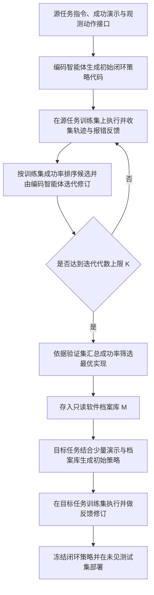

# Learning and Transferring Closed-Loop Robot Software

## 一句话定义

**Learning and Transferring Closed-Loop Robot Software**（arXiv:2609.19906v3）研究将编码智能体通过仿真执行反馈优化并经验证集筛选出的完整闭环控制软件保留为只读经验档案库，以兼顾冻结代码的零推理延迟部署与新任务策略获取的跨任务迁移收益。

## 英文缩写速查

| 缩写 | 英文全称 | 简要说明 |
|---|---|---|
| GT-Geom | Ground-Truth Geometry | 仿真器提供的逐像素几何掩码 ID 与物体/部件类别元数据，本文消融显示其对代码优化最关键 |
| RGB | Red, Green, Blue | 多视角彩色图像输入（本文 RoboCasa 中为左、右及腕部三路相机） |
| BC | Behavior Cloning | 基于演示轨迹监督学习动作映射的行为克隆基线（本文对照 BC-Transformer-10） |
| VLA | Vision-Language-Action | 视觉-语言-动作基础模型（本文作为多任务参考基线列出 GR00T N1.5、$\pi_{0.5}$、$\pi_0$） |
| API | Application Programming Interface | 编码智能体与观测、动作接口及代码生成会话交互的程序接口 |
| WBC | Whole-Body Control | 全身控制（本文真机在 Unitree G1 上通过 SONIC 全身控制器执行高层姿态目标） |

## 为什么重要

1. **回答“源任务特化分支是否阻碍迁移”的核心疑问：** 编码智能体在迭代修补控制程序时会不断新增条件分支与控制细节（本文统计 `if`/`elif` 从 622 增至 741）。一个直观担忧是这些代码会过拟合源任务条件，从而降低对新任务的参考价值。本文通过受控跨任务迁移实验给出反例：在相同参考访问机制下，使用验证筛选的优胜源策略（`Best4`）相比直接使用初始生成源策略（`Initial4`），在 9 个目标任务上平均提升 **15.6 个百分点**，证明“在源任务学得更好的完整代码”同样是更强的跨任务经验载体。
2. **完整闭环软件即经验，无需强行抽象为通用技能：** 不同于必须把经验提炼为独立规划原语或解耦技能库的方法，本文将观测解析、状态机转移 $h_t$ 与情境分支作为整体策略包保留，由后续任务的编码智能体自主查阅与裁剪复用。
3. **训练期调用编码模型，部署期零模型推理开销：** 冻结后的闭环 Python 策略在测试与真机阶段直接以高频闭环运行（Unitree G1 上为 50 Hz），避免在线大模型控制每回合动辄数十次调用（对照在线智能体平均 **52.6 次/回合**）带来的延迟与算力成本。

## 核心信息

| 字段 | 内容或核查状态 |
|---|---|
| **作者** | So Kuroki、Kento Kawaharazuka、Yujin Tang |
| **机构** | Sakana AI；东京大学（The University of Tokyo） |
| **发表时间** | 2026-09-17 提交 arXiv v1，2026-10-30 修订 v3（arXiv:2609.19906v3 [cs.RO]） |
| **论文链接** | [arXiv:2609.19906](https://arxiv.org/abs/2609.19906) / [arXiv HTML v3](https://arxiv.org/html/2609.19906) |
| **项目与代码** | 未确认（截至 2026-11-27，arXiv v3 原文与检索索引均未列出独立项目页或官方 GitHub 仓库） |
| **清单分类** | `harness.skills`（来源条目：`survey_ax_2609_19906`） |
| **开源状态** | **未确认开源代码**（仅论文正文公开；无官方可执行仓库与权重发布记录） |

## 核心原理

### 1. 闭环策略接口与编码智能体学习设定

在给定观测配置 $\omega$ 下，环境状态 $x_t$ 经观测函数映射为许可观测 $o_t = \mathcal{O}_\omega(x_t)$；闭环策略 $P$ 维护内部状态 $h_t$（例如当前操作阶段，每回合初重置），每步输出控制指令与下一状态：

$$(a_t, h_{t+1}) = P(o_t, h_t; q)$$

编码智能体 $\mathcal{A}_B$（生成预算为 $B$）接收任务指令 $q$、少量成功演示 $\mathcal{D}_q$ 以及观测-动作接口规范 $\mathcal{I}_\omega$，输出包含观测处理、状态转移、条件分支与控制代码的完整可执行策略包。优化过程中编码模型权重保持冻结；策略一旦筛选冻结，测试阶段不再调用编码模型。

### 2. 数据划分隔离与验证集筛选归档

为避免对训练初始状态过拟合，每个源任务 $s$ 的环境实例在优化前被严格划分为互斥的 **Train / Validation / Test** 三组：

- **Train 反馈：** 智能体运行候选策略并接收轨迹级观测、动作、任务成败与运行错误；历史候选按训练集成功率排序（平局优先更早代），选出最优先序点进行下一轮代码修订。
- **Validation 筛选：** 经过共 $K$ 代生成与修订后（包含初始生成策略 $P_s^{(0)}$），依据验证集成功率选出唯一归档版本：

$$P_s^\star \in \underset{P \in \{P_s^{(0)}, \ldots, P_s^{(K-1)}\}}{\arg\max} \ \widehat{J}_{\mathcal{C}_s^{\mathrm{val}}}(P)$$

  验证阶段仅向智能体返回汇总成功数与评测次数，不泄露单条轨迹或图像，防止针对验证案例手工特化。所有源任务优胜实现构成只读档案库 $\mathcal{M} = \{P_s^\star \mid s \in \mathcal{S}\}$。

### 3. 基于软件档案库的无约束跨任务迁移

面对新目标任务 $q$ 时，智能体除目标任务指令、成功演示 $\mathcal{D}_q$ 与接口规范 $\mathcal{I}_\omega$ 外，还可只读访问整个档案库 $\mathcal{M}$：

$$\widetilde{P}_q^{(0)} = \mathcal{A}_B(q, \mathcal{D}_q, \mathcal{I}_\omega, \mathcal{M})$$

系统不预设源任务与目标任务的配对关系，由智能体自行浏览 $\mathcal{M}$ 并决定参考哪些实现的观测解析模式、状态机结构或局部控制子程序，随后在目标任务训练集上执行一轮（若初始运行报错则先修复重跑再改进一轮）轨迹反馈修正得到最终策略 $\widetilde{P}_q$，冻结后在测试集评测。

## 流程总览

## 源码运行时序图

**不适用**（截至 2026-11-27，arXiv:2609.19906v3 原文及当前检索材料未提供官方代码仓库或独立项目页链接，未确认可运行官方源码实现）。

## 实验与评测

### 1. 源任务闭环策略学习（RoboCasa / PandaOmron，Table I）

在 [RoboCasa](./robocasa.md) 仿真环境的 PandaOmron 平台上，以 `gpt-6-astra`（high reasoning effort）作为编码模型，对 4 个源任务（`Faucet` 300 步、`Drawer` 750 步、`Pick → Sink` 600 步、`Microwave` 450 步）执行 $K=5$ 代优化（每任务 10 条演示 / 10 训练 / 10 验证 / 30 共享测试案例）：

| 方法 | 每任务演示数 | 运行时输入 | Faucet | Drawer | Pick → Sink | Microwave | 4 任务均值 |
|---|---|---|---|---|---|---|---|
| **Validation-selected policy code (本文)** | 10 | Full | 56.7% (17/30) | **70.0% (21/30)** | **76.7% (23/30)** | **53.3% (16/30)** | **64.2%** |
| Initially generated policy code | 10 | Full | 33.3% (10/30) | 3.3% (1/30) | 26.7% (8/30) | 50.0% (15/30) | 28.3% |
| GPT-6 Astra online | 10 | Full | **70.0% (21/30)** | 50.0% (15/30) | 60.0% (18/30) | 26.7% (8/30) | 51.7% |
| BC-Transformer-10 | 10 | 3 RGB + proprio | 23.3% (7/30) | 6.7% (2/30) | 3.3% (1/30) | 3.3% (1/30) | 9.2% |

- **迭代优化收益：** 验证筛选策略相对初始生成代码平均提升 **35.8 个百分点**（34/120 → 77/120），全部 4 个任务均获改善；且训练与验证曲线同步上升（Fig. 2）。
- **相对在线智能体：** 冻结策略不仅比同模型在线控制高 **12.5 个百分点**（64.2% vs 51.7%），而且推理期无需模型调用（在线方法平均每回合 **52.6 次**调用）。
- **公开多任务策略参考对比（Panel B，100 条演示、RGB + 状态输入、不完全对齐训练分布与观测条件）：** GR00T N1.5 为 **62.5%**（20/30, 17/30, 27/30, 11/30）、$\pi_{0.5}$ / Human300 为 **58.3%**、$\pi_0$ / Human300 为 **37.5%**、Diffusion Policy / Human300 为 **20.0%**。

### 2. 观测模态消融（5 训练 / 5 验证 / 10 测试，3 代优化，Table II）

| 观测条件 | Faucet | Drawer | Pick → Sink | Microwave | 均值 (%) | 相对 Full (pp) |
|---|---|---|---|---|---|---|
| Full（RGB + Metric 3D + GT-Geom + Contact） | 10/10 | 9/10 | 6/10 | 1/10 | 65.0 | 0.0 |
| Without contact | 8/10 | 9/10 | 6/10 | 5/10 | 70.0 | +5.0 |
| Without Metric 3D | 8/10 | 10/10 | 7/10 | 2/10 | 67.5 | +2.5 |
| **Without GT-Geom** | 5/10 | 8/10 | 1/10 | 0/10 | **35.0** | **-30.0** |
| **RGB only** | 2/10 | 4/10 | 2/10 | 1/10 | **22.5** | **-42.5** |

- 仅使用 RGB 时均值暴跌至 **22.5%**；单独移除 `GT-Geom` 导致最大的单一模态组损失（**-30.0 pp**），表明语义/几何区域定位信息在生成精准闭环程序时起核心支撑作用。单次运行下去除 Contact 或 Metric 3D 略高于 Full，作者明确指出不足以证明移除它们普遍有利。

### 3. 九个目标任务的跨任务软件迁移（3 次独立运行，Table III）

目标任务按任务结构相似度分为 Near（4 项）、Intermediate（2 项）、Far（3 项）；每次运行使用 5 条演示、5 个训练案例（单轮轨迹修订，若首轮报错则先修错重跑）和 10 个共享测试案例（会话上限 30 分钟、80 次 API 调用）：

| 迁移距离 | 目标任务 | No reference | Initial4 | Best4 |
|---|---|---|---|---|
| Near | TurnOnSinkFaucet | 90.0 ± 17.3 (27/30) | 76.7 ± 32.1 (23/30) | **90.0 ± 10.0 (27/30)** |
| Near | PickPlaceSinkToCounter | 60.0 ± 52.0 (18/30) | 0.0 ± 0.0 (0/30) | **70.0 ± 20.0 (21/30)** |
| Near | CloseDrawer | 70.0 ± 52.0 (21/30) | 86.7 ± 5.8 (26/30) | **93.3 ± 11.5 (28/30)** |
| Near | TurnOffMicrowave | 3.3 ± 5.8 (1/30) | **76.7 ± 15.3 (23/30)** | 60.0 ± 10.0 (18/30) |
| Intermediate | OpenMicrowave | 80.0 ± 17.3 (24/30) | 23.3 ± 40.4 (7/30) | **83.3 ± 20.8 (25/30)** |
| Intermediate | PickPlaceCounterToCabinet | **63.3 ± 23.1 (19/30)** | 53.3 ± 23.1 (16/30) | 56.7 ± 32.1 (17/30) |
| Far | OpenCabinet | 23.3 ± 20.8 (7/30) | **40.0 ± 10.0 (12/30)** | **40.0 ± 10.0 (12/30)** |
| Far | TurnOnStove | 16.7 ± 15.3 (5/30) | 6.7 ± 11.5 (2/30) | **20.0 ± 20.0 (6/30)** |
| Far | CoffeeSetupMug | 0.0 ± 0.0 (0/30) | **10.0 ± 17.3 (3/30)** | 0.0 ± 0.0 (0/30) |
| **总计** | **9 任务宏平均（3 次运行）** | **45.2 ± 10.3 (122/270)** | **41.5 ± 10.5 (112/270)** | **57.0 ± 7.8 (154/270)** |

- `Best4` 在全部 3 次运行中均高于 `Initial4`，九任务宏平均领先 **15.6 个百分点**，也比无参考基线高 **11.8 个百分点**。
- `Initial4` 整体低于 `No reference`（41.5% vs 45.2%），说明**单纯提供参考代码并不自动带来正迁移**，低质量初始代码反而可能误导生成（如 `PickPlaceSinkToCounter` 跌至 0/30、`OpenMicrowave` 跌至 23.3%）。
- 静态代码分析显示，4 个源任务非测试 Python 代码中的 `if`/`elif` 分支总数由 `Initial4` 的 **622** 增加到 `Best4` 的 **741**（+19.1%）。

### 4. Unitree G1 真机验证（§V，Table IV）

在 29 自由度实体 Unitree G1（固定五指手、20° 俯视相机）上，结合深度点云与 TypeSafe **JEV-1.14** 目标区域检测（不使用仿真真值物体位姿或接触标签），利用 **Claude Opus 5.5** 在 RoboCasa 中无演示优化 10 个训练案例（最多 8 代，10/10 早停；关抽屉取第 4 代、关冰箱门与导航取第 7 代），部署时以 **50 Hz** 向低层 [SONIC](./nvidia-sonic.md) 全身控制器输出行走和头/手目标位姿，无需 real-to-sim 场景重建（仅部署前调整目标距离等少数参数）。结果：`Close drawer` **4/5**、`Close refrigerator` **3/5**、`Navigation` **4/5**（本节未评测档案库跨任务迁移）。

## 与其他工作对比

| 对比维度 | 本文方法 | [Act-Observe-Rewrite (AOR)](./paper-agentic-2603-04466.md) | [RHO](./paper-agentic-2606-16458.md) | [ASPIRE](./paper-agentic-2607-00272.md) |
|---|---|---|---|---|
| **经验保留载体** | 完整闭环策略包（含观测解析、状态机 $h_t$、条件分支） | 单任务回合间直接重写当前代码 | 多文件策略仓库（Repositories-as-Policies） | 从验证修复中蒸馏的模块化技能库（in-context 检索） |
| **源任务筛选机制** | 严格划分 Train/Val/Test，仅凭 Val 汇总分数选优入库 | 回合间关键帧与结构化轨迹反馈 | HELIX 反射演化优化器隔离闭环搜索 | 逐原语多模态 trace 诊断 + 进化搜索 |
| **跨任务迁移方式** | 只读访问完整源实现档案库 $\mathcal{M}$，自主裁剪改写 | 单任务上下文适应为主 | 训练期框架优化，部署期低成本调用 | 检索模块化技能指导新任务编程 |
| **部署推理特征** | 冻结 Python 代码闭环运行（真机 50 Hz，0 次模型调用） | 周期性重写或冻结执行 | 单轮零代码生成或轻量工具框架 | 编程 Agent + 闭环执行引擎 |

## 结论

**一句话总判：在编码智能体生成闭环机器人策略时，唯有经过执行反馈迭代优化并由独立验证集筛选出的高质量代码，才能作为可靠的跨任务参考经验；未经过滤的初始生成代码不仅源任务成功率低，还会在迁移时拖累新任务表现。**

1. **验证筛选是经验增值的核心门禁：** 源任务代码经 5 代执行优化与验证集筛选后测试成功率从 **28.3%** 升至 **64.2%**，且其分支复杂度增加（`if`/`elif` +19.1%）并未阻碍整体迁移，反而带动 9 个目标任务平均达到 **57.0%**。
2. **劣质参考代码产生负迁移：** 暴露未经优化的初始源策略（`Initial4`）在目标任务上均值为 **41.5%**，低于完全无参考的 **45.2%**，工程实践中不应将未验证的候选脚本直接纳入经验库。
3. **语义几何定位对代码生成极其敏感：** 观测消融中移除 `GT-Geom` 导致均值骤降 **30.0 个百分点**，远超移除接触信号或 Metric 3D；向真机迁移时必须用可靠的分割/检测模型（如文中验证的 JEV-1.14 + 深度点云）补齐这一信息槽位。
4. **测试期零 LLM 调用兼具性能与实时性优势：** 冻结闭环代码在源任务上比同模型在线推理高 **12.5 个百分点**（64.2% vs 51.7%），同时免去每回合 50 余次模型调用，可直接在 50 Hz 频率下驱动真机全身控制器。

## 工程实践

- **划分严格的评估隔离边界：** 在让编码智能体使用执行反馈改写控制逻辑时，务必区分用于诊断修补的训练案例（可返回观测、动作与报错堆栈）和用于选优归档的验证案例（仅反馈汇总通过率），防止智能体针对少数测试初态硬编码。
- **档案库应采用“只读参考 + 目标微调”模式：** 不要直接把源任务策略函数当作不可变黑盒原语硬套到新任务，允许智能体在读取完整实现后重用其中的观测解析与安全判断模式，并基于目标任务的少量演示与 1 轮以上的真实执行反馈完成局部逻辑改写。
- **真机分层接入低层全身控制器：** 在人形或高自由度平台上，将编码智能体产出的 50 Hz 闭环软件定位为高层姿态与状态机决策器，向下输出移动速度与头/手目标给已验证的全身控制器（如 SONIC），并在部署前留出目标距离阈值等物理对齐参数以便现场标定。

## 局限与风险

- **并非所有目标任务都获益于验证优胜代码：** 在 `TurnOffMicrowave`（60.0% vs 76.7%）和 `CoffeeSetupMug`（0.0% vs 10.0%）上，`Best4` 表现仍低于 `Initial4`，说明源任务的特定分支逻辑在部分结构迁移场景仍可能引入参考偏差。
- **观测假设与真机迁移未闭环：** 仿真主实验与迁移实验依赖仿真器提供的 `GT-Geom`（移除后性能下降 30.0 pp），而实体 Unitree G1 验证仅覆盖 3 个学习任务（每任务 5 次试验）且未使用档案库跨任务迁移，真实视觉分割噪声对跨任务软件迁移的影响尚未量化。
- **真机贡献未与底层控制器解耦：** Unitree G1 的 4/5、3/5、4/5 成功率是高层生成代码与 SONIC 全身控制器的联合结果，实验未剥离 SONIC 本身鲁棒性的独立贡献。
- **未开源代码与模型闭源依赖：** 截至 2026-11-27 官方代码未公开，且论文依赖 `gpt-6-astra` 与 `Claude Opus 5.5` 等高推理能力闭源模型进行代码生成与修订。

## 关联页面

- [Agentic Robots 综述](paper-towards-agentic-robots-survey.md)
- [全量项目节点清单](../overview/awesome-agentic-robots-node-index.md)
- [VLA 方法背景](../methods/vla.md)
- [机器人智能体执行框架](../methods/robot-agent-harness.md)：对照规划、执行接口与反馈机制
- [智能体操作策略](../methods/agentic-manipulation-policies.md)：高阶模型编程与验证闭环范式
- [Coding Agent 验证闭环](../methods/coding-agent-verification-loops.md)：执行证据驱动的迭代代码修订
- [ASPIRE 方法页](../methods/aspire.md) 与 [ASPIRE 论文实体](./paper-agentic-2607-00272.md)：对照「蒸馏技能库」与「保留完整闭环实现」两种经验载体
- [智能体技能封装](../methods/agent-skill-packaging.md)
- [机器人操作任务](../tasks/manipulation.md)
- [Act-Observe-Rewrite (AOR)](./paper-agentic-2603-04466.md)
- [RHO](./paper-agentic-2606-16458.md)
- [RoboCasa 仿真平台](./robocasa.md)
- [NVIDIA SONIC 全身控制](./nvidia-sonic.md)

## 推荐继续阅读

- [arXiv:2609.19906 论文全文（HTML v3）](https://arxiv.org/html/2609.19906)
- [arXiv:2609.19906 摘要页](https://arxiv.org/abs/2609.19906)

## 参考来源

- [论文原文核对笔记](../../sources/papers/paper-agentic-2609-19906.md)
- [官方 Awesome 快照归档](../../sources/repos/awesome-agentic-robots-survey-index.md)
- [arXiv:2609.19906 原始论文](https://arxiv.org/abs/2609.19906)
