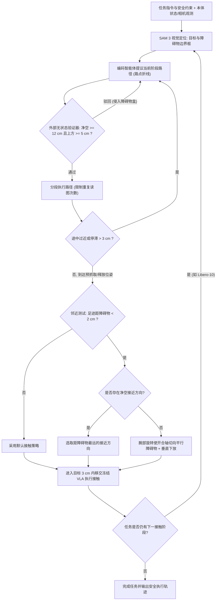

# SafeHarness: Coding Agents with Harness for Safe Robot Control

## 一句话定义

**SafeHarness** 是一种面向机器人操作编码智能体（Coding Agent）的安全执行护栏框架：它将每个操作子阶段拆分为自由空间路径段与末端接触段，通过外部无状态碰撞验证、两点重规划与邻近障碍接触策略选择，使「避碰安全」与「完成任务」具备同等执行优先级。

## 英文缩写速查

| 缩写 | 英文全称 | 简要说明 |
|---|---|---|
| VLA | Vision-Language-Action | 视觉-语言-动作模型；本文将其冻结作为近距精细接触原语调用 |
| LLM | Large Language Model | 大语言模型；作为编码智能体规划骨干（GPT-5.5 / GPT-6-Astra） |
| TSR | Task Success Rate | 任务成功率，评测回合达成任务目标的比例 |
| CAR | Collision-Avoidance Rate | 避障率，整个回合内障碍物位移未超过 $1\text{ mm}$ 的比例 |
| SSR | Safe Success Rate | 安全成功率，同时达成任务目标且全程无障碍物碰撞的回合比例 |
| CBF | Control Barrier Function | 控制障碍函数；相关基线（如 AEGIS）使用的后置动作安全滤波器 |

## 为什么重要

1. **揭示编码智能体「识别了约束却依然碰撞」的规划鸿沟**：此前编码智能体仅以任务成功率评测，SafeHarness 在 SafeLIBERO 上的诊断表明，即使提示词明确禁止触碰障碍物且模型推理轨迹已正确感知障碍物，智能体仍将任务完成作为唯一目标，沿最短直线直接穿撞障碍物。
2. **揭示「技能复用与安全约束冲突」的反直觉现象**：消融实验显示，在无障碍环境中积累的技能记忆（`Model + Skills`）虽然提升任务成功率，但在障碍物紧邻目标的场景（Level I）下反而会因为机械回放既定动作而使碰撞率高于无技能的纯模型，且更强的模型底座并不能自动消除该缺陷。
3. **证明长期约束不能只靠提示词维持**：长程操作单回合往往延续数百步、上下文膨胀至数万 token，早期提示词中的安全约束会随对话增长而衰减；将安全校验下沉为外部无状态的「计划-验证-重规划」护栏机制，可在不依赖上下文记忆的情况下稳定守住安全底线。

## 核心信息

| 字段 | 内容 |
|---|---|
| **作者** | Bingxin Xu, Yuzhang Shang, Zhen Dong, Emilio Ferrara |
| **机构** | 南加州大学（USC）；中佛罗里达大学（UCF）；加州大学圣巴巴拉分校（UCSB） |
| **发表时间** | 2026-09-17（v1）/ 2026-10-02（arXiv:2609.20822v2 [cs.RO]） |
| **论文链接** | [arXiv:2609.20822](https://arxiv.org/abs/2609.20822) / [arXiv HTML v2](https://arxiv.org/html/2609.20822) |
| **项目与代码** | 未确认（arXiv v2 原文及公开检索材料未提供 GitHub 仓库或独立项目页 URL） |
| **清单分类** | `harness.monitoring_and_recovery` |
| **来源条目** | `survey_ax_2609_20822` |
| **开源状态** | **未确认开源代码**（截至 2026-11-27，未确认官方可运行源码仓库、权重或独立项目页） |

## 核心原理

SafeHarness 沿用编码智能体调用感知原语、运动原语与冻结 [VLA](../methods/vla.md) 策略的分工范式，并以**接触事件（Contact Event）**作为自然切分点，将长程任务拆解为重复执行的「子阶段循环」。每个子阶段由以下两个互补护栏协同保障（原文 §3.1–§3.4）：

### 1. 阶段切分与双约束分解（§3.1）

一个操作子阶段包含「自由空间搬运/接近路径」与「末端富接触（contact-rich）动作」两部分，二者的碰撞风险几何形态截然不同：
- **路径约束**：控制机械臂及被抓持负载在工作空间长距离扫掠时的避碰问题；
- **接触约束**：末端在目标邻近小体积区域内开爪、下探、抓取或释放时的避碰问题（该动作锚定在目标位置上，无法像路径那样大范围绕行）。

单靠其中任一约束均无法保证全回合安全；双子目标任务（如 Libero-10）则按阶段重复调用整套双护栏循环。

### 2. 障碍物感知路径规划（Obstacle-Aware Route Planning，§3.2）

针对规划成本远低于物理执行成本的不对称性，SafeHarness 采用外部无状态校验驱动的 **Plan–Verify–Execute** 闭环：
- **每阶段重新建框与规划**：使用开放概念分割模型 **SAM 3** 将当前阶段的目标物体与障碍物定位为边界框（bounding boxes）。由于夹爪抓取物体后机械臂与负载形成刚性组合体，所需净空体积显著增大，因此每个阶段均须重新规划，不能沿用空爪阶段的路径。
- **外部几何验证器（Verifier）**：智能体在带框视图上提出由路点折线（polyline of waypoints）构成的候选路径，末端止于目标上方的预抓取或释放位姿。在任何运动下发之前，对话上下文之外的外部验证器校核夹爪（及所持负载）是否进入障碍物安全包络——实验设定为水平/三维距离障碍物 $< 12\text{ cm}$ 或在障碍物上方净空 $< 5\text{ cm}$ 即判定碰撞并驳回。
- **两点触发重规划（Two-Point Replanning）**：
  1. **执行前验证驳回**：候选路点侵入障碍物盒时直接拒绝并要求智能体重新规划，直至通过校验；
  2. **执行期异常重规划**：由于边界框只是近似几何表示，真实运动中若机械臂接近障碍物过近，或受未建模物理约束卡滞（实测表现为夹爪停在距目标路点 $> 3\text{ cm}$ 处），立即中止当前轨迹并从停机位姿重新触发路径规划。
- **观测经济性（Economy of Observation）**：为避免执行途中反复读取同一张路径规划图像导致上下文窗口膨胀、进而拉低长对话推理稳定性（§3.4），SafeHarness 显式限制执行阶段读取该图像的次数。

### 3. 障碍物感知接触执行（Obstacle-Aware Contact Execution，§3.3）

当机械臂到达目标上方的预抓取/释放位姿后，由第二个护栏接管路径验证所未覆盖的局部接触段：
- **邻近测试（Adjacency Test）**：判断目标接触位置处的夹爪足迹与障碍物间距是否小于阈值（实验中为 $2\text{ cm}$）。若无邻近障碍物，则允许沿用默认接触策略。
- **避障接触方向选择与腕部重定向**：若检测到邻近障碍物，则将接触约束至保持夹爪与障碍物净空的方向，并在可行方向中优先选取**距障碍物最远**的接近方向；若所有接近方向均无法满足净空要求，则旋转夹爪使开合轴（opening axis）切向平行于障碍物外缘，并采用垂直下放（vertical lowering）方式消除朝向障碍物的横向扫掠运动。
- **局部原语移交**：在完成方位与安全约束设定后，仅当夹爪进入目标 $3\text{ cm}$ 范围内时，才将控制权移交给冻结的 VLA 策略执行精细接触。

## 流程总览

## 源码运行时序图

**不适用**（截至 2026-11-27，arXiv:2609.20822v2 原文及公开检索材料均未确认可运行的官方源码仓库或可执行脚本入口，原文仅提供架构、参数边界与评测协议描述，因此不绘制源码级运行时序图。）

## 实验与评测

### 1. 实验设置（§4.1）

- **仿真基准（SafeLIBERO）**：从 LIBERO-Spatial、Goal、Object、Libero-10 四个套件中各选 4 个代表性任务（共 16 个基础任务），分别配对 6 种家居障碍物之一（摩卡壶、收纳盒、牛奶盒、红酒瓶、马克杯、书），并在两种空间难度下实例化——**Level I**（障碍物紧邻目标物体）与 **Level II**（障碍物位于自然搬运路径上），合计 32 个任务；每个任务跑 10 个随机种子（每级 160 episodes）。单集上限 900 环境步（成功轨迹均值约 400 步，双子目标 Libero-10 约 700 步）。
- **碰撞判定与指标**：沿用 SafeLIBERO 官方评估器，回合任意时刻障碍物位移 $> 1\text{ mm}$ 即判为碰撞；汇报 **TSR**（任务成功率）、**CAR**（避障率）与 **SSR**（安全成功率）。
- **受控组件**：冻结 VLA 策略与 LIBERO 技能记忆（Skill Memory）完全复用 Harness VLA 配置，感知固定为 SAM 3，以此将增益严格归因于双护栏本身。
- **真机平台**：在 **PiPER-X 6-DoF** 研究机械臂上测试 2 个包含双障碍物（目标旁 + 搬运路径上各一）的任务，每任务各 20 次真实试验。

### 2. SafeLIBERO 主对比实验（Table 1，%，越高达标越好）

| 方法 | Spatial (TSR / CAR) | Goal (TSR / CAR) | Object (TSR / CAR) | Libero-10 (TSR / CAR) | Average (TSR / CAR) |
|---|---|---|---|---|---|
| OpenVLA-OFT | 36.5 / 8.3 | 24.3 / 19.5 | 28.8 / 11.5 | 15.3 / 6.0 | 26.2 / 11.3 |
| $\pi_{0.5}$ | 59.3 / 14.0 | 60.0 / 20.0 | 57.5 / 18.0 | 54.3 / 16.5 | 57.8 / 17.1 |
| AEGIS（基于 $\pi_{0.5}$ 的 CBF 安全层） | 68.5 / 68.0 | **82.8** / 76.5 | 72.5 / 71.3 | 46.3 / 59.8 | 67.5 / 68.9 |
| **SafeHarness (GPT-5.5)** | **81.2** / 76.2 | 68.8 / 88.8 | 90.0 / 87.5 | 75.0 / 95.0 | 78.8 / 86.9 |
| **SafeHarness (GPT-6-Astra)** | 76.2 / **90.0** | 78.8 / **90.0** | **92.5** / **91.2** | **77.5** / **96.2** | **81.2** / **91.9** |

- 相比先前的代表性安全层基线 AEGIS，`SafeHarness (GPT-6-Astra)` 平均 TSR 提升 **+13.7** 个百分点、CAR 提升 **+23.0** 个百分点。在含两个子目标的 Libero-10 上，AEGIS 因反复触发安全阻断却无法引导回目标导致 TSR（46.3%）低于其包裹的冻结 $\pi_{0.5}$（54.3%），而 SafeHarness 将 TSR 与 CAR 分别推进至 77.5% 与 96.2%。

### 3. 真机双障碍物试验（Table 2，PiPER-X 6-DoF，每任务 20 trials，TSR / CAR %）

| 方法 | White can $\to$ plate (TSR / CAR) | Coke bottle $\to$ plate (TSR / CAR) | Average (TSR / CAR) |
|---|---|---|---|
| $\pi_{0.5}$ | 20 / 15 | 30 / 20 | 25.0 / 17.5 |
| GPT-5.5（同底座无护栏编码智能体） | 30 / 40 | 25 / 50 | 27.5 / 45.0 |
| **SafeHarness (GPT-5.5)** | **70** (+133%) / **85** (+113%) | **60** (+140%) / **80** (+60%) | **65.0** (+136%) / **82.5** (+83%) |

### 4. 模型家族与失败源消融（Table 3 & Table 4，SafeLIBERO 全部 32 任务，%）

| 规划骨干 | 变体 | Level I (TSR / CAR / SSR) | Level II (TSR / CAR / SSR) | All 32 (TSR / CAR / SSR) |
|---|---|---|---|---|
| GPT-5.5 | Model（纯语言模型直驱） | 43.1 / 43.1 / 25.6 | 19.4 / 56.9 / 18.8 | 31.3 / 50.0 / 22.2 |
| GPT-5.5 | Model + Skills（MS） | 44.4 / 18.1 / 13.1 | 68.1 / 69.4 / 49.4 | 56.2 / 43.8 / 31.3 |
| GPT-5.5 | MS + Contact | 55.0 / 38.8 / 32.5 | 68.8 / 70.0 / 50.0 | 61.9 / 54.4 / 41.3 |
| GPT-5.5 | MS + Route | 75.0 / 71.3 / 62.5 | **71.2** / 82.5 / 58.8 | 73.1 / 76.9 / 60.6 |
| GPT-5.5 | **SafeHarness** | **86.2** / **90.0** / **80.0** | **71.2** / **83.8** / **66.3** | **78.8** / **86.9** / **73.1** |
| GPT-6-Astra | Model（纯语言模型直驱） | 36.9 / 50.6 / 30.6 | 31.9 / 74.4 / 31.3 | 34.4 / 62.5 / 30.9 |
| GPT-6-Astra | Model + Skills（MS） | 56.9 / 19.4 / 11.9 | 43.1 / 49.4 / 25.6 | 50.0 / 34.4 / 18.8 |
| GPT-6-Astra | MS + Contact Harness | 67.5 / 45.0 / 40.0 | 46.3 / 53.8 / 38.8 | 56.9 / 49.4 / 39.4 |
| GPT-6-Astra | MS + Route Harness | 78.8 / 72.5 / 65.0 | 70.0 / 87.5 / 63.8 | 74.4 / 80.0 / 64.4 |
| GPT-6-Astra | **SafeHarness** | **90.0** / **92.5** / **83.8** | **72.5** / **91.2** / **72.5** | **81.2** / **91.9** / **78.1** |

- **组件贡献排序（§4.4）**：两个护栏缺一不可；其中 **Route Planning 贡献显著高于 Contact Execution**，因为在抓取接触瞬间，智能体常自带接近默认抓姿避开部分近邻风险，但搬运途中若不显式绕行则必定撞击路径障碍物（甚至在 Level I 中，抓起高大目标如红酒瓶旁物体后也会立刻扫掠周边空间）。

## 与其他工作对比

- **对比端到端 [VLA](../methods/vla.md)（OpenVLA-OFT、$\pi_{0.5}$）**：端到端策略在训练目标中未显式编码动态障碍避让，轨迹基本按演示分布固定回放，因此在 SafeLIBERO 上避障率仅 11.3%–17.1%；SafeHarness 仅将冻结 VLA 限制在目标 $3\text{ cm}$ 内的精细接触阶段使用。
- **对比下游安全滤波器（如 AEGIS / CBF 安全层）**：控制障碍函数（CBF）在动作下发末端被动裁剪或否决危险指令，无法重新规划绕行路线或改换抓取侧向；当任务含多个子阶段时，频繁干预反而显著拉低任务完成率。SafeHarness 则把碰撞校验前置到**路径提案与接触选向决策内部**。
- **对比无安全护栏的编码智能体（[Code as Policies](paper-pai-2209-07753-codeaspolicies.md)、[Harness VLA](paper-harness-vla.md)）**：传统编码智能体依赖自由直线移动与无障碍场景积累的技能库，在有障碍环境中呈现「能力越强、回放越快、碰得越狠」的退化；SafeHarness 复用相同的技能记忆与底座模型，通过显式护栏实现安全与成功协同提升。

## 结论

**一句话总判：在编码智能体驱动的机器人操作中，安全约束不能寄望于长上下文提示词自觉或后置被动滤波器，必须以「外部无状态路径验证 + 邻近接触选向」护栏机制嵌入动作决策内部。**

1. **安全提升的核心来自护栏机制而非更强骨干**：将骨干从 GPT-5.5 换为 GPT-6-Astra 后，`Model + Skills` 的安全成功率反而从 31.3% 降至 18.8%，而加载 SafeHarness 后二者 SSR 分别跃升至 73.1% 与 78.1%（GPT-6-Astra 下 TSR 提升 +31.2 点、CAR 提升 +57.5 点）。
2. **「能完成任务」与「遵守安全约束」存在结构性竞争**：在无护栏条件下，技能记忆的引入使智能体直接回放旧轨迹，导致 Level I 避障率跌至 18.1%–19.4%；只有强制每阶段先做场景建框与路径验证，才能打通技能复用与安全避障。
3. **路径重规划比局部接触选向贡献更大，但二者不可互相替代**：在双组件消融中，单独引入路径护栏将 GPT-6-Astra 的 SSR 从 18.8% 提至 64.4%，叠加接触护栏后进一步提至 78.1%。
4. **外部无状态护栏天然免疫长对话上下文退化**：将障碍物边界框维护与几何相交校验置于对话历史之外，使安全约束不随数百步工具调用的 token 累积而失效。

## 工程实践

- **关键几何阈值与触发条件（§4.1）**：
  - 障碍物安全包络（路径验证）：夹爪及被抓物体距障碍物边界框水平 $< 12\text{ cm}$ 或上方净空 $< 5\text{ cm}$ 时驳回路径；
  - 执行期停滞重规划：夹爪在距预期路点 $> 3\text{ cm}$ 处受阻停滞时立即中止并从当前位姿重规划；
  - 接触邻近判定与 VLA 移交：目标位置夹爪足迹距障碍物 $< 2\text{ cm}$ 时触发避障接触策略选择；夹爪进入目标 $3\text{ cm}$ 范围内再调用冻结 VLA 原语。
- **负载几何耦合校核**：抓取阶段完成后必须立刻将「夹爪 + 被抓物体」作为复合刚体重新校验路径包络，避免空爪通过而持物撞障。
- **上下文图片读取节流**：在路点跟踪执行循环中严格限制重复读取静态规划视图的次数，防止重复图像 token 污染语言模型的后续推理注意力。

## 局限与风险

- **开源代码与可复现边界**：截至 2026-11-27，未确认官方可运行源码仓库、完整提示词模板或验证器实现代码，工程复现需自行搭建 SAM 3 分割框提取、外包络碰撞检查器与阻塞重规划接口。
- **边界框几何近似误差**：路径验证依赖分割模型生成的轴对齐/简化边界框，对非凸异形物体、悬垂遮挡或透明/反光物体可能存在包络过高估计（导致可行路径误拒）或低估风险，这也是文中必须引入执行期停滞重规划的原因。
- **接触极度受限场景的退化风险**：当障碍物从多侧紧贴目标且所有水平接近方向均不满足 $2\text{ cm}$ 净空时，系统只能旋转腕部切向对齐并垂直下探；在狭窄箱内或顶部同时受阻（如低矮货架）的工况下仍可能失去可行无碰解。
- **感知与底座依赖**：框架依赖 SAM 3 分割精度与专有强编码智能体（GPT-5.5 / GPT-6-Astra）的多步推理能力，未评估轻量开源小模型作为规划器时的可用性与时延开销。

## 关联页面

- [Agentic Robots 综述](paper-towards-agentic-robots-survey.md)
- [全量项目节点清单](../overview/awesome-agentic-robots-node-index.md)
- [VLA 方法背景](../methods/vla.md)
- [智能体机器人操作策略](../methods/agentic-manipulation-policies.md)：对照操作场景中的规划、执行与反馈接口。
- [Robot Agent Harness · 机器人智能体执行框架](../methods/robot-agent-harness.md)：编码智能体与底层执行护栏的职责划分与架构模式
- [Coding Agent Verification Loops · 编码智能体闭环验证](../methods/coding-agent-verification-loops.md)：执行前静态/几何验证与异常重规划闭环机制
- [Agent Planning Feedback · 智能体规划反馈](../methods/agent-planning-feedback.md)：执行停滞观测回流与动态再规划
- [Safe RL · 安全强化学习](../methods/safe-rl.md)：对照基于约束学习/CBF 滤波的传统安全控制路线
- [Embodied Agent Benchmarking · 具身智能体评测基准](../methods/embodied-agent-benchmarking.md)：参考含安全指标（CAR / SSR）的评测基准设计
- [Manipulation · 机器人操作任务](../tasks/manipulation.md)
- [Harness VLA](paper-harness-vla.md)：本文直接复用的冻结 VLA 技能记忆与编码智能体基座配置
- [Code as Policies](paper-pai-2209-07753-codeaspolicies.md)：机器人操作编码智能体范式奠基工作
- [LIBERO 基准](libero-benchmark.md)：SafeLIBERO 所基于的终身操作评测任务套件

## 推荐继续阅读

- [arXiv:2609.20822 论文原文 HTML v2](https://arxiv.org/html/2609.20822)
- [arXiv:2609.20822 论文摘要页](https://arxiv.org/abs/2609.20822)
- [VLSA / AEGIS & SafeLIBERO（arXiv:2512.11891）](https://arxiv.org/abs/2512.11891)
- [Harness VLA（arXiv:2607.08448）](https://arxiv.org/abs/2607.08448)

## 参考来源

- [SafeHarness 原文全文核对归档（arXiv:2609.20822v2）](../../sources/papers/paper-agentic-2609-20822.md)
- [官方 Awesome 快照归档](../../sources/repos/awesome-agentic-robots-survey-index.md)
- [arXiv:2609.20822 论文原始入口](https://arxiv.org/abs/2609.20822)
- [arXiv:2609.20822 HTML v2 全文](https://arxiv.org/html/2609.20822)
