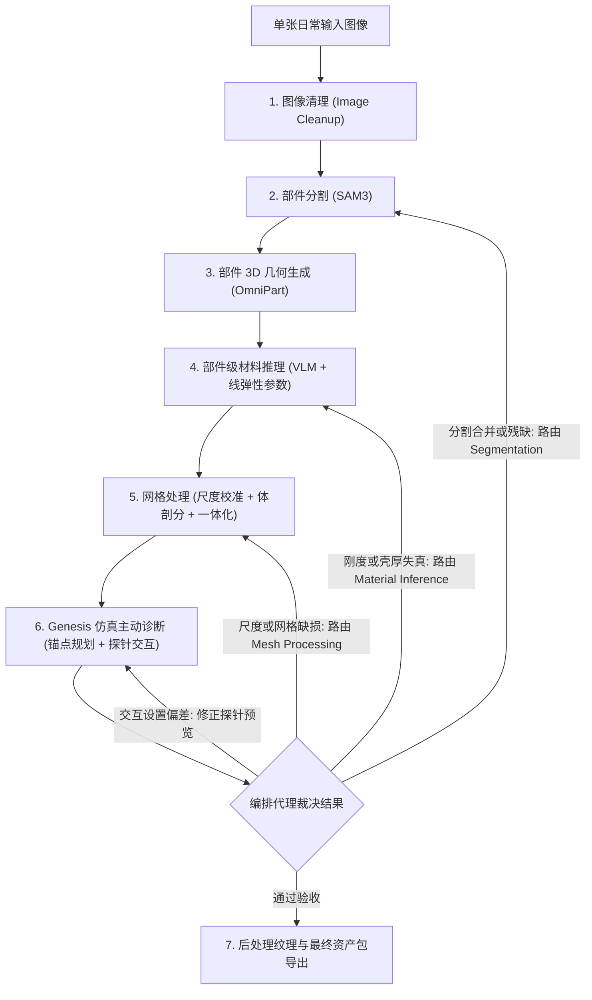
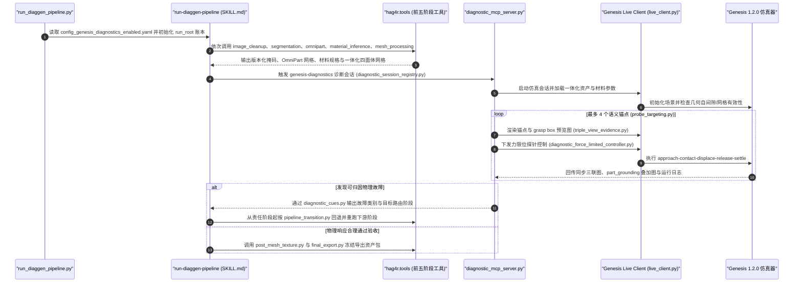

# DiagGen: Agentic Generation of Deformable Assets with Sim-based Diagnostics for Robotic Simulation

## 一句话定义

DiagGen 是一个将物理仿真器纳入生成闭环的 Agentic 可变形资产生成框架，能够从单张非标定日常图像出发，生成带部件级异质材料属性的体网格资产，并由 VLM 诊断代理在 Genesis 中执行受控抓取探针测试、归因物理异常并路由回上游责任阶段进行针对性修复。

## 英文缩写速查

| 缩写 | 英文全称 | 简要说明 |
|---|---|---|
| DiagGen | Agentic Generation of Deformable Assets with Sim-based Diagnostics | 本文提出的可变形资产「生成—仿真—诊断—修复」闭环框架 |
| PMSC | Part–Material Specification Consistency | 静态部件与材料规格一致性评分指标（1–5 分，含网格复杂度惩罚） |
| PAIP | Paired Asset Interaction Plausibility | 动态成对交互合理性评测协议，基于仿真渲染视频由双 VLM 交换顺序盲评 |
| FEM | Finite Element Method | 有限元方法，Genesis 用来仿真异质体网格弹性形变的物理求解器 |
| SAP | Semi-Analytic Primal | 半解析原始接触求解器，用于在 Genesis 中精确建模夹爪与柔性体间的摩擦接触 |
| VLM | Vision-Language Model | 视觉-语言大模型，分别驱动各生成阶段代理、仿真诊断代理与评测裁判 |

## 为什么重要

1. **把仿真器从「事后打分器」变成「在线根因诊断器」：** 现有 3D 资产生成流程大多在导出前做开环校验或静态渲染评分，一旦在真实机器人仿真中出现部件脱落、僵硬不动或尺度失调，无法自动定位到底是分割、材料还是网格阶段出了问题。DiagGen 让代理在仿真里「动手捏一捏」，直接根据形变与回弹证据反推上游故障源。
2. **仅需单张日常照片即可构建异质可变形体网格：** 不同于 PhysTwin、EMPM 等需要多视角标定视频或真实机器人交互录制来拟合连续参数的方法，DiagGen 结合 SAM3、OmniPart 与 VLM 语义先验，单图即可产出兼具柔性本体与刚性附件（如带金属插头的 USB 集线器、带钥匙圈的毛绒玩具）的连通四面体网格。
3. **打通单个资产生成到高保真机器人操作仿真的工程链路：** 直接用 OmniPart 生成的离散多部件网格在抓取提拉时往往会散架；DiagGen 通过度量尺度校准与网格一体化（monolithization）保证弹性传力路径连续，生成的资产可直接投入 Genesis 轨迹优化与 Agentic Real2Sim 数字孪生场景构建。

## 核心信息

| 字段 | 内容 |
|---|---|
| 作者 | Guanxiong Chen、Yiduo Qu、Qianjun Xia、Pengyu Jing、Yixian Cheng、Bole Ma、Pengzhi Yang、Bingyang Zhou、Ziming Li、Shashwat Suri、Gongbo Sun、Chao Liu、Peter Yichen Chen、Ziqiu Zeng、Fan Shi |
| 机构 | UBC、新加坡国立大学（NUS）、剑桥大学、NHR@FAU（埃尔朗根-纽伦堡大学）、威斯康星大学麦迪逊分校 |
| 发表时间 | 2026-09-19（arXiv v1） |
| 论文链接 | [arXiv:2609.23103](https://arxiv.org/abs/2609.23103) / [HTML v1](https://arxiv.org/html/2609.23103) |
| 项目与代码 | [项目主页](https://diaggen.github.io/) / [diaggen/diaggen](https://github.com/diaggen/diaggen) |
| 清单分类 | `environment.reconstruction` |
| 来源条目 | `survey_ax_2609_23103` |
| 开源状态 | **已开源** Agent 技能套件（`.agents/skills/run-diaggen-pipeline/`）、流水线账本入口、Genesis 诊断 MCP 服务与确定性工具链；运行需自行配置本地 Conda 环境、VLM API 及 Genesis/SAM3/OmniPart 检查点 |

## 核心原理

DiagGen 采用「**技能代理（Skilled Agents）—模型后端（Model Backends）—确定性工具（Tools）**」三层架构，围绕版本化产物契约构建 **generate–simulate–diagnose–refine** 闭环：

1. **六阶段流水线与版本化契约：**
   - **图像清理（Image Cleanup）：** 剥离复杂背景，产出干净参考图及强调静止几何与材料线索的仿真向描述。
   - **部件分割与 3D 提升（Segmentation & OmniPart）：** 先由 **SAM3** 将参考图分解为 2D 语义部件掩码，再由 **OmniPart** 将掩码与描述提升为部件分离的 3D 表面网格。
   - **材料推理（Material Inference）：** VLM 代理按部件语义决定表征方式（壳体/实体填充模式 `fill mode`）与 Genesis 线弹性物理参数，包括杨氏模量 $E$、泊松比 $\nu$、密度 $\rho$、表面摩擦系数及壳层厚度，从而在同一资产内区分软体与刚性附件。
   - **网格处理（Mesh Processing）：** 先建立真实度量尺度（metric scale），再进行四面体体积剖分，并将分离的部件网格**一体化（monolithization）**为单个连通体网格，确保跨部件接触受力时具备连续的弹性载荷传递路径。
   - **仿真主动诊断与导出：** 候选体网格进入 Genesis 接受测试；确认合格后执行纹理烘焙与资产包冻结导出，完整保存输入图像到每次修复决定的谱系。
2. **基于可控交互的仿真器主动诊断：**
   - **语义锚点规划与预览校准：** 诊断代理读取带索引的部件列表、几何摘要与材料规格，选取最多 **4 个**行为显著区域作为语义锚点（如把手、边缘、翻盖、柔性体）并拟定待验证的物理假设。每个锚点编译为带接触区域与位移方向的抓取框（grasp box），系统先渲染目标预览图供代理微调接触点与运动方向，避免因抓空导致误诊。
   - **标准探针与多模态证据收集：** 每个获批锚点在重置静止态的独立仿真回合中执行 **approach–contact–displace–release–settle** 协议。探测过程中代理实时接收顶视/斜视同步 RGB 三联图（初始、最大形变、释放回弹）、部件落地叠加图、步级摘要与仿真器日志，并在证据尚不充分时追加探针。
3. **根因归因与三类上游修复路由：**
   - 诊断代理结合观察到的运动响应（或初始化拒绝日志）与上游产物账本，将缺陷归因后交由编排代理裁决。除测试回合设置问题（`episode setup`）在诊断内部直接修正预览外，其余缺陷精确路由至三类上游阶段并**复用之前阶段的已验证产物**，仅从责任阶段起重新执行下游全部阶段：
     - **Segmentation 路由：** 修复不同功能区域被错误合并（如插头/线缆未与外壳分离）或连续部件残缺（复用清理后参考图）。
     - **Material inference 路由：** 修复表面/体积填充模式、壳厚冲突或模量失真（复用参考图、掩码与 OmniPart 网格）。
     - **Mesh processing 路由：** 修复尺度偏差、缺失细小部件网格精度或连通拓扑故障（同时复用已推理的材料表征）。

## 流程总览

## 源码运行时序图

复现主路径以 `hag4r/agentic/run_diaggen_pipeline.py`（传入 `--source_image`、`--run_id`、`--run_root` 与 `configs/config_genesis_diagnostics_enabled.yaml`）初始化单资产运行账本，随后由 `.agents/skills/run-diaggen-pipeline/SKILL.md` 驱动各子技能并调用 `hag4r/tools/` 下的确定性工具链；仿真诊断阶段通过 `.codex/config.toml` 挂载的 `hag4r/agentic/diagnostic_mcp_server.py` 与 `hag4r/tools/genesis/live_client.py` 通信，控制 Genesis 1.2.0 完成预览校准、力限位抓放探针与故障路由回滚。

## 实验与评测

作者在 **40 个真实手机拍摄与 MVImgNet2.0 对象**上开展评测（主实验中每个资产最多允许 1 次修复），并针对静态规格与动态交互分别定义了 **PMSC** 与 **PAIP** 两项 VLM 盲评指标：

### 1. 注入故障盲测诊断（RQ1, Table I, `GPT-5.5` high reasoning）

在 3 个代表性资产上分别手动注入单一阶段故障且对诊断代理隐瞒根因，全部 **3/3** 准确识别异常并路由至目标上游阶段：

| 测试资产 | 注入的真实故障（Owning Stage） | 诊断代理观察证据与裁决结论 | 故障与路由均正确? |
|---|---|---|---|
| **Curling iron（卷发棒）** | `material_inference`：将刚性机身高刚度误赋给柔性电源线 | 观察到电源线/插头呈「紧凑刚体整体运动、几乎无局部弯曲」，核对目标无误后路由至 `material_inference` | 是 |
| **Massager（按摩器）** | `segmentation`：掩码漏掉大部分金属螺旋弹簧 | 探针三次扩框调整仍无法隔离完整弹簧，诊断为前景归属/分辨率不足并路由至 `segmentation` | 是 |
| **Kitchen tongs（厨房夹）** | `mesh_processing`：度量尺度目标由 0.28 m 误设为 2.8 m | 末端夹臂大幅弯折且释放后两轮自然静置均「几乎无回弹」，核对尺度记录异常后路由至 `mesh_processing` | 是 |

### 2. 40 个资产诊断与修复效果（RQ2, §IV-B & Table II）

- **整体通过与修复比例：** 40 个资产中，**26 个**在首次诊断即获准通过（平均 PMSC **3.12**）；**14 个**被诊断代理建议并执行了上游修复。
- **静态规格一致性（PMSC, Eq. 1，$S = \max(1, H - F - \mathbf{1}[T > 40{,}000])$）：** 14 个修复资产的平均 PMSC 由修复前的 **2.14** 提升至修复后的 **3.43**（5 分制净提升 **+1.29**）；其中 **10 个提升（71.4%）**、**4 个持平（28.6%）**、**0 个下降**。
- **动态交互合理性（PAIP, `GPT-5.6 Terra` 双盲交换顺序评测）：** 14 对对比中，修复版胜 **9 例**、基线胜 **4 例**、平局 **1 例**。典型正面案例如饼干边缘/秋葵末端/运动鞋窄边从无法选中变为可稳定抓取探测、马桶搋子橡胶碗在同等推力下显现合理柔性形变；典型负向案例如毛绒小猫与运动手表在局部部件（表扣/饰物）抓取响应上反而略逊于基线。
- **三类路由定性修复案例（Table II）：**
  - **USB hub（`segmentation`）：** 原分割未独立识别金属插头；修复后明确拆分为外壳、线缆、连接器与金属插头四区，可被稳定抓取。
  - **Juice box（`material_inference`）：** 原统一壳厚大于局部自间隙导致 Genesis 初始化前直接拒载；修复代理下调各部件壳厚并将单一 3.0 GPa 模量拆分为盒身 0.8、顶部 0.7、接缝 0.6、翻盖 0.3 GPa 后顺利通过仿真测试。
  - **Medical bag（`mesh_processing`）：** 原网格丢失背带、提手与五金件；提升网格精度后以 **13,318** 个四面体完整恢复全部 5 个部件标签。

### 3. 下游机器人操作与 Real2Sim 迁移验证（§IV-C, Fig. 4–6）

- **轨迹优化与抓取放置：** 在 Genesis 隐式 FEM + SAP 摩擦接触下，使用 `GPT-5.6 Sol` 完成钥匙圈软玩具、厨房夹与饼干、修复版 USB 集线器的抓取—抬升—搬运—放置闭环优化。
- **对比直接 OmniPart：** 同等抓提动作下，未一体化的 OmniPart 四面体网格（Cheetah 玩具+钥匙圈）直接分裂解体，DiagGen 一体化网格保持完整并整体抬起。
- **对比修复前后 USB 集线器：** Airbot 夹爪抓提外壳时，基线单材料线缆维持僵硬弯折，分割修复后的线缆具备独立柔性参数并随重力自然下垂。
- **场景级 Real2Sim：** 将 [Agentic Real2Sim](paper-agentic-real2sim.md) 中的 SAM3D 资产与 MuJoCo 替换为 DiagGen 资产与 Genesis 后端，成功在仿真中忠实复现 Airbot 机械臂与 Meta Quest 2 遥操作采集的真实柔性物体抓取放置、扭转等操作轨迹。

## 与其他工作对比

| 对比维度 | DiagGen（本文） | OmniPart / 视觉 3D 基础模型 | PhysTwin / EMPM / Pokeflex | PhysX-Omni |
|---|---|---|---|---|
| **输入条件** | 单张非标定日常 RGB 照片 | 单张图像或文本条件 | 多视角标定交互视频或高精度 3D 扫描 | 单张图像 / 提示 |
| **物理表征与异质性** | 部件级线弹性参数 + 一体化四面体体网格（软硬共存） | 部件分离表面网格（缺少弹性传力连接） | 质点弹簧、MPM 或扫描体网格（依赖真实拟合） | 统一物理属性预测（刚体/柔体/铰接体） |
| **仿真反馈机制** | **仿真器入环**：主动抓取探针并将根因路由至上游重生成 | 开环前向生成 | 通过真实视频梯度拟合力学参数 | 生成后物理合理性事后校验（不回流修复） |
| **下游可仿真性** | 可直接投入 Genesis 隐式 FEM + SAP 接触操作规划 | 直接四面体化后抓提易出现部件断裂分离 | 强依赖特定真实录制物体 | 面向通用仿真环境构建 |

## 结论

**一句话总判：把物理仿真器做成可回流上游的「主动探针诊断器」，比只在生成末尾做静态打分更能暴露并修复单图可变形资产在分割、材料与尺度上的隐蔽故障。**

1. **一体化（Monolithization）是离散部件网格走向机器人操作的前提：** 仅靠部件级 3D 生成（如 OmniPart）缺少跨部件弹性传力路径，抓提即散架；通过度量尺度校准与一体四面体剖分才能支撑 Genesis 接触富操作。
2. **三类上游修复路线均可从仿真症状反推：** 实验证明 14/40 个资产需要修复，且定向回溯使 PMSC 均分从 2.14 升至 3.43（71.4% 资产提升），其中初始化前拒载日志（如壳厚与自间隙冲突）与多视角三联图都是高信噪比诊断依据。
3. **跨阶段症状混淆与「局部修复副作用」不可忽视：** 14 个修复资产在动态 PAIP 上仍有 4 例输给基线（如运动手表、毛绒小猫），说明单轮修复可能改善某一部分却削弱另一处交互响应，工程上必须保留修复后的再次交互验证。

## 工程实践

1. **多环境与仿真器依赖准备：** 官方仓 `diaggen/diaggen` 将工作区按模块拆分为 `hag4r`、`hag4r_mesh`、`hag4r_segmentation` 与 `omnipart` 四个 Conda 环境，并在 `third_party/` 下捆绑定制 Genesis 1.2.0（提供实时诊断接口）、SAM3 与 OmniPart 源码，使用前需在 `configs/config_genesis_diagnostics_enabled.yaml` 中对齐本地检出路径与模型权重位置。
2. **Skill + MCP 工具解耦架构：** 运行入口为 `hag4r/agentic/run_diaggen_pipeline.py` 初始化账本，再通过 `.agents/skills/run-diaggen-pipeline/SKILL.md` 调度各阶段子技能；需预先设置环境变量 `DIAGGEN_ROOT` 使 `.codex/config.toml` 正确拉起 `diagnostic_mcp_server.py`。
3. **关键数值与预算边界参考：** 静态 PMSC 对四面体数量超过 **40,000** 的过密网格施以 1 分惩罚（Table II 医学包案例控制在了 13,318 个四面体）；每次诊断默认最多规划 **4 个**语义锚点，且正式运行中应始终开启预览校准，避免抓空导致的误判。

## 局限与风险

1. **分割与材料故障的症状耦合：** 论文明确指出，材料参数过硬与部件分割粘连在探针下可能呈现极其相似的刚性运动假象，导致诊断代理在根因归属时发生混淆。
2. **多轮迭代与大规模并行尚未验证：** 本文在 40 资产主实验中将每条流水线限制为最多 1 次上游修复以控制耗时，且尚未在数千资产规模下测试并发调度与吞吐率。
3. **评测依赖 VLM-as-a-Judge 与单轮修复偶发退化：** 由于公开社区缺乏经过真实力学测量验证的部件级可变形体数据集，PMSC 与 PAIP 仍依赖 VLM 裁判（尽管作者通过分离生成模型 `Luna` 与评测模型 `Terra` 并交换 A/B 顺序缓解偏置）；同时 4/14 例修复在 PAIP 输给基线，表明若无人工或自动回归门控，盲目覆盖旧版本存在风险。
4. **未包含铰接体（Articulated Objects）支持：** 当前流水线与线弹性体网格表征主要面向连续/异质可变形体，尚不支持带运动副约束的铰接物体（列为未来工作）。

## 关联页面

- [Agentic Robots 综述](paper-towards-agentic-robots-survey.md)
- [全量项目节点清单](../overview/awesome-agentic-robots-node-index.md)
- [VLA 方法背景](../methods/vla.md)
- [机器人仿真场景生成](../methods/robot-simulation-scene-generation.md)
- [机器人仿真集成（Robot Simulation Integration）](../methods/robot-simulation-integration.md)
- [机器人智能体脚手架（Agent Harness）](../methods/robot-agent-harness.md)
- [智能体技能封装（Agent Skill Packaging）](../methods/agent-skill-packaging.md)
- [智能体工具调用接口（Agent Tool-Use Interface）](../methods/agent-tool-use-interface.md)
- [视觉三维重建（Visual 3D Reconstruction）](../methods/visual-3d-reconstruction.md)
- [机器人操作任务（Manipulation）](../tasks/manipulation.md)
- [Agentic Real2Sim 论文实体](paper-agentic-real2sim.md)
- [Genesis 物理仿真器](genesis-sim.md)

## 推荐继续阅读

- [DiagGen 官方项目主页与 3D 资产交互展厅](https://diaggen.github.io/)
- [DiagGen 官方 GitHub 仓库（diaggen/diaggen）](https://github.com/diaggen/diaggen)
- [arXiv:2609.23103 论文 HTML 原文](https://arxiv.org/html/2609.23103)

## 参考来源

- [DiagGen 原文核对归档](../../sources/papers/paper-agentic-2609-23103.md)
- [diaggen/diaggen 官方代码核查](../../sources/repos/paper-agentic-2609-23103.md)
- [官方 Awesome 快照归档](../../sources/repos/awesome-agentic-robots-survey-index.md)
- [arXiv:2609.23103 论文原文](https://arxiv.org/abs/2609.23103)
- [DiagGen 官方项目主页](https://diaggen.github.io/)
