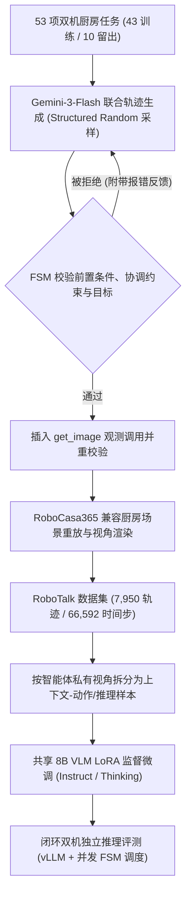
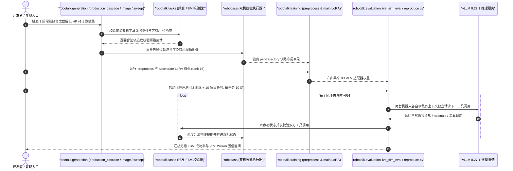

# RoboTalk: Learning Multi-Robot Communication and Coordination from Multimodal Demonstrations

## 一句话定义

RoboTalk 是一套面向部分可观测双移动操作机器人的多模态协同数据合成管线与数据集（含 53 项厨房任务的 7,950 条轨迹），用统一的工具调用接口把自然语言通信、跨机同步与高层技能选择纳入同一监督微调范式，使可端侧部署的 8B 小型 VLM 学会去中心化协作与新任务泛化。

## 英文缩写速查

| 缩写 | 英文全称 | 简要说明 |
|---|---|---|
| VLM | Vision-Language Model | 视觉–语言模型：本文用作每个机器人的去中心化高层协作策略（重点研究 8B 量级模型） |
| Dec-POMDP | Decentralized Partially-Observable Markov Decision Process | 去中心化部分可观测马尔可夫决策过程：刻画双机器人各自保有局部观测与通信历史的协作建模框架 |
| FSM | Finite-State Machine | 有限状态机：维护符号状态、校验工具调用前置条件与协调约束，并判定闭环任务是否成功 |
| SFT | Supervised Fine-Tuning | 监督微调：基于 RoboTalk 示范轨迹对小型 VLM 执行的下一工具调用与推理轨迹联合训练 |
| LoRA | Low-Rank Adaptation | 低秩适应：本文对 8B 开源 VLM 采用的参数高效微调方式（rank 16, alpha 32） |
| VLA | Vision-Language-Action | 视觉–语言–动作模型：RoboCasa365 原生面向的单智能体连续动作基座，本文改写为双机高层技能接口 |

## 为什么重要

在部分可观测环境下让多台移动操作机器人去中心化协同完成长时程任务，需要同时解决「分工协商、跨机动作依赖同步、窄空间设备独占冲突」三类问题，而端侧部署约束要求高层次策略能跑在 8B 量级的小型 VLM 上。

现有多智能体工作大多依赖纯文本状态、调用云端大模型，或只监督动作而未将「自然语言通信 + 物理技能调用」放在同一小模型策略中联合训练。RoboTalk 证明：仅提供通信工具甚至明确提示词协议，未微调的 8B 模型在闭环仿真中的成功率仍接近 0%–2%；但通过结构化协作协议与 FSM 校验合成高质量多模态示范后，8B 模型无需云端推理即可学到可靠的通信与工具调用策略。

## 核心信息

| 字段 | 内容 |
|---|---|
| 作者 | Dorian Benhamou Goldfajn*, Mason Nakamura*, Saaduddin Mahmud, Justin Svegliato, Kyle H. Wray, Shlomo Zilberstein（* 同等贡献） |
| 机构 | University of Massachusetts Amherst；加州大学伯克利分校（UC Berkeley）；美国东北大学（Northeastern University） |
| 发表时间 | 2026-09-21 提交 v1，2026-10-08 修订 v2（arXiv:2609.23997v2 [cs.RO]） |
| 论文链接 | [arXiv:2609.23997](https://arxiv.org/abs/2609.23997) · [HTML 全文](https://arxiv.org/html/2609.23997) |
| 项目与代码 | [DorianAtSchool/robotalk](https://github.com/DorianAtSchool/robotalk)（Apache-2.0）· [HF 数据集](https://huggingface.co/datasets/DorianAtSchool/RoboTalk) · [HF 模型](https://huggingface.co/DorianAtSchool) |
| 清单分类 | `data.collection`, `harness.orchestration` |
| 来源条目 | `survey_ax_2609_23997` |
| 开源状态 | 已开源（含完整数据合成、FSM 校验器、双机 RoboCasa365 改编环境、LoRA 训练与 vLLM/Gemini/Oracle 闭环评测代码，以及 7,950 条数据集与微调权重） |

## 核心原理

### 1. 去中心化问题建模与工具化动作空间

系统将双移动操作机器人的合作过程形式化为 Dec-POMDP 元组 $(S, \{A_i\}, T, R, \{\Omega_i\}, O)$：

- **局部私有上下文 $\Omega_i$**：每台机器人仅能读取自身视角图像、工具返回与收到的通信消息，无法窥视搭档的相机画面或私有工具调用历史。初始任务目标、裁剪掉无关家具的抽象初始状态 JSON、工具定义及协作规则在起始时共享，且出生位姿、柜门开关与 Leader 指定均做随机化。
- **统一工具动作空间 $A_i$**：将通信与物理控制统一为 JSON 工具调用，涵盖感知（`get_image`）、导航、操作、通信（`communicate`）、跨机同步（`wait_for_signal`）、让位（`give_space`）与空操作。
- **并发步进与 FSM 校验**：每个时间步内，FSM 基于该步**起始时刻**的符号世界状态同时检验双方动作，因此任一方不能依赖搭档在同一时间步内尚未生效的状态变更。只有满足所有子目标并达成终点状态时，团队才获得稀疏奖励 $1$（否则 $0$）。

### 2. 三项任务无关协调机制

为解决分工冲突、依赖竞态与物理挤占，RoboTalk 在交互规则与工具层固化了三项通用协议：

1. **Leader–Follower 规划协议**：双方开始任何物理动作前，先经两步通信握手确立共享计划（第 1 步由指定 Leader 发送计划并由 Follower 声明等待；第 2 步 Leader 等待确认并由 Follower 确认分工），随后在第 3 步起并行执行各自职责。
2. **Wait–Release 同步流程**：当某动作依赖搭档先完成前置操作时，等待方先发 `communicate` 说明请求与精确释放关键词（release keyword），下一回合调用 `wait_for_signal` 挂起自身；搭档达成条件后发送包含该关键词的消息即可唤醒等待方。
3. **独占工作区访问规则**：冰箱、微波炉、咖啡机等窄小交互区同一时刻只允许一台机器人占据；占用方离开前须调用 `give_space` 或主动导航离开，避免搭档进入时触发碰撞或校验拒批（而长台面、餐桌等共享区域支持双机并发作业）。

### 3. 三阶段多模态轨迹合成与多样性筛选

数据构建分为三阶段：

1. **轨迹生成与反馈重试**：调用 Gemini-3-Flash 生成双机联合轨迹（工具调用、自然语言消息与一句话推理 rationale），由 FSM 逐条校验前置条件、协调约束和任务达成状态；被拒样本附带具体校验错误反馈自动重试。
2. **观测点插入与重校验**：在需要视觉判断的位置插入 `get_image` 调用并再次通过 FSM 校验。
3. **场景采样与仿真渲染**：在 4 种布局 × 5 种风格 × 3 个种子共 60 个候选厨房配置中筛选兼容场景进行物理重放，渲染出双机相机图像并拆分为单智能体上下文序列。

为避免合成轨迹趋同，作者对比了多种采样策略，最终因 **Structured Random**（随机指定通信长度、复杂度与工具调用多样性的低/中/高组合条件）在通信语义多样性上提升最显著（+52.00%）而将其用于生成全量 **7,950 条轨迹**（53 个任务 × 150 条，含 **66,592** 个时间步）。训练使用 43 个任务、留出 10 个未见任务（Phase 2/3/4 分布为训练 12/12/19，留出 2/2/6，不含单阶段简单任务）。

## 流程总览

## 源码运行时序图

官方仓库 [DorianAtSchool/robotalk](https://github.com/DorianAtSchool/robotalk) 开源了全流程脚本，涵盖 `robotalk.generation` 数据合成、`robotalk.release.materialize_training_layout` 目录重建、`robotalk.training` 多卡 LoRA 微调，以及 `scripts/reproduce.py` / `robotalk.evaluation.live_sim_eval` 闭环仿真评测；以下序列对应一条数据制备、训练与闭环评测的完整运行链路：

最小验证路径为先下载 `prepare_coffee` 任务数据并以 `robotalk.release.materialize_training_layout` 解包，随后使用 `robotalk.evaluation.live_sim_eval --backend oracle` 重放真实示范；完整复现图 3、5、6、7 均由 `scripts/reproduce.py` 统一驱动。

## 实验与评测

所有闭环实验均采用固定评测队列（43 个训练任务各 10 局 = 430 局；10 个留出未见任务各 10 局 = 100 局），指标为**无错 FSM 成功率**（在参考解长度 4 倍预算内达成任务目标，且全程无任何被拒绝或失败的工具调用），置信区间为 95% Wilson 区间。

### 1. 数据生成采样策略多样性对比（Table III，每任务 30 条）

| 采样方法 | 通信嵌入多样性 | 相对 Base 增幅 | 动作序列 Levenshtein 多样性 | 相对 Base 增幅 |
|---|---|---|---|---|
| Base | 0.058174 | – | 0.357283 | – |
| High Temp（1.0 vs. 0.6） | 0.062859 | +8.05% | 0.376510 | +5.38% |
| Random（UUID 前缀） | 0.059423 | +2.15% | 0.359801 | +0.70% |
| Structured Random（最终采用） | **0.088427** | **+52.00%** | 0.364234 | +1.95% |
| Verbalized | 0.077940 | +33.98% | **0.458226** | **+28.25%** |

### 2. RQ1：未微调模型在不同通信引导层级下的表现（Fig. 5）

| 引导层级 | 启用组件 | Gemini-3-Flash（训练 / 留出） | Qwen3-VL-8B-Instruct（训练 / 留出） |
|---|---|---|---|
| None | 禁用通信（等待即永久挂起） | 7.7% / 5% | 0.2% / 0% |
| Unguided | 仅开放 `communicate` 工具 | 9.5% / 8% | 0.5% / 0% |
| Minimal | 鼓励通信 + Wait–Release 同步 | 43.3% / 34% | 1.2% / 0% |
| Intermediate | 增加分工、落地表达、冲突避免与完成汇报 | 46.0% / 46% | 1.6% / 0% |
| Full | 强制执行完整 Leader–Follower 规划协议 | **65.6% / 72%** | 0.0% / 0% |

### 3. RQ2：RoboTalk 数据规模扩展对 8B 模型 SFT 的影响（Fig. 6）

| 模型与任务划分 | 30 条/任务 | 60 条/任务 | 90 条/任务 | 120 条/任务 | 150 条/任务 |
|---|---|---|---|---|---|
| Qwen3-VL-8B-Instruct（训练任务） | 81.9% | 87.9% | 92.1% | 93.0% | **94.2%** |
| Qwen3-VL-8B-Instruct（留出任务） | 45% | 64% | 55% | 48% | **65%** |
| Qwen3-VL-8B-Thinking + Rationale（训练任务） | 80.2% | 84.7% | 91.4% | 90.2% | **92.6%** |
| Qwen3-VL-8B-Thinking + Rationale（留出任务） | 71% | 72% | 66% | **77%** | 73% |

### 4. RQ3：模型变体与推理轨迹（Rationale）消融（Fig. 7，30 条/任务）

| 模型与监督目标 | 训练任务 | 留出任务 |
|---|---|---|
| Instruct + 仅工具调用 | 81.9% | 45% |
| Instruct + Rationale + 工具调用 | **82.6%** | 58% |
| Thinking + 仅工具调用 | 71.6% | 50% |
| Thinking + Rationale + 工具调用 | 80.2% | **71%** |

## 与其他工作对比

论文 Table I 将 RoboTalk 与既有具身多智能体工作进行了能力对齐（含 `RoCo`、`Tool-RoCo`、`CoELA`、`PARTNR`、`TeamCraft`、`VIKI-R`、`LLawCo`）：

- **纯文本或多智能体提示方案（如 RoCo、CoELA、PARTNR）：** RoCo 与 CoELA 未面向多移动操作发布联合微调数据集；PARTNR 与 LLawCo 等主要依赖符号或文本世界表征而非双机实时视觉输入。
- **既有公开多模态多智能体基准（如 TeamCraft、VIKI-R）：** TeamCraft 基于 Minecraft 且采用隐式沟通；VIKI-R 聚焦移动操作视觉协同，但并未在同一 VLM 策略中对「显式自然语言消息生成」和「物理技能选择」做联合 SFT。
- **RoboTalk 的差异化定位：** 同时覆盖公开数据集、移动操作场景、双视角视觉输入、显式自然语言通信，以及面向小型 VLM 的「通信 + 技能工具调用」联合 SFT。

## 结论

**一句话总判：小型 VLM 仅靠提示词与通信接口无法学会去中心化多机协同，但在结构化协议约束、FSM 校验和带有推理轨迹（rationale）的多模态示范微调下，8B 模型可以稳健学会通信分工并泛化到未见任务。**

1. **协议引导对大模型立竿见影，对小模型远远不够** — 加上完整 Leader–Follower 规划协议使未微调 `Gemini-3-Flash` 成功率从 7.7%/5% 跃升至 65.6%/72%，但未微调 `Qwen3-VL-8B-Instruct` 全程不超过 1.6%（留出 0%），说明小模型必须依赖监督微调建立联合通信–行动能力。
2. **数据量增加能稳定刷高训练任务，但不能保证新任务单调泛化** — Instruct 模型在 43 个训练任务上从 81.9% 单调爬升至 94.2%，而 10 个留出任务则在 45%–65% 之间波动，工程上不能仅靠堆同分布轨迹预期零样本任务泛化。
3. **Rationale 推理监督是留出泛化的关键杠杆** — 在 30 条/任务固定规模下，加入一句话 rationale 使 Instruct 留出成功率提升 13 个百分点（45%→58%），使 Thinking 模型提升 21 个百分点（50%→71%），并在 120 条/任务时推高至 77%。
4. **合成多样性要按目标维度选型** — Structured Random 优先拉高了通信语义多样性（+52.00%），而 Verbalized Sampling 动作序列多样性最高（+28.25%），后续工作可结合两者优势。

## 工程实践

- **LoRA 训练超参：** 对 `Qwen3-VL-8B-Instruct` 与 `Qwen3-VL-8B-Thinking` 固定使用 LoRA（`rank=16`、`alpha=32`、`dropout=0.05`）、1 个 epoch、学习率 $10^{-4}$、权重衰减 `0.01`、余弦退火（前 3% 线性预热）、最大上下文长度 `8,192` token（含视觉 token）、全局有效 batch size `64`。
- **算力与显存适配：** 论文训练使用 4× B200 GPU（每卡 8 样本；全套 10 个模型约 235 B200 GPU-hours，30 条/任务约 2 h，150 条/任务约 9.7 h）；在 80–96 GB 单卡（如 H100/A100）上可使用 `--per-device-batch-size 4 --grad-accum 4` 保持等效 batch 64；不支持 V100（Volta）及更老架构。
- **推理服务与资产准备：** 开源模型闭环评测通过官方 `vllm/vllm-openai:v0.27.1` Apptainer 容器提供本地服务（需 CUDA 13.0 及 580+ 驱动），Thinking 变体推理耗时比 Instruct 约长 30%；仿真运行前须安装 `DorianAtSchool/robosuite` 并下载约 10 GB（解压 23 GB）RoboCasa365 资产。
- **数据集版本口径：** Hugging Face 数据集 `v1.1` 替换了 `v1.0` 中 95 条（1.2%）仿真重放失败的轨迹；官方已发布模型基于 `v1.0` 训练，用 `v1.1` 重训结果处于置信区间一致范围内。

## 局限与风险

- **技能抽象边界：** 物理技能通过仿真器脚本工具执行，论文聚焦高层通信、规划与协调，不涉及底层连续控制或真实机械臂/移动底盘的运动学与抓取失败恢复。
- **FSM 符号抽象失真风险：** 任务成败完全由符号 FSM 判定，会抽象掉部分真实物理细节（官方 README 明确举例：在 `CheeseMixing` 任务中将刮刀放入锅中即记作完成搅拌）。
- **“单机包办”的协作退化现象：** Fig. 5 嵌套柱状图显示，部分被判为无错成功的回合实际上由一台机器人完成了全部改变环境状态的物理操作、另一台仅主动让位不干扰；虽适用于单机即可高效完成的子集任务，但提示指标本身不惩罚工作负载不均。
- **团队规模与场景局限：** 目前仅验证双移动操作机器人与模拟室内厨房环境，尚未拓展至 3 台以上多机拓扑、人机混编协作或真实硬件 Sim2Real 部署。

## 关联页面

- [Agentic Robots 综述](paper-towards-agentic-robots-survey.md)
- [全量项目节点清单](../overview/awesome-agentic-robots-node-index.md)
- [VLA 方法背景](../methods/vla.md)
- [机器人学习数据管线](../methods/robot-learning-data-pipelines.md)：了解采集、同步与数据质量检查。
- [智能体工具调用接口](../methods/agent-tool-use-interface.md)：对比工具契约设计与并发约束校验。
- [机器人智能体运行框架（Agent Harness）](../methods/robot-agent-harness.md)：对照去中心化上下文隔离、状态校验与闭环评测编排。
- [多智能体强化学习（MARL）](../methods/marl.md)：延伸对比传统 Dec-POMDP 通信策略学习与大模型工具通信范式。
- [仿真场景生成](../methods/robot-simulation-scene-generation.md)：了解 RoboCasa365 等厨房资产配置与兼容性采样。
- [通用操作任务](../tasks/manipulation.md) · [移动操作任务](../tasks/loco-manipulation.md)

## 推荐继续阅读

- [DorianAtSchool/robotalk 官方仓库与复现文档](https://github.com/DorianAtSchool/robotalk)
- [RoboTalk Hugging Face 多模态数据集（v1.1）](https://huggingface.co/datasets/DorianAtSchool/RoboTalk)
- [RoboTalk Explorer 交互式轨迹浏览器](https://huggingface.co/spaces/DorianAtSchool/RoboTalk-Explorer)
- [RoboTalk Hugging Face 开源微调模型合集](https://huggingface.co/DorianAtSchool)

## 参考来源

- [RoboTalk 论文通读归档](../../sources/papers/paper-agentic-2609-23997.md)
- [官方 Awesome 快照归档](../../sources/repos/awesome-agentic-robots-survey-index.md)
- [DorianAtSchool/robotalk 仓库核对归档](../../sources/repos/paper-agentic-2609-23997.md)
- [arXiv:2609.23997 摘要与元数据](https://arxiv.org/abs/2609.23997)
- [arXiv:2609.23997 HTML 全文](https://arxiv.org/html/2609.23997)
- [官方 GitHub 仓库](https://github.com/DorianAtSchool/robotalk)
