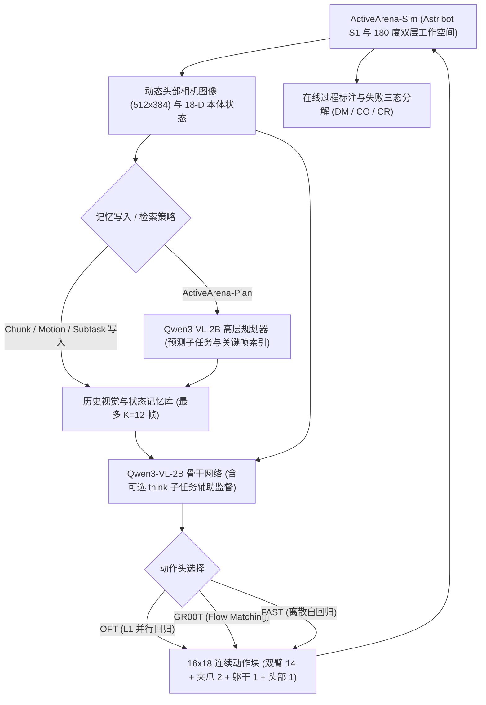
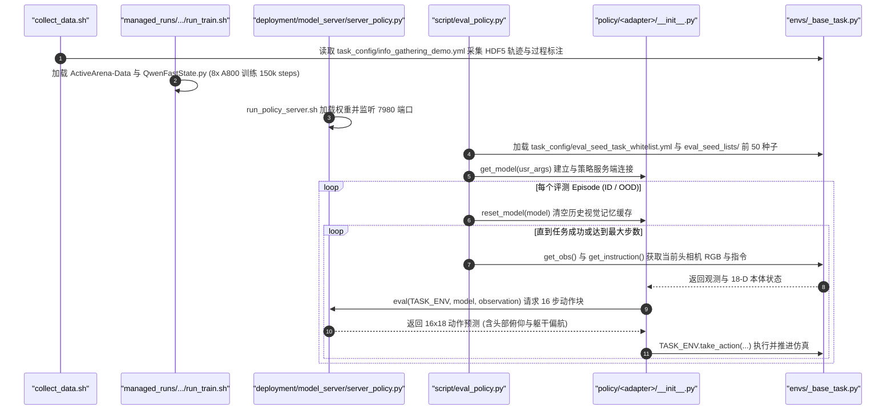

# ActiveArena: Benchmarking and Understanding Active Perception in Robotic Manipulation

## 一句话定义

**ActiveArena** 是一套面向部分可观测场景下机器人主动感知与双臂操作的标准化“仿真器—基准—基线”套件（包含 `ActiveArena-Sim`、`ActiveArena-Bench` 与 13 组受控实验构成的 `ActiveArena-VLA`），用于联合评测具身策略在闭环中**主动获取缺失信息**与**跨视角维护工作记忆**的能力。

## 英文缩写速查

| 缩写 | 英文全称 | 简要说明 |
|---|---|---|
| VLA | Vision-Language-Action | 视觉-语言-动作统一策略模型 |
| WAM | World-Action Model | 结合未来视频/世界预测与动作生成的具身模型 |
| OFT | OpenVLA Fine-Tuning (Parallel Action Query) | 基于并行动作查询回归连续动作块的解码头架构 |
| ID / OOD | In-Distribution / Out-of-Distribution | 分布内（同场景域）与分布外（新背景、光照与密集跨任务干扰物）评测协议 |
| DM / CO / CR | Discovery Miss / Context Omission / Context Retained | 失败轨迹三态分解：未发现目标、曾发现但末帧丢失上下文、末帧覆盖完整但决策执行失败 |
| TCP | Tool Center Point | 机械臂末端执行器工具中心点，用于与仿真器末端连杆标定对齐 |

## 为什么重要

现有长程操作与记忆基准（如 LIBERO、RoboTwin 2.0、RoboMME、MemoryBench）大多假设任务所需视觉证据已在固定视角下可见，因而无法诊断真实具身场景中“初始观测不足”的核心挑战。论文将现有仿真平台的缺口归纳为三类：**本体缺口**（固定相机视角）、**场景缺口**（局部小桌面）与**交互缺口**（缺乏揭示隐藏属性的物理探索）。ActiveArena 首次把**主动视角控制**（头部俯仰 + 躯干偏航）、**物理信息获取**（翻面、开柜、按键计数）与**跨视角时空记忆**统一到 18 维连续双臂控制闭环中，并通过严格分离的 ID/OOD 协议和失败状态分解揭示出内存写入策略、本体感知连续性与子任务监督对泛化的决定性影响。

## 核心信息

| 字段 | 内容与状态 |
|---|---|
| 作者 | Yibo Li, Enshen Zhou, Rui Chen, Yanjun Ding, Mengzhen Liu, Yi Han, Jiabo Zhan, Lipeng Wang, Shanghang Zhang, Lu Sheng |
| 机构 | 北京航空航天大学（BUAA）、北京智源人工智能研究院（BAAI）、北京大学（PKU）、清华大学（Tsinghua） |
| 发表时间 | 2026-09-21（arXiv v1），2026-09-23（v2，43 页） |
| 论文链接 | [arXiv:2609.24124](https://arxiv.org/abs/2609.24124)（[HTML 全文](https://arxiv.org/html/2609.24124)） |
| 项目与代码 | [项目主页](https://leeibo.github.io/ActiveArena) · [ActiveArena 仿真/基准仓库](https://github.com/leeibo/ActiveArena)（MIT） · [ActiveArena-VLA 模型仓库](https://github.com/leeibo/ActiveArena-VLA) · [HuggingFace 数据集](https://huggingface.co/datasets/leeibo/ActiveArena-Data) |
| 清单分类 | `model.planning, environment.benchmarking, harness.memory` |
| 来源条目 | `survey_ax_2609_24124` |
| 开源状态 | 已开源（仿真器、35 任务基准、采集/评测脚本、581.2k 帧数据集、资产包、VLA 训练推理代码及 3 组公开 OFT 检查点权重） |

## 核心原理

ActiveArena 将部分可观测条件下的语言条件操作形式化为两类功能交替的闭环决策过程：在时刻 $t$，策略基于当前视觉观测 $o_t$、可选本体状态 $x_t$、历史记忆 $M_t = \mathcal{M}_\phi(h_t)$ 与语言指令 $l$ 决策动作 $\mathbf{a}_t$，使其承担信息获取（$\pi_l^{\text{info}}$：转动视角、探索空间或物理翻检）或任务推进（$\pi_l^{\text{task}}$：抓取、放置、按压）功能。

1. **ActiveArena-Sim（高覆盖主动感知仿真器）：**
   - **Astribot S1 本体适配：** 在 RoboTwin 2.0 中集成带有手动标注 cuRobo 自碰撞模型的 Astribot S1，包含双 7-DoF 机械臂、双夹爪（单主动关节驱动 5 从动关节的 0/1 归一化控制）、1-DoF 头部俯仰（$[-1.22, 1.22]\ \text{rad}$）与 1-DoF 躯干偏航（`astribot_torso_joint_4`，$[-1.2, 1.2]\ \text{rad}$），构成 **18 维连续动作空间** $\mathbf{a}_t = [\mathbf{a}_t^L, g_t^L, \mathbf{a}_t^R, g_t^R, a_t^{\text{torso}}, a_t^{\text{head}}] \in \mathbb{R}^{18}$。策略仅可读取动态头部相机（$512 \times 384$，$60^\circ$ VFOV），腕部相机在基准中被屏蔽，可见场景覆盖达到固定视角仿真器的 **6.3 倍**。
   - **环形扇面与双层工作空间：** 以机器人为中心构建内径 $0.30\ \text{m}$、外径 $1.08\ \text{m}$、张角 $180^\circ$ 的环形扇面桌面（可附带偏移 $20^\circ$ 的上层环形平台，高度 $1.09\ \text{m}$），交互面积与信息获取丰富度均为传统桌面的 **2 倍**，单一固定视角无法覆盖全局。
   - **在线过程级标注：** 每帧自动记录 `subtask`、三阶段标签 `stage`（`1: search`、`2: anchor`、`3: action`）、3D 投影面积 $\ge 40\%$ 无遮挡判定得到的 `visible_object_mask`、`discovered_object_mask`、关键帧标志及相机内外参。

2. **ActiveArena-Bench（35 任务与 ID/OOD 协议）：**
   - **两大家族、五大类别：** 涵盖视觉探索与交互式信息获取，共 35 项任务、最多包含 9 轮感知—动作循环：单目标搜索（`SS`，5 项）、单目标跨区循环（`SL`，16 项）、多目标循环（`ML`，6 项）、多目标比较决策（`MD`，3 项，如颜色计数按键）以及交互式信息获取（`IA`，5 项，如抓起易拉罐查看背面生产日期并按保质期分类）。
   - **标准化数据与切分：** 每项任务提供 100 条 ID 演示轨迹（共 **581.2k 帧 / 10.76 小时**），评测固定使用 50 个确定性种子分别测试 **ID**（`info_gathering_demo`）与 **OOD**（`info_gathering_randomized`，含随机背景、光照、更密集杂物且允许其他任务的目标物作为当前场景干扰物）。

3. **ActiveArena-VLA（13 组受控消融套件与关键帧机制）：**
   - 统一基于 StarVLA 框架与 `Qwen3-VL-2B-Instruct` 骨干网络，在 16 步动作块（$C=16$）控制下系统拆解五大设计维度：
     - **记忆写入策略与容量（$K \in \{0, 6, 12\}$）：** 对比无记忆（`None`）、语义子任务跳变触发（`Subtask`：$\mathcal{K}^{\text{sub}} = \{0\} \cup \{t \mid s_t \neq s_{t-1}\}$）、因果运动事件触发（`Motion`：夹爪开合、头/躯干转动 $>0.005\ \text{rad}$ 或末端转向 $>40^\circ$/停顿）与动作块对齐均匀采样（`Chunk`：$\mathcal{K}^{\text{chunk}} = \{nC \mid nC < T\}$）。
     - **本体状态注入：** 通过两层 1024 维 MLP 将每帧对齐的 18 维本体状态投影为软令牌并叠加帧位置编码，显著抑制动作块边界跳变。
     - **VLM 辅助监督：** 联合优化损失 $\mathcal{L} = \mathcal{L}_{\text{action}} + 0.1\,\mathcal{L}_{\text{VLM}}$，在 `<think>` 片段监督全局指令或细粒度子任务语义。
     - **高层规划器检索记忆（`ActiveArena-Plan`）：** 微调独立 `Qwen3-VL-2B` 规划器，在最多 12 帧步长-16 滚动历史（无状态输入）上自回归输出 `<think>...</think><subtask>...</subtask><retrieval>[indices]</retrieval>`，仅将匹配子任务切换窗口 $[q, q+16)$ 的稀疏记忆帧与当前子任务传给下游 OFT 执行器，降低训练峰值显存 **46%**（78.9 GB → 42.6 GB）。
     - **动作头对比：** 比较连续并行回归头 `OFT`、DiT 流匹配头 `GR00T` 与自回归离散分词头 `FAST`。

## 流程总览

## 源码运行时序图

`ActiveArena` 将仿真环境与策略服务解耦为两个仓库：数据采集由 `collect_data.sh` 驱动，模型训练与推理服务在 `ActiveArena-VLA` 中通过 `managed_runs/<config>/run_train.sh` 和 `run_policy_server.sh`（默认端口 `7980`）启动，闭环评测则由 `ActiveArena` 主入口 `script/eval_policy.py` 按固定种子调用 `policy/` 适配器与 `envs/_base_task.py` 执行交互。

## 实验与评测

### 1. 仿真主榜单（表 2，35 项任务平均成功率 %）

所有方法均在相同 3,500 条 ID 轨迹（581.2k 帧）上训练，并在相同 50 个随机种子上分别评测 ID（1,750 局）与 OOD（1,750 局）：

| 方法 | 记忆 | SS (ID / OOD) | SL (ID / OOD) | ML (ID / OOD) | MD (ID / OOD) | IA (ID / OOD) | 总平均 Avg. (ID / OOD) |
|---|---|---|---|---|---|---|---|
| FAST-WAM | No | 59.60 / 4.00 | 40.38 / 1.00 | 25.67 / 0.00 | 12.00 / 3.33 | 22.40 / 5.20 | 35.60 / 2.06 |
| $\pi_{0.5}$ | No | 41.20 / 5.60 | 22.38 / 0.63 | 1.67 / 0.00 | 2.67 / 5.33 | 1.60 / 1.20 | 16.86 / 1.71 |
| SaPaVe | No | 48.80 / 40.80 | 19.88 / 5.88 | 10.67 / 3.00 | 25.33 / 12.67 | 6.00 / 2.80 | 20.91 / 10.51 |
| HiF-VLA | Yes | 16.80 / 14.00 | 6.88 / 1.13 | 0.00 / 0.00 | 30.67 / 18.67 | 17.60 / 17.20 | 10.69 / 6.57 |
| MemER | Yes | **81.20** / 66.00 | 33.88 / 18.63 | 18.33 / 5.67 | 40.00 / **42.00** | 11.60 / 6.40 | 35.31 / 23.43 |
| MemoryVLA | Yes | 46.00 / 34.40 | 20.88 / 6.50 | 14.00 / 2.00 | 28.00 / 27.33 | 9.20 / 4.40 | 22.23 / 11.20 |
| ActiveArena-Fixed | Yes | 1.20 / 0.40 | 0.00 / 0.00 | 0.00 / 0.00 | 1.33 / 0.67 | 0.40 / 0.40 | 0.34 / 0.17 |
| **ActiveArena-OFT** | Yes | 80.40 / **70.80** | **74.50** / **54.38** | **53.33** / **33.33** | **44.00** / 35.33 | **31.60** / **27.20** | **62.97** / **47.60** |
| **ActiveArena-Plan** | Yes | 79.20 / 69.60 | 73.38 / 52.63 | 49.67 / 30.00 | 42.00 / 33.33 | 28.00 / 24.80 | 60.97 / 45.54 |

### 2. 失败状态分解（表 3，占失败局数百分比 ID / OOD %）

- `ActiveArena-Fixed` 禁用主动视角后 `DM` 高达 **96.3% / 97.3%**，说明主动视角移动是任务可解的前提。
- 无记忆模型 $\pi_{0.5}$ 的 `DM`（20.9% / 25.2%）与 `CO`（40.7% / 43.8%）均偏高，表现出反复重新搜索同一对象的行为。
- `ActiveArena-OFT` 将 `DM` 降至 **2.3% / 3.2%**、`CO` 降至 **6.2% / 7.3%**，剩余失败主要集中于 `CR`（**91.5% / 89.5%**），表明主动感知获取已较充分，当前瓶颈转向末步推理与精细操作控制。

### 3. 核心设计消融实验（表 5–9，ID / OOD 总平均 %）

- **记忆写入与容量（表 5）：** `None`（27.37 / 6.12）；`Subtask` 在 $K=6$ 为 24.46 / 18.69，$K=12$ 为 28.11 / 16.00；`Motion` 受控制抖动噪声影响，$K=12$（32.80 / 22.69）反而低于 $K=6$（37.54 / 26.40）；均匀步长 `Chunk` 表现最稳健，$K=6$ 达 58.69 / 38.74，$K=12$ 提升至 **62.97 / 47.60**。
- **规划器记忆检索（表 6）：** `ActiveArena-Plan` 使用稀疏检索达到 **60.97 / 45.54**，远高于低层策略内联子任务写入（28.11 / 16.00），接近稠密 `Chunk`（62.97 / 47.60），且峰值训练显存从 78.9 GB 降至 42.6 GB（节省 46%）。
- **VLM 辅助监督（表 7）：** 无监督为 58.57 / 41.60；全局任务指令监督在 OOD 下滑至 60.06 / 39.54；细粒度子任务监督达到 **62.97 / 47.60**。
- **本体状态注入（表 8 & 图 7）：** 去掉 18-D 本体状态后成绩从 **62.97 / 47.60** 骤降至 **50.86 / 16.86**；同时动作块边界平均中位跳变误差从 $4.55^\circ$ 降至 $0.65^\circ$。
- **动作头对比（表 9）：** `OFT`（**62.97 / 47.60**）显著高于 `GR00T`（40.00 / 13.43，受限于缺少大规模预训练时的流匹配动作噪声）与 `FAST`（22.34 / 12.00，受限于自回归离散解码不稳定）。

### 4. 真机迁移验证（表 4 & 表 20）

在实体 Astribot S1 上构建 8 项主动感知与交互任务（含翻找布袋、三层抽屉寻物、读取 T 恤 XL 尺码标签、动态双队交接追踪等），采集 640 条示范轨迹并在 20 套预先生成的位姿/光照/遮挡随机化配置上逐一重放评测（每策略共 160 局）：`ActiveArena-OFT` 平均成功率 **55.63%**，明显领先 `MemER`（34.38%）、`SaPaVe`（24.38%）与 $\pi_{0.5}$（23.75%），验证了仿真基准趋势向物理机器人的有效迁移。

## 与其他工作对比

| 维度 | 传统桌面基准（LIBERO / RoboTwin 2.0） | 既有记忆基准（RoboMME / MemoryBench / RoboMemArena） | 主动感知问答（EmbodiedEval / ESI-Bench） | **ActiveArena** |
|---|---|---|---|---|
| 独立可控头部/躯干视角 | 不支持或仅固定/腕部 | 仅极少数支持，多无双臂 | 支持，但多抽象为离散语义动作 | **支持（18-D 连续控制，6.3 倍视野覆盖）** |
| 初始信息完备性 | 默认初始可观测 | 部分延迟依赖历史 | 需探索求解 | **四条公理强制初始信息不足** |
| 物理交互获取隐含信息 | 无或极少 | 较少 | 无连续底层操作 | **支持开柜、翻面查标签、计数按键等** |
| ID / OOD 严格分离与过程标注 | 少见严格分离与多粒度关键帧 | 含部分阶段/关键帧标注 | 缺少底层操作对齐标注 | **原生在线过程标注 + 1,750/1,750 固定种子 ID/OOD** |

## 结论

**一句话总判：ActiveArena 系统揭示了“可控主动视角 + 稳定时间均匀采样 + 18-D 本体状态锚定 + 子任务语义监督/规划器稀疏检索”是解决部分可观测双臂操作与缩小 ID–OOD 鸿沟的关键，且证明单纯扩大不稳定触发记忆库反而有害。**

1. **优先保证写入触发稳定性，再扩展记忆容量：** 在动作块尺度稳定时，`Chunk` 均匀采样优于容易受预测误差或控制抖动干扰的 `Subtask`/`Motion` 事件触发，且只有触发稳定时增大 $K$ 才带来稳定的 OOD 收益。
2. **用高层规划器解耦“记什么”与“怎么做”：** `ActiveArena-Plan` 表明由独立 VLM 规划器预测子任务并检索稀疏切换关键帧，可在接近稠密历史精度的同时减少 46% 显存开销，是长程扩展的实用路线。
3. **显式注入与每帧视觉对齐的本体状态：** 缺失 18-D 本体状态会导致 OOD 成功率从 47.60% 暴跌至 16.86% 并引发 $4.55^\circ$ 动作块跳变，主动视角切换任务必须将当前构型作为条件输入。
4. **将测试重点转向“末步推理与控制（CR）”：** 在 `ActiveArena-OFT` 上超 89% 的失败属于 `CR`（已看到全部线索但仍未完成操作），说明后续研究需加强跨帧线索融合推理与高精操作执行。

## 工程实践

- **硬件与复现算力边界：** 13 组内部 VLA 模型每组在 `8 x NVIDIA A800` 上以 `bfloat16`、DeepSpeed ZeRO-2（单卡 batch size 7）训练 150,000 步约耗时 50 小时（约 400 A800 GPU-小时）；单卡 `NVIDIA RTX 4090 (24 GB)` 评测 `ActiveArena-OFT`（12 帧记忆 + 16 步动作块）峰值显存 21.8 GB、宿主内存 14.6 GB，吞吐约 93.3 局/小时，跑完完整 3,500 局 ID+OOD 约需 37.50 小时，支持多卡并行按种子分片。
- **底座与服务解耦部署：** `ActiveArena-Sim` 依赖 Linux + Python 3.10 + CUDA 12.1 + Vulkan + PyTorch3D/cuRobo；`ActiveArena-VLA` 固定依赖 `Qwen/Qwen3-VL-2B-Instruct`（修订版 `89644892e4d85e24eaac8bacfd4f463576704203`），通过 `run_policy_server.sh` 以 WebSocket 服务形式向仿真器输出 16×18 动作块。
- **关键勘误提醒：** 论文官网表格将 `MD` 与 `IA` 两列数值标反，若对比多目标决策（3 任务）与交互式信息获取（5 任务）分项成绩，应以 arXiv 论文原文表 2 / 表 5 为准。

## 局限与风险

- **ID–OOD 泛化鸿沟依然显著：** 即使表现最好的 `ActiveArena-OFT` 在 OOD 下仍有 15.37 个百分点（62.97% → 47.60%）的下滑，交互式任务（`IA`）OOD 成功率仅 27.20%，说明面对密集未知干扰物与隐含信息推理仍具挑战。
- **本体与外部模型覆盖有限：** 当前主要支持 Astribot S1（论文附录规划未来扩展至 Unitree G1 与 AgiBot G2）；内部 VLA 套件未包含原生针对大规模第一人称人类视频的预训练阶段（部分解释了流匹配头 `GR00T` 在本数据集上未充分收敛的现象）。
- **记忆策略边界：** 论文明确指出 `Chunk` 均匀采样并非理论最优记忆机制，未探索自适应遗忘与长程压缩策略在超长任务中的上限。

## 关联页面

- [机器人视觉感知栈选型闭环](../queries/robot-perception-stack-selection-loop.md)：对照视觉感知与开放词汇定位选型闭环。
- [具身大模型评测基准选型闭环](../queries/embodied-eval-benchmark-selection-loop.md)：对照评测基准设计与指标选型闭环。
- [Agentic Robots 综述](paper-towards-agentic-robots-survey.md)
- [全量项目节点清单](../overview/awesome-agentic-robots-node-index.md)
- [VLA 方法背景](../methods/vla.md)
- [StarVLA 模块化 VLA 框架](../methods/star-vla.md)
- [具身智能体基准评测](../methods/embodied-agent-benchmarking.md)
- [智能体化操作策略](../methods/agentic-manipulation-policies.md)
- [动作分块 Action Chunking](../methods/action-chunking.md)
- [机器人操作](../tasks/manipulation.md)：了解物体操作和抓取任务
- [双臂操作 Bimanual Manipulation](../tasks/bimanual-manipulation.md)
- [自主探索 Autonomous Exploration](../tasks/autonomous-exploration.md)

## 推荐继续阅读

- [ActiveArena 项目主页](https://leeibo.github.io/ActiveArena)
- [ActiveArena-Sim 与基准仓库](https://github.com/leeibo/ActiveArena)
- [ActiveArena-VLA 模型仓库](https://github.com/leeibo/ActiveArena-VLA)
- [ActiveArena-Data 数据集（Hugging Face）](https://huggingface.co/datasets/leeibo/ActiveArena-Data)

## 参考来源

- [论文全文精读归档](../../sources/papers/paper-agentic-2609-24124.md)
- [官方双仓库核查归档](../../sources/repos/paper-agentic-2609-24124.md)
- [官方 Awesome 快照归档](../../sources/repos/awesome-agentic-robots-survey-index.md)
- [arXiv:2609.24124 HTML 原文](https://arxiv.org/html/2609.24124)
