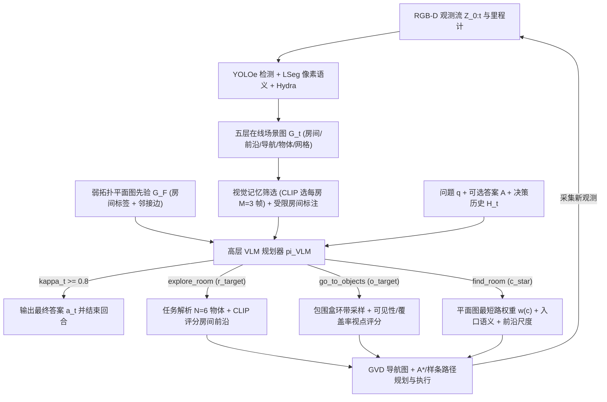
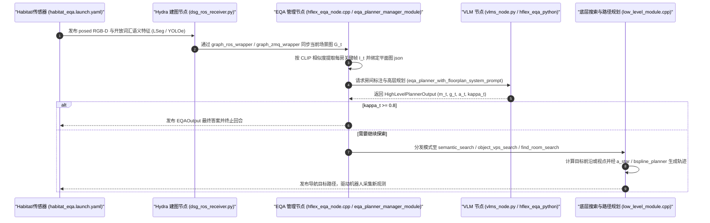

# Hierarchical Floorplan-Guided Vision-Language Exploration for Embodied Question Answering

## 一句话定义

**HFLEX-EQA** 是一个面向未知室内环境的分层主动具身问答（EQA）框架，它在线构建开放词汇三维分层场景图并检索紧凑视觉记忆，由高层 VLM 结合弱拓扑平面图先验在“探索已知房间 / 检查已见物体 / 搜寻未见房间”三种专用探索模式间切换，从而在足够置信度下完成问答。

## 英文缩写速查

| 缩写 | 英文全称 | 简要说明 |
|---|---|---|
| EQA | Embodied Question Answering | 具身问答：智能体需主动探索未知环境以收集证据再回答问题 |
| VLM | Vision-Language Model | 视觉-语言模型，承担高层状态推理、房间语义标注与答案生成 |
| TSDF | Truncated Signed Distance Field | 截断有符号距离场，用于融合深度与像素级开放词汇语义特征 |
| GVD | Generalized Voronoi Diagram | 广义 Voronoi 图，从占据栅格提取可通行导航图节点 |
| WFD | Wavefront Frontier Detection | 波前边界检测，提取已探索自由空间与未知区域之间的前沿 |
| CLIP | Contrastive Language-Image Pre-training | 对比图文编码模型，用于关键帧检索及前沿/文本余弦相似度评分 |
| HM3D | Habitat-Matterport 3D | 室内三维扫描与语义标注数据集，用于仿真基准测试与平面图生成 |

## 为什么重要

1. **区分信息缺失类型而非单一局部启发式：** 传统主动 EQA 方法（如 ExploreEQA、GraphEQA）将探索视为单一规划问题，未能区分“当前房间尚未看全”“已见物体视角不清”和“目标在完全未见的房间里”三种不同需求。HFLEX-EQA 通过三模式分层接口显式解耦高层语义决策与底层几何/视角规划。
2. **弱先验免定位的平面图利用方式：** 在真实建筑中常有粗略平面图可用，但未必包含精确尺度或可靠的全局定位。HFLEX-EQA 只把平面图视为“房间类别 + 邻接关系”的弱拓扑先验，不要求机器人在平面图中精确定位，也不假设平面图完全准确，即可推理下一跳最可能通往目标房间的类别。
3. **机载可部署的完整软硬件闭环：** 不同步依赖云端建图或离线预处理，感知（YOLOe + LSeg + Hydra）、分层规划（C++ 核心库）与轨迹生成均在 Jetson Thor / ROS 2 Jazzy 机载实时运行，并在 ANYmal 四足机器人上完成了未知室内实机验证。

## 核心信息

| 项目 | 详情 |
|---|---|
| 作者 | Albert Gassol Puigjaner, Kostas Alexis |
| 机构 | Autonomous Robots Lab, Norwegian University of Science and Technology (NTNU) |
| 发表时间 | 2026-09-22（arXiv:2609.26360v1 [cs.RO]） |
| 论文链接 | [arXiv:2609.26360](https://arxiv.org/abs/2609.26360) · [HTML 全文](https://arxiv.org/html/2609.26360) |
| 项目与代码 | [项目主页](https://ntnu-arl.github.io/hflexeqa/) · [主代码仓 ntnu-arl/hflex_eqa](https://github.com/ntnu-arl/hflex_eqa) · [ROS 2 仓 ntnu-arl/hflex_eqa_ros](https://github.com/ntnu-arl/hflex_eqa_ros) · [Zenodo DOI](https://doi.org/10.5281/zenodo.22919691) |
| 清单分类 | `model.planning`, `harness.memory` |
| 开源状态 | 已开源（BSD-3-Clause，含 C++ 规划库、Python VLM 规划器、ROS 2 节点、Docker 与 HM3D 基准脚本） |

## 核心原理

给定问题 $q$、可选候选答案集 $\mathcal{A}$、在线采集的 RGB-D 观测序列 $\mathcal{Z}_{0:t}$ 以及估计拓扑平面图 $\mathcal{G}^{\mathcal{F}} = (\mathcal{N}^{\mathcal{F}}, \mathcal{E}^{\mathcal{F}})$，系统通过 $a^* = F_{\text{EQA}}(q, \mathcal{Z}_{0:t}, \mathcal{G}^{\mathcal{F}}, \mathcal{A})$ 输出选项或自由文本答案。核心由四个模块组成：

### 1. 在线分层场景图与开放词汇语义地图（Section IV-A）
- **五层场景图 $\mathcal{G}_t$：** 基于 Hydra 增量构建并优化五类节点：
  $$\mathcal{N}_t = \mathcal{N}_t^{L_r} \cup \mathcal{N}_t^{L_f} \cup \mathcal{N}_t^{L_n} \cup \mathcal{N}_t^{L_o} \cup \mathcal{N}_t^{L_m}$$
  分别对应房间层 $L_r$、前沿层 $L_f$、导航层 $L_n$、物体层 $L_o$ 和度量-语义网格 $L_m$。
- **语义检测与关键帧存储：** 使用 **YOLOe**（仿真用 HM3D 类别，实机用 ADE20K 类别）检测物体并生成边界框与网格顶点；房间节点 $r_i = (c_{r_i}, \mathcal{K}_i)$ 在位姿变化与 CLIP 余弦差异足够大时追加关键帧，并关联内部导航节点。
- **开放词汇前沿与导航层：** 并行使用 **LSeg** 提取像素级 CLIP 特征，通过深度投影融合成带运行平均语义特征的 TSDF 与开放词汇二维占据栅格 $\mathcal{O}_t$；从 $\mathcal{O}_t$ 提取 **GVD** 构成导航层 $L_n$，使用 **WFD** 提取前沿并对其质心 $\mathbf{p}_{f_i}$ 半径 $r_f$ 内栅格特征取平均，得到前沿语义特征 $\phi_{f_i}$、朝向 $\theta_{f_i}$ 与尺寸 $s_{f_i}$。

### 2. 弱拓扑平面图先验（Section IV-B）
- 平面图 $\mathcal{G}^{\mathcal{F}}$ 中节点仅保留房间语义标签 $\ell(u)$，边仅保留房间连通性，**不保留度量几何坐标或机器人位姿**。
- 它被视为不完整且可能包含错误标签或错漏连边的弱先验，用于辅助推理“当前房间相邻有哪些未探索房间类型更可能通向目标房间”。

### 3. 高层 VLM 规划器（Section IV-C）
- **紧凑状态构造：** $\mathcal{X}_t = (q, \mathcal{A}, \mathcal{G}_t, \mathcal{I}_t, \mathcal{H}_t, \mathcal{G}^{\mathcal{F}})$，其中 $\mathcal{H}_t = \{(m_k, g_k)\}_{k=0}^{t-1}$ 为历史高层决策。
- **任务相关视觉记忆 $\mathcal{I}_t$：** 为避免传入完整图像历史，每个房间按 CLIP 图文相似度选取最多 $M=3$ 张关键帧 $\mathcal{I}_{r_i}$；若上一步为 `go_to_objects`，则纳入物体检查视图 $\mathcal{I}_{\text{O}}$，再并入当前观测 $\mathbf{I}_t$。
- **受限房间语义标注：** 每次高层查询前，由 VLM 根据房间关键帧与室内物体标签预测房间类别 $c_{r_i}$，且输出词表受限于平面图出现过的房间类别，从而建立在线场景图与平面图的语义对齐。
- **模式与回答输出：** $\pi_{\text{VLM}}(\mathcal{X}_t) = (m_t, g_t, a_t, \kappa_t)$。当答案置信度 $\kappa_t \ge \kappa_{\min}$（实验中设为 $0.8$）时立即终止探索并返回 $a_t$；否则输出模式 $m_t \in \{\texttt{explore\_room}, \texttt{go\_to\_objects}, \texttt{find\_room}\}$ 与对应目标 $g_t$。

### 4. 三类专用底层规划器（Section IV-D）
- **`explore_room`（探索已知房间）：** 针对未充分探索的目标房间 $r_{\text{target}}$，先用任务解析 VLM 预测与问题最相关的 $N=6$ 个物体并编码为 CLIP 文本向量 $\{\psi_j\}_{j=1}^N$，按最大余弦相似度为房间内前沿打分：
  $$S_{\text{exp}}(f_i) = \max_j \frac{\phi_{f_i}^\top \psi_j}{\|\phi_{f_i}\|\|\psi_j\|}$$
  选取最高分可达前沿并朝向 $\theta_f$ 观测。
- **`go_to_objects`（精细检查已见物体）：** 根据物体包围盒半轴估算最小安全视距 $r_{\min} = \max(\delta^{xy}/\tan(\theta_x/2), \delta^z/\tan(\theta_y/2))$，在 $[r_{\min}, r_{\min}(1+\epsilon)]$（$\epsilon=1$）半径环带采样自由空间候选视点 $v$，综合遮挡后可见顶点比例 $\rho_{\text{vis}}(v)$ 与图像投影覆盖率 $\rho_{\text{img}}(v)$ 打分（$\lambda_{\text{vis}}=0.7, \lambda_{\text{img}}=0.3$）：
  $$S_{\text{vp}}(v) = \lambda_{\text{vis}}\rho_{\text{vis}}(v) + \lambda_{\text{img}}\rho_{\text{img}}(v)$$
- **`find_room`（平面图引导房间搜寻）：**
  1. 将当前房间标签 $c_{r_{\text{current}}}$ 匹配至平面图中所有同名节点，取其邻接节点集合 $\mathcal{U}_t$ 与候选类别集合 $\mathcal{C}_t$。
  2. 计算每个候选类别 $c \in \mathcal{C}_t$ 到目标房间类别 $c^\star$ 的最短图距离 $d(c, c^\star)$，并转化为归一化进度权重：
     $$w(c) = \frac{\exp(-d(c, c^\star))}{\sum_{c' \in \mathcal{C}_t}\exp(-d(c', c^\star))}$$
     若当前房间无法匹配平面图或无路径，权重归零，退化为局部探索。
  3. 结合入口模板匹配分 $S_{\text{tr}}(f_i)$（匹配 `"doorway/entrance/hallway/opening to/into a c*"`）、平面图进度引导分 $S_{\text{fp}}(f_i) = \sum_{c\in\mathcal{C}_t} w(c) \cos(\phi_{f_i}, \eta_c)$ 与归一化前沿尺度 $S_{\text{free}}(f_i)$ 计算综合得分（$(\alpha, \beta, \gamma)=(0.35, 0.55, 0.1)$）：
     $$S_{\text{find}}(f_i) = \alpha S_{\text{tr}}(f_i) + \beta S_{\text{fp}}(f_i) + \gamma S_{\text{free}}(f_i)$$

## 流程总览

## 源码运行时序图

`ntnu-arl/hflex_eqa` 提供 C++ 核心规划库与 Python VLM 规划器，并通过配套 ROS 2 仓库 `ntnu-arl/hflex_eqa_ros` 中的 `habitat_eqa.launch.yaml`（仿真单回合）或 `eqa.launch.yaml` + `scene_graph.launch.yaml`（ANYmal 实机）拉起 `hflex_eqa_node.cpp` 与 `vlms_node.py` 协同执行。

## 实验与评测

### 1. 仿真基准对比（OpenEQA & ExploreEQA，HM3D 单层语义子集）
实验在 Habitat 仿真器与 HM3D 场景上进行，保留具备语义标注的单层片段以构建平面图先验，共 **108 个 OpenEQA 回合**与 **114 个 ExploreEQA 回合**，所有方法最大规划迭代上限均为 **50 步**；评测指标为成功率 **SR%（↑）**、平均规划步数 **S（↓）** 与平均路径长度 **P（m，↓）**。

**有候选答案（Choices）核心对比（Table I）：**

| VLM 后端 | 方法 | OpenEQA SR% | OpenEQA S | OpenEQA P(m) | ExploreEQA SR% | ExploreEQA S | ExploreEQA P(m) |
|---|---|---|---|---|---|---|---|
| GPT-4o | HFLEX-EQA | **52.8** | 12.32 | 31.9 | **48.2** | 15.12 | 40.8 |
| GPT-4o | GraphEQA | 36.1 | 5.44 | 22.3 | 39.5 | 8.12 | 17.5 |
| GPT-4o | ExploreEQA | 44.4 | 13.52 | 24.9 | 44.7 | 11.81 | 22.9 |
| GPT-5.5 | HFLEX-EQA | **75.0** | 4.00 | 9.3 | **57.9** | 4.47 | 14.4 |
| GPT-5.5 | GraphEQA | 35.2 | 1.59 | 6.2 | 50.9 | 3.14 | 6.5 |
| GPT-5.5 | ExploreEQA | 59.3 | 19.11 | 35.0 | 54.4 | 18.74 | 37.5 |
| Gemini-3.5 Pro | HFLEX-EQA | **75.0** | 4.49 | 13.0 | **63.2** | 5.96 | 19.6 |
| Gemini-3.5 Pro | GraphEQA | 46.3 | 1.76 | 4.7 | 54.4 | 2.66 | 5.5 |
| Gemini-3.5 Pro | ExploreEQA | 54.6 | 13.25 | 24.0 | 53.5 | 10.98 | 21.5 |
| Claude Opus 4.8 | HFLEX-EQA | **63.9** | 6.12 | 25.6 | **57.9** | 5.75 | 23.1 |
| Claude Opus 4.8 | GraphEQA | 41.7 | 5.09 | 16.1 | 53.5 | 10.76 | 16.3 |
| Claude Opus 4.8 | ExploreEQA | 54.6 | 15.43 | 28.7 | 43.9 | 15.80 | 32.4 |
| Qwen 3.5-9B | HFLEX-EQA | **52.8** | 3.54 | 12.8 | **51.8** | 3.98 | 13.6 |
| Qwen 3.5-9B | GraphEQA | 30.6 | 3.89 | 13.6 | 44.7 | 7.53 | 14.9 |
| Qwen 3.5-9B | ExploreEQA | 36.1 | 16.12 | 30.3 | 43.0 | 11.40 | 22.3 |

**无候选答案（No choices，LLM 判分）核心对比（Table I）：**
- **Gemini-3.5 Pro：** HFLEX-EQA 在 OpenEQA 达 **56.5%**（GraphEQA 为 39.8%）、ExploreEQA 达 **53.5%**（GraphEQA 为 46.5%）。
- **Claude Opus 4.8：** HFLEX-EQA 在 OpenEQA 达 **40.7%**（GraphEQA 为 38.0%）、ExploreEQA 达 **57.9%**（GraphEQA 为 49.1%）。
- **GPT-5.5：** HFLEX-EQA 在 OpenEQA 达 **44.4%**（GraphEQA 为 26.9%）、ExploreEQA 达 **53.5%**（GraphEQA 为 50.0%）。
- **GPT-4o & Qwen 3.5-9B：** 同样均高于 GraphEQA（如 Qwen 3.5-9B 在 OpenEQA 为 37.0% vs 23.1%，ExploreEQA 为 36.8% vs 32.5%）。

### 2. 消融实验与真值语义分析（Gemini-3.5 Pro，Table II & Table III）
- **消融研究（Table II）：**
  - 完整 `HFLEX-EQA`：OpenEQA SR **75.0%**（$S=4.49, P=13.0\text{ m}$），ExploreEQA SR **63.2%**（$S=5.96, P=19.6\text{ m}$）。
  - 去除平面图先验（`w/o FP`）：OpenEQA 降至 **64.8%**（-10.2 个百分点），ExploreEQA 降至 **53.5%**（-9.7 个百分点）。
  - 去除物体视点选择（`w/o VP`）：OpenEQA 降至 **67.6%**，ExploreEQA 降至 **58.8%**。
  - 去除语义前沿（`w/o SF`，改用最近前沿）：OpenEQA 降至 **66.7%**，ExploreEQA 降至 **57.0%**，且 OpenEQA 规划步数升至 $12.10$。
  - 在基线 `GraphEQA` 提示词中直接加入平面图（`GraphEQA + FP`）：OpenEQA 反而从 46.3% 降至 **43.5%**，ExploreEQA 仅从 54.4% 微升至 **57.0%**，说明仅将平面图塞入 Prompt 无法稳定提升表现。
- **真值语义分析（Table III）：** 使用真值语义（`+ GT`）后，`HFLEX-EQA + GT` 在 Choices 下进一步提升至 OpenEQA **79.6%**（$S=3.16$）与 ExploreEQA **64.0%**（$S=5.11$），仍明显高于 `GraphEQA + GT`（63.9% / 57.9%）。

### 3. 四足机器人实机实验与视觉扰动鲁棒性（Section V-C, Table IV, Fig. 5）
- **硬件平台：** ANYmal 四足机器人，搭载 Ouster OS0 LiDAR + VectorNav VN100 IMU（里程计）、Intel RealSense D455 RGB-D 相机及 NVIDIA Jetson Thor 机载算力；除外部 API 调用 GPT-5.5 外，感知、建图与分层规划均机载实时运行。
- **7 类真实未知室内问题测试（Table IV）：** 覆盖状态（微波炉颜色，$\kappa=0.94, S=10, P=48.6\text{ m}$）、计数（午餐椅数量，$\kappa=0.86, S=9, P=42.6\text{ m}$）、序列理解（冰箱与椅子颜色对比，$\kappa=0.84, S=11, P=50.9\text{ m}$）、文字识别（白板内容，$\kappa=0.95, S=5, P=17.3\text{ m}$）、存在性（会议室展示设备，$\kappa=0.92, S=4, P=16.2\text{ m}$）、定位（笔记本电脑位置，$\kappa=0.85, S=4, P=14.6\text{ m}$）与功能理解（挂外套位置，$\kappa=0.84, S=7, P=42.6\text{ m}$），全部正确作答；在去掉选项的日志回放测试中，所有自由回答依然正确，且 **47/50** 步高阶探索模式选择与有选项版本一致。
- **图像扰动测试（Fig. 5）：** 对实机日志施加高斯模糊、光照衰减与 Gamma 校正扰动后，高层模式一致性 $m_t$ 保持稳定，仅在强高斯模糊下最终答案准确率明显下降。

## 与其他工作对比

| 方法 / 系列 | 场景表示 | 是否区分探索模式 | 平面图先验利用 | 实验特征与局限 |
|---|---|---|---|---|
| **ExploreEQA** | 语义占据地图 + 图像打分投影前沿 | 否（单一探索/回答策略） | 无 | 仅支持固定选项（依赖选项概率对比），常需较多步数与较长路径（如 GPT-5.5 在 OpenEQA 需 19.11 步 / 35.0 m） |
| **GraphEQA** | 在线分层场景图 + 视觉记忆 | 否（单步直接选目标/前沿） | 无（直接拼接进 Prompt 效果不稳定） | 倾向较早终止探索（步数常低于 5 步、路径短），但因此容易漏采关键信息导致成功率显著偏低 |
| **HFLEX-EQA（本文）** | 在线五层场景图（Hydra + YOLOe + LSeg）+ CLIP 关键帧记忆 | **是**（`explore_room` / `go_to_objects` / `find_room`） | **是**（弱拓扑图用于计算邻接房间进步权重 $w(c)$） | 借助弱平面图与专用底层规划显著提升各 VLM 下的问答成功率，同时支持有选项与无选项自由回答，但规划步数与路径通常高于过早停止的 GraphEQA |

## 结论

**一句话总判：HFLEX-EQA 证明了“三维分层场景图 + 三模式分层探索 + 免定位弱拓扑平面图先验”能够在不依赖精确平面图几何或真值语义的前提下，显著提高多类 VLM 在开放室内具身问答中的准确率并支持真实四足机器人机载部署。**

1. **采用结构化模式分解优于端到端单步选点：** 将高层决策收敛到 `explore_room`、`go_to_objects`、`find_room` 三种语义模式，配合各自专用的几何/语义底层评分器，比直接让 VLM 选前沿或把平面图硬塞进 Prompt 更有效（`GraphEQA + FP` 在 OpenEQA 下降 2.8%，而完整 `HFLEX-EQA` 高出 31.5%）。
2. **弱拓扑平面图足以引导跨房间搜寻：** 无需全局几何对齐或精确图内定位，仅靠“同类房间候选匹配 + 邻接最短路进度权重 $w(c)$ + 入口语义模板”即可带来约 10 个百分点的成功率增益（`w/o FP` 在 OpenEQA 降 10.2%、ExploreEQA 降 9.7%）。
3. **小参数本地 VLM 同样受益于结构化记忆与先验：** 即使采用 Qwen 3.5-9B，HFLEX-EQA 仍能取得比 GPT-4o 下的 GraphEQA 更高的成功率（OpenEQA 52.8% vs 36.1%；ExploreEQA 51.8% vs 39.5%）。
4. **实机部署重点需保证开放词汇前景检测与图-帧一致性：** 机载算力（Jetson Thor）足以实时运行 Hydra、YOLOe、LSeg 与 C++ 规划层，但视觉强模糊或语义误检仍会限制最终问答上限（对比 `+GT` 仍有约 4.6% 提升空间）。

## 工程实践

- **容器化构建与双工作流配置：** 官方仓库通过 `install/default.repos`（桌面/Habitat）与 `install/thor.repos`（Jetson Thor）管理 `reasoning_hydra`、`semantic_inference_ros`、`kimera_pgmo`（注意桌面用 `hflex_eqa/default` 分支、Thor 用 `hflex_eqa/thor` 分支）等 ROS 2 Jazzy 依赖，并在 `docker/default/` 与 `docker/thor/` 提供完整 Compose 环境。
- **离线模型与显存优化：** 首次运行前需手动下载并放置 `models/lseg.ckpt`；`yoloe-11l-seg.pt` 与 OpenCLIP ViT-B/32 缓存可在联网首次启动时自动拉取并复用为离线运行（`HF_HUB_OFFLINE=1`）。在 **8 GB 显存 GPU** 上可通过设置 `HFLEX_EQA_QUERY_DEVICE=cpu` 将文本查询 CLIP 模型迁至 CPU，仅保留 YOLOe 与 LSeg 在 GPU 运行。
- **平面图先验生成与开关细节：** `habitat_eqa.launch.yaml` 默认不加载平面图 JSON（虽然 `use_floorplan_prior` 默认为 `true`，但需配合 `floorplan_source:=json` 与 `floorplan_json_path` 才会真正启用）；HM3D 基准测试需先用 `Per_Scene_Region_Weighted_Votes.csv` 运行 `generate_floorplans.py`（OpenEQA）或 `generate_floorplans_exploreeqa.py`（ExploreEQA）生成 `topological_graph.json`。
- **VLM 后端替换：** 通过修改 `hflex_eqa/config/habitat/high_level.yaml` 或 `config/anymal/high_level.yaml` 即可切换 OpenAI、Gemini、Llama、Anthropic 或本地 OpenAI 兼容 vLLM 后端。

## 局限与风险

- **基准评测覆盖范围受限于单层场景：** 论文仿真评测筛选了 HM3D 中具备语义标注的**单层**片段（OpenEQA 108 回合、ExploreEQA 114 回合），尚未涵盖跨楼层楼梯/电梯拓扑与多层平面图推理。
- **物体视点评分未建模视角方向与光照：** `go_to_objects` 仅优化可见顶点比例与投影覆盖率（式 (8)），未显式建模正反面朝向、局部反光或强模糊退化（Fig. 5 显示强模糊会导致问答准确率显著下降）。
- **外部先验与上游感知误差传导：** 虽然平面图容忍部分缺漏，但实机部署仍需预先提供房间标签与邻接拓扑；且对比 `Table III` 的 `+GT` 结果可知，YOLOe/LSeg 的开放词汇感知误差及房间分类误差仍是当前约 1%–5% 成功率差距的主要来源。
- **步数与计算开销权衡：** 相比频繁早停的 GraphEQA，HFLEX-EQA 为收集充分证据往往执行更多规划步骤与更长路径，在严格受限时间或高频 API 调用计费场景需结合具体 $\kappa_{\min}$ 阈值权衡。

## 关联页面

- [机器人视觉感知栈选型闭环](../queries/robot-perception-stack-selection-loop.md)：对照视觉感知与开放词汇定位选型闭环。
- [Agentic Robots 综述](paper-towards-agentic-robots-survey.md)
- [全量项目节点清单](../overview/awesome-agentic-robots-node-index.md)
- [VLA 方法背景](../methods/vla.md)
- [机器人智能体执行框架](../methods/robot-agent-harness.md)：对照规划、执行接口与反馈机制
- [智能体规划与反馈机制](../methods/agent-planning-feedback.md)：高层决策历史与置信度早停闭环
- [机器人导航工程流水线](../methods/robot-navigation-workflow.md)：结合 GVD 导航图与局部路径规划落地
- [具身智能体评测基准](../methods/embodied-agent-benchmarking.md)：OpenEQA 与 ExploreEQA 任务评测范式
- [机器人视觉感知](../methods/robot-visual-perception.md)：RGB-D、开放词汇分割（LSeg）与目标检测（YOLOe）
- [自主探索任务](../tasks/autonomous-exploration.md)：语义前沿探索（WFD + CLIP 评分）与信息增益策略
- [视觉语言导航（VLN）](../tasks/vision-language-navigation.md)：语言引导跨房间搜索与拓扑结构先验
- [零样本目标导航](../tasks/zero-shot-object-navigation.md)：开放词汇目标定位与跨房间搜寻对照

## 推荐继续阅读

- [论文原文（arXiv:2609.26360）](https://arxiv.org/abs/2609.26360)
- [HFLEX-EQA 官方项目主页](https://ntnu-arl.github.io/hflexeqa/)
- [HFLEX-EQA 官方主仓库（ntnu-arl/hflex_eqa）](https://github.com/ntnu-arl/hflex_eqa)
- [HFLEX-EQA ROS 2 仓库（ntnu-arl/hflex_eqa_ros）](https://github.com/ntnu-arl/hflex_eqa_ros)
- [Zenodo 数据与成果归档](https://doi.org/10.5281/zenodo.22919691)

## 参考来源

- [论文原文核对笔记](../../sources/papers/paper-agentic-2609-26360.md)
- [官方源码仓库核查归档](../../sources/repos/paper-agentic-2609-26360.md)
- [官方 Awesome 快照归档](../../sources/repos/awesome-agentic-robots-survey-index.md)
- [arXiv:2609.26360 HTML 全文](https://arxiv.org/html/2609.26360)
- [GitHub 官方仓库 ntnu-arl/hflex_eqa](https://github.com/ntnu-arl/hflex_eqa)
- [GitHub 官方 ROS 2 仓库 ntnu-arl/hflex_eqa_ros](https://github.com/ntnu-arl/hflex_eqa_ros)
