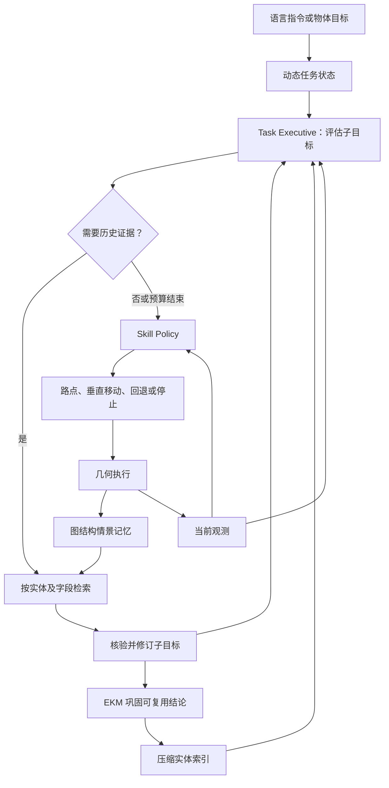
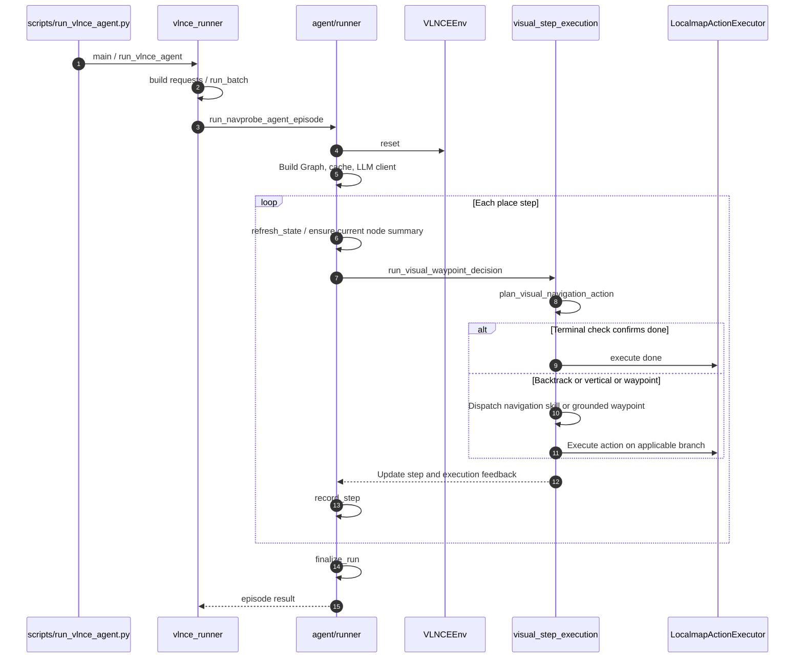

# NavProbe：基于主动记忆检索与证据推理的零样本导航

**NavProbe: Evidence-Grounded Reasoning with Active Memory Retrieval for Zero-Shot Navigation**

## 一句话定义

用可追溯历史证据判断任务是否真的完成，而不是把已经执行的动作直接当作成功。

## 英文缩写速查

| 缩写 | 英文全称 | 简要说明 |
|---|---|---|
| VLN | Vision-Language Navigation | 自然语言路线导航 |
| VLM | Vision-Language Model | 高层推理与技能选择 |
| EKM | Entity Knowledge Manager | 将检索结论巩固到实体摘要 |
| FSS | Frontier–Skeleton Sampling | 前沿与骨架路点采样 |
| BEV | Bird's-Eye View | 俯视空间表示 |
| SR | Success Rate | 成功率 |
| SPL | Success weighted by Path Length | 路径长度加权成功率 |

## 核心信息

| 字段 | 内容 |
|---|---|
| 机构 | 上海科技大学（ShanghaiTech University） |
| 作者 | Jingyang Liu、Sujia Yao、Jiayuan Gu、Lan Xu |
| 论文 | [arXiv:2609.27526v2](https://arxiv.org/html/2609.27526v2)，2026-10-03 |
| 官方代码 | [NavProbe](https://github.com/liujy25/NavProbe)，MIT |
| 任务 | VLN-CE 与 ObjectNav |

## 为什么重要

长指令中的“经过壁炉后右转”并不等于执行过一次右转。只保留文字摘要可能丢掉反证，把所有旧图像放进上下文又可能干扰推理。NavProbe 把任务是否完成与底层动作是否执行分开处理，让历史判断能够被纠正。

## 核心原理与流程总览

- **任务状态**：动态 agenda 与执行 history；每个子目标含自然语言目标、状态及可核验命题。新证据可新增、细化、重排或重开子目标。
- **情景记忆**：地点节点存全景图，转移边存轨迹，地标存检测及位置；独立占据地图用于几何规划。
- **压缩索引**：各实体摘要加证据字段指针。执行器按待核验问题选择实体及字段，不把原始图像永久塞入推理上下文。
- **核验与巩固**：每轮检索后形成结论并修订 agenda；EKM 可新增、更正或删除旧摘要中的主张。原始记录保留，后续仍可复查。
- **技能策略**：根据当前观测及修订后的状态选择 GoToWaypoint、VerticalMove、Backtrack 或 Stop。FSS 在占据地图上生成前沿与骨架候选，再把可见标签映射为米制路点。

论文 §III：检索与核验发生在单次决策内，机器人不因此每轮移动；到达检索预算仍须处理最后一批证据。实际评测每步至多 6 轮检索。

## 源码运行时序图

以下针对官方 VLN-CE 入口的静态调用链，非真机 ROS2 源码时序。

入口、runner 与分派函数对应 [源码归档](../../sources/repos/navprobe.md)。代码中终止前存在待核验状态，接近目标不直接等同于 done；不同技能分支使用不同执行例程。

## 实验与评测

论文 Table I–II，均为作者报告；每个 benchmark 使用与 Uni-LaViRA 对齐的 100 个 episode 子集，各配置重复三次取均值。

| 基准 | SR (%) | SPL (%) |
|---|---:|---:|
| R2R-CE | 71.7 | 55.8 |
| RxR-CE | 55.3 | 38.6 |
| HM3D-v2 ObjectNav | 79.3 | 43.8 |

R2R-CE 同 GPT-5.5 的 Uni-LaViRA 重跑基线为 61.7% SR、45.0% SPL。RxR-CE 的 nDTW 为 53.9，对比 Uni-LaViRA 53.7，路径对齐变化很小。ObjectNav 的 SPL 低于 Uni-LaViRA 的 46.1%。

| R2R-CE 消融（Table III） | SR (%) | SPL (%) |
|---|---:|---:|
| 完整系统 | 71.7 | 55.8 |
| 去任务状态 | 63.3 | 51.4 |
| 去 EKM | 65.0 | 51.1 |
| 去检索及 EKM | 57.3 | 43.1 |
| Full Graph | 62.0 | 48.8 |

46.71% 的导航决策触发检索（排除首次决策后 53.79%）；触发时平均 1.82 轮。图 2 展示误判电视后重开搜索，以及重新核验路线后进入餐厅。图 3 在 Galaxea R1Pro 上用 ZED2 RGB-D、MID-360 LiDAR、Voxel-SLAM 和 Nav2 完成定性多阶段导航演示。

## 结论

NavProbe 的重点是可修订、可追溯的任务进度，而非单纯增加历史上下文。

- 任务状态必须跨决策保留，完成条件与动作调用结果分别记录。
- 证据索引与原始记录分离，允许按问题取证及纠正误判。
- 去 EKM 后再去检索的对照才对应独立检索贡献；不要把联合消融全部归因于检索。
- SR、SPL 与轨迹对齐分别报告，避免用成功率替代运动效率。
- 部署时测量额外 VLM 调用延迟、错误恢复及停机验证，而不是仅复用论文成功率。

## 工程实践

官方源码已开放，仿真复现依赖 Python 3.9、Habitat 0.3.3、视觉模型 API、检测器权重及授权场景数据。论文采用 GPT-5.5、YOLO-World；README 当前默认 GroundingDINO，复现需显式对齐配置。运行入口和数据准备见 [代码归档](../../sources/repos/navprobe.md)。

## 局限与风险

- 评测为抽样子集，不是全量 benchmark；真机只提供定性示例。
- 低层仿真执行使用 Habitat-Lab ShortestPathFollower；不要将语义选择结果当作完整真实导航控制性能。
- 检索结论来自 VLM，可能误判；证据可回查并不保证逻辑正确。
- 未证明时延、token 或计算成本下降；未独立运行仿真或真机。
- 官方代码的真机完整部署范围未确认，外部模型与场景许可仍是复现条件。

## 关联页面

- [视觉–语言导航](../tasks/vision-language-navigation.md)
- [零样本物体导航](../tasks/zero-shot-object-navigation.md)
- [NavMCP](paper-navmcp-long-horizon-navigation.md) — 跨导航调用累积证据
- [SuperNav](paper-supernav-agentic-navigation.md) — agent harness 与可替换执行后端
- [导航纵深路线 Stage 4](../../roadmap/depth-navigation.md)
- [Agentic Robots 综述](paper-towards-agentic-robots-survey.md)
- [全量项目节点清单](../overview/awesome-agentic-robots-node-index.md)

## 推荐继续阅读

- [AgenticNav](https://arxiv.org/abs/2606.10577) — 对照按需回忆与工具调用架构
- [Uni-LaViRA](https://arxiv.org/abs/2605.27582) — 论文主要零样本对照

## 参考来源

- [NavProbe 原文归档](../../sources/papers/navprobe_arxiv_2609_27526.md)
- [NavProbe 官方代码归档](../../sources/repos/navprobe.md)
- [原有 Awesome 快照归档](../../sources/repos/awesome-agentic-robots-survey-index.md)
