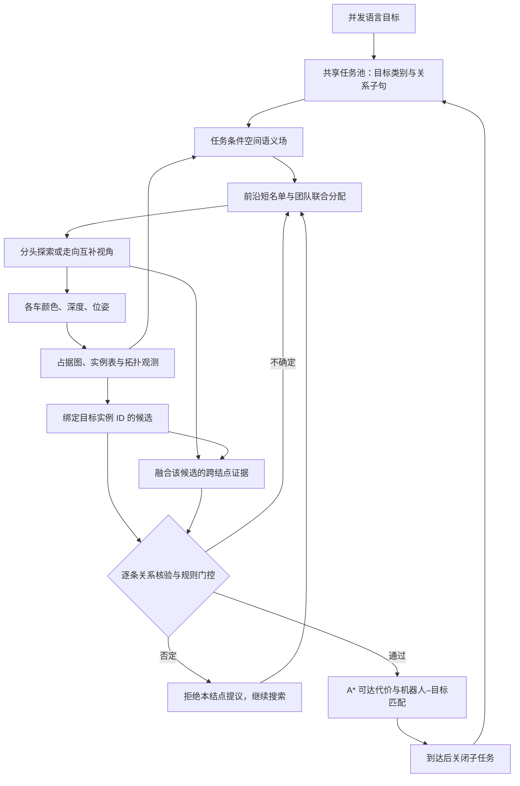

# CoRelNav：面向空间约束语义导航的多机器人协同关系导航 / Collaborative Relational Navigation for Multi-Robot Spatially Constrained Semantic Navigation

## 一句话定义

在未知室内环境同时找多个目标时，CoRelNav 不只让机器人分区搜索，还把不同机器人看到的线索绑定到同一物体实例，按缺哪条关系证据来分配补观测任务，再导航到验证过的目标。

## 英文缩写速查

| 缩写 | 英文全称 | 本文含义 |
|---|---|---|
| RGB-D | Red–Green–Blue and Depth | 彩色与深度观测，结合位姿写入共享地图 |
| ROI | Region of Interest | 围绕观测结点、用于生成验证输入的局部区域 |
| SR | Success Rate | 成功率，整回合要求全部子任务及其到达条件完成 |
| SPL | Success weighted by Path Length | 路径长度加权成功率，文中双机分母计两台轨迹总长 |
| HM3D | Habitat-Matterport 3D Dataset | 仿真所用的室内三维重建场景 |

## 为什么重要

类别导航可以到任意一张床；关系导航要能分辨哪张床同时满足指定条件。有遮挡时单台车未必能看齐全部支撑物。CoRelNav 的贡献在于让未看到的关系证据参与下一次航点分配，而不是等探索结束才让模型对已有图片作判断。

## 核心信息

| 字段 | 内容 |
|---|---|
| 作者 | Jinyu He、Zihao Mao、Haonan Jin、Mengyin Fu、Wenjie Song |
| 机构 | 北京理工大学自动化学院 |
| 首发 | 2026-09-23，[arXiv:2609.27720v1](https://arxiv.org/abs/2609.27720v1)，预印本 |
| 输入与输出 | 多条类别或关系目标，及各车颜色、深度和位姿；输出可执行的探索或目标接近航点 |
| 公开状态 | 已读官方论文；未确认独立官方项目页、可运行源码或该论文的任务包 |

## 核心机制

1. **拆任务和记地图。** 从指令提取目标类别及含谓词、支撑物类别的关系子句。共享占据地图负责通行几何，实例表保存稳定 ID、三维位置和历史；稀疏拓扑结点保留当时的全景、可见实例和连通性，供按视角回查。
2. **语义相似度只负责找线索。** 用指令与结点全景、对象上下文的嵌入相似度为已知自由区域打分。每车先按语义、可观测未知面积、缺失证据收益和 A* 代价缩小前沿候选集；团队再按覆盖并集、语义/补证收益、动作成本、路径复用、前沿间距和走廊冲突做联合分配。切换收益不足时保持旧航点，避免频繁改派。
3. **按实例补证。** 候选假设固定目标实例 ID。验证器消费带编号的局部俯视几何、物体索引、垂直线索与原始子句；规则门控要求整体及逐条子句均通过，并检查支撑实例身份、类别、参数个数和必要证据。一次否定只拒绝该结点提议，不确定则保留候选并提高互补视角的探索效用。
4. **聚合后再验证。** 在同一候选的证据结点上，将各自固定的 4 m × 4 m 区域取并集，用最新共享占据地图和按实例索引的点缓存重渲染，可纳入结点建立后才看到的支撑物。验证后用 A* 代价和 Hungarian 匹配分配可达接近位姿；到达才结束任务。

## 流程总览

依据论文 §III 与图 2–3 整理；对应方法数据流，不表示已追踪实现源码。

## 评测与证据边界

| 设置 | 论文结果 | 怎么读 |
|---|---|---|
| 两个类别目标，同区域 / 跨区域（表 I） | 对比 Co-NavGPT，同区 SR 70.9% → 71.6%、SPL 0.202 → 0.208；跨区 SR 70.1% → 74.6%、SPL 0.214 → 0.252 | 同区定义为目标成功区域间最短测地距离小于 5 m；跨区为其余回合 |
| 类别 + 关系混合任务（表 II） | 对比 VLN-Game (Dual)，整体 SR 39.5% → 51.3%、整体 SPL 0.084 → 0.129，关系子任务 SR 56.3% → 63.1%；189.5k → 91.2k tokens/回合 | 双线独立基线不共享证据；外部基线按顺序发放两子任务，CoRelNav 并发持有任务池，结果不是同调度协议下的单因素对照 |
| 系统内判定和消融（表 II–III） | 仅用最高相似度的 Embedding 关系 SR 为 28.2%；多支撑物组完整系统 SR 44.7%，无联合分配为 39.5%，无跨结点聚合为 34.2% | 表 II 关系子任务 SR 和表 III 多支撑组结果不是同一统计口径 |
| 真机（§IV-B、图 6） | 两台轮式机器人在未见环境并行寻找灭火器箱和靠椅的包 | Jetson AGX Orin、Livox MID-360、RealSense D435i、OMNI-4P；Grounding DINO/MobileSAM 做学习感知。是整链路可行性示例，不是实机成功率 |

## 与其他工作对比

- **对比 Co-NavGPT（表 I，双类别目标）：** 在仅含类别目标的设置下，CoRelNav 的同区 SR/SPL 为 71.6%/0.208（Co-NavGPT 为 70.9%/0.202），跨区为 74.6%/0.252（Co-NavGPT 为 70.1%/0.214），主要反映任务条件空间语义场与团队联合分配在跨区搜索上的优势。
- **对比 VLN-Game (Dual)（表 II，类别 + 关系混合任务）：** CoRelNav 整体 SR/SPL 为 51.3%/0.129（VLN-Game (Dual) 为 39.5%/0.084），关系子任务 SR 为 63.1%（对 56.3%），每回合模型用量为 91.2k 对 189.5k tokens；需注意外部基线双线不共享证据且按顺序发放两子任务，而 CoRelNav 并发持有任务池，属于系统级对比而非单因素对照。
- **对比同类场景图与主动核验框架：** 相较于 [ConceptGraphs](paper-conceptgraphs-open-vocabulary-3d-scene.md) 侧重按物体组织的开放词汇 3D 场景表示，以及 [NavProbe](paper-agentic-2609-27526.md) 与 [DIV-Nav](https://arxiv.org/abs/2510.16518) 聚焦单机主动取证或单机关系核验，CoRelNav 将未闭合关系子句转化为多机器人共享地图上的补观测效用，并按同一实例 ID 跨结点聚合重渲染后再验证目标。

## 局限与风险

Habitat + HM3D 仿真用模拟器给出的实例掩码及 ID，建图、探索、补证和执行仍在线。文中的团队 SPL 以第一台起点串访两成功区域的最短路线为参考，再与实际单机路径长或双机路径长度之和比较，不等于墙钟时延或标准单目标 SPL。token 下降也不等于模型费用、延迟或通信带宽同比减少。

## 结论

关键设计不是多派一台车，而是让两台车找**不同但能拼起来的证据**，且只将同一实例的证据合起来。

- 对多个同类候选，单独统计错认率和缺证率；不要把“找到一张床”计成“找到椅子旁的那张床”。
- 对团队收益做两层对照：先锁定任务发放和感知条件比较联合分配，再固定分配策略比较单视角与跨视角验证。论文在额外构造的四任务测试中，从两台增至三或四台未继续改善 SPL。
- 真机接入优先验证共享坐标、实例串号与时序对齐；模拟器提供的正确 ID 隐藏了这些工程故障。论文未系统量化检测、跨视角关联和标定误差。
- 若需要工程验收，另测任务耗时、共享消息量、身份切换与重规划次数；表 II 的 token 指标不能替代这些测量。

## 工程实践与源码运行时序图

接入独立导航栈时，先确认各车能在同一坐标系和实例命名空间里写入证据，再检查从已验证目标到安全可达接近位姿的接口。关系判断通过不代表航点可达。

不适用。截至 2026-11-26，论文及作者题名检索未确认可运行的官方 CoRelNav 实现，未把上述方法图当成源码调用图，也未声称复现。

## 关联页面

- [视觉–语言导航](../tasks/vision-language-navigation.md)：同是语言驱动的移动决策；CoRelNav 特别强调终点关系的取证和验证。
- [零样本目标导航](../tasks/zero-shot-object-navigation.md)：类别先验能指路，空间约束仍需实例与支撑物证据。
- [ConceptGraphs](paper-conceptgraphs-open-vocabulary-3d-scene.md)：对照按物体组织的开放词汇场景表示，不把它等同于协同取证调度。
- [NavProbe](paper-agentic-2609-27526.md)：对照导航中的主动视觉/几何核验与进度纠错。
- [导航纵深 Stage 4](../../roadmap/depth-navigation.md)：从单机语言导航进入多机关系目标。
- [Agentic Robots 综述](paper-towards-agentic-robots-survey.md) · [综述节点索引](../overview/awesome-agentic-robots-node-index.md)：保留原策展入口与归类。

## 推荐继续阅读

- [DIV-Nav 原文](https://arxiv.org/abs/2510.16518)：对照单机如何先找关系涉及的多个物体，再用视觉语言模型确认空间关系。
- [On Evaluation of Embodied Navigation Agents](https://arxiv.org/abs/1807.06757)：核对标准 SPL，再对比本文的团队定义。

## 参考来源

- [CoRelNav 原文归档与核对范围](../../sources/papers/corelnav_arxiv_2609_27720.md)
- [Awesome Agentic Robots 综述清单快照](../../sources/repos/awesome-agentic-robots-survey-index.md)
