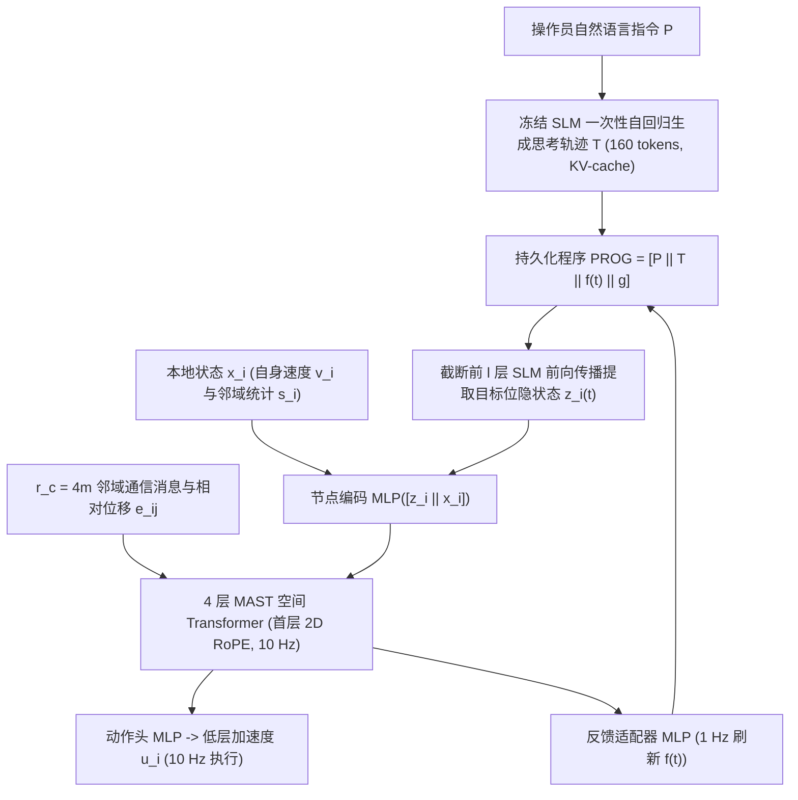

# Controlling Collectives of AI Agents in Reasoning Space with Spatial Transformers

## 一句话定义

**COMPASS**（COmmanding Multi-robot Policies with Attention and Semantic Steering）是一种面向大规模具身智能体集群的去中心化控制架构，通过**多智能体空间 Transformer（MAST）**将邻域多跳通信聚合为紧凑的**学习型反馈 token**并闭环注入冻结语言模型的**潜在推理空间**，从而把高层自然语言语义解译与低层物理协调控制解耦。

## 英文缩写速查

| 缩写 | 英文全称 | 简要说明 |
|---|---|---|
| COMPASS | Commanding Multi-robot Policies with Attention and Semantic Steering | 本文提出的推理空间去中心化多机器人反馈控制架构 |
| MAST | Multi-Agent Spatial Transformer | 基于局部通信掩码与相对几何编码的多智能体空间注意力网络 |
| SLM | Small Language Model | 适合机载部署的小参数语言模型（本文默认采用 Qwen3-1.7B） |
| RoPE | Rotary Position Embedding | 旋转位置编码，本文用于第一层 MAST 注入 2D 相对位移 |
| CV | Coefficient of Variation | 最近邻距离变异系数，用于衡量集群空间分布的均匀度 |
| COM | Center of Mass | 机器人集群的质心，用于统计全局飞行航向误差与迁移轨迹 |

## 为什么重要

将语言模型引入多机器人控制时，直接扩大集群规模会遇到两类瓶颈：

1. **纯语言通信的上下文过载**：若把邻居相对位置、速度等状态直接编码进自然语言提示词，小语言模型（SLM）有限的推理预算会被空间计算挤占（thinking becomes re-tasked），导致航向解译退化甚至集群分裂。
2. **集中式大模型的动作一致性失效**：即便采用 Claude Opus 4.8 等前沿大模型做集中式控制，随着机群规模 $N$ 增长，模型也难以同时生成兼顾一致性与凝聚性的加速度序列，并频繁输出数量不匹配的动作指令。

COMPASS 给出的核心思路是**“语义留在语言模型、空间协作交给空间 Transformer、两者通过潜在推理空间中的非语言 token 耦合”**，使语言模型无需直接处理空间几何坐标即可实现千机规模（$N=1024$）的稳定协作。

## 核心信息

| 字段 | 内容或状态 |
|---|---|
| 作者 | Frederic Vatnsdal, Roshan Gopal, Romina Garcia Camargo, Vijay Kumar, Alejandro Ribeiro |
| 机构 | University of Pennsylvania（ESE / SAS / GRASP Laboratory） |
| 发表时间 | 2026-09-23（arXiv:2609.28247v1 [cs.RO]） |
| 论文链接 | [arXiv:2609.28247](https://arxiv.org/abs/2609.28247) · [arXiv HTML 全文](https://arxiv.org/html/2609.28247) |
| 项目与代码 | 未确认开源代码（论文全文及 arXiv 页面未列出独立项目页或 GitHub 代码仓库） |
| 清单分类 | `model.robot_control`（来源条目：`survey_ax_2609_28247`） |
| 开源状态 | 未确认开源代码 |

## 核心原理

COMPASS 将每台机器人的高频物理动力学 $\mathbf{X}(\tau)\in\mathbb{R}^{N\times d_x}$、$\mathbf{U}(\tau)\in\mathbb{R}^{N\times d_u}$（10 Hz，$dt=0.1\text{ s}$）与慢时间尺度的潜在推理动力学（1 Hz）耦合在同一闭环中：

### 1. 持久化嵌入程序与双阶段推理（Reasoning in the Loop）

每台机器人 $i$ 本地维护一个处于语言模型嵌入空间 $\mathbb{R}^{d_{\mathrm{LM}}}$ 的持久化 token 序列：

$$\mathrm{PROG}_i(t) = \left[\mathbf{P}_i \,\|\, \mathbf{T}_i \,\|\, \mathbf{f}_i(t) \,\|\, \mathbf{g}\right]$$

- **思考轨迹生成与 KV-cache 复用**：当操作员下发或更新指令 $\mathbf{P}_i$（如 `"vector two o'clock"`）时，各机器人独立以温度采样（temperature = 0.6, top-p = 0.95, top-K = 20）自回归生成固定长度（默认 160 tokens）的思考轨迹 $\mathbf{T}_i$，随后在下次指令变更前保持冻结并缓存 KV 状态。
- **潜在推理状态抽取**：在控制循环中，仅运行冻结语言模型的前 $\ell$ 层（Qwen3-1.7B 默认 $\ell=27$），以可学习反馈 token $\mathbf{f}_i(t)=\psi(\boldsymbol{\pi}_i(t))$ 和可学习目标 query token $\mathbf{g}$ 接续在末尾，抽取 $\mathbf{g}$ 位置隐状态作为推理状态：

$$\mathbf{z}_i(t+1) = \phi_{1:\ell}\big(\mathbf{P}_i \,\|\, \mathbf{T}_i \,\|\, \psi(\boldsymbol{\pi}_i(t)) \,\|\, \mathbf{g}\big)$$

由于因果注意力掩码及末端位置特性，$\mathbf{f}_i$ 与 $\mathbf{g}$ 可以查询整段提示与思考轨迹，而语言 token 不会反向关注它们，因此反馈与目标 token 无需受限于自然语言流形。

### 2. 多智能体空间 Transformer（MAST）

MAST 负责以去中心化多跳消息传递的方式将群体推理状态 $\mathbf{Z}(t)$ 转化为物理动作与闭环反馈：

- **节点输入**：拼接自身推理状态、自身速度 $\mathbf{v}_i$ 与局部邻域统计 $\mathbf{s}_i=[\mu_{\mathcal{N}_i}, v_e]$（平均邻居距离与相对邻域平均速度误差），经 MLP 映射为 $\mathbf{h}_i^{(0)} = \mathrm{MLP}([\mathbf{z}_i \,\|\, \mathbf{x}_i]) \in \mathbb{R}^{d_{\mathrm{MAST}}}$。
- **2D RoPE 相对几何编码**：在第一层 MAST 中，按坐标轴 $a\in\{x,y\}$ 与周期 $\lambda=96\text{ m}$ 对查询和键向量做 2D 旋转位置编码，使注意力 logit 仅依赖相对位移 $\mathbf{p}_j - \mathbf{p}_i$，保证策略具备平移不变性与节点置换等变性。
- **通信掩码与边条件聚合**：仅对通信半径 $d_{ij} = \|\mathbf{p}_j - \mathbf{p}_i\|_2 \le r_c$（$r_c=4\text{ m}$）的邻居开放注意力掩码 $\mathcal{M}_{ij}=1$，并注入归一化边几何 $\mathbf{e}_{ij}=[\mathbf{p}_j - \mathbf{p}_i \,\|\, d_{ij}]/r_c$：

$$\mathbf{h}_i^{(\ell)} = \mathbf{h}_i^{(\ell-1)} + \mathbf{W}_o \sum_{j:\mathcal{M}_{ij}=1} A_{ij}\left(\mathbf{W}_v \mathbf{h}_j^{(\ell-1)} + \mathbf{W}_e \mathbf{e}_{ij}\right)$$

4 层 MAST（$d_{\mathrm{MAST}}=256$、8 头 $d_h=32$）赋予每台机器人 4-hop 局部通信感受野。末端输出 $\boldsymbol{\pi}_i=\mathbf{h}_i^{(4)}$ 分别经两个 MLP 头解码为**低层控制动作** $\mathbf{u}_i$（10 Hz 执行）与**反馈 token** $\mathbf{f}_i$（1 Hz 回写语言模型程序）。

### 3. 行为克隆与 DAgger 联合训练

语言模型权重全程冻结，仅训练 $\mathbf{f}$、$\mathbf{g}$ 及 MAST 参数。监督信号来自集中式势场（potential-field）专家（含群体速度对齐、$5\text{ m/s}$ 目标速度跟踪、质心凝聚与碰撞排斥 4 项），在 $N=[32,64]$（密度 $0.25\text{ robots/m}^2$，$T=10\text{ s}$）上结合 Behavior Cloning、DAgger 重标注与截断随时间反向传播（TBPTT）训练 200 epochs。

## 流程总览

## 源码运行时序图

**不适用**（截至 2026-11-27，论文原文与 arXiv 入口均未提供官方项目页或 GitHub 代码仓库链接，且 `candidate_repos` 为空，未确认可运行官方源码实现；系统运行流程以论文第 II–III 节给出的结构与超参数为准）。

## 实验与评测

实验在二维双积分器机器人集群（$dt=0.1\text{ s}$，密度 $0.25\text{ robots/m}^2$，目标速度 $5\text{ m/s}$）上进行，所有模型均仅在 $N=[32,64]$ 与 7 类训练语料上训练，测试阶段采用留出初始状态、思考轨迹与未见指令模板：

1. **零样本规模扩展（Section IV-A，Fig. 3–4，$N=8\dots 1024$，30 s）**：
   - 面对 `"go east"` 指令，COMPASS 航向误差随集群规模扩大而**单调下降**：从 $N=8$ 的 $2.79^\circ$ 降至 $N=1024$（训练规模的 16 倍）的 $0.34^\circ$，且始终保持单连通（$\mathrm{frags}=1$）、稳定达到 $5\text{ m/s}$ 目标速率以及较低的最近邻距离变异系数（CV）。
2. **结构化指令多样性（Section IV-B，Fig. 5，10 trials/scale）**：
   - 全队使用同一模糊指令或混用 4 种同等难度的模糊指令时，“群体智慧”并未自发涌现（航向误差与速度均退化）；当队伍中 $1/4$ 机器人接收较易解码的直白表述时，MAST 多跳反馈可将整支集群的航向误差与速度拉回准确意图，且该增益在所有测试规模下稳定保持。
3. **推理引擎规模权衡（Section IV-C，Table II，$N=1$ 探测实验）**：
   - 在留出模糊基数方向指令上：Qwen3-0.6B（$\ell=28, d_{\mathrm{LM}}=1024$）相对误差 1.00（3.7 s / 1.2 GB VRAM）；Qwen3-1.7B（$\ell=28, d_{\mathrm{LM}}=2048$）相对误差 0.80（4.0 s / 3.3 GB）；Qwen3-4B（$\ell=36, d_{\mathrm{LM}}=2560$）相对误差 0.65（5.0 s / 7.7 GB）。作者权衡边缘部署延迟与显存后选取 Qwen3-1.7B（$\ell=27$）作为默认引擎。
4. **未见模糊指令与任务切换（Section IV-C-1，Fig. 6，$N=64$，16 trials/class，60 s）**：
   - 中位航向误差分别为：训练内指令 $1.0^\circ$、留出模板 $1.9^\circ$、未见概念/模糊指令（如 `"all units where Santa Claus lives"`）$5.7^\circ$。
   - 飞行中由 `"go east"`（15 s）动态切换至 `"stop"` 并重新生成思考轨迹后，集群可平稳减速停止，但相比几乎静止的势场专家存在约 $0.2\text{ m/s}$ 的残余漂移。
5. **未见方位泛化（Section IV-C-2，Table III，Fig. 7，$N=64$，60 s）**：
   - 训练内 4 主方向（Cardinals，20 trials）与 4 间方位（Intercardinals，20 trials）扇区命中率均为 100%，中位误差分别为 $1.1^\circ$ 与 $1.2^\circ$。
   - 零样本 16 方位次间方位（Secondary intercardinals，如 NNE、ESE，24 trials）：75%（18/24）落入目标扇区，中位误差 $7.7^\circ$（均值 $7.96^\circ \pm 4.41^\circ$）；其中以 `"east"` 开头的指令误差最低（ESE $1.7^\circ \pm 1.0^\circ$、ENE $3.8^\circ \pm 1.8^\circ$），NNE 表现最差（$13.2^\circ \pm 2.7^\circ$，2/3 试验偏出扇区）。
   - 零样本数值方位角（16 trials）：中位误差 $2.0^\circ$（均值 $2.2^\circ \pm 1.6^\circ$），但实验表明训练数值方位角并不能迁移提升次间方位自然语言指令的精度。

## 与其他工作对比

| 对比方案 | 协调方式与架构特点 | 在论文评测中的表现（$N=64 \sim 1024$） |
|---|---|---|
| **COMPASS（本文）** | 本地冻结 SLM（潜在空间 $\mathbf{z}_i$）+ 4 层去中心化 MAST + 1 Hz 学习反馈 token | 规模扩展至 $N=1024$ 航向误差低至 $0.34^\circ$，全程 $\mathrm{frags}=1$ 不分裂 |
| **纯语言通信消融** | 同等规模冻结 SLM + 寄存器读出，将邻居相对位置/速度写入语言提示词 | $N=64$ 即分裂为 15 组，均速降至 $2.5\text{ m/s}$（目标速度一半），比无通信更差 |
| **无通信消融（$r_c=0$）** | 断开机器人间 MAST 邻域通信，仅靠单机解码执行 | 无法消弭个体语言采样偏差，缺乏集群凝聚性与碰撞协同 |
| **集中式前沿大模型（Claude Opus 4.8）** | 单一前沿 LLM 接收全局状态/视觉并集中输出全队加速度（含人工设计反馈） | 小规模能正确解译意图，但随 $N$ 增大无法给出协调加速度，且频繁输出错误数量动作需重试，导致集群分裂 |
| **势场集中式专家（Oracle）** | 全局知晓所有机器人状态的 4 项势场控制器 | 训练上界参照；停机几乎无漂移（COMPASS 在 `"stop"` 切换后留有 $0.2\text{ m/s}$ 漂移） |

## 结论

**一句话总判：COMPASS 证明了将语言模型的语义理解与空间 Transformer 的多跳几何协调在“潜在推理空间”而非“自然语言文本通道”中耦合，是实现百至千机规模具身智能体协同的关键架构路径。**

1. **避免把几何坐标塞进语言提示词**：对于机载小语言模型（1B–4B），邻域状态文本化会直接挤占推理预算并摧毁集群凝聚性；应通过轻量级图/空间注意力模块输出紧凑的潜在反馈向量。
2. **利用“部分清晰 + 局部传播”实现结构化多样性**：在多智能体面对歧义指令时，只需让约 1/4 的个体接收更易解译的表述，即可借助局部共识机制抵消其余个体的语义偏置。
3. **推理深度与思考长度需按任务调优**：思考轨迹长度存在经验甜点（本文为 160 tokens，亦验证了 120/320），而潜在状态抽取深度 $\ell$ 对模糊指令并非单调越深越好，部署新模型前宜做层扫描（layer-sweep）。
4. **分层频率与 KV-cache 显著降低机载开销**：将自回归思考生成限制在指令切换时刻并配合 KV-cache 复用，使 1 Hz 潜在推理刷新与 10 Hz 物理控制回路得以高效解耦。

## 工程实践

- **硬件与训练开销**：训练阶段在单卡 NVIDIA RTX A5000（24 GB 显存）上完成 200 epochs（AdamW，$lr=10^{-4}$，weight decay $10^{-4}$，cosine annealing）；千机规模评估在双卡 RTX A5000 上运行。
- **推理配置选型**：默认采用 Qwen3-1.7B（第 $\ell=27$ 层输出隐状态，显存约 3.3 GB，单机探测延迟约 4.0 s），在边缘 SWaP（体积/重量/功耗）约束与模糊指令泛化之间取得折中；若允许更高延迟/显存，可无须改架构直接替换为 Qwen3-4B。
- **通信与感知接口**：MAST 第一层采用周期 $\lambda=96\text{ m}$ 的 2D RoPE，通信半径 $r_c=4\text{ m}$，输入仅依赖自身速度、相对邻居位移和邻域平均统计量，不依赖全局绝对坐标。$\lambda$ 过短会导致远邻混叠、过长则几何区分度失效，迁移至不同尺度场地时需同步标定 $\lambda$ 与 $r_c$。

## 局限与风险

1. **动力学与环境高度简化**：实验仅在二维无障碍平面的双积分器点质点动力学上验证，未涉及三维飞行动力学、复杂障碍物绕行、通信丢包或异步延迟。
2. **集中式专家上限与停机漂移**：策略通过模仿势场专家学得，缺乏显式安全滤波/CBF 保障；在 `"stop"` 指令切换后仍存在约 $0.2\text{ m/s}$ 的残余速度漂移。
3. **未见角度与模型原生偏置**：零样本 16 方位次间方向仅 75% 落入目标扇区（NNE 误差达 $13.2^\circ \pm 2.7^\circ$），且数值方位角训练无法改善语言次间方向的零样本性能；此外系统依赖模型先验的航空方位习惯（正北 $0^\circ$ 顺时针递增）。
4. **代码尚未开源**：目前未公布官方代码或预训练权重，复现需自行构建势场专家、采样思考轨迹及实现 2D RoPE + 边特征 MAST 模块。

## 关联页面

- [Agentic Robots 综述](paper-towards-agentic-robots-survey.md)
- [全量项目节点清单](../overview/awesome-agentic-robots-node-index.md)
- [VLA 方法背景](../methods/vla.md)
- [智能体规划与反馈执行](../methods/agent-planning-feedback.md)：对照推理反馈与执行闭环设计。
- [多智能体强化学习（MARL）](../methods/marl.md)：对照去中心化多智能体协调与通信范式。
- [行为克隆（Behavior Cloning）](../methods/behavior-cloning.md)：本文模仿集中式势场专家的基础监督范式。
- [DAgger 交互式模仿学习](../methods/dagger.md)：本文用于缓解闭环状态分布偏移的重标注训练策略。
- [机器人控制架构](../methods/robot-control-architecture.md)：对照 1 Hz 语义推理与 10 Hz 物理控制的分层频率设计。

## 推荐继续阅读

- [Controlling Collectives of AI Agents in Reasoning Space with Spatial Transformers (arXiv HTML)](https://arxiv.org/html/2609.28247)
- [MAST: Multi-Agent Spatial Transformer for Learning to Collaborate (arXiv:2509.17195)](https://arxiv.org/abs/2509.17195)
- [Qwen3 Technical Report (arXiv:2505.09388)](https://arxiv.org/abs/2505.09388)

## 参考来源

- [论文原文核对档案](../../sources/papers/paper-agentic-2609-28247.md)
- [官方 Awesome 快照归档](../../sources/repos/awesome-agentic-robots-survey-index.md)
- [arXiv 摘要页](https://arxiv.org/abs/2609.28247)
- [arXiv HTML 全文](https://arxiv.org/html/2609.28247)
