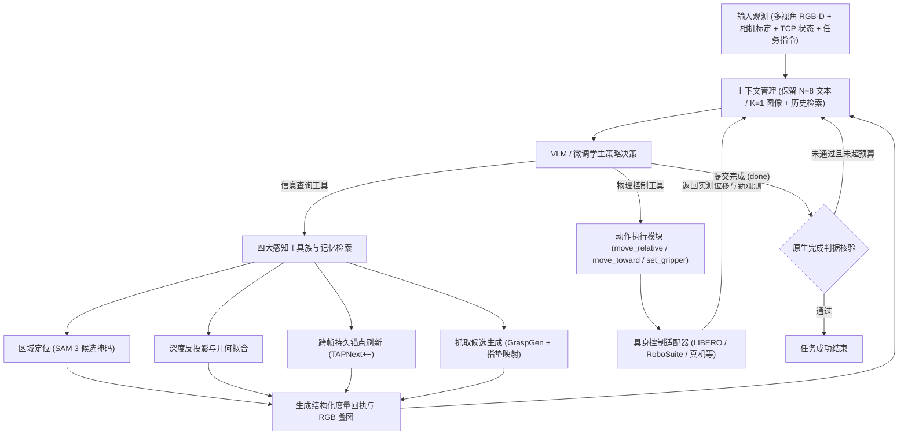
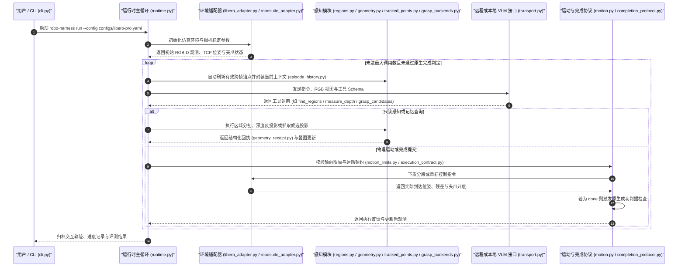

# Robo-Harness K1: Harnessing Robot-Use Agents via Perception Augmentation

## 一句话定义

**Robo-Harness K1** 是一个面向机器人使用智能体（Robot-Use Agent, RUA）的感知增强执行框架（harness），通过将区域定位、标定深度与局部几何、跨帧视觉锚点与抓取候选封装为与物理运动同构的可调用工具，使视觉-语言模型（VLM）能够在不改动基础模态接口的前提下开展「观测 → 测量 → 动作 → 验证」闭环操作，并支持将成功轨迹蒸馏至紧凑型 VLM。

## 英文缩写速查

| 缩写 | 英文全称 | 简要说明 |
|------|----------|----------|
| RUA | Robot-Use Agent | 直接通过工具调用接口观测环境并控制机器人执行动作的 VLM 智能体 |
| VLM | Vision-Language Model | 接收多视角 RGB 图像与文本并输出工具调用的视觉-语言模型 |
| VLA | Vision-Language-Action Model | 端到端将视觉与语言映射为底层动作令牌或连续动作块的机器人策略模型 |
| TCP | Tool-Center-Point | 末端执行器工具中心点，K1 中几何测量与运动指令的统一参考坐标点 |
| SFT | Supervised Fine-Tuning | 将教师模型的工具调用轨迹序列化为文本目标的智能体监督微调方法 |
| LoRA | Low-Rank Adaptation | 在冻结视觉编码器下仅微调语言侧低秩适配器的轻量参数微调方式 |

## 为什么重要

1. **揭示纯 RGB 机器人智能体的空间瓶颈：** 先前智能体框架（如 [Inspect Robots](inspect-robots.md)）虽证明 VLM 可直接充当策略，但在纯 2D RGB 观测下，即便模型语义理解正确，仍常因 3D 尺度与深度缺失导致定位偏差。在 LIBERO-PRO 60 组配对测试中，纯 RGB 版 Gemini 3.7 Flash 仅获 16.7%（Spatial 类仅 5.0%），约三分之一失败源于错误空间判断后的过早提交完成。
2. **「感知即工具」保持接口通用与模型完整：** 与端到端动作微调（易侵蚀预训练视觉-语言表征）或专用深度特征融合不同，K1 把 3D 度量证据转译为文本回执（receipt）与 RGB 视图叠加图，让基础 VLM 无需新增输入模态即可按需测量并跨不同机械臂与仿真器零样本迁移。
3. **打通前沿模型工具轨迹向紧凑型 RUA 的蒸馏路径：** 由于感知查询与物理控制采用统一的文本工具序列化格式，前沿 VLM 的成功交互轨迹可直接用于紧凑模型（如 Qwen3.5-9B）的语言侧 LoRA SFT，在 107 条演示的有限样本下展现出优于动作回归基线的新状态与未见任务条件泛化能力。

## 核心信息

| 字段 | 内容 |
|------|------|
| 作者 | Zexi Li, Yehang Zhang, Wenqian Li, Haojian Huang, Chenxu Wang, Chunyang Zhang, Shiyuan Deng, Yangkai Wei, Tianyi Zhang, Ruize Gao, Binghui Xie, Bohan Zhou, Jinghao Li, Kaiwen Zhou, Yifan Chang, James Cheng, Yinchuan Li |
| 机构 | 原文 arXiv HTML 与项目仓 README 未披露作者单位 |
| 发表时间 | 2026-09-24（arXiv v1）/ 2026-11-24（arXiv v2） |
| 论文链接 | [arXiv:2609.29389](https://arxiv.org/abs/2609.29389)（[HTML 全文](https://arxiv.org/html/2609.29389)） |
| 项目与代码 | [GitHub: Robo-Harness/k1](https://github.com/Robo-Harness/k1) · [项目主页](https://robo-harness.github.io/k1/) |
| 清单分类 | `model.perception`, `model.robot_control`, `harness.memory`（来源条目 `survey_ax_2609_29389`） |
| 开源状态 | **部分开源**（MIT 协议开源核心 harness、LIBERO-Pro 与 RoboSuite 适配器及 SFT 接口；RoboCasa/RoboTwin/RoboDojo/RoboLab 适配器待发布，不含数据集、权重与原始日志） |

## 核心原理

### 1. 工具分类与智能体闭环

给定任务指令 $g$、当前多视角 RGB 图像与机械臂状态 $o_t$，以及交互上下文 $c_t$，VLM 策略 $\pi_\theta$ 在每一步决策中采样一个工具及其参数 $(u, a) \sim \pi_\theta(\cdot \mid g, o_t, c_t)$。工具集合被明确划分为两类：

- **只读信息查询 $\mathcal{U}_{\rm query}$：** $r = \mathcal{H}_{\rm query}(u, a; s_t)$，在不移动机器人的前提下返回度量回执 $r$、RGB 视图叠加标注或历史检索结果。
- **物理执行指令 $\mathcal{U}_{\rm act}$：** $(r, o_{t+1}) = \mathcal{H}_{\rm act}(u, a; s_t)$，驱动底层控制器推进环境并返回实际达成位姿、残差与更新后观测。

底层 harness 读取 RGB-D 图像、相机内外参标定、TCP 位姿与夹爪开度，但向 VLM 暴露的始终是 RGB 视图、文本状态与结构化回执，使智能体可在一次运动前链式调用多个查询以消除几何不确定性。

### 2. 四大感知工具族

| 工具族 | 代表工具 | 底层实现与核心机制 | 返回给 VLM 的证据形式 |
|------|----------|--------------------|----------------------|
| **区域定位** | `find_regions`, `inspect_region`, `check_region_view` | `find_regions` 基于文本提示调用 SAM 3 生成非冗余候选掩码；`inspect_region` 对指定边框内表面细化；`check_region_view` 将测量表面点投影至另一视角验证深度一致性 | 原图上的绿色轮廓叠图、持久化 `S` 编号及局部表面几何摘要 |
| **深度与几何** | `measure_depth`, `fit_geometry`, `region_relation` | 利用深度图 $D^c$、相机内参 $K^c$ 与外参 $T^w_c$ 反投影像素：$$x^w = T^w_c \left[ D^c(u,v)(K^c)^{-1}(u,v,1)^{\top};\, 1 \right]$$ 拟合表面平面或无向主轴，计算区域间及区域到 TCP 的空间位移 | 世界坐标点、TCP 相对位移向量、橙色主轴线与紫色 TCP 连线 |
| **持久锚点追踪** | `track_features`, `read_track`（以及调用间自动刷新） | 依托 TAPNext++ 跨帧追踪图像对应点，并结合当前深度与相机位姿提升至世界坐标，将相机移动与物体表面位移解耦 | 带持久化编号与实时有效性标记的 `P` 锚点（遮挡或深度不一致时失效并保留历史参照） |
| **抓取候选** | `grasp_candidates` | 将目标区域点云送入 GraspGen 生成平行夹爪 6-DoF 位姿，经具身适配器映射至指垫中点坐标系，结合平行夹爪对称性去重与视场深度遮挡检查 | 最多 3 个候选 TCP 位姿、预抓取航点及包含指垫中心/手指轮廓的投影示意图 |

### 3. 自适应运动粒度、记忆检索与完成反馈

- **分层运动工具：** `move_relative` 提供单轴不超过 $\delta_{\rm axis}=3\text{ cm}$ 的局部精细对齐；`move_to_pose`、`rotate_toward` 与 `align_axis`（单次旋转上限 $15^\circ$）用于持久位姿控制；`move_toward` 面向远距离目标执行单次直达运动（在达到容差、停滞或耗尽步数预算时终止）；`set_gripper`（0 闭 / 1 开）返回稳定状态与实测夹爪开合度；`align_region_references` 则提供源区域与目标区域对齐的平移假设。
- **上下文窗口与记忆检索：** 默认上下文保留任务指令、当前测量证据、最近 $N=8$ 轮文本交互以及 $K=1$ 轮历史图像，同时提供 `search_history`、`read_history` 按需翻阅早期记录与历史帧，并要求每次工具调用附带简短决策注释（decision note），辅以 `update_task_progress` / `remember` 记录里程碑。
- **完成判定反馈：** 模型提交 `done` 时，harness 调用环境原生成功判据；若未满足完成条件且控制步数/调用预算仍有余量，则驳回完成请求并将控制权交回模型继续修正。

### 4. 智能体监督微调（Agentic SFT）

因为查询与动作共用语言工具序列化格式，学生模型（Qwen3.5-9B）无需额外的连续动作头，仅在冻结视觉编码器下通过语言侧 LoRA（$r=16, \alpha=32$）优化下一令牌交叉熵损失：

$$\mathcal{L}_{\rm agent} = -\sum_{j}\sum_{k \in y_j} \log \pi_\theta(y_{j,k} \mid c_j, y_{j,<k})$$

训练数据从 139 条 Gemini 成功轨迹中剔除 32 条保留任务条件的轨迹，在剩余 107 条轨迹（43 种条件）上过滤执行错误与被驳回的 `done` 请求后保留 2,482 个可执行工具调用样本（含决策注释），并保留先前的失败试探与恢复上下文；后续亦支持在多环境混合轨迹（316 条）上继续微调。

## 流程总览

## 源码运行时序图

官方仓库 `Robo-Harness/k1` 通过 `pyproject.toml` 注册 CLI 入口 `robo-harness`（对应 `src/robo_harness/cli.py` 与运行时调度模块 `src/robo_harness/runtime.py`），以配置文件（如 `configs/libero-pro.yaml` 或 `configs/robosuite.yaml`）驱动环境适配器与感知/运动工具闭环；蒸馏训练链路则由 `src/robo_harness/training/prepare.py` 与 `sft.py` 负责样本序列化与 Qwen3.5 LoRA 微调。

## 实验与评测

### 1. LIBERO-PRO 前沿模型配对评测与完整评测（表 1、表 S6–S7）

在 LIBERO-PRO（Spatial、Object、Goal 三类各 10 项任务 × `swap`/`task` 两种扰动，单回合控制步数上限 1,200 步 @ 20 Hz、智能体调用上限 400 次）上：

- **60 组同构配对比较（State 0，完全匹配任务与初始状态，对比纯 RGB Inspect Robots 接口与 K1）：**
  - **Gemini 3.7 Flash：** 从 RGB-only 的 **16.7%（10/60）** 提升至 K1 的 **71.7%（43/60）**（+55.0 pp，双侧精确 McNemar 检验 $p=2.1\times 10^{-9}$）。分项变化：Spatial `5.0% → 75.0%`、Object `40.0% → 80.0%`、Goal `5.0% → 60.0%`。
  - **GPT-6 Astra：** 从 RGB-only 的 **63.3%（38/60）** 提升至 K1 的 **93.3%（56/60）**（+30.0 pp，McNemar $p=1.2\times 10^{-4}$）。分项变化：Spatial `45.0% → 90.0%`、Object `80.0% → 100.0%`、Goal `65.0% → 90.0%`。
- **180 轮完整 Gemini + K1 评测（3 个初始状态）：** 总成功率 **77.2%（139/180）**，其中 Object **86.7%（52/60）**、Spatial **81.7%（49/60）**、Goal **63.3%（38/60）**；松爪后稳定性复检为 **72.8%（131/180）**。

### 2. 跨本体与跨仿真器零样本迁移（表 2、表 S10–S15）

保持冻结 Gemini 3.7 Flash、感知提供者与工具契约不变，仅替换环境适配器：

| 环境 / 载体 | 评测设置 | 关键指标（零样本 K1 + Gemini） | 观察重点 |
|-------------|----------|--------------------------------|----------|
| **RoboSuite**（3 臂 4 共享任务） | 每任务 20 轮（5 复位构型 × 4），共用 Panda 夹爪 | Panda **90.0%**（72/80）、UR5e **88.8%**（71/80）、IIWA **86.2%**（69/80） | 3 项方块任务在三款机械臂上均达 100.0%；螺母装配分别为 60.0% / 55.0% / 45.0% |
| **RoboSuite**（Panda 全 7 项任务） | 包含擦拭（Wiping）与双臂协作任务 | 7 项平均 **72.1%**（101/140） | 双臂举升（Two-arm lifting）75.0%，擦拭 65.0%，双臂交接（Handover）仅 **5.0%（1/20）** |
| **RoboTwin**（Aloha AgileX 双臂） | 10 项任务（排除 18 个初始化失败后剩 96 Easy / 86 Hard） | Easy 宏平均 **32.0%**（31/96），Hard 宏平均 **28.0%**（25/86） | 光照/纹理/桌面高度扰动下仅降 4.0 pp；Grab Roller Hard 达 90.0%，Place Dual Shoes 等为 0.0% |
| **RoboCasa**（PandaOmron 移动操作） | 24 项厨房任务 × 10 初始状态（240 轮） | 总体 **22.1%（53/240）** | 存在明显方向不对称：Counter→Sink 80%、Cabinet→Counter 50%，而 Counter→Cabinet 0%、微波炉开启 0% |

### 3. 真机 Piper 机械臂实验（表 3、Appendix D.4）

在配备平行夹爪与两台外置 RGB-D 相机的物理 Piper 机械臂上，比较 Clean 基线（仅 RGB 观测与 4 个运动/结束工具，同用 Gemini 3.7 Flash）与 K1（每任务 3 次有效结束试次，总计 9 次）：

- **Can into bowl**（50 次调用上限）：Clean `1/3 (33.3%)`（进度分 1.00） vs K1 **`2/3 (66.7%)`**（进度分 1.67）。
- **Bowl onto plate**（50 次调用上限）：Clean `0/3 (0.0%)`（进度分 0.00） vs K1 **`3/3 (100.0%)`**（进度分 2.00）。
- **Two-object sorting**（长程双物分拣，100 次调用上限）：Clean `0/3 (0.0%)`（进度分 0.50） vs K1 **`3/3 (100.0%)`**（进度分 2.00）。
- **总计：** Clean **1/9（11.1%）** vs K1 **8/9（88.9%）**（注：原文说明其中 1 次碗试次含外部完成复核与夹爪单元引导，另有 1 次操作员中断的罐试次单独记录）。

### 4. Agentic SFT 蒸馏与混合环境续训（表 4–5、表 S8–S9、表 S16）

基于同一批 107 条 Gemini 成功轨迹微调 5 个 epoch（A：43 个训练构型；B：43 个新初始状态；C：12 个未见任务条件 × 3 状态 = 36 轮）：

| 模型与训练方式 | Split A（训练构型） | Split B（新初始状态） | Split C（未见条件） | 备注 |
|----------------|---------------------|-----------------------|---------------------|------|
| **Qwen K1 RUA**（9B, LoRA） | **51.2%** (22/43) | **44.2%** (19/43) | **13.9%** (5/36) | Epoch 3 在 B 达峰值 46.5%；唯一在 C 取得成功的模型 |
| **OpenVLA-7B**（离散动作令牌） | 20.9% (9/43) | 30.2% (13/43) | 0.0% (0/36) | 在 Split B 的 Object 类高于 K1（62.5% vs 43.8%），但 Spatial 仅 6.7% |
| **$\pi_{0.5}$**（流匹配动作块） | 7.0% (3/43) | 7.0% (3/43) | 0.0% (0/36) | 4 步开环动作块重规划 |
| **Qwen RUA**（纯 RGB 文本动作） | 7.0% (3/43) | 4.7% (2/43) | 0.0% (0/36) | 35.2%（43/122）评测因非法 JSON 动作格式终止 |
| **Qwen VLA (RGB-D)**（连续动作回归） | 0.0% (0/43) | 0.0% (0/43) | 0.0% (0/36) | 同一 Qwen3.5-9B 底座直接预测 8 步连续动作块失效 |

在 Epoch-3 检查点上进一步使用四环境混合轨迹（316 条：LIBERO-PRO 107 + RoboSuite 142 + RoboCasa 32 + RoboTwin 35）续训 3 epoch 后：LIBERO-PRO B 从 `42.9% → 52.4%`（+9.5 pp）、C 从 `11.1% → 27.8%`（+16.7 pp）、RoboSuite 从 `28.3% → 50.0%`（+21.7 pp）；但样本不足 40 条的 RoboCasa（`8.3% → 4.2%`）与 RoboTwin（`2.6% → 2.5%`）仍未能解锁。

### 5. 关键消融与运行统计（表 6、表 S17–S21）

- **感知与完成反馈协同（30 轮，表 S17）：** LIBERO-PRO 上二者皆关为 10.0%，仅开感知 30.0%，仅开反馈 13.3%，同时开启达 **70.0%**；RoboTwin 上对应为 `0.0% / 6.7% / 6.7% / 30.0%`。
- **四大感知工具族贡献（30 轮，表 6 / S18）：**
  - LIBERO-PRO：完整工具 70.0% → 去除抓取候选 60.0% → 去除深度/几何 56.7% → 去除区域及其依赖 50.0% → 去除跨帧锚点刷新 **40.0%**（掉幅最大）。
  - RoboTwin：完整工具 30.0% → 去除跨帧追踪 20.0% → 去除深度/几何 16.7% → 去除区域工具或抓取候选 **13.3%**。
- **决策分布与耗时（180 轮 Gemini，图 4 / 表 S19 / S21）：** 6,282 次决策中运动占 67.5%，感知占 25.5%（其中 64.6% 发生在首帧之后），记忆/进度占 3.9%，完成判定占 2.3%。每轮平均耗时 Gemini+K1 为 **5.16 分钟**（34.9 次调用，API 耗时占 77%），Astra+K1 为 **7.31 分钟**（45.9 次调用，API 耗时占 83%）。
- **记忆窗口影响（18 轮，表 S20）：** 历史图像过多反而退化（$K=0$ 达 83.3%/28.3 调用，$K=1$ 为 77.8%/33.0 调用，$K=3$ 降至 61.1%/47.4 调用）；文本窗口过短（$N=1,2$）虽有 72.2% 成功率但调用次数翻倍至 70.0–72.6 次。

## 与其他工作对比

| 对比维度 | 纯 RGB RUA（[Inspect Robots](inspect-robots.md)） | 端到端 VLA（[VLA](../methods/vla.md) / OpenVLA / [π0](../methods/pi0-policy.md)） | Code-as-Policies（CaP-Agent0 / RATs） | **Robo-Harness K1（本文）** |
|----------|--------------------------------------------------|--------------------------------------------------------------------|---------------------------------------|----------------------------|
| **空间信息获取** | 仅 2D RGB 图像，无度量反馈 | 隐式从海量动作数据中学习，或引入额外深度编码头 | 在生成的可执行代码/价值图内部一次性调用感知 | VLM 在交互循环中按需调用工具，接收度量回执与 RGB 叠图 |
| **LIBERO-PRO 表现** | Gemini 16.7% / Astra 63.3%（60 组配对） | 文献协议下 OpenVLA/$\pi_0$ 0.0%、$\pi_{0.5}$ 12.8% | 文献协议下 CaP-Agent0 23.2%、RATs 43.8% | Gemini 71.7% / Astra 93.3%（60 组配对）；Gemini 全量 77.2% |
| **抗视觉/布局扰动** | 语义易对齐但 3D 尺度易漂移 | 极易受物体交换或新初始状态影响 | 依赖预置技能封装覆盖度 | 跨任务中以 Spatial 类增幅最大；RoboTwin Easy→Hard 仅降 4.0 pp |
| **小样本适应/蒸馏** | 文本动作易出现格式错误与空间失准 | 107 条轨迹下难以跨新任务条件泛化（Split C 0.0%） | 主要依赖闭源大模型直接编写代码 | 可通过语言侧 LoRA 直接蒸馏工具调用轨迹（Split C 13.9%，混合续训 27.8%） |
| **核心短板** | 缺乏 3D 定位与完成后纠正机制 | 动作微调损害预训练表征且依赖演示覆盖 | 缺少步进式视觉验证与交互式局部修正 | 单轮延迟较高（3–7 分钟），精细接触装配与双臂协同交接仍弱 |

## 结论

**一句话总判：Robo-Harness K1 证明了在不改变 VLM 模态接口的前提下，将 3D 感知封装为按需调用的工具并配以完成验证，可同时释放前沿模型的零样本空间操作能力与小模型的代理式蒸馏潜能，但高交互延迟与精细接触策略恢复仍是下一步关键瓶颈。**

1. **Spatial 能力增益最显著，且调用间锚点维护不可或缺** — 在同构 60 组 LIBERO-PRO 测试中，K1 将 Gemini 3.7 Flash 提升 55.0 pp（Spatial 从 5.0% 至 75.0%）；消融实验表明去除调用间持久锚点刷新会使 LIBERO-PRO 成功率从 70.0% 骤降至 40.0%。
2. **感知与完成反馈必须成对启用** — 仅开感知（30.0%）或仅开完成反馈（13.3%）均远低于二者协同的 70.0%；让模型看到误差并获得预算内纠错机会，比单次精准预测更有效。
3. **图像历史宜薄、文本历史宜适中** — 保留过多历史帧会分散当前帧注意力（$K=3$ 跌至 61.1%），$K=0\sim 1$ 配合 $N=8$ 文本窗口与按需检索兼具高成功率与低调用开销。
4. **工具轨迹比直接动作回归更耐稀疏示范** — 同用 107 条轨迹，工具交互格式使 Qwen3.5-9B 成为唯一攻克未见条件（Split C 13.9%）的模型，而直接在同底座上做 RGB-D 连续动作回归得 0.0%。
5. **当前边界清晰：低频长耗时、弱精细接触与交接** — 77%–83% 时间消耗在 VLM API 往返（约 5–7 分钟/轮）；感知虽能测出残差（如 6.7 cm 偏差），但缺乏高层重规划时模型仍会重复无效微调直至预算耗尽。

## 工程实践

- **环境隔离安装：** 官方仓提示 **LIBERO-Pro 与 RoboSuite 需分别建立独立的 Python 3.10/3.11 虚拟环境**（二者控制器与仿真依赖冲突）；核心包通过 `pip install -e '.[dev]'` 安装，完整感知配置需单独部署 SAM 3 与 TAPNext++；若做无外部模型的几何烟雾测试，可在配置中设置 `region_tools: false`、`tracking_backend: lk`、`tracking_device: cpu` 并运行 `robo-harness run ... --smoke`。
- **模型服务与安全边界：** 通过环境变量 `ROBO_HARNESS_BASE_URL`、`ROBO_HARNESS_MODEL`、`ROBO_HARNESS_API_KEY` 对接支持多图输入与函数调用的 OpenAI 兼容服务端；远程端点强制 HTTPS，禁止将密钥写入 YAML 或命令行，发布前可用 `robo-harness-audit .` 校验产物目录。
- **适配器与工具裁剪：** 部署到新机械臂或特定任务（如 RoboSuite 擦拭任务无需夹爪）时，应在适配器中显式屏蔽不适用工具并完成手眼标定与指垫中心坐标系对齐（映射 GraspGen 输出至实际夹爪 TCP）。
- **蒸馏数据与训练：** 过滤执行错误与无效 `done` 调用后保留真实交互上下文（含失败尝试与修正轨迹），对 Qwen3.5-9B 采用冻结视觉编码器 + 语言侧 LoRA（$r=16, \alpha=32$）训练 3–5 epoch 即可观察到新状态泛化收敛（Epoch 3 达发育集峰值）。

## 局限与风险

1. **强依赖深度标定与可见表面：** 深度噪声、强反光/透明物体或严重遮挡会直接导致反投影误差与锚点失效（`valid=false`）；部分任务（如 RoboCasa 中向柜内/微波炉内放置）因受限视角与碰撞约束成功率仍为 0%。
2. **「能测出误差」不等价于「会更换策略」：** 论文第 4.3 节与附录 E.7 指出，当局部微调指令实际达成率仅 10%–26% 且存在 6.7 cm 残余偏差时，智能体往往持续重复微调直至耗尽步数，而非主动松开、后退并重新规划抓取姿态。
3. **精细接触与双臂协同释放薄弱：** RoboSuite 中双臂交接仅 5.0%、螺母装配仅 45%–60%；RoboTwin 鞋子/瓶子回收任务为 0.0%，表明几何工具尚未解决需要高频力觉反馈或严格时序协同的操作。
4. **控制频率与推理延迟：** 单回合需数十次 VLM 往返、耗时 3–7 分钟，目前仅适用于可暂停物理仿真或准静态桌面真实场景，无法直接胜任动态高速或实时高频闭环控制。
5. **开源与真机评测边界：** 当前仓库仅公开发布 LIBERO-Pro 与 RoboSuite 适配器，其余 4 个环境适配器、训练轨迹与权重尚未公开；真机 Piper 实验仅含 9 次有效结束试次且部分试次含外部完成复核，属于可行性验证。

## 关联页面

- [机器人视觉感知栈选型闭环](../queries/robot-perception-stack-selection-loop.md)：对照视觉感知与开放词汇定位选型闭环。
- [Agentic Robots 综述](paper-towards-agentic-robots-survey.md)
- [Inspect Robots](inspect-robots.md)：本文配对对比所复用的纯 RGB 机器人智能体评测基线框架
- [全量项目节点清单](../overview/awesome-agentic-robots-node-index.md)
- [VLA 方法背景](../methods/vla.md)
- [机器人智能体执行框架](../methods/robot-agent-harness.md)：对照规划、工具调用与反馈的系统边界
- [智能体工具使用接口](../methods/agent-tool-use-interface.md)：工具契约、参数规范与回执设计
- [智能体操作策略](../methods/agentic-manipulation-policies.md)：从工具调用闭环向操作策略迁移的方法脉络
- [抓取位姿估计](../methods/grasp-pose-estimation.md)：GraspGen 等 6-DoF 抓取候选生成方法背景
- [机器人操作（Manipulation）](../tasks/manipulation.md)
- [双臂操作（Bimanual Manipulation）](../tasks/bimanual-manipulation.md)

## 推荐继续阅读

- [Robo-Harness K1 官方项目主页（含真机与仿真演示视频）](https://robo-harness.github.io/k1/)
- [Robo-Harness K1 官方 GitHub 仓库（含架构文档与 v1.1 升级说明）](https://github.com/Robo-Harness/k1)
- [arXiv:2609.29389 论文原文（v2 HTML 版）](https://arxiv.org/html/2609.29389)

## 参考来源

- [Robo-Harness K1 论文原文通读归档](../../sources/papers/paper-agentic-2609-29389.md)
- [Robo-Harness K1 官方代码仓归档（Robo-Harness/k1）](../../sources/repos/paper-agentic-2609-29389.md)
- [官方 Awesome 快照归档](../../sources/repos/awesome-agentic-robots-survey-index.md)
- [arXiv:2609.29389 摘要页](https://arxiv.org/abs/2609.29389)
- [GitHub: Robo-Harness/k1](https://github.com/Robo-Harness/k1)
