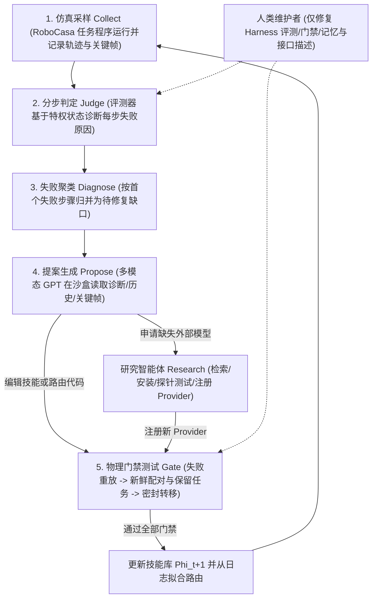

# What Stops Recursive Self-Improvement in Robotics? Lessons from 123 Rounds of Agentic Skill Discovery

## 一句话定义

该技术报告记录了一套由编程智能体驱动的机器人技能递归自改进闭环在 RoboCasa 厨房长程操作任务上连续运行 123 轮（993 次仿真回合）的完整失败剖面，指出限制能力累积的并非智能体编码推理水平，而是感知模块化带来的**语义位移**、长任务链导致的**前沿锁定**，以及人类维护的**评测与执行支架（Harness）失真**。

## 英文缩写速查

| 缩写 | 英文全称 | 简要说明 |
|---|---|---|
| RSI | Recursive Self-Improvement | 递归自改进，指智能体从历史运行失败中持续改写并验证自身技能与工具的闭环范式 |
| VLM | Vision-Language Model | 视觉语言模型，文中用于多模态提案智能体（看失败关键帧）及 §5 验证的 `Qwen2.5-VL 7B` 等空间关系推理基座 |
| RGB-D | Red-Green-Blue + Depth | 彩色图像与深度图，RoboCasa 中 PandaOmron 头部与腕部相机的观测输入模态 |
| SAM 3 | Segment Anything Model 3 | 概念级文本提示分割模型，在闭环中作为外部 Provider 负责按名词短语分割场景物体与搁架 |
| CLI | Command-Line Interface | 命令行界面，本文中指在只读隔离容器内调度 OpenAI GPT 智能体的 Codex CLI 执行入口 |
| 6-DoF | Six Degrees of Freedom | 六自由度，文中指 `target_graspgen_6dof` 等外部抓取位姿生成模型的输出空间 |
| IK | Inverse Kinematics | 逆运动学，将末端目标位姿解算为机械臂/躯干关节运动轨迹的底层运动规划接口 |

## 为什么重要

1. **提供少见的“长周期失败机理剖析”实证样本：** 近期多数 Agentic Robotics 研究报告基准分数跃升（如 [RHO](paper-agentic-2606-16458.md) 与 [ASPIRE](paper-agentic-2607-00272.md)），而本文完整公开了长达数周、123 轮、847 次提案尝试与 113 次人工支架修复的逐轮记录，揭示“通过门禁测试却无法推进端到端任务”的真实失效模式。
2. **明确区分“智能体能力不足”与“闭环环境缺陷”：** 实验证明当失败归因准确且修复路径开放时，智能体能够自主发现视野遮挡、申请并修复主动视角选点模型、并在无人类编写任何机器人代码的情况下部署工作技能；反之，问题集中在智能体周围的**可表征性、可表达性与可分辨性**条件破损。
3. **为构建 Embodied RSI Harness 提炼可检验的设计准则：** 作者将 123 轮教训收敛为 3 条核心机制诊断与 12 条附带证伪实验方案的工程建议（D1–D12），直接指导下一代机器人执行支架（[Robot Agent Harness](../methods/robot-agent-harness.md)）与自动化验证循环的设计。

## 核心信息

| 字段 | 内容或状态 |
|---|---|
| 作者 | Jiaming Wang（正文署名 Wang Jiaming） |
| 机构 | National University of Singapore（新加坡国立大学） |
| 发表时间 | 2026-09-23（arXiv:2609.31760v1 [cs.RO]，Technical report，20 页，7 图，8 表） |
| 论文链接 | [arXiv:2609.31760](https://arxiv.org/abs/2609.31760) · [arXiv HTML 全文](https://arxiv.org/html/2609.31760) |
| 项目与代码 | 论文未提供官方 GitHub 仓库或独立项目页链接 |
| 清单分类 | `harness.skills`（来源条目：`survey_ax_2609_31760`） |
| 开源状态 | **未确认开源代码**（截至 2026-11-27，arXiv v1 原文及公开检索均未发布可运行实现仓库） |

## 核心原理

### 1. 五层可演化软件栈与分工机制

系统将机器人软件拆解为五个部分，明确划分“智能体可改”与“人类维护”的边界（禁止人类编写任何技能、任务程序或模型封装代码）：

- **任务程序（Task program）：** 由**编排智能体（Orchestrator）**根据任务描述生成 Python 代码（每次上限 25 min），负责组合技能与声明各步期望达成的状态目标（如“定位冰箱顶层搁架”“抓取并抬起物体”）。编排器保留历史最佳程序，仅在出现程序故障时修订，以迫使技能缺陷留在技能库内修复而非靠程序绕过。
- **技能库（Skill library）：** 涵盖 `localize`、`find region`、`approach`、`grasp`、`move` 等具备类型化输入输出契约的技能族，同一技能族可并存多个实现。由多模态**提案智能体（Proposer）**针对被选中的失败缺口读取失败表、评测诊断、历史 diff/执行轨迹以及失败步骤首尾相机 RGB 关键帧后进行代码修改（每个缺口最多 3 次尝试，每次上限 60 min）。
- **外部模型提供方（Providers）：** 封装文本提示分割（SAM 3）、指代表达分割（Florence-2）、单目深度估计、6-DoF 抓取生成与运动规划等重型模型。当提案智能体判定代码修改无法解决缺失能力时发起研究请求，由**研究智能体（Research agent）**检索、安装、在探测场景与历史失败样本上测试并注册新模型。
- **路由规则（Routing）：** 每轮基于记录的技能调用日志自动重新拟合，决定技能族在不同条件下选用哪一具体实现。
- **评测与执行支架（Harness）：** 包括分步状态评测器、物理回归/新鲜场景门禁测试、候选记忆以及机器人动作接口描述；全实验期间仅允许人类修复 Harness Bug。

各智能体均通过沙盒化只读 Codex CLI 容器运行（第 74 轮起进一步屏蔽运行仓库与保留测试任务）：第 1–75 轮采用 `gpt-5.6-sol`（最高推理强度），第 76–84 轮为 `gpt-6-astra`（低强度），第 85–123 轮为 `gpt-6-astra`（中等强度）。仿真中的机器人本体仅通过头部/腕部 RGB-D 相机与关节读数感知环境，运行时从不调用 GPT 模型。

### 2. 三条件诊断模型与三大失效机制

论文将包含 $m$ 个声明步骤的任务成功概率定义为 $S(\Phi) = \prod_{j=1}^m p_j(\Phi)$，其中 $p_j(\Phi)$ 为前 $j-1$ 步成功条件下第 $j$ 步的条件成功率，$\pi_j = \prod_{i<j} p_i$ 为到达第 $j$ 步的概率。使库更新 $\Phi_{t+1} = \Phi_t \oplus \delta$ 真正提升期望任务成功率 $S$ 的三项必要条件为：**可表征性（Representability）**、**可表达性（Expressibility）**与**可分辨性（Resolvability）**。123 轮运行中唯一满足全部三项条件的前线——“目标在视野外时的主动寻视”——已被智能体独立攻克；其余停滞均可归因于三类结构性失效：

1. **教训 1 — 感知串联与语义位移（Semantic displacement）：** SAM 3 仅响应名词短语概念（能标出所有搁架，无法分辨“最上层”），Florence-2 对关系描述输出跨多层弥散的掩码，深度图只提供几何坐标而不提供序数语义。关系语义落在模块之间的缝隙里，但智能体仅拥有编辑 Python 代码的权限而无法直接把跨场景 VLM 纳入感知模型类别，于是将缺失的关系语义“位移”为不断膨胀的几何规则补丁（`fixture_region` 膨胀至 3,056 行、33 个阈值，其调用的 `localize` 达 5,032 行、48 个阈值），对已记录的 2 个失败种子过拟合（种子 69 每次均被救回，种子 68 从未救回），且无法区分“看不见搁架（应移动视角）”与“分不清哪层（应提升推理）”。
2. **教训 2 — 技能链双重衰减与前沿锁定（Frontier lock）：** 由
   $$\Delta S = \underbrace{\pi_j}_{\text{到达概率}} \cdot \Delta p_j \cdot \underbrace{\prod_{i>j} p_i}_{\text{后续完成概率}}$$
   可知，上游不可靠（$\pi_j$ 极小）同时衰减下游修复的**端到端收益 $\Delta S$** 与**门禁可测样本数 $\approx n\pi_j$**。大量失败堆积在链条首端，使学习被锁死在感知第一步，同时上游误差（如预抓取停止过短）在下游表现为 `no_grasp_contact` 等误归因故障。
3. **教训 3 — 评测支架决定学习结果（Harness capture & selection failure）：** 包括**评测器捕获**（以 0.85 m 球面判断可达性导致智能体将底盘精确停在 0.849–0.850 m 球面上却抓不到物体；动作描述缺失躯干升降自由度；底盘标称速度与实测相差逾 20 倍且存在死区）、**不可分辨筛选**（门禁阈值过严拒绝局部修复、过松允许零胜零负晋级、物理噪声使近半数配对差异无法复现）、**证据不动点**（确定性仿真+固定 4 种子+冻结程序导致连续十余轮产生完全一致的失败）、**记忆污染**（将未执行的模型申请当作代码门禁并记为失败，使智能体后续主动回避重提），以及**新注册模型零调用**（注册仅验证合成探针通过，无人负责接入技能路由）。

## 流程总览

## 源码运行时序图

**不适用**（核查结果：截至 2026-11-27，arXiv:2609.31760v1 全文及公开索引未提供可运行官方源码仓库或独立项目页，因此无可运行源码入口可供核对）。

## 实验与评测

全实验围绕 PandaOmron 移动操作机器人在 RoboCasa 中的 3 个训练任务与 1 个保留评测任务（`cabinet to counter`）展开，每轮耗时 1–3 小时（含新模型检索时额外增加数小时），共运行 123 轮。

### 1. 阶段演化与任务完成率（Tables 4, 5, 6）

| 阶段（轮次） | 任务范围与关键变动 | 累计 Rollout（完成数） | 任务成功数 | 门禁通过技能变更 | 典型进展或阻塞现象 |
|---|---|---|---|---|---|
| 1–59 | 仅 `Fridge`（主动发现期） | 243（237） | 0 | 33 | 第 5 轮申请主动视角模型、第 16 轮消除视野外失败；第 36 轮顶层定位短期过关后随视角漂移退化 |
| 60–65 | 加入 `Cabinet` | 49（49） | 0 | 8 | 第 62–63 轮首个 `approach` 与 `grasp` 技能获批，但到达与抓取曝光底座/躯干支架缺陷 |
| 66–102 | 加入 `Sink` 与多项 Harness 修复 | 448（434） | 13 | 14 | 第 78 轮起 `Sink` 出现零星成功（多为中间步骤失败后物体偶然落入水槽）；第 90–102 轮进入证据不动点 |
| 103–110 | 修复记忆分类与门禁统计 | 97（97） | 1 | 1 | 恢复丢失的模型请求；要求配对差异必须可复现 |
| 111–118 | 恢复历史请求并迁移机器 | 96（95） | 0 | 1 | 第 118 轮抓取技能在未见与保留场景复现胜出 |
| 119–123 | 第 118 轮抓取更新后观察期 | 60（60） | 0 | 0 | 尽管每轮均注册新模型，目标任务连续 0 成功，第 123 轮 `Fridge` 仍 3/4 停在第 0 步 |
| **总计（1–123）** | **全程无人类编写机器人代码** | **993（972）** | **14** | **57（51 属感知）** | `Fridge 0/486`、`Cabinet 0/256`、`Sink 14/230`（14 次中 9 次含中间步骤失败）；人类共作 113 次 Harness 修复 |

### 2. 核心机理量化测量（Tables 5, 7, 8 & §5）

- **区域定位主导首步失败与前沿锁定：** 三任务阶段（第 66–123 轮）中，`wrong_region` / 区域定位为 `132/224` 次 `Fridge` 与 `113/232` 次 `Cabinet` 回合的首个失败点；在后期（第 103–123 轮），`Fridge` 种子 68、70、71 的全部 `62` 次回合均卡死在 `wrong_region`。整体上，`Fridge` 有 **57%** 回合在第一步即失败，仅 **2.7%** 通过 4 步、**0.9%** 通过 5 步；第 60 轮的 6 个新鲜抓取测试样本中有 5 个根本未走到抓取步骤。第 118 轮抓取改写虽在未见与保留任务上复现胜出，但随后 60 次完整任务 rollout 仍为 0 成功。
- **语义位移与可见性纠缠：** 搁架区域技能累积至 **3,056 行、33 个阈值**，所组合的物体定位器达 **5,032 行、48 个阈值**；针对 `Fridge` 2 状态缺口的 27 次尝试全部救回种子 69、从未救回种子 68。区域步骤起始帧中，顶层搁架占位像素在种子 68/71/70/69 上分别为约 `3,000` / `1,273` / `292` / `45`。
- **模型类别离线对照验证：** 直接用开源 7B 视觉语言模型 **Qwen2.5-VL** 对 4 帧已记录头部相机视图做零样本推理，无需几何补丁即在 **4/4** 视图上正确定位“the top shelf”与“the shelf below”（单次查询约 1 s），证实核心障碍在于模型类别未能切换而非问题无解。
- **支架失真、筛选噪声与记忆污染：**
  - **评测捕获：** 0.85 m 球面可达性判定下有 **276** 次成功恰好停在 `0.849–0.850 m`；动作描述缺失躯干升降遭提案智能体投诉 **34** 次；底盘速度标称 `0.0016 m/step` 而实测达 `0.037 m/step`。
  - **筛选噪声：** **119** 个至少救回 1 个精确失败状态的候选因固定百分比阈值被淘汰；第 40–65 轮出现 **22** 次基线已饱和下的零胜零负晋级；对 **36** 对意见分歧的新鲜场景重跑测试中，**19** 对可复现、**16** 对不可复现、1 对未测。
  - **记忆与集成断裂：** **88** 次附带模型请求的提案被错误作为代码测试并记录为失败（其中 46 次在冰箱区域前线），导致智能体 **15** 次直接以“不重复已有请求”为由放弃修复；全周期共完成 86 次模型注册（20 个身份），早期 8 个模型被调用 51–1,863 次，而第 107 轮之后首次注册的所有 12 个模型（含第 114–121 轮注册的 11 个关系/视觉语言定位模型）在后续任务 rollout 中调用次数均为 **0**。
  - **提示词措辞效应：** 第 93–94 轮仅因警告避免状态特化修复，编辑提交率为 `0/8`；第 96 轮将一段提示改为鼓励利用失败尝试延续改进后，编辑率跃升至 `11/12`，而切换 GPT 推理强度本身未见显著变化。

## 与其他工作对比

| 对比维度 | 本文（123 轮 Agentic Skill Discovery） | [RHO](paper-agentic-2606-16458.md) | [ASPIRE](paper-agentic-2607-00272.md) | [Physical RSI on RoboCasa](project-agentic-project-physical-rsi-robocasa.md) | [Voyager](paper-agentic-2305-16291.md) |
|---|---|---|---|---|---|
| 演进对象 | 分类型技能库、自动拟合路由、任务程序与外部 Provider 注册 | 完整多文件策略仓库（RaPs）与 ROS 2 工具/提示词 | 统一 CaP 控制程序、独立复现准入的可复用技能库 | Markdown 技能文档、`rc` Python 函数库与自改进提示本身 | Minecraft 可执行 JS 技能库与自动课程 |
| 环境与任务难度 | RoboCasa 15 步移动操作（含不可见目标、门后关系词“顶层搁架”） | CaP-Bench Robosuite / LIBERO-PRO 桌面操作与 O3DE 仿真 | LIBERO-Pro、Robosuite、BEHAVIOR-1K 与 YAM 双臂真机 | RoboCasa 全部 365 个原子与复合任务（493 幕全解决） | Minecraft 沙盒环境（符号化状态与精确接口） |
| 阻塞诊断重点 | 系统性记录失败机制：语义位移、前沿锁定、Harness 失真与零调用孤岛 | 强调训练/部署面分离（M4/S4）与 sidecar 防作弊硬隔离 | 依靠逐原语多模态执行引擎暴露细粒度状态以保障可诊断性 | 将自改进器设为可改技能、利用分层记忆与预测裁决闭环解决 365 任务 | 游戏 API 与物品栏状态精确且低成本，三条件天然成立 |
| 关键启示差异 | 证明“多轮过门禁的局域改动”在关系感知与长链条件下无法自动叠加 | 通过训练期大搜索吸收多轮开销，验证多文件协同重构优于单函数修补 | 验证“可诊断执行引擎 + 独立复现准入”对持续技能累积的决定性作用 | 与本文同测 RoboCasa 却全部通关，反衬出编码基底（允许改写自改进器/跨步骤自由度）与并行日志蒸馏对打破前沿锁定的重要性 | 作为软件/游戏环境对照组，说明真实物理感知语义与噪声才是机器人 RSI 的核心分水岭 |

## 结论

**一句话总判：机器人递归自改进停滞的根因往往不在编程智能体的代码或推理能力，而在于系统外围的感知表达粒度、长链信号衰减与脆弱的评测记忆支架将局部正反馈困在了第一步。**

1. **用 VLM 关系推理前置取代几何规则补丁（D4–D5）：** 对包含序数、遮挡与空间关系的开放指令，应以 VLM（如 Qwen2.5-VL、RoboPoint 类模型）直接输出目标点/框再由分割与深度做几何校验及拒识触发重看，同时将“语义位移检测后切换模型类别”设为一等智能体动作。
2. **让技能链结构本身进入可学习基底（D6–D7）：** 允许编排层提交经过门禁验证的技能链修改（如插入抬升重看或恢复步骤），并在门禁测试中通过状态重置从中间步骤采样，直接绕过前端不可靠造成的前沿锁定与双重衰减。
3. **以实测具身模型与统计门禁取代静态声明（D1–D2, D8–D9）：** 通过在线探测校准运动学/死区/工作空间参数而非手写静态常量；门禁需匹配样本统计分辨力、要求配对差异可复现并保留盲测 lockbox，同时划分固定回归哨兵与持续探索新场景预算。
4. **为记忆建立类型系统并强制模型集成义务（D10–D11）：** 严格区分“已验证拒绝”与“基础设施失败/未执行请求”，避免阻塞探索；新注册 Provider 必须绑定至少一个上线技能的实际调用验证，杜绝“注册而不使用”的能力孤岛。
5. **将 Harness 自身纳入档案回放门控迭代（D12）：** 把提案智能体有理有据的拒绝原因作为高置信度 Harness 缺陷报告，并以历史轨迹库决策翻转回放作为门禁，逐步实现评测支架本身的自动化改进。

## 工程实践

1. **避免过拟合式的技能代码膨胀监控：** 工程落地中应追踪单个感知或区域定位技能的代码行数、硬编码阈值数量及跨样本救回不对称性（如“救回样本 A 却从未救回同分布样本 B”）；一旦命中语义位移特征，应停止继续微调几何阈值并强制升级上游感知原语。
2. **明确分离“门禁测试状态”与“搜索记忆状态”：** 对外部模型申请、环境探针超时或未到达执行步的样本，不得写入“方案失败”负反馈记录；同时保留只读不可见的保留测试集，防止智能体通过重复拟合少量确定性种子制造虚假的进度指示。
3. **以程序步骤契约与起点可达性做失败归因：** 在多步骤串联流水线（`find -> approach -> grasp -> move`）中，评测器在判分前应先校验起点前置条件（如从当前末端位姿是否真能运动规划到达目标），把因上游停靠偏差造成的下游抓取失败归还给上游定位或底座停靠技能。

## 局限与风险

1. **单一实验序列、无受控消融对照组：** 如原文 §10 所述，本研究是单个模拟器（RoboCasa）、单个厨房布局与三项任务上的一次长周期实证记录，期间模型版本（`gpt-5.6-sol` 切至 `gpt-6-astra`）、Provider 列表与 113 次人类 Harness 修复并行发生，因此无法给出严格因果效应量估计。
2. **VLM 解决方案的验证范围有限：** §5 中使用 `Qwen2.5-VL 7B` 的 4/4 正确结果仅基于 4 张已记录头部视角关键帧的离线可行性验证，尚未接入完整的闭环在线执行与多布局泛化基准中验证长期稳定性。
3. **12 条设计建议尚属待检验假说：** 论文在 §8（Table 3）提出的 D1–D12 改进方案均未在本次 123 轮运行中完成闭环对照重跑，其实际收益仍需在冻结基准与隔离预算下通过所列证伪实验加以确认。

## 关联页面

- [Agentic Robots 综述](paper-towards-agentic-robots-survey.md)
- [全量项目节点清单](../overview/awesome-agentic-robots-node-index.md)
- [VLA 方法背景](../methods/vla.md)
- [智能体机器人操作策略](../methods/agentic-manipulation-policies.md)：对照操作场景中的规划、执行与反馈接口
- [机器人执行支架（Robot Agent Harness）](../methods/robot-agent-harness.md)：对照评测隔离、执行反馈与支架演进机制
- [编码智能体验证闭环](../methods/coding-agent-verification-loops.md)：与软件工程测试门禁在可表征性与可分辨性上的差异对照
- [智能体技能封装](../methods/agent-skill-packaging.md)：多实现技能路由与类型化接口封装规范
- [具身智能体基准评测](../methods/embodied-agent-benchmarking.md)：长程任务分步评测与统计门禁设计参考
- [机器人操作任务](../tasks/manipulation.md) · [移动操作任务](../tasks/loco-manipulation.md)
- [RHO: Your Coding Agent is Secretly a Roboticist](paper-agentic-2606-16458.md)
- [ASPIRE: Agentic /Skills Discovery for Robotics](paper-agentic-2607-00272.md)
- [Physical RSI on RoboCasa](project-agentic-project-physical-rsi-robocasa.md)

## 推荐继续阅读

- [arXiv:2609.31760 HTML 全文（含附录 A–E 逐轮与模型统计全表）](https://arxiv.org/html/2609.31760)
- [RoboCasa: Large-Scale Simulation of Everyday Tasks for Generalist Robots (arXiv:2406.02523)](https://arxiv.org/abs/2406.02523)

## 参考来源

- [arXiv:2609.31760 原文核对归档](../../sources/papers/paper-agentic-2609-31760.md)
- [官方 Awesome 快照归档](../../sources/repos/awesome-agentic-robots-survey-index.md)
- [论文官方摘要页（arXiv:2609.31760）](https://arxiv.org/abs/2609.31760)
- [论文 HTML 全文（arXiv:2609.31760）](https://arxiv.org/html/2609.31760)
