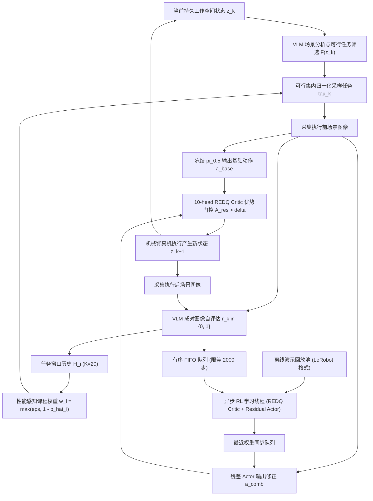

# Find Something You Can't Do: Agentic Real-World Reinforcement Learning for Self-Improving VLA Models

## 一句话定义

**FIND** 是一个面向视觉-语言-动作（VLA）模型真机自改进的智能体强化学习（Agentic Real-World RL）框架：它不再在每回合后手动把环境重置到固定初态，而是直接把上一回合留下的场景作为下一回合起点，由 VLM 筛选当前可行任务、按近期失败率优先安排练习，并用执行前后成对图像自评估结果驱动残差强化学习持续提升策略成功率。

## 英文缩写速查

| 缩写 | 英文全称 | 简要说明 |
|---|---|---|
| VLA | Vision-Language-Action | 视觉-语言-动作模型，文中以微调后冻结的 $\pi_{0.5}$ 作为基础策略 |
| RL | Reinforcement Learning | 强化学习，文中用于在线真实世界残差策略改进 |
| VLM | Vision-Language Model | 视觉-语言模型，文中承担可行任务识别与成对图像成败评估 |
| REDQ | Randomized Ensembled Double Q-learning | 随机集成双 Q 学习，文中采用 10 个 Q 头提升 Critic 价值估计稳定性 |
| SBERT | Sentence-BERT | 句向量编码器，文中冻结编码任务文本并经可训练投影接入残差 Actor/Critic |
| FIFO | First-In, First-Out | 先进先出队列，用于采集线程与学习线程之间的有序经验传输 |
| DoF | Degrees of Freedom | 自由度，文中实验使用 7-DoF Franka Emika Panda 机械臂 |

## 为什么重要

1. **突破“部署即冻结”的 VLA 瓶颈：** 预训练 VLA（如 $\pi_0$、$\pi_{0.5}$）具备较强语义与操作先验，但在真实工作空间出现视角偏移、接触动力学变化或特定几何构型时仍会失败，且常规部署无法直接从自身失败经验中学习。
2. **用“场景条件选任务”替代高成本真机重置：** 对失败后散落或歪斜的物体进行通用复位往往比完成原任务更难。FIND 将自主学习重构为“在当前能做的任务里挑还做不好的任务来练”，显著压缩了真机重置与人工标注成本。
3. **打通自主练习的完整闭环：** 把场景理解、课程调度、无人工奖励自评估与保守残差 RL 集成在同一持久化工作流中，使真实机器人可在少人值守下连续积累数小时有效交互经验。

## 核心信息

| 字段 | 内容或状态 |
|---|---|
| 作者 | Yuan Fang, Zechu Li, Haolei Tong, Puze Liu, Georgia Chalvatzaki |
| 机构 | TU Darmstadt, Hessian.AI, University of Augsburg, Tongji University, Shanghai Research Institute for Intelligent Autonomous Systems |
| 发表时间 | 2026-09-25（arXiv v1）/ 2026-10-01（arXiv v2） |
| 论文链接 | [arXiv:2609.32069](https://arxiv.org/abs/2609.32069) · [arXiv HTML](https://arxiv.org/html/2609.32069) |
| 项目与代码 | [项目页](http://FIND.github.io)（仅论文声明网址，实测返回非本项目占位页 `Yuguo's place`；论文 §IV-A 仅引用第三方库 [lerobot](https://github.com/huggingface/lerobot)） |
| 清单分类 | `data.collection` · 来源条目：`survey_ax_2609_32069` |
| 开源状态 | 未确认开源代码（截至 2026-11-27 未发现 FIND 官方可运行仓库） |

## 核心原理

### 1. 持久工作空间中的问题建模

设预定义语言条件操作任务库为 $\mathcal{T}=\{\tau_1,\dots,\tau_N\}$，每个任务 $\tau_i$ 对应自然语言指令 $l_i$。在控制步 $t$，策略接收观测 $o_t=(\mathcal{I}_t, s_t, l_i)$（视觉观测与本体状态）并输出动作 $a_t \sim \pi(\cdot \mid o_t)$。由于回合结束后不进行人工场景复原，第 $k$ 回合初始场景状态 $z_k$ 决定了当前物理上可执行的任务子集：

$$\mathcal{F}(z_k) = \{\tau_i \in \mathcal{T} \mid \tau_i \text{ is feasible under } z_k\}$$

智能体从 $\mathcal{F}(z_k)$ 中采样任务 $\tau_k$ 并执行，随后获得二值结果 $r_k \in \{0,1\}$，而物理执行后的终端场景直接成为下一回合初始状态 $z_{k+1}$：

$$z_k \rightarrow \mathcal{F}(z_k) \rightarrow \tau_k \rightarrow r_k \rightarrow z_{k+1}$$

### 2. 智能体自改进闭环（Agentic Self-Improvement）

1. **场景条件任务筛选：** 回合开始时，VLM 观察当前场景并识别与任务库对应的状态 $z_k$，过滤掉当前物理不可行的任务，仅保留 $\mathcal{F}(z_k)$。任务库与可行性结构预先定义，以保证指令始终处于预训练 VLA 的支持范围之内。
2. **性能感知课程（Performance-Aware Curriculum）：** 为每个任务 $\tau_i$ 维护长度为 $K=20$ 的近期结果滑动窗口 $\mathcal{H}_i=[r_i^{(1)},\dots,r_i^{(K)}]$（训练前先用基础 VLA 的评估轨迹初始化，在线阶段用自评估结果不断替换最旧记录）。据此估计近期成功率 $\hat{p}_i = \frac{1}{|\mathcal{H}_i|}\sum_{r\in\mathcal{H}_i} r$，并赋权：

   $$w_i = \max(\epsilon, 1 - \hat{p}_i)$$

   其中下界 $\epsilon > 0$ 防止已掌握任务被彻底遗忘或退化后无法察觉。最终只在当前可行集内归一化采样概率：

   $$P(\tau_i \mid z_k) = \frac{w_i}{\sum_{\tau_j \in \mathcal{F}(z_k)} w_j} \quad (\tau_i \in \mathcal{F}(z_k)), \qquad 0 \quad (\tau_i \notin \mathcal{F}(z_k))$$

3. **成对图像自评估（Paired-Image Self-Evaluation）：** 执行前与执行结束后从同一固定场景视角各拍摄一帧图像，连同任务指令输入 VLM，由其对比状态变化输出二值成败 $r_k \in \{0,1\}$。同一结果同时承担两项职责：作为 RL 的稀疏任务完成奖励，以及更新对应任务的滑动窗口 $\mathcal{H}_i$。

### 3. 基于残差离线策略 RL 的策略改进与门控执行

FIND 的闭环调度与底层策略学习算法解耦；论文采用冻结 $\pi_{0.5}$ 与轻量残差离线策略 RL 进行实例化：

1. **有界残差策略：** 冻结 VLA 输出基础动作 $\mathbf{a}^{\mathrm{base}}_t = \pi_{\mathrm{VLA}}(\mathcal{I}_t, s_t, l)$，残差 Actor $\pi_\phi$ 基于视觉特征 $h_{\mathrm{img}}(\mathcal{I}_t)$ 与语言条件状态 $\tilde{s}_t$ 预测修正量 $\Delta\mathbf{a}_t$，合成动作：

   $$\mathbf{a}^{\mathrm{comb}}_t = \operatorname{clip}\left(\mathbf{a}^{\mathrm{base}}_t + \alpha\Delta\mathbf{a}_t\right)$$

   $\pi_\phi$ 参数零初始化，确保训练起步时完全复现基础 VLA 行为。
2. **独立语言条件分支：** 使用冻结 Sentence-BERT 编码指令并接一层可训练投影 $z_l = g_{\theta_l}(f_{\mathrm{SBERT}}(l))$，拼接本体状态 $\tilde{s}_t = [s_t; z_l]$ 输入 Actor 与 Critic；投影层仅通过 Critic 损失优化，在 Actor 更新时截断梯度。
3. **Critic 门控执行（Critic-Gated Residual Execution）：** 采用含 10 个 Q 值头的 REDQ 集成 Critic，取均值 $\bar{Q}$ 评估残差动作相对基础动作的优势 $A_{\mathrm{res}}(x_t) = \bar{Q}(x_t, \mathbf{a}^{\mathrm{comb}}_t) - \bar{Q}(x_t, \mathbf{a}^{\mathrm{base}}_t)$。仅当 $A_{\mathrm{res}}(x_t) > \delta$ 时执行 $\mathbf{a}^{\mathrm{comb}}_t$，否则安全回退到 $\mathbf{a}^{\mathrm{base}}_t$。
4. **异步采集-学习解耦：** 采集线程与 RL 更新线程在独立 Python 线程中并行运行，通过有序 FIFO 队列向学习端传输离线/在线混合经验，并通过仅保留最近更新权重的队列向采集端回传策略参数；若采集端领先学习端超过 2000 步，则在当前回合结束后暂停等待。

## 流程总览

## 源码运行时序图

**不适用**：截至 2026-11-27 核查，论文仅公布项目页 `http://FIND.github.io`（实测指向非本项目的占位页面 `Yuguo's place`），正文中除引用第三方数据与训练生态库 `huggingface/lerobot` 作为数据存储格式外，未提供 FIND 本身的官方代码仓库或可运行入口脚本，因此不构造猜测性的源码调用时序图。

## 实验与评测

### 1. 硬件平台与离线任务集（§IV-A, Table I）

- **机器人与感知：** 7-DoF Franka Emika Panda + 平行夹爪；2 台 ZED X Mini 相机（第三人称视角 + 腕部视角，仅使用左目 RGB 并缩放至 $224\times 224$）。
- **算力与数据格式：** 单机工作站（NVIDIA RTX 4090 GPU + Intel Core i9-14900K CPU + 64 GB RAM）；使用 Meta Quest 控制器采集遥操作演示，以 LeRobot 格式存储（8 维末端位姿与夹爪动作），既用于微调 $\pi_{0.5}$ 基础策略，也用于初始化离线回放缓冲区。
- **可逆任务对设计（共 8 个任务，每任务 50 条演示）：**

| 任务名 | 演示回合数 | 转移步数（Transitions） |
|---|---|---|
| Put a cube into the bowl | 50 | 6,573 |
| Take the cube out of the bowl | 50 | 5,922 |
| Stack one cube on the other cube | 50 | 8,228 |
| Take the top cube off the other cube | 50 | 6,364 |
| Open the drawer | 50 | 6,534 |
| Close the drawer | 50 | 3,974 |
| Hang the mug on the mug tree | 50 | 8,930 |
| Take the mug off the mug tree | 50 | 16,384 |

### 2. 长程自治运行统计（Table II）

在 6 小时代表性自主学习运行中，系统无在线人工奖励标注连续运行并获得如下统计：

| 指标 | 数值 |
|---|---|
| 总交互时长 | 6 h |
| 总执行回合数 | 456 |
| 无人工干预回合数 | 426 |
| 人工场景恢复次数 | 30（物体掉入不利姿态 21、物体紧耦合难分离 7、超出可达空间 2） |
| 人工干预回合占比 | 6.58% |
| 最长连续无干预运行时间 | 48 min |

### 3. VLM 监督组件评测（Table III）

在 100 个任务筛选场景与 100 对执行前后图像对上与人工标注对比，作者最终选用 **GPT-5.6 Terra** 部署两个 VLM 监督模块：

| 模型 | 任务筛选准确率 (%) | 任务筛选延迟 (s) | 成败评估准确率 (%) | 成败评估延迟 (s) |
|---|---|---|---|---|
| **GPT-5.6 Terra** | **96** | **$4.1 \pm 1.2$** | **100** | **$2.6 \pm 1.2$** |
| GPT-5.6 Luna | 88 | $4.4 \pm 1.7$ | 98 | $2.7 \pm 1.3$ |
| Claude Fable 5 | 96 | $7.3 \pm 1.5$ | 97 | $5.8 \pm 0.9$ |
| Gemini 3.1 Pro Preview | 94 | $9.2 \pm 3.1$ | 95 | $6.4 \pm 0.8$ |
| Kimi K3 | 93 | $33.5 \pm 22.1$ | 96 | $16.9 \pm 6.4$ |

### 4. 多任务自改进与消融结果（§IV-B, Fig. 3）

- **主结果（5 个随机种子）：** 每 20k 在线步进行一次独立人工评估（8 任务 $\times$ 20 回合，不进入回放池与课程统计），平均成功率从微调基础 VLA 的 **55%** 提升至最终检查点的 **71.9%**；同期基于最近 $K=20$ 次 VLM 判定的在线滑动平均成功率达到 **$(70.4 \pm 4.6)\%$**，趋势高度一致。
- **动态任务分配：** 课程机制会持续降低已稳定成功任务的采样概率，将交互预算倾斜至成功率偏低或波动较大的可行任务。
- **消融验证：** 去掉“性能感知课程”会导致采样无法聚焦策略当前弱项、收敛明显变慢；去掉“Critic 门控”则会让未带来价值增益的残差修正干扰基础 VLA 动作，同样显著降低最终表现。

## 与其他工作对比

| 路线 / 代表工作 | 核心关注点 | 与 FIND 的关键差异 |
|---|---|---|
| 冻结 VLA + 人工遥操作 SFT（$\pi_0$、$\pi_{0.5}$） | 离线多任务预训练与微调 | 部署后无法从真机失败中自主改进；FIND 在线以残差 RL 持续纠偏 |
| 传统无重置 RL（Leave No Trace、MEDAL++、Practice Makes Perfect） | 学习显式复位/撤销策略或固定技能调度 | 依赖学习单独复位行为或手工规则；FIND 利用 VLM 根据当前场景实时筛选可行后续任务 |
| 残差/在线 VLA RL（RoboFuME、Xiao et al. 2026、Q2RL、RL Token） | 给定单一任务与监督后的策略微调算法 | 聚焦“怎么学好指定任务”；FIND 聚焦“接下来该练什么”并闭环串联可行性、课程与自评估 |
| 智能体机器人系统（ASPIRE、HARBOR、Nautilus） | 大模型规划、技能发现或 RL 训练 Harness | ASPIRE 侧重技能/任务发现，HARBOR/Nautilus 侧重自动化训练框架搭建；FIND 专注持久真机空间下的弱项驱动闭环实践 |

## 结论

**一句话总判：FIND 证明了用“场景条件可行任务筛选 + 弱项优先课程 + 成对图像 VLM 自评估 + Critic 门控残差 RL”可以在无在线人工奖励标注、低人工复位介入（6.58%）下实现真实世界 VLA 策略的显著自改进（55% $\rightarrow$ 71.9%）。**

1. **不要硬写通用复位策略，优先组织可逆或状态互补的任务流：** 当环境终态本身就是其他任务的合法起点时，场景条件选任务能大幅替代人工复原。
2. **用同一份 VLM 成对图像判定同时服务 RL 奖励与课程调度：** 前后帧对比比单帧终端判断更适合检测状态改变量（如抽屉开合、杯子取放），且可直接维护 $K=20$ 滑动胜率表。
3. **真实世界残差学习必须配保守回退机制：** 零初始化残差 Actor 配合 10-head REDQ Critic 的优势门控（$A_{\mathrm{res}} > \delta$）与双线程异步队列（步差上限 2000）是抑制早期探索破坏基础 VLA 的关键。
4. **选型外部 VLM 需兼顾成对判别精度与延迟：** 表 III 显示成败判定准确率直接影响奖励噪声，而每次回合边界约 2.6–4.1 s 的响应延迟会决定 6 小时内能跑完多少有效真机回合。

## 工程实践

- **课程初始化不可省：** 上线自主交互前，先用基础 VLA 的离线/初始评估轨迹填充 $\mathcal{H}_i$（$K=20$），避免冷启动阶段盲目均匀采样已经熟练的任务。
- **异步通信与滞后保护：** 真机控制线程与 GPU 优化线程分离时，采用有序 FIFO 队列传递经验、仅保留最近更新权重的队列下发模型，并设置步数差上限（文中为 2000 步）防止策略过于陈旧导致价值高估。
- **语言特征解耦训练：** 在残差分支中使用冻结 Sentence-BERT + 可训练线性/浅层投影并仅由 Critic 目标回传梯度，可避免小规模真机在线奖励过拟合语言编码。
- **低成本触发恢复机制：** 虽然 93.42% 回合可全自动流转，仍需针对“物体掉至不利姿态”“多物体卡死难分离”“越界”保留轻量级人工恢复触发或守护检测。

## 局限与风险

1. **受限于预定义任务库与基础 VLA 先验：** FIND 假定任务指令与可行性关系预先给定，且基础 VLA 对库内任务已具备可尝试的初始能力（文中基准为 55%），无法凭空发现库外全新技能。
2. **依赖可逆任务对结构：** 当前 8 任务严格按 4 组可逆对偶设计；对于不可逆或终态难以自然衔接到下一任务的开放操作场景，仍可能卡在无后续可行任务的死角。
3. **极端失败构型仍需人工兜底：** Table II 中 30 次人工恢复有 21 次来自物体掉落至训练分布少见的姿态，反映系统仍受限于基础策略在非标准状态下的恢复覆盖率。
4. **外部 VLM 成本与源码未核实风险：** 闭环高度依赖商用多模态大模型 API 的准确率与延迟稳定性；此外截至 2026-11-27 尚未确认官方开源代码仓库，工程复现需自行实现调度器与残差 RL 后端。

## 关联页面

- [Agentic Robots 综述](paper-towards-agentic-robots-survey.md)
- [全量项目节点清单](../overview/awesome-agentic-robots-node-index.md)
- [VLA 方法背景](../methods/vla.md)
- [强化学习](../methods/reinforcement-learning.md)：了解奖励驱动的策略学习。
- [残差策略学习](../methods/residual-policy-learning.md)：理解基础策略叠加有界修正与安全门控的机制。
- [Agentic Manipulation Policies](../methods/agentic-manipulation-policies.md)：理解大模型推理与底层操作策略闭环协作模式。
- [操作任务综述](../tasks/manipulation.md)：了解真实桌面操作任务指标与评测设定。
- [π0.5: Open-World VLA](paper-pi05-open-world-vla.md)：FIND 实验采用的基础冻结 VLA 模型。
- [HARBOR](paper-harbor.md)：同课题组提出的智能体机器人 RL 训练 Harness 框架。
- [ASPIRE](paper-aspire.md)：面向智能体技能发现与自适应演化的相关工作。

## 推荐继续阅读

- [FIND arXiv 原文页面](https://arxiv.org/abs/2609.32069)
- [π0.5 原论文：A Vision-Language-Action Model with Open-World Generalization](https://arxiv.org/abs/2504.16054)
- [HARBOR 原论文：A Harness Framework for Agentic Robot Reinforcement Learning](https://arxiv.org/abs/2606.08610)

## 参考来源

- [FIND 论文原文核对归档](../../sources/papers/paper-agentic-2609-32069.md)
- [官方 Awesome 快照归档](../../sources/repos/awesome-agentic-robots-survey-index.md)
- [arXiv:2609.32069 官方页面](https://arxiv.org/abs/2609.32069)
- [arXiv HTML 全文版本](https://arxiv.org/html/2609.32069)
- [论文声明项目页入口](http://FIND.github.io)
