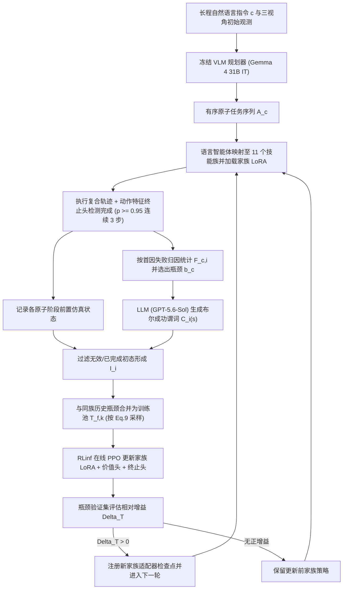

# SEES: A Self-Evolving Embodied System via Failure-Guided VLA Policy Adaptation

## 一句话定义

**SEES（Self-Evolving Embodied System）** 是一种面向长程机器人操作任务的失败驱动自演化系统，通过自动定位长程执行中的高频失败原子瓶颈、在仿真中恢复前置状态并由 LLM 合成稀疏成功谓词，利用在线 PPO 联合微调按技能族（skill family）共享的 VLA LoRA 适配器，从而在不额外采集专家示教的前提下实现跨任务的策略累积演进。

## 英文缩写速查

| 缩写 | 英文全称 | 简要说明 |
|---|---|---|
| SEES | Self-Evolving Embodied System | 本文提出的失败驱动、技能族级 VLA 自演化系统框架 |
| VLA | Vision-Language-Action | 视觉-语言-动作策略模型，输入多视角视觉观测与语言指令并输出控制动作 |
| VLM | Vision-Language Model | 视觉-语言模型；本文使用冻结的 Gemma 4 31B IT 进行长程任务分解 |
| PPO | Proximal Policy Optimization | 近端策略优化算法，本文基于 RLinf 实现对家族级 LoRA 适配器的在线更新 |
| LoRA | Low-Rank Adaptation | 低秩自适应微调；用于按技能族存储并更新 VLA 动作头增量参数 |
| SFT | Supervised Fine-Tuning | 监督微调；用于构建基础 VLA 策略及头部分割预训练基准 |
| GAE | Generalized Advantage Estimation | 广义优势估计，用于 PPO 训练中计算低方差优势函数 $\hat{A}_t$ |

## 为什么重要

1. **长程任务的“木桶短板”瓶颈**：现有 VLA 模型（如 GR00T N1.5、$\pi_0$、RLDX-1）受限于多阶段示教数据昂贵，预训练语料严重偏向单阶段短程技能。一旦某一高频原子技能薄弱，就会在多条不同长程任务中反复导致整体失败。
2. **摆脱部署后对人类专家示教的依赖**：DAgger/ThriftyDAgger 等人机介入式微调仍需要专家定位错误阶段并持续补录示范数据，机器人部署到家庭等真实环境后往往难以获得持续人工示教。
3. **跨任务正迁移优于孤立微调**：SEES 将具有共同能力需求的原子技能聚类为 11 个语义技能族并共享 LoRA 适配器，使得针对少数高频瓶颈的有限 RL 预算也能同时惠及未直接参与训练的同族技能乃至完全未见（unseen）复合任务。

## 核心信息

| 字段 | 内容 |
|---|---|
| 论文标题 | *SEES: A Self-Evolving Embodied System via Failure-Guided VLA Policy Adaptation* |
| 作者 | Ziwen Li, Hanlue Zhang, Zhenyang Ren, Tianyu Huang, Runqi Lin, Haoyu Wang, Zhengqing Gao, Yandong Guo, Fakhri Karray, Tongliang Liu, Chris Russell, Mingming Gong |
| 机构 | MBZUAI、悉尼大学（University of Sydney）、牛津大学（University of Oxford）、AI^2 Robotics、滑铁卢大学（University of Waterloo）、墨尔本大学（University of Melbourne） |
| 发表时间 | 2026-09-26（arXiv:2609.32698v1 `[cs.RO]`） |
| 论文链接 | [arXiv:2609.32698](https://arxiv.org/abs/2609.32698) / [arXiv HTML 全文](https://arxiv.org/html/2609.32698) |
| 项目与代码 | 截至 2026-11-27 论文正文及元信息未提供独立项目主页或公开 GitHub 代码仓库链接 |
| 清单分类 | `model.adaptation` |
| 来源条目 | `survey_ax_2609_32698` |
| 开源状态 | 未确认开源代码（文中说明底层强化学习管线基于 RLinf 搭建，附录 A 提及补充提示文档 `task_decomposition.md`） |

## 核心原理

SEES 围绕“执行与失败归因 → 瓶颈导向仿真 RL 构建 → 技能族共享适配器更新与验收”形成闭环自演化机制：

### 1. 长程任务分解、技能族路由与终止头归因（§3.1 & Appendix A–B）
- **VLM 计划分解与技能族映射**：给定长程指令 $c$ 及初始左/右/腕部三视角图像，冻结的 `Gemma 4 31B IT`（贪心解码）输出 JSON 格式有序原子指令序列 $\mathcal{A}_c$。随后语言智能体将每个原子任务 $i \in \mathcal{A}_c$ 路由到 11 个预定义语义技能族之一 $g(i)$（如开合铰接装置、操作家电、水池控制、抓取、容器内放置、平面放置、插入固定槽、关系整理、倾倒冲洗、目标导向导航）。同族任务共用动作头 LoRA 参数 $\phi_f$，未演化的技能族回退至基础 VLA 参数 $\theta$。
- **动作特征终止头与头参数预训练**：为避免频繁调用大模型判断子任务是否结束，SEES 在冻结基础 VLA 的动作 token 特征上外挂轻量两输出头（`LayerNorm → 512 维隐藏层 + GELU → 2 输出`，分别预测终止概率与归一化进度）。该头首先在示教数据上采用仅更新预测头的目标函数离线优化：
  $$\mathcal{L}_{\mathrm{head}} = 0.10\,\mathcal{L}_{\mathrm{term}}^{\mathrm{SFT}} + 0.05\,\mathcal{L}_{\mathrm{progress}}$$
  其中终止监督以标注完成帧 $c = L - 1$（或复合任务分段边界）为中心、在 32 帧窗口内采用线性上升的软目标及正样本权重动态裁剪至 $[1, 50]$ 的掩码二元交叉熵；进度监督为掩码 $L_1$ 回归。推理阶段，当连续 3 个环境步的预测终止概率 $\ge 0.95$ 时判定子任务完成，丢弃当前动作块剩余动作并切换至下一原子阶段。
- **首因失败归因与瓶颈选择**：若某原子阶段在步数上限前未触发终止信号或环境判定失败，则将该复合轨迹的失败归因于**首个阻塞继续执行的原子阶段**（下游被阻断阶段不计入）。每轮演化在每条复合任务 $c$ 中选取归因失败次数 $F_{c,i}$ 最高的阶段作为瓶颈：
  $$b_c = \arg\max_{i \in \mathcal{A}_c} F_{c,i}$$
  按每条复合任务单瓶颈的方式挑选，可防止训练预算被高频出现的少数任务垄断。

### 2. 瓶颈导向仿真 RL 任务构建（§3.2 & Appendix C.1–C.2）
- **前置状态收集与恢复**：在复合任务执行过程中（包括最终成功与失败的轨迹），系统在每个原子阶段开始前保存完整仿真状态、场景描述与任务依赖状态（如家电开关状态、计时器等）。构建针对瓶颈 $i$ 的 RL 任务时，无需重放前置阶段，直接恢复前置上下文即可从瓶颈起点开练。
- **LLM 自动生成成功谓词与稀疏奖励**：脚本将原子指令 $l_i$、相关物体/装置标识及仿真器状态查询接口文档填入模板，由 `GPT-5.6-Sol` 生成返回布尔值的 Python 成功检查函数 $C_i(s)$。剔除恢复失败或初始已满足 $C_i(s)$ 的样本后形成有效初态集 $\mathcal{I}_i$，定义 RL 任务：
  $$\mathcal{T}_i = (l_i, \mu_i^0, r_i), \qquad \mu_i^0 = \operatorname{Uniform}(\mathcal{I}_i)$$
  当 $C_i$ 连续 3 个环境步为真时，锁存成功标志 $S_{i,t}=1$，仅在首次确认完成时发放稀疏奖励：
  $$r_{i,t} = S_{i,t} - S_{i,t-1}$$
  注意在单阶段 RL 训练中由 $C_i$ 控制回合成功与终止；而在长程复合执行中则由学习得到的终止头控制阶段切换。

### 3. 技能族级 LoRA 演化与检查点注册（§3.3 & Appendix C.3–C.5）
- **历史任务混合采样**：第 $k$ 轮中，每个包含所选瓶颈的活跃技能族将其当轮瓶颈与历史各轮已选同族任务去重合并为训练池 $\mathcal{T}_{f,k}$。旧任务通过当前策略重新采样新轨迹而非回放旧轨迹，任务采样权重随有效初态数 $N_{i,k}$ 与时间衰减调整：
  $$w_{i,k} = \sqrt{N_{i,k}}\,2^{-(k - k_i^{\mathrm{first}})}, \qquad p_{i,k} = \frac{w_{i,k}}{\sum_{j \in \mathcal{T}_{f,k}} w_{j,k}}$$
- **参数化与多任务 PPO 目标**：仅对动作头线性层引入低秩增量 $W_f = W_0 + \frac{\alpha}{r} B_f A_f$，连同家族专属价值头与终止头构成可训练参数 $\phi_f$，冻结视觉-语言主干与其他家族适配器。对于基于流匹配（flow-based）的动作模型，PPO 概率比 $\rho_t(\phi_f) = \exp[\ell_t(\phi_f) - \ell_t(\phi_f^{\mathrm{old}})]$ 在采样的随机去噪转移路径上计算。总体 RL 目标结合裁剪 PPO、价值回归与基于 RL 成功信号辅助的终止头更新：
  $$\mathcal{L}_{\mathrm{RL}} = -J_f^{\mathrm{PPO}} + \mathcal{L}_V + 0.05\,\mathcal{L}_{\mathrm{term}}^{\mathrm{RL}}$$
- **验证门控与检查点注册**：每轮保存多个中间检查点（如每 10 步保存一次），在每项选中瓶颈任务的 5 个随机有效初态上各评估 5 次，计算相对于更新前策略的等权平均成功率增量 $\Delta_T^{(j)}$：
  $$j^* = \arg\max_{j \in \mathcal{C}} \Delta_T^{(j)}$$
  仅当 $\Delta_T^{(j^*)} > 0$ 时注册新检查点用于后续长程执行与下一轮演化，否则保留原家族策略（在 RoboCasa365 每轮中均能找到正增益检查点）。

## 流程总览

## 源码运行时序图

**不适用**（截至 2026-11-27，论文 arXiv:2609.32698 原文及元信息未提供公开可运行的官方源码仓库或项目主页，仅在正文及附录中说明了基于 RLinf 框架与 RoboCasa365 / LIBERO 环境的实验配置与提示工程细节，故无法核对实际代码入口与模块调用时序）。

## 实验与评测

### 1. RoboCasa365 长程与未见任务自演化（Table 1）
遵循 RoboCasa365 50 任务评测协议（Atomic 18 项、Composite-Seen 16 项、Composite-Unseen 16 项）；GR00T N1.5 与 RLDX-1 均从 Human300（65 原子 + 235 复合任务，每任务 100 条示教）SFT 检查点起步。每轮演化在 16 个 Composite-Seen 任务上各采集 50 条轨迹，并为每个活跃技能族分配 40 个外部 PPO 步（rank=64, $\alpha=128$, 32 并行环境, 全局 batch 240）：

| 模型 | 配置 | Atomic (%) | Composite-Seen (%) | Composite-Unseen (%) |
|---|---|---:|---:|---:|
| Diffusion Policy* | Base policy（原论文参考） | 15.7 | 0.2 | 1.3 |
| $\pi_0^*$ | Base policy（原论文参考） | 36.3 | 5.2 | 0.7 |
| $\pi_{0.5}^*$ | Base policy（原论文参考） | 39.6 | 7.1 | 1.2 |
| GR00T N1.5 | Base policy | 47.2 | 10.2 | 3.5 |
| GR00T N1.5 | SEES (execution only) | 47.2 | 9.5 | 4.7 |
| GR00T N1.5 | + 1 evolution round | **56.2** | 10.4 | 5.2 |
| GR00T N1.5 | + 2 evolution rounds | 54.5 | 11.3 | 5.7 |
| GR00T N1.5 | + 3 evolution rounds | 55.7 | **13.1** | **6.1** |
| RLDX-1 | Base policy | 66.4 | 20.4 | 6.0 |
| RLDX-1 | SEES (execution only) | 66.4 | 17.6 | 4.2 |
| RLDX-1 | + 1 evolution round | 68.5 | 19.9 | 5.5 |
| RLDX-1 | + 2 evolution rounds | 68.9 | 20.4 | 6.3 |
| RLDX-1 | + 3 evolution rounds | **70.3** | **21.8** | **7.1** |

- **执行切换的冷启动现象**：`execution only` 在 Composite-Seen 上低于直接端到端执行（GR00T 10.2%→9.5%，RLDX-1 20.4%→17.6%），原因在于部分分解后的原子指令在单阶段 SFT 数据中缺乏独立对应样本；经过三轮演化后两个基座在三项指标上均超越原 Base policy，且增益稳定外溢到未参与训练与选型的 `Composite-Unseen`。

### 2. LIBERO 四套件受限预算演进与同族迁移（Table 2 & Table 7）
以 RLinf 发布的 GR00T N1.5 SFT 为起点，将每个套件的 10 个任务视为单个技能族（共享 rank=8, $\alpha=8$ LoRA），仅在 3 轮内共投入 80（Object）或 96（Spatial/Goal/Long）个外部 PPO 步，每轮最多新增 3 个高失败率任务，在完全隔离的 15 个密封初态 × 5 推理种子（750 trials/套件）上评测：

| 套件 | 瓶颈任务组（初态 → 演化后） | 兄弟任务组（未参与 PPO） | 全套件总体成功率（初态 → 演化后） |
|---|---|---|---|
| LIBERO-Object | 59.24% → 82.86% | 82.22% → 93.33% | 66.13% → **86.00%**（496/750 → 645/750） |
| LIBERO-Spatial | 40.44% → 49.78% | 49.33% → 57.33% | 41.33% → **50.53%** |
| LIBERO-Goal | 39.11% → 56.15% | 85.33% → 89.33% | 43.73% → **59.47%** |
| LIBERO-Long | 58.22% → 62.96% | 88.00% → 89.33% | 61.20% → **65.60%** |
| 四套件平均 | — | — | 53.10% → **65.40%**（+12.30 pp） |

在 LIBERO-Object 细粒度结果（Table 7）中，全部 10 个任务均获得提升，其中 3 个从未进入 PPO 的兄弟任务同样显著受益：`Ketchup`（66.67%→86.67%，+20.00 pp）、`Butter`（90.67%→96.00%，+5.33 pp）、`Chocolate pudding`（89.33%→97.33%，+8.00 pp）。

### 3. 消融实验与模块审计（Tables 3–6）
- **家族共享 vs. 原子独立 LoRA（Table 3，5 个 pick-and-place 任务，3 瓶颈 + 2 兄弟，每适配器 40 步）**：

| 方法 | 瓶颈任务 (%) | 兄弟任务（未训）(%) | 总体平均 (%) |
|---|---:|---:|---:|
| Before RL | 62.7 | 75.0 | 67.6 |
| Atomic-specific LoRA | 70.7 | 72.0 | 71.2 |
| Family-level LoRA | **74.0** | **80.0** | **76.4** |

- **瓶颈选择策略对比（Table 4，`ScrubCuttingBoard`，50 个保留场景，2 轮 × 40 PPO 步）**：Base policy 为 `9/50 (18%)`；随机选择（R1 Release → R2 Navigate）为 `14/50 (28%)`；最高成功率阶段优先（R1 Pick up → R2 Release）为 `17/50 (34%)`；SEES 瓶颈选择（R1 Scrub → R2 Navigate，随首轮修复动态切换瓶颈）达到 **`32/50 (64%)`**。
- **终止头 vs. VLM 失败归因审计（Table 5，100 条复合轨迹 / 243 次原子尝试）**：`Terminate` 在 Outcome Macro-F1（**94.0%** vs. 59.9%）、误判成功率（**3.3%** vs. 17.7%）、终止时间绝对误差（**10.8** vs. 112.6 步）与首因失败归因准确率（**92.0%** vs. 45.0%）上均大幅优于本地部署的 `Qwen3-VL-32B-Instruct`。
- **LLM 成功谓词校验（Table 6，Atomic-Seen 900 条轨迹）**：`GPT-5.6-Sol` 生成谓词与 RoboCasa365 官方谓词的帧一致率达 **97.8%**、平衡准确率 **98.2%**、召回率 **96.4%**、回合级结果一致率 **95.9%**（18 个任务中有 13 个达 100% 回合一致）。

## 与其他工作对比

| 对比维度 | 传统人机介入（DAgger / ThriftyDAgger） | 独立技能适配器（CORAL / OrthoSkillVLA） | 通用自主数据收集（SOAR / RoboClaw） | **SEES（本文）** |
|---|---|---|---|---|
| 瓶颈发现方式 | 人工审阅失败轨迹与干预接管 | 依赖外部传入的新任务数据集 | 随机或可行性导向采集多样化经验 | **动作特征终止头自动统计首因瓶颈** |
| 参数共享与迁移 | 全模型微调，易受遗忘或成本高 | 技能/任务隔离防干扰，难以正向惠及兄弟任务 | 统一策略更新，未必聚焦阻塞短板 | **11 个语义技能族共享 LoRA，正迁移至兄弟与未见任务** |
| 奖励与环境构建 | 人工标注或示范监督 | 依赖既有奖励或示教数据 | 依赖预设任务与规则或世界模型 | **恢复前置仿真状态 + LLM 从 API 文档合成布尔稀疏奖励** |
| 适用阶段重点 | 部署前/早期人工辅助 | 持续学习防遗忘 | 广度经验扩张 | **固定有限 RL 预算下的长程短板定点突破** |

## 结论

**一句话总判：SEES 用“首因瓶颈定位 + 前置状态恢复 + 技能族共享 LoRA”证明了在极低在线 RL 预算下，无需新增专家示教也能撬动长程 VLA 策略及未见兄弟任务的系统级提升。**

1. **预算应砸在首因瓶颈而非均匀撒网** — 在 `ScrubCuttingBoard` 上，瓶颈轮转策略（R1 Scrub → R2 Navigate）将全任务成功率从 18% 拉升至 64%，远超随机选择（28%）与强项巩固（34%）。
2. **技能族参数共享带来显式正迁移** — 在匹配 40 步预算下，家族 LoRA 不仅把瓶颈成功率提得比独立 LoRA 更高（74.0% vs. 70.7%），还将未训练兄弟任务从 75.0% 提升到 80.0%（独立 LoRA 反而降至 72.0%）。
3. **策略原生轻量终止头显著优于 VLM 周期轮询** — 挂载在动作特征上的终止头将平均时序误差从 112.6 步压缩至 10.8 步，使长程失败归因准确率从 45.0% 跃升至 92.0%。
4. **验证门控是防止演化退化的必要保险** — 通过在独立验证初态上筛选 $\Delta_T > 0$ 的检查点并按指数衰减重采历史同族任务，避免单轮 PPO 更新破坏已有子技能。

## 工程实践

1. **VLA 适配超参参考**：
   - **RoboCasa365（含终止头联合微调）**：动作头 LoRA `rank=64`、`alpha=128`、`dropout=0`；actor 学习率 $6 \times 10^{-6}$、critic 学习率 $10^{-4}$、PPO clip $0.2$、$\gamma=0.99$、GAE $\lambda=0.95$、action chunk 16、去噪步数 4、720 步回合上限。
   - **LIBERO（纯行动策略演化）**：LoRA `rank=8`、`alpha=8`；actor 学习率 $5 \times 10^{-6}$、critic 学习率 $10^{-5}$，每轮前先执行 48 步 critic-only 预热再开启 actor 更新。
2. **状态恢复与稀疏奖励设计**：记录原子阶段入口前的仿真器物理快照与设备状态（开关、计时器等），先用生成谓词过滤“已意外满足目标”的初态，再要求 $C_i(s)$ 连续 3 步为真才锁存奖励，可显著减少物理抖动导致的虚假正奖励。
3. **真机扩展路径（§5）**：论文尚未开展真机闭环实验，但指出可将 URDFormer / ACDC / SplatSim / RE3SIM 等 real-to-sim 重建手段与运行日志结合，仅局部重建瓶颈子任务涉及的物体与交互界面来运行同套离线演化与硬件验收流程。

## 局限与风险

1. **长程分解带来的冷启动性能折损**：由于部分分解后的原子指令在原始 VLA 的单阶段 SFT 数据中从未单独出现，直接将连续策略切换为“分解+分段执行”会使 RoboCasa365 Composite-Seen 初始成功率下降（GR00T 10.2%→9.5%，RLDX-1 20.4%→17.6%），必须依赖后续 RL 演化弥补并反超。
2. **依赖可复原状态与可查询 API 的仿真器**：当前工作仅在 RoboCasa365 与 LIBERO 仿真器中验证；若迁移到真实世界部署，需要额外引入局部场景重建与位姿/动力学随机化来吸收重建误差。
3. **固定技能族划分与单一瓶颈假设**：目前 11 个技能族由人工预定义且路由结果随库版本缓存；若出现跨族新技能或同一阶段存在多模态失败耦合，固定路由与“每任务每轮仅选单一瓶颈”的策略可能受限。
4. **未公开源码的复现边界**：截至目前未确认官方完整训练/评估代码公开，复现需自行基于 RLinf 复现流匹配 PPO 似然重算及 RoboCasa365 局部状态快照逻辑。

## 关联页面

- [Agentic Robots 综述](paper-towards-agentic-robots-survey.md)
- [全量项目节点清单](../overview/awesome-agentic-robots-node-index.md)
- [VLA 方法背景](../methods/vla.md)
- [智能体机器人操作策略](../methods/agentic-manipulation-policies.md)：对照操作场景中的规划、执行与反馈接口
- [PPO（近端策略优化）](../methods/ppo.md)：本文在 RLinf 中用于在线更新家族共享 LoRA 适配器的核心强化学习算法
- [智能体规划与反馈机制](../methods/agent-planning-feedback.md)：对照长程任务分解、终止监控与失败归因闭环
- [机器人策略学习](../methods/robot-policy-learning.md)：基础 SFT 与在线 RL 后训练协同范式
- [机器人操作任务（Manipulation）](../tasks/manipulation.md)：RoboCasa365 与 LIBERO 评测聚焦的桌面与厨房长程操作场景

## 推荐继续阅读

- [SEES 原文（arXiv HTML）](https://arxiv.org/html/2609.32698)
- [RLDX-1 Technical Report（arXiv:2605.03269）](https://arxiv.org/abs/2605.03269)
- [GR00T N1: An Open Foundation Model for Generalist Humanoid Robots（arXiv:2503.14734）](https://arxiv.org/abs/2503.14734)
- [$\pi_{\mathrm{RL}}$: Online RL Fine-tuning for Flow-based Vision-Language-Action Models（arXiv:2510.25889）](https://arxiv.org/abs/2510.25889)

## 参考来源

- [SEES 原文核对归档](../../sources/papers/paper-agentic-2609-32698.md)
- [官方 Awesome 快照归档](../../sources/repos/awesome-agentic-robots-survey-index.md)
- [论文原始入口（arXiv:2609.32698）](https://arxiv.org/abs/2609.32698)
- [arXiv HTML 全文版本](https://arxiv.org/html/2609.32698)
