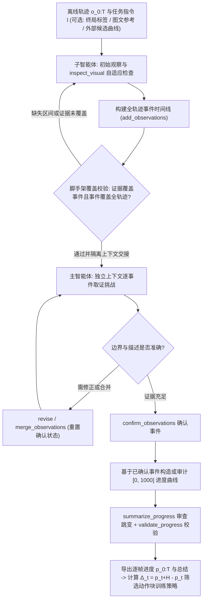
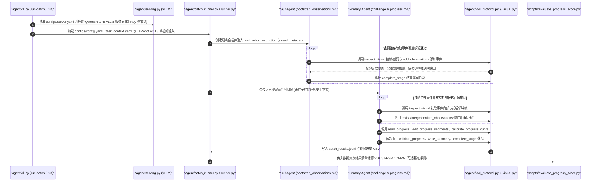

# ARS: Agentic Reward System for Robot Learning

## 一句话定义

ARS（Agentic Reward System）是一个面向通用视觉语言模型（VLM）的无训练进度奖励推理框架，通过「自适应视觉检查 + 跨上下文事件提案与独立验证 + 脚手架证据覆盖约束」从离线机器人轨迹中估计逐帧任务进度，并可用于筛选下游策略训练动作块或审计外部奖励曲线。

## 英文缩写速查

| 缩写 | 英文全称 | 简要说明 |
|---|---|---|
| ARS | Agentic Reward System | 本文提出的免奖励模型训练 Agentic 进度估计与审计推理框架 |
| VOC | Value-Order Correlation | 正确指令下预测进度与时间步之间的平均 Spearman 秩相关系数 |
| FPSR | False Progress Suppression Ratio | 错配指令轨迹中未出现严格正进度增量的时长占比，衡量虚假加分抑制能力 |
| CMPG | Correct–Mismatch Progress Gap | 正确指令终值进度均值减去错配指令峰值进度均值，衡量语义对齐区分度 |
| EPCR | Expert Progress Coverage Ratio | 正确指令专家轨迹中被有效正进度增量区间覆盖的时长占比 |
| BC | Behavior Cloning | 行为克隆，本文用于评测进度的二值加权动作块筛选策略学习 |

## 为什么重要

1. **推理流程结构对通用 VLM 的奖励能力起决定性作用：** 先前研究常表明专用机器人奖励模型强于直接提示的通用 VLM；ARS 在不训练任何奖励模型参数的情况下，仅通过结构化工具检查与跨上下文复核就让通用 `Qwen3.6-27B` 在语义错配与下游策略学习上显著超越多种专门训练的奖励模型。
2. **揭示既有奖励模型的「时空相关性 ≠ 指令语义对齐」盲区：** 本文构造的 ManiSkill 语义错配基准证明，即便在仅有两件物体、平均 31.7 帧的简单桌面抓取放置场景中，多个基线仍会因机械臂动作流畅而给「操作错误物体」打出高进度（如 Robometer 的 VOC 达 0.983 但 FPSR 仅 0.240）。
3. **打通真实工业产线混合质量经验的高效利用：** 在洗衣机背板多螺钉拧紧的实验室产线复现平台上，直接混入全部离线 rollout 会把 demo-only BC 成功率从 58.0% 拉低至 50.5%，而用 ARS（辅以无数值标注的图文参考例）筛选正增量片段可将 $\pi_{0.5}$ 策略成功率提升至 81.5%。

## 核心信息

| 字段 | 内容 |
|---|---|
| 作者 | Sheng Hu、Weiyi Lu、Lingbing Zeng、Gan Weng、Weiwei Zhang、Kai Xie、Xiaofeng Mou、Yi Xu |
| 机构 | AIRC, Midea Group（美的集团人工智能研究院） |
| 发表时间 | 2026-09-28（arXiv v1） |
| 论文链接 | [arXiv:2609.34484](https://arxiv.org/abs/2609.34484) / [HTML v1](https://arxiv.org/html/2609.34484) |
| 项目与代码 | [midea-ai/ars](https://github.com/midea-ai/ars) |
| 清单分类 | `data.annotation, data.refinement` |
| 来源条目 | `survey_ax_2609_34484` |
| 开源状态 | **已开源** ARS 完整推理引擎（`agent/`）、配置文件（`configs/`）、正反单视频样张（`examples/`）及 ManiSkill 语义错配基准转换/评测脚本（`scripts/`）；下游 $\pi_{0.5}$ 微调与真机控制训练代码未随该仓发布 |

## 核心原理

给定离线轨迹 $\tau = (\mathbf{o}_{0:T}, \mathbf{a}_{0:T-1}, l)$ 与任务指令 $l$，ARS 输出归一化逐帧任务进度 $p_{0:T} = f(\mathbf{o}_{0:T}, l) \in [0, 1]^{T+1}$（工具内部采用整数区间 $[0, 1000]$）。其核心由四大机制与下游策略筛选接口组成：

1. **自适应视觉检查（Adaptive Visual Inspection）：** 整段长视频一次性输入模型易遗漏瞬态变化或混淆失败与成功尝试。两阶段智能体均通过 `inspect_visual` 按当前未决问题指定时间窗、调整抽帧密度及可选空间裁剪，且支持向后读取后续观测（例如通过后续「物体被抬离桌面」的帧来回溯确认早期抓握是否真正成功）。
2. **基于可编辑事件时间线的推理与脚手架约束：** 轨迹被结构化为事件时间线（工具中称 `observations`），每条事件绑定起止帧区间、视觉描述、引用证据 ID 与 1–5 级置信度。脚手架（harness）强制执行硬性检查：
   - **证据覆盖约束：** 创建或修改事件时，引用证据必须完整覆盖该事件的起止帧区间。
   - **全轨迹覆盖约束：** 事件提案阶段在提交完成前必须覆盖 $[0, T]$ 全长，缺失区间会被拦截并退回补齐。
3. **跨上下文独立验证（Cross-Agent Verification）：**
   - **子智能体（提案阶段）：** 在独立上下文中浏览视频并生成初始事件时间线。
   - **主智能体（验证与估计阶段）：** 在**隔离的新推理上下文**中仅接手提案时间线（不继承子智能体的全部工具交互历史，在 LIBERO-Long 上将单次查询平均输入 token 从 57.6K 降至 41.4K），将其视为待质疑声明。主智能体必须重新采集覆盖事件内部及前后邻域的视觉证据，才允许调用 `confirm_observations`；一旦调用 `revise_observations` 或 `merge_observations` 修改边界或描述，原确认状态立即失效并须重新取证确认。
4. **基于已确认事件的进度构造与辅助信号融合：**
   - 主智能体结合已验证事件调用 `edit_progress_segments`（支持分段线性插值上升、状态保持平台及失误回退下降）与 `calibrate_progress_curve`（两锚点全局仿射校准），并用 `read_progress` / `summarize_progress` 审查曲线跳变位置与幅度，最后按 `validate_progress` → `write_summary` → `complete_stage` 顺序导出。
   - **三种可选扩展模式：** （a）接入轨迹级终局成败标签锚定终点完成度，但中间段落仍保留局部失误回退与失败轨迹中的有效子段；（b）接入无数值进度标注的正/负图文上下文参考例澄清任务标准；（c）审计外部奖励模型（如 Robometer）生成的候选进度曲线，仅针对证据不足的区间进行定向修正。
5. **进度引导的策略学习（二值加权行为克隆）：** 对步长为 $H$ 的动作块计算进度差 $\Delta_t = p_{t+H} - p_t$ 与筛选指示 $I_t = \mathbb{1}[\Delta_t > \epsilon(p_t)] \in \{0, 1\}$，最小化筛选后的行为克隆损失：
   $$\mathcal{L}_{\mathrm{BC}}(\theta) = \frac{1}{\sum_{\tau\in\mathcal{D}}\sum_t I_t}\sum_{\tau\in\mathcal{D}}\sum_t I_t \,\ell_{\mathrm{BC}}(\theta; \mathbf{o}_t, l, \mathbf{a}_{t:t+H-1})$$
   其中仿真对比统一采用零阈值 $\epsilon(p_t)=0$；真机混入全量演示数据时采用分阶段阈值，将 $[0, 1]$ 划分为 $B=8$ 个等宽进度桶，每桶仅保留 $\Delta_t$ 排名前 $\alpha=30\%$ 的 rollout 动作块并与演示按 1:1 分层采样。

## 流程总览

## 源码运行时序图

复现主路径通过 `python -m agent.cli run-batch`（搭配 `--lerobot-root`、`--config configs/config.yaml` 及可选 `--start-server configs/server.yaml`、`--proposal-batch-results` 或 `--num-nodes`）驱动 `agent/batch_runner.py`（或 `agent/ray_batch_runner.py`）读取 LeRobot v2.1 Parquet 轨迹；单视频快速调试可通过 `python -m agent.cli run` 直接运行 `examples/inputs/` 下的匹配/错配样例；核心工具约束、视觉裁剪与进度曲线校验均由 `agent/tool_protocol.py`、`agent/visual.py`、`agent/progress.py` 与 `agent/schemas.py` 强制执行。

## 实验与评测

### 1. 语义错配基准（ManiSkill 两物体 Pick-and-Place，Table 1 & Table 10）

基于改造版 `RL4VLA` 采集 25 类物体、500 对轨迹（1,000 个样本，平均 31.7 帧），每条正确执行视频配对「正确指令」与「指向场景中另一未接触物体的错配指令」：

| 类别 | 方法 | VOC ↑ | FPSR (η=0) ↑ | CMPG ↑ | 备注（Table 10 / Appendix C） |
|---|---|---|---|---|---|
| 专用奖励训练 | LRM | 0.828 | 0.893 | 0.373 | 11 档离散输出，EPCR 仅 0.159 |
| 专用奖励训练 | R²VLM | 0.916 | 0.184 | -0.050 | 错配指令峰值均值高于正确终值均值 |
| 专用奖励训练 | SOLE-R1 | 0.902 | 0.361 | 0.266 | 双视角输入（主视角+腕部视角） |
| 专用奖励训练 | Robometer (4B) | 0.983 | 0.240 | 0.366 | 曾暴露于 ManiSkill (FAILSafe)，EPCR 0.978 |
| 外部曲线审计 | **ARS w/ Robometer proposal** | 0.988 | 0.915 | 0.891 | Qwen3.6-27B 审计修正，EPCR 0.899 |
| 免奖励训练 | TOPReward + Qwen3-VL-8B | 0.930 | 0.368 | 0.685 | 概率尺度 CMPG 0.685（线性尺度 0.190） |
| 免奖励训练 | TOPReward + Qwen3-VL-32B | 0.945 | 0.383 | 0.756 | 概率尺度 CMPG 0.756（线性尺度 0.129） |
| 免奖励训练 | **ARS + Qwen3.6-27B** | **0.995** | **0.918** | **0.904** | **三项指标均居首**，EPCR 0.908 |

### 2. 仿真长程策略学习（LIBERO-Long，Table 2 & Table 13）

使用固定行为策略采集 4,096 条混合质量轨迹（2,204 成功 + 1,892 失败，平均 390.3 帧），统一从 $\pi_{0.5}$ 预训练权重出发，以 $H=10$、零阈值 $\Delta_t > 0$ 筛选动作块训练 30k 步（3 种子均值±标准差，每检查点 1,000 次评测）：

| 类别 | 方法 | 峰值成功率 (%) ↑ | 相对 Vanilla BC (pp) | 保留动作块比例 (%) | 30k 末检查点 (%) |
|---|---|---|---|---|---|
| 基线 | Vanilla BC | 44.2 ± 0.3 | — | 100.0 | 40.1 ± 1.8 |
| 专用奖励训练 | LRM | 38.6 ± 0.5 | -5.6 | 13.7 | 36.8 ± 1.5 |
| 专用奖励训练 | R²VLM | 41.5 ± 0.4 | -2.7 | 13.6 | 34.1 ± 1.1 |
| 专用奖励训练 | SOLE-R1 | 44.8 ± 0.4 | +0.6 | 52.6 | 40.4 ± 2.8 |
| 专用奖励训练 | Robometer | 46.8 ± 0.9 | +2.6 | 89.5 | 42.1 ± 2.3 |
| 免奖励训练 | TOPReward + Qwen3-VL-8B | 43.1 ± 0.5 | -1.1 | 77.0 | 37.9 ± 2.5 |
| 免奖励训练 | TOPReward + Qwen3-VL-32B | 47.6 ± 0.7 | +3.4 | 67.9 | 40.5 ± 2.9 |
| 免奖励训练 | **ARS + Qwen3.6-27B** | **57.9 ± 0.4** | **+13.7** | 66.9 | **51.6 ± 1.4** |
| 终局结果标签 | Success-only BC | 52.6 ± 0.7 | +8.4 | 38.5 | — |
| 终局结果标签 | **ARS + outcome** | **62.2 ± 0.6** | **+18.0** | 60.3 | — |
| 特权仿真状态 | Privileged progress | 66.5 ± 0.8 | +22.3 | 57.2 | — |

### 3. 工作流、基础模型与思考模式消融（Table 3, Table 4, Table 14–17）

1. **组件与上下文隔离消融（LIBERO-Long, Qwen3.6-27B, Table 4）：**
   - 仅整视频提案且无检查与验证：`45.4 ± 0.3%`（7.3 次查询 / 242.7K 输入 token）。
   - 加入自适应检查但无验证：`52.3 ± 0.8%`（10.2 次查询 / 413.2K 输入 token）。
   - 同上下文自我验证（无隔离）：`51.8 ± 0.5%`（19.0 次查询 / 1,097.2K 输入 token）。
   - **完整跨上下文 ARS：** `57.9 ± 0.4%`（**24.9 次查询** / **980.6K 输入 token** / **21.1K 输出 token**），相对单上下文自我验证高出 **6.1 个百分点**；相比 TOPReward-32B 减少 **93.6% 查询次数**与 **65.8% 累计输入 token**。
2. **小参数模型与单提示基线对比（Table 3 & Table 16）：** 4B 参数量级下，`ARS + Qwen3.5-4B` 在语义错配基准达 `0.986 / 0.625 / 0.633`，超越 `Robometer-4B`（`0.983 / 0.240 / 0.366`）；而同一 `Qwen3.6-27B` 用 GVL 式单轮提示在错配基准仅 `0.637 / 0.900 / 0.354`，在 LIBERO-Long 上时序与打乱提示仅分别达 `0.0%` 与 `34.1 ± 1.1%`。
3. **显式语言 CoT 思考模式（Table 17）：** 关闭 `Qwen3.6-27B` thinking 模式后，ARS 在 LIBERO-Long 仍取得 `55.4 ± 0.7%`（仅比开启后的 `57.9 ± 0.4%` 低 2.5 个百分点），表明可编辑事件时间线与证据链接已承担了关键的中间推理状态维护。

### 4. 真机工业装配验证（洗衣机背板三螺钉拧紧，Table 5 & Appendix G.3）

在全尺寸工业洗衣机装配线实验室复现平台上（2,574 条演示 + 3,092 条混合质量 rollout，$\pi_{0.5}$ 初始化，$H=50$，200k 步，$B=8$、$\alpha=30\%$ 分阶段阈值，每组单种子评测 200 次完整三螺钉装配）：

| 配置 | 成功率 (%) ↑ | 说明 |
|---|---|---|
| Demo + all rollouts BC | 50.5 | 未经筛选的混合质量 rollout 明显污染策略 |
| Demo-only BC | 58.0 | 仅用专家演示 |
| ARS（无参考） | 72.0 | 相对 Demo-only 提升 +14.0 pp |
| **ARS + 视觉参考（2 正例 + 1 负例）** | **81.5** | **相对 Demo-only 提升 +23.5 pp** |
| ARS + 视觉参考 + outcome（Appendix G.3） | 84.0 | 相对 81.5% 在 Fisher 精确检验下不显著（$p=0.597$） |

## 与其他工作对比

| 对比维度 | ARS（本文） | Robometer | TOPReward | R²VLM / SOLE-R1 | LRM |
|---|---|---|---|---|---|
| **训练需求** | **免奖励模型训练**（通用 VLM 推理） | 需在 RBM-1M 上训练 4B 对比奖励模型 | 免训练（利用 VLM `True` token 对数概率） | 需专项时空/CoT 推理微调 | 需训练 11 档离散进度模型 |
| **视觉与上下文机制** | 子智能体提案 + **跨上下文独立检查与重验证** | 固定 8 帧采样单次前向预测 | 对所有前缀帧逐帧前向查询 | 单上下文循环/逐帧 CoT 推理 | 单帧/序列离散进度分类 |
| **语义错配表现 (FPSR / CMPG)** | **0.918 / 0.904** | 0.240 / 0.366 | 0.383 / 0.756（32B 概率） | 0.184 / -0.050 与 0.361 / 0.266 | 0.893 / 0.373（EPCR 仅 0.159） |
| **LIBERO-Long 策略成功率** | **57.9%**（+outcome **62.2%**） | 46.8% | 47.6%（32B） | 41.5% / 44.8% | 38.6% |
| **推理成本与延迟定位** | 单次评估约 24.9 次查询 + 21.1K 输出 token，**适合离线筛选与审计** | 单次前向极快，适合在线高频打分 | 每帧前缀查询（390.3 次查询、2.87M 输入 token），输入开销大 | 逐时间步生成 CoT | 单次前向，但大量零增量（76.7%） |

## 结论

**一句话总判：在进度奖励建模中，让通用 VLM 在隔离上下文中用工具主动查证并修正结构化事件时间线，比把全部帧一次性塞给模型或单纯做奖励模型微调更能同时保住语义对齐与局部回归刻画。**

1. **高 VOC 不能代表指令对齐：** Robometer 在错配基准上 VOC 高达 0.983，但 FPSR 只有 0.240；评测与选型必须同时看错配抑制（FPSR/CMPG）和正样本覆盖（EPCR），避免模型给「流畅但做错目标」的轨迹打高分。
2. **上下文隔离验证是长程任务提效关键：** 将提案与核验拆进两个独立上下文不仅避免同一会话惯性（比单上下文自我验证在 LIBERO-Long 高 +6.1 pp），还把主智能体每次查询平均输入 token 压缩了 28.1%。
3. **ARS 最务实的落地定位是「离线数据策划 + 外部奖励审计器」：** 在真机混合质量数据中仅靠 ARS 筛选配合 3 张无数值图文参考即可把成功率从 58.0% 推高至 81.5%；同时 ARS 能把 Robometer 的错配 FPSR 从 0.240 审计修复到 0.915，适合离线产出高纯度监督信号再蒸馏给轻量级在线模型。

## 工程实践

1. **推理部署与数据集接入：** `midea-ai/ars` 默认采用 Python 3.11 + `vLLM 0.19.1`（`Qwen3.6-27B` 在 96 GiB VRAM GPU 测试），需确保 vLLM 的 `--allowed-local-media-path` 覆盖运行输出目录或父目录以便读取局部裁剪图；批量输入要求 **LeRobot v2.1** 格式（包含 `meta/info.json` 与 Parquet 内 `image` 特征）。
2. **动作块筛选超参数选择：** 若下游直接基于纯离线 rollout 对比或无额外专家示范保底，宜采用保守的零阈值 $\epsilon(p_t)=0$（避免高阈值丢掉慢速但必需的过渡动作）；若保留全量高质量示范作为保底（如真机 1:1 演示/rollout 分层采样），则推荐使用分阶段分桶阈值（如 $B=8, \alpha=30\%$）防止前期高增幅阶段主导采样。
3. **少量低成本辅助先验的优先级：** 当任务含难以仅凭指令文本界定的验收标准（如螺钉紧固到位或卡死状态）时，优先补充少量正/负无数值图文参考（真实产线实验使成功率由 72.0% 升至 81.5%），其收益往往比仅加二值终局标签更明显；多机批量跑分可使用 `--num-nodes` 配合共享文件系统走 Ray 分布式调度。

## 局限与风险

1. **离线非因果与推理开销限制：** ARS 依赖事后回顾帧消除局部歧义且需多轮工具生成推理，单轨迹平均产生 21.1K 输出 token，不适合直接部署在毫秒级闭环控制或在线 RL 实时打分链路中。
2. **基础模型工具合规与精细边界误差：** Appendix F.1 显示 `Qwen3-VL-4B-Instruct` 因无法遵守工具/脚手架约束未能跑通 ARS，`Qwen3.5-4B` 在 LIBERO-Long 上仍有 0.81%（33/4096）运行失败；Appendix B 也表明即便 `Qwen3.6-27B` 经独立核验后，细微旋钮接触起点仍可能提前约 10 帧。
3. **数据规范化与基准单种子局限：** 外部曲线审计仅支持已归一化至 $[0, 1]$ 且逐帧对齐的 `batch_results.jsonl` 清单输入；真机实验因测试成本高昂仅使用 1 个训练种子评估 200 次试验，未能度量跨随机种子的训练方差。

## 关联页面

- [Agentic Robots 综述](paper-towards-agentic-robots-survey.md)
- [全量项目节点清单](../overview/awesome-agentic-robots-node-index.md)
- [VLA 方法背景](../methods/vla.md)
- [机器人策略学习流程](../methods/robot-policy-learning.md)
- [机器人智能体脚手架（Agent Harness）](../methods/robot-agent-harness.md)
- [智能体工具调用接口（Agent Tool-Use Interface）](../methods/agent-tool-use-interface.md)
- [行为克隆（Behavior Cloning）](../methods/behavior-cloning.md)
- [动作块预测（Action Chunking）](../methods/action-chunking.md)
- [机器人学习数据流水线](../methods/robot-learning-data-pipelines.md)
- [自动标注流水线（Auto-Labeling Pipelines）](../methods/auto-labeling-pipelines.md)
- [机器人操作任务（Manipulation）](../tasks/manipulation.md)
- [Robometer 论文实体](paper-robometer.md)
- [TOPReward 论文实体](paper-topreward.md)
- [π0.5 开放世界 VLA 论文实体](paper-pi05-open-world-vla.md)
- [LIBERO 基准测试集](libero-benchmark.md)
- [ManiSkill3 GPU 并行仿真平台](paper-notebook-maniskill3-gpu-parallelized-robotics-simulation.md)

## 推荐继续阅读

- [arXiv:2609.34484 论文 HTML 原文](https://arxiv.org/html/2609.34484)
- [ARS 官方 GitHub 仓库（midea-ai/ars）](https://github.com/midea-ai/ars)

## 参考来源

- [ARS 原文核对归档](../../sources/papers/paper-agentic-2609-34484.md)
- [midea-ai/ars 官方代码核查](../../sources/repos/paper-agentic-2609-34484.md)
- [官方 Awesome 快照归档](../../sources/repos/awesome-agentic-robots-survey-index.md)
- [arXiv:2609.34484 论文原文](https://arxiv.org/abs/2609.34484)
- [ARS 官方仓库主页](https://github.com/midea-ai/ars)
